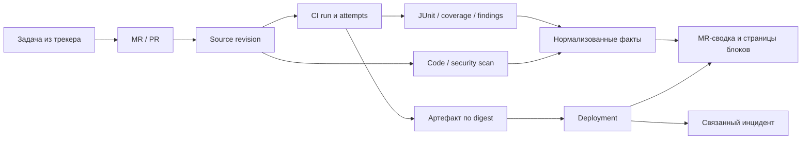

# Модель данных и правила измерения

Модель связывает шесть блоков, сохраняет наблюдаемые факты и версии расчёта. Основные сценарии работы описаны в [видении](../vision.md), полный перечень показателей - в [метриках](../metrics.md).

## Общие сущности и данные

| Сущность | Минимальные поля | Почему нужна отдельно |
|---|---|---|
| Organization/project/component/service | Stable ID, source coordinates, paths, owner group, mapping version | Repo не всегда равен сервису; service может собираться из нескольких repositories |
| Source revision / MR | Provider+instance+repo ID, source SHA, target SHA, merge-base, head kind, PR/MR ID | Предотвращает сравнение разных версий и потерю контекста при force-push |
| Pipeline/run/job/attempt | External IDs, definition version, context, native/normalized statuses, dates, runner/matrix/shard | Retry и параллельные jobs не смешиваются |
| Analysis execution / report | Tool/version, rule/config/scope hash, source SHA/artifact digest, start/end, exit class, scanned/skipped targets, completeness | «Ноль findings» возможен только при известном успешном выполнении scope |
| Finding occurrence | Native/canonical IDs, rule/class/kind, location/package, severity/confidence, lifecycle, evidence refs | Counts без детальных findings не дают new/resolved и объяснения |
| Test case/config/execution | Stable case ID, suite version, params, env fingerprint, outcome, duration, attempt | Один тест в разных matrix env не ошибочно flaky |
| Coverage fact | File/range, covered/executable units, kind, producer, SHA | Общая, patch, line, branch и block coverage различаются |
| Package/SBOM | PURL/version/ecosystem, dependency relations, source/build/digest, completeness, DB snapshot | Новые CVE можно сопоставлять с уже известной версией |
| Artifact/deployment | Immutable digest, source/build refs, service/environment, dates, outcome, release/rollout ID | Проверили и выпустили одну и ту же версию либо видим разрыв |
| Decision/exception/policy | Actor, reason, scope, expiry, authority, policy version, evidence time | Accepted risk не теряется и не становится fixed |
| Link | From/to, source, method, confidence, valid interval, actor | Угаданная связь задачи и MR не выдаётся за подтверждённую |
| Import ledger | Cursor, page bounds, rate limit/backfill status, event time/ingested time, completeness | Можно объяснить неполную историю и восстановиться после пропущенного webhook |

## Общие правила измерения

### Состояния данных

Различаем полноту расчёта и статистическую надёжность: точный count на маленькой выборке возможен; генеральная оценка по нему ненадёжна.

| Состояние | Когда применяется | Пример |
|---|---|---|
| `ASSESSED` | Формула рассчитана на полном определённом наблюдаемом scope | 9 successful из 10 eligible runs; рядом n=10 и low sample confidence |
| `PROVISIONAL` | Есть пригодная часть scope/новый несопоставимый метод | Скан проверил 2 из 3 языков; результат относится к двум |
| `BOUNDED` | Обоснованы только верхняя/нижняя границы | История attempts усечена, известно минимум 12 job-min retries |
| `NOT_EVALUATED` | Нет настроенного источника или запуск не выполнялся | Coverage report не публикуется |
| `UNKNOWN` | Источник ошибся/данные повреждены, результат не определяется | API 403/timeout или malformed report; reason code сообщает конкретную причину |
| `NOT_APPLICABLE` | Известно, что объект/знаменатель отсутствует | В MR нет изменённых executable lines: patch coverage неприменима |

Permission-related UX может использовать reason `AUTH_REQUIRED`, но не превращает source failure в ноль. На сайте показываем текущую попытку и последний хороший snapshot раздельно: старый результат не становится актуальным автоматически.

### Паспорт каждой метрики

Минимум: stable metric ID+version, name/decision, object scope, source mode, unit, exact formula, numerator/denominator, exclusions, event/cohort/window/timezone, filters/slices, sample size, missingness, source/rules/config versions, last updated, value bounds/confidence, threshold+policy origin, drilldown query.

Начальная нормализация не стирает исходные единицы. Severity с mapping-version отображается вместе с native severity. Неизвестный confidence не получает значение «high». Экспериментальные веса не экспортируются как доказанная модель риска.

Стартовые percentiles: nearest-rank `sorted[ceil(p*n)-1]`, при n=0 результата нет; при малой выборке n<20 пометка. Это единый проектный выбор, не требование DORA. Для сравнения cohorts нужны одинаковые определение, scope, versions и сопоставимый процесс. Итоги нескольких сервисов не усредняют их проценты: агрегируем числители и знаменатели только если семантика совместима.

### Delta и причины изменений

Для каждого сравнения различаем: code changed, dependency changed, rules changed, DB changed, scope changed, source recovered/lost, identity uncertain. Наличие нового advisory на прежнем digest - новая известная проблема, но не новый дефект, внесённый автором последнего MR. Обновление анализатора может менять counts без изменения исходников.

Сравнение head и base допускается только при совпадающем profile и достаточном scope; если baseline отсутствует, выполняем безопасный baseline run либо показываем `newly_observed`. Находка считается resolved только после полного сопоставимого scan; отсутствие отчёта не означает исправление.

### Единая ответственность за факты

Есть один canonical finding/coverage/deployment record, несколько представлений. C28 и I27 - один показатель patch coverage с aliases; S40 и I45 используют одни release decisions. В итоговом представлении не складываем alias-метрики и не удваиваем одну причину риска. Security finding может быть виден в MR и безопасности, но occurrence остаётся один.

## Связь с управлением задачами и качеством выпуска

| Технические данные | Минимальный контракт | Использование в управлении задачами и качеством выпуска |
|---|---|---|
| MR↔task link | Canonical IDs, method explicit/key/webhook/guess, confidence и timestamps | Как считать связность задач, какие типы задач участвуют |
| Check completion | Name, kind, scope, SHA/digest, status, time, completeness, policy version | Как эти проверки входят в DoD команды; manual criteria не угадываются |
| Finding и решение | Kind, severity, first seen/verified fixed, evidence, accepted/FP и expiry | Как формировать технические задачи и показать возвраты/качество |
| Pipeline timeline | Stable run/attempt, source SHA, status и причины | Как связать технические задержки с task stage; не весь task cycle time равен CI wait |
| Deployment | Service/environment/release/digest/source refs, outcome и время | Что считается выпуском задачи/эпика и как оформляется дефект после выпуска |
| Technical initiative facts | Comparable before/after slices, versions, sample/missingness | Инициатива, бизнес-срез, размеры задач и предсказуемость |

На границе нужен один владелец canonical task identity и один link-service. Пример: строка `PAY-17` - недостаточная глобальная identity, если подключены две Jira с одинаковыми ключами. Namespace включает provider instance+project+external ID. Доступ к задаче не даёт автоматически права читать private code/security evidence.

## Три слоя ответственности

| Слой | За что отвечает | Пример | Что получает клиент |
|---|---|---|---|
| Коннектор | Доступ и сохранение фактов API/файла в разрешённом scope | Jira changelog, Confluence versions, GitLab reviews | Manifest возможностей, курсор, freshness, ссылки |
| Штатный движок CraftPulse | История, семантика, детекторы, расчёты, evidence graph | WIP на дату, broken anchors, target cohorts | Готовая методика, reproducible calculation, findings |
| Продуктовый сценарий | Понятный вопрос и действие в рабочем месте | Просроченный task с MR без reviewer | Панель/карточка, owner действия, доказательства |

Инструмент анализа может быть внешним: Vale/lychee/oasdiff и движки [кода](code.md) и [безопасности](security.md). Штатность заключается в поддерживаемой поставке/обновлениях и согласованной методике. Import-only режим тоже полноценный путь для крупных клиентов с внутренней платформой.

## Единый контракт метрики

Минимальные поля: `metric_id`, `definition_version`, `mapping_version`, scope, entity/time cohort, event-time range, as_of, timezone/calendar, value/unit, numerator/denominator, sample_size, exclusions, missing_counts, data_state, source watermark, provenance/query hash. Для percentile - estimator; для target - его версия и база; для forecast - backtest и assumptions.

Состояния данных определены [выше](#состояния-данных); размер выборки и статистическая уверенность хранятся отдельно от полноты наблюдаемого scope. Формат API сохраняет те же определения; изменение перечислений и семантики требует совместимой версии или миграции.

Качество источника, качество результата и уверенность AI - разные оси. Не перемножаем их в скрытый общий score. Например «8 задач старше target, coverage start=74%» полезнее «качество потока 61».

## Условия корректного релиза

Изоляция tenants и source permissions; secrets в credential store; least-privilege scopes; sandbox сканеров/документационных checks; удаление/revocation; idempotent ingestion; versioned mapping; полные checkpoints и data retention.

Default advisory. Наличие UNKNOWN не блокирует merge, если команда не выбрала обязательную capability. Для жёсткого gate нужны ясные verified rules и осмысленный bypass с owner/reason/expiry. Рекомендация модели никогда сама не становится mandatory gate.
