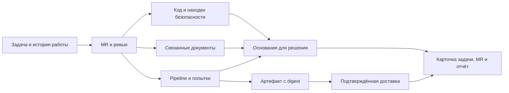

# Видение craftPulse

craftPulse - B2B-платформа аналитики разработки. Она собирает историю задач, Git и MR, результаты CI, находки анализаторов и связанные документы. По этим данным руководитель понимает, как движется работа, PM разбирает задержку конкретного обязательства, техлид выбирает действие по изменению, разработчик получает объяснённый сигнал в MR.

Основной сегмент - российские компании с 10-100 инженерами без собственной аналитической платформы. Для крупной компании craftPulse работает поверх её инструментов через API, импорт и runner внутри согласованного контура. Трекер, Git-хостинг, анализатор и wiki остаются местами ведения работы; craftPulse связывает их результаты и сохраняет историю для воспроизводимых расчётов.

M0, M1 и M2 задают последовательность реализации. Подробные сквозные механики описаны в [сценариях](scenarios.md).

## Какую работу выполняет продукт

Руководитель выбирает период и команду, видит вход и выход потока по местной размерности задач, незавершённую работу, превышения согласованных сроков и полноту источников. Из изменения графика он переходит к задачам, их интервалам и связанным MR. Подготовка отчёта перестаёт зависеть от новой ручной выгрузки на каждый вопрос.

PM видит историю обязательства: исходный план, добавления и снятия, состояние задачи в трекере, ожидание ревью и исходы проверок. Подключение второго трекера даёт общий список с подтверждёнными зеркалами и видимыми конфликтами. Закрытая задача, слитый MR и доставка в production отображаются как отдельные события.

Техлид получает сводку конкретного MR: новые находки на сопоставимой базе, изменения структуры кода, попытки CI, доступное покрытие и открытые исключения. В дальнейшем к ней добавляются обязательства по документации и подтверждение готовности выпуска. Каждое предупреждение ведёт к правилу, версии, исходному отчёту и возможному действию.

Владелец сервиса разбирает документацию по назначению: где инструкция запуска, кому принадлежит runbook, какие ссылки сломаны, соответствует ли опубликованный комплект нужной версии. Общий балл документации не заменяет эти проверки.

## Шесть связанных блоков

| Блок | Что наблюдаем | Как используется результат |
|---|---|---|
| Задачи | Начало и завершение работы, WIP, блокировки, размер, план, возвраты и обязательства DoD | Ежедневный отчёт, список застрявших задач, проверка исходного плана |
| Активность | События проекта, очередь MR, человеческие ответы, подтверждённые связи | История на дату и разбор ожидания между участниками |
| Код | Структура функций, копии, находки, изменения файлов и история касаний | Разбор нового MR и выбор работы по техдолгу |
| Безопасность | Области проверок, уязвимые зависимости, потенциальные секреты, находки и исключения | Триаж проблем и проверка того, что нужная версия действительно проверена |
| CI/CD | Запуски и попытки, тестовые результаты, покрытие, артефакты и доставка | Объяснение зелёного pipeline, повторов, неполных проверок и выпуска |
| Документация | Документы и владельцы, ссылки, API-спецификации, review и связи с сервисом | Исправление конкретных пробелов; позже - docs impact и передача сервиса |

Общий объект может участвовать в нескольких представлениях. Patch coverage из блоков кода и CI - один факт. Принятое исключение безопасности и решение о bypass выпуска тоже не складываются в два независимых риска. Связи имеют тип: «реализует», «документирует», «блокирует», «проверено», «доставлено», «зеркало».

Стрелка появляется при наличии подтверждённой связи. Пробел остаётся видимым: например, задача может быть завершена без известного MR, а артефакт собран без данных о production. Рядом с выводом показывается, какая часть выбранной работы связана с кодом и проверками.

## Путь команды: от подключения к первому отчёту

### 1. Выбрать область и доступ

Администратор задаёт организацию, команду, проекты, сервисы и репозитории. Один сервис может собираться из нескольких репозиториев; один репозиторий может содержать несколько компонентов. Предложенные границы компонентов подтверждаются перед их использованием в срезах.

Чтение Git и задач, импорт CI и публикация комментария в MR требуют отдельных возможностей доступа. Для публикации включается bot-доступ, для чтения - минимальные необходимые права. Аналитическая роль не расширяет исходную область доступа пользователя.

Результат шага - перечень подключений с доступными возможностями: текущее состояние, история, связи, отчёты, публикация. Если нужное чтение недоступно, интерфейс показывает причину и доступный объём; подключение не выглядит полностью успешным.

### 2. Загрузить факты и проверить полноту

Для трекера начальная загрузка охватывает открытые задачи, завершённую когорту за выбранный период и необходимую предысторию. Для Git читаются дерево и история, через API - MR, ответы и CI. Существующие отчёты привязываются к source SHA, профилю и области проверки.

Импорт хранит страницы, курсоры, ошибки и время последней успешной сверки. Частичная история не становится полной после получения одной страницы changelog. Пропущенный webhook восстанавливается сверкой с источником; повторная доставка события не создаёт вторую задачу или попытку.

Результат шага - наблюдаемая история и список пробелов. Если ранние события неизвестны, старые графики получают ограничение охвата; снимок текущего состояния не выдаётся за прошлое.

### 3. Подтвердить смысл workflow

Продукт предлагает соответствие статусов и полей: начало работы, завершение, отмена, ожидание, блокировка, размерность и команда. Владелец процесса проверяет его на примерах задач и сверяет несколько расчётов с исходным трекером.

Категория In Progress помогает предложить правило, но не решает его автоматически. Задача, созданная сразу в реальном рабочем статусе, может иметь начало в момент создания. Intake-статус исключается по своему смыслу и идентификатору. Blocked остаётся частью полного WIP. Переоткрытие начинает новый эпизод и не переносит дату первого завершения.

Результат шага - подтверждённая версия mapping, календарь, часовой пояс и правила размера. Неизвестные статусы и поля видны отдельно. После изменения mapping затронутые окна пересчитываются с новой версией; сохранённый отчёт воспроизводится по использованной версии.

### 4. Получить первый полезный срез

Первый отчёт показывает начатые и впервые завершённые задачи, cycle time по размеру и типу, WIP с возрастом и блокировками, очередь MR, подтверждённые связи и полноту сбора. Исторический p85 можно изучить как ориентир; обязательный target подтверждает команда.

При раскрытии числа пользователь получает исходную выборку: задачи или проверки, интервалы, исключения, неизвестные значения, формулу и версию. Список без размера остаётся отдельной группой, а не исчезает из отчёта. Управленческий отчёт обновляется ежедневно; разбор конкретного изменения использует его SHA и актуальные результаты.

### 5. Встроить результат в обычную работу

Техлид включает сводку MR. Руководитель сохраняет командный срез для регулярного отчёта. PM использует карточку задачи для разбора задержки. На пилоте проверяется, какое действие вызвал результат: снятая блокировка, назначенное ревью, исправление, подготовленная задача техдолга или обоснованное исключение.

Создание задачи в трекере выполняется отдельным действием пользователя. Повторный импорт и чтение отчёта сами по себе ничего в исходных системах не меняют.

## Как обрабатывается MR

1. Сохраняются head и base SHA, версия diff и связанная задача. Подсказка по ключу задачи хранится отдельно от подтверждённой связи.
2. Выбираются законченные внешние отчёты на нужную версию и профиль. Для непокрытых областей при выбранном режиме выполняются штатные проверки.
3. Сопоставляются находки base и head, попытки CI и доступное покрытие. Переименование, смена правила, обновление базы уязвимостей и потеря источника показываются отдельными причинами изменения.
4. Формируется сводка: что появилось, что подтверждённо исправлено, что осталось, что не проверено и какое действие доступно. При отсутствии сопоставимого baseline находка называется впервые наблюдённой.
5. В MR публикуется результат текущей версии, а на сайте хранится та же сводка с подробностями. Старый успешный отчёт не подменяет неуспешную проверку нового head.

Мягкий режим включён по умолчанию. Обязательный gate появляется после выбора конкретной политики и проверок. Если требуемого evidence нет, оно не считается успешно выполненным; поведение gate определяется выбранной политикой. Исключение хранит автора, основание, область и срок пересмотра.

## Два режима проверок

Import-only подходит команде с собственными линтерами, SAST/SCA, тестами и системой триажа. craftPulse получает результаты через авторизованный API или CI, сохраняет исходные правила, критичность и решения. Подключение анализатора не заставляет менять проверенный процесс команды.

Штатная поставка подходит команде без нужных проверок. craftPulse поддерживает зафиксированные версии движков, профилей и адаптеров, запускает выбранные проверки в выделенном CI/runner и собирает детальные результаты. Для кода стартовые профили ориентированы на Go, Python и JS/TS; для безопасности отдельно подключаются SAST, SCA, secrets и поддержанные конфигурации. Документация проверяется по выбранным roots и назначению сервиса.

Режимы совмещаются по компоненту, языку, виду проверки и профилю. Внешний Sonar-отчёт не отключает поиск секретов. Штатная проверка не повторяет подтверждённо покрытый внешний scope. Тестовые отчёты импортируются; автоматический выбор сокращённого набора тестов относится к отдельному эксперименту M2.

## Ежедневная работа и развитие сценариев

| Сценарий | Что видит пользователь | Какое решение принимает | Этап |
|---|---|---|---|
| Задача стареет в работе | Возраст, target при наличии, blocked-интервалы, очередь связанного MR и состояние CI | Снять блокировку, договориться о ревью или изменить план | M0 на имеющихся данных |
| Успешный pipeline с оговорками | Финальный исход, первая попытка, fail→pass, разрешённые падения и пропущенные отчёты | Разобрать конкретную проверку; не считать retry доказательством flaky-теста | Технический M0 |
| План спринта изменился | Исходный состав, все добавления и снятия, результат на конец | Обсудить незапланированную работу и переносы | M1 при истории плана |
| Один проект в Jira и Redmine | Общая выборка, подтверждённые зеркала и конфликтующие поля | Разобрать конфликт без двойного throughput | M1, read-only |
| Проверка DoD | Обязательства задачи, результаты на нужную версию и ручная приёмка | Подтвердить готовность или найти отсутствующее основание | M1 |
| Изменился API | Diff контракта, связанные документы, владелец и обязательство обновления | Обновить reference или migration guide | M1 |
| Передача сервиса | Owner, runbook, review на текущую версию и известные пробелы | Принять комплект или запросить конкретное дополнение | M1/M2 |
| Изменился процесс команды | Сопоставимые периоды, состав, объём и версия методики | Обсудить наблюдаемые изменения и дальнейшую проверку инициативы | M1 |

## Уровни, права и поведение при нехватке данных

Иерархия представлений: организация, направление, команда, проект или сервис, компонент и репозиторий, задача, MR, запуск и находка. Бизнес-срез опирается на подтверждённые эпики и инициативы. Метки технического долга и количество коммитов не превращаются в денежный эффект или личную производительность.

Пользователь видит доступную ему исходную область. Ограничения распространяются на тексты документов, названия, выдержки и агрегаты. Смешанный корпус wiki не подключается как общедоступный только потому, что service account умеет его прочитать.

При ошибке источника показываются текущая попытка, причина и последний успешный снимок с датой. Процент без известного знаменателя не рассчитывается. Отсутствие тестового отчёта означает отсутствие измерения, а не нулевое покрытие. Подробные состояния и правила чтения заданы в [метриках](metrics.md).

## Ход разработки

Разработка идёт законченными сценариями от источника до действия пользователя. Общая модель расширяется по мере подключения следующего блока. M0 сквозного продукта и M0 отдельного технического профиля имеют разные объёмы: весь технический каталог не становится условием первого отчёта по потоку.

| Шаг | Поставляемый результат | Зависимость | Проверка готовности |
|---|---|---|---|
| 1. Опорная выборка | Настроенные GitLab/Jira DC или соответствующие экспорты, права и примеры истории | Доступ к области пилота | В исходной системе и импорте совпадают выбранные задачи, события и время |
| 2. Поток M0 | История, подтверждённый mapping, T04/T05/T08/T12/T14 и полнота | Полный открытый scope и нужная предыстория | Ручная сверка расчётов на ту же дату, календарь и версию |
| 3. Связь M0 | Task↔MR, очередь ревью, таймлайн и импорт CI | GitLab и правила подтверждения связей | Число раскрывается до исходных сущностей; неоднозначные связи видны |
| 4. Ежедневный сценарий | Командный отчёт, карточка задержки и действие по сигналу | Проверенные определения и понятная выдача | Пользователь объясняет вывод и использует его в рабочем разборе |
| 5. Технический сценарий | Сводка MR, baseline/head, попытки и область проверок; выбранные профили или Sonar | Версионируемые отчёты и исполнения | Смена правила или потеря скана не выдаётся за изменение кода либо fix |
| 6. Расширение M1 | Redmine, история спринта, DoD и подтверждённая доставка по отдельным срезам | Данные соответствующего сценария | Нет двойного результата; готовность и production имеют своё evidence |
| 7. Документация | Тонкий Git-профиль M0; выбранная wiki и docs impact M1 | Roots, владельцы, контракты и область доступа | Нарушение раскрывается до документа и правила; недоступный URL не объявляется битым |
| 8. Эксперименты M2 | Прогноз, сложные рекомендации, pulse и test selection по отдельности | Достаточная история и проверенная базовая польза | Backtest или сравнение с полным результатом; измеренные ошибки и ограничения |

Сроки и состав одновременно разрабатываемых адаптеров определяются доступной мощностью команды и пилотом. Каталог не задаёт календарного обещания. Приоритеты конкретных подключений - в [connectors.md](connectors.md), поведение функций и стабильные ID - в [features.md](../requirements/features.md).

## Как проверяется ценность

На пилоте фиксируются исходное время подготовки регулярного отчёта, число ручных сверок и способ разбора MR. После подключения измеряются те же действия, время до первого доверенного отчёта, расхождения с источником, полезные решения по сигналам и частота отключения шумных правил.

Для технических проверок отдельно измеряется добавленный расход runner и задержка MR. Для документации проверяется конкретная задача пользователя: найти инструкцию, обновить контракт или передать сервис. Само появление графика или рост числа открытий сайта не подтверждают пользу. Снижение cycle time, дефектов или затрат команды не приписывается внедрению без отдельного сравнения.
