# Техническое задание craftPulse

## Часть I. SRS - спецификация требований к ПО

### 1. Назначение, границы и источники

#### 1.1. Назначение и версия требований

craftPulse связывает задачи, изменения кода, запуски CI, находки анализаторов и документы в одну историю разработки. По этой истории продукт строит ролевые отчёты и разборы: пользователь проверяет наблюдение по исходным событиям и выбирает следующее действие. Основные пользователи - руководитель разработки, проектный менеджер, техлид и разработчик. Подключениями управляет администратор, смысл статусов и полей подтверждает владелец процесса, за документацию сервиса отвечает владелец сервиса.

SRS нужна, чтобы согласовать поведение продукта, реализацию и приёмку. Версия требований - **0.6** от **11 ноября 2026 года**; приложения из раздела 1.5 берутся из того же коммита репозитория, что и этот документ. Эта версия задаёт границу системы, роли, поставки, полный состав функций, алгоритмы UC, проверяемые FR, бизнес-правила, требования к данным, внешние интерфейсы и контракт API, реестр и карточки UI с текстовой дизайн-системой, требования безопасности, план проверки NFR и трассировку среза MVP. Внутреннее устройство системы описано в части II.

F-xx обозначают пользовательские возможности, UC-xx - сценарии, Kxx - сквозные технические сценарии, C/S/I/A/D/T - метрики. Идентификаторы не меняются при уточнении требований. Поставки M0/M1/M2 задают очередь реализации, а не глубину проектирования: все функции и сценарии этого документа входят в полное ТЗ, и исключить любую из них можно только новой версией требований.

#### 1.2. Граница системы

В craftPulse входят:

- подключение источников, приём отчётов и событий, хранение истории и контроль её полноты;
- подтверждённое сопоставление статусов, полей, учётных записей и объектов разных источников;
- расчёт показателей по версиям определений, сохранение срезов и раскрытие числа до исходных событий;
- отчёт команды, карточка задачи, сводка MR, разбор находок, попыток CI и документации;
- шаг передачи отчётов из CI клиента и штатные профили проверок в выделенном CI/runner;
- исключения, политика проверок и черновик задачи техдолга, который пользователь подтверждает перед записью, - каждое в своей поставке;
- проверка прав доступа при показе объектов, исходных данных, агрегатов и выгрузок.

Задачи ведутся в трекере, код и ревью - в Git-хостинге, сборка и тесты - в CI, документы редактируются в wiki, развёртывания выполняет система доставки. craftPulse читает факты этих систем и хранит, откуда взята каждая связь. Для публикации сводки в MR администратор отдельно выдаёт право записи. Задача техдолга появляется в трекере только после подтверждения пользователя с правом записи; чтение и повторный импорт ничего в трекер не пишут. Автоматической двусторонней синхронизации трекеров в первой версии нет.

Управленческое решение, исправление кода или документа и ручную приёмку пользователь выполняет в своём рабочем процессе. Завершение задачи, merge, успешный pipeline и доставка в production учитываются отдельно. Продукт не ставит сотрудникам единый балл, не складывает оценки размера задач разных команд и не выводит эффект инициативы из одного сравнения периодов. Публичный каталог репозиториев и единая оценка репозитория в продукт не входят.

#### 1.3. Поставки и границы показа

Демонстрационный MVP проходит на подготовленном стенде, M0 - на данных клиента, и принимаются они по разным условиям. Прохождение MVP не означает готовности M0. Для стенда подключается больше адаптеров, чем обязательно для M0: у клиента они включаются, только если он работает на этом стеке. Функции M1 в MVP не входят.

| Поставка | Функции и UC в объёме | Что отложено | Зависимости и ограничения | Условие готовности требований |
|---|---|---|---|---|
| Демонстрационный MVP | Три связанных результата: ежедневный отчёт команды, разбор задачи и сводка текущего MR. F-01-F-08; F-10-F-14 и F-16-F-18 в командном срезе; F-22, F-24; F-30-F-36 и F-40-F-43 в выбранных профилях; F-50, F-51, F-60, F-61 в границах столбца «Срез MVP» таблиц 3.1. UC-01-UC-11, UC-13-UC-15, UC-19-UC-21, UC-25-UC-30, UC-36, UC-37 в части MVP | Redmine и проект в двух трекерах; исходный план спринта, полный DoD, доставка, бизнес-иерархия, инициативы, горячие точки, создание задачи техдолга, обязательные проверки и эксперименты M2 | Один стенд; основной проход Jira DC + GitLab self-managed + GitLab CI. Дополнительные адаптеры стенда перечислены под таблицей | Каждое включённое поведение связано с AC-01-AC-18 и NFR-01-NFR-09 [требований MVP](mvp-scope.md) |
| Минимальный сквозной M0 | Общие F-01-F-08; командные F-10-F-14 и F-16-F-18 в части M0; F-22, F-24, F-50, F-51. Технический M0 в выбранном объёме: F-30-F-36, F-40-F-43; тонкий Git-профиль документации F-60, F-61. F-31 в M0 даёт только предупреждения через UC-25 и UC-26. UC-01-UC-15, UC-19-UC-21, UC-25-UC-30, UC-32, UC-36, UC-37 в части M0 | Расширения функций M1; остальные адаптеры и профили - по их этапам; обязательные проверки и разрешённый обход (UC-31) - M1 | Jira Server/DC, GitLab self-managed, GitLab CI и универсальный импорт. Первый отчёт о потоке работы не требует технического профиля | Для выбранного сквозного сценария определены данные, права, поведение при пробелах и приёмка на данных клиента; зафиксированы состав профиля и ограничения источников |
| M1 | F-02, F-11-F-15, F-17, F-20, F-21, F-23, F-33, F-34, F-37-F-39, F-51, F-60, F-62, F-63 в части M1; обязательные проверки и разрешённый обход F-31 (UC-31). UC-02, UC-04, UC-07, UC-13-UC-18, UC-21-UC-24, UC-28, UC-31-UC-38 в части M1; UC-40 в части M1 по K08 | Прогноз, сложные рекомендации, сокращение набора тестов, учения по runbook и остальные сценарии M2 | Redmine - первый следующий трекер; история спринта, DoD, CD, связи сервисов и wiki подключаются под конкретный сценарий | Для каждого расширения описаны основной путь, альтернативы, права и проверка результата, в том числе конфликт зеркал, отсутствие истории и неполные основания |
| M2 | F-23 и F-63 в части M2: UC-24 и UC-42; UC-39-UC-48: прогноз, маршрут ревью, выбор тестов, учения, поиск ответа в документации, pulse-опрос, сбои после развёртываний, стоимость CI, доступность сервиса извне, межкомандные передачи | Каждый сценарий включается отдельно после проверки пользы и достаточности данных | История, согласованный эксперимент, нужные CD, CMDB и телеметрия, правила публикации данных по группам | Для каждого сценария заданы ожидаемый результат, условия применимости, способ проверки и безопасное поведение при нехватке данных; вопросы раздела 9.2 решены до его приёмки |

Состав интеграций стенда задаёт [раздел 2 требований MVP](mvp-scope.md#2-интеграции-и-штатная-реализация): GitLab self-managed и GitHub.com; Jira DC и универсальный импорт; GitLab CI, GitHub Actions и Jenkins в пределах build API; SonarQube Server/Community Build; Markdown и OpenAPI в Git и Confluence DC. Штатные проверки покрывают выбранные профили Go, Python и JS/TS, а также Opengrep, Trivy и Gitleaks; результаты тестов и покрытие приходят готовыми отчётами. GitHub.com с Actions, Jenkins и Confluence DC для стенда обязательны в заявленном объёме. Порядок остальных интеграций задают [коннекторы](../product/connectors.md); GitHub Enterprise Server, облачные редакции и произвольные плагины поддержку автоматически не получают.

#### 1.4. Термины

| Термин | Значение |
|---|---|
| Организация | Изолированная область клиента со своими пользователями, командами и проектами (tenant) |
| Команда, проект, сервис, компонент | Команда задаёт процесс и шкалу размера задач; проект объединяет работу; сервис связывает поставляемую систему с её компонентами; компонент - область анализа внутри репозитория или между репозиториями |
| MR | Запрос на слияние изменения. В тексте MR означает и PR в GitHub, при этом семантика каждого провайдера сохраняется |
| Head и база MR | Head - последний коммит MR, к которому относится сводка. База - сопоставимая ревизия целевой ветки, с которой сравнивается head |
| Исходный идентификатор | Провайдер, инстанс, проект и внешний ID объекта внутри организации. Одинаковый ключ из разных источников не означает один объект |
| Сопоставление (mapping) | Подтверждённое соответствие статусов, исходов, полей, типов, размеров и команд понятиям процесса; хранится с версией |
| Область | Выбранный набор проектов, объектов, компонентов, документов или проверок. Расчёт учитывает одновременно область расчёта и область, доступную пользователю |
| Возможность подключения | Проверенное свойство конкретного подключения: чтение состояния, истории, связей, отчётов или прав, публикация в MR (capability) |
| Срез на дату | Дата состояния расчёта вместе с версиями истории и определений (as-of). Время получения запоздавшего события хранится отдельно |
| Основание | Доступные пользователю исходные данные вывода: объект, событие, интервал, отчёт или манифест с версией и происхождением (evidence) |
| Находка | Результат конкретного правила с объектом, областью, версией и основанием. Исходная серьёзность и решение триажа сохраняются |
| Манифест, профиль | Манифест описывает источник отчёта, запуск, версии инструментов, область и полноту. Профиль задаёт поддержанный набор проверок и их настройки |
| Режимы проверок | Import-only: craftPulse принимает готовые отчёты клиента. Штатный: craftPulse запускает выбранные проверки сам. Смешанный: оба режима совмещаются по компоненту, языку, виду анализа, профилю, SHA и области |
| Предупреждение, обязательная проверка | Предупреждение информирует и не блокирует merge (advisory). Обязательную проверку команда включает отдельно своей политикой (gate) |
| Исключение | Решение с автором, причиной, областью и сроком пересмотра. Принятый риск оставляет находку открытой и не считается исправлением |
| Завершение, доставка, DoD | Принятое завершение задачи; подтверждённая доставка артефакта; Definition of Done - набор условий готовности с технической и ручной проверкой |
| Состояние данных | `ASSESSED`, `PROVISIONAL`, `BOUNDED`, `UNKNOWN`, `NOT_EVALUATED`, `NOT_APPLICABLE` по [модели метрик](../product/metrics/model.md). Ноль допустим только для определённой проверенной области |

#### 1.5. Источники требований

Все приложения лежат внутри `docs/` и взяты на коммите из раздела 1.1. Версии провайдеров и инструментов конкретной поставки фиксируются в её манифесте.

| Источник | Что считается требованием | Назначение |
|---|---|---|
| [Видение](../product/vision.md) | Рабочие задачи, граница продукта, права и ход разработки | Назначение и общий порядок M0/M1/M2 |
| [Бизнес-план, раздел 5](../business-plan/business-plan.md#5-продукт-и-полный-перечень-возможностей) | Все 42 F-ID, пользовательские цели и связанные UC; раздел 7.1 - условия поставок | Проверка полноты каталога и результата каждой функции |
| [Функции](../requirements/features.md) | Поведение каждой F-xx, ограничения этапа и проверка законченных сценариев | Результат, данные и границы функций |
| [Use Case](../requirements/use-cases.md) | UC-01-UC-48: акторы, предусловия, данные и права, основной ход, альтернативы, итоги | Алгоритмы сценариев и общие ветки ОВ-1-ОВ-7 |
| [MVP](mvp-scope.md) | Разделы 1-4 - состав и правила; разделы 5-8 - показ, данные, AC и NFR | Точный состав стенда, включая дополнительные адаптеры |
| [Сквозные сценарии](../product/scenarios.md) | K01-K10 и сценарии шести блоков | Связи технических результатов, документации и решений пользователя |
| [Метрики](../product/metrics.md) и [модель](../product/metrics/model.md) | Определения, состояния данных, версии, область и общий паспорт показателя | Единые правила расчёта и раскрытия |
| [Задачи](../product/metrics/tasks.md), [активность](../product/metrics/activity.md), [код](../product/metrics/code.md), [безопасность](../product/metrics/security.md), [CI/CD](../product/metrics/ci-cd.md), [документация](../product/metrics/documentation.md) | ID, формулы, минимальные данные, ограничения и этапы | Методика расчёта; формулы в SRS не повторяются |
| [Коннекторы](../product/connectors.md) | Модель подключения, возможности, форматы, этапы и ошибки | Поддержанная область каждого провайдера |

Если источники расходятся, состав и критерии стенда берутся из требований MVP, состав первого клиентского пилота - из раздела 7.1 бизнес-плана и этапа M0 коннекторов, формулы и состояния - из каталога метрик, перечень F-ID - целиком из раздела 5 бизнес-плана.

### 2. Общее описание и контекст

#### 2.1. Рабочий процесс и среда

Администратор выбирает организацию, проекты и источники, проверяет полномочия и загружает историю. Владелец процесса подтверждает сопоставление статусов и полей на исходных задачах. craftPulse связывает факты и обновляет отчёт команды, карточку задачи и сводку MR. Руководитель и PM разбирают поток работы и препятствия, техлид и разработчик - текущее изменение. После действия в исходной системе следующий сбор показывает новое состояние тех же объектов.

craftPulse работает в облаке или устанавливается в контуре компании. Среде нужен разрешённый доступ к API, Git, отчётам и источникам обновления правил и баз уязвимостей; для закрытого контура способ обновления согласуется до запуска профиля. Код и конфигурация проекта клиента исполняются только в выделенном CI/runner, основной сервис получает результаты. Состав инфраструктуры и изоляция описаны в части II.

В MVP и M0 пользователи входят через GitLab. Подключение GitHub как источника данных вход через GitHub не добавляет. На тарифе «Крупная компания» вход идёт через корпоративный SSO. Вход выполняется только через внешнего провайдера: учётная запись первого администратора задаётся при установке или создании облачного рабочего пространства и получает роль при первом входе (UC-01, UC-03).

#### 2.2. Пользователи и полномочия

Роль - набор действий, а не должность; один человек может совмещать роли. Пользователь видит только то, что ему разрешено одновременно в craftPulse и в исходной системе. Права администратора на настройки не открывают закрытый код, данные безопасности или wiki. Выбор дашборда права не меняет.

| Актор / роль | Цель и действия | Область данных | Условия и ограничения |
|---|---|---|---|
| Пользователь | Войти, выбрать разрешённый срез, раскрыть число, получить отчёт или выгрузку | Доступные ему организация, команды, проекты и объекты | Права проверяются также для заголовков, поиска, агрегатов, сохранённых срезов и выгрузок; если право неизвестно, объект закрыт |
| Руководитель разработки | Проверять выпуск и поток работы с учётом размера задач, возраст и блокировки, сроки и возвраты; сравнивать инициативы, переходить к бизнес-обязательствам | Назначенные команды и проекты; на M1 - доступные организационные и бизнес-связи | Шкалы размера разных команд не складываются; данные закрытой команды не раскрываются через общий итог |
| Проектный менеджер | Разбирать задачу, историю проекта, очередь MR, план спринта, проект в двух трекерах и передачу проекта | Назначенный проект, его задачи и разрешённые связанные MR, запуски CI и документы | Доступ к задаче не открывает закрытую находку в связанном коде; подтверждение зеркал и разбор конфликтов ничего не пишут в трекер |
| Техлид | Выбрать профиль проверок, разобрать MR, попытки CI и находку, оформить исключение, подготовить задачу техдолга, настроить политику проверок | Разрешённые сервисы, компоненты, репозитории, отчёты и находки | Политику и исключения меняет только пользователь с отдельным правом в этой области; задача техдолга создаётся после подтверждения и при праве записи в трекер |
| Разработчик | Получить сводку своего MR, сверить правило и строку, результаты тестов и покрытие, исправить проблему или обосновать риск | Доступные репозитории, MR и отчёты | Исключение действует только в назначенной области; значение потенциального секрета удаляется до показа |
| Администратор | Задать структуру организации, подключения, учётные записи, области доступа и вариант поставки; восстановить сбор | Настройки организации, состояние подключений и разрешённые диагностические сведения | Права на чтение API, клонирование Git, загрузку отчётов и запись комментария в MR выдаются раздельно; учётные данные интеграций в отчётах не показываются |
| Владелец процесса | Подтвердить, какие статусы означают начало, завершение, отмену и блокировку, а также размер, тип, команду, календарь и целевые сроки; на M1 - правила DoD | Процесс своей команды и примеры доступных задач | Сопоставление подтверждается по ID статусов конкретного инстанса и хранится с версией; категория статуса в трекере сама по себе не означает начало работы |
| Владелец сервиса | Назначить корневые каталоги документации, владельца и аудиторию; исправлять нарушения документации, проверять влияние изменений API, публикацию и комплект передачи | Свой сервис и разрешённые документы, версии и обязательства | Последний редактор не становится владельцем автоматически; ревью документа и учение по runbook привязаны к версии и учитываются раздельно |
| Участник команды | Добровольно ответить на pulse-опрос (M2) | Собственный ответ и сводка по группе в согласованной области | Вопросы, доступ к ответам и минимальный размер группы для публикации согласуются до сбора (Q-02) |

#### 2.3. Внешние участники обмена

| Участник | Что передаёт и получает | За что отвечает craftPulse | Что остаётся за внешней системой |
|---|---|---|---|
| Git-хостинг | Передаёт коммиты, MR, base и head, ответы ревью, учётные записи и права; принимает разрешённый комментарий | Связи, сопоставимость ревизий, сводка для актуального head, проверка прав | Хранение кода, назначение ревьюеров, ревью и merge; проверка личности при входе через GitLab |
| Трекер задач | Передаёт задачи, статусы и исходы, поля, связи, историю и права; на M1 принимает подтверждённую задачу техдолга | Сопоставление, восстановление истории, связи, расчёт потока работы, разбор зеркал и подтверждение записи | Workflow, изменения задач, ручная приёмка и справочники |
| CI и runner | Передаёт запуски, jobs и попытки, время, исходы, отчёты и манифест; выполняет шаг передачи и выбранный профиль | Приём и нормализация отчётов, полнота и версии, сводка по текущему изменению | Сборка и тесты проекта, ресурсы исполнения и исходный результат job |
| Анализатор и поставщик отчётов | Передаёт находки, правила, исходную серьёзность, метрики, решения внешнего триажа, схему отчёта и сведения о запуске | Чтение поддержанного формата, происхождение, сопоставимость и исключения в craftPulse | Смысл правила, лицензия движка клиента и решения внешнего триажа |
| Хранилище документации | Передаёт текст, версию или hash, структуру, сведения о владельце и права чтения | Выбор документов и аудитории, связь с сервисом, поддержанные проверки | Редактирование, хранение исходной версии и права доступа |
| Провайдер идентификации | Подтверждает личность через GitLab или корпоративный SSO | Сопоставление учётных записей, роль и область, применение прав источников | Аутентификация и корпоративная учётная запись |
| Система доставки, реестр артефактов, CMDB | Передаёт развёртывания, окружение, digest артефакта, состав и подтверждённую доступность извне | На M1/M2 связывает поставку с проверками, уязвимостями, сбоями и доступностью извне | Развёртывание, запись инцидента и сведения об окружении |
| Источник баз уязвимостей и правил | Передаёт версии баз, правила и обновления из разрешённого источника | Фиксирует использованную версию и отличает новую уязвимость в базе от изменения кода | Публикация базы и доступность обновления в контуре |
| Внешняя BI-система, получатель выгрузки | Читает разрешённую выгрузку или ответ API | Сохраняет в выгрузке определения, версии, область и права | Свои визуализации и дальнейшая работа с выгрузкой |

#### 2.4. Внешние условия и ограничение результата

| Зависимость | Что требуется | Если условие не выполнено | Как проверяется |
|---|---|---|---|
| Версия и редакция провайдера | Проверенные методы API, схема ответов, постраничная выдача и возможности конкретного инстанса | Доступная часть показывается отдельно; неподдержанная возможность не объявляется рабочей интеграцией | Пробное чтение, проверка контракта и сверка с источником на заявленной версии |
| История задач | Полная история переходов и полей, нужная предыстория и все открытые задачи | Без истории доступен только текущий снимок; прошлый WIP, cycle time и исходный план считаются только по доступным событиям | Сверка старой открытой задачи, загрузки истории, постраничной выдачи и границы истории с источником |
| Смысл процесса | Подтверждённые ID статусов и исходов, размер, тип, команда, календарь и целевые сроки | Неизвестные поля видны; начало, завершение и обещанный срок не назначаются по догадке | Предпросмотр на доступных задачах и ручная сверка выбранного среза |
| Права в источниках | Проверка доступа конкретного пользователя к репозиторию, задаче, документу и закрытым данным безопасности | Содержимое, заголовки и вклад недоступных объектов не раскрываются; служебная учётная запись не заменяет права пользователя | Положительная и отрицательная проверка, прямая ссылка, агрегат, сохранённый срез и отзыв права; для MVP AC-12 и NFR-05 |
| Сеть и лимиты API | Разрешённые адреса, лимиты и возможность повторной сверки | Текущая ошибка, точка продолжения, задержка и последний успешный снимок с датой показываются отдельно | Ответы 401/403, 429, timeout и ошибка на следующей странице с последующим восстановлением |
| Подтверждение связей | Исходные ID, тип и происхождение связи; для MR, CI и отчёта - репозиторий, ревизия, запуск и область | Связь, найденная по ветке или названию, остаётся кандидатом; причина ожидания не придумывается | Одинаковые ключи из разных инстансов, неоднозначная связь, отчёт по другому SHA |
| Формат и полнота отчёта | Поддержанный формат и схема, источник отчёта, профиль и правила, SHA или digest, область и признак завершённости | Неверный пакет отклоняется с причиной; отсутствующая проверка не считается чистой или исправленной | Корректный и некорректный пакет для каждого профиля |
| Сопоставимая база | Base и head проверены теми же правилами, базой уязвимостей, областью и настройками | Без базы находка помечается «впервые обнаружена»; смена методики показывается отдельно от изменения кода | Повтор анализа при смене правил или базы и при пропуске проверки head |
| Попытки CI и отчёты тестов | ID запусков, jobs и попыток; JUnit для исходов тестов, отдельный LCOV, Cobertura или JaCoCo для покрытия | Сводка Jenkins не восстанавливает внутренние повторы; JUnit не даёт покрытия; провал и затем успех не доказывают нестабильность теста | Наборы с повторами и матрицей; для Jenkins - манифест запуска; отсутствие каждого вида отчёта |
| Публикация в MR | Отдельное право записи в нужный проект и подтверждённый актуальный head | Результат остаётся на сайте в разрешённой области; ошибка публикации видна, публикация не считается выполненной | Токен только на чтение, отозванное право записи, новый head во время публикации |
| Штатные проверки | Поддержанный язык, вид анализа и профиль, изолированный запуск, доступные версии правил и баз, нужные лицензии | Непокрытая область обозначается; законченный внешний отчёт заменяет только свою область | Манифест, наборы с проблемами и без; недоступное обновление базы |
| Документы и аудитория | Выбранные корневые каталоги, владелец, версия и проверяемые права чтения; для внешних ссылок - согласованный сетевой режим | Неизвестные права закрывают документ; ответы 403/429 и timeout не считаются сломанной ссылкой; возраст документа не заменяет ревью | Закрытый родительский раздел wiki, пользователь вне группы, сломанный якорь, сетевые ошибки |
| Доставка и состав артефакта | SHA, неизменяемый digest, окружение, исход, состав и подтверждённые связи с инцидентами | По tag, видимости репозитория или job до production нельзя утверждать доставку в production, доступность извне или причину сбоя | Повторно использованный tag, отсутствие CD или CMDB, неполный перечень компонентов; UC-34, UC-35, UC-45, UC-47 |

Срез воспроизводится по выбранному периоду или дате, исходным ID и версиям сопоставления и расчёта. Запоздавшее событие или новая методика создают новую версию результата. Формулы и правила для неизвестных значений заданы в приложениях раздела 1.5. Сохранённый отчёт показывается только в той области, которая доступна пользователю сейчас.

#### 2.5. Основные пути по ролям

| Путь | Входное условие и действие | Ожидаемый результат | Связи и проверка |
|---|---|---|---|
| Подключение | Администратор выбирает тестовые проекты, подключает Jira, GitLab и CI и повторяет загрузку | Видны возможности подключения, область и история; повторная загрузка не создаёт дубликатов | F-03, F-07; UC-04-UC-06, UC-10; MVP AC-02, AC-06, AC-11 |
| Настройка процесса | Владелец процесса сверяет на исходных задачах рабочие и входящие статусы, отмену, переоткрытие, неизвестные поля и целевые сроки | Подтверждённая версия сопоставления; неизвестное не становится началом или завершением, прежний срез воспроизводится | F-16; UC-07, UC-09; MVP AC-03, AC-18 |
| Регулярный контроль | Руководитель выбирает команду и период и раскрывает стареющую задачу из отчёта | Обновлённые графики и та же расчётная выборка; пробелы и n видны | F-01, F-10-F-14, F-18; UC-11, UC-13, UC-15; MVP AC-04, AC-14, AC-18 |
| Разбор препятствия | PM открывает разрешённую задачу, у которой MR ждёт ревьюера, и смотрит результаты CI | Наблюдение с основанием и следующим действием; неизвестная связь или причина показана как неизвестная | F-02, F-22, F-24, F-51; UC-19, UC-21; MVP AC-05, AC-16 |
| Технический разбор | Техлид выбирает профиль, получает новый head, открывает находку и оформляет исключение | Сайт и MR показывают одну и ту же актуальную сводку; у исключения есть область и срок пересмотра; упавшая проверка не закрывает находку | F-30, F-32, F-34-F-36; UC-25-UC-30; MVP AC-07, AC-08, AC-10, AC-13 |
| Исправление | Разработчик открывает правило и строку, исправляет код и перезапускает pipeline | Сопоставимый полный отчёт подтверждает исправление; прежний успешный результат не переносится на новый head | F-40-F-43; UC-26-UC-28; MVP AC-07, AC-09, AC-10 |
| Документация | Владелец сервиса назначает корневой каталог в Git, владельца и аудиторию, открывает сломанный якорь или ошибку спецификации | Нарушение привязано к документу и версии; закрытая страница wiki не раскрывается | F-60, F-61; UC-36, UC-37; MVP AC-09, AC-12 |
| Отзыв доступа | Администратор сужает область пользователя или его права в источнике; пользователь открывает прежний срез и прямую ссылку | Недоступные объекты, их названия и вклад в агрегаты не показываются; сохранённый результат не обходит проверку | F-08; UC-03; MVP AC-12, NFR-05 |

Для M1 дополнительно проверяются исходный план спринта и его история, два трекера с подтверждёнными зеркалами, подтверждение DoD и доставки, сопоставимость периодов инициативы, подтверждение записи в трекер, влияние изменения API на документацию и комплект передачи. Для M2 к каждому сценарию из подраздела «Общие и последующие сценарии» раздела 3.1 добавляются условия эксперимента и измеримая проверка по каталогу метрик.

### 3. Функциональные требования и Use Case

#### 3.1. Каталог функций

Каталог содержит все 42 функции раздела 5 бизнес-плана с их названиями и связанными UC. Столбец «Поставка» описывает целевой продукт, «Срез MVP» - поведение на стенде. Ссылка на UC не означает, что весь сценарий входит в более раннюю поставку: например, F-31 в M0 и MVP даёт только предупреждения через UC-25 и UC-26, а UC-31 с обязательными проверками и разрешённым обходом относится к M1.

Во всех строках действуют права доступа из раздела 2.2, паспорт показателя и состояния данных. «Пользователь» - любая роль, которой доступен объект. Карточки FR раздела 3.2 и связи со шагами и ветками в разделе 3.3 уточняют каталог с теми же F-ID и UC-ID; критерии MVP заданы в его требованиях.

##### Общие возможности

| F-ID | Функция | Актор | Ожидаемый результат | UC-ID | Поставка | Срез MVP |
|---|---|---|---|---|---|---|
| F-01 | Раскрытие показателя | Пользователь | Формула, выборка, интервалы, исключения, n, полнота, версия и исходные объекты того же расчёта | UC-11 | M0; одно определение для панели, MR, выгрузки и API | Да, для включённых показателей |
| F-02 | Связи задачи, MR и проверок | Пользователь | Цепочка связей с типом и подтверждением каждой; предположение отделено от факта | UC-14, UC-19 | M0: задача и MR; M1: самостоятельные связи с находками и задачами | Задача, MR, запуск CI и отчёт; находка через MR помечена как косвенная связь |
| F-03 | Подключения и импорт | Администратор; техлид - для импорта отчётов | Подключённая область и проверенные возможности источника; повторный пакет не дублирует объекты | UC-04, UC-05, UC-06 | M0: Jira Server/DC, GitLab self-managed, GitLab CI и универсальный импорт; другие адаптеры по этапам | Да, включая дополнительные адаптеры стенда из раздела 1.3 |
| F-04 | Готовые панели | Руководитель разработки | После загрузки и подтверждения сопоставления доступны готовые панели без написания запросов | UC-07, UC-13 | M0 | Три связанных разбора на подготовленном наборе |
| F-05 | Понятные состояния данных | Пользователь | Ноль, неизвестность, отсутствие проверки, частичный результат и неприменимость различаются | UC-10, UC-11 | M0 | Да; текущая попытка показана отдельно от последнего успешного снимка |
| F-06 | Работа в согласованном контуре | Администратор | Подключения, импорт и runner работают в выбранной области размещения | UC-01 | M0: облако или установка в контуре по тарифам «Установка в контуре» и «Крупная компания» | Один изолированный стенд, без отказоустойчивости и самостоятельного подключения клиентов |
| F-07 | Состояние сбора | Администратор | Видны задержка обновления, границы истории, неизвестные поля, последняя сверка и причина пробела | UC-04, UC-05, UC-08, UC-10 | M0 | Да, для каждого обязательного подключения |
| F-08 | Доступ к разрешённым данным | Пользователь | Открываются только разрешённые объекты, основания и агрегаты; отзыв права действует и на сохранённые срезы | UC-03 | M0 | Вход через GitLab, сопоставление учётных записей и отрицательные проверки доступа |

##### Руководитель разработки и владелец процесса

| F-ID | Функция | Актор | Ожидаемый результат | UC-ID | Поставка | Срез MVP |
|---|---|---|---|---|---|---|
| F-10 | Ежедневный отчёт команды | Руководитель разработки | Обновлённый отчёт за выбранный период с датой расчёта, динамикой и последней сверкой | UC-13 | M0 | Графики потока работы, длительности, WIP, сроков и переоткрытий; фильтры и обновление |
| F-11 | Результаты задач и поставка | Руководитель разработки | Первые принятые завершения по типу и размеру; подтверждённая доставка отдельно | UC-13, UC-18 | M0: завершения; M1: доставка и бизнес-срез | Завершения без двойного учёта переоткрытий; без доставки в production |
| F-12 | Незавершённая работа и задержки | Руководитель разработки | WIP, возраст задач, заблокированные задачи и разброс cycle time с переходом к задачам | UC-13 | M0: WIP, возраст, блокировки и cycle time; M1: время по состояниям | Как в M0; заблокированные задачи остаются частью WIP |
| F-13 | Возвраты и готовность | Руководитель разработки, владелец процесса | Переоткрытия, возвраты из приёмки, дефекты после выпуска и выполнение DoD разбираются отдельно | UC-15, UC-16 | M0: переоткрытия; M1: приёмка, дефекты после выпуска и DoD с подтверждением | Переоткрытия (T23) с окном наблюдения; без DoD и дефектов после выпуска |
| F-14 | Целевые сроки и план | Руководитель разработки, владелец процесса | Время задач сравнивается с целевым сроком нужной версии, результат спринта - с исходным планом при полной истории | UC-09, UC-22 | M0: целевые сроки; M1: исходный план спринта | Целевые сроки по типу и размеру, без исходного плана спринта |
| F-15 | Эффект инициатив | Руководитель разработки | Сравнение периодов до и после с видимыми изменениями состава, области и методики | UC-17 | M1 | Не входит |
| F-16 | Определения процесса | Владелец процесса | Проверенное на задачах и подтверждённое сопоставление, календарь и целевые сроки с версией | UC-07, UC-09 | M0 | Начало, завершение, отмена, блокировка, размер, тип, команда и целевой срок; без бизнес-полей и DoD |
| F-17 | Переход между уровнями | Руководитель разработки | Переход от доступного общего среза к команде, задаче, MR и инженерному результату | UC-14, UC-18 | M0: команда; M1: организация и бизнес-иерархия | Команда и её доступные задачи и MR |
| F-18 | Отчёт за период | Руководитель разработки, получатель выгрузки | Повторяемый отчёт с теми же определениями и основаниями; выгрузка сохраняет область и версию | UC-12, UC-13 | M0: регулярный отчёт; формат выгрузки выбирается до приёмки UC-12 | Сохранённый отчёт и ручное обновление; рассылка и выгрузка в BI или API в срез не входят |

##### Проектный менеджер

| F-ID | Функция | Актор | Ожидаемый результат | UC-ID | Поставка | Срез MVP |
|---|---|---|---|---|---|---|
| F-20 | Прогресс спринта | PM | Исходный план, добавленные и снятые задачи и результат на конец спринта | UC-22 | M1 при наличии истории плана | Не входит |
| F-21 | Проект в двух трекерах | PM | Общая выборка Jira и Redmine с подтверждёнными зеркалами задач и видимыми конфликтами | UC-23 | M1, только чтение | Не входит; универсальный импорт этот сценарий не заменяет |
| F-22 | Разбор задержки задачи | PM, руководитель разработки | История и блокировки задачи, её MR, очередь ревью и CI собраны в наблюдение с основанием и следующим действием | UC-19 | M0 | Да, в том числе до нарушения целевого срока |
| F-23 | Разбор проекта перед передачей | PM, владелец сервиса | Сервисы, владельцы, открытые проблемы и комплект документов с известными пробелами | UC-24 | M1: комплект передачи; M2: проверка учением | Не входит |
| F-24 | Понятное объяснение проблемы | PM, техлид, разработчик | Объект, правило, область проверки, исходная серьёзность и доступное действие | UC-27 | M0 | Разрешённые технические наблюдения в карточке задачи и MR |

##### Техлид

| F-ID | Функция | Актор | Ожидаемый результат | UC-ID | Поставка | Срез MVP |
|---|---|---|---|---|---|---|
| F-30 | Сводка MR | Техлид, разработчик | Сводка по актуальному head: новые и устранённые находки относительно сопоставимой базы, попытки CI, покрытие и непроверенные области | UC-26 | Технический M0 | Сайт и один обновляемый комментарий в MR для выбранного профиля |
| F-31 | Политика проверок | Техлид | Предупреждения по умолчанию; отдельно включённые обязательные проверки с правилами разрешённого обхода | UC-31; предупреждения через UC-25, UC-26 | M0: предупреждения через UC-25 и UC-26; M1: UC-31 с обязательными проверками и обходом | Только предупреждения; отсутствие данных проверки не считается успехом |
| F-32 | Импорт и штатные проверки | Техлид | Режим выбран по компоненту, языку, виду анализа и профилю; законченный внешний отчёт закрывает только свою область | UC-25 | Технический M0 в поддержанных профилях | Import-only, штатный и смешанный режимы для Go, Python и JS/TS |
| F-33 | Находки и работа по техдолгу | Техлид | Факты и структура изменения; затем короткий список горячих точек и концентрация авторства для разбора | UC-27, UC-32 | M0: факты и находки; M1: горячие точки и концентрация авторства | Только факты и находки выбранных профилей |
| F-34 | Управление исключениями | Техлид, уполномоченный разработчик, владелец сервиса | Решение с автором, причиной, областью и сроком пересмотра; решения внешнего триажа сохранены | UC-28 | M0: код и безопасность; M1: документация | Исключения по коду и безопасности без записи во внешний триаж |
| F-35 | Повторы CI | Техлид | Все известные попытки, смена провала на успех, разрешённые падения и расход повторов | UC-29 | M0 при доступной истории попыток | GitLab CI и GitHub Actions; Jenkins в пределах build API и манифеста запуска |
| F-36 | Причины изменения показателей | Техлид | Видно, что изменило результат: код, зависимости, правила, база уязвимостей, область или доступность источника; новая уязвимость прежнего артефакта не приписывается последнему MR | UC-30 | M0: причины изменения и версии показаны отдельно | Изменение между base и head, без переоценки выпущенных SBOM |
| F-37 | Карта сервиса | Техлид | Подтверждённая карта компонентов и переход к исходным данным проблемного компонента | UC-32 | M1 | Не входит |
| F-38 | Задача техдолга из находки | Техлид | Проверенный черновик, явное подтверждение записи в трекер и связь с созданной задачей | UC-33 | M1 | Не входит |
| F-39 | Паспорт релиза | Техлид, владелец сервиса | Выпущенная версия по digest: исходная ревизия, проверки до решения о выпуске, исключения и окружение; при новой уязвимости - затронутые выпущенные версии с версией базы | UC-34, UC-35 | M1 при подключённой системе доставки и манифесте сборки с digest | Не входит |

##### Разработчик

| F-ID | Функция | Актор | Ожидаемый результат | UC-ID | Поставка | Срез MVP |
|---|---|---|---|---|---|---|
| F-40 | Разбор предупреждения | Разработчик | Разрешённые место, правило, версия и контекст для исправления или триажа | UC-27 | M0 | Да; значение потенциального секрета удалено до показа |
| F-41 | Тесты и покрытие | Разработчик | Исходы тестов и доступное покрытие строк, ветвей и изменения с привязкой к коду и видимыми пробелами | UC-26 | M0 при наличии отчётов | JUnit и выбранные LCOV, Cobertura, JaCoCo; покрытие изменения - только при надёжной привязке строк |
| F-42 | Сравнение с базой | Разработчик | Сравнение с сопоставимой базой или явная причина, почему сравнить нельзя | UC-26 | M0 | Да; переименование файла и смена правил не создают новых проблем без основания |
| F-43 | Принятие риска | Уполномоченный разработчик | Обоснованное исключение действует в разрешённой области до срока пересмотра | UC-28 | M0 | Да; чужая область и истёкший срок находку не скрывают |

##### Активность и документация

| F-ID | Функция | Актор | Ожидаемый результат | UC-ID | Поставка | Срез MVP |
|---|---|---|---|---|---|---|
| F-50 | История проекта на дату | PM, руководитель разработки | События задач, MR, CI и доступных документов на выбранную дату с отметками загрузки истории и запоздания | UC-20 | M0: события подключённых источников | История включённых объектов; полный исторический обзор проекта в срез не входит |
| F-51 | Очередь ревью | Техлид, PM | Готовые к ревью MR без ревьюера, ожидающие первого ответа и повторного ревью показаны отдельно | UC-21 | M0: очередь и первый ответ; M1: повторное ревью и сроки ответа | Очередь и первый ответ человека; ответ бота ожидание не завершает |
| F-60 | Подключение документации | Владелец сервиса, администратор | Выбранные корневые каталоги, владелец, аудитория и профиль проверки связаны с сервисом и задачей | UC-36 | M0: тонкий Git-профиль; M1: wiki | Markdown и OpenAPI в Git; в Confluence DC - список страниц, текст, версия и ссылка на источник в проверенной области |
| F-61 | Нарушения документации | Владелец сервиса, разработчик | Нарушение ведёт к файлу, якорю или спецификации и правилу; ошибки доступа и сети отделены от дефектов документа | UC-37 | M0: поддержанные проверки; новые профили по каталогу коннекторов | Локальные ссылки и якоря в Git, проверка OpenAPI; чтение wiki не включает проверку всех макросов и вложений |
| F-62 | Документация при изменении API | Владелец сервиса, разработчик | Затронутый контракт и документы, примеры или руководство по миграции, которые нужно обновить | UC-38 | M1 | Не входит |
| F-63 | Комплект передачи и публикации | Владелец сервиса, PM | Инструкции, ADR, ревью и опубликованные документы соответствуют нужной версии; результат учения по runbook показан отдельно | UC-24, UC-42 | M1: обязательства, ревью и версия публикации; M2: учения | Не входит |

##### Общие и последующие сценарии

Эти UC описывают общие условия работы и сквозные или экспериментальные результаты. У UC-02, UC-39-UC-41 и UC-43-UC-48 нет строки F в бизнес-плане, новые F-ID для них не заводятся. Правила pulse-опроса и подтверждения полезности документа для UC-43 и UC-44 решаются в Q-02.

| UC-ID | Актор и цель | Наблюдаемый результат и граница | Поставка | Основание в продуктовой документации |
|---|---|---|---|---|
| UC-01 | Администратор: развернуть систему в контуре | Работающий экземпляр с подключениями и runner в разрешённой области; первый вход через внешнего провайдера | M0; в MVP один стенд | F-06, [видение](../product/vision.md#1-выбрать-область-и-доступ); Q-01 |
| UC-02 | Администратор: описать организацию | Команды, проекты, сервисы, репозитории и компоненты задают области представлений | M0 | [Уровни и права](../product/vision.md#уровни-права-и-поведение-при-нехватке-данных) |
| UC-08 | Администратор: сопоставить учётные записи | Подтверждённые исходные учётные записи участника, боты отдельно; сопоставление не расширяет права | M0 | F-07, [активность](../product/metrics/activity.md) |
| UC-34 | Техлид, владелец сервиса: проверить релиз по артефакту | SHA и digest, проверки до решения о выпуске, исключения, окружение и исход; tag без digest не доказывает, что выпущен тот же артефакт; поздняя проверка не меняет прошлую готовность | M1 | F-39, [K06](../product/scenarios.md#k06-паспорт-релиза-по-digest---m1) |
| UC-35 | Техлид: узнать о новой уязвимости в выпущенной версии | Затронутые известные digest и причина «обновилась база уязвимостей» с её версией; неизвестный состав артефакта виден | M1 | F-39, [K07](../product/scenarios.md#k07-повторная-оценка-без-изменения-кода---m1) |
| UC-39 | Руководитель, PM: спрогнозировать срок или объём | Распределение по историческим данным, проверка на истории, ошибка и условия применимости; срок не гарантируется | M2 | [Задачи, T37](../product/metrics/tasks.md) |
| UC-40 | Техлид, разработчик: получить маршрут ревью | Места MR, которые стоит посмотреть первыми, и возможные ревьюеры с объяснением; история изменений файлов остаётся косвенным признаком владения | M1/M2 по K08; сложные рекомендации - M2 | [K08](../product/scenarios.md#k08-рекомендованный-маршрут-ревью---m1m2), [код](../product/metrics/code.md) |
| UC-41 | Техлид: сократить набор тестов под изменение | Рекомендация в теневом режиме, сравнение с полным прогоном и учёт пропущенных падений; при сомнении запускается полный прогон | M2 | [K10](../product/scenarios.md#k10-безопасное-сокращение-тестов---m2-эксперимент) |
| UC-42 | Владелец сервиса: подтвердить runbook учением | Результат согласованного учения для версии runbook отдельно от наличия текста | M2 | F-63, [документация, D26](../product/metrics/documentation.md) |
| UC-43 | Пользователь: найти ответ в документации | Разрешённая инструкция и явное подтверждение пользователя, что она помогла; переход по ссылке не считается найденным ответом | M2 | [Документация, D31-D34](../product/metrics/documentation.md) |
| UC-44 | Участник команды: ответить на pulse-опрос | Добровольный ответ и сводка по группе по согласованным правилам; активность в системах ответ не заменяет | M2 | [Активность, A26](../product/metrics/activity.md); Q-02 |
| UC-45 | Руководитель, техлид: разобрать сбои после развёртываний | Подтверждённые сбои из-за развёртывания, время восстановления и внеплановые развёртывания; упавший job до production учитывается отдельно | M2 | [CI/CD, I39-I41](../product/metrics/ci-cd.md) |
| UC-46 | Руководитель, техлид: оценить стоимость CI | Расход переведён в деньги по ставкам компании с периодом и единицами; без ставок показывается только расход ресурсов | M2 | [CI/CD, I18](../product/metrics/ci-cd.md) |
| UC-47 | Техлид: учесть доступность сервиса извне | Публичный, внутренний или неизвестный доступ для реально затронутого развёртывания по подтверждённому перечню; видимость репозитория не используется как признак доступности | M2 | [Безопасность, S24/S25](../product/metrics/security.md) |
| UC-48 | Руководитель: разобрать межкомандные передачи | Эпизоды смены команды-владельца задачи и время ожидания по истории; факт передачи не указывает на виновника | M2 | [Активность, A25](../product/metrics/activity.md) |

#### 3.2. Карточки функциональных требований

FR задают обязанности системы, BR - семантику результата, DR - необходимый состав и происхождение данных. Номера устойчивы и не заменяют F-ID и UC-ID. Для карточки есть отдельный `AC-FR-xxx`; это пространство идентификаторов отличается от AC-01-AC-18 MVP. Источники - приложения раздела 1.5 в том же коммите. Статус карточек - требования данной версии SRS для проверки и согласования; выполненная приёмка продукта здесь не заявлена.

Поставка и приоритет относятся к поведению в карточке; общий FR наследуется всеми более поздними поставками. Части M1/M2 не включаются в MVP через общую ссылку на F. Для UC-02 и самостоятельных последующих UC без отдельной функции в разделе 3.1 указаны обеспечиваемые общие F-ID; это связь общего контракта, а не расширение смысла этих функций. Собственная цель таких UC остаётся в каталоге UC. Формулы и единицы берутся из каталогов метрик; физическая модель данных определяется отдельно в части II.

Входом служат только данные, принятые по DR. Указанный в карточке актор действует в пределах раздела 2.2. Общие ветки ОВ-1-ОВ-7 и их FR из таблицы 3.3 применяются также к карточкам, в которых не повторён полный текст ветки. Новый смысл неизвестного поля, метода прогноза, опроса или внешней операции не назначается по догадке: действует отказ либо ограниченный результат по BR/DR и соответствующему Q.

##### FR-001. Выдача в разрешённой области

| Поле | Содержание |
|---|---|
| ID и название | FR-001. Выдача в разрешённой области |
| Основание | F-01/F-08/F-18/F-60; [каталог функций](../requirements/features.md), [UC](../requirements/use-cases.md), определения раздела 1.5 |
| Требование | Система должна при чтении пользователем объекта, сводки или выгрузки ограничить выдачу пересечением организации, назначенной области и действующих прав источников. |
| Вход и результат | Вход: субъект и область запроса. Результат: только разрешённые объекты и их вклад; общая сумма пересчитана по доступной области с отметкой ограничения без числа и названий скрытых объектов. |
| Правила и права | BR-023; раздел 2.2; NFR-010/NFR-011; полномочия и область по разделу 2.2 |
| Ошибки и альтернативы | Неподтверждённый доступ закрывает область. Прямая ссылка, сохранённый срез и evidence не обходят проверку; пустая разрешённая область даёт отказ без данных. |
| Поставка и приоритет | M0, наследуется M1/M2; обязательно при включении указанной возможности; условия Q сохраняют силу |
| Критерий приёмки | AC-FR-001: V-08/V-26 из двух задач с доступом только к одной выдаётся одна и count=1; после отзыва нет ни задачи, ни её вклада, заголовка или выдержки. Проверить UI/API/выгрузку и прямую ссылку. |
| Проверка | Пройти указанные в критерии наборы раздела 4.4 и отрицательные ветки; свидетельство: входы, ожидаемое/фактическое, версии и разрешённое evidence |
| Связи | Все UC, ОВ-1; UC-03, шаг 6, A2-A4; UC-11 A4; UC-12 A1; DR-001/DR-011/DR-012. UI: UI-01, UI-04, UI-08, UI-73; операции - карта раздела 5.4 по FR-001 |

##### FR-002. Проверка сессии перед действием

| Поле | Содержание |
|---|---|
| ID и название | FR-002. Проверка сессии перед действием |
| Основание | F-08; [каталог функций](../requirements/features.md), [UC](../requirements/use-cases.md), определения раздела 1.5 |
| Требование | Система должна при недействительной сессии или отозванном ключе пользователя отказать в защищённом действии до чтения данных или изменения состояния. |
| Вход и результат | Истёкшая сессия возвращает ко входу и затем к исходному экрану; несохранённая форма не применяется. Недействительный ключ API получает отказ без данных. |
| Правила и права | BR-023; раздел 2.2; NFR-012; сроки сессии - Q-06; полномочия и область по разделу 2.2 |
| Ошибки и альтернативы | Новая сессия требует нового подтверждения действия, которое не было выполнено; переход на экран не равен сохранению. |
| Поставка и приоритет | M0, наследуется M1/M2; обязательно при включении указанной возможности; условия Q сохраняют силу |
| Критерий приёмки | AC-FR-002: V-07/V-08 истечение сессии перед сохранением mapping оставляет прежнюю версию; после входа доступен тот же экран. Отозванный API-ключ не получает срез. |
| Проверка | Пройти указанные в критерии наборы раздела 4.4 и отрицательные ветки; свидетельство: входы, ожидаемое/фактическое, версии и разрешённое evidence |
| Связи | UC-03; все защищённые действия, ОВ-7; DR-010/DR-018. UI: UI-03, UI-73; операции - карта раздела 5.4 по FR-002 |

##### FR-003. Состояние результата вместо ложного нуля

| Поле | Содержание |
|---|---|
| ID и название | FR-003. Состояние результата вместо ложного нуля |
| Основание | F-01/F-05; [каталог функций](../requirements/features.md), [UC](../requirements/use-cases.md), определения раздела 1.5 |
| Требование | Система должна при выдаче результата указать его состояние данных и причину по таблице 4.3. |
| Вход и результат | Значение, единица, состояние, границы и n независимы; неизвестный знаменатель не даёт процент. При отсутствии оценки value отсутствует; запрет доступа оформляется без защищённого payload. |
| Правила и права | BR-006/BR-022/BR-023; NFR-008; полномочия и область по разделу 2.2 |
| Ошибки и альтернативы | Малая выборка не меняет точный count на UNKNOWN; частичный count относится только к названной проверенной области. |
| Поставка и приоритет | M0, наследуется M1/M2; обязательно при включении указанной возможности; условия Q сохраняют силу |
| Критерий приёмки | AC-FR-003: полный успешный scan без findings даёт 0 ASSESSED; отсутствующий scan даёт NOT_EVALUATED без 0, повреждённый - UNKNOWN; пустой применимый знаменатель - NOT_APPLICABLE. Сверить V-01. |
| Проверка | Пройти указанные в критерии наборы раздела 4.4 и отрицательные ветки; свидетельство: входы, ожидаемое/фактическое, версии и разрешённое evidence |
| Связи | UC-10; UC-11, шаг 2, A1-A3; все выдачи результата; DR-003/DR-009/DR-011. UI: общие состояния раздела 6.1.6, отдельного экрана нет; операции - карта раздела 5.4 по FR-003 |

##### FR-004. Идемпотентный приём

| Поле | Содержание |
|---|---|
| ID и название | FR-004. Идемпотентный приём |
| Основание | F-03/F-07/F-35; [каталог функций](../requirements/features.md), [UC](../requirements/use-cases.md), определения раздела 1.5 |
| Требование | Система должна при повторной доставке уже принятого факта с той же исходной идентичностью и содержимым сохранить один вклад этого факта в расчёт. |
| Вход и результат | Ledger фиксирует повтор доставки; число сущностей, событий, attempts и occurrences остаётся прежним. Новая исходная версия сохраняется как изменение, а не дополнительное одноимённое событие. |
| Правила и права | BR-001/BR-002; NFR-007; полномочия и область по разделу 2.2 |
| Ошибки и альтернативы | Неопределимая identity или конфликт содержимого без порядка исходных версий направляется на сверку; тихая перезапись запрещена. |
| Поставка и приоритет | M0, наследуется M1/M2; обязательно при включении указанной возможности; условия Q сохраняют силу |
| Критерий приёмки | AC-FR-004: три replay V-02 оставляют один completion и одну job-attempt; другая attempt-ID добавляет новую попытку, а не перезаписывает первую. |
| Проверка | Пройти указанные в критерии наборы раздела 4.4 и отрицательные ветки; свидетельство: входы, ожидаемое/фактическое, версии и разрешённое evidence |
| Связи | UC-05 A4; UC-06 A3; UC-26; ОВ-5; DR-002/DR-003/DR-006. UI: общие состояния раздела 6.1.6, отдельного экрана нет; операции - карта раздела 5.4 по FR-004 |

##### FR-005. Исправление истории новой revision

| Поле | Содержание |
|---|---|
| ID и название | FR-005. Исправление истории новой revision |
| Основание | F-03/F-07/F-50; [каталог функций](../requirements/features.md), [UC](../requirements/use-cases.md), определения раздела 1.5 |
| Требование | Система должна после принятия запоздавшего события или исправления исходного факта создать новую calculation revision затронутых срезов. |
| Вход и результат | Event time задаёт место в истории; observed_at задаёт момент знания. Сохранённая revision воспроизводится по прежним входам, mapping и определению; новая revision показывает изменение и причину. |
| Правила и права | BR-002/BR-006/BR-024; NFR-008; полномочия и область по разделу 2.2 |
| Ошибки и альтернативы | Событие после as_of не влияет на состояние на эту дату; неизвестный порядок одновременных конфликтов не разрешается по порядку доставки. |
| Поставка и приоритет | M0, наследуется M1/M2; обязательно при включении указанной возможности; условия Q сохраняют силу |
| Критерий приёмки | AC-FR-005: V-05 после полной догрузки даёт новый точный T08=3 дня; прежняя неполная revision сохраняет своё состояние и не переписывается. |
| Проверка | Пройти указанные в критерии наборы раздела 4.4 и отрицательные ветки; свидетельство: входы, ожидаемое/фактическое, версии и разрешённое evidence |
| Связи | UC-05, шаг 4; UC-07 A7; UC-20 A2; DR-002/DR-004/DR-011. UI: общие состояния раздела 6.1.6, отдельного экрана нет; операции - карта раздела 5.4 по FR-005 |

##### FR-006. Сохранение точки продолжения при отказе

| Поле | Содержание |
|---|---|
| ID и название | FR-006. Сохранение точки продолжения при отказе |
| Основание | F-03/F-05/F-07; [каталог функций](../requirements/features.md), [UC](../requirements/use-cases.md), определения раздела 1.5 |
| Требование | Система должна при отказе чтения источника сохранить подтверждённую точку продолжения и показать текущую ошибку отдельно от последней успешной сверки. |
| Вход и результат | Временный отказ оставляет датированный снимок при действующем доступе; после восстановления сбор продолжает незавершённую область и сверяет пропуски. |
| Правила и права | BR-022/BR-023; NFR-006/NFR-009/NFR-018; полномочия и область по разделу 2.2 |
| Ошибки и альтернативы | Потеря подключения или отзыв доступа прекращает чтение и выдачу отозванной области; зависимый текущий показатель UNKNOWN. Ошибка не обновляет last success или полный watermark. |
| Поставка и приоритет | M0, наследуется M1/M2; обязательно при включении указанной возможности; условия Q сохраняют силу |
| Критерий приёмки | AC-FR-006: сбой второй страницы V-06 не объявляет импорт полным; повтор после восстановления получает пропущенные IDs без дублей. Отзыв доступа закрывает и старый снимок. |
| Проверка | Пройти указанные в критерии наборы раздела 4.4 и отрицательные ветки; свидетельство: входы, ожидаемое/фактическое, версии и разрешённое evidence |
| Связи | UC-04 A5; UC-05 A2/A5; UC-10 A1/A2; ОВ-2/ОВ-3; DR-003/DR-011/DR-018. UI: общие состояния раздела 6.1.6, отдельного экрана нет; операции - карта раздела 5.4 по FR-006 |

##### FR-007. Отмена и повтор подтверждения настроек

| Поле | Содержание |
|---|---|
| ID и название | FR-007. Отмена и повтор подтверждения настроек |
| Основание | F-03/F-16/F-34; [каталог функций](../requirements/features.md), [UC](../requirements/use-cases.md), определения раздела 1.5 |
| Требование | Система должна при отмене до сохранения оставить действующую версию настроек без изменений. |
| Вход и результат | Повтор подтверждения того же содержимого возвращает ту же сохранённую версию; новая версия появляется только при изменении подтверждённых значений. |
| Правила и права | BR-002/BR-024; права автора по разделу 2.2; полномочия и область по разделу 2.2 |
| Ошибки и альтернативы | Уже подтверждённое внешнее действие проверяется по ledger FR-043; закрытие формы после внешней записи её не отменяет. |
| Поставка и приоритет | M0, наследуется M1/M2; обязательно при включении указанной возможности; условия Q сохраняют силу |
| Критерий приёмки | AC-FR-007: отмена изменения target сохраняет v1; два подтверждения одного target дают одну v2 и одну запись решения. V-07. |
| Проверка | Пройти указанные в критерии наборы раздела 4.4 и отрицательные ветки; свидетельство: входы, ожидаемое/фактическое, версии и разрешённое evidence |
| Связи | UC-01/UC-02/UC-04/UC-07/UC-09/UC-17/UC-25/UC-28; ОВ-5/ОВ-6; DR-004/DR-010/DR-018. UI: UI-17, UI-18; операции - карта раздела 5.4 по FR-007 |

##### FR-008. Защита от устаревшего подтверждения

| Поле | Содержание |
|---|---|
| ID и название | FR-008. Защита от устаревшего подтверждения |
| Основание | F-16/F-34/F-38; [каталог функций](../requirements/features.md), [UC](../requirements/use-cases.md), определения раздела 1.5 |
| Требование | Система должна при подтверждении изменения на основе уже заменённой версии отказать в перезаписи до повторного просмотра актуального состояния. |
| Вход и результат | Вход: версия, которую видел автор. Результат конфликта: сохранена более новая версия, показана необходимость обновить данные; чужое решение не потеряно. |
| Правила и права | BR-002/BR-012/BR-024; права автора по разделу 2.2; полномочия и область по разделу 2.2 |
| Ошибки и альтернативы | Повтор того же подтверждённого действия возвращает его исход по FR-007/FR-043 и не считается новым конкурирующим решением. |
| Поставка и приоритет | M0, наследуется M1/M2; обязательно при включении указанной возможности; условия Q сохраняют силу |
| Критерий приёмки | AC-FR-008: два автора прочитали v1; после сохранения v2 первым второй не заменяет её своей v1-формой; после просмотра v2 вправе подтвердить v3. V-07. |
| Проверка | Пройти указанные в критерии наборы раздела 4.4 и отрицательные ветки; свидетельство: входы, ожидаемое/фактическое, версии и разрешённое evidence |
| Связи | UC-07, шаг 7; UC-28, шаг 3; UC-33, шаги 3-4; DR-004/DR-010/DR-018. UI: UI-17; операции - карта раздела 5.4 по FR-008 |

##### FR-009. Один срез для всех представлений

| Поле | Содержание |
|---|---|
| ID и название | FR-009. Один срез для всех представлений |
| Основание | F-01/F-18/F-30/F-42; [каталог функций](../requirements/features.md), [UC](../requirements/use-cases.md), определения раздела 1.5 |
| Требование | Система должна при показе одного показателя в UI, MR, API или выгрузке использовать его единое определение и одну явно указанную calculation revision. |
| Вход и результат | Scope, as_of, версии, фильтры, когорта и единицы одинаковы для сравниваемых выдач. Актуальная ссылка выбирает новую revision явно; ссылка на сохранённую сохраняет её идентичность. |
| Правила и права | BR-009/BR-023/BR-024; NFR-008; полномочия и область по разделу 2.2 |
| Ошибки и альтернативы | Разные права получателей дают разные разрешённые области и подписанные итоги; это не расхождение формулы. Alias-метрики не удваивают вклад. |
| Поставка и приоритет | M0, наследуется M1/M2; обязательно при включении указанной возможности; условия Q сохраняют силу |
| Критерий приёмки | AC-FR-009: V-08 при одинаковых правах и revision даёт равные numerator/denominator, n, значения и IDs в UI/API/выгрузке; MR содержит ссылку на ту же revision. |
| Проверка | Пройти указанные в критерии наборы раздела 4.4 и отрицательные ветки; свидетельство: входы, ожидаемое/фактическое, версии и разрешённое evidence |
| Связи | UC-11/UC-12; UC-26, шаги 4-5; DR-008/DR-009/DR-011. UI: UI-35, UI-36, UI-37; операции - карта раздела 5.4 по FR-009 |

##### FR-010. История решений и управляемое удаление

| Поле | Содержание |
|---|---|
| ID и название | FR-010. История решений и управляемое удаление |
| Основание | F-06/F-07/F-08/F-34; [каталог функций](../requirements/features.md), [UC](../requirements/use-cases.md), определения раздела 1.5 |
| Требование | Система должна при изменении или удалении сохраняемого факта зарегистрировать основание, область, автора либо источник и время операции в разрешённом аудите. |
| Вход и результат | Действуют настроенные сроки хранения по классам данных. Удалённый payload исчезает из выдачи, индекса, выдержек и производных срезов; остаётся допустимая отметка удаления без содержимого. |
| Правила и права | BR-024; NFR-011/NFR-014; сроки и удаление копий - Q-08; полномочия и область по разделу 2.2 |
| Ошибки и альтернативы | После физического удаления оснований прежний расчёт помечается невоспроизводимым с причиной; запрет доступа действует до удаления, а не после него. |
| Поставка и приоритет | M0, наследуется M1/M2; обязательно при включении указанной возможности; условия Q сохраняют силу |
| Критерий приёмки | AC-FR-010: удаление тестового документа V-09 исключает его текст из поиска и evidence; отчёт объясняет отсутствие основания. Аудит не содержит secret-marker. |
| Проверка | Пройти указанные в критерии наборы раздела 4.4 и отрицательные ветки; свидетельство: входы, ожидаемое/фактическое, версии и разрешённое evidence |
| Связи | UC-01, шаг 1; UC-10 A2; UC-28; ОВ-3; DR-010/DR-011/DR-012/DR-018. UI: UI-17; операции - карта раздела 5.4 по FR-010 |

##### FR-011. Проверка установки и первый администратор

| Поле | Содержание |
|---|---|
| ID и название | FR-011. Проверка установки и первый администратор |
| Основание | F-06; [каталог функций](../requirements/features.md), [UC](../requirements/use-cases.md), определения раздела 1.5 |
| Требование | Система должна после запуска администратором поставки выдать результат проверки заданного контура. |
| Вход и результат | Параметры: адрес, credential store, срок хранения, сетевая область runner, источник обновлений и провайдер входа. Выход: версия установки и результаты проверок сайта, хранилища, входа и базы. |
| Правила и права | BR-022/BR-023; раздел 2.2; Q-01/Q-06/Q-08; полномочия и область по разделу 2.2 |
| Ошибки и альтернативы | A1: неверные параметры перечислены; A2: внутренняя база имеет видимую дату; A3: недоступный провайдер не даёт входа; A4: назначение admin по FR-064. Отмена - FR-007. |
| Поставка и приоритет | M0; обязательно при включении указанной возможности; условия Q сохраняют силу |
| Критерий приёмки | AC-FR-011: V-10 на валидной конфигурации проверки сайта, credential store, провайдера и базы имеют определённый исход с версией поставки; при недоступном провайдере причина видна, вход невозможен. Сохранить протокол установки. |
| Проверка | Пройти указанные в критерии наборы раздела 4.4 и отрицательные ветки; свидетельство: входы, ожидаемое/фактическое, версии и разрешённое evidence |
| Связи | UC-01, шаги 1-7, A1-A4; DR-001/DR-018. UI: UI-05; операции - карта раздела 5.4 по FR-011 |

##### FR-012. Подтверждённая структура организации

| Поле | Содержание |
|---|---|
| ID и название | FR-012. Подтверждённая структура организации |
| Основание | F-06/F-08/F-17 (общая настройка); [каталог функций](../requirements/features.md), [UC](../requirements/use-cases.md), определения раздела 1.5 |
| Требование | Система должна по подтверждению администратором структуры сохранить связи команд, проектов, сервисов, репозиториев и путей компонентов как область срезов и назначенных прав. |
| Вход и результат | Предложения из manifests не действуют до подтверждения. На M0 отчёт подписывает группировку по текущему составу; на M1 применяет состав на дату при наличии истории. |
| Правила и права | BR-001/BR-007/BR-023; полномочия и область по разделу 2.2 |
| Ошибки и альтернативы | A1: недостаток manifests требует ручных путей; A2: перенос меняет текущую структуру M0, а на M1 получает effective time. Нельзя выдать текущий состав за исторический. |
| Поставка и приоритет | M0; датированная структура - M1; обязательно при включении указанной возможности; условия Q сохраняют силу |
| Критерий приёмки | AC-FR-012: сервис из двух repos сохраняет оба подтверждённых компонента; неподтверждённый путь не участвует. Перенос команды меняет только заявленный режим группировки. V-11. |
| Проверка | Пройти указанные в критерии наборы раздела 4.4 и отрицательные ветки; свидетельство: входы, ожидаемое/фактическое, версии и разрешённое evidence |
| Связи | UC-02, шаги 1-8, A1/A2; DR-001/DR-004. UI: UI-07; операции - карта раздела 5.4 по FR-012 |

##### FR-013. Вход через внешний провайдер

| Поле | Содержание |
|---|---|
| ID и название | FR-013. Вход через внешний провайдер |
| Основание | F-08; [каталог функций](../requirements/features.md), [UC](../requirements/use-cases.md), определения раздела 1.5 |
| Требование | Система должна после подтверждения личности провайдером создать сессию с сопоставленной identity, ролью и разрешённой областью пользователя. |
| Вход и результат | Базовая область задаётся составом команд; назначение роли не расширяет права источников. GitLab - M0, корпоративный SSO - соответствующая поставка после Q-01. |
| Правила и права | BR-014/BR-023; FR-001/FR-002; NFR-012; полномочия и область по разделу 2.2 |
| Ошибки и альтернативы | A1/A5: без identity или при отказе провайдера сессия не создаётся; A2/A3: отзыв сужает доступ; A4: прямая ссылка вне области даёт отказ без заголовка. |
| Поставка и приоритет | M0; SSO по тарифу после Q-01; обязательно при включении указанной возможности; условия Q сохраняют силу |
| Критерий приёмки | AC-FR-013: подтверждённый участник видит свою команду; тот же субъект без подтверждения провайдера не входит. Отдельно пройти отрицательные запросы FR-001. V-10. |
| Проверка | Пройти указанные в критерии наборы раздела 4.4 и отрицательные ветки; свидетельство: входы, ожидаемое/фактическое, версии и разрешённое evidence |
| Связи | UC-03, шаги 1-7, A1-A5; DR-001/DR-018. UI: UI-01, UI-02, UI-03, UI-08, UI-73; операции - карта раздела 5.4 по FR-013 |

##### FR-014. Проверенные возможности подключения

| Поле | Содержание |
|---|---|
| ID и название | FR-014. Проверенные возможности подключения |
| Основание | F-03/F-07; [каталог функций](../requirements/features.md), [UC](../requirements/use-cases.md), определения раздела 1.5 |
| Требование | Система должна по запросу администратора выполнить пробное чтение выбранного источника и сохранить после подтверждения только фактически проверенные capabilities. |
| Вход и результат | Тип, instance, редакция/версия, scope и период определены; current/status/resolution/field/sprint history, links, permissions и deletions проверяются раздельно. Write MR и write tracker проверяются отдельно от read без пробной записи. |
| Правила и права | BR-001/BR-022/BR-023; FR-006/FR-007; полномочия и область по разделу 2.2 |
| Ошибки и альтернативы | A1: частичная capability видна с причиной; A2/A4: отдельное право записи не выдаётся из read; A3: другая редакция не подключается под неверным адаптером; A5: ошибка не даёт статуса рабочего подключения. |
| Поставка и приоритет | M0; дополнительные адаптеры по 1.3; обязательно при включении указанной возможности; условия Q сохраняют силу |
| Критерий приёмки | AC-FR-014: read-only источник подтверждает чтение, но не публикацию/создание задачи; Jira Cloud не принимается за DC; отказ history даёт частичный scope, а не полную историю. V-06/V-12. |
| Проверка | Пройти указанные в критерии наборы раздела 4.4 и отрицательные ветки; свидетельство: входы, ожидаемое/фактическое, версии и разрешённое evidence |
| Связи | UC-04, шаги 1-6, A1-A5; DR-001/DR-003. UI: UI-09, UI-10; операции - карта раздела 5.4 по FR-014 |

##### FR-015. Полный охват загрузки истории

| Поле | Содержание |
|---|---|
| ID и название | FR-015. Полный охват загрузки истории |
| Основание | F-03/F-07; [каталог функций](../requirements/features.md), [UC](../requirements/use-cases.md), определения раздела 1.5 |
| Требование | Система должна при загрузке истории собрать заявленную когорту до подтверждённого конца постраничной выдачи и опубликовать фактические границы охвата. |
| Вход и результат | Для задач: весь открытый backlog, завершённая когорта периода и предыстория её начала. Для Git: заявленное окно по UC-05; отчёты привязаны к SHA/profile/scope. После backfill действуют webhooks при наличии и ночная сверка. |
| Правила и права | BR-002/BR-022; FR-004/FR-005/FR-006; полномочия и область по разделу 2.2 |
| Ошибки и альтернативы | A1/A3: усечённая история имеет границу; A2: продолжение с checkpoint; A4: replay без дубля; A5: без webhook обновление ночной сверкой с видимым lag. |
| Поставка и приоритет | M0; обязательно при включении указанной возможности; условия Q сохраняют силу |
| Критерий приёмки | AC-FR-015: старая открытая задача без недавнего updated включена в WIP; ошибка последней страницы не даёт полного watermark. После продолжения IDs совпадают с source manifest. V-06. |
| Проверка | Пройти указанные в критерии наборы раздела 4.4 и отрицательные ветки; свидетельство: входы, ожидаемое/фактическое, версии и разрешённое evidence |
| Связи | UC-05, шаги 1-5, A1-A5; DR-002/DR-003/DR-005. UI: UI-11; операции - карта раздела 5.4 по FR-015 |

##### FR-016. Валидация универсального импорта

| Поле | Содержание |
|---|---|
| ID и название | FR-016. Валидация универсального импорта |
| Основание | F-03; [каталог функций](../requirements/features.md), [UC](../requirements/use-cases.md), определения раздела 1.5 |
| Требование | Система должна при передаче пакета уполномоченным пользователем проверить его контракт и выдать перечень принятого и отклонённого с причиной и затронутыми показателями. |
| Вход и результат | Schema, исходные координаты, event time, версия документа или SHA, scope и completeness обязательны по виду данных. Невалидный envelope отклоняет пакет целиком; валидный envelope допускает пообъектное принятие независимых записей с явным partial. |
| Правила и права | BR-001/BR-002/BR-022; FR-004; NFR-015; полномочия и область по разделу 2.2 |
| Ошибки и альтернативы | A1: CSV без истории даёт только текущий snapshot; A2: отклонённый пакет не заменяет принятую revision; A3: повтор не удваивает вклад. Запись с неразрешённой обязательной ссылкой не считается полной. |
| Поставка и приоритет | M0; обязательно при включении указанной возможности; условия Q сохраняют силу |
| Критерий приёмки | AC-FR-016: V-13 принимает один валидный объект и отклоняет другой с неизвестным обязательным ID; полный статус не выставлен. Неподдержанная schema отклоняет весь пакет, прежний отчёт сохранён. |
| Проверка | Пройти указанные в критерии наборы раздела 4.4 и отрицательные ветки; свидетельство: входы, ожидаемое/фактическое, версии и разрешённое evidence |
| Связи | UC-06, шаги 1-5, A1-A3; DR-002/DR-003/DR-009. UI: UI-12, UI-13, UI-51; операции - карта раздела 5.4 по FR-016 |

##### FR-017. Подтверждение семантики workflow

| Поле | Содержание |
|---|---|
| ID и название | FR-017. Подтверждение семантики workflow |
| Основание | F-04/F-16; [каталог функций](../requirements/features.md), [UC](../requirements/use-cases.md), определения раздела 1.5 |
| Требование | Система должна по подтверждению владельцем процесса сохранить проверенную на примерах версию mapping статусов, исходов, полей, календаря и часового пояса команды. |
| Вход и результат | Preview на 10-20 задачах показывает начало, принятое завершение, отмену/дубликат, ожидание, blocked, тип, размер и команду; три расчёта сверяются на одну дату. После подтверждения включается ежедневный отчёт. |
| Правила и права | BR-003/BR-004/BR-005/BR-006/BR-007; FR-005/FR-007/FR-008; полномочия и область по разделу 2.2 |
| Ошибки и альтернативы | A1: исключается конкретный intake status; A2: создание сразу в подтверждённом рабочем статусе даёт start=created; A3: unknown не становится start/done; A4: расхождение раскрывается до событий; A5: без размера отдельная группа; A7: новая версия не заменяет старую. |
| Поставка и приоритет | M0; обязательно при включении указанной возможности; условия Q сохраняют силу |
| Критерий приёмки | AC-FR-017: intake с API-category active не стартует работу, а реально созданная active задача стартует в created; неизвестный status перечислен отдельно. V-14. |
| Проверка | Пройти указанные в критерии наборы раздела 4.4 и отрицательные ветки; свидетельство: входы, ожидаемое/фактическое, версии и разрешённое evidence |
| Связи | UC-07, шаги 1-8, A1-A5/A7; DR-002/DR-004. UI: UI-14; операции - карта раздела 5.4 по FR-017 |

##### FR-018. Подтверждённые identities людей и ботов

| Поле | Содержание |
|---|---|
| ID и название | FR-018. Подтверждённые identities людей и ботов |
| Основание | F-07/F-51; [каталог функций](../requirements/features.md), [UC](../requirements/use-cases.md), определения раздела 1.5 |
| Требование | Система должна по подтверждению администратором сохранить сопоставление source accounts и actor kind для расчётов человеческого ответа. |
| Вход и результат | Логин/почта создают предложение; одно отображаемое имя не объединяет людей. Изменение bot-mark пересчитывает затронутые метрики новой revision. |
| Правила и права | BR-001/BR-014; FR-004/FR-005; полномочия и область по разделу 2.2 |
| Ошибки и альтернативы | A1: совпавшее имя остаётся кандидатом; A2: найденный позднее бот исключается из human-response. Неизвестный actor kind не считается доказанным человеком. |
| Поставка и приоритет | M0; обязательно при включении указанной возможности; условия Q сохраняют силу |
| Критерий приёмки | AC-FR-018: V-15 два одинаковых имени остаются разными accounts; bot-комментарий не завершает human clock, подтверждённый внешний human response завершает. |
| Проверка | Пройти указанные в критерии наборы раздела 4.4 и отрицательные ветки; свидетельство: входы, ожидаемое/фактическое, версии и разрешённое evidence |
| Связи | UC-08, шаги 1-5, A1/A2; DR-001/DR-004/DR-005. UI: UI-15; операции - карта раздела 5.4 по FR-018 |

##### FR-019. Версионные целевые сроки

| Поле | Содержание |
|---|---|
| ID и название | FR-019. Версионные целевые сроки |
| Основание | F-14/F-16; [каталог функций](../requirements/features.md), [UC](../requirements/use-cases.md), определения раздела 1.5 |
| Требование | Система должна по решению владельца процесса сохранить target для команды, типа и размера отдельной версией с основанием и областью применимости. |
| Вход и результат | Исторический p85 показан с периодом, n и полнотой как ориентир. Прежние нарушения сохраняют прежний target; новая оценка имеет свою явно выбранную версию. |
| Правила и права | BR-006/BR-007; FR-007/FR-008; полномочия и область по разделу 2.2 |
| Ошибки и альтернативы | A1: n<20 помечено малой выборкой и не даёт надёжного автоматического срока; A2: изменение не переписывает нарушения; A3: без размера срок не применяется по догадке. |
| Поставка и приоритет | M0; обязательно при включении указанной возможности; условия Q сохраняют силу |
| Критерий приёмки | AC-FR-019: V-16 задача с cycle=3 дня нарушает target v1=2 дня; v2=4 дня не исправляет старый отчёт. Без target нет процента соблюдения. |
| Проверка | Пройти указанные в критерии наборы раздела 4.4 и отрицательные ветки; свидетельство: входы, ожидаемое/фактическое, версии и разрешённое evidence |
| Связи | UC-09, шаги 1-5, A1-A3; DR-004/DR-011. UI: UI-16; операции - карта раздела 5.4 по FR-019 |

##### FR-020. Диагностика полноты и свежести

| Поле | Содержание |
|---|---|
| ID и название | FR-020. Диагностика полноты и свежести |
| Основание | F-05/F-07; [каталог функций](../requirements/features.md), [UC](../requirements/use-cases.md), определения раздела 1.5 |
| Требование | Система должна при открытии администратором состояния сбора показать по подключению последнюю попытку, last success, lag, границы страниц/истории, неизвестные поля и затронутые показатели. |
| Вход и результат | После исправления причины и повтора показан новый результат сверки; error, last successful snapshot и полнота не объединяются в один зелёный статус. |
| Правила и права | BR-022/BR-023; FR-006/FR-010; NFR-018; полномочия и область по разделу 2.2 |
| Ошибки и альтернативы | A1: временная ошибка оставляет датированный снимок; A2: потеря подключения прекращает выдачу отозванной области, документы удаляются из поискового индекса вместе с выдержками. |
| Поставка и приоритет | M0; обязательно при включении указанной возможности; условия Q сохраняют силу |
| Критерий приёмки | AC-FR-020: V-06 показывает failed page, неизменный last success и зависимый T08; восстановление меняет состояние только после сверки. |
| Проверка | Пройти указанные в критерии наборы раздела 4.4 и отрицательные ветки; свидетельство: входы, ожидаемое/фактическое, версии и разрешённое evidence |
| Связи | UC-10, шаги 1-6, A1/A2; DR-003/DR-011/DR-018. UI: UI-09, UI-11; операции - карта раздела 5.4 по FR-020 |

##### FR-021. Раскрытие показателя до его когорты

| Поле | Содержание |
|---|---|
| ID и название | FR-021. Раскрытие показателя до его когорты |
| Основание | F-01/F-05; [каталог функций](../requirements/features.md), [UC](../requirements/use-cases.md), определения раздела 1.5 |
| Требование | Система должна при выборе пользователем показателя выдать паспорт и исходные объекты именно той когорты и revision, по которым рассчитан разрешённый результат. |
| Вход и результат | Паспорт содержит поля DR-011; список интервалов/задач/attempts/findings позволяет независимо получить числитель, знаменатель и исключения. |
| Правила и права | BR-006/BR-023; FR-001/FR-003/FR-009; полномочия и область по разделу 2.2 |
| Ошибки и альтернативы | A1: неполный результат имеет своё состояние; A2: неизвестный знаменатель исключает процент; A3: малая выборка подписана; A4: скрытый вклад не раскрывается. |
| Поставка и приоритет | M0; обязательно при включении указанной возможности; условия Q сохраняют силу |
| Критерий приёмки | AC-FR-021: V-03/V-04 раскрывают тот же один completion и те же интервалы, что использованы в формуле; закрытый объект не появляется в списке и итоге. |
| Проверка | Пройти указанные в критерии наборы раздела 4.4 и отрицательные ветки; свидетельство: входы, ожидаемое/фактическое, версии и разрешённое evidence |
| Связи | UC-11, шаги 1-5, A1-A4; DR-002/DR-011. UI: UI-23, UI-24; операции - карта раздела 5.4 по FR-021 |

##### FR-022. Выгрузка с определениями и правами

| Поле | Содержание |
|---|---|
| ID и название | FR-022. Выгрузка с определениями и правами |
| Основание | F-18; [каталог функций](../requirements/features.md), [UC](../requirements/use-cases.md), определения раздела 1.5 |
| Требование | Система должна по запросу пользователя либо внешней BI отдать выбранный разрешённый срез вместе с определениями, версиями, единицами и полнотой. |
| Вход и результат | Период, фильтры и calculation revision передаются с данными. Формат выдачи определяется до приёмки UC-12; выбор формата не меняет смысл показателя. |
| Правила и права | BR-023/BR-024; FR-001/FR-002/FR-009; полномочия и область по разделу 2.2 |
| Ошибки и альтернативы | A1: выдаётся только разрешённая область с безопасной отметкой ограничения; A2: отозванный/истёкший ключ получает отказ. Сохранённая копия вне craftPulse не считается автоматически отозванной. |
| Поставка и приоритет | M0, вне среза демонстрационного MVP; обязательно при включении указанной возможности; условия Q сохраняют силу |
| Критерий приёмки | AC-FR-022: V-08 даёт совпадающие значения и IDs при одинаковых версиях и правах; отозванный ключ не получает даже строку результата. |
| Проверка | Пройти указанные в критерии наборы раздела 4.4 и отрицательные ветки; свидетельство: входы, ожидаемое/фактическое, версии и разрешённое evidence |
| Связи | UC-12, шаги 1-4, A1/A2; DR-011/DR-018. UI: UI-08, UI-34, UI-35, UI-36; операции - карта раздела 5.4 по FR-022 |

##### FR-023. Ежедневный отчёт команды

| Поле | Содержание |
|---|---|
| ID и название | FR-023. Ежедневный отчёт команды |
| Основание | F-04/F-10/F-11/F-12/F-18; [каталог функций](../requirements/features.md), [UC](../requirements/use-cases.md), определения раздела 1.5 |
| Требование | Система должна после выбора руководителем команды и периода сформировать отчёт по подтверждённому mapping с графиками T04/T05/T08/T10-T15/T18/T23 и очередью MR в доступной области. |
| Вход и результат | Ось недели/месяца, тип/размер, p50/p85/n и точки задач, WIP/blocked/возраст, target и дата/полнота открываются до объектов. Сохранённый срез обновляется ежедневно и при ручном refresh новой revision. |
| Правила и права | BR-003-BR-009; FR-001/FR-003/FR-009; полномочия и область по разделу 2.2 |
| Ошибки и альтернативы | A1: unknown size отдельной группой; A2: датированный старый снимок; A3: первый completion остаётся в своём периоде; A4: шкалы команд не складываются. Получатель ссылки имеет собственную область. |
| Поставка и приоритет | M0; только состав 1.3 для MVP; обязательно при включении указанной возможности; условия Q сохраняют силу |
| Критерий приёмки | AC-FR-023: V-03/V-04 дают один первый результат и отдельную доработку; ежедневный сбор создаёт новую revision, старый срез воспроизводится. Для общего отчёта двух команд размеры разделены. |
| Проверка | Пройти указанные в критерии наборы раздела 4.4 и отрицательные ветки; свидетельство: входы, ожидаемое/фактическое, версии и разрешённое evidence |
| Связи | UC-13, шаги 1-7, A1-A4; DR-002/DR-004/DR-005/DR-007/DR-011. UI: UI-20, UI-37; операции - карта раздела 5.4 по FR-023 |

##### FR-024. Переход от агрегата к подтверждённому звену

| Поле | Содержание |
|---|---|
| ID и название | FR-024. Переход от агрегата к подтверждённому звену |
| Основание | F-02/F-17; [каталог функций](../requirements/features.md), [UC](../requirements/use-cases.md), определения раздела 1.5 |
| Требование | Система должна при переходе руководителя от общего показателя к команде, задаче, MR или проверке сохранить определение, фильтры и доступную область исходного среза. |
| Вход и результат | Каждое звено имеет source identity и подтверждение; неполнота и режим текущего/исторического состава видны на каждом уровне. |
| Правила и права | BR-007/BR-009/BR-010/BR-023; полномочия и область по разделу 2.2 |
| Ошибки и альтернативы | A1: разные шкалы размера раздельны; A2: неизвестный исторический состав не подменяется текущим; A3: ветка с ключом задачи только кандидат. |
| Поставка и приоритет | M0: команда; M1: организация/бизнес-иерархия; обязательно при включении указанной возможности; условия Q сохраняют силу |
| Критерий приёмки | AC-FR-024: V-17 явная связь открывает нужный MR того же instance; одинаковый ключ в другом instance не добавляет второе звено. |
| Проверка | Пройти указанные в критерии наборы раздела 4.4 и отрицательные ветки; свидетельство: входы, ожидаемое/фактическое, версии и разрешённое evidence |
| Связи | UC-14, шаги 1-5, A1-A3; DR-001/DR-004/DR-005/DR-011. UI: UI-01, UI-21, UI-22, UI-24; операции - карта раздела 5.4 по FR-024 |

##### FR-025. Раздельные виды возвратов

| Поле | Содержание |
|---|---|
| ID и название | FR-025. Раздельные виды возвратов |
| Основание | F-13; [каталог функций](../requirements/features.md), [UC](../requirements/use-cases.md), определения раздела 1.5 |
| Требование | Система должна при разборе руководителем возвратов показать T23 по когорте с полным follow-up и отдельно доступные на M1 T24/T25. |
| Вход и результат | Окно наблюдения и зрелый знаменатель сохранены; недавно завершённые, отменённые и события вне окна перечислены отдельными категориями. Эпизоды доступны в раскрытии. |
| Правила и права | BR-004/BR-008/BR-013; FR-003; полномочия и область по разделу 2.2 |
| Ошибки и альтернативы | A1: незрелые задачи не занижают reopen-rate; A2: неизвестный gate не выводится по частому предыдущему статусу. Workflow reopen не называется production defect. |
| Поставка и приоритет | M0: T23; M1: T24/T25; обязательно при включении указанной возможности; условия Q сохраняют силу |
| Критерий приёмки | AC-FR-025: V-04 даёт 1/1=100% зрелых переоткрытий; незрелая задача не увеличивает знаменатель. Без origin=production T25 не возникает. |
| Проверка | Пройти указанные в критерии наборы раздела 4.4 и отрицательные ветки; свидетельство: входы, ожидаемое/фактическое, версии и разрешённое evidence |
| Связи | UC-15, шаги 1-5, A1/A2; DR-002/DR-004/DR-013. UI: UI-28; операции - карта раздела 5.4 по FR-025 |

##### FR-026. Проверка DoD по основаниям

| Поле | Содержание |
|---|---|
| ID и название | FR-026. Проверка DoD по основаниям |
| Основание | F-13; [каталог функций](../requirements/features.md), [UC](../requirements/use-cases.md), определения раздела 1.5 |
| Требование | Система должна при проверке готовности задачи выдать по каждому обязательству DoD его состояние и основание для подтверждённой версии результата задачи. |
| Вход и результат | T26 показывает покрытие определением; T27 - подтверждение всех обязательств среди eligible completed. Ручная приёмка требует source-поля/отметки, автора и времени. |
| Правила и права | BR-010/BR-013; FR-001/FR-003; полномочия и область по разделу 2.2 |
| Ошибки и альтернативы | A1: неописанный DoD выделен и не выполнен; A2: чужой SHA не засчитан; A3: CI не заменяет ручную отметку; A4: кандидат связи не основание. |
| Поставка и приоритет | M1; обязательно при включении указанной возможности; условия Q сохраняют силу |
| Критерий приёмки | AC-FR-026: V-18 полный набор check и ручной отметки нужной версии даёт verified; удаление отметки или другой SHA оставляет обязательство неподтверждённым. |
| Проверка | Пройти указанные в критерии наборы раздела 4.4 и отрицательные ветки; свидетельство: входы, ожидаемое/фактическое, версии и разрешённое evidence |
| Связи | UC-16, шаги 1-6, A1-A4; DR-004/DR-005/DR-009/DR-010. UI: UI-29; операции - карта раздела 5.4 по FR-026 |

##### FR-027. Сопоставление периодов инициативы

| Поле | Содержание |
|---|---|
| ID и название | FR-027. Сопоставление периодов инициативы |
| Основание | F-15; [каталог функций](../requirements/features.md), [UC](../requirements/use-cases.md), определения раздела 1.5 |
| Требование | Система должна после выбора руководителем инициативы и периодов выдать сравнение только сопоставимых показателей с составом, объёмом, областью и версиями обоих периодов. |
| Вход и результат | Дата инициативы и затронутые команды сохранены; различия процесса/состава видны. Наблюдаемая разница не утверждается причинным эффектом. |
| Правила и права | BR-009/BR-025; FR-007; полномочия и область по разделу 2.2 |
| Ошибки и альтернативы | A1: несовместимый mapping/profile запрещает delta; A2: изменение состава подписано фактором сравнения. |
| Поставка и приоритет | M1; обязательно при включении указанной возможности; условия Q сохраняют силу |
| Критерий приёмки | AC-FR-027: V-19 при совпадающих версиях сравнение раскрывает обе когорты; смена определения сохраняет два уровня без числового delta. |
| Проверка | Пройти указанные в критерии наборы раздела 4.4 и отрицательные ветки; свидетельство: входы, ожидаемое/фактическое, версии и разрешённое evidence |
| Связи | UC-17, шаги 1-6, A1/A2; DR-004/DR-011/DR-014. UI: UI-30; операции - карта раздела 5.4 по FR-027 |

##### FR-028. Цепочка бизнес-обязательства

| Поле | Содержание |
|---|---|
| ID и название | FR-028. Цепочка бизнес-обязательства |
| Основание | F-11/F-17; [каталог функций](../requirements/features.md), [UC](../requirements/use-cases.md), определения раздела 1.5 |
| Требование | Система должна при открытии руководителем эпика выдать его исходный и изменённый состав до последнего подтверждённого звена задачи, MR, артефакта и доставки. |
| Вход и результат | Остановка цепочки подписана отсутствующим основанием; переход открывает доступный source object. |
| Правила и права | BR-010/BR-020/BR-023; полномочия и область по разделу 2.2 |
| Ошибки и альтернативы | A1: без delivery нет production verdict; A2: недоказанная связь остаётся разрывом, даже если названия совпали. |
| Поставка и приоритет | M1; обязательно при включении указанной возможности; условия Q сохраняют силу |
| Критерий приёмки | AC-FR-028: V-20 завершённая задача с merge, но без deployment показывается без доставки; появление подтверждённого digest достраивает звено новой revision. |
| Проверка | Пройти указанные в критерии наборы раздела 4.4 и отрицательные ветки; свидетельство: входы, ожидаемое/фактическое, версии и разрешённое evidence |
| Связи | UC-18, шаги 1-5, A1/A2; DR-002/DR-005/DR-013. UI: UI-31; операции - карта раздела 5.4 по FR-028 |

##### FR-029. Карточка наблюдаемой задержки

| Поле | Содержание |
|---|---|
| ID и название | FR-029. Карточка наблюдаемой задержки |
| Основание | F-02/F-22/F-24; [каталог функций](../requirements/features.md), [UC](../requirements/use-cases.md), определения раздела 1.5 |
| Требование | Система должна при открытии пользователем задачи сформировать наблюдение о её текущем эпизоде с основанием и доступным следующим действием. |
| Вход и результат | Возраст/target, blocked intervals, подтверждённые MR/reviewer/wait/CI имеют ссылки на исходные события; действие в трекере или Git выполняет пользователь там. |
| Правила и права | BR-005/BR-007/BR-010/BR-014/BR-025; полномочия и область по разделу 2.2 |
| Ошибки и альтернативы | A1: нет MR - пробел; A2: ключ ветки только кандидат с подтверждением/отклонением; A3: без достаточных фактов причина не придумывается. |
| Поставка и приоритет | M0; обязательно при включении указанной возможности; условия Q сохраняют силу |
| Критерий приёмки | AC-FR-029: V-17 ready MR без reviewer даёт это наблюдение и ссылку; удаление подтверждённой связи убирает вывод о MR, оставляя возраст задачи. |
| Проверка | Пройти указанные в критерии наборы раздела 4.4 и отрицательные ветки; свидетельство: входы, ожидаемое/фактическое, версии и разрешённое evidence |
| Связи | UC-19, шаги 1-6, A1-A3; DR-002/DR-005/DR-006/DR-007/DR-011. UI: UI-22, UI-25; операции - карта раздела 5.4 по FR-029 |

##### FR-030. Таймлайн на дату

| Поле | Содержание |
|---|---|
| ID и название | FR-030. Таймлайн на дату |
| Основание | F-50; [каталог функций](../requirements/features.md), [UC](../requirements/use-cases.md), определения раздела 1.5 |
| Требование | Система должна по выбору пользователем проекта и даты восстановить события подключённых источников на эту дату с разделением human/bot/system. |
| Вход и результат | Source URLs, event time, observed_at и отметки backfill/late позволяют отличить произошедшее от момента его загрузки; knowledge cutoff и revision заданы. |
| Правила и права | BR-002/BR-006/BR-014; FR-005; полномочия и область по разделу 2.2 |
| Ошибки и альтернативы | A1: отсутствующая история имеет границу; A2: поздние и backfill-события отмечены. Текущий snapshot не создаёт прошлых событий. |
| Поставка и приоритет | M0, в MVP только включённые объекты; обязательно при включении указанной возможности; условия Q сохраняют силу |
| Критерий приёмки | AC-FR-030: V-05 поздний start занимает место по event time, но в старой knowledge revision отсутствует; обе даты видны в новой. |
| Проверка | Пройти указанные в критерии наборы раздела 4.4 и отрицательные ветки; свидетельство: входы, ожидаемое/фактическое, версии и разрешённое evidence |
| Связи | UC-20, шаги 1-4, A1/A2; DR-002/DR-003/DR-005/DR-011. UI: UI-26; операции - карта раздела 5.4 по FR-030 |

##### FR-031. Очередь человеческого ревью

| Поле | Содержание |
|---|---|
| ID и название | FR-031. Очередь человеческого ревью |
| Основание | F-51; [каталог функций](../requirements/features.md), [UC](../requirements/use-cases.md), определения раздела 1.5 |
| Требование | Система должна при открытии очереди показать готовые открытые MR по наблюдаемому ожиданию назначения ревьюера или первого внешнего человеческого ответа. |
| Вход и результат | Возраст от ready; при его отсутствии явно от open. Нет назначения считается только при доступном поле reviewer. Автор и бот не завершают human clock. |
| Правила и права | BR-014; FR-018; полномочия и область по разделу 2.2 |
| Ошибки и альтернативы | A1: fallback подписан; A2: unknown reviewer не значит отсутствующий; A3: comments-only называется внешним ответом; A4: повторное ревью и ожидание автора раздельны на M1. |
| Поставка и приоритет | M0; повторные раунды/порог - M1; обязательно при включении указанной возможности; условия Q сохраняют силу |
| Критерий приёмки | AC-FR-031: V-15 bot и автор не меняют ожидание; внешний human response завершает его. Неизвестный reviewer не попадает в группу «нет reviewer». |
| Проверка | Пройти указанные в критерии наборы раздела 4.4 и отрицательные ветки; свидетельство: входы, ожидаемое/фактическое, версии и разрешённое evidence |
| Связи | UC-21, шаги 1-5, A1-A4; DR-004/DR-005/DR-011. UI: UI-27; операции - карта раздела 5.4 по FR-031 |

##### FR-032. План спринта на фактический старт

| Поле | Содержание |
|---|---|
| ID и название | FR-032. План спринта на фактический старт |
| Основание | F-14/F-20; [каталог функций](../requirements/features.md), [UC](../requirements/use-cases.md), определения раздела 1.5 |
| Требование | Система должна при выборе PM спринта показать неизменяемый исходный состав на фактический старт и его результат на конец отдельно от изменений после старта. |
| Вход и результат | Membership/тип/размер/team на start и события add/remove сохранены; снятая задача остаётся в знаменателе исходного обещания. |
| Правила и права | BR-007/BR-015; полномочия и область по разделу 2.2 |
| Ошибки и альтернативы | A1: без исторического состава план UNKNOWN, snapshots начинаются с подключения; A2: add-then-remove сохраняет оба события; A3: removed не исчезает из исходного плана. |
| Поставка и приоритет | M1; обязательно при включении указанной возможности; условия Q сохраняют силу |
| Критерий приёмки | AC-FR-032: V-21 план A/B, завершена A, снята B, добавлена и снята C: выполнение 1/2, исходный план 2, оба события C видны. |
| Проверка | Пройти указанные в критерии наборы раздела 4.4 и отрицательные ветки; свидетельство: входы, ожидаемое/фактическое, версии и разрешённое evidence |
| Связи | UC-22, шаги 1-5, A1-A3; DR-002/DR-004/DR-011. UI: UI-32; операции - карта раздела 5.4 по FR-032 |

##### FR-033. Подтверждённые зеркала трекеров

| Поле | Содержание |
|---|---|
| ID и название | FR-033. Подтверждённые зеркала трекеров |
| Основание | F-21; [каталог функций](../requirements/features.md), [UC](../requirements/use-cases.md), определения раздела 1.5 |
| Требование | Система должна после подтверждения PM зеркальной пары и источника истины полей учитывать её как одну задачу с сохранением обеих исходных identities и конфликтов. |
| Вход и результат | Новая явная связь только предлагает кандидата; до подтверждения задачи раздельны. Conflict не выбирает автоматически более благополучный статус. |
| Правила и права | BR-001/BR-016; FR-004/FR-007; полномочия и область по разделу 2.2 |
| Ошибки и альтернативы | A1: допускается ручная пара; A2: новые кандидаты не склеиваются; A3: оба статуса видны разрешённому пользователю. В трекеры ничего не записывается. |
| Поставка и приоритет | M1; обязательно при включении указанной возможности; условия Q сохраняют силу |
| Критерий приёмки | AC-FR-033: V-22 одинаковые summary/key двух instances дают две задачи; подтверждённая пара даёт один вклад, конфликт active/done сохранён по chosen authority. |
| Проверка | Пройти указанные в критерии наборы раздела 4.4 и отрицательные ветки; свидетельство: входы, ожидаемое/фактическое, версии и разрешённое evidence |
| Связи | UC-23, шаги 1-8, A1-A3; DR-001/DR-002/DR-004/DR-005. UI: UI-19, UI-22; операции - карта раздела 5.4 по FR-033 |

##### FR-034. Комплект передачи проекта

| Поле | Содержание |
|---|---|
| ID и название | FR-034. Комплект передачи проекта |
| Основание | F-23/F-63; [каталог функций](../requirements/features.md), [UC](../requirements/use-cases.md), определения раздела 1.5 |
| Требование | Система должна при разборе проекта принимающей стороной выдать состояние сервиса и комплект передачи с владельцами, текущими версиями, основаниями ревью и пробелами. |
| Вход и результат | Открытые задачи/findings/checks, runbook/ADR/инструкция имеют дату и источник; пользователь принимает комплект или запрашивает конкретное дополнение. |
| Правила и права | BR-019/BR-023; FR-001; полномочия и область по разделу 2.2 |
| Ошибки и альтернативы | A1: unknown owner - пробел; A2: текст без ревью текущей версии не готов; A3: закрытый документ не раскрывает даже заголовок. Учение отдельно в FR-052. |
| Поставка и приоритет | M1; учение - M2; обязательно при включении указанной возможности; условия Q сохраняют силу |
| Критерий приёмки | AC-FR-034: V-23 комплект с текущим ревью открывается принимающему; старая review-version оставляет пробел, закрытый корень не раскрывается. |
| Проверка | Пройти указанные в критерии наборы раздела 4.4 и отрицательные ветки; свидетельство: входы, ожидаемое/фактическое, версии и разрешённое evidence |
| Связи | UC-24, шаги 1-5, A1-A3; DR-001/DR-010/DR-012. UI: UI-22, UI-33; операции - карта раздела 5.4 по FR-034 |

##### FR-035. Матрица профилей и базовая линия

| Поле | Содержание |
|---|---|
| ID и название | FR-035. Матрица профилей и базовая линия |
| Основание | F-31/F-32; [каталог функций](../requirements/features.md), [UC](../requirements/use-cases.md), определения раздела 1.5 |
| Требование | Система должна после выбора техлидом компонентов и режима выдать версионную матрицу проверки и конфигурацию шага CI в режиме предупреждений для поддержанных профилей. |
| Вход и результат | Режим выбирается по component/language/kind/profile/scope. Законченный внешний отчёт заменяет только совпадающую область; базовая линия возникает после полного прогона основной ветки. |
| Правила и права | BR-010/BR-011/BR-018; FR-007; NFR-003/NFR-014; полномочия и область по разделу 2.2 |
| Ошибки и альтернативы | A1: Sonar не выключает secrets/SCA; A2: нет test/coverage reports - NOT_EVALUATED, тесты не запускаются craftPulse; A3: оборванный pipeline не создаёт clean baseline; A4: unsupported scope явно непроверен. |
| Поставка и приоритет | Технический M0; обязательно при включении указанной возможности; условия Q сохраняют силу |
| Критерий приёмки | AC-FR-035: V-24 внешний code report закрывает только code; secrets остаётся в профиле. Первый MR не получает старые baseline-findings как новые. |
| Проверка | Пройти указанные в критерии наборы раздела 4.4 и отрицательные ветки; свидетельство: входы, ожидаемое/фактическое, версии и разрешённое evidence |
| Связи | UC-25, шаги 1-7, A1-A4; DR-003/DR-005/DR-009. UI: UI-49, UI-50, UI-51, UI-52; операции - карта раздела 5.4 по FR-035 |

##### FR-036. Сводка по точным ревизиям MR

| Поле | Содержание |
|---|---|
| ID и название | FR-036. Сводка по точным ревизиям MR |
| Основание | F-30/F-31/F-41/F-42; [каталог функций](../requirements/features.md), [UC](../requirements/use-cases.md), определения раздела 1.5 |
| Требование | Система должна при поступлении отчётов MR сформировать сводку из законченных отчётов на зафиксированные head/base, профиль и область. |
| Вход и результат | Сводка содержит findings/delta, структуру кода, CI attempts, тесты, patch coverage и непроверенные области; ссылка ведёт к разрешённым основаниям. |
| Правила и права | BR-010/BR-011/BR-017; FR-009/FR-059/FR-062; полномочия и область по разделу 2.2 |
| Ошибки и альтернативы | A1: без базы newly_observed; A2: неуспешный scan не закрывает findings; A5: coverage по FR-062; A6: неподдержанный Sonar MR - NOT_EVALUATED для Sonar и поддержанный штатный профиль отдельно. |
| Поставка и приоритет | Технический M0; обязательно при включении указанной возможности; условия Q сохраняют силу |
| Критерий приёмки | AC-FR-036: V-25 отчёт другого SHA не попадает в сводку head; без comparable base есть newly_observed, без head scan нет resolved. |
| Проверка | Пройти указанные в критерии наборы раздела 4.4 и отрицательные ветки; свидетельство: входы, ожидаемое/фактическое, версии и разрешённое evidence |
| Связи | UC-26, шаги 1-4/6-7, A1/A2/A5/A6; DR-005/DR-006/DR-008/DR-009/DR-011. UI: UI-51, UI-52, UI-53, UI-54; операции - карта раздела 5.4 по FR-036 |

##### FR-037. Основание и действие по находке

| Поле | Содержание |
|---|---|
| ID и название | FR-037. Основание и действие по находке |
| Основание | F-24/F-33/F-40; [каталог функций](../requirements/features.md), [UC](../requirements/use-cases.md), определения раздела 1.5 |
| Требование | Система должна при открытии пользователем находки выдать разрешённые место, правило, версии, native severity/confidence, приоритет безопасности и доступное действие. |
| Вход и результат | Source report и evidence раскрывают основание; потенциальный secret redacted до любой выдачи. Решение внешнего триажа имеет источник и не переписывается. |
| Правила и права | BR-017/BR-023/BR-025; NFR-014; полномочия и область по разделу 2.2 |
| Ошибки и альтернативы | A1: скрыт secret-value, удаление строки не доказывает отзыв; A2: внешний triage сохранён; A3: нет security right - отказ без finding payload. |
| Поставка и приоритет | M0; обязательно при включении указанной возможности; условия Q сохраняют силу |
| Критерий приёмки | AC-FR-037: V-26 учебный marker отсутствует в UI/API/log/export, но правило и безопасная location доступны; PM без security right не видит основание. |
| Проверка | Пройти указанные в критерии наборы раздела 4.4 и отрицательные ветки; свидетельство: входы, ожидаемое/фактическое, версии и разрешённое evidence |
| Связи | UC-27, шаги 1-5, A1-A3; DR-009/DR-010/DR-018. UI: UI-45, UI-46; операции - карта раздела 5.4 по FR-037 |

##### FR-038. Исключение с областью и сроком

| Поле | Содержание |
|---|---|
| ID и название | FR-038. Исключение с областью и сроком |
| Основание | F-34/F-43; [каталог функций](../requirements/features.md), [UC](../requirements/use-cases.md), определения раздела 1.5 |
| Требование | Система должна по подтверждению уполномоченным пользователем сохранить решение по находке с причиной, областью, автором и сроком пересмотра. |
| Вход и результат | Тип решения: false positive, accepted risk или not applicable; external authority импортируется со ссылкой. Исключение меняет применимую выборку по политике и оставляет occurrence в истории. |
| Правила и права | BR-012/BR-017; FR-007/FR-008/FR-061; полномочия и область по разделу 2.2 |
| Ошибки и альтернативы | A2: другая область не подавляется; A3: требуется review - pending не действует; A4: triage во внешнем источнике не изменяется craftPulse; A5: без права запись отклонена. |
| Поставка и приоритет | M0: код/безопасность; M1: документация; обязательно при включении указанной возможности; условия Q сохраняют силу |
| Критерий приёмки | AC-FR-038: V-27 accepted в scope A не закрывает finding как fixed и не подавляет scope B; pending approval не уменьшает применимую выборку. |
| Проверка | Пройти указанные в критерии наборы раздела 4.4 и отрицательные ветки; свидетельство: входы, ожидаемое/фактическое, версии и разрешённое evidence |
| Связи | UC-28, шаги 1-5, A2-A5; DR-009/DR-010. UI: UI-47, UI-48; операции - карта раздела 5.4 по FR-038 |

##### FR-039. Все известные попытки CI

| Поле | Содержание |
|---|---|
| ID и название | FR-039. Все известные попытки CI |
| Основание | F-35; [каталог функций](../requirements/features.md), [UC](../requirements/use-cases.md), определения раздела 1.5 |
| Требование | Система должна при открытии pipeline техлидом выдать историю известных attempts с первым и итоговым исходом, allowed failures, пропущенными отчётами и расходом повторов. |
| Вход и результат | Attempt IDs, matrix/shard/config, время и native/normalized statuses не теряются за общим pass. Расход складывается по job duration, не по wall-clock pipeline. |
| Правила и права | BR-001/BR-006/BR-014; FR-004; полномочия и область по разделу 2.2 |
| Ошибки и альтернативы | A1: одинаковые имена matrix jobs различаются; A2: неизвестная причина не приписана коду; A3: неполная история даёт нижнюю границу расхода, Jenkins без manifest не восстанавливает внутренние retries. |
| Поставка и приоритет | M0; обязательно при включении указанной возможности; условия Q сохраняют силу |
| Критерий приёмки | AC-FR-039: V-28 fail 60 с, retry pass 30 с и parallel pass 40 с дают три attempts, общий расход 130 с и retry 30 с; потеря retry-history даёт BOUNDED. |
| Проверка | Пройти указанные в критерии наборы раздела 4.4 и отрицательные ветки; свидетельство: входы, ожидаемое/фактическое, версии и разрешённое evidence |
| Связи | UC-29, шаги 1-6, A1-A3; DR-003/DR-006/DR-009. UI: UI-55, UI-56; операции - карта раздела 5.4 по FR-039 |

##### FR-040. Причины изменения технического результата

| Поле | Содержание |
|---|---|
| ID и название | FR-040. Причины изменения технического результата |
| Основание | F-36; [каталог функций](../requirements/features.md), [UC](../requirements/use-cases.md), определения раздела 1.5 |
| Требование | Система должна при сравнении техлидом результатов показать подтверждённые факторы code/dependency/rules/DB/scope/source/identity отдельно от числовой delta. |
| Вход и результат | Изменение может иметь несколько факторов; невозможность разложить влияние не скрывается. Rename не создаёт одновременно new и resolved без доказанной identity. |
| Правила и права | BR-009/BR-011/BR-025; полномочия и область по разделу 2.2 |
| Ошибки и альтернативы | A1: сохранены все факторы; A2: перенос - кандидат совпадения; A3: новый advisory на прежнем digest относится к DB update, а не автору последнего MR. |
| Поставка и приоритет | M0; выпущенные SBOM - M1; обязательно при включении указанной возможности; условия Q сохраняют силу |
| Критерий приёмки | AC-FR-040: V-19/V-29 неизменный digest с новой DB получает причину DB changed; изменённые rules без сопоставимого анализа не дают delta «внесено кодом». |
| Проверка | Пройти указанные в критерии наборы раздела 4.4 и отрицательные ветки; свидетельство: входы, ожидаемое/фактическое, версии и разрешённое evidence |
| Связи | UC-30, шаги 1-5, A1-A3; DR-005/DR-009/DR-013/DR-011. UI: UI-57; операции - карта раздела 5.4 по FR-040 |

##### FR-041. Вердикт обязательной политики

| Поле | Содержание |
|---|---|
| ID и название | FR-041. Вердикт обязательной политики |
| Основание | F-31; [каталог функций](../requirements/features.md), [UC](../requirements/use-cases.md), определения раздела 1.5 |
| Требование | Система должна после явного включения техлидом обязательных проверок выдавать вердикт версии политики отдельно от фактических исходов проверок. |
| Вход и результат | Policy задаёт категории, условия unknown и разрешённого bypass: authority, reason, scope, expiry. Нарушение даёт failed job; реальный запрет merge зависит от настройки Git-хостинга. |
| Правила и права | BR-012/BR-018; FR-003/FR-007; полномочия и область по разделу 2.2 |
| Ошибки и альтернативы | A1: нет evidence - не pass; A2: действующий разрешённый bypass учтён и записан; A3: merge без разрешения отмечен отдельно; A4: отсутствие host gate явно означает, что merge не блокируется. |
| Поставка и приоритет | M1; M0 только advisory; обязательно при включении указанной возможности; условия Q сохраняют силу |
| Критерий приёмки | AC-FR-041: V-30 новая verified запрещённая находка даёт policy fail; approved bypass меняет verdict, но не scan outcome; без host setting блокировка не заявлена. |
| Проверка | Пройти указанные в критерии наборы раздела 4.4 и отрицательные ветки; свидетельство: входы, ожидаемое/фактическое, версии и разрешённое evidence |
| Связи | UC-31, шаги 1-5, A1-A4; DR-005/DR-009/DR-010. UI: UI-51, UI-58, UI-59, UI-60; операции - карта раздела 5.4 по FR-041 |

##### FR-042. Факты для выбора техдолга

| Поле | Содержание |
|---|---|
| ID и название | FR-042. Факты для выбора техдолга |
| Основание | F-33/F-37; [каталог функций](../requirements/features.md), [UC](../requirements/use-cases.md), определения раздела 1.5 |
| Требование | Система должна при выборе техлидом компонента показать факты для выбора участка работы: находки, возраст, исключения, сложность и копии, а на M1 горячие точки и концентрацию авторства. |
| Вход и результат | Каждый компонент имеет собственный источник/профиль и временное окно Git-истории. Ownership по истории - косвенный признак для разбора. |
| Правила и права | BR-009/BR-011/BR-025; полномочия и область по разделу 2.2 |
| Ошибки и альтернативы | A1: сервис из компонентов не усредняет несовместимые проценты; A2: короткая история подписана границей, не выдаётся за полную. |
| Поставка и приоритет | M0: факты; M1: карта/горячие точки; обязательно при включении указанной возможности; условия Q сохраняют силу |
| Критерий приёмки | AC-FR-042: V-19/V-31 сложный часто изменяемый файл появляется с факторами; неполная история ограничивает результат, а два analyser-процента не усредняются. |
| Проверка | Пройти указанные в критерии наборы раздела 4.4 и отрицательные ветки; свидетельство: входы, ожидаемое/фактическое, версии и разрешённое evidence |
| Связи | UC-32, шаги 1-5, A1/A2; DR-001/DR-005/DR-009/DR-014. UI: UI-44, UI-45; операции - карта раздела 5.4 по FR-042 |

##### FR-043. Однократная подтверждённая запись в трекер

| Поле | Содержание |
|---|---|
| ID и название | FR-043. Однократная подтверждённая запись в трекер |
| Основание | F-38; [каталог функций](../requirements/features.md), [UC](../requirements/use-cases.md), определения раздела 1.5 |
| Требование | Система должна после отдельного подтверждения техлидом проверенного черновика создать не более одной задачи для одного подтверждённого действия и сохранить её source identity. |
| Вход и результат | До подтверждения существует только draft. Сбой после отправки оставляет outcome unknown до сверки; повтор использует ledger действия. Закрытие задачи не подтверждает исправление finding. |
| Правила и права | BR-002/BR-010/BR-011/BR-023; FR-008; NFR-024; полномочия и область по разделу 2.2 |
| Ошибки и альтернативы | A1/A2: до полного сопоставимого scan finding не fixed; A3: отказ записи оставляет draft и причину; A4: повтор подтверждения возвращает ту же задачу, неизвестный исход не вызывает слепой create. |
| Поставка и приоритет | M1; обязательно при включении указанной возможности; условия Q сохраняют силу |
| Критерий приёмки | AC-FR-043: V-32 два подтверждения и обрыв после успешного create дают одну внешнюю задачу после сверки; без write right нет записи. |
| Проверка | Пройти указанные в критерии наборы раздела 4.4 и отрицательные ветки; свидетельство: входы, ожидаемое/фактическое, версии и разрешённое evidence |
| Связи | UC-33, шаги 1-6, A1-A4; DR-003/DR-005/DR-010/DR-018. UI: UI-61; операции - карта раздела 5.4 по FR-043 |

##### FR-044. Паспорт развёрнутого артефакта

| Поле | Содержание |
|---|---|
| ID и название | FR-044. Паспорт развёрнутого артефакта |
| Основание | F-39; [каталог функций](../requirements/features.md), [UC](../requirements/use-cases.md), определения раздела 1.5 |
| Требование | Система должна при открытии развёртывания выдать его паспорт по immutable digest с исходной ревизией, сборкой, окружением, исходом и основаниями на момент решения о выпуске. |
| Вход и результат | Проверки и исключения после release-decision time показаны отдельно; tag не идентифицирует артефакт. Одинаковый tag с двумя digest даёт две сборки. |
| Правила и права | BR-010/BR-020; полномочия и область по разделу 2.2 |
| Ошибки и альтернативы | A1: без CD только builds без production verdict; A2: reused tag сохраняет обе identities; A3: поздний scan не исправляет прошлое release readiness. |
| Поставка и приоритет | M1; обязательно при включении указанной возможности; условия Q сохраняют силу |
| Критерий приёмки | AC-FR-044: V-20 два digest под одним tag различаются; scan после выпуска доступен отдельно и не засчитывается в evidence до решения. |
| Проверка | Пройти указанные в критерии наборы раздела 4.4 и отрицательные ветки; свидетельство: входы, ожидаемое/фактическое, версии и разрешённое evidence |
| Связи | UC-34, шаги 1-4, A1-A3; DR-005/DR-009/DR-010/DR-013. UI: UI-62; операции - карта раздела 5.4 по FR-044 |

##### FR-045. Переоценка выпущенного состава

| Поле | Содержание |
|---|---|
| ID и название | FR-045. Переоценка выпущенного состава |
| Основание | F-39; [каталог функций](../requirements/features.md), [UC](../requirements/use-cases.md), определения раздела 1.5 |
| Требование | Система должна после обновления базы по расписанию переоценить известный состав выпущенных digest и показать затронутые версии с датой и версией базы. |
| Вход и результат | По умолчанию ежедневная переоценка, источник базы задан клиентом; новый pipeline приложения не требуется. Причина обновления - новая известная уязвимость прежнего артефакта. |
| Правила и права | BR-011/BR-020/BR-025; FR-006; полномочия и область по разделу 2.2 |
| Ошибки и альтернативы | A1: неизвестный/неполный SBOM не объявлен незатронутым; A2: недоступная DB оставляет старую дату и ошибку, не актуальную зелёную оценку. |
| Поставка и приоритет | M1; обязательно при включении указанной возможности; условия Q сохраняют силу |
| Критерий приёмки | AC-FR-045: V-29 одинаковый digest/SBOM на DB2 получает advisory, которого нет в DB1; релиз без SBOM остаётся UNKNOWN. |
| Проверка | Пройти указанные в критерии наборы раздела 4.4 и отрицательные ветки; свидетельство: входы, ожидаемое/фактическое, версии и разрешённое evidence |
| Связи | UC-35, шаги 1-4, A1/A2; DR-003/DR-009/DR-013. UI: UI-63; операции - карта раздела 5.4 по FR-045 |

##### FR-046. Проверяемый корпус документации

| Поле | Содержание |
|---|---|
| ID и название | FR-046. Проверяемый корпус документации |
| Основание | F-60; [каталог функций](../requirements/features.md), [UC](../requirements/use-cases.md), определения раздела 1.5 |
| Требование | Система должна после выбора владельцем сервиса корней, аудитории и профиля построить перечень документов с проверенным эффективным доступом и выполнить поддержанные проверки профиля. |
| Вход и результат | Git Markdown/OpenAPI M0, wiki M1 и Confluence DC на стенде по 1.3; корень может быть в другом repo. Владелец подтверждён, не вычислен по последнему редактору. |
| Правила и права | BR-019/BR-023; FR-001; полномочия и область по разделу 2.2 |
| Ошибки и альтернативы | A1: без корня результат документации UNKNOWN, не 0%; A2: неизвестный ACL не позволяет индексировать текст или выдержки; закрытый parent учитывается. |
| Поставка и приоритет | M0: Git; M1: wiki; стенд по 1.3; обязательно при включении указанной возможности; условия Q сохраняют силу |
| Критерий приёмки | AC-FR-046: V-23 открытый Git-root даёт manifest документов; wiki-child с неизвестным/закрытым parent ACL не индексируется и не появляется в поиске. |
| Проверка | Пройти указанные в критерии наборы раздела 4.4 и отрицательные ветки; свидетельство: входы, ожидаемое/фактическое, версии и разрешённое evidence |
| Связи | UC-36, шаги 1-6, A1/A2; DR-001/DR-012. UI: UI-64, UI-65; операции - карта раздела 5.4 по FR-046 |

##### FR-047. Проверка нарушения документации

| Поле | Содержание |
|---|---|
| ID и название | FR-047. Проверка нарушения документации |
| Основание | F-61; [каталог функций](../requirements/features.md), [UC](../requirements/use-cases.md), определения раздела 1.5 |
| Требование | Система должна при разборе нарушения документации выдать документ, место, правило и версию проверки и подтвердить исправление только повторной проверкой той же применимой области. |
| Вход и результат | Поддержанные исходы: missing file/anchor, устойчивые external 404/410, invalid OpenAPI, missing required profile document. Причины доступа/сети показаны раздельно. |
| Правила и права | BR-011/BR-019; полномочия и область по разделу 2.2 |
| Ошибки и альтернативы | A1: 403/429/timeout не broken link; A2: новый modified_at без устранения не закрывает finding. |
| Поставка и приоритет | M0; обязательно при включении указанной возможности; условия Q сохраняют силу |
| Критерий приёмки | AC-FR-047: V-23 missing anchor даёт нарушение, 403 даёт unknown/access outcome; изменение даты без исправления сохраняет нарушение, исправленный anchor закрывается полным повтором. |
| Проверка | Пройти указанные в критерии наборы раздела 4.4 и отрицательные ветки; свидетельство: входы, ожидаемое/фактическое, версии и разрешённое evidence |
| Связи | UC-37, шаги 1-5, A1/A2; DR-003/DR-009/DR-012. UI: UI-65, UI-66; операции - карта раздела 5.4 по FR-047 |

##### FR-048. Обязательство документации по версии контракта

| Поле | Содержание |
|---|---|
| ID и название | FR-048. Обязательство документации по версии контракта |
| Основание | F-62; [каталог функций](../requirements/features.md), [UC](../requirements/use-cases.md), определения раздела 1.5 |
| Требование | Система должна при подтверждённом изменении API-контракта сформировать связанное обязательство документации с владельцем и версией контракта. |
| Вход и результат | Reference/примеры/runbook определяются по карте сервиса; закрытие требует обновления и review документа на текущую версию контракта. |
| Правила и права | BR-010/BR-019; полномочия и область по разделу 2.2 |
| Ошибки и альтернативы | A1: возможный breaking change остаётся кандидатом до проверки; A2: нет изменения контракта - нет обязательства; A3: старое review оставляет открытым. |
| Поставка и приоритет | M1; обязательно при включении указанной возможности; условия Q сохраняют силу |
| Критерий приёмки | AC-FR-048: V-23 contract v2 и review v1 не закрывают обязательство; review обновлённого документа для v2 закрывает; обычный refactor без изменения контракта его не создаёт. |
| Проверка | Пройти указанные в критерии наборы раздела 4.4 и отрицательные ветки; свидетельство: входы, ожидаемое/фактическое, версии и разрешённое evidence |
| Связи | UC-38, шаги 1-6, A1-A3; DR-005/DR-010/DR-012. UI: UI-67; операции - карта раздела 5.4 по FR-048 |

##### FR-049. Прогноз с проверкой на истории

| Поле | Содержание |
|---|---|
| ID и название | FR-049. Прогноз с проверкой на истории |
| Основание | F-01/F-05 (общий контракт результата); [каталог функций](../requirements/features.md), [UC](../requirements/use-cases.md), определения раздела 1.5 |
| Требование | Система должна по запросу руководителя или PM выдать распределение срока либо объёма только при выполненных условиях применимости versioned метода. |
| Вход и результат | Результат содержит историческую когорту, n, assumptions, уровни вероятности и rolling backtest/error без использования будущих данных. Throughput samples сохраняют дни с нулевым результатом и календарь. Метод, критерий достаточности и качество фиксируются до включения по Q-05. |
| Правила и права | BR-009/BR-021/BR-025; NFR-025; полномочия и область по разделу 2.2 |
| Ошибки и альтернативы | A1: недостаточная история - отказ от прогноза с причиной; A2: рост scope показан нарушенным допущением; A3: используется сопоставимая часть или прогноз отсутствует. |
| Поставка и приоритет | M2; включение после Q-05; обязательно при включении указанной возможности; условия Q сохраняют силу |
| Критерий приёмки | AC-FR-049: V-33 повтор фиксированного набора/метода/seed воспроизводит распределение и backtest; удаление достаточной истории даёт отказ, не гарантированную дату. |
| Проверка | Пройти указанные в критерии наборы раздела 4.4 и отрицательные ветки; свидетельство: входы, ожидаемое/фактическое, версии и разрешённое evidence |
| Связи | UC-39, шаги 1-6, A1-A3; самостоятельная возможность без отдельного F-ID; DR-011/DR-014. UI: UI-38; операции - карта раздела 5.4 по FR-049 |

##### FR-050. Объяснённый маршрут ревью

| Поле | Содержание |
|---|---|
| ID и название | FR-050. Объяснённый маршрут ревью |
| Основание | F-01/F-05/F-33 (общие факты); [каталог функций](../requirements/features.md), [UC](../requirements/use-cases.md), определения раздела 1.5 |
| Требование | Система должна при открытии маршрута ревью выдать упорядоченные места изменения с наблюдаемыми основаниями и допустимые рекомендации групп ревьюеров. |
| Вход и результат | Причины: hotspot/finding/test gap/co-change; история, scope, версия метода и пользовательская оценка рекомендации сохранены. Ownership остаётся косвенным признаком. |
| Правила и права | BR-014/BR-021/BR-025; полномочия и область по разделу 2.2 |
| Ошибки и альтернативы | A1: нет истории - нет групп по истории, остаются findings/tests; A2: opt-out исключает участника; A3: неверная рекомендация фиксируется в оценке. |
| Поставка и приоритет | M1: простые факты K08; M2: сложные рекомендации; обязательно при включении указанной возможности; условия Q сохраняют силу |
| Критерий приёмки | AC-FR-050: V-33 доступная история даёт группу с основанием; opt-out убирает её участника; отсутствие истории оставляет только обоснованные места проверки. |
| Проверка | Пройти указанные в критерии наборы раздела 4.4 и отрицательные ветки; свидетельство: входы, ожидаемое/фактическое, версии и разрешённое evidence |
| Связи | UC-40, шаги 1-5, A1-A3; K08; DR-005/DR-009/DR-014. UI: UI-68, UI-69; операции - карта раздела 5.4 по FR-050 |

##### FR-051. Теневой отбор тестов

| Поле | Содержание |
|---|---|
| ID и название | FR-051. Теневой отбор тестов |
| Основание | F-01/F-05/F-41 (общие результаты тестов); [каталог функций](../requirements/features.md), [UC](../requirements/use-cases.md), определения раздела 1.5 |
| Требование | Система должна при включённом техлидом теневом эксперименте сохранить рекомендованный набор тестов и сравнить его с полным прогоном без изменения pipeline. |
| Вход и результат | Версии test map, code и метода заданы; пропущенные падения и возможная экономия учитываются по одному сопоставимому запуску. Порог перехода из shadow - Q-05. |
| Правила и права | BR-021; NFR-025; полномочия и область по разделу 2.2 |
| Ошибки и альтернативы | A1: нет карты - полный набор; A2: падение вне рекомендации записывается как пропуск; A3: сокращение требует отдельного решения после оценки, при сомнении полный прогон. |
| Поставка и приоритет | M2; автоматизация после Q-05; обязательно при включении указанной возможности; условия Q сохраняют силу |
| Критерий приёмки | AC-FR-051: V-34 рекомендация {a}, полный прогон a=pass/b=fail дают один пропуск; теневой режим оставляет оба теста в pipeline. |
| Проверка | Пройти указанные в критерии наборы раздела 4.4 и отрицательные ветки; свидетельство: входы, ожидаемое/фактическое, версии и разрешённое evidence |
| Связи | UC-41, шаги 1-6, A1-A3; самостоятельная возможность без отдельного F-ID; DR-005/DR-006/DR-014. UI: UI-70; операции - карта раздела 5.4 по FR-051 |

##### FR-052. Учение по версии runbook

| Поле | Содержание |
|---|---|
| ID и название | FR-052. Учение по версии runbook |
| Основание | F-63; [каталог функций](../requirements/features.md), [UC](../requirements/use-cases.md), определения раздела 1.5 |
| Требование | Система должна по записи владельца сервиса сохранить исход согласованного учения для точной версии runbook с датой, участниками, сценарием и местом остановки. |
| Вход и результат | Доля успешных учений и последняя дата относятся к одной версии и сопоставимым сценариям; наличие текста не заменяет учение. |
| Правила и права | BR-019/BR-021; полномочия и область по разделу 2.2 |
| Ошибки и альтернативы | A1: новая версия не наследует success прежней; A2: неуспех сохранён с шагом остановки и не становится successful. |
| Поставка и приоритет | M2; обязательно при включении указанной возможности; условия Q сохраняют силу |
| Критерий приёмки | AC-FR-052: V-35 runbook v1 success и v1 fail дают 1/2; у v2 без учений нет 100%, последняя дата v1 не считается датой учения v2. |
| Проверка | Пройти указанные в критерии наборы раздела 4.4 и отрицательные ветки; свидетельство: входы, ожидаемое/фактическое, версии и разрешённое evidence |
| Связи | UC-42, шаги 1-5, A1/A2; DR-010/DR-012/DR-014. UI: UI-71; операции - карта раздела 5.4 по FR-052 |

##### FR-053. Поиск с явной оценкой полезности

| Поле | Содержание |
|---|---|
| ID и название | FR-053. Поиск с явной оценкой полезности |
| Основание | F-01/F-05/F-60 (общий доступ к документам); [каталог функций](../requirements/features.md), [UC](../requirements/use-cases.md), определения раздела 1.5 |
| Требование | Система должна по запросу пользователя показать только разрешённые документы и учесть полезность ответа только по явной пользовательской отметке. |
| Вход и результат | Просмотр/клик не означает helpful; отметки helped/not helped и no result разделены. Содержание запроса и отметки защищены политикой Q-02/Q-08. |
| Правила и права | BR-019/BR-021/BR-023; полномочия и область по разделу 2.2 |
| Ошибки и альтернативы | A1: no result не доказывает отсутствие документа и не раскрывает закрытый; A2: отрицательная отметка учитывается отдельно, повтор запроса не подменяет её положительной. |
| Поставка и приоритет | M2; правила оценки после Q-02; обязательно при включении указанной возможности; условия Q сохраняют силу |
| Критерий приёмки | AC-FR-053: V-35 клик без отметки не увеличивает helped; явное helped увеличивает его на один; закрытый документ не появляется в выдаче/выдержке. |
| Проверка | Пройти указанные в критерии наборы раздела 4.4 и отрицательные ветки; свидетельство: входы, ожидаемое/фактическое, версии и разрешённое evidence |
| Связи | UC-43, шаги 1-6, A1/A2; самостоятельная возможность без отдельного F-ID; DR-012/DR-015. UI: UI-72; операции - карта раздела 5.4 по FR-053 |

##### FR-054. Добровольный pulse-опрос

| Поле | Содержание |
|---|---|
| ID и название | FR-054. Добровольный pulse-опрос |
| Основание | F-05/F-08 (общий контракт и доступ); [каталог функций](../requirements/features.md), [UC](../requirements/use-cases.md), определения раздела 1.5 |
| Требование | Система должна после закрытия добровольного опроса опубликовать сводку только по согласованной группе и при достижении согласованного порога ответов. |
| Вход и результат | Ответы отдельно от активности; вопросы разрешено пропускать. До Q-02 сбор/публикация не включаются; доступ к ответам и размер группы не назначаются системой по догадке. |
| Правила и права | BR-021/BR-023; NFR-025; полномочия и область по разделу 2.2 |
| Ошибки и альтернативы | A1: меньше порога - сводки нет; A2: отказ не создаёт ответ и не раскрывает руководителю личность отказавшегося. |
| Поставка и приоритет | M2; включение после Q-02; обязательно при включении указанной возможности; условия Q сохраняют силу |
| Критерий приёмки | AC-FR-054: V-36 при пороге k ответы k-1 не публикуются, k публикуются в согласованной области; закрытие формы без отправки не создаёт ответ. |
| Проверка | Пройти указанные в критерии наборы раздела 4.4 и отрицательные ветки; свидетельство: входы, ожидаемое/фактическое, версии и разрешённое evidence |
| Связи | UC-44, шаги 1-5, A1/A2; самостоятельная возможность без отдельного F-ID; DR-015/DR-018. UI: UI-39, UI-40; операции - карта раздела 5.4 по FR-054 |

##### FR-055. Сбои подтверждённых развёртываний

| Поле | Содержание |
|---|---|
| ID и название | FR-055. Сбои подтверждённых развёртываний |
| Основание | F-01/F-05 (общий контракт результата); [каталог функций](../requirements/features.md), [UC](../requirements/use-cases.md), определения раздела 1.5 |
| Требование | Система должна при разборе сервисов и периода вычислить I39-I41 по подтверждённым связям production deployment и инцидента с числителями, знаменателями и временем восстановления. |
| Вход и результат | Источник инцидента подтверждает необходимость вмешательства и восстановление; unsuccessful job до production отделён от сбоя развёртывания. |
| Правила и права | BR-010/BR-020/BR-021; полномочия и область по разделу 2.2 |
| Ошибки и альтернативы | A1: совпадение по времени только кандидат; A2: pre-production failure не увеличивает долю сбоев; A3: hotfix без инцидента не подтверждает rework deployment. |
| Поставка и приоритет | M2; обязательно при включении указанной возможности; условия Q сохраняют силу |
| Критерий приёмки | AC-FR-055: V-37 два eligible production deploy, один с подтверждённым incident дают CFR=1/2; совпавший по времени неподтверждённый incident не добавляет числитель. |
| Проверка | Пройти указанные в критерии наборы раздела 4.4 и отрицательные ветки; свидетельство: входы, ожидаемое/фактическое, версии и разрешённое evidence |
| Связи | UC-45, шаги 1-4, A1-A3; самостоятельная возможность без отдельного F-ID; DR-013/DR-016/DR-011. UI: UI-41; операции - карта раздела 5.4 по FR-055 |

##### FR-056. Расход и расчётная стоимость CI

| Поле | Содержание |
|---|---|
| ID и название | FR-056. Расход и расчётная стоимость CI |
| Основание | F-01/F-05/F-35 (общий расход попыток); [каталог функций](../requirements/features.md), [UC](../requirements/use-cases.md), определения раздела 1.5 |
| Требование | Система должна при выборе пользователем проектов и периода выдать расход jobs и расчётную стоимость по применимым версиям ставок с отдельными фиксированными платежами. |
| Вход и результат | Runner class, единица тарификации, валюта и тарифный период определены. Фактический счёт показан отдельно от оценки; attempts доступны в раскрытии. |
| Правила и права | BR-006/BR-021; FR-039; полномочия и область по разделу 2.2 |
| Ошибки и альтернативы | A1: без ставки только расход, стоимость UNKNOWN без нулевой цены; A2: invoice не перезаписывает расчётную оценку. |
| Поставка и приоритет | M2; точность сверки после Q-05; обязательно при включении указанной возможности; условия Q сохраняют силу |
| Критерий приёмки | AC-FR-056: V-38 10 job-min по 2 RUB/min дают 20 RUB переменной оценки; fixed 5 RUB и invoice 30 RUB раздельны; неизвестная ставка не даёт 0 RUB. |
| Проверка | Пройти указанные в критерии наборы раздела 4.4 и отрицательные ветки; свидетельство: входы, ожидаемое/фактическое, версии и разрешённое evidence |
| Связи | UC-46, шаги 1-4, A1/A2; самостоятельная возможность без отдельного F-ID; DR-006/DR-017/DR-011. UI: UI-42; операции - карта раздела 5.4 по FR-056 |

##### FR-057. Доступность затронутого развёртывания

| Поле | Содержание |
|---|---|
| ID и название | FR-057. Доступность затронутого развёртывания |
| Основание | F-01/F-05/F-39 (общие основания релиза); [каталог функций](../requirements/features.md), [UC](../requirements/use-cases.md), определения раздела 1.5 |
| Требование | Система должна при открытии панели безопасности связать находки известного развёрнутого digest с подтверждённой внешней доступностью каждого затронутого развёртывания. |
| Вход и результат | Public/internal/unknown взяты из deployment/CMDB/inventory с датой и provenance; видимость Git-репозитория не определяет доступность развёртывания. |
| Правила и права | BR-010/BR-020/BR-021/BR-023; полномочия и область по разделу 2.2 |
| Ошибки и альтернативы | A1: отсутствующая доступность остаётся unknown, не internal; A2: без deployment находки repo показаны отдельно без exposure ranking. |
| Поставка и приоритет | M2; обязательно при включении указанной возможности; условия Q сохраняют силу |
| Критерий приёмки | AC-FR-057: V-37 приватный repo с public deployment имеет public exposure; публичный repo без deployment не получает эту классификацию. |
| Проверка | Пройти указанные в критерии наборы раздела 4.4 и отрицательные ветки; свидетельство: входы, ожидаемое/фактическое, версии и разрешённое evidence |
| Связи | UC-47, шаги 1-4, A1/A2; самостоятельная возможность без отдельного F-ID; DR-009/DR-013/DR-016. UI: UI-63; операции - карта раздела 5.4 по FR-057 |

##### FR-058. Эпизоды межкомандной передачи

| Поле | Содержание |
|---|---|
| ID и название | FR-058. Эпизоды межкомандной передачи |
| Основание | F-01/F-05/F-50 (общая история); [каталог функций](../requirements/features.md), [UC](../requirements/use-cases.md), определения раздела 1.5 |
| Требование | Система должна при выборе руководителем команд и периода восстановить подтверждённые эпизоды смены команды-владельца после начала работы и ожидание после каждой передачи. |
| Вход и результат | Исходная/целевая команда, effective time и следующее подтверждённое действие имеют происхождение; длительность не приписывается виновнику. |
| Правила и права | BR-006/BR-007/BR-021/BR-023/BR-025; полномочия и область по разделу 2.2 |
| Ошибки и альтернативы | A1: до границы owner-history эпизоды не выводятся; A2: чужая команда/объекты не раскрываются, из безопасного исходящего эпизода не выводятся закрытые длительности и counts. |
| Поставка и приоритет | M2; обязательно при включении указанной возможности; условия Q сохраняют силу |
| Критерий приёмки | AC-FR-058: V-39 передача t1 и возобновление t3 дают 2 дня известного ожидания; без history нет придуманного эпизода; закрытая целевая область не раскрывается. |
| Проверка | Пройти указанные в критерии наборы раздела 4.4 и отрицательные ветки; свидетельство: входы, ожидаемое/фактическое, версии и разрешённое evidence |
| Связи | UC-48, шаги 1-4, A1/A2; самостоятельная возможность без отдельного F-ID; DR-002/DR-004/DR-005/DR-016. UI: UI-43; операции - карта раздела 5.4 по FR-058 |

##### FR-059. Публикация только актуального head

| Поле | Содержание |
|---|---|
| ID и название | FR-059. Публикация только актуального head |
| Основание | F-30/F-42; [каталог функций](../requirements/features.md), [UC](../requirements/use-cases.md), определения раздела 1.5 |
| Требование | Система должна перед публикацией сводки MR проверить, что её head совпадает с текущим head MR. |
| Вход и результат | Сводка старого head сохраняется с его SHA и признаком устаревания; новый head требует своего набора отчётов и revision. |
| Правила и права | BR-010/BR-011; FR-036; полномочия и область по разделу 2.2 |
| Ошибки и альтернативы | При смене head во время анализа/публикации результат не объявляется текущим; обработка возвращается к фиксации нового head. |
| Поставка и приоритет | Технический M0; обязательно при включении указанной возможности; условия Q сохраняют силу |
| Критерий приёмки | AC-FR-059: V-25 смена h1→h2 до публикации не публикует pass h1 как результат h2; h2 без scan остаётся непроверенным. |
| Проверка | Пройти указанные в критерии наборы раздела 4.4 и отрицательные ветки; свидетельство: входы, ожидаемое/фактическое, версии и разрешённое evidence |
| Связи | UC-26, шаги 2-5, A3; DR-005/DR-009/DR-011. UI: UI-53, UI-54; операции - карта раздела 5.4 по FR-059 |

##### FR-060. Один обновляемый комментарий MR

| Поле | Содержание |
|---|---|
| ID и название | FR-060. Один обновляемый комментарий MR |
| Основание | F-30; [каталог функций](../requirements/features.md), [UC](../requirements/use-cases.md), определения раздела 1.5 |
| Требование | Система должна при разрешённой публикации обновить один комментарий craftPulse для данного MR вместо создания нового при каждом повторе. |
| Вход и результат | Краткая сводка содержит до пяти важнейших новых сигналов, устранённые, структуру кода, CI/tests/coverage, непроверенные области, режим и ссылку на полную revision. |
| Правила и права | BR-002/BR-023; FR-009/FR-059; полномочия и область по разделу 2.2 |
| Ошибки и альтернативы | Нет write right - сводка остаётся на сайте/по ссылке CI, техлиду видна ошибка. Payload комментария ограничен аудиторией MR; более закрытые evidence/агрегаты туда не передаются. |
| Поставка и приоритет | Технический M0; обязательно при включении указанной возможности; условия Q сохраняют силу |
| Критерий приёмки | AC-FR-060: V-25 три replay дают один comment ID с последней актуальной revision; read-only token не публикует комментарий и не теряет сводку сайта. |
| Проверка | Пройти указанные в критерии наборы раздела 4.4 и отрицательные ветки; свидетельство: входы, ожидаемое/фактическое, версии и разрешённое evidence |
| Связи | UC-26, шаг 5, A4; ОВ-5; DR-003/DR-005/DR-011/DR-018. UI: UI-53, UI-54; операции - карта раздела 5.4 по FR-060 |

##### FR-061. Применение и истечение исключения

| Поле | Содержание |
|---|---|
| ID и название | FR-061. Применение и истечение исключения |
| Основание | F-34/F-43; [каталог функций](../requirements/features.md), [UC](../requirements/use-cases.md), определения раздела 1.5 |
| Требование | Система должна при расчёте на дату применять исключение только после требуемого подтверждения, в его области и до срока пересмотра. |
| Вход и результат | Условие времени: effective_from ≤ as_of < expires_at; expired/pending/rejected не подавляют находку. Прежнее решение остаётся в истории, accepted не становится fixed. |
| Правила и права | BR-012; FR-038; полномочия и область по разделу 2.2 |
| Ошибки и альтернативы | На точной границе expires_at находка возвращается в применимую выборку; продление создаёт новое подтверждённое решение, не переписывает старое. |
| Поставка и приоритет | M0: код/безопасность; M1: документация; обязательно при включении указанной возможности; условия Q сохраняют силу |
| Критерий приёмки | AC-FR-061: V-27 до expiry approved действует только в A; ровно в expiry A возвращается в выборку, B никогда не подавляется. |
| Проверка | Пройти указанные в критерии наборы раздела 4.4 и отрицательные ветки; свидетельство: входы, ожидаемое/фактическое, версии и разрешённое evidence |
| Связи | UC-28, шаг 4, A1-A3; DR-009/DR-010/DR-011. UI: UI-47, UI-48; операции - карта раздела 5.4 по FR-061 |

##### FR-062. Тесты и применимое покрытие

| Поле | Содержание |
|---|---|
| ID и название | FR-062. Тесты и применимое покрытие |
| Основание | F-41/F-42; [каталог функций](../requirements/features.md), [UC](../requirements/use-cases.md), определения раздела 1.5 |
| Требование | Система должна при получении test/coverage reports выдать исходы тестов и виды покрытия только для соответствующих SHA, test configuration и измеренных executable units. |
| Вход и результат | JUnit описывает test executions, не coverage; LCOV/Cobertura/JaCoCo дают покрытие своего вида. Patch coverage требует надёжной diff/line-привязки; line/branch/block не смешиваются. |
| Правила и права | BR-001/BR-011; FR-003/FR-009; полномочия и область по разделу 2.2 |
| Ошибки и альтернативы | Нет отчёта - NOT_EVALUATED; malformed - UNKNOWN; нет executable changed lines - NOT_APPLICABLE. Один test case в разных matrix configs не один уникальный execution и не доказанный flaky. |
| Поставка и приоритет | M0; обязательно при включении указанной возможности; условия Q сохраняют силу |
| Критерий приёмки | AC-FR-062: V-40 covered=2/executable=4 дают 50% line coverage; 0 executable дают N/A, JUnit без coverage не даёт процент, чужой SHA не измеряет текущий diff. |
| Проверка | Пройти указанные в критерии наборы раздела 4.4 и отрицательные ветки; свидетельство: входы, ожидаемое/фактическое, версии и разрешённое evidence |
| Связи | UC-25 A2; UC-26, шаги 3-4, A5; DR-005/DR-006/DR-008. UI: UI-53, UI-55; операции - карта раздела 5.4 по FR-062 |

##### FR-063. Версионное определение DoD

| Поле | Содержание |
|---|---|
| ID и название | FR-063. Версионное определение DoD |
| Основание | F-13/F-16; [каталог функций](../requirements/features.md), [UC](../requirements/use-cases.md), определения раздела 1.5 |
| Требование | Система должна по подтверждению владельцем процесса сохранить для типов задач версию обязательств DoD с указанным видом основания и правилами ручного подтверждения. |
| Вход и результат | Обязательство задаёт eligibility, требуемый check/document/business sign-off и source field/status/checklist; версия связывается с mapping и областью команды. |
| Правила и права | BR-013; FR-007/FR-008/FR-026; полномочия и область по разделу 2.2 |
| Ошибки и альтернативы | Обязательство без способа подтверждения не объявляется машинно проверенным; отсутствие определения видно в T26 и не засчитывается verified. |
| Поставка и приоритет | M1; обязательно при включении указанной возможности; условия Q сохраняют силу |
| Критерий приёмки | AC-FR-063: V-18 заданные test+manual обязательства видны у нужного типа; тип без DoD выделен отдельно, даже если его pipeline pass. |
| Проверка | Пройти указанные в критерии наборы раздела 4.4 и отрицательные ветки; свидетельство: входы, ожидаемое/фактическое, версии и разрешённое evidence |
| Связи | UC-07 A6; UC-16, шаг 2; DR-004/DR-009/DR-010. UI: UI-14, UI-29; операции - карта раздела 5.4 по FR-063 |

##### FR-064. Назначение первого администратора

| Поле | Содержание |
|---|---|
| ID и название | FR-064. Назначение первого администратора |
| Основание | F-06/F-08; [каталог функций](../requirements/features.md), [UC](../requirements/use-cases.md), определения раздела 1.5 |
| Требование | Система должна при первом подтверждённом входе в ещё не настроенную организацию назначить роль первого администратора только указанной при установке учётной записи внешнего провайдера. |
| Вход и результат | Назначение привязано к provider instance и stable subject ID; сообщение другой учётной записи не раскрывает identity назначенного администратора. Собственный пароль craftPulse не создаётся. |
| Правила и права | BR-001/BR-023; FR-011/FR-013; Q-01; полномочия и область по разделу 2.2 |
| Ошибки и альтернативы | Недоступный провайдер, неподтверждённая identity или другой subject не получают admin. Повтор входа не создаёт новую организацию или повторное назначение. |
| Поставка и приоритет | M0; обязательно при включении указанной возможности; условия Q сохраняют силу |
| Критерий приёмки | AC-FR-064: V-10 u1 из конфигурации получает admin при первом подтверждённом входе; u2 с таким же display name и субъект другого instance не получают эту роль. |
| Проверка | Пройти указанные в критерии наборы раздела 4.4 и отрицательные ветки; свидетельство: входы, ожидаемое/фактическое, версии и разрешённое evidence |
| Связи | UC-01, шаг 6, A4; UC-03, шаги 2-4; DR-001/DR-018. UI: UI-02, UI-06; операции - карта раздела 5.4 по FR-064 |

#### 3.3. Алгоритмы UC

Пошаговые алгоритмы ведутся в одном [каталоге Use Case](../requirements/use-cases.md) по [шаблону](../templates/use-case.md). В каталоге у каждого UC указаны акторы, триггер, предусловия с данными и правами, основной ход, альтернативы с шагом возникновения и точкой возврата, итог успеха, отмены и отказа. Общие ветки ОВ-1-ОВ-7 - отзыв доступа, устаревшие данные, потеря источника, неполная история, повтор действия, отмена и истёкшая сессия - описаны там один раз и указаны в UC, где меняют результат.

| UC-ID | Цель | Альтернативы и расширения | Связанные F | Результат успеха | Основной ход → FR | Ветки → FR |
|---|---|---|---|---|---|---|
| [UC-01](../requirements/use-cases.md#uc-01-развернуть-craftpulse-в-контуре-компании) | Развернуть craftPulse в контуре компании: запустить craftPulse внутри сети компании, чтобы исходный код, учётные данные и отчёты не покидали её контур, и назначить первого администратора | A1, A2, A3, A4; переходы: UC-02, UC-03; ОВ-5, ОВ-6 | F-06 | экземпляр craftPulse работает в контуре, параметры и версия поставки сохранены, первый администратор назначен | шаги 1-7: FR-011; шаг 6: FR-064 | A1: FR-011; A2: FR-011; A3: FR-011; A4: FR-064; ОВ-5: FR-004/FR-007; ОВ-6: FR-007 |
| [UC-02](../requirements/use-cases.md#uc-02-описать-организацию-и-её-структуру) | Описать организацию и её структуру: задать направления, команды, проекты, сервисы, репозитории и компоненты, по которым строятся срезы и области доступа | A1, A2; переходы: UC-04, UC-08; ОВ-6 | - | структура сохранена; отчёты и права используют её с момента сохранения | шаги 1-8: FR-012 | A1: FR-012; A2: FR-012; ОВ-6: FR-007 |
| [UC-03](../requirements/use-cases.md#uc-03-войти-в-craftpulse-и-получить-доступ) | Войти в craftPulse и получить доступ: войти в craftPulse и видеть данные не шире своих прав в исходных системах | A1, A2, A3, A4, A5; переходы: UC-08; ОВ-1, ОВ-7 | F-08 | у пользователя есть сессия, роль и область; каждое чтение проверяет пересечение прав | шаги 1-7: FR-013; первый администратор: FR-064 | A1: FR-013; A2: FR-001; A3: FR-001; A4: FR-001; A5: FR-013; ОВ-1: FR-001; ОВ-7: FR-002 |
| [UC-04](../requirements/use-cases.md#uc-04-подключить-источник-данных) | Подключить источник данных: подключить источник и узнать, какие данные из него реально доступны | A1, A2, A3, A4, A5; переходы: UC-05, UC-06; ОВ-5, ОВ-6 | F-03, F-07 | подключение сохранено с перечнем проверенных возможностей; загрузка истории началась | шаги 1-6: FR-014 | A1: FR-014; A2: FR-014; A3: FR-014; A4: FR-014; A5: FR-014; ОВ-5: FR-004/FR-007; ОВ-6: FR-007 |
| [UC-05](../requirements/use-cases.md#uc-05-загрузить-историю-источника) | Загрузить историю источника: получить историю, на которой можно строить воспроизводимые расчёты, и видеть её границы | A1, A2, A3, A4, A5; переходы: UC-07; ОВ-2, ОВ-3, ОВ-4, ОВ-5 | F-03, F-07 | история сохранена с границами, точками продолжения и временем сверки; включено обновление | шаги 1-5: FR-015 | A1: FR-015; A2: FR-006; A3: FR-015; A4: FR-004; A5: FR-015; ОВ-2: FR-006; ОВ-3: FR-006/FR-010; ОВ-4: FR-003/FR-015; ОВ-5: FR-004/FR-007 |
| [UC-06](../requirements/use-cases.md#uc-06-загрузить-данные-универсальным-импортом) | Загрузить данные универсальным импортом: получить поддержанные показатели для системы, к которой нет готового адаптера | A1, A2, A3; переходы: UC-07; ОВ-5, ОВ-6 | F-03 | принятые факты сохранены с происхождением; список принятого и отклонённого доступен | шаги 1-5: FR-016 | A1: FR-016; A2: FR-016; A3: FR-004; ОВ-5: FR-004/FR-007; ОВ-6: FR-007 |
| [UC-07](../requirements/use-cases.md#uc-07-подтвердить-соответствие-статусов-и-полей) | Подтвердить соответствие статусов и полей: закрепить, что в workflow команды означает начало работы, завершение, отмена, ожидание, блокировка, размер и команда, чтобы отчёт совпадал с тем, как команда работает | A1, A2, A3, A4, A5, A6, A7; переходы: UC-09; ОВ-6 | F-04, F-16 | сохранена версия соответствия и календаря; ежедневный отчёт команды включён | шаги 1-8: FR-017 | A1: FR-017; A2: FR-017; A3: FR-017; A4: FR-017; A5: FR-017; A6: FR-063; A7: FR-005/FR-017; ОВ-6: FR-007 |
| [UC-08](../requirements/use-cases.md#uc-08-сопоставить-учётные-записи-участников) | Сопоставить учётные записи участников: связать учётные записи одного человека в трекере, Git, CI и craftPulse и отделить ботов и служебные учётные записи от людей | A1, A2; ОВ-5, ОВ-6 | F-07 | сопоставление сохранено; показатели ответа и очереди считают только людей | шаги 1-5: FR-018 | A1: FR-018; A2: FR-018; ОВ-5: FR-004/FR-007; ОВ-6: FR-007 |
| [UC-09](../requirements/use-cases.md#uc-09-задать-целевые-сроки) | Задать целевые сроки: закрепить целевой срок для размера и типа задач, чтобы отчёт показывал задачи сверх срока | A1, A2, A3; ОВ-4, ОВ-6 | F-14, F-16 | целевой срок сохранён с версией и применяется к новым расчётам | шаги 1-5: FR-019 | A1: FR-019; A2: FR-019; A3: FR-019; ОВ-4: FR-003/FR-015; ОВ-6: FR-007 |
| [UC-10](../requirements/use-cases.md#uc-10-проверить-состояние-сбора-данных) | Проверить состояние сбора данных: узнать, насколько свежи и полны данные каждого источника и что мешает сбору | A1, A2; переходы: UC-04, UC-05; ОВ-2, ОВ-3 | F-05, F-07 | причина пробела устранена, новая сверка прошла успешно | шаги 1-6: FR-020 | A1: FR-006/FR-020; A2: FR-001/FR-006/FR-010; ОВ-2: FR-006; ОВ-3: FR-006/FR-010 |
| [UC-11](../requirements/use-cases.md#uc-11-раскрыть-показатель) | Раскрыть показатель: понять, из чего получено число, и проверить его по исходным объектам | A1, A2, A3, A4; переходы: UC-12; ОВ-1, ОВ-2, ОВ-4 | F-01, F-05 | пользователь видит паспорт и тот же набор объектов, что в формуле | шаги 1-5: FR-021 | A1: FR-003; A2: FR-003; A3: FR-003; A4: FR-001; ОВ-1: FR-001; ОВ-2: FR-006; ОВ-4: FR-003/FR-015 |
| [UC-12](../requirements/use-cases.md#uc-12-выгрузить-показатели) | Выгрузить показатели: использовать показатели вне сайта и получить те же значения и определения | A1, A2; ОВ-1, ОВ-2 | F-18 | выгрузка или ответ API содержит значения, определения, версии, состояние данных и полноту | шаги 1-4: FR-022 | A1: FR-001/FR-022; A2: FR-002; ОВ-1: FR-001; ОВ-2: FR-006 |
| [UC-13](../requirements/use-cases.md#uc-13-получить-ежедневный-отчёт-команды) | Получить ежедневный отчёт команды: видеть, как движется работа команды, без ручной выгрузки из трекера | A1, A2, A3, A4; переходы: UC-11, UC-15, UC-19, UC-21; ОВ-1, ОВ-2, ОВ-4 | F-04, F-10, F-11, F-12, F-18 | отчёт за период показан с датой расчёта; сохранённый срез обновляется ежедневно по тем же определениям | шаги 1-7: FR-023 | A1: FR-023; A2: FR-006/FR-023; A3: FR-023; A4: FR-023; ОВ-1: FR-001; ОВ-2: FR-006; ОВ-4: FR-003/FR-015 |
| [UC-14](../requirements/use-cases.md#uc-14-перейти-от-организации-к-задачам-и-mr) | Перейти от организации к задачам и MR: спуститься от общего среза к команде, задаче, MR и проверке, чтобы найти причину изменения | A1, A2, A3; переходы: UC-19, UC-27; ОВ-1 | F-02, F-17 | руководитель прошёл от общего среза до исходного объекта по тем же определениям | шаги 1-5: FR-024 | A1: FR-024; A2: FR-024; A3: FR-024; ОВ-1: FR-001 |
| [UC-15](../requirements/use-cases.md#uc-15-разобрать-возвраты-и-доработку) | Разобрать возвраты и доработку: отдельно увидеть переоткрытия, возвраты с этапа приёмки и дефекты после выпуска, чтобы понять, где теряется качество | A1, A2; ОВ-1, ОВ-4 | F-13 | руководитель видит переоткрытия и на M1 остальные виды возвратов с задачами | шаги 1-5: FR-025 | A1: FR-025; A2: FR-025; ОВ-1: FR-001; ОВ-4: FR-003/FR-015 |
| [UC-16](../requirements/use-cases.md#uc-16-проверить-готовность-задачи-по-dod) | Проверить готовность задачи по DoD: узнать, какие обязательства Definition of Done подтверждены для задачи и каких оснований не хватает | A1, A2, A3, A4; ОВ-1, ОВ-2 | F-13 | для задачи показаны все обязательства и основания; неподтверждённые выделены | шаги 1-6: FR-026; определение: FR-063 | A1: FR-026; A2: FR-026; A3: FR-026; A4: FR-026; ОВ-1: FR-001; ОВ-2: FR-006 |
| [UC-17](../requirements/use-cases.md#uc-17-сравнить-периоды-до-и-после-инициативы) | Сравнить периоды до и после инициативы: увидеть, что изменилось после улучшения процесса, и не принять случайное изменение за эффект | A1, A2; ОВ-4, ОВ-6 | F-15 | инициатива сохранена, сравнение показано с составом, объёмом и методикой | шаги 1-6: FR-027 | A1: FR-027; A2: FR-027; ОВ-4: FR-003/FR-015; ОВ-6: FR-007 |
| [UC-18](../requirements/use-cases.md#uc-18-проследить-бизнес-обязательство-до-поставки) | Проследить бизнес-обязательство до поставки: найти, где остановился бизнес-эпик: в плане, задачах, MR, проверках или доставке | A1, A2; переходы: UC-34; ОВ-1, ОВ-3 | F-11, F-17 | цепочка эпика показана до последнего подтверждённого звена | шаги 1-5: FR-028 | A1: FR-028; A2: FR-028; ОВ-1: FR-001; ОВ-3: FR-006/FR-010 |
| [UC-19](../requirements/use-cases.md#uc-19-разобрать-задержку-задачи) | Разобрать задержку задачи: найти подтверждённое препятствие, из-за которого задача не движется, и того, кто может действовать | A1, A2, A3; переходы: UC-21, UC-27; ОВ-1, ОВ-2 | F-02, F-22 | пользователь видит основание задержки и переходит к действию в исходной системе | шаги 1-6: FR-029 | A1: FR-029; A2: FR-029; A3: FR-029; ОВ-1: FR-001; ОВ-2: FR-006 |
| [UC-20](../requirements/use-cases.md#uc-20-восстановить-ход-проекта-на-дату) | Восстановить ход проекта на дату: увидеть, что происходило в проекте в выбранный день, со ссылками на исходные объекты | A1, A2; ОВ-1, ОВ-4, ОВ-5 | F-50 | история на дату показана со ссылками и отметками полноты | шаги 1-4: FR-030 | A1: FR-030; A2: FR-005/FR-030; ОВ-1: FR-001; ОВ-4: FR-003/FR-015; ОВ-5: FR-004/FR-007 |
| [UC-21](../requirements/use-cases.md#uc-21-разобрать-очередь-mr-на-ревью) | Разобрать очередь MR на ревью: найти MR, которые ждут ревьюера или первого ответа, и сдвинуть очередь | A1, A2, A3, A4; ОВ-1, ОВ-2 | F-51 | очередь разделена по видам ожидания; самые долгие видны с возрастом | шаги 1-5: FR-031 | A1: FR-031; A2: FR-031; A3: FR-031; A4: FR-031; ОВ-1: FR-001; ОВ-2: FR-006 |
| [UC-22](../requirements/use-cases.md#uc-22-разобрать-план-спринта) | Разобрать план спринта: сравнить, что команда обещала на старте спринта, с изменениями состава и результатом | A1, A2, A3; ОВ-4 | F-14, F-20 | исходный план, изменения и результат спринта показаны раздельно | шаги 1-5: FR-032 | A1: FR-032; A2: FR-032; A3: FR-032; ОВ-4: FR-003/FR-015 |
| [UC-23](../requirements/use-cases.md#uc-23-свести-проект-из-двух-трекеров) | Свести проект из двух трекеров: получить общий список задач проекта из двух трекеров без двойного учёта и с видимыми конфликтами | A1, A2, A3; ОВ-3, ОВ-5, ОВ-6 | F-21 | подтверждённые зеркала считаются одной задачей; конфликты перечислены | шаги 1-8: FR-033 | A1: FR-033; A2: FR-033; A3: FR-033; ОВ-3: FR-006/FR-010; ОВ-5: FR-004/FR-007; ОВ-6: FR-007 |
| [UC-24](../requirements/use-cases.md#uc-24-разобрать-проект-перед-передачей) | Разобрать проект перед передачей: понять состояние проекта или сервиса, который команда принимает или отдаёт, и что нужно дополнить до передачи | A1, A2, A3; переходы: UC-42; ОВ-1, ОВ-2 | F-23, F-63 | обзор и комплект показаны с датами и источниками; пробелы названы | шаги 1-5: FR-034 | A1: FR-034; A2: FR-034; A3: FR-001; ОВ-1: FR-001; ОВ-2: FR-006 |
| [UC-25](../requirements/use-cases.md#uc-25-подключить-проверки-к-ci-проекта) | Подключить проверки к CI проекта: выбрать для каждого компонента импорт своих отчётов или штатный профиль проверок и добавить шаг craftPulse в pipeline | A1, A2, A3, A4; переходы: UC-26; ОВ-5, ОВ-6 | F-31, F-32 | шаг craftPulse добавлен в pipeline, матрица проверок и базовая линия сохранены с версиями инструментов | шаги 1-7: FR-035 | A1: FR-035; A2: FR-035; A3: FR-035; A4: FR-035; ОВ-5: FR-004/FR-007; ОВ-6: FR-007 |
| [UC-26](../requirements/use-cases.md#uc-26-получить-сводку-mr) | Получить сводку MR: увидеть в MR, что изменение добавило и исправило, что не проверено и какое действие нужно | A1, A2, A3, A4, A5, A6; переходы: UC-27, UC-29, UC-30, UC-31, UC-38; ОВ-1, ОВ-5 | F-30, F-31, F-41, F-42 | в MR один актуальный комментарий для текущего head; полная сводка на сайте совпадает с ним | шаги 1-7: FR-036; шаги 2-5: FR-059, шаг 5: FR-060, шаги 3-4: FR-062 | A1: FR-036; A2: FR-036; A3: FR-059; A4: FR-060; A5: FR-062; A6: FR-036; ОВ-1: FR-001; ОВ-5: FR-004/FR-007 |
| [UC-27](../requirements/use-cases.md#uc-27-разобрать-находку) | Разобрать находку: проверить основание предупреждения и выбрать действие | A1, A2, A3; переходы: UC-28, UC-30, UC-33; ОВ-1 | F-24, F-33, F-40 | действие по находке выбрано, основание проверено | шаги 1-5: FR-037 | A1: FR-037; A2: FR-037; A3: FR-001/FR-037; ОВ-1: FR-001 |
| [UC-28](../requirements/use-cases.md#uc-28-оформить-исключение) | Оформить исключение: зафиксировать, что находку не исправляют, с причиной, областью и сроком пересмотра, чтобы она не всплывала снова и не терялась | A1, A2, A3, A4, A5; ОВ-1, ОВ-5, ОВ-6 | F-34, F-43 | исключение сохранено с автором, причиной, областью и сроком; находка помечена «принята» | шаги 1-5: FR-038; шаг 4: FR-061 | A1: FR-061; A2: FR-038/FR-061; A3: FR-038/FR-061; A4: FR-038; A5: FR-038; ОВ-1: FR-001; ОВ-5: FR-004/FR-007; ОВ-6: FR-007 |
| [UC-29](../requirements/use-cases.md#uc-29-разобрать-успешный-pipeline-с-оговорками) | Разобрать успешный pipeline с оговорками: увидеть, что скрыто за зелёным статусом pipeline: повторы, разрешённые падения и пропущенные отчёты | A1, A2, A3; ОВ-4 | F-35 | повторы, разрешённые падения и пропущенные отчёты показаны с попытками | шаги 1-6: FR-039 | A1: FR-039; A2: FR-039; A3: FR-039; ОВ-4: FR-003/FR-015 |
| [UC-30](../requirements/use-cases.md#uc-30-понять-причину-изменения-показателей) | Понять причину изменения показателей: отличить изменение кода от смены правил, базы уязвимостей, области проверки или потери источника, чтобы не обвинить автора MR | A1, A2, A3; переходы: UC-35; ОВ-3 | F-36 | изменение разложено по причинам с находками каждой | шаги 1-5: FR-040 | A1: FR-040; A2: FR-040; A3: FR-040; ОВ-3: FR-006/FR-010 |
| [UC-31](../requirements/use-cases.md#uc-31-включить-обязательную-проверку) | Включить обязательную проверку: сделать выбранные проверки блокирующими по политике команды и задать правила обхода | A1, A2, A3, A4; ОВ-6 | F-31 | политика сохранена с версией; вердикт виден в каждом MR и блокирует слияние при нарушении | шаги 1-5: FR-041 | A1: FR-041; A2: FR-041; A3: FR-041; A4: FR-041; ОВ-6: FR-007 |
| [UC-32](../requirements/use-cases.md#uc-32-выбрать-работу-по-техдолгу) | Выбрать работу по техдолгу: найти участки кода, работа над которыми принесёт больше пользы, и обосновать время на техдолг | A1, A2; переходы: UC-33; ОВ-1, ОВ-4 | F-33, F-37 | выбран участок для работы с фактами и, на M1, горячими точками | шаги 1-5: FR-042 | A1: FR-042; A2: FR-042; ОВ-1: FR-001; ОВ-4: FR-003/FR-015 |
| [UC-33](../requirements/use-cases.md#uc-33-подготовить-задачу-техдолга) | Подготовить задачу техдолга: создать в трекере задачу на исправление находки и потом убедиться, что исправление подтверждено | A1, A2, A3, A4; ОВ-5, ОВ-6 | F-38 | в трекере одна задача, связанная с находками; исправление подтверждено проверкой того же вида | шаги 1-6: FR-043 | A1: FR-043; A2: FR-043; A3: FR-043; A4: FR-043; ОВ-5: FR-004/FR-007; ОВ-6: FR-007 |
| [UC-34](../requirements/use-cases.md#uc-34-проверить-релиз-по-артефакту) | Проверить релиз по артефакту: узнать, что именно выпущено и какие проверки были у этой версии до решения о выпуске | A1, A2, A3; переходы: UC-27; ОВ-1, ОВ-3 | F-39 | паспорт релиза показан с проверками до выпуска и найденными пробелами | шаги 1-4: FR-044 | A1: FR-044; A2: FR-044; A3: FR-044; ОВ-1: FR-001; ОВ-3: FR-006/FR-010 |
| [UC-35](../requirements/use-cases.md#uc-35-узнать-о-новой-уязвимости-в-выпущенных-версиях) | Узнать о новой уязвимости в выпущенных версиях: найти уже выпущенные версии, которые затронула новая публикация об уязвимости, до следующего коммита и pipeline | A1, A2; переходы: UC-33; ОВ-1, ОВ-2 | F-39 | затронутые выпущенные версии отмечены с версией базы | шаги 1-4: FR-045 | A1: FR-045; A2: FR-045; ОВ-1: FR-001; ОВ-2: FR-006 |
| [UC-36](../requirements/use-cases.md#uc-36-подключить-документацию-сервиса) | Подключить документацию сервиса: связать документы с сервисом, владельцем, аудиторией и профилем требований, где бы они ни лежали | A1, A2; переходы: UC-04, UC-37; ОВ-1, ОВ-6 | F-60 | корни, владельцы, аудитория и профиль сохранены; перечень документов и результат проверок доступны | шаги 1-6: FR-046 | A1: FR-046; A2: FR-046; ОВ-1: FR-001; ОВ-6: FR-007 |
| [UC-37](../requirements/use-cases.md#uc-37-разобрать-нарушения-документации) | Разобрать нарушения документации: найти и исправить конкретные проблемы документации сервиса | A1, A2; переходы: UC-28; ОВ-1 | F-61 | нарушение закрыто повторной проверкой | шаги 1-5: FR-047 | A1: FR-047; A2: FR-047; ОВ-1: FR-001 |
| [UC-38](../requirements/use-cases.md#uc-38-увидеть-в-mr-затронутую-документацию) | Увидеть в MR затронутую документацию: узнать до выпуска, какие документы нужно обновить из-за изменения API-контракта | A1, A2, A3; ОВ-1 | F-62 | обязательство закрыто обновлённым документом с ревью текущей версии | шаги 1-6: FR-048 | A1: FR-048; A2: FR-048; A3: FR-048; ОВ-1: FR-001 |
| [UC-39](../requirements/use-cases.md#uc-39-спрогнозировать-срок-или-объём) | Спрогнозировать срок или объём: получить распределение возможной даты завершения или числа задач к дате по истории команды и понимать, насколько прогнозу можно доверять | A1, A2, A3; ОВ-4 | - | показано распределение, допущения и ошибка на истории | шаги 1-6: FR-049 | A1: FR-049; A2: FR-049; A3: FR-049; ОВ-4: FR-003/FR-015 |
| [UC-40](../requirements/use-cases.md#uc-40-получить-маршрут-ревью) | Получить маршрут ревью: узнать, какие места MR смотреть первыми и какую группу владельцев позвать на ревью | A1, A2, A3; ОВ-1, ОВ-4 | - | маршрут показан с причинами; отметка о принятии сохранена | шаги 1-5: FR-050 | A1: FR-050; A2: FR-050; A3: FR-050; ОВ-1: FR-001; ОВ-4: FR-003/FR-015 |
| [UC-41](../requirements/use-cases.md#uc-41-сократить-набор-тестов-под-изменение) | Сократить набор тестов под изменение: получить рекомендацию набора тестов, затронутых изменением, и оценку пропущенных падений, чтобы решить, можно ли сокращать тяжёлые прогоны | A1, A2, A3; ОВ-6 | - | накоплена оценка пропущенных падений и экономии | шаги 1-6: FR-051 | A1: FR-051; A2: FR-051; A3: FR-051; ОВ-6: FR-007 |
| [UC-42](../requirements/use-cases.md#uc-42-подтвердить-runbook-учением) | Подтвердить runbook учением: зафиксировать результат согласованного учения по runbook отдельно от наличия текста | A1, A2; переходы: UC-24; ОВ-6 | F-63 | запись учения сохранена с версией runbook и исходом | шаги 1-5: FR-052 | A1: FR-052; A2: FR-052; ОВ-6: FR-007 |
| [UC-43](../requirements/use-cases.md#uc-43-найти-ответ-в-документации) | Найти ответ в документации: найти нужную инструкцию в подключённых документах и отметить, помогла ли она | A1, A2; ОВ-1 | - | найден документ, полезность подтверждена явной отметкой | шаги 1-6: FR-053 | A1: FR-053; A2: FR-053; ОВ-1: FR-001 |
| [UC-44](../requirements/use-cases.md#uc-44-ответить-на-опрос-команды) | Ответить на опрос команды: добровольно сообщить о трениях в работе и возможности работать качественно | A1, A2; ОВ-6 | - | ответ сохранён, сводка группы опубликована по согласованным правилам | шаги 1-5: FR-054 | A1: FR-054; A2: FR-054; ОВ-6: FR-007 |
| [UC-45](../requirements/use-cases.md#uc-45-разобрать-сбои-после-развёртываний) | Разобрать сбои после развёртываний: увидеть развёртывания в production, вызвавшие сбой, время восстановления и внеплановые развёртывания | A1, A2, A3; переходы: UC-34; ОВ-1, ОВ-3 | - | показатели стабильности поставки показаны с числом развёртываний и подтверждёнными связями | шаги 1-4: FR-055 | A1: FR-055; A2: FR-055; A3: FR-055; ОВ-1: FR-001; ОВ-3: FR-006/FR-010 |
| [UC-46](../requirements/use-cases.md#uc-46-оценить-стоимость-ci) | Оценить стоимость CI: перевести расход CI в деньги по ставкам компании, чтобы видеть цену повторов и тяжёлых прогонов | A1, A2; переходы: UC-29; ОВ-4 | - | расчётная стоимость показана с периодом, единицами и ставками | шаги 1-4: FR-056 | A1: FR-056; A2: FR-056; ОВ-4: FR-003/FR-015 |
| [UC-47](../requirements/use-cases.md#uc-47-учесть-доступность-сервиса-извне) | Учесть доступность сервиса извне: увидеть, какие развёрнутые сервисы с находками доступны снаружи, чтобы раньше разбирать их | A1, A2; переходы: UC-27; ОВ-1, ОВ-3 | - | затронутые развёртывания показаны с доступностью | шаги 1-4: FR-057 | A1: FR-057; A2: FR-057; ОВ-1: FR-001; ОВ-3: FR-006/FR-010 |
| [UC-48](../requirements/use-cases.md#uc-48-разобрать-межкомандные-передачи) | Разобрать межкомандные передачи: увидеть, где задачи и MR переходят между командами и сколько ждут после передачи | A1, A2; переходы: UC-19; ОВ-1, ОВ-4 | - | передачи и ожидания показаны по эпизодам | шаги 1-4: FR-058 | A1: FR-058; A2: FR-058; ОВ-1: FR-001; ОВ-4: FR-003/FR-015 |


### 4. Бизнес-правила и требования к данным

#### 4.1. Бизнес-правила

Проверка в последнем столбце задаёт входы и ожидаемый результат в разделе 4.4. Правило наследует права FR-001 и состояние данных FR-003; неизвестное предусловие не считается выполненным. Определения показателей: [модель](../product/metrics/model.md), [задачи](../product/metrics/tasks.md), [активность](../product/metrics/activity.md), [код](../product/metrics/code.md), [безопасность](../product/metrics/security.md), [CI/CD](../product/metrics/ci-cd.md), [документация](../product/metrics/documentation.md).

| BR-ID | Условие | Правило и результат | Исключение | Источник и связанные FR | Проверка |
|---|---|---|---|---|---|
| BR-001 | Идентификация объекта, account, события или attempt | Identity включает tenant, provider, instance, вид объекта и стабильный внешний ID в его исходном namespace; project/repo и история переноса сохраняются. Mutable key/name не является identity. Run/job/attempt/config различаются | Нет устойчивого ID: применяется объявленная адаптером детерминированная identity по исходным координатам; если уникальность не доказана, запись не допускается к точному счёту. Одинаковое имя не объединяет объекты | Модель; задачи; CI/CD; FR-004/FR-012/FR-016/FR-018/FR-033/FR-039 | V-02/V-17/V-22/V-28 |
| BR-002 | Повтор, исправление или конкурентное изменение | Одинаковые identity+source revision+payload дают один факт. Новая исходная revision меняет историю с provenance и создаёт новую calculation revision; старый срез сохраняет свои входы. Повтор подтверждения без изменения не создаёт новой версии | При разном payload без порядка исходных версий - конфликт и сверка, без last-write-wins по received time. Неопределённый исход внешней записи не разрешает новый create | Модель, ОВ-5; FR-004/FR-005/FR-007/FR-008/FR-043 | V-02/V-05/V-07/V-32 |
| BR-003 | Начало и принятый результат задачи | Смысл status/resolution определяется подтверждённым mapping по IDs. Completed - принятый результат workflow; cancelled/duplicate - терминальный исход без принятого результата. Если задача действительно создана active, start=created; intake-status исключается адресно | Unknown mapping не создаёт start/completion. Done/merge/fixVersion/зелёный CI не доказывают production delivery. Последующая отмена не переписывает первое валидно принятое completion; ошибочное исходное completion исправляется только явной correction с новой revision | Задачи T04/T05/T07; FR-017/FR-023/FR-028 | V-03/V-14/V-20 |
| BR-004 | Переоткрытие и повторное закрытие | Первое принятое completion задаёт T05/T08/T09. Reopen открывает новый episode; повторное принятое completion сохраняется отдельно, T36 с числом/длительностями rework episodes относится к M1. First-completed, final-completed-as-of и причины эпизодов сохраняются | Альтернативная cohort policy требует отдельного названия и версии. Если неизвестно, был ли completion первым, точный default T05 не определяется; известные эпизоды не выдаются за первые | Задачи T05/T08/T23/T36; FR-005/FR-023/FR-025 | V-03/V-04/V-05 |
| BR-005 | WIP и блокировка на дату t | Задача входит в WIP при открытом эпизоде `episode_started ≤ t < completed/cancelled`. Reopen возвращает её в WIP. Blocked - подмножество WIP; перекрывающиеся интервалы блокировки не суммируются дважды. Открытая блокировка ограничена as_of | Неизвестное начало не создаёт точный исторический age. Исключение пауз допустимо только для отдельно названного active-clock, а не полного WIP или end-to-end cycle time | Задачи T12-T17; FR-023/FR-029 | V-03/V-04/V-05 |
| BR-006 | Время и распределения | Период `[from,to)`, as_of, knowledge cutoff, timezone/calendar и единицы зафиксированы. Длительности - календарные секунды с преобразованием offset в UTC; дни по 86 400 с для calendar mode. Business-time - отдельный versioned календарь. p50/p85: nearest-rank `sorted[ceil(p*n)-1]`, без округления до расчёта | n=0 не даёт percentile; n<20 - low-sample warning, а не запрет точного count. Отрицательная длительность или конфликт порядка событий - invalid/UNKNOWN до сверки; delivery order не заменяет event order | Модель; задачи; FR-003/FR-005/FR-019/FR-021/FR-039 | V-03/V-04/V-16/V-41 |
| BR-007 | Тип, размер, команда и target | Размер берётся на start, состав/тип/команда - на дату, предусмотренную метрикой; план - на sprint start. Unknown size выделяется, не удаляется. Шкалы команд не складываются. Target задаётся владельцем по типу/размеру/команде с версией; исторический p85 только ориентир | M0 grouping по текущему составу подписывается и не называется team-at-time. Без size/target срок не подставляется из другой группы. Новая версия target не переписывает прежние нарушения | Задачи T08/T10/T11/T19; UC-02/UC-09; FR-012/FR-019/FR-023/FR-032 | V-11/V-16/V-21 |
| BR-008 | Переоткрытия и возвраты | T23: unique tasks с reopen в фиксированном follow-up / completed cohort с полным таким окном. На точной границе начала окно включительно, конца - исключительно. Длина окна - параметр версии определения T23: в версии 1 это 30 календарных дней, другое окно вводится новой версией определения. Незрелые задачи отдельно. T24 требует заданного acceptance gate, T25 - подтверждённого production origin и delivery | Reopen не production defect; число дефектов и число задач не одна единица. При неполном наблюдении знаменатель не объявляется полным | Задачи T23-T25; FR-025/FR-026 | V-04/V-18/V-37 |
| BR-009 | Сравнение и агрегация | Delta допускается при совместимых определениях, mapping, единицах, scope, cohort policy, календаре, tools/rules/config/DB и наблюдаемом охвате. При различии факторов показаны отдельные уровни и причина несопоставимости. Совместимые доли агрегируются суммой числителей и знаменателей | Нельзя усреднять проценты сервисов, складывать points команд, alias-метрики или считать смену метода изменением кода. Состав команды и объём показаны; before/after не доказывает причинность. Сравнение возможно после явно выполненного пересчёта обеих сторон единым методом в новых revisions | Модель; задачи; FR-009/FR-024/FR-027/FR-040/FR-042 | V-08/V-19/V-31 |
| BR-010 | Связь task/MR/CI/finding/document | Подтверждённая связь имеет endpoints с canonical IDs, вид, метод, источник/автора, интервал действия и основание. Explicit source relation или отдельное подтверждение уполномоченным пользователем делает связь подтверждённой; ключ ветки/name/time proximity даёт кандидата | MR→CI→report требует совпадения repo/SHA/run/profile/scope. Косвенная finding→task через MR так и подписана и не заменяет самостоятельную причинную связь. Unknown/ambiguous link не закрывает DoD или release chain | Модель; задачи T28; активность A18/A20; FR-024/FR-026/FR-028/FR-029/FR-036 | V-17/V-18/V-25/V-37 |
| BR-011 | Delta находок и покрытие | New/resolved требуют сопоставимых полных scans base/head и доказанной occurrence identity. Без baseline - newly_observed. Resolved только при полном сопоставимом scan нужной области без находки. Report другого SHA не покрывает текущий head | Missing/failed/timeout scan не clean/fixed; rename с неопределённой identity не создаёт двойной new/resolved. JUnit не даёт coverage, разные виды coverage не смешиваются. Смена DB/rules отдельно от изменения кода | Модель; код; безопасность; CI/CD; FR-035/FR-036/FR-040/FR-043/FR-047/FR-059/FR-062 | V-24/V-25/V-29/V-40 |
| BR-012 | Исключение, обход и принятый риск | Решение действует только в подтверждённой области, при полномочиях автора и требуемом approval, в `[effective_from,expires_at)`. На M0 редактора политики нет: подтверждение ревьюером с `exceptions.review` требуется для принятого риска (`accepted_risk`) по находкам видов security, secret, dependency и iac, остальные решения действуют без него; подтверждать собственное решение нельзя. Причина и expiry обязательны. Применимость определяется версией политики. Accepted/FP/not applicable сохраняют original occurrence и решение | Pending/rejected/expired не подавляют; другая location/package/version/scope, не покрытая решением, остаётся открытой. Accepted risk не fixed. Продление - новое решение; внешний authority сохраняется | Безопасность; код; UC-28/UC-31; FR-038/FR-041/FR-061 | V-27/V-30 |
| BR-013 | Definition of Done | Eligibility и обязательства задаёт versioned policy команды. Verified требует всех машинных и ручных evidence для подтверждённых связей и правильных версий результата. T26 (описан DoD) отдельно от T27 (подтверждён DoD) | Нет policy/evidence/ручной отметки - не verified. Pass CI не подтверждает business sign-off, старый SHA и предложенный task-link не основание | Задачи T26/T27; FR-026/FR-063 | V-18 |
| BR-014 | Human response и попытки CI | Боты, system accounts и автор MR не внешний human response. Clock начинается от ready; open fallback подписывается. Comments-only называется первым внешним ответом. Config/matrix/shard входят в identity test/job execution | Unknown actor/reviewer не означает human/no-reviewer. Fail→pass одного запуска без сопоставимых test identities не доказывает flaky. Jenkins без manifest не восстанавливает скрытые attempts | Активность A05-A10; CI/CD; FR-018/FR-031/FR-039/FR-062 | V-15/V-28/V-40 |
| BR-015 | Исходный план спринта | Истина: stable sprint ID, фактические start/end и history membership. На start фиксируются tasks/size/type/team; removed остаются в исходном знаменателе, add-then-remove сохраняет оба изменения. T20 и T22 используют эту когорту | Текущий список не восстанавливает прошлый план. Cancelled/removed показаны отдельно; доля завершённых задач не означает достижение sprint goal | Задачи T19-T22; FR-032 | V-21 |
| BR-016 | Два трекера | До явного подтверждения mirror group исходные задачи раздельны. После подтверждения вклад один, поля берутся из выбранного authority с видимыми конфликтами и версиями решения | Ни summary, ни одинаковый key, ни вновь появившаяся explicit relation не склеивают без подтверждения. Автоматической записи/синхронизации в трекеры нет; source ACL остаются обязательны | Задачи T29; UC-23; FR-033 | V-22 |
| BR-017 | Severity, secrets и внешний triage | Native severity/confidence сохраняются рядом с mapped значением и mapping version. Неизвестная confidence остаётся неизвестной. Secret-value и его фрагменты удаляются до сохранения доступного payload/логов/комментариев; внешний triage отображается с authority | Удаление строки не доказывает отзыв credentials. Redaction не лишает finding безопасного rule/location evidence; запрещённая security evidence не раскрывается через task aggregate | Безопасность; модель; FR-037/FR-038 | V-26 |
| BR-018 | Advisory и gate | M0 по умолчанию advisory. На M1 mandatory capability включается явно versioned policy, содержащей поведение при unknown и правила bypass. Вердикт политики не стирает фактический scan outcome | Рекомендация модели не mandatory gate. Без host setting нельзя обещать блокировку merge. Unauthorized merge и approved bypass считаются раздельно; missing evidence не становится pass | Модель; UC-31; FR-035/FR-041 | V-30 |
| BR-019 | Документ и его готовность | Root/profile/owner/audience/ACL/version обязательны. Ревью, contract obligation и учение привязаны к версиям, не modified_at. Broken external link требует устойчивого 404/410; file/anchor проверяются по дереву нужной версии | 403/429/timeout - access/network, не broken link. Без root - UNKNOWN; unknown ACL закрывает индексирование. Новый contract/runbook не наследует прежнюю готовность. Клик/просмотр не helpful, только явная отметка | Документация; FR-034/FR-046/FR-047/FR-048/FR-052/FR-053 | V-23/V-35 |
| BR-020 | Выпуск и внешние сигналы | Release identity - immutable digest со source/build/service/environment/deployment time/outcome. Readiness на decision time использует только существовавшие тогда evidence/решения. Новая DB может дать новое знание о прежнем digest | Tag/Done/merge не delivery; поздний scan не делает прошлую проверку пройденной. Incident-by-time только кандидат; public repo не public deployment. Неизвестный SBOM/exposure не означает отсутствие проблемы | Модель; CI/CD; безопасность; FR-028/FR-044/FR-045/FR-055/FR-057 | V-20/V-29/V-37 |
| BR-021 | M2 и условия применимости | Метод/версия, входная когорта, assumptions, дата и достаточность обязательны. Forecast требует backtest; test selection сначала shadow с полным прогоном; survey добровольный с согласованным порогом; деньги требуют ставки/валюты/периода | Неопределённые пороги Q-02/Q-05 не подменяются числами. Недостаточные данные дают отказ либо названную пригодную часть. Без rate стоимость UNKNOWN; invoice и estimate отдельно; отказ от опроса не раскрывается руководителю | Соответствующие каталоги; UC-39-UC-48; FR-049-FR-058 | V-33-V-39 |
| BR-022 | Пробел, ошибка или потеря источника | Причина и затронутый scope обязательны. Full watermark только после подтверждённого конца всех нужных страниц и сверки; snapshot не history. Временная ошибка допускает старый датированный результат только при подтверждённом доступе | Отзыв/удаление подключения прекращает чтение и текущую выдачу его области; зависимый показатель UNKNOWN. Пригодная часть - PROVISIONAL, доказанная граница - BOUNDED, ошибка неопределимого результата - UNKNOWN; прежний snapshot отдельно | Модель; ОВ-2/ОВ-3/ОВ-4; FR-003/FR-006/FR-014/FR-015/FR-016/FR-020 | V-01/V-05/V-06/V-13 |
| BR-023 | Любая выдача и общий показатель | Разрешение - пересечение tenant, роли, назначенной области, source ACL и специальных прав security/wiki. Значение и drilldown строятся по одной разрешённой когорте и revision на UI/API/MR/export. Общий aggregate не раскрывает скрытый вклад | Служебный token не заменяет user ACL. Публикация в MR ограничена аудиторией MR, иначе защищённые части не публикуются. Скрытые объекты не дают названий/snippets/counts; reason AUTH_REQUIRED допустим без payload. Уже скачанная внешняя копия не отзывается системой | Модель; UC-03/UC-11/UC-12/ОВ-1; FR-001/FR-002/FR-009/FR-022/FR-060 | V-08/V-09/V-26 |
| BR-024 | Сохранённый срез, correction и удаление | Срез фиксирует as_of и knowledge cutoff, входные revisions/hashes, определения, mapping/calculation, scope и query. Изменение фактов/метода даёт новую revision. Воспроизведение использует сохранённую семантику с текущей проверкой доступа | Reproducibility действует пока разрешены и сохранены основания. После удаления источник не восстанавливается из старого отчёта; невоспроизводимость обозначена. Retention и удаление копий настраиваются по классам после Q-08, произвольный срок не вводится | Модель; UC-01/UC-07/UC-10/UC-20; FR-005/FR-008/FR-009/FR-010 | V-05/V-07/V-08/V-09 |
| BR-025 | Объяснение и причинность | Наблюдение содержит объект, факт/правило, версию, область, основание и доступное действие. Подтверждённая последовательность событий не подменяется утверждением о виновнике или бизнес-эффекте | Нет основания - неизвестная причина; before/after, co-change, authorship, совпадение времени или новый advisory не доказательство причинности/производительности человека | Видение; модель; активность; FR-027/FR-029/FR-037/FR-040/FR-042/FR-058 | V-17/V-19/V-29/V-39 |

#### 4.2. Требования к данным

Это логический контракт, а не схема таблиц БД. Каждая запись ссылается на tenant/source instance и provenance; nullable поле имеет отдельную причину отсутствия, а не фиктивное значение. Набор допустим только в рамках проверенной capability. Числа, используемые в примерах, - синтетические входы приёмки.

Общие правила истории для всех строк: исходная identity и исходная revision не теряются; correction, mapping и расчёт версионируются. Сроки хранения событий, reports/evidence, пользовательских решений, аудита и копий задаются раздельно до поставки по Q-08; здесь они не назначаются. В пределах срока и разрешённого доступа старые revisions воспроизводимы. Отзыв закрывает выдачу сразу по FR-001, независимо от физического удаления. Удаление исключает текст/вложения/выдержки из индексов и производных представлений; безопасный tombstone и аудит сохраняются только в допустимой политикой части. Эти правила обязательны для каждой строки ниже.

| DR-ID | Набор данных, обязательные поля и единицы | Идентичность и источник истины | Проверки и полнота | Хранение / удаление / история | Проверка и связи |
|---|---|---|---|---|---|
| DR-001 | Tenant, provider, instance ID/URL, edition/version, object kind, native ID, project/repo namespace; структуры service/component/path, user/source account, assigned area и source ACL | Source IDs стабильны, key/name mutable; источник подтверждает перенос, администратор подтверждает структуру и identity mappings. Credentials только безопасная ссылка, без значения | Коллизии по типу/instance/project не объединяются. Capabilities и ACL с датой проверки обязательны; display name не identity и не human-kind | История переносов/состава/ACL с effective/observed time; удаление source payload не меняет принадлежность tenant | V-10/V-11/V-12/V-17/V-22; FR-001/FR-012/FR-014/FR-018/FR-033; BR-001/BR-023 |
| DR-002 | Task ID, created, status/resolution/type; event ID/source revision, field ID, before/after, actor ID/kind, event_time+offset, observed_at, source URL, schema; start/completion/reopen/cancel episodes | Трекер/универсальный manifest - факты, confirmed mapping - смысл. Объект сохраняет identity при доказанном переносе между проектами | Поле size/team может быть unknown с reason. Before/after chain, порядок и исходный cursor проверены; unknown first completion не считается первым. Snapshot и history раздельны | Raw permitted facts и нормализованные версии ссылаются друг на друга; correction не стирает прежнюю knowledge revision | V-02-V-05/V-14/V-21; FR-004/FR-005/FR-015/FR-017/FR-023; BR-002-BR-008 |
| DR-003 | Import ID, schema/parser version, package hash, source scope, requested/loaded time bounds, pages/cursors/checkpoint, accepted/rejected IDs+reasons, expected/observed counts, current attempt, last success, watermark, completeness | Source/API/пакет и ledger - происхождение; повтор delivery отличается от новой версии факта. У manifest есть hash и время получения | Envelope без schema/identity/scope отклоняется. Объектные ошибки изолируются только для независимых валидных записей; неполные dependencies не дают full. Полный checkpoint не проходит незагруженную страницу | Принятый manifest неизменяем в своей revision, retry связан с исходной попыткой; секреты не сохраняются. Отказ не стирает предыдущий успешный результат | V-02/V-06/V-13/V-32; FR-004/FR-006/FR-015/FR-016/FR-020/FR-043; BR-002/BR-022 |
| DR-004 | Mapping ID/version, actor/confirmation time, status/resolution/field IDs, start/done/cancel/blocked policy, type/size/team, effective interval, calendar/timezone; target value/unit/version/basis; DoD eligibility/evidence rules | Подтверждение владельца процесса, структуры/accounts - администратора; исходные схемы/значения сохраняются | Size - локальная шкала, target duration>0 в объявленной единице; unknown отдельно. Preview/reconciliation до подтверждения. Исторические поля требуют history capability | Версии не перезаписываются; no-op не новая версия; target сохраняет применимость к прежнему отчёту. DoD отдельно для M1 | V-07/V-11/V-14/V-16/V-18; FR-007/FR-008/FR-017/FR-019/FR-063; BR-003/BR-007/BR-013 |
| DR-005 | Repo/MR ID, base/head/merge-base SHA, diff version/hash, ready/open/response times, reviewer field availability; Link endpoints/type/method/status/confidence/source/actor/valid interval/evidence | Git provider и explicit source link либо подтверждение человека; task key из текста - candidate. Finding→MR→task - косвенный путь с типами рёбер | Endpoint identity, repo/SHA/run/scope совпадают; ambiguous edges не подтверждены. Native review и external comment не смешиваются; bot/author исключены из human response | Force-push/new head создают новую версию связи и сводки; старые SHA не переименовываются в текущие; ACL применяется к каждому endpoint | V-15/V-17/V-25; FR-024/FR-029/FR-030/FR-031/FR-036/FR-059; BR-010/BR-014 |
| DR-006 | Pipeline/run/job/attempt IDs, definition version, config/env/matrix/shard fingerprint, native+normalized outcome, timestamps, duration seconds; test case/config/execution ID, suite/params/version, outcome/duration/attempt, failure kind if known | API CI и run manifest; report producer для tests. Имя job/case не заменяет ID/config | Attempt history completeness обязательна; fail→pass сохранены. Unknown failure cause не code failure. Duration≥0, test counts и report totals сверяются; JUnit без coverage не создаёт его | Все известные attempts сохраняются, финальный success не стирает fail; повтор report не удваивает executions. Неполные retries дают bound, не точную сумму | V-02/V-28/V-34/V-38/V-40; FR-039/FR-051/FR-056/FR-062; BR-001/BR-006/BR-014 |
| DR-007 | Workflow intervals: episode ID, class active/wait/blocked, start/end+offset, open-end as_of, source event refs; created/start/completed clocks | События DR-002 и mapping DR-004; interval derived version фиксирована | Полуоткрытые интервалы не имеют отрицательной длины; blocked overlaps объединяются; full WIP включает blocked. Неполное начало даёт lower bound только при доказуемой границе | Пересчёт сохраняет исходные events и новую derived revision; порядок получения не меняет event-time timeline | V-03-V-05/V-41; FR-023/FR-029; BR-004/BR-005/BR-006 |
| DR-008 | Coverage: producer/version/schema, SHA, file/path/range, kind line/branch/block, covered/executable counts, diff/map version и scope | Report и source tree/diff того же SHA; C28/I27 - aliases одного patch-coverage факта | `0≤covered≤executable`; нет executable units - N/A, нет report - NOT_EVALUATED. Patch требует надёжной line-map. Unsupported/malformed report - reason, не 0% | Canonical fact повторно используется в MR/CI/API; исходные line-map и producer version привязаны к snapshot | V-08/V-40; FR-009/FR-036/FR-062; BR-011/BR-023 |
| DR-009 | Analysis/report ID+hash, tool/rules/config/profile/parser/DB versions+hashes, mode/language/component/scope, SHA/digest, start/end, exit class, scanned/skipped targets, completeness; finding native/canonical ID, rule/kind/location/package, severity/confidence/lifecycle/evidence | Анализатор/штатный runner; решения не стирают исходные occurrences. Совпадение finding требует versioned identity method | Count без detailed findings не позволяет new/resolved. Head/base сравнимы только при BR-011. Secret payload redacted до доступного хранения; unknown confidence не high | Old scan и current attempt раздельны; missing scan не закрывает occurrence. Hash относится к очищенному доступному report, исходный secret не нужен для доказательства | V-01/V-24-V-30/V-40; FR-035-FR-040/FR-045/FR-047; BR-011/BR-017 |
| DR-010 | Decision/exception/policy/bypass ID+version, actor/authority/reviewer, reason/type, endpoints/scope, created/effective/expiry times, approval status, evidence time, external triage refs; DoD/manual sign-off source field+actor+time | Подтверждённый автор или внешний authority; policy version определяет требуемый approval | Пустая причина/невалидный срок/чужая область отклоняются. Effective interval полуоткрытый; pending не действует. Manual evidence и check имеют нужную версию | Audit переходов pending/approved/rejected/expired сохраняется; extension новая версия; delete по общей политике без утечки текста причины | V-07/V-18/V-27/V-30/V-32; FR-008/FR-026/FR-038/FR-041/FR-061/FR-063; BR-012/BR-013 |
| DR-011 | Metric ID/definition version, calculation revision, input revisions/hashes/query hash, mapping/target/calendar/policy versions, scope/filter/cohort/window/as_of/knowledge cutoff/timezone, value/unit/numerator/denominator/n, estimator, exclusions/missing counts, state/reason/bounds/confidence, source watermarks/provenance | Сохранённый versioned расчёт по canonical facts и каталогу метрик; UI/API/export не назначают свою формулу | Undefined value отсутствует, bounds доказаны; n не заменяет completeness. Drilldown IDs/intervals совпадают с разрешённой когортой. Timestamp знания и дата состояния различаются | Новая history/method revision не переписывает старую. При утрате основания - явная невоспроизводимость. Saved view проверяет текущие ACL перед выдачей | V-01/V-03-V-05/V-08/V-09/V-16/V-19; FR-003/FR-005/FR-009/FR-021-FR-023; BR-006/BR-009/BR-024 |
| DR-012 | Document/root/service IDs, path/page ID, version/hash/body reference, owner/audience, inherited/effective ACL+checked time, profile version, link/anchor targets, review/contract/runbook refs | Git/wiki и подтверждённая карта сервиса; последний редактор не owner. Документ в другом repo имеет собственные ACL | Unknown ACL закрывает индексирование; 403/429/timeout - отдельные outcomes. Review и drill относятся к версии; root отсутствует - UNKNOWN. Link finding содержит location и rule version | При отзыве/удалении убрать body/snippets из индекса и выдач; old version не подменяет текущую готовность. Срок хранения поисковых производных согласован с исходником | V-09/V-23/V-35; FR-010/FR-034/FR-046-FR-048/FR-052/FR-053; BR-019/BR-023 |
| DR-013 | Artifact digest (алгоритм+значение), source/build refs, SBOM/package PURL/version/ecosystem/relations/completeness, deployment/release ID, service/environment, decision/deploy times+outcome, inventory version, DB snapshot | Build manifest, registry/CD и SBOM; tag только label. Source composition и deployed digest имеют подтверждённую связь | Нужен тот же digest; неполный SBOM не доказывает отсутствие CVE. Evidence после decision time не прошлое readiness. Delivery не выводится из Done/merge | Релизное решение и поздняя переоценка хранятся отдельно; digest не переиспользуется для другой сборки, reused tag сохраняет обе связи | V-20/V-29/V-37; FR-028/FR-044/FR-045/FR-055/FR-057; BR-020 |
| DR-014 | Experiment/method ID+version, cohort/period/assumptions, достаточность, model/config/seed if stochastic, backtest predictions+actuals/errors; recommendation reasons/feedback/opt-out; shadow test set/full result/missed failures; drill scenario/runbook version/participants/outcome | Versioned расчёт и явная оценка пользователя; threshold достаточности/качества фиксируется до включения по Q-05 | Два одинаковых набора и method/seed воспроизводят результат; shadow не меняет pipeline. Opt-out учтён. Отсутствующий backtest/required history исключает forecast; failed drill не success | Метод и inputs pinned, результаты разных методов не перезаписывают друг друга; отзывы/участники защищены своей областью | V-19/V-31/V-33-V-35; FR-027/FR-042/FR-049-FR-052; BR-021/BR-025 |
| DR-015 | Search session/query ID, разрешённый scope+document version, explicit helpful/not-helpful action/time; survey ID/question version/group/consent, optional answers, close time, publication threshold и audience policy | Явное действие человека, а не активность/клик. Содержание ответов хранится отдельно от engineering activity | Q-02 до сбора задаёт вопросы/порог/доступ; refusal не ответ; пропущенный вопрос не 0. Порог применяется к согласованной группе ответов, маленькая группа не публикуется | Retention запросов/ответов и производных сводок по Q-08 с минимально необходимыми identities; руководитель не получает список отказавшихся | V-35/V-36; FR-053/FR-054; BR-021/BR-023 |
| DR-016 | Incident ID/start/restored/intervention+origin, confirmed deployment link; deployment exposure public/internal/unknown+source/as_of; transfer episode/from/to/effective time/next resumed event/history bounds | Incident source, CMDB/inventory и история владельца; совпадение времени - только candidate | Restoration≥incident start; незавершённое восстановление отдельно от complete cohort. Unknown exposure не internal. Без owner history нет восстановленного transfer; закрытая команда не раскрывается | Новые подтверждения связей создают revision, не меняют прежнюю known-at картину; source ACL по каждому основанию | V-37/V-39; FR-055/FR-057/FR-058; BR-010/BR-020/BR-025 |
| DR-017 | Runner class, consumed amount/unit, rate ID/version/value/currency/unit/effective period, fixed fee/period, invoice ID/currency/period+actual amount | CI usage - факт; rate/invoice - подтверждённые данные компании/поставщика | Единицы совместимы; currency conversion только по явно заданной версии курса, иначе валюты раздельны. Нет ставки - нет стоимости. Wall-clock parallel pipeline не сумма job-min | Изменение rate не переписывает прежнюю оценку; invoice и estimate хранятся раздельно со ссылкой на одни usage facts | V-38; FR-039/FR-056; BR-006/BR-021 |
| DR-018 | Audit/action ID, actor/source, operation, scope, base/new version, event/observed times, outcome/reason, correlation ID и safe evidence refs | Подтверждённое действие пользователя, импорт или фоновая операция; external-write ledger содержит confirmation ID и исход unknown/succeeded/failed | Без raw credentials/secrets и закрытых snippets. Audit не даёт дополнительных пользовательских прав. Повтор action ID не новый create; unknown внешней записи требует reconciliation | Срок/доступ/удаление аудита отдельно от payload по Q-08; след удаления без запрещённого содержимого. Технические копии не расширяют срок выдачи | V-07/V-09/V-26/V-32; FR-002/FR-010/FR-020/FR-043/FR-060; BR-002/BR-023/BR-024 |

#### 4.3. Неполнота, отсутствие значения и недоступность

Data state описывает качество данных; право чтения проверяется раньше. Для недоступного пользователю объекта нет ответа с protected value, count или названием, даже если внутренний расчёт ASSESSED. Разрешена общая причина `AUTH_REQUIRED` без раскрытия объекта. Неизвестное поле сохраняет raw ID и reason, видимое только в разрешённой области; оно не получает смысл «нет», «0», «false», «не было события».

| Ситуация | Наблюдаемый результат | Значение и восстановление | FR / BR / DR |
|---|---|---|---|
| Полная определённая область успешно проверена и объектов нарушения нет | ASSESSED; count=0 с единицей и scope | Ноль означает проверенное отсутствие. Малый n помечается отдельно | FR-003; BR-022; DR-009/DR-011 |
| Пригодна только явно определённая часть области | PROVISIONAL; named covered scope, missing counts/reasons | Число только для проверенной части, не итог всей области; неизвестный общий знаменатель исключает общий процент | FR-003/FR-016; BR-022; DR-003/DR-011 |
| Доказана только нижняя/верхняя граница | BOUNDED; bound+unit+основание | Например cycle≥1 дня или известный минимальный retry расход; точечное значение не подставляется | FR-003/FR-039; BR-006/BR-022; DR-007/DR-011 |
| Источник не настроен либо scan/report ещё не выполнялся | NOT_EVALUATED с причиной для соответствующего вида измерения | Чистота, pass rate и покрытие не определяются. Для документации без root действует явно заданный UC-36 UNKNOWN | FR-003/FR-035/FR-046; BR-019/BR-022; DR-009/DR-012 |
| API error, corrupt report, unknown required field/порядок истории | UNKNOWN для неопределимого показателя | Нет точного value; безопасная пригодная часть может иметь отдельный PROVISIONAL результат, доказанный bound - BOUNDED | FR-003/FR-006/FR-017; BR-022; DR-002/DR-003 |
| Известно, что объект либо применимый знаменатель отсутствует | NOT_APPLICABLE | Нет changed executable lines - patch coverage N/A; нулевой знаменатель не 0% и не 100% | FR-003/FR-062; BR-011; DR-008/DR-011 |
| Временный сетевой отказ при действующем доступе | Текущая попытка UNKNOWN/error; прежний успешный snapshot отдельно с его state/as_of | Старый результат не называется текущим; last success неизменён. Продолжение с checkpoint и сверка | FR-006/FR-020; BR-022; DR-003 |
| Подключение удалено/доступ отозван | Чтение и выдача отозванной области прекращены; зависимый текущий показатель UNKNOWN в разрешённой диагностике | Старый snapshot не обход доступа. Retention/удаление по Q-08, восстановление подключения не доказательство полноты до сверки | FR-001/FR-006/FR-010; BR-022/BR-023; DR-012/DR-018 |
| History page отсутствует, неизвестен start/прошлый состав | Граница истории, список affected metrics; исторический результат BOUNDED/UNKNOWN | Current snapshot не реконструирует прошлый WIP или sprint plan. После полной догрузки новая revision | FR-005/FR-015/FR-032; BR-004/BR-022; DR-002/DR-003 |
| Late/correction/replay | Late/correction меняет затронутую revision; replay оставляет один вклад | Сохранены event time/observed_at, исходный порядок и hashes. Неоднозначный конфликт требует сверки | FR-004/FR-005/FR-008; BR-002/BR-024; DR-002/DR-003/DR-011 |

#### 4.4. Контрольные наборы и ожидаемые результаты

Это спецификация входов и ожидаемых выводов для будущей приёмки. Она не означает, что craftPulse реализован или прошёл проверки. Проверяющий сначала фиксирует manifest: source capabilities, очищенные входные IDs/events/reports, scope, период, as_of и knowledge cutoff, mapping/calculation/method/profile versions, expected values и hashes. Один и тот же набор прогоняется дважды, ingest-набор - с тремя replay. Затем сверяются payload и drilldown всех предусмотренных представлений, включая отрицательные права. Формат файла автоматизации и физическое хранение данных здесь не задаются.

Общие обозначения: `d0=2026-10-01T00:00:00Z`, `dN=d0+N календарных суток`; время в UTC; окно `[d0,d10)`, as_of=d10, если строка не задаёт другое. Tenant O, source J1, project P; `J1/P/A` и `J2/P/A` - разные identities. Mapping m1 подтверждает intake→not started, active→started, blocked→started+blocked, done/accepted→completion, cancelled/duplicate→non-completion. Calculation c1 использует default cohort и nearest-rank. Размер S известен на start, если не указано обратное. Полнота history означает все страницы от creation до as_of, включая resolution и field history. Время получения обычно равно event time; поздние доставки заданы отдельно. Приведённые версии/пороги - входы примеров, не назначенные клиенту настройки.

##### 4.4.1. Обычный результат, отмена и повтор импорта

| Набор V-02/V-03 | Входное событие с устойчивым ID | Ожидаемая история и вклад |
|---|---|---|
| Обычный путь A | a0: created d0 intake; a1: start d1; a2: blocked d2; a3: active d3; a4: done/accepted d4 | T04=1; T05=1; T08=3 дня; T09=4 дня; blocked duration=1 день; size-at-start=S |
| Отмена B | b0: created d0; b1: start d1; b2: cancelled d3 | T04 ещё +1, T07=1; T05/T08 не получают B. На d3 B уже вне WIP |
| Снимки WIP | Полная область A/B на d2 и d3 | d2: T12=2, blocked T13 count=1 и share=1/2; d3: T12=1, blocked=0. На d4: WIP=0. Boundary d4 completion уже исключает A |
| Итог периода | Окно `[d0,d10)` и полная история | T04=2, T05=1, T07=1, n(T08)=1, p50=p85=3 дня с low-sample warning; B показана исключением completion cohort |
| Replay | Три раза передать a0-a4/b0-b2 с теми же IDs/versions и payload | 2 задачи, 8 событий, T04/T05/T07/интервалы прежние; import ledger содержит повторные доставки без новых source facts |
| Нарушение identity | Передать a4 с тем же source revision, но другим event_time без correction ordering | Конфликт и причина; принятый факт не молча перезаписан. Для разрешения нужна исходная correction/reconciliation |

##### 4.4.2. Переоткрытая задача

| Набор V-04 | Вход | Ожидаемый результат |
|---|---|---|
| Эпизоды A | a0 created d0; a1 start d1; a2 done d3; a3 reopen d5; a4 done d8; полная история | Первый cycle=2 дня, lead=3 дня; второй episode d5-d8. First-completed=d3, final-completed-as-of-d10=d8 |
| Первое окно | `[d0,d5)` | T05=1, T08 p50=p85=2 дня, n=1; переоткрытие на d5 не меняет это первое completion |
| Второе окно | `[d5,d10)` | T05=0 ASSESSED для полной области; повторное completion видно отдельно. В M1 T36: один rework episode длительностью3 дня. n(T08)=0 и percentile N/A, не 0 дней |
| Текущий WIP | Состояние на d6 | WIP=1; возраст текущего episode=1 день, полный age от первого start=5 дней показан отдельно; на d8 WIP=0 |
| Follow-up | H=4 дня, as_of=d10. Добавить C: first done d9, без reopen; полная история обеих | У A полное окно `[d3,d7)`, reopen d5 в окне: T23=1/1=100%. C незрелая, отдельно; знаменатель не 2 |
| Граница follow-up | Вместо reopen d5 поставить единственный reopen d7 | Reopen ровно в конце `[d3,d7)` не входит: T23=0/1=0%; новый WIP episode всё равно начинается d7 |
| Нарушение условия | Неизвестна history до d2, первый completion может быть раньше | Default first-completion cohort не ASSESSED; известные переходы перечислены, точный T05/T08 не восстанавливаются по final status |

##### 4.4.3. Неполная история и запоздавшее событие

| Набор V-05 | Вход и версия знания | Ожидаемый результат |
|---|---|---|
| R0 на d5 | Scope содержит только H: snapshot active на d3, done на d4; history до d3 недоступна; source scope полностью перечислен, но start/первые completion неизвестны | На d5 current WIP=0 по полному current snapshot. Длительность известного завершившегося episode ≥1 дня BOUNDED. T05 BOUNDED от0 до1 задачи: не доказано, что известное completion было первым. Точный T08 UNKNOWN без значения. Snapshot не создаёт start на d3 |
| R1 на d6 | Приходят h0 created d0, h1 first start d1, h2 done d4 и подтверждение всех history pages d0-d5; as_of остаётся d5, knowledge cutoff=d6 | Новая revision R1: T05=1, T08=3 дня, T09=4 дня, n=1, ASSESSED/low sample; причина - history recovered, observed_at позднее event time |
| Воспроизведение | Открыть R0 и R1 при тех же актуальных правах | R0 сохраняет неопределённость и bounds; R1 точные значения. Новый event не переписывает R0. Drilldown каждой revision соответствует её knowledge cutoff |
| Нарушение условия | Пришла только h1, но нет подтверждения отсутствующих страниц | Полнота не повышена до ASSESSED автоматически; возможное прежнее completion/исправление не исключено. Сохраняется причина пробела |

##### 4.4.4. Остальные правила: нормальный и отрицательный случай

| Набор | Входы / действие | Ожидаемый нормальный результат | Нарушение условия и ожидаемый результат | Связи |
|---|---|---|---|---|
| V-01. Состояния | Успешный полный scan scope A без findings; отдельно scan A не запускался, malformed report, отсутствующий applicable denominator, завершённые 2 из 3 языков | Полный scope: count 0 ASSESSED; 2 языка: свой count PROVISIONAL и missing language | Missing scan NOT_EVALUATED; malformed UNKNOWN; no denominator N/A. Ни один не показан 0/100%. Известные 12 retry-min при усечённой истории дают ≥12 min BOUNDED | FR-003/BR-022/DR-011 |
| V-06. Источник и страницы | Source manifest IDs A/B/C, page1 A/B, page2 C; старая открытая C без updated; last success d4. Page2 timeout d5, восстановлена d6 | После d6 все A/B/C по одной identity, complete watermark после сверки; C в open backlog | До d6 incomplete/page2 error и last success d4, current attempt failed. Отзыв credentials d5 прекращает выдачу source-area даже из снимка; 429 следует NFR-006 | FR-006/FR-014/FR-015/FR-020; BR-022; DR-003 |
| V-07. Отмена/повтор/конкуренция | Target v1=2 дня; форма v2=4 дня; сначала отмена, потом два подтверждения одного action | После отмены v1; после подтверждений одна v2. Audit содержит автора/основание | Два автора читали v1: после v2 первого второй получает конфликт, не перезаписывает. После просмотра v2 может создать v3 | FR-007/FR-008; BR-002/BR-024; DR-004/DR-018 |
| V-08. Единый результат и ACL | V-03, одинаковые scope/as_of/revision/principal на UI/API/export. Отдельно права только на A | Одинаковые T05=1, n=1, cycle=3, task IDs. При правах только A доступная когорта не содержит B | Отзыв A исключает её payload/count из всех новых выдач. Итог по более широкой области не сохраняется как скрытый count; invalid key - отказ. C28/I27 alias не складываются | FR-001/FR-002/FR-009/FR-021/FR-022; BR-023; DR-011 |
| V-09. Удаление и сохранённый отчёт | Документ D v1 проиндексирован и входит в saved report; есть разрешённая политика удаления D | После удаления нет body/snippet в поиске, API/evidence/cache выдачах; безопасная отметка отсутствия основания | Попытка открыть старую revision не возвращает удалённый текст и не утверждает её полную воспроизводимость; audit не содержит payload. Восстановление из backup проверяет действующие удаления | FR-010/BR-024/DR-012/DR-018 |
| V-10. Установка/вход | GitLab identity u1 указана первым admin; валидные параметры; отдельно внутренняя DB с датой | u1 получает admin при подтверждённом входе, дата DB видна, session ограничена tenant | u2 не admin; неверные параметры перечислены; недоступный провайдер/непроверенная identity не создаёт session и парольный fallback | FR-011/FR-013; BR-023; DR-001 |
| V-11. Состав | Команда A владеет P до d5, B с d5; у сервиса два подтверждённых component paths | M1 as_of d4 использует A, d6 - B; M0 явно current grouping B. Service содержит оба paths | Неподтверждённый proposed path не участвует; unknown history не выдаёт B как исторического владельца d4 | FR-012/FR-024; BR-007; DR-001/DR-004 |
| V-12. Capabilities | Test instance Jira DC с read current/history, без write; версия зафиксирована | Подключение содержит проверенные current/history, read не создаёт пробных задач | Jira Cloud на DC-адаптере отклоняется; 403 history даёт missing capability/partial scope, не успешную полную историю; write отсутствует отдельно | FR-014; BR-022; DR-001/DR-003 |
| V-13. Частичный импорт | Валидный envelope schema s1, record A валиден, B без обязательного source ID; refs независимы | A принят один раз, B отклонён с reason, пакет partial, affected scope явно неполон | Unsupported envelope schema s2 отклоняет пакет целиком; прежняя accepted revision сохранена. CSV current-only не создаёт прошлый WIP | FR-016; BR-001/BR-022; DR-003 |
| V-14. Workflow | Intake ID i с API-category active; real active ID a; неизвестный x; A created в a d0, B created в i d0 | Подтверждённый mapping даёт start(A)=d0, у B до перехода в a нет start; preview и три контрольных расчёта совпадают | x перечислен unmapped без start/completion; отсутствие size даёт группу «без размера», не исключение задачи | FR-017; BR-003/BR-007; DR-004 |
| V-15. Люди/ревью | MR ready d1; bot comment d2; author comment d3; external human review d4; два accounts с одинаковым display name | Время первого human review=3 дня, до d4 MR ждёт; одинаковые имена раздельны до подтверждения | Comments-only называется external response; unknown reviewer не «нет reviewer», unknown actor не human; без ready используется open с подписью. M1 раунды/ожидание автора раздельны | FR-018/FR-031; BR-014; DR-005 |
| V-16. Target и размер | V-03 A size S на start, M после start; target v1(S)=2 дня, позже v2(S)=4; отдельная задача без size/target | A в S, cycle3 нарушает v1; старое нарушение сохранено. Новая явно выбранная оценка v2 имеет свою revision | Target≤0 отклоняется; unknown size/target не заменяется M/общим сроком; нет applicable target - нет eligible denominator. p85 при n=1 подписан малой выборкой | FR-019/FR-023; BR-006/BR-007; DR-004/DR-011 |
| V-17. Связи/задержка | J1/P/A и J2/P/A; MR в repo R явно связан с J1/P/A, ready без reviewer, CI ждёт; соседняя ветка содержит только key A | Подтверждённая цепочка у J1/P/A даёт наблюдение ожидания reviewer и source URLs, у J2 нет этой связи | Текстовый key остаётся candidate; после отклонения кандидата нет причины «ждёт этот MR». Недостаток фактов не дополняется причинным объяснением | FR-024/FR-029; BR-001/BR-010/BR-025; DR-005 |
| V-18. DoD/возвраты | Для типа code: test check SHA h1 и manual acceptance field с actor/time обязательны; подтверждённая task→MR h1; отдельный gate acceptance и production origin | Оба основания h1 дают verified; T26 и T27 имеют свои eligible denominators; T24/T25 только при заданных gate/origin/delivery | h0 вместо h1, missing manual, candidate link или no DoD не verified; pass CI не закрывает manual. Без production origin reopen не T25 | FR-025/FR-026/FR-063; BR-008/BR-013; DR-004/DR-010 |
| V-19. Сопоставимость | Одинаковая когорта/definition/mapping/calendar/profile/rules/config/DB двух периодов; затем смена rules при неизменном коде | Совместимые уровни допускают delta с n/scope/составом и оговоркой причинности | Разные версии без общего пересчёта не дают delta; rules changed отдельно. Смена состава видна, before/after не доказанный эффект | FR-027/FR-040; BR-009/BR-025; DR-011 |
| V-20. Релиз | Task→MR h1→build digest D1→prod deploy d5, decision d4; scan D1 d3; под тем же tag появился D2; поздний scan D1 d6 | Паспорт D1 содержит scan d3, отдельно поздний d6; D2 другая сборка. Chain до подтверждённой delivery | Нет deployment/digest - только build, без production verdict. Scan другого digest или после decision не evidence готовности на d4 | FR-028/FR-044; BR-010/BR-020; DR-013 |
| V-21. Спринт | Start d1, end d8; план A/B; A done d4; B removed d5; C add d2/remove d3 | Исходный count2, T20=1/2, T22=1/2 с причиной B removed; добавления/снятия C сохранены оба, size на start | Текущий список {A} не меняет исходный знаменатель на 1; без history start план UNKNOWN, не восстановлен из current | FR-032; BR-015; DR-002/DR-004 |
| V-22. Зеркала | J1/P/A и J2/P/A с одинаковым summary; status active/done; затем PM подтверждает mirror и J1 как status authority | До подтверждения две задачи; после одна canonical group со статусом active и видимым конфликтом | Новая explicit cross-link даёт кандидата, не auto-merge. Повтор подтверждения не удваивает group; недоступный endpoint не раскрывается | FR-033; BR-001/BR-016; DR-001/DR-005 |
| V-23. Документация | Root R/profile p1, doc D v1, owner/audience/ACL подтверждены; missing anchor; external 404 подтверждён повтором; contract v2 и review v2 | Manifest доступных docs, точные нарушения anchor/404; исправление подтверждается повторной проверкой; review v2 закрывает obligation v2 | 403/429/timeout не broken; modified_at не исправляет anchor; review v1 не закрывает contract v2; unknown parent ACL исключает index/snippet; без root UNKNOWN | FR-034/FR-046/FR-047/FR-048; BR-019/BR-023; DR-012 |
| V-24. Профиль | Repo Go: внешний полный code-report для h1/scope A; штатный secrets/SCA; первый полный main scan содержит finding f | Code не сканируется повторно в том же covered scope, secrets/SCA выполняются; f входит в baseline | Частичный report не выключает непокрытый scope; отсутствующий JUnit/coverage NOT_EVALUATED; оборванный main scan не создаёт clean baseline; unsupported язык отмечен | FR-035; BR-011/BR-018; DR-009 |
| V-25. MR и публикация | Полные comparable scans base b/head h1, finding f есть только на b; MR write разрешён; три доставки сводки | f resolved; один comment ID, актуальная revision; top signals≤5, полный список на сайте; comment и сайт согласованы | Head сменился h2: h1 stale и не current; report h0 не покрывает h2; нет scan h2 - нет fixed. Нет base - newly_observed. Нет write - сайт и ошибка публикации. Закрытая evidence не уходит аудитории MR | FR-036/FR-059/FR-060; BR-010/BR-011/BR-023; DR-005/DR-009 |
| V-26. Безопасность | Finding потенциального секрета с учебным нерабочим marker, native severity high/confidence unknown; доступ разработчику, PM без security right; внешний triage FP | Разработчик видит безопасную location/rule/native severity и unknown confidence, действия отзыва; внешний triage сохранён | Marker и фрагменты не в payload/log/export/comment; PM не видит finding/скрытый вклад. Удаление строки не подтверждает отзыв; triage источника не изменён | FR-037/FR-038; BR-017/BR-023; DR-009/DR-010 |
| V-27. Исключение | f в scope A и B; decision accepted только A, effective d2, expiry d5, policy требует reviewer; approved d3 | До approval f применима; после d3 и до d5 A accepted, original occurrence сохранён, B открыта | На d5 A снова применима; pending/rejected/чужая область/пустая причина не подавляют. Продление - новое approved decision, accepted никогда не fixed | FR-038/FR-061; BR-012; DR-010 |
| V-28. CI attempts | Run r, job config linux attempt1 fail60с/attempt2 pass30с; одноимённый job windows attempt1 pass40с; финальный pipeline pass | 3 attempts, расход130с, retry30с, fail→pass виден; linux/windows раздельны | Усечённая history даёт lower bound; Jenkins без manifest не придумывает inner retries; неизвестная failure cause не названа code. Allowed failure и missing report отдельно от pipeline pass | FR-039; BR-001/BR-006/BR-014; DR-006 |
| V-29. Новая база | Digest D1/SBOM P v1 неизменны; DB1 без advisory, DB2 содержит advisory для P v1; второй digest D2 без SBOM | D1 получает новую известную проблему с DB2 и причиной DB changed; не приписана последнему MR | D2 не объявлен unaffected; DB update failed оставляет дату DB1/error; rename finding с uncertain identity не считается сразу new+resolved | FR-040/FR-045; BR-011/BR-020/BR-025; DR-009/DR-013 |
| V-30. Gate | Policy p1 запрещает новый verified secret, требует scan, unknown→fail; Git host требует successful job. Отдельно approved bypass actor/reason/scope/expiry | Finding даёт scan finding и policy fail, bypass даёт разрешённый verdict с записью, но не удаляет finding | Нет required scan - не pass; default M0 advisory не блокирует. Без host setting нет обещания merge block; merge без approved bypass отмечен unauthorized | FR-041; BR-012/BR-018; DR-010 |
| V-31. Техдолг/доли | Файл F: complexity20, churn10 в окне; G: complexity20, churn0; method учитывает оба фактора. У компонентов покрытия 1/2 и 9/10 одинакового вида | Hotspot F объяснён complexity/churn, G имеет свои факты. Совместимая общая доля=10/12, не среднее 70% | Разные producer/scope semantics не агрегируются; неполное Git-окно подписано границей, authorship не доказанный owner/продуктивность | FR-042; BR-009/BR-025; DR-009/DR-014 |
| V-32. Внешняя запись | Draft с finding refs, action q1 подтверждён техлидом с write right; tracker создал Z, ответ потерян; повтор q1 | Reconciliation находит Z; одна внешняя задача и одна связь. Повтор возвращает тот же результат | До подтверждения нет записи; нет write - draft и отказ; unknown outcome не даёт blind create. Закрытие Z без полного scan не fixed | FR-043; BR-002/BR-011/BR-023; DR-003/DR-018 |
| V-33. Прогноз/маршрут | До включения заданы method/seed, достаточная сопоставимая history и backtest criterion; маршрут содержит finding/test gap и разрешённую owner-history, один участник opt-out | Два расчёта дают тот же прогноз/backtest; маршрут содержит reasons и не содержит opt-out участника; feedback сохраняется | Нет требуемой history/backtest - forecast не построен; short history убирает owner suggestion, но оставляет finding/test gap; scope growth показан violated assumption | FR-049/FR-050; BR-021/BR-025; DR-014 |
| V-34. Отбор тестов | Shadow method рекомендует {a}, полный прогон {a pass,b fail} одного SHA/config; затем отсутствует test map | Один missed failure b, фактический pipeline запускает a/b; estimate экономии отделён от факта | No map рекомендует полный набор; включение сокращения без отдельного решения не происходит; unknown/full comparison gap не даёт «0 пропусков» | FR-051; BR-021; DR-006/DR-014 |
| V-35. Учение/поиск | Runbook v1: два сопоставимых drills success/fail; v2 без drills. Search по разрешённому D: click, затем explicit helped | v1 success share1/2, дата последнего drill v1; один explicit helped учтён отдельно от click | v2 без подтверждения, не 100%; failed drill с шагом остановки. Click без отметки не helpful; not helped отдельно; no-result не доказывает отсутствия документа | FR-052/FR-053; BR-019/BR-021; DR-012/DR-014/DR-015 |
| V-36. Опрос | До сбора согласованы questions/group/access и threshold k; closed survey с k ответами; optional question пропущен | Групповая сводка опубликована в согласованной области, missing answer не нулевая оценка | k-1 ответов - сводки нет; отказ без отправки не запись и не список отказавшихся руководителю. Пока Q-02 не решён, сбор не включён | FR-054; BR-021/BR-023; DR-015 |
| V-37. Инцидент/exposure | Два production deployments D1/D2, D1 связан с incident start d2/restored d3; D1 public по inventory, private repo; D2 internal | CFR=1/2; I40 recovery p50=p85=24 часа для одной complete записи с n=1; D1 public независимо от private repo | Только совпадение времени не даёт incident link; pre-prod fail не CFR; hotfix без incident только кандидат. Нет inventory - exposure unknown, нет deployment - repo finding без exposure. Без restored нет complete duration | FR-055/FR-057; BR-010/BR-020; DR-013/DR-016 |
| V-38. Деньги | 10 job-min class R, rate v1=2 RUB/min, fixed5 RUB/period, invoice30 RUB того же периода | Variable estimate20 RUB и fixed5 RUB показаны отдельно; invoice30 RUB отдельно; раскрытие до jobs/attempts | Нет rate - только10 job-min, стоимость UNKNOWN; разные валюты без conversion version не складываются. Смена ставки не переписывает v1 estimate | FR-056; BR-006/BR-021; DR-017 |
| V-39. Передача | Task start d0, team A→B d1, первое подтверждённое возобновление d3; owner-history полна | Один transfer episode и ожидание2 дня, source refs; нет утверждения о виновнике | Нет history - до границы эпизодов нет; B вне области - безопасный исходящий факт A без названий/объектов B и скрытого ожидания/counts | FR-058; BR-007/BR-021/BR-023/BR-025; DR-016 |
| V-40. Покрытие/tests | h1 line covered2/executable4 и сопоставимый diff; JUnit содержит case a в linux/windows | 50% line coverage; test executions различаются по config, не две попытки одного flaky test | executable0=N/A; no coverage report=NOT_EVALUATED; malformed=UNKNOWN; report h0 не h1; JUnit не coverage; разные виды line/branch не смешаны | FR-062; BR-011/BR-014; DR-006/DR-008 |
| V-41. Границы и единицы | Длительности [1,2,3,4] суток; событие completion ровно to; timestamp `2026-10-02T03:00:00+03:00`; перекрывающиеся blocked `[d1,d3)`/`[d2,d4)` | p50=2, p85=4 дня; completion на to не входит; timestamp=d1 UTC; blocked union=3 дня, не4. n4 low-sample отдельно от ASSESSED | n0 не percentile0; отрицательный interval отклоняется/UNKNOWN до сверки; неподтверждённый business calendar не подменяет calendar seconds | FR-003/FR-023/FR-039; BR-005/BR-006; DR-007/DR-011 |

### 5. Внешние интерфейсы и API

HTTP-контракт craftPulse - один файл [openapi.yaml](openapi.yaml) версии OpenAPI 3.1.2. В нём лежат все операции, параметры, схемы запросов и ответов, ошибки и примеры. Этот раздел описывает границы обмена, общие правила контракта, действия прав и карту операций; схемы из контракта сюда не копируются. Серверные интерфейсы Go и типы frontend генерируются из контракта (раздел 11).

#### 5.1. Границы обмена

| Интерфейс | Кто инициирует обмен | Назначение | Вход / выход | Протокол и формат | Ошибки / ограничения / права | Приложение |
|---|---|---|---|---|---|---|
| HTTP API craftPulse | SPA в браузере пользователя | Все экраны раздела 6: настройки, отчёты, раскрытие, задачи, MR, находки, документация | JSON-представления ресурсов | HTTPS, REST, `/api/v1`, cookie сессии `__Host-cp_session` | Ошибки RFC 9457; чтение по пересечению прав (раздел 7.3); изменяющий запрос требует `Origin` сайта | [openapi.yaml](openapi.yaml), все теги |
| Вход через провайдера | Браузер пользователя | Вход в организацию (UC-03) | Переход к провайдеру и возврат с кодом авторизации | OpenID Connect, код авторизации с PKCE (раздел 13.1); `/o/{org_slug}/login` и `/callback` вне `/api/v1` | Ошибка входа - переход на страницу входа с классом причины; сессия не создаётся | `startLogin`, `completeLogin` |
| Шаг CI клиента | `craftpulse-ci` на runner клиента | Профиль проверок проекта, загрузка пакета отчётов, итог приёма (UC-25, UC-26) | Профиль JSON; пакет tar.gz с манифестом; квитанция JSON | HTTPS, `Authorization: Bearer cpt_...` | Пакет до 25 MiB, после распаковки до 100 MiB и 1 000 файлов (NFR-015); токен даёт только свой проект | `getCiCheckProfile`, `uploadPackage`, `getReceipt` |
| Универсальный импорт | Администратор или техлид в форме UI-12 | Передача фактов системы без адаптера (UC-06) | Файл JSON или CSV и поля манифеста; квитанция | HTTPS, `multipart/form-data` | Тот же приём, что у пакета CI; записи только в областях с правом импорта | `createImport` |
| Машинное чтение | Внешняя BI-система | Тот же срез, что в UI и выгрузке (UC-12) | Ряды, ревизии, когорта, выгрузка | HTTPS, `Authorization: Bearer cpk_...` | Права владельца ключа на момент запроса; ключ в адресе отклоняется и отзывается (SEC-17) | Операции с `security: apiKey` |
| Webhook источника | Git-хостинг, трекер, CI | Сигнал перечитать объект (раздел 10.6) | Тело в формате источника | HTTPS, `POST /api/v1/webhooks/{route_id}` | Ответ `200` сразу; подпись проверяет адаптер; тело до 1 MiB | `receiveWebhook` |
| Доступ пользователя к источнику | Пользователь в профиле | Разрешение craftPulse читать от имени пользователя, например Confluence DC (раздел 13.5) | Переход к источнику и возврат с кодом | OAuth 2.0, код авторизации | Токены хранит адаптер; отзыв закрывает документы источника для пользователя | `startSourceLink`, `completeSourceLink`, `deleteSourceLink` |
| Файл выгрузки | Пользователь или BI | Срез вне сайта (UI-35) | JSON или zip с `data.csv` и `metadata.json` | HTTPS, скачивание после повторной проверки прав | Уже скачанный файл не отзывается (BR-023) | `downloadExport` |
| Контракт адаптера | Ядро craftPulse | Вызовы адаптеров источников: `Probe`, `Fetch`, `Manifest`, `CheckAccess`, `Publish` и другие (раздел 10.3) | Канонический пакет фактов, JSON | HTTPS внутри установки, отдельный контракт `adapter.yaml` | Не входит в `openapi.yaml`: это внутренний API установки и адаптеров клиентов, его версии описаны в разделе 10.3 | `adapter.yaml` |
| API провайдеров | Адаптер craftPulse | Чтение задач, MR, CI, отчётов, документов и прав; публикация комментария MR | Формат провайдера | REST провайдера; версии - в манифесте поставки (раздел 1.5) | Поддержанные версии и возможности - раздел 5.5 и [коннекторы](../product/connectors.md) | Документация провайдера |

API craftPulse и API провайдеров разделены: браузер, CI и BI никогда не обращаются к источнику через craftPulse, а адаптер не принимает запросов извне установки.

#### 5.2. Правила контракта

Общие правила записаны в `info.description` контракта и действуют для всех операций:

- **Версия.** Префикс `/api/v1`. Совместимые изменения добавляют операции и поля без новой версии. Несовместимое изменение выходит новой версией с объявленным сроком параллельной жизни, а старые операции помечаются заголовками `Deprecation` и `Sunset`.
- **Организация.** Берётся из сессии, ключа или токена и в адресе не передаётся (раздел 13.2).
- **Ресурсы и имена.** Пути - существительные во множественном числе в `kebab-case`, не глубже двух уровней вложенности. Поля - `snake_case`, ссылки - `*_id`, время - `*_at`. Действие с параметрами или побочным эффектом оформляется подресурсом: `/activation`, `/decisions`, `/confirmation`.
- **Данные.** Время - RFC 3339 в UTC. Длительности - целые `*_seconds` или `*_ms`. Деньги - строка-decimal и валюта ISO 4217. Перечисления - стабильные строки: клиент принимает неизвестное значение и показывает его как неизвестное. Значение показателя - объект `MetricValue` с состоянием данных (раздел 4.3): у `UNKNOWN`, `NOT_EVALUATED` и `NOT_APPLICABLE` значения нет, и оно не заменяется нулём.
- **`null` и отсутствие поля.** `null` - значения нет. Обязательность поля задаётся `required` его схемы. Необязательное поле, закрытое правами, отсутствует и перечислено в `redactions`; остальные необязательные поля можно не передавать по условиям схемы. Обязательные поля не маскируются по отдельности: при отсутствии права закрывается весь объект. Закрытые элементы коллекции фильтруются без исходных индексов, с отметкой `access_limited` и `access_notes`. Пустая коллекция - пустой массив.
- **Неполные и ограниченные данные.** Ответ, построенный по части области, имеет `access_limited: true` и `access_notes` без числа и названий скрытых объектов (FR-001). Недоступная проверка прав источника даёт отметку `access_check_unavailable`, а не ошибку всего ответа.
- **Коллекции.** `{data, next_cursor}`, курсор непрозрачен и действует 24 ч. `limit` по умолчанию 50, максимум 200. Сортировка - только по полям из операции, вторым ключом всегда идёт `id`. Точного общего количества коллекции не отдают.
- **Строгость запроса.** Неизвестный параметр запроса даёт `400 unknown_parameter`, неизвестное поле тела - `422` с причиной `unknown_field`. Клиент обязан игнорировать неизвестные поля ответа.
- **Частичное обновление.** JSON Merge Patch (`application/merge-patch+json`): `null` очищает поле, отсутствующее поле не меняется.
- **Конкурентные изменения.** Версионируемый ресурс отдаёт `ETag`, изменение требует `If-Match`. Устаревшая версия даёт `412 version_conflict`, отсутствие заголовка - `428 precondition_required`, первая версия ресурса - `If-Match: "0"`. Это реализует FR-008 и уникальный номер версии из раздела 12.8.
- **Повтор подтверждения.** Операция, которая создаёт версию настройки, решение или внешнюю запись, требует `Idempotency-Key` (UUID на одну попытку пользователя). Повтор возвращает сохранённый результат, тот же ключ с другим телом - `422 idempotency_key_reused`. Сохранённый повтор проверяется до `If-Match`, поэтому уже созданная версия не приводит к `412` при повторе. Область ключа включает организацию, субъекта, операцию и целевой ресурс; другое тело с тем же ключом отклоняется. Ключ хранится как `confirmation_id` вместе с созданной записью (раздел 12.5) и живёт по её сроку хранения. Выпуск ключа API и токена загрузки ключа повтора не имеет: значение показывается один раз, и слепой повтор выпустил бы второй ключ. Поэтому клиент после таймаута сверяется со списком.
- **Долгие операции.** Пробное чтение, загрузка пакета, импорт, выгрузка, пересчёт, повторная проверка документации, прогноз и запись в трекер отвечают `202` с адресом ресурса-операции в `Location`. Пока операция идёт, её ресурс содержит `retry_after_seconds`. Сбор, пересчёт ряда и повторная проверка документации возвращают `BackgroundOperation`; `getBackgroundOperation` различает очередь, выполнение, успех и ошибку. Ресурс доступен инициатору с действующими правами исходного действия и хранится 24 ч после завершения. Для других долгих запросов состояние находится в их собственном ресурсе: квитанции, пробе, выгрузке, прогнозе или черновике.
- **Лимиты.** Пределы пакета - NFR-015. Частоту на адресах входа и webhook ограничивает nginx (раздел 13.4): `429` с `Retry-After`. Недоступное хранилище объектов даёт `503` с `Retry-After`.
- **Ограничение генератора.** Тип-массив в схеме допускается только как пара «тип и `null`»: другие объединения генератор сервера `oapi-codegen` не поддерживает. Это проверяет правило Spectral `craftpulse-type-union`.

Каталог кодов ошибок - поле `code` ответа `application/problem+json`. Один и тот же исход на всех операциях даёт один и тот же код. Новый код добавляется без новой версии: клиент обрабатывает неизвестный код по HTTP-статусу.

| `code` | HTTP | Когда | Что делает клиент |
|---|---|---|---|
| `malformed_request` | 400 | Тело или параметр не разобраны | Исправляет запрос |
| `unknown_parameter` | 400 | Параметр запроса не поддерживается операцией | Исправляет запрос |
| `auth_required` | 401 | Нет действующей сессии, ключа или токена | SPA показывает UI-03 и ведёт на вход с текущим путём |
| `forbidden` | 403 | Область видна, но роль не содержит действия | Показывает отказ без данных |
| `origin_rejected` | 403 | Изменяющий запрос с cookie и чужим или пустым `Origin` | Не повторяет; это признак подделки запроса |
| `not_found` | 404 | Объекта нет, он в другой организации или закрыт | Показывает UI-04; не различает три случая |
| `state_conflict` | 409 | Действие невозможно в текущем состоянии ресурса | Перечитывает ресурс; повтор не поможет |
| `capability_missing` | 409 | У подключения нет проверенной возможности | Показывает, какую возможность проверить в UI-10 |
| `stale_head` | 409 | Сводка относится к устаревшему head MR | Открывает сводку текущего head |
| `version_conflict` | 412 | Версия в `If-Match` устарела | Перечитывает и показывает актуальную версию в UI-17 |
| `payload_too_large` | 413 | Пакет или тело больше предела | Уменьшает пакет |
| `unsupported_media_type` | 415 | Неподдержанный `Content-Type` | Исправляет запрос |
| `validation_failed` | 422 | Данные не проходят по смыслу; все ошибки полей в `errors` | Показывает ошибки у полей формы |
| `idempotency_key_reused` | 422 | Тот же `Idempotency-Key` с другим телом | Генерирует новый ключ для новой попытки |
| `precondition_required` | 428 | Нет `If-Match` у версионируемого изменения | Перечитывает ресурс и передаёт `ETag` |
| `rate_limited` | 429 | Превышен лимит частоты | Повторяет через `Retry-After` |
| `internal_error` | 500 | Непредвиденная ошибка сервера | Показывает `correlation_id`; повтор чтения допустим |
| `not_implemented` | 501 | Операция контракта ещё не реализована в этой сборке | Не повторяет; показывает, что функция недоступна |
| `service_unavailable` | 503 | База или хранилище объектов временно недоступны | Повторяет через `Retry-After` |

Код `internal_error` в операциях не перечисляется: любая операция может его вернуть. Ответ содержит только класс ошибки и `correlation_id`, без стека, SQL и внутренних адресов (SEC-23).

#### 5.3. Действия и права

У каждой операции есть `x-craftpulse-action`. Middleware действия в `internal/controller/http/v1/middleware` через сценарий `access` проверяет, что роль субъекта содержит это действие в области запроса (раздел 13.4). Данные дополнительно фильтруются по правам источника и отдельным правам на данные безопасности и wiki (раздел 7.3). Таблица связывает действия с ролями матрицы 7.7. «Любая роль» означает любую роль с чтением в своей области.

| Действие | Кто | Область |
|---|---|---|
| `public` | Без входа: начало входа, возврат провайдера, webhook | Маршрут организации или подключения |
| `session.read`, `session.manage`, `profile.manage` | Любой вошедший пользователь | Своя сессия, настройки и фоновые операции; для операции также проверяются исходное действие и область |
| `org.read`, `report.read`, `tasks.read`, `mr.read`, `ci.read`, `findings.read`, `docs.read` | Любая роль; ключ API - только `org.read` и `report.read` | Назначенные команды, проекты и сервисы. Находки безопасности требуют `security_access`, wiki - `wiki_access` и доступа пользователя к Confluence |
| `export.create` | Любая роль; ключ API | Текущая область, файл - только запросившему |
| `org.manage`, `users.manage`, `accounts.manage`, `api_keys.manage`, `connections.manage`, `sync.read`, `installation.read`, `audit.read`, `ci_rates.manage` | `administrator` | Организация; содержимое закрытого кода, безопасности и wiki администратор не получает (SEC-15) |
| `imports.create` | `administrator`, `tech_lead` | Области, где у пользователя есть право импорта |
| `receipts.read` | `administrator`, `tech_lead`; токен загрузки - свои пакеты | Квитанции своих приёмов и проектов |
| `upload_tokens.manage`, `check_profiles.manage`, `experiments.manage`, `tech_debt.draft` | `tech_lead`; токены загрузки - также `administrator` | Свой проект |
| `ingest.upload` | Токен загрузки CI | Свой проект |
| `process.manage` | `process_owner` | Своя команда |
| `links.decide`, `mirrors.manage` | `project_manager` | Свой проект; нужен доступ к обоим концам связи |
| `exceptions.manage` | `tech_lead`, `developer`; `service_owner` для документации (M1) | Область находки, не шире области автора |
| `exceptions.review` | `tech_lead` | Область находки |
| `docs.manage` | `service_owner` | Свой сервис |
| `initiatives.manage` | `dev_lead` | Назначенные команды |
| `policy.manage` | `tech_lead` с правом на политику | Свой проект |
| `policy.bypass` | Роль `bypass_authority` из версии политики | MR своего проекта |
| `tracker.write` | `tech_lead` с правом записи в выбранный проект трекера | Проект трекера |
| `surveys.manage` | `dev_lead` в согласованной области (Q-02) | Своя команда |
| `survey.respond` | Приглашение участника (Q-02) | Свой опрос |

Ответ на отказ следует разделу 13.4: если область субъекту не видна, ответ `404 not_found`; если видна, но действия нет, - `403 forbidden`. Статус и тело ошибки не раскрывают существование чужого объекта (SEC-11).

#### 5.4. Карта операций

Карта построена из `openapi.yaml`: по `operationId` находится полное описание операции, её параметры, ответы и примеры. Ссылка - JSON Pointer операции в файле контракта. Поставка - с какой поставки операция доступна; раньше неё операция отвечает `404 not_found`.

<!-- OPERATION-MAP:START -->
<!-- Карта генерируется: npm --prefix scripts/openapi run map -->

**session** - Вход, сессия и текущий пользователь (UC-03, раздел 13).

| operationId | Метод и путь | Назначение / FR / UC; UI | Право и вход | Поставка | Ссылка в OpenAPI |
|---|---|---|---|---|---|
| `startLogin` | `GET /o/{org_slug}/login` | Начать вход через провайдера организации. FR-013, UC-03; UI-02 | `public`; без входа | M0 | [контракт](openapi.yaml#/paths/~1o~1{org_slug}~1login/get) |
| `completeLogin` | `GET /o/{org_slug}/callback` | Завершить вход по ответу провайдера. FR-013, FR-064, UC-03, UC-01; UI-02, UI-03, UI-06 | `public`; без входа | M0 | [контракт](openapi.yaml#/paths/~1o~1{org_slug}~1callback/get) |
| `logout` | `POST /api/v1/session/logout` | Выйти из текущей сессии. FR-002, UC-03; UI-01 | `session.manage`; сессия | M0 | [контракт](openapi.yaml#/paths/~1session~1logout/post) |
| `getCurrentUser` | `GET /api/v1/me` | Получить текущего пользователя, организацию, роли и доступные действия. FR-001, FR-013, UC-03; UI-01 | `session.read`; сессия | M0 | [контракт](openapi.yaml#/paths/~1me/get) |
| `getBackgroundOperation` | `GET /api/v1/operations/{operation_id}` | Получить состояние фоновой операции. FR-001, FR-006, FR-023, FR-047, UC-05, UC-10, UC-13, UC-37 | `session.read`; сессия | M0 | [контракт](openapi.yaml#/paths/~1operations~1{operation_id}/get) |

**organization** - Структура организации, пользователи, роли и учётные записи источников (UC-02, UC-03, UC-08).

| operationId | Метод и путь | Назначение / FR / UC; UI | Право и вход | Поставка | Ссылка в OpenAPI |
|---|---|---|---|---|---|
| `getOrganizationStructure` | `GET /api/v1/organization/structure` | Получить структуру организации. FR-012, UC-02; UI-07 | `org.manage`; сессия | M0 | [контракт](openapi.yaml#/paths/~1organization~1structure/get) |
| `replaceOrganizationStructure` | `PUT /api/v1/organization/structure` | Подтвердить новую структуру организации. FR-012, FR-007, FR-008, UC-02; UI-07, UI-17 | `org.manage`; сессия | M0 | [контракт](openapi.yaml#/paths/~1organization~1structure/put) |
| `listTeams` | `GET /api/v1/teams` | Список доступных команд. FR-001, FR-024, UC-14; UI-01 | `org.read`; сессия, ключ API | M0 | [контракт](openapi.yaml#/paths/~1teams/get) |
| `listProjects` | `GET /api/v1/projects` | Список доступных проектов. FR-001, UC-14; UI-01, UI-22 | `org.read`; сессия, ключ API | M0 | [контракт](openapi.yaml#/paths/~1projects/get) |
| `listServices` | `GET /api/v1/services` | Список доступных сервисов. FR-001, FR-042, UC-32; UI-44 | `org.read`; сессия | M0 | [контракт](openapi.yaml#/paths/~1services/get) |
| `listAreas` | `GET /api/v1/areas` | Список областей источников. FR-012, FR-046, UC-02, UC-36; UI-07, UI-64 | `org.manage`; сессия | M0 | [контракт](openapi.yaml#/paths/~1areas/get) |
| `listUsers` | `GET /api/v1/users` | Список пользователей организации. FR-013, UC-03; UI-08 | `users.manage`; сессия | M0 | [контракт](openapi.yaml#/paths/~1users/get) |
| `listUserRoles` | `GET /api/v1/users/{user_id}/roles` | Роли пользователя. FR-001, FR-013, UC-03; UI-08 | `users.manage`; сессия | M0 | [контракт](openapi.yaml#/paths/~1users~1{user_id}~1roles/get) |
| `replaceUserRoles` | `PUT /api/v1/users/{user_id}/roles` | Заменить роли пользователя. FR-001, FR-013, UC-03; UI-08, UI-17 | `users.manage`; сессия | M0 | [контракт](openapi.yaml#/paths/~1users~1{user_id}~1roles/put) |
| `blockUser` | `POST /api/v1/users/{user_id}/block` | Заблокировать пользователя. FR-002, UC-03, SEC-08; UI-08 | `users.manage`; сессия | M0 | [контракт](openapi.yaml#/paths/~1users~1{user_id}~1block/post) |
| `unblockUser` | `POST /api/v1/users/{user_id}/unblock` | Разблокировать пользователя. UC-03; UI-08 | `users.manage`; сессия | M0 | [контракт](openapi.yaml#/paths/~1users~1{user_id}~1unblock/post) |
| `endUserSessions` | `DELETE /api/v1/users/{user_id}/sessions` | Завершить все сессии пользователя. FR-002, UC-03, SEC-08; UI-08 | `users.manage`; сессия | M0 | [контракт](openapi.yaml#/paths/~1users~1{user_id}~1sessions/delete) |
| `listPersons` | `GET /api/v1/persons` | Список людей и ботов. FR-018, UC-08; UI-15 | `accounts.manage`; сессия | M0 | [контракт](openapi.yaml#/paths/~1persons/get) |
| `listSourceAccounts` | `GET /api/v1/source-accounts` | Учётные записи источников и кандидаты сопоставления. FR-018, UC-08; UI-15 | `accounts.manage`; сессия | M0 | [контракт](openapi.yaml#/paths/~1source-accounts/get) |
| `createAccountAssignments` | `POST /api/v1/account-assignments` | Подтвердить привязки учётных записей и вид участника. FR-018, FR-007, FR-008, UC-08; UI-15, UI-17 | `accounts.manage`; сессия | M0 | [контракт](openapi.yaml#/paths/~1account-assignments/post) |

**credentials** - Ключи API, токены загрузки CI и доступ пользователя к источникам (разделы 7.2, 13.3, 13.6).

| operationId | Метод и путь | Назначение / FR / UC; UI | Право и вход | Поставка | Ссылка в OpenAPI |
|---|---|---|---|---|---|
| `listSourceLinks` | `GET /api/v1/me/source-links` | Список подключений, которым нужен доступ пользователя. FR-001, UC-03; UI-04, UI-73 | `profile.manage`; сессия | M0 | [контракт](openapi.yaml#/paths/~1me~1source-links/get) |
| `startSourceLink` | `POST /api/v1/me/source-links/{connection_id}/authorization` | Начать разрешение доступа к источнику через OAuth 2.0. FR-001, UC-03; UI-04, UI-73 | `profile.manage`; сессия | M0 | [контракт](openapi.yaml#/paths/~1me~1source-links~1{connection_id}~1authorization/post) |
| `deleteSourceLink` | `DELETE /api/v1/me/source-links/{connection_id}/authorization` | Отозвать доступ craftPulse к источнику от имени пользователя. FR-001, UC-03; UI-73 | `profile.manage`; сессия | M0 | [контракт](openapi.yaml#/paths/~1me~1source-links~1{connection_id}~1authorization/delete) |
| `completeSourceLink` | `GET /api/v1/source-links/callback` | Принять код авторизации источника. FR-001, UC-03; UI-73 | `profile.manage`; сессия | M0 | [контракт](openapi.yaml#/paths/~1source-links~1callback/get) |
| `listApiKeys` | `GET /api/v1/api-keys` | Ключи API организации. FR-022, UC-12; UI-08 | `api_keys.manage`; сессия | M0 | [контракт](openapi.yaml#/paths/~1api-keys/get) |
| `createApiKey` | `POST /api/v1/api-keys` | Выпустить ключ API. FR-022, UC-12, SEC-17; UI-08 | `api_keys.manage`; сессия | M0 | [контракт](openapi.yaml#/paths/~1api-keys/post) |
| `revokeApiKey` | `DELETE /api/v1/api-keys/{api_key_id}` | Отозвать ключ API. FR-002, UC-12, SEC-17; UI-08 | `api_keys.manage`; сессия | M0 | [контракт](openapi.yaml#/paths/~1api-keys~1{api_key_id}/delete) |
| `listUploadTokens` | `GET /api/v1/upload-tokens` | Токены загрузки CI. FR-035, UC-25; UI-50 | `upload_tokens.manage`; сессия | M0 | [контракт](openapi.yaml#/paths/~1upload-tokens/get) |
| `createUploadToken` | `POST /api/v1/upload-tokens` | Выпустить токен загрузки CI. FR-035, UC-25; UI-50 | `upload_tokens.manage`; сессия | M0 | [контракт](openapi.yaml#/paths/~1upload-tokens/post) |
| `revokeUploadToken` | `DELETE /api/v1/upload-tokens/{upload_token_id}` | Отозвать токен загрузки CI. UC-25, SEC-17; UI-50 | `upload_tokens.manage`; сессия | M0 | [контракт](openapi.yaml#/paths/~1upload-tokens~1{upload_token_id}/delete) |

**connections** - Подключения источников, пробное чтение и состояние сбора (UC-04, UC-05, UC-10).

| operationId | Метод и путь | Назначение / FR / UC; UI | Право и вход | Поставка | Ссылка в OpenAPI |
|---|---|---|---|---|---|
| `listAdapters` | `GET /api/v1/adapters` | Список поддержанных адаптеров. FR-014, UC-04; UI-10 | `connections.manage`; сессия | M0 | [контракт](openapi.yaml#/paths/~1adapters/get) |
| `listConnections` | `GET /api/v1/connections` | Подключения и сводное состояние сбора. FR-014, FR-020, UC-04, UC-10; UI-09 | `connections.manage`; сессия | M0 | [контракт](openapi.yaml#/paths/~1connections/get) |
| `createConnection` | `POST /api/v1/connections` | Создать подключение в состоянии черновика. FR-014, UC-04, SEC-18, SEC-20; UI-10 | `connections.manage`; сессия | M0 | [контракт](openapi.yaml#/paths/~1connections/post) |
| `getConnection` | `GET /api/v1/connections/{connection_id}` | Получить подключение. FR-014, UC-04; UI-10 | `connections.manage`; сессия | M0 | [контракт](openapi.yaml#/paths/~1connections~1{connection_id}/get) |
| `updateConnection` | `PATCH /api/v1/connections/{connection_id}` | Изменить подключение. FR-014, FR-020, UC-04, UC-10; UI-10, UI-11 | `connections.manage`; сессия | M0 | [контракт](openapi.yaml#/paths/~1connections~1{connection_id}/patch) |
| `deleteConnection` | `DELETE /api/v1/connections/{connection_id}` | Удалить подключение. FR-010, FR-020, UC-10; UI-11, UI-17 | `connections.manage`; сессия | M0 | [контракт](openapi.yaml#/paths/~1connections~1{connection_id}/delete) |
| `startConnectionProbe` | `POST /api/v1/connections/{connection_id}/probes` | Запустить пробное чтение. FR-014, UC-04; UI-10 | `connections.manage`; сессия | M0 | [контракт](openapi.yaml#/paths/~1connections~1{connection_id}~1probes/post) |
| `getConnectionProbe` | `GET /api/v1/connections/{connection_id}/probes/{probe_id}` | Результат пробного чтения. FR-014, UC-04; UI-10 | `connections.manage`; сессия | M0 | [контракт](openapi.yaml#/paths/~1connections~1{connection_id}~1probes~1{probe_id}/get) |
| `activateConnection` | `POST /api/v1/connections/{connection_id}/activation` | Подтвердить возможности и запустить загрузку истории. FR-014, FR-015, FR-007, UC-04, UC-05; UI-10, UI-17 | `connections.manage`; сессия | M0 | [контракт](openapi.yaml#/paths/~1connections~1{connection_id}~1activation/post) |
| `getSyncStatus` | `GET /api/v1/connections/{connection_id}/sync-status` | Состояние сбора подключения. FR-006, FR-015, FR-020, UC-05, UC-10; UI-11 | `sync.read`; сессия | M0 | [контракт](openapi.yaml#/paths/~1connections~1{connection_id}~1sync-status/get) |
| `requestSyncRun` | `POST /api/v1/connections/{connection_id}/sync-runs` | Запросить повтор сбора или сверку. FR-006, FR-015, UC-05, UC-10; UI-11 | `connections.manage`; сессия | M0 | [контракт](openapi.yaml#/paths/~1connections~1{connection_id}~1sync-runs/post) |

**ingest** - Приём пакетов из CI и универсального импорта, квитанции и конфликты (UC-06, UC-25).

| operationId | Метод и путь | Назначение / FR / UC; UI | Право и вход | Поставка | Ссылка в OpenAPI |
|---|---|---|---|---|---|
| `getCiCheckProfile` | `GET /api/v1/ci/check-profile` | Профиль проверок проекта для шага CI. FR-035, UC-25; UI-51 | `ingest.upload`; токен загрузки | M0 | [контракт](openapi.yaml#/paths/~1ci~1check-profile/get) |
| `uploadPackage` | `POST /api/v1/ingest/packages` | Загрузить пакет отчётов из CI. FR-004, FR-016, FR-036, UC-25, UC-26; UI-51 | `ingest.upload`; токен загрузки | M0 | [контракт](openapi.yaml#/paths/~1ingest~1packages/post) |
| `createImport` | `POST /api/v1/imports` | Передать файл универсального импорта. FR-016, FR-004, UC-06; UI-12, UI-13 | `imports.create`; сессия | M0 | [контракт](openapi.yaml#/paths/~1imports/post) |
| `listReceipts` | `GET /api/v1/receipts` | Журнал приёма пакетов. FR-016, FR-020, UC-06, UC-10; UI-13 | `sync.read`; сессия | M0 | [контракт](openapi.yaml#/paths/~1receipts/get) |
| `getReceipt` | `GET /api/v1/receipts/{receipt_id}` | Квитанция приёма. FR-016, FR-004, UC-06, UC-25; UI-13, UI-51 | `receipts.read`; сессия, токен загрузки | M0 | [контракт](openapi.yaml#/paths/~1receipts~1{receipt_id}/get) |
| `listReceiptRecords` | `GET /api/v1/receipts/{receipt_id}/records` | Записи пакета и их исходы. FR-016, UC-06; UI-13 | `receipts.read`; сессия, токен загрузки | M0 | [контракт](openapi.yaml#/paths/~1receipts~1{receipt_id}~1records/get) |
| `listIngestConflicts` | `GET /api/v1/ingest-conflicts` | Конфликты приёма. FR-004, UC-06; UI-11 | `sync.read`; сессия | M0 | [контракт](openapi.yaml#/paths/~1ingest-conflicts/get) |
| `resolveIngestConflict` | `POST /api/v1/ingest-conflicts/{conflict_id}/resolution` | Решить конфликт приёма. FR-004, FR-005, UC-06; UI-11, UI-17 | `connections.manage`; сессия | M0 | [контракт](openapi.yaml#/paths/~1ingest-conflicts~1{conflict_id}~1resolution/post) |

**process** - Сопоставление workflow, календарь, целевые сроки и DoD (UC-07, UC-09, UC-16).

| operationId | Метод и путь | Назначение / FR / UC; UI | Право и вход | Поставка | Ссылка в OpenAPI |
|---|---|---|---|---|---|
| `getWorkflowCatalog` | `GET /api/v1/teams/{team_id}/workflow-catalog` | Справочники источников для сопоставления команды. FR-017, UC-07; UI-14 | `process.manage`; сессия | M0 | [контракт](openapi.yaml#/paths/~1teams~1{team_id}~1workflow-catalog/get) |
| `previewMapping` | `POST /api/v1/teams/{team_id}/mapping-previews` | Предпросмотр сопоставления на задачах. FR-017, UC-07; UI-14 | `process.manage`; сессия | M0 | [контракт](openapi.yaml#/paths/~1teams~1{team_id}~1mapping-previews/post) |
| `listMappingVersions` | `GET /api/v1/teams/{team_id}/mapping-versions` | Версии сопоставления команды. FR-017, UC-07; UI-14 | `process.manage`; сессия | M0 | [контракт](openapi.yaml#/paths/~1teams~1{team_id}~1mapping-versions/get) |
| `createMappingVersion` | `POST /api/v1/teams/{team_id}/mapping-versions` | Подтвердить новую версию сопоставления. FR-017, FR-007, FR-008, UC-07; UI-14, UI-17 | `process.manage`; сессия | M0 | [контракт](openapi.yaml#/paths/~1teams~1{team_id}~1mapping-versions/post) |
| `listCalendarVersions` | `GET /api/v1/teams/{team_id}/calendar-versions` | Версии рабочего календаря команды. FR-017, UC-07; UI-14 | `process.manage`; сессия | M0 | [контракт](openapi.yaml#/paths/~1teams~1{team_id}~1calendar-versions/get) |
| `createCalendarVersion` | `POST /api/v1/teams/{team_id}/calendar-versions` | Подтвердить новую версию календаря. FR-017, FR-007, FR-008, UC-07; UI-14, UI-17 | `process.manage`; сессия | M0 | [контракт](openapi.yaml#/paths/~1teams~1{team_id}~1calendar-versions/post) |
| `getTargetBaselines` | `GET /api/v1/teams/{team_id}/target-baselines` | Исторический p85 как ориентир целевого срока. FR-019, UC-09; UI-16 | `process.manage`; сессия | M0 | [контракт](openapi.yaml#/paths/~1teams~1{team_id}~1target-baselines/get) |
| `listTargetVersions` | `GET /api/v1/teams/{team_id}/target-versions` | Версии целевых сроков команды. FR-019, UC-09; UI-16 | `process.manage`; сессия | M0 | [контракт](openapi.yaml#/paths/~1teams~1{team_id}~1target-versions/get) |
| `createTargetVersion` | `POST /api/v1/teams/{team_id}/target-versions` | Подтвердить целевой срок группы. FR-019, FR-007, FR-008, UC-09; UI-16, UI-17 | `process.manage`; сессия | M0 | [контракт](openapi.yaml#/paths/~1teams~1{team_id}~1target-versions/post) |

**reports** - Отчёты, ряды показателей, паспорт и когорта раскрытия, сохранённые срезы (UC-11, UC-13).

| operationId | Метод и путь | Назначение / FR / UC; UI | Право и вход | Поставка | Ссылка в OpenAPI |
|---|---|---|---|---|---|
| `getTeamReport` | `GET /api/v1/teams/{team_id}/report` | Ежедневный отчёт команды. FR-023, FR-003, FR-009, UC-13, FR-025, UC-15; UI-20 | `report.read`; сессия, ключ API | M0 | [контракт](openapi.yaml#/paths/~1teams~1{team_id}~1report/get) |
| `listMetricDefinitions` | `GET /api/v1/metric-definitions` | Определения показателей. FR-021, FR-022, UC-11, UC-12; UI-23 | `report.read`; сессия, ключ API | M0 | [контракт](openapi.yaml#/paths/~1metric-definitions/get) |
| `refreshSeries` | `POST /api/v1/series/{series_id}/refreshes` | Пересчитать ряд вручную. FR-023, FR-005, UC-13; UI-20 | `report.read`; сессия | M0 | [контракт](openapi.yaml#/paths/~1series~1{series_id}~1refreshes/post) |
| `getRevision` | `GET /api/v1/revisions/{revision_id}` | Паспорт ревизии расчёта. FR-021, FR-005, FR-009, UC-11; UI-23 | `report.read`; сессия, ключ API | M0 | [контракт](openapi.yaml#/paths/~1revisions~1{revision_id}/get) |
| `listRevisionCohort` | `GET /api/v1/revisions/{revision_id}/cohort` | Когорта точки показателя. FR-021, FR-001, FR-024, UC-11, UC-14, FR-025, UC-15; UI-24 | `report.read`; сессия, ключ API | M0 | [контракт](openapi.yaml#/paths/~1revisions~1{revision_id}~1cohort/get) |
| `listSavedViews` | `GET /api/v1/saved-views` | Сохранённые срезы пользователя. FR-023, UC-13; UI-37 | `report.read`; сессия | M0 | [контракт](openapi.yaml#/paths/~1saved-views/get) |
| `createSavedView` | `POST /api/v1/saved-views` | Сохранить срез. FR-023, FR-009, UC-13; UI-37 | `report.read`; сессия | M0 | [контракт](openapi.yaml#/paths/~1saved-views/post) |
| `getSavedView` | `GET /api/v1/saved-views/{saved_view_id}` | Открыть сохранённый срез. FR-001, FR-009, UC-13; UI-37 | `report.read`; сессия | M0 | [контракт](openapi.yaml#/paths/~1saved-views~1{saved_view_id}/get) |
| `deleteSavedView` | `DELETE /api/v1/saved-views/{saved_view_id}` | Удалить сохранённый срез. UC-13; UI-37 | `report.read`; сессия | M0 | [контракт](openapi.yaml#/paths/~1saved-views~1{saved_view_id}/delete) |

**exports** - Выгрузки и машинное чтение для BI (UC-12).

| operationId | Метод и путь | Назначение / FR / UC; UI | Право и вход | Поставка | Ссылка в OpenAPI |
|---|---|---|---|---|---|
| `listSeries` | `GET /api/v1/series` | Ряды показателей в доступной области. FR-022, UC-12; UI-36 | `report.read`; сессия, ключ API | M0 | [контракт](openapi.yaml#/paths/~1series/get) |
| `getSeriesData` | `GET /api/v1/series/{series_id}/data` | Значения ряда. FR-009, FR-022, UC-12; UI-36 | `report.read`; сессия, ключ API | M0 | [контракт](openapi.yaml#/paths/~1series~1{series_id}~1data/get) |
| `createExport` | `POST /api/v1/exports` | Запросить выгрузку. FR-022, FR-009, UC-12; UI-34 | `export.create`; сессия, ключ API | M0 | [контракт](openapi.yaml#/paths/~1exports/post) |
| `getExport` | `GET /api/v1/exports/{export_id}` | Состояние выгрузки. FR-022, UC-12; UI-34 | `export.create`; сессия, ключ API | M0 | [контракт](openapi.yaml#/paths/~1exports~1{export_id}/get) |
| `downloadExport` | `GET /api/v1/exports/{export_id}/file` | Скачать файл выгрузки. FR-022, FR-001, UC-12; UI-35 | `export.create`; сессия, ключ API | M0 | [контракт](openapi.yaml#/paths/~1exports~1{export_id}~1file/get) |

**tasks** - Задачи, история, таймлайн проекта, связи и очередь ревью (UC-14, UC-19-UC-21).

| operationId | Метод и путь | Назначение / FR / UC; UI | Право и вход | Поставка | Ссылка в OpenAPI |
|---|---|---|---|---|---|
| `getProjectOverview` | `GET /api/v1/projects/{project_id}/overview` | Обзор проекта. FR-024, FR-029, UC-14, UC-19; UI-22 | `tasks.read`; сессия | M0 | [контракт](openapi.yaml#/paths/~1projects~1{project_id}~1overview/get) |
| `listProjectTimeline` | `GET /api/v1/projects/{project_id}/timeline` | События проекта на дату. FR-030, UC-20; UI-26 | `tasks.read`; сессия | M0 | [контракт](openapi.yaml#/paths/~1projects~1{project_id}~1timeline/get) |
| `listTasks` | `GET /api/v1/tasks` | Задачи в доступной области. FR-024, FR-029, UC-14, UC-19; UI-22 | `tasks.read`; сессия | M0 | [контракт](openapi.yaml#/paths/~1tasks/get) |
| `getTask` | `GET /api/v1/tasks/{task_id}` | Карточка задачи с наблюдением о задержке. FR-029, FR-024, UC-19, UC-14; UI-25 | `tasks.read`; сессия | M0 | [контракт](openapi.yaml#/paths/~1tasks~1{task_id}/get) |
| `listTaskEvents` | `GET /api/v1/tasks/{task_id}/events` | История задачи. FR-029, FR-030, UC-19, UC-20; UI-25 | `tasks.read`; сессия | M0 | [контракт](openapi.yaml#/paths/~1tasks~1{task_id}~1events/get) |
| `decideLink` | `POST /api/v1/links/{link_id}/decisions` | Подтвердить или отклонить связь-кандидат. FR-024, FR-029, FR-007, UC-19, FR-055, UC-45; UI-25, UI-17, UI-41 | `links.decide`; сессия | M0 | [контракт](openapi.yaml#/paths/~1links~1{link_id}~1decisions/post) |

**changes** - MR, сводка head, pipeline, попытки, тесты, матрица проверок и базовые линии (UC-25, UC-26, UC-29).

| operationId | Метод и путь | Назначение / FR / UC; UI | Право и вход | Поставка | Ссылка в OpenAPI |
|---|---|---|---|---|---|
| `listMergeRequests` | `GET /api/v1/merge-requests` | MR в доступной области и очередь ревью. FR-031, UC-21; UI-27 | `mr.read`; сессия | M0 | [контракт](openapi.yaml#/paths/~1merge-requests/get) |
| `getMergeRequest` | `GET /api/v1/merge-requests/{merge_request_id}` | MR. FR-031, FR-036, UC-21, UC-26; UI-53 | `mr.read`; сессия | M0 | [контракт](openapi.yaml#/paths/~1merge-requests~1{merge_request_id}/get) |
| `getMergeRequestSummary` | `GET /api/v1/merge-requests/{merge_request_id}/summary` | Сводка MR по точному head. FR-036, FR-059, FR-060, FR-062, UC-26; UI-53, UI-54 | `mr.read`; сессия | M0 | [контракт](openapi.yaml#/paths/~1merge-requests~1{merge_request_id}~1summary/get) |
| `getPipeline` | `GET /api/v1/pipelines/{pipeline_id}` | Pipeline с оговорками. FR-039, FR-062, UC-29, UC-26; UI-55 | `ci.read`; сессия | M0 | [контракт](openapi.yaml#/paths/~1pipelines~1{pipeline_id}/get) |
| `listPipelineAttempts` | `GET /api/v1/pipelines/{pipeline_id}/attempts` | Jobs и все известные попытки. FR-039, UC-29; UI-56 | `ci.read`; сессия | M0 | [контракт](openapi.yaml#/paths/~1pipelines~1{pipeline_id}~1attempts/get) |
| `listTestExecutions` | `GET /api/v1/pipelines/{pipeline_id}/test-executions` | Выполнения тестов pipeline. FR-062, UC-26; UI-55 | `ci.read`; сессия | M0 | [контракт](openapi.yaml#/paths/~1pipelines~1{pipeline_id}~1test-executions/get) |
| `getCheckProfile` | `GET /api/v1/projects/{project_id}/check-profiles` | Действующая матрица проверок проекта. FR-035, UC-25; UI-49 | `check_profiles.manage`; сессия | M0 | [контракт](openapi.yaml#/paths/~1projects~1{project_id}~1check-profiles/get) |
| `createCheckProfileVersion` | `POST /api/v1/projects/{project_id}/check-profiles` | Подтвердить новую матрицу проверок. FR-035, FR-007, FR-008, UC-25; UI-49, UI-17 | `check_profiles.manage`; сессия | M0 | [контракт](openapi.yaml#/paths/~1projects~1{project_id}~1check-profiles/post) |
| `getCiConfiguration` | `GET /api/v1/projects/{project_id}/ci-configuration` | Фрагмент конфигурации CI. FR-035, UC-25; UI-50 | `check_profiles.manage`; сессия | M0 | [контракт](openapi.yaml#/paths/~1projects~1{project_id}~1ci-configuration/get) |
| `listBaselines` | `GET /api/v1/projects/{project_id}/baselines` | Базовые линии проекта. FR-035, FR-036, UC-25, UC-26; UI-52 | `ci.read`; сессия | M0 | [контракт](openapi.yaml#/paths/~1projects~1{project_id}~1baselines/get) |

**findings** - Находки, обзор компонента, причины изменения результата и исключения (UC-27, UC-28, UC-30, UC-32).

| operationId | Метод и путь | Назначение / FR / UC; UI | Право и вход | Поставка | Ссылка в OpenAPI |
|---|---|---|---|---|---|
| `getComponentOverview` | `GET /api/v1/components/{component_id}/overview` | Технический обзор компонента. FR-042, UC-32; UI-44 | `findings.read`; сессия | M0 | [контракт](openapi.yaml#/paths/~1components~1{component_id}~1overview/get) |
| `listFindings` | `GET /api/v1/findings` | Находки кода, безопасности и документации. FR-037, FR-042, FR-047, UC-27, UC-32, UC-37; UI-45, UI-65 | `findings.read`; сессия | M0 | [контракт](openapi.yaml#/paths/~1findings/get) |
| `getFinding` | `GET /api/v1/findings/{finding_id}` | Карточка находки. FR-037, FR-038, UC-27; UI-46 | `findings.read`; сессия | M0 | [контракт](openapi.yaml#/paths/~1findings~1{finding_id}/get) |
| `compareTechnicalResults` | `GET /api/v1/technical-comparisons` | Причины изменения технического результата. FR-040, UC-30; UI-57 | `findings.read`; сессия | M0 | [контракт](openapi.yaml#/paths/~1technical-comparisons/get) |
| `listExceptions` | `GET /api/v1/exceptions` | Исключения и ожидающие подтверждения решения. FR-038, FR-061, UC-28; UI-48 | `findings.read`; сессия | M0 | [контракт](openapi.yaml#/paths/~1exceptions/get) |
| `createException` | `POST /api/v1/exceptions` | Оформить исключение для находки. FR-038, FR-061, FR-007, UC-28; UI-47, UI-17 | `exceptions.manage`; сессия | M0 | [контракт](openapi.yaml#/paths/~1exceptions/post) |
| `getException` | `GET /api/v1/exceptions/{exception_id}` | Решение с версиями и переходами. FR-038, FR-061, UC-28; UI-48 | `findings.read`; сессия | M0 | [контракт](openapi.yaml#/paths/~1exceptions~1{exception_id}/get) |
| `createExceptionVersion` | `POST /api/v1/exceptions/{exception_id}/versions` | Продлить или изменить решение новой версией. FR-038, FR-061, FR-008, UC-28; UI-47, UI-17 | `exceptions.manage`; сессия | M0 | [контракт](openapi.yaml#/paths/~1exceptions~1{exception_id}~1versions/post) |
| `decideException` | `POST /api/v1/exceptions/{exception_id}/decisions` | Подтвердить или отклонить ожидающую версию решения. FR-038, FR-061, UC-28; UI-48, UI-17 | `exceptions.review`; сессия | M0 | [контракт](openapi.yaml#/paths/~1exceptions~1{exception_id}~1decisions/post) |

**documentation** - Корни документации, документы и повторная проверка (UC-36, UC-37).

| operationId | Метод и путь | Назначение / FR / UC; UI | Право и вход | Поставка | Ссылка в OpenAPI |
|---|---|---|---|---|---|
| `listDocumentationRoots` | `GET /api/v1/services/{service_id}/documentation-roots` | Корни документации сервиса. FR-046, UC-36; UI-64 | `docs.read`; сессия | M0 | [контракт](openapi.yaml#/paths/~1services~1{service_id}~1documentation-roots/get) |
| `replaceDocumentationRoots` | `PUT /api/v1/services/{service_id}/documentation-roots` | Подтвердить корни документации сервиса. FR-046, FR-007, FR-008, UC-36; UI-64, UI-17 | `docs.manage`; сессия | M0 | [контракт](openapi.yaml#/paths/~1services~1{service_id}~1documentation-roots/put) |
| `listServiceDocuments` | `GET /api/v1/services/{service_id}/documents` | Корпус документации сервиса. FR-046, FR-047, UC-36, UC-37; UI-65 | `docs.read`; сессия | M0 | [контракт](openapi.yaml#/paths/~1services~1{service_id}~1documents/get) |
| `requestDocumentationCheck` | `POST /api/v1/services/{service_id}/documentation-checks` | Запросить повторную проверку документации. FR-047, UC-37; UI-66 | `docs.manage`; сессия | M0 | [контракт](openapi.yaml#/paths/~1services~1{service_id}~1documentation-checks/post) |

**webhooks** - Приём webhook источников (раздел 10.6).

| operationId | Метод и путь | Назначение / FR / UC; UI | Право и вход | Поставка | Ссылка в OpenAPI |
|---|---|---|---|---|---|
| `receiveWebhook` | `POST /api/v1/webhooks/{route_id}` | Принять webhook источника. FR-015, UC-05 | `public`; без входа | M0 | [контракт](openapi.yaml#/paths/~1webhooks~1{route_id}/post) |

**installation** - Протокол проверки установки и аудит (UC-01, раздел 13.8).

| operationId | Метод и путь | Назначение / FR / UC; UI | Право и вход | Поставка | Ссылка в OpenAPI |
|---|---|---|---|---|---|
| `getLatestInstallationProtocol` | `GET /api/v1/installation/protocols/latest` | Последний протокол проверки установки. FR-011, UC-01; UI-05 | `installation.read`; сессия | M0 | [контракт](openapi.yaml#/paths/~1installation~1protocols~1latest/get) |
| `listAuditEvents` | `GET /api/v1/audit-events` | Журнал аудита организации. FR-010, SEC-22 | `audit.read`; сессия | M0 | [контракт](openapi.yaml#/paths/~1audit-events/get) |

**m1** - Операции поставки M1 - зеркала, спринты, DoD, инициативы, бизнес-цепочка, политика, выпуск, техдолг, обязательства документации, передача проекта.

| operationId | Метод и путь | Назначение / FR / UC; UI | Право и вход | Поставка | Ссылка в OpenAPI |
|---|---|---|---|---|---|
| `getOrganizationReport` | `GET /api/v1/organization/report` | Срез организации по командам. FR-024, UC-14; UI-21 | `report.read`; сессия | M1 | [контракт](openapi.yaml#/paths/~1organization~1report/get) |
| `listMirrorCandidates` | `GET /api/v1/projects/{project_id}/mirror-candidates` | Кандидаты зеркал задач двух трекеров. FR-033, UC-23; UI-19 | `mirrors.manage`; сессия | M1 | [контракт](openapi.yaml#/paths/~1projects~1{project_id}~1mirror-candidates/get) |
| `listMirrorGroups` | `GET /api/v1/mirror-groups` | Подтверждённые группы зеркал. FR-033, UC-23; UI-19, UI-22 | `tasks.read`; сессия | M1 | [контракт](openapi.yaml#/paths/~1mirror-groups/get) |
| `createMirrorGroup` | `POST /api/v1/mirror-groups` | Подтвердить группу зеркал. FR-033, FR-007, UC-23; UI-19, UI-17 | `mirrors.manage`; сессия | M1 | [контракт](openapi.yaml#/paths/~1mirror-groups/post) |
| `deleteMirrorGroup` | `DELETE /api/v1/mirror-groups/{mirror_group_id}` | Снять подтверждение группы зеркал. FR-033, UC-23; UI-19 | `mirrors.manage`; сессия | M1 | [контракт](openapi.yaml#/paths/~1mirror-groups~1{mirror_group_id}/delete) |
| `listSprints` | `GET /api/v1/projects/{project_id}/sprints` | Спринты проекта. FR-032, UC-22; UI-32 | `tasks.read`; сессия | M1 | [контракт](openapi.yaml#/paths/~1projects~1{project_id}~1sprints/get) |
| `getSprint` | `GET /api/v1/sprints/{sprint_id}` | План спринта и результат. FR-032, UC-22; UI-32 | `tasks.read`; сессия | M1 | [контракт](openapi.yaml#/paths/~1sprints~1{sprint_id}/get) |
| `listDodVersions` | `GET /api/v1/teams/{team_id}/dod-versions` | Версии Definition of Done команды. FR-063, UC-07, UC-16; UI-14 | `process.manage`; сессия | M1 | [контракт](openapi.yaml#/paths/~1teams~1{team_id}~1dod-versions/get) |
| `createDodVersion` | `POST /api/v1/teams/{team_id}/dod-versions` | Подтвердить версию DoD. FR-063, FR-007, FR-008, UC-07; UI-14, UI-17 | `process.manage`; сессия | M1 | [контракт](openapi.yaml#/paths/~1teams~1{team_id}~1dod-versions/post) |
| `getTaskDod` | `GET /api/v1/tasks/{task_id}/dod` | Выполнение DoD задачи. FR-026, UC-16; UI-29 | `tasks.read`; сессия | M1 | [контракт](openapi.yaml#/paths/~1tasks~1{task_id}~1dod/get) |
| `listInitiatives` | `GET /api/v1/initiatives` | Инициативы. FR-027, UC-17; UI-30 | `report.read`; сессия | M1 | [контракт](openapi.yaml#/paths/~1initiatives/get) |
| `createInitiative` | `POST /api/v1/initiatives` | Сохранить инициативу. FR-027, FR-007, UC-17; UI-30, UI-17 | `initiatives.manage`; сессия | M1 | [контракт](openapi.yaml#/paths/~1initiatives/post) |
| `getInitiativeComparison` | `GET /api/v1/initiatives/{initiative_id}/comparison` | Сравнение периодов до и после инициативы. FR-027, UC-17; UI-30 | `report.read`; сессия | M1 | [контракт](openapi.yaml#/paths/~1initiatives~1{initiative_id}~1comparison/get) |
| `getDeliveryChain` | `GET /api/v1/tasks/{task_id}/delivery-chain` | Цепочка бизнес-обязательства до поставки. FR-028, UC-18; UI-31 | `tasks.read`; сессия | M1 | [контракт](openapi.yaml#/paths/~1tasks~1{task_id}~1delivery-chain/get) |
| `listCheckPolicyVersions` | `GET /api/v1/projects/{project_id}/check-policies` | Версии политики обязательных проверок. FR-041, UC-31; UI-58 | `findings.read`; сессия | M1 | [контракт](openapi.yaml#/paths/~1projects~1{project_id}~1check-policies/get) |
| `createCheckPolicyVersion` | `POST /api/v1/projects/{project_id}/check-policies` | Подтвердить версию политики проверок. FR-041, FR-007, FR-008, UC-31; UI-58, UI-17 | `policy.manage`; сессия | M1 | [контракт](openapi.yaml#/paths/~1projects~1{project_id}~1check-policies/post) |
| `createPolicyBypass` | `POST /api/v1/policy-bypasses` | Оформить разрешённый обход политики. FR-041, FR-007, UC-31; UI-59, UI-17 | `policy.bypass`; сессия | M1 | [контракт](openapi.yaml#/paths/~1policy-bypasses/post) |
| `listPolicyEvaluations` | `GET /api/v1/policy-evaluations` | Вердикты политики и история обходов. FR-041, UC-31; UI-60 | `findings.read`; сессия | M1 | [контракт](openapi.yaml#/paths/~1policy-evaluations/get) |
| `createTechDebtDraft` | `POST /api/v1/tech-debt-drafts` | Создать черновик задачи техдолга. FR-043, UC-33; UI-61 | `tech_debt.draft`; сессия | M1 | [контракт](openapi.yaml#/paths/~1tech-debt-drafts/post) |
| `getTechDebtDraft` | `GET /api/v1/tech-debt-drafts/{draft_id}` | Черновик и исход записи в трекер. FR-043, UC-33; UI-61 | `findings.read`; сессия | M1 | [контракт](openapi.yaml#/paths/~1tech-debt-drafts~1{draft_id}/get) |
| `confirmTechDebtDraft` | `POST /api/v1/tech-debt-drafts/{draft_id}/confirmation` | Подтвердить запись задачи в трекер. FR-043, FR-007, UC-33; UI-61, UI-17 | `tracker.write`; сессия | M1 | [контракт](openapi.yaml#/paths/~1tech-debt-drafts~1{draft_id}~1confirmation/post) |
| `listArtifacts` | `GET /api/v1/artifacts` | Выпущенные артефакты. FR-044, FR-045, FR-057, UC-34, UC-35, UC-47; UI-63 | `findings.read`; сессия | M1 | [контракт](openapi.yaml#/paths/~1artifacts/get) |
| `getArtifactPassport` | `GET /api/v1/artifacts/{artifact_id}` | Паспорт артефакта по digest. FR-044, FR-045, FR-057, UC-34, UC-35, UC-47; UI-62 | `findings.read`; сессия | M1 | [контракт](openapi.yaml#/paths/~1artifacts~1{artifact_id}/get) |
| `listDocumentationObligations` | `GET /api/v1/documentation-obligations` | Обязательства документации по версии контракта. FR-048, UC-38; UI-67 | `docs.read`; сессия | M1 | [контракт](openapi.yaml#/paths/~1documentation-obligations/get) |
| `decideDocumentationObligation` | `POST /api/v1/documentation-obligations/{obligation_id}/decisions` | Подтвердить или отклонить кандидат изменения контракта. FR-048, FR-007, UC-38; UI-67, UI-17 | `docs.manage`; сессия | M1 | [контракт](openapi.yaml#/paths/~1documentation-obligations~1{obligation_id}~1decisions/post) |
| `getHandoverPackage` | `GET /api/v1/projects/{project_id}/handover` | Комплект передачи проекта. FR-034, UC-24; UI-33 | `docs.read`; сессия | M1 | [контракт](openapi.yaml#/paths/~1projects~1{project_id}~1handover/get) |
| `decideHandover` | `POST /api/v1/projects/{project_id}/handover/decisions` | Принять комплект или запросить дополнение. FR-034, FR-007, UC-24; UI-33, UI-17 | `docs.manage`; сессия | M1 | [контракт](openapi.yaml#/paths/~1projects~1{project_id}~1handover~1decisions/post) |

**m2** - Операции поставки M2 - прогноз, маршрут ревью, отбор тестов, учения, поиск, опрос, стабильность поставки, стоимость CI, передачи между командами.

| operationId | Метод и путь | Назначение / FR / UC; UI | Право и вход | Поставка | Ссылка в OpenAPI |
|---|---|---|---|---|---|
| `setReviewParticipation` | `PUT /api/v1/me/review-participation` | Включить или выключить участие в рекомендациях ревью. FR-050, UC-40; UI-69 | `profile.manage`; сессия | M1 | [контракт](openapi.yaml#/paths/~1me~1review-participation/put) |
| `getReviewRoute` | `GET /api/v1/merge-requests/{merge_request_id}/review-route` | Маршрут ревью MR. FR-050, UC-40; UI-68 | `mr.read`; сессия | M1 | [контракт](openapi.yaml#/paths/~1merge-requests~1{merge_request_id}~1review-route/get) |
| `createReviewRouteFeedback` | `POST /api/v1/merge-requests/{merge_request_id}/review-route/feedback` | Отметить рекомендацию маршрута. FR-050, UC-40; UI-68 | `mr.read`; сессия | M1 | [контракт](openapi.yaml#/paths/~1merge-requests~1{merge_request_id}~1review-route~1feedback/post) |
| `createForecast` | `POST /api/v1/forecasts` | Запросить прогноз срока или объёма. FR-049, UC-39; UI-38 | `report.read`; сессия | M2 | [контракт](openapi.yaml#/paths/~1forecasts/post) |
| `getForecast` | `GET /api/v1/forecasts/{forecast_id}` | Результат прогноза. FR-049, UC-39; UI-38 | `report.read`; сессия | M2 | [контракт](openapi.yaml#/paths/~1forecasts~1{forecast_id}/get) |
| `createTestSelectionExperiment` | `POST /api/v1/projects/{project_id}/test-selection-experiments` | Включить теневой эксперимент отбора тестов. FR-051, FR-007, UC-41; UI-70, UI-17 | `experiments.manage`; сессия | M2 | [контракт](openapi.yaml#/paths/~1projects~1{project_id}~1test-selection-experiments/post) |
| `getTestSelectionExperiment` | `GET /api/v1/test-selection-experiments/{experiment_id}` | Оценка теневого отбора тестов. FR-051, UC-41; UI-70 | `ci.read`; сессия | M2 | [контракт](openapi.yaml#/paths/~1test-selection-experiments~1{experiment_id}/get) |
| `stopTestSelectionExperiment` | `PUT /api/v1/test-selection-experiments/{experiment_id}/termination` | Прекратить теневой эксперимент отбора тестов. FR-051, UC-41; UI-70, UI-17 | `experiments.manage`; сессия | M2 | [контракт](openapi.yaml#/paths/~1test-selection-experiments~1{experiment_id}~1termination/put) |
| `listRunbookDrills` | `GET /api/v1/documents/{document_id}/drills` | Учения по runbook. FR-052, UC-42; UI-71 | `docs.read`; сессия | M2 | [контракт](openapi.yaml#/paths/~1documents~1{document_id}~1drills/get) |
| `createRunbookDrill` | `POST /api/v1/documents/{document_id}/drills` | Записать учение по версии runbook. FR-052, FR-007, UC-42; UI-71, UI-17 | `docs.manage`; сессия | M2 | [контракт](openapi.yaml#/paths/~1documents~1{document_id}~1drills/post) |
| `searchDocuments` | `GET /api/v1/document-search` | Поиск по разрешённой документации. FR-053, UC-43; UI-72 | `docs.read`; сессия | M2 | [контракт](openapi.yaml#/paths/~1document-search/get) |
| `createSearchFeedback` | `POST /api/v1/document-search/{query_id}/feedback` | Отметить, помог ли найденный документ. FR-053, UC-43; UI-72 | `docs.read`; сессия | M2 | [контракт](openapi.yaml#/paths/~1document-search~1{query_id}~1feedback/post) |
| `createSurvey` | `POST /api/v1/surveys` | Провести pulse-опрос. FR-054, FR-007, UC-44; UI-40, UI-17 | `surveys.manage`; сессия | M2 | [контракт](openapi.yaml#/paths/~1surveys/post) |
| `getSurvey` | `GET /api/v1/surveys/{survey_id}` | Опрос и групповая сводка. FR-054, UC-44; UI-40 | `surveys.manage`; сессия | M2 | [контракт](openapi.yaml#/paths/~1surveys~1{survey_id}/get) |
| `getSurveyForm` | `GET /api/v1/survey-invitations/current` | Форма опроса по приглашению. FR-054, UC-44; UI-39 | `survey.respond`; приглашение опроса | M2 | [контракт](openapi.yaml#/paths/~1survey-invitations~1current/get) |
| `submitSurveyResponse` | `POST /api/v1/survey-responses` | Отправить ответ на опрос. FR-054, UC-44; UI-39 | `survey.respond`; приглашение опроса | M2 | [контракт](openapi.yaml#/paths/~1survey-responses/post) |
| `getDeliveryStability` | `GET /api/v1/services/{service_id}/delivery-stability` | Стабильность поставки сервиса. FR-055, UC-45; UI-41 | `report.read`; сессия | M2 | [контракт](openapi.yaml#/paths/~1services~1{service_id}~1delivery-stability/get) |
| `getCiCost` | `GET /api/v1/ci-cost` | Расход и расчётная стоимость CI. FR-056, UC-46; UI-42 | `report.read`; сессия | M2 | [контракт](openapi.yaml#/paths/~1ci-cost/get) |
| `listCiRates` | `GET /api/v1/ci-rates` | Версии ставок стоимости CI. FR-056, UC-46; UI-42 | `ci_rates.manage`; сессия | M2 | [контракт](openapi.yaml#/paths/~1ci-rates/get) |
| `createCiRateVersion` | `POST /api/v1/ci-rates` | Задать версию ставки. FR-056, FR-007, UC-46; UI-42, UI-17 | `ci_rates.manage`; сессия | M2 | [контракт](openapi.yaml#/paths/~1ci-rates/post) |
| `listTeamTransfers` | `GET /api/v1/teams/{team_id}/transfers` | Межкомандные передачи и ожидания. FR-058, UC-48; UI-43 | `report.read`; сессия | M2 | [контракт](openapi.yaml#/paths/~1teams~1{team_id}~1transfers/get) |
| `createCiInvoice` | `POST /api/v1/ci-invoices` | Записать фактический счёт поставщика CI. FR-056, FR-007, UC-46; UI-42 | `ci_rates.manage`; сессия | M2 | [контракт](openapi.yaml#/paths/~1ci-invoices/post) |

<!-- OPERATION-MAP:END -->

#### 5.5. Адаптеры и API провайдеров

Адаптер переводит API провайдера в канонический пакет фактов (раздел 10.3). Точные версии провайдеров конкретной поставки фиксирует её манифест (раздел 1.5); состав стенда - [требования MVP](mvp-scope.md#2-интеграции-и-штатная-реализация).

| Адаптер | Провайдер и редакция | Возможности, нужные функциям M0 | Поведение при неподдержанном |
|---|---|---|---|
| `jiradc` | Jira Server / Data Center | `read_current`, `read_status_history`, `read_field_history`, `read_resolution_history`, `read_permissions`; M1 - `read_sprint_history`, `write_tracker_issue` | Jira Cloud на этом адаптере не подключается: проба завершается `edition_mismatch` (V-12). Без истории доступен только текущий снимок с границей истории (BR-022) |
| `gitlab` | GitLab self-managed CE/EE и GitLab CI | `read_current`, `read_links`, `read_permissions`, `webhook`; публикация - `write_mr_comment` | Без права записи сводка остаётся на сайте, публикация - `failed` с `write_permission_missing` (FR-060). Без webhook обновление идёт ночной сверкой с видимым отставанием |
| `github` | GitHub.com и GitHub Actions (стенд) | Как у `gitlab` | Как у `gitlab`; GitHub Enterprise Server этим адаптером не поддерживается |
| `jenkins` | Jenkins build API (стенд) | `read_current` для сборок | Внутренние повторы без манифеста запуска не восстанавливаются: `attempt_history = truncated` (FR-039 A3) |
| `sonarqube` | SonarQube Server и Community Build (стенд) | `read_current` для анализов и находок | Анализ MR без поддержки редакции - `NOT_EVALUATED` для Sonar, штатный профиль работает отдельно (FR-036 A6) |
| `confluencedc` | Confluence Data Center (стенд) | `read_current`, `read_permissions` через токен пользователя | Без OAuth 2.0 у экземпляра проба не проходит; без разрешения пользователя документы Confluence для него закрыты (раздел 13.5) |
| `git` | Любой Git по SSH или HTTPS | Дерево, refs, diff и история | MR и права не читаются: их даёт адаптер Git-хостинга |
| Адаптер клиента | Система клиента без встроенного адаптера | Объявляет возможности в `Probe` | Не объявленная и не проверенная возможность не используется; запрос, которому она нужна, получает `409 capability_missing` |

#### 5.6. Проверка контракта и документация

Проверки запускаются из корня репозитория. Нужны Node.js 26.3.0, npm и Go 1.27.0. Зависимости инструментов закреплены в `scripts/openapi/package-lock.json`; сервер и frontend для проверки не создаются.

| Инструмент | Роль | Конфигурация |
|---|---|---|
| Redocly CLI 2.77.0 | Структура OpenAPI 3.1, примеры по схемам без лишних полей, читаемая документация Redoc 3 | [redocly.yaml](redocly.yaml); [.redocly.lint-ignore.yaml](.redocly.lint-ignore.yaml) отключает только требование 2xx у трёх операций-перенаправлений |
| Spectral CLI 6.17.1 | Действие, поставка, связи FR/UC/UI, имена операций, полей и путей, общие ошибки, допустимые объединения типов | [openapi.spectral.yaml](openapi.spectral.yaml) |
| oapi-codegen v2.8.2 | Модели Go и строгий интерфейс Gin; сборка с Gin 1.12.0 и oapi-codegen/runtime 1.8.0 | `scripts/openapi/go-codegen.yaml`, `check-generators.sh` |
| openapi-typescript 7.13.0 | Типы клиента; результат проверяется TypeScript 6.0.3 в строгом режиме | `scripts/openapi/check-generators.sh`; компилятор запускается отдельно от генератора, чей peer - TypeScript 5.x |
| Проверки craftPulse | Полнота связей с 48 UC и 64 FR, ограничения ключа BI, `ETag` целевого срока, повторы версий, опрос фоновых операций, отказ `Origin`, отсутствие индексов скрытых строк, безопасный `return_to`, соответствие карты SRS | `scripts/openapi/check-contract.mjs`, `operation-map.mjs` |

```sh
npm --prefix scripts/openapi ci --ignore-scripts --no-audit --no-fund
npm --prefix scripts/openapi run verify
npm --prefix scripts/openapi run generators
npm --prefix scripts/openapi run docs
```

`verify` запускает оба линтера, проверку правил craftPulse, сверку карты и отрицательные проверки. Отрицательные проверки намеренно удаляют действие, задают неподдержанное объединение типов, портят пример ответа, добавляют индекс скрытой строки в `redactions` и удаляют версию настроек из пробы: каждая должна завершиться отказом ожидаемого правила. Исходный контракт не меняется.

`generators` создаёт временный каталог, генерирует и собирает Go-контракт, генерирует типы TypeScript и проверяет их компилятором 6.0.3. После проверки каталог удаляется. Объединения типов, кроме пары с `null`, в контракте запрещены из-за ограничений oapi-codegen. Схемы тел запросов имеют суффиксы `Input`, `Draft` или `Create`, чтобы их имена не совпадали с именами типов полей генератора.

Карта раздела 5.4 строится из того же файла командой `npm --prefix scripts/openapi run map`; `verify` отклоняет устаревшую карту. UC-15/FR-025 используют `getTeamReport` и `listRevisionCohort`: отдельного вызова для каждого графика возвратов нет. UC-01/FR-011 запускается конфигурацией и командой вне HTTP; `getLatestInstallationProtocol` показывает его результат. Отмена неподтверждённой формы HTTP-запроса не создаёт. Решение ревьюера выполняет `decideException` с правом `exceptions.review`; автор оформляет и продлевает исключение через операции с правом `exceptions.manage`.

Линтеры и проверки проходят для всех операций контракта. Генераторы проверяют возможность собрать интерфейсы; они не подтверждают реализацию сервера. При запуске генератора типов без конфигурации три предупреждения о 2xx относятся к тем же перенаправлениям. Документация собирается в `build/openapi.html`; сгенерированные код и HTML в Git не входят. Эти команды входят в обязательный `repository-check`.

#### 5.7. Проверка контракта на сценариях

Проход выполнен по контракту: для каждого шага выбраны операция, успешный ответ и существенная ошибка и сверены с UC и матрицей 7.7.

| Сценарий | Шаг и операция | Успешный ответ | Существенная ошибка | UC и права |
|---|---|---|---|---|
| Подключение Jira DC | `createConnection` с адресом, учётными данными и проектом | `201`, подключение `draft`, учётные данные представлены только `credentials_set_at` | Адрес вне сетевой области - `422 outside_scope`; область уже собирает другое подключение - `409 state_conflict` | UC-04 шаги 1-3; `connections.manage` - администратор |
| | `startConnectionProbe`, затем `getConnectionProbe` | `202` и ресурс пробы; затем `succeeded` с возможностями и причинами недоступных | Jira Cloud - `failed` с `edition_mismatch` | UC-04 шаги 4-5, A3 |
| | `activateConnection` с `probe_id` и `If-Match` | `200`, подключение `active`, началась загрузка истории | Проба не последняя или выполнена для другой версии настроек - `409 state_conflict`; новая форма устарела - `412`; повтор уже выполненной активации возвращает `200` до сравнения прежнего `If-Match` | UC-04 шаг 6, UC-05 шаг 1 |
| | `getSyncStatus` | Последняя попытка, последний успех, отставание и граница истории по видам данных | Подключение недоступно субъекту - `404` | UC-10 шаги 1-3; `sync.read` - администратор |
| Импорт | `createImport` с CSV задач и полями манифеста | `202`, `receipt_id`, `Location` на квитанцию | Неподдержанная схема - отказ пакета целиком в квитанции, прежний результат сохранён; файл больше 25 MiB - `413` | UC-06 шаги 1-3; `imports.create` - администратор, техлид |
| | `getReceipt`, `listReceiptRecords?outcome=rejected` | `partial`: 1 принята, 1 отклонена с `missing_source_id` | Повтор того же файла - `202` со статусом `duplicate`, вклад не удваивается | UC-06 шаги 4-5, A3; FR-004, FR-016 |
| Отчёт с раскрытием | `getTeamReport` за период | Ряды T04-T23 с `MetricValue`, ревизия и `grouping` | Нет сопоставления - точки `NOT_EVALUATED` с `mapping_missing`, а не нули | UC-13 шаги 1-3; `report.read` - любая роль |
| | `getRevision` по `revision.id` | Паспорт: определения, версии сопоставления и календаря, watermark, срез | Ревизия удалена по сроку - `404`; невоспроизводимая - `irreproducible_reason` | UC-11 шаги 1-2 |
| | `listRevisionCohort` с `metric_id` и `point_start` | Объекты точки с ролью и вкладом, тот же набор, что в формуле | Часть объектов закрыта - `access_limited: true` без их числа | UC-11 шаги 3-5, A4; FR-021, FR-001 |
| Исключение | `getFinding` | Правило, место, исходная серьёзность, `confidence: null`, действие `create_exception` | Находка безопасности без `security_access` - `404` | UC-27; `findings.read` |
| | `createException` с `Idempotency-Key` | `201`, решение `pending`, если политика требует подтверждения | Пустая причина или срок раньше начала - `422`; повтор с тем же ключом возвращает то же решение | UC-28 шаги 1-4; `exceptions.manage` - техлид, разработчик |
| | `decideException` с `approve` и `If-Match` | `200`, решение `active` с переходом `approved` | Автор подтверждает своё при требовании ревьюера - `403`; решение уже отклонено - `409` | UC-28 A3; `exceptions.review` - техлид |
| Отказ в доступе | `getTask` задачи проекта B пользователем u1 из проекта A | - | `404 not_found` без названия; в аудите отказ с ID и причиной «вне области» | UC-03 A4, ST-02; раздел 13.10 |
| | `downloadExport` после отзыва права в Jira | - | `404 not_found`, файл не выдаётся | UC-12 A1, ST-03 |
| | `createException` для закрытой находки; расширение области доступной находки | - | Закрытая находка - одинаковый `404`; недопустимое расширение доступной области - `422 outside_scope` у `/scope` | UC-28 A5, раздел 7.4 |
| | Любая операция с истёкшей сессией | - | `401 auth_required`, SPA возвращается на тот же экран после входа без повторной отправки формы | UC-03 ОВ-7, FR-002 |

### 6. Интерфейс пользователя: полное текстовое описание

#### 6.1. Карта интерфейса

Реестр охватывает M0, M1 и M2 из раздела 1.3. Поставка в строке означает начало доступности представления; уточнения после точки с запятой относятся к расширениям. Демонстрационный MVP использует только срез из [его требований](mvp-scope.md). Наличие UI-ID не означает готовности реализации или макета. Реестр и общие правила задают основу подробных карточек раздела 6.2.

Порядок чтения панелей, раскрытие до исходных объектов, короткая сводка MR и путь первого отчёта опираются на [интервью и исследование UI/UX-паттернов](../research/ui-ux-patterns.md). Заимствуются способы взаимодействия, совместимые с действующими UC; новые функции и пороги из аналогов в объём не переносятся.

У каждого UI-ID один владелец. Заимствованный компонент, переход на экран другой группы и его использование другой ролью владельца не меняют. Группа отвечает также за предметные состояния и альтернативные ветки своих представлений.

| Группа | Область ответственности | UI-ID | Следующий комплект описаний |
|---|---|---|---|
| G1 | Настройки, источники, доступы; общая оболочка, вход, общие состояния и подтверждения | UI-01-UI-18, UI-73 | Подключения, импорт и доступы |
| G2 | Управленческие панели, раскрытие задач, таймлайн, зеркала трекеров, выгрузка и управленческие представления M2 | UI-19-UI-40, UI-43 | Дашборды и раскрытие исходных событий |
| G3 | Находки, CI, документация, технические и внешние представления, включая стабильность поставки и стоимость CI | UI-41-UI-42, UI-44-UI-72 | Находки, исключения, MR/CI и документация |

«Пользователь» ниже включает роли людей из раздела 2.2 в разрешённой области. Видимая роль панели определяет компоновку, а разрешение действия и данных проверяется отдельно. Все строки наследуют FR-001-FR-010 по применимости: права, сессия, состояния данных, повтор, версии, отмена и сохранение точки продолжения.

##### 6.1.1. Общая оболочка, настройки, источники и доступы (G1)

| UI-ID | Экран / диалог / представление | Актор | Цель | FR / F / UC и шаги | Входы и выходы | Поставка |
|---|---|---|---|---|---|---|
| UI-01 | Оболочка, выбор команды, проекта и вида панели | Пользователь | Открыть доступную область и сохранить контекст | FR-001/013/024; F-02/F-08; UC-03: 6-7, UC-14: 1-2 | Вход UI-02, глубокая ссылка; выход в UI-20/UI-22/UI-44, настройки; выбор доступной области без расширения прав | M0; уровни организации/направления M1 |
| UI-02 | Вход через внешний провайдер и возврат после входа | Пользователь | Получить сессию | FR-013/064; F-08; UC-03: 1-4, UC-01: 6 | Адрес сайта или сохранённый разрешённый путь → GitLab/SSO → UI-01/UI-06; отказ UI-03/UI-04 | M0; SSO только соответствующей поставки, Q-01 |
| UI-03 | Вход временно невозможен / сессия истекла | Пользователь | Повторить вход, сохранив точку продолжения | FR-002/013; F-08; UC-03 A1/A5, ОВ-7 | Ошибка провайдера или истечение → объяснение, повтор UI-02; без пароля craftPulse | M0 |
| UI-04 | Объект или область недоступны | Пользователь | Вернуться к разрешённому контексту без раскрытия объекта | FR-001; F-08; UC-03 A2-A4, ОВ-1 | Прямая ссылка или отзыв → UI-01 либо последний разрешённый список; названия, выдержки и вклад скрыты | M0 |
| UI-05 | Конфигурация установки и результат запуска вне сайта | Администратор | Запустить экземпляр и исправить параметры | FR-011; F-06; UC-01: 1-5, A1-A3 | Конфигурация/команда запуска → диагностический вывод запуска с причинами → исправление и повтор; при успехе UI-02 | M0 |
| UI-06 | Результат первого входа и назначения администратора | Первый администратор; иной вошедший пользователь | Подтвердить назначение или объяснить, что организация ещё не настроена | FR-064; F-06/F-08; UC-01: 6-7, A4 | UI-02 → UI-07 для указанной учётной записи; иная запись → безопасное сообщение и возврат к UI-02 | M0 |
| UI-07 | Структура организации и форма команды, проекта, сервиса, компонента | Администратор | Подтвердить состав и границы срезов | FR-012; UC-02: 1-8, A1/A2 | UI-01 → редактирование связей, путей и участников → UI-17 → структура; отмена UI-18 | M0; даты действия структуры M1 |
| UI-08 | Доступ пользователя: роль, область и доступ API | Администратор | Назначить действия и область; увидеть ограничения и состояние доступа API | FR-001/013/022; F-08/F-18; UC-03: 5-7/A3, UC-12 A2 | Настройки → выбор пользователя/области → UI-17 → актуальные права; недействительный ключ не даёт данных UI-36 | M0; API для BI на тарифе «Крупная компания» |
| UI-09 | Подключения и состояние сбора | Администратор | Найти источник и причину пробела | FR-014/020; F-03/F-05/F-07; UC-04: 1, UC-10: 1-3 | Настройки → UI-10 или UI-11; разрешённая ссылка из панелей → состояние источника | M0; адаптеры по разделу 1.3 |
| UI-10 | Форма подключения и пробное чтение возможностей | Администратор | Проверить и подтвердить подключение | FR-014; F-03/F-07; UC-04: 1-6, A1-A5 | UI-09 → адрес/область/период/credentials → пробное чтение → UI-17 → UI-11; неподдержанный адаптер → UI-12 | M0; запись задач/новые источники M1 |
| UI-11 | Загрузка истории, диагностика и восстановление источника | Администратор | Видеть границы, остановить загрузку или продолжить сбор | FR-015/020; F-03/F-05/F-07; UC-05: 1-5/A1-A5, UC-10: 2-6/A1/A2 | UI-09/UI-10 → страницы, точка продолжения, ошибки, last success → повтор/восстановление UI-10; отключение UI-17 | M0 |
| UI-12 | Универсальный импорт: выбор проекта, вида и передача пакета | Администратор, техлид | Передать факты поддержанной схемы | FR-016; F-03; UC-06: 1-3/A1-A3 | UI-09 или UI-49 → передача пакета → UI-13; отмена UI-18 | M0 |
| UI-13 | Квитанция импорта: принятое, отклонённое и причины | Администратор, техлид | Проверить исход, исправить и повторить пакет | FR-016; F-03; UC-06: 3-5/A1-A3 | UI-12 или внешний приём → строки ошибок, происхождение и охват → UI-12/UI-11; переход к доступному результату | M0 |
| UI-14 | Соответствие workflow, календарь, предпросмотр и сверка | Владелец процесса | Подтвердить семантику статусов/полей и на M1 определить DoD | FR-017/063; F-04/F-16; UC-07: 1-8/A1-A7 | Настройки/пробел в UI-20/UI-29 → примеры задач и расхождения → UI-17 → версия и UI-20; конфликт требует обновления | M0; этап приёмки, бизнес-эпик и DoD M1 |
| UI-15 | Учётные записи: кандидаты сопоставления и пометки ботов | Администратор | Подтвердить identities без объединения по имени | FR-018; F-07; UC-08: 1-5/A1/A2 | Настройки/проблема входа → кандидаты и пакетное подтверждение → UI-17 → сопоставление; неизвестные остаются отдельно | M0 |
| UI-16 | Целевые сроки команды: ориентир и форма версии | Владелец процесса | Задать срок по типу/размеру с видимым n | FR-019; F-14/F-16; UC-09: 1-5/A1-A3 | Настройки/панель → исторический p85 и ввод срока → UI-17 → UI-20; без mapping ссылка UI-14 | M0 |
| UI-17 | Общий диалог подтверждения изменения / конфликта версии | Роль, которой разрешено исходное действие | Подтвердить именно просмотренное изменение | FR-007/008/010; UC-02/04/07/08/09, UC-10 A2, ОВ-5/ОВ-6 | Форма → область, изменения, последствия и версия → результат исходного UI; конфликт → просмотр свежей версии и новое подтверждение | M0 |
| UI-18 | Общий диалог несохранённых изменений | Пользователь с изменённой формой | Явно сохранить ввод или отказаться от него | FR-007; ОВ-6 | Переход/закрытие формы → «Продолжить редактирование» либо «Отбросить изменения» → прежняя форма/целевой экран | M0 |
| UI-73 | Личное разрешение доступа к Confluence | Пользователь | Разрешить или отозвать чтение от своего имени без выдачи новой роли | FR-001/002/013; UC-03, ОВ-1/ОВ-7; SEC-10/15 | Профиль UI-01 или UI-04 → Confluence READ → UI-73 → повтор разрешённого чтения; отзыв закрывает свои документы | M0 при поддержанном Confluence DC |

UI-05 - реальный внешний интерфейс конфигурации, команды запуска и диагностического вывода, а не мастер установки в ещё не запущенном сайте. Секретные параметры маскируются. Экран UI-08 не определяет протокол выпуска ключей, срок сессии или новый способ входа: это границы разделов 5 и 7 и вопросов Q-01/Q-06.

##### 6.1.2. Управленческие панели, таймлайн и выгрузка (G2)

| UI-ID | Экран / диалог / представление | Актор | Цель | FR / F / UC и шаги | Входы и выходы | Поставка |
|---|---|---|---|---|---|---|
| UI-19 | Проект в двух трекерах: пары зеркал, источник истины и конфликты | PM | Подтвердить зеркала и правила полей без записи в трекеры | FR-033; F-21; UC-23: 1-8/A1-A3 | Настройки проекта или UI-22 → общий список, пары вручную/списком → UI-17 → UI-22; конфликты → исходные трекеры | M1 |
| UI-20 | Ежедневный отчёт команды | Руководитель разработки | Видеть поток, WIP, сроки и очередь | FR-023; F-04/F-10/F-11/F-12/F-18; UC-13: 1-7/A1-A4 | UI-01/сохранённая ссылка → UI-23/UI-25/UI-27/UI-28; сохранение UI-37, выгрузка UI-34 | M0; время в состояниях M1 |
| UI-21 | Срез организации и направления | Руководитель разработки | Сравнить команды без сложения разных шкал | FR-024; F-02/F-17; UC-14: 1-2/A1/A2 | UI-01 → команда UI-20 → проект UI-22; назад тот же период | M1 |
| UI-22 | Обзор проекта и сервиса, общий список задач | Руководитель разработки, PM, владелец сервиса | Выбрать объект и его управленческий контекст | FR-024/029/033/034; F-02/F-21/F-22/F-23; UC-14: 2-3, UC-19: 1, UC-23: 1-2/6, UC-24: 1-2 | UI-20/UI-21/прямая ссылка → UI-25/UI-26/UI-32/UI-33/UI-44; зеркала UI-19 | M0; зеркала/передача M1 |
| UI-23 | Паспорт показателя | Пользователь | Проверить определение, revision, n и полноту | FR-021; F-01/F-05; UC-11: 1-2/A1-A4 | Число в панели/сводке → UI-24; закрытие возвращает к выбранному числу | M0 |
| UI-24 | Расчётная когорта и исходные события | Пользователь | Проверить те же объекты, которые вошли в формулу | FR-021/024; F-01/F-02/F-05; UC-11: 3-5, UC-14: 3-4 | UI-23 → задача UI-25, MR UI-53, попытка UI-56, находка UI-46 или исходная система; назад тот же срез | M0 |
| UI-25 | Карточка задачи и подтверждение связи-кандидата | Руководитель разработки, PM; пользователь в области | Разобрать задержку по основаниям | FR-029; F-02/F-22; UC-19: 1-6/A1-A3 | UI-20/UI-24/UI-26/ссылка → факты и кандидат связи; подтвердить/отклонить → UI-17; далее UI-27/UI-53/UI-55/источник | M0 |
| UI-26 | Таймлайн проекта на дату и подробности события | Руководитель разработки, PM | Восстановить события, разделив людей/ботов/системы | FR-030; F-50; UC-20: 1-4/A1/A2 | UI-22/выбор даты → событие и UI-25/UI-53/документ/источник; назад дата и позиция | M0 |
| UI-27 | Очередь MR и настройка порога ответа | PM, техлид; руководитель в области | Найти ожидание ревью и перейти к действию | FR-031; F-51; UC-21: 1-5/A1-A4 | UI-20/UI-25 → UI-53 или назначение в Git-хостинге; порог M1 → локальная настройка UI-27 | M0; повторное ревью/порог M1 |
| UI-28 | Возвраты и эпизоды доработки | Руководитель разработки | Разделить переоткрытие, приёмку и дефект после выпуска | FR-025; F-13; UC-15: 1-5/A1/A2 | UI-20 → UI-23/UI-24/UI-25; ненастроенный этап → UI-14 по правам | M0; приёмка/дефекты M1 |
| UI-29 | Обзор DoD и основания задачи | Руководитель разработки, PM, владелец процесса | Найти неподтверждённое обязательство | FR-026/063; F-13; UC-16: 1-6/A1-A4 | UI-20/UI-25 → список обязательств и точных версий оснований → UI-53/UI-55/UI-67/трекер; определение UI-14 | M1 |
| UI-30 | Инициатива: форма даты/команд и сравнение периодов | Руководитель разработки | Сопоставить показатели при видимых допущениях | FR-027; F-15; UC-17: 1-6/A1/A2 | Панель → параметры → UI-17 → сравнение → UI-23/UI-24; несопоставимость → смена показателя | M1 |
| UI-31 | Цепочка бизнес-эпика до поставки | Руководитель разработки | Найти последнее подтверждённое звено | FR-028; F-11/F-17; UC-18: 1-5/A1/A2 | UI-21/UI-22 → UI-25/UI-53/UI-62; пробел остаётся пробелом, назад цепочка | M1 |
| UI-32 | План спринта, изменения состава и результат | PM | Сравнить обещание на старт с итогом | FR-032; F-14/F-20; UC-22: 1-5/A1-A3 | UI-22 → спринт → UI-24/UI-25; назад исходный спринт | M1 |
| UI-33 | Комплект передачи проекта и решение принимающей стороны | PM, владелец сервиса | Принять комплект или назвать дополнение | FR-034; F-23/F-63; UC-24: 1-5/A1-A3 | UI-22 → владельцы/проблемы/документы → приёмка либо запрос дополнения; UI-65/UI-71, назад проект | M1; учение runbook M2 |
| UI-34 | Диалог параметров и результата выгрузки | Пользователь | Получить разрешённый срез вне сайта | FR-022; F-18; UC-12: 1-4/A1 | Панель/UI-23/срез → подтверждение области/периода/revision → UI-35; отказ/повтор в том же диалоге | M0 |
| UI-35 | Файл выгрузки с определениями и состоянием данных | Получатель выгрузки | Проверить числа и происхождение вне сайта | FR-009/022; F-18; UC-12: 3-4 | UI-34 → файл с метаданными и разрешёнными ссылками; ссылка → UI-23/вход UI-02 | M0 |
| UI-36 | Ответ API для BI, включая отказ и частичную область | Внешняя BI-система, администратор | Получить тот же срез машинным запросом | FR-009/022; F-18; UC-12: 1-4/A1/A2 | Запрос BI → ответ со scope/revision/определениями либо безопасный отказ; недействительный ключ → администратор UI-08 | M0 на тарифе «Крупная компания» |
| UI-37 | Сохранение, открытие и ссылка на срез | Руководитель разработки; получатель в области | Повторять отчёт и делиться разрешённой ссылкой | FR-009/023; F-18; UC-13: 5-6 | UI-20 → параметры сохранения → сохранённый срез UI-20; выгрузка UI-34; права получателя проверяются заново | M0 |
| UI-38 | Прогноз: параметры, распределение и проверка на истории | Руководитель разработки, PM | Получить вероятностный сценарий с ошибкой | FR-049; UC-39: 1-6/A1-A3 | Панель → вопрос/исторический период → распределение и backtest либо причина отказа → UI-23/UI-24 | M2 |
| UI-39 | Pulse-опрос: ссылка, добровольная форма и результат отправки | Участник команды, в том числе без доступа к сайту | Отправить ответы или пропустить вопросы | FR-054; UC-44: 1-3/A2 | Переданная руководителем ссылка → форма → подтверждение сохранения; закрытие до отправки не создаёт ответа | M2, после Q-02/Q-08 |
| UI-40 | Pulse-опрос: условия проведения, ссылка и групповая сводка | Руководитель в согласованной области | Передать ссылку и увидеть допустимую сводку после закрытия | FR-054; UC-44: 1/4-5/A1 | Согласованные вопросы/группа/правила → ссылка UI-39 → закрытый опрос → сводка либо сообщение о непубликации; без списка отказавшихся | M2, после Q-02/Q-08 |
| UI-43 | Межкомандные передачи и ожидания по эпизодам | Руководитель разработки | Найти долгие организационные очереди | FR-058; UC-48: 1-4/A1/A2 | Панель → команды/период → UI-25/исходный MR; выход в недоступную команду не раскрывает её объекты или скрытые итоги | M2 |

UI-35 и UI-36 - внешние представления. Им не назначаются вымышленные интерактивные экраны: результат существует в скачанном файле или ответе API. Уже полученный внешний файл не отзывается автоматически; новая выдача и переход по ссылкам всегда проверяют текущий доступ. Механизм допуска к UI-39 не заменяет основной вход в craftPulse и не обещает анонимность. Вопросы, получатели ответов, порог группы и правила ссылки уточняются до сбора по Q-02/Q-08; произвольный порог здесь не задаётся.

##### 6.1.3. Находки, CI, документация и технические представления (G3)

| UI-ID | Экран / диалог / представление | Актор | Цель | FR / F / UC и шаги | Входы и выходы | Поставка |
|---|---|---|---|---|---|---|
| UI-41 | Стабильность поставки и связи с инцидентами | Руководитель разработки, техлид | Разобрать сбои подтверждённых развёртываний | FR-055; UC-45: 1-4/A1-A3 | Панель → сервис/период → UI-62/источник инцидента; кандидат связи отдельно, подтверждение человеком/источником по UC → UI-17 | M2 |
| UI-42 | Расход, расчётная стоимость CI и форма ставок | Руководитель разработки, техлид; ставки задаёт администратор | Разделить минуты, оценку, фиксированные платежи и счёт; задать версии ставок | FR-056; UC-46: предусловия, 1-4/A1/A2 | Панель → проекты/период → UI-55/UI-56/UI-23; администратор → классы runner, ставки, единицы, валюта/период и фиксированные платежи → UI-17; отмена UI-18, неизвестная ставка оставляет минуты | M2 |
| UI-44 | Технический обзор компонента/сервиса и участки техдолга | Техлид | Выбрать работу по фактам кода и истории | FR-042; F-33/F-37; UC-32: 1-5/A1/A2 | UI-01/UI-22 → UI-45/UI-46/UI-57/UI-61; компоненты с разными источниками раздельны | M0; горячие точки/концентрация авторства/несколько компонентов M1 |
| UI-45 | Список находок кода и безопасности | Техлид, разработчик с правом на данные | Отобрать находки по состоянию и основанию | FR-037/042; F-24/F-33/F-40; UC-27: 1, UC-32: 2-4 | UI-44/UI-53/UI-63 → UI-46/UI-48; назад тот же фильтр | M0 |
| UI-46 | Карточка находки и очищенное основание | Техлид, разработчик; PM только в разрешённой области | Проверить правило, место, серьёзность и выбрать действие | FR-037; F-24/F-33/F-40; UC-27: 1-5/A1-A3 | UI-45/UI-25/UI-53 → отчёт/код, UI-47/UI-57/UI-61; закрытая security-находка → UI-04 | M0 |
| UI-47 | Форма исключения и продления | Техлид, разработчик, владелец сервиса по политике | Задать причину, область и срок пересмотра | FR-038/061; F-34/F-43; UC-28: 1-5/A1-A5 | UI-46/UI-66/UI-48 → UI-17 → принято/ожидает/отказ; внешний триаж → анализатор; назад исходная находка | M0 код/безопасность; документация M1 |
| UI-48 | Исключения: история, ожидающее подтверждение и решение ревьюера | Уполномоченный автор/ревьюер | Проверить действие и срок решения | FR-038/061; F-34/F-43; UC-28 A1/A3/A4 | UI-44/UI-46 → подтвердить/отклонить UI-17 или продлить UI-47; истёкшее решение остаётся в истории | M0 код/безопасность; документация M1 |
| UI-49 | Матрица проверок, профиль и режим импорта по компоненту | Техлид | Выбрать реальное покрытие и базовую линию | FR-035; F-31/F-32; UC-25: 1-3/A1/A2/A4 | UI-44/настройки → профиль, версии, непокрытая область → UI-50/UI-52; сохранение UI-17 | M0 |
| UI-50 | Подключение шага в конфигурации CI и обычном MR | Техлид; внешний Git-хостинг/CI | Применить настройку pipeline и маскированную переменную | FR-035; F-31/F-32; UC-25: 4-6 | UI-49 → инструкция/фрагмент конфигурации → переменная в CI и обычный MR в Git-хостинге → UI-51/UI-52 | M0 |
| UI-51 | Шаг craftPulse в CI: вывод приёма отчётов и вердикт | CI, техлид, разработчик | Видеть, что передано, что не проверено и где полный результат | FR-016/035/036/041; F-30/F-31/F-32; UC-25: 5-7/A3, UC-26: 1-5, UC-31: 4/A1 | Запуск pipeline → очищенная квитанция/ссылка → UI-13/UI-53; ошибка до шага → UI-55; повтор в CI | M0 предупреждения; обязательный вердикт M1 |
| UI-52 | Базовая линия и статус её готовности | Техлид | Проверить сопоставимость base и выбранного профиля | FR-035/036; F-30/F-32; UC-25: 3/6-7, UC-26 A1 | UI-49/UI-51 → результат baseline/пробелы → UI-53; ожидание/ошибка не означает готовую базу | M0 |
| UI-53 | Полная web-сводка MR по точному head | Техлид, разработчик; пользователь в области | Разобрать добавленное, исправленное и непроверенное | FR-036/059/060/062; F-30/F-31/F-41/F-42; UC-26: 1-7/A1-A6 | Комментарий UI-54, CI UI-51, UI-25 → UI-46/UI-55/UI-57/UI-67/UI-68; новый head явно меняет актуальную сводку | M0; обязательства документации M1 |
| UI-54 | Один обновляемый комментарий craftPulse в MR | Разработчик, техлид во внешнем Git-хостинге | Получить краткий сигнал того же head и ссылку на детали | FR-036/059/060; F-30/F-42; UC-26: 5/A3/A4 | Публикация по разрешённой учётной записи → комментарий → UI-53; отказ записи виден техлиду в UI-53/UI-09 | M0 |
| UI-55 | Pipeline: исход, оговорки, тесты и применимое покрытие | Техлид; пользователь в области | Отделить зелёный итог от полноты проверок | FR-039/062; F-35/F-41; UC-29: 1-6/A1-A3, UC-26: 3-4/A5 | UI-25/UI-53/UI-42 → UI-56/исходный CI; отсутствующий отчёт имеет своё состояние | M0 |
| UI-56 | Job, конфигурация matrix и все известные попытки | Техлид | Проверить расход повторов и причину исхода | FR-039; F-35; UC-29: 3-5/A1-A3 | UI-55/UI-42/UI-24 → список attempts → исходный job/отчёт; назад pipeline с фильтром | M0 |
| UI-57 | Причины изменения технического результата | Техлид | Разделить код, правила, базу, область и потери источников | FR-040; F-36; UC-30: 1-5/A1-A3 | UI-44/UI-53/UI-46 → находки по каждой причине UI-46, переоценка UI-63; несопоставимость вместо ложной разницы | M0 |
| UI-58 | Версионная политика обязательных проверок | Техлид с правом менять политику | Выбрать основания блокировки и правила обхода | FR-041; F-31; UC-31: 1-5/A1/A4 | UI-49/настройки → UI-17 → UI-53/UI-60; внешняя настройка требования successful pipeline через UI-50 | M1 |
| UI-59 | Диалог разрешённого обхода | Ответственный из политики | Указать причину и срок обхода | FR-041; F-31; UC-31 A2 | Нарушение UI-53/UI-60 → причина/срок/область → UI-17 → перезапуск во внешнем CI; история UI-60 | M1 |
| UI-60 | Отчёт политики и история обходов | Техлид | Отличить разрешённый обход, нарушение и отсутствие merge gate | FR-041; F-31; UC-31 A2-A4 | UI-58/UI-53 → MR UI-53, решение UI-59 или внешний Git-хостинг; несанкционированный обход отдельным исходом | M1 |
| UI-61 | Черновик задачи техдолга, подтверждение записи и результат | Техлид с правом записи в выбранный проект | Создать одну задачу и проверить исправление | FR-043; F-38; UC-33: 1-6/A1-A4 | UI-46/UI-44 → проект/тип/текст → отдельное подтверждение UI-17 → исходный трекер и связь; отказ сохраняет черновик | M1 |
| UI-62 | Паспорт сборки/развёртывания по digest | Техлид, владелец сервиса; пользователь в области | Проверить состав, проверки до выпуска и пробелы | FR-044; F-39; UC-34: 1-4/A1-A3 | UI-31/UI-41/UI-63 → UI-46/UI-48/исходная доставка; без CD только сборка, без digest нет паспорта | M1 |
| UI-63 | Панель безопасности выпущенных версий и доступности извне | Техлид | Найти затронутые digest после обновления базы | FR-045/057; F-39; UC-35: 1-4/A1/A2, UC-47: 1-4/A1/A2 | UI-44/результат фоновой переоценки → UI-62/UI-46/UI-61; неизвестные состав/доступность показаны отдельно | M1 переоценка; доступность извне M2 |
| UI-64 | Корни документации, владельцы, аудитория и профиль | Владелец сервиса | Подключить разрешённый корпус к сервису | FR-046; F-60; UC-36: 1-6/A1/A2 | UI-22/настройки → корни/аудитория/профиль → UI-17 → UI-65; источник подключается через UI-10 | M0 Git; wiki M1, Confluence DC на стенде MVP |
| UI-65 | Корпус документации и результат проверок | Владелец сервиса; пользователь с правом на документы | Найти документы текущей версии и пробелы профиля | FR-046/047; F-60/F-61; UC-36: 4-6, UC-37: 1-2 | UI-64/UI-33/UI-44 → UI-66/UI-71/исходный документ; неизвестные права закрывают документы | M0 |
| UI-66 | Нарушение документации: место, правило и повторная проверка | Владелец сервиса | Исправить нарушение и получить подтверждение | FR-047; F-61; UC-37: 1-5/A1/A2 | UI-65/UI-53 → редактирование в хранилище → результат повторной проверки; исключение UI-47; сетевой отказ отдельно от 404/410 | M0; исключение M1 |
| UI-67 | Изменение API-контракта и обязательства документации | Разработчик, владелец сервиса | Подтвердить кандидат несовместимости и актуальное ревью | FR-048; F-62; UC-38: 1-6/A1-A3 | UI-53/UI-54 → подтвердить/отклонить кандидат UI-17 → документ/MR в источнике → основание текущей версии; назад UI-53 | M1 |
| UI-68 | Маршрут ревью и отметка о рекомендации | Техлид, разработчик | Выбрать места проверки и группу владельцев | FR-050; UC-40: 1-5/A1-A3 | UI-53 → основания, места, группы → исходный diff; отметка «принята/неверная группа» → результат; отказ участия UI-69 | M1/M2 по K08; сложные рекомендации M2 |
| UI-69 | Личная настройка участия в рекомендациях ревью | Участник, который может попасть в рекомендации | Отказаться от появления в группах рекомендаций | FR-050; UC-40: предусловие, A2 | Профиль в UI-01/маршрут UI-68 → отказ от участия → сохранённая настройка; история не превращается в рейтинг | M1/M2 вместе с соответствующим маршрутом |
| UI-70 | Эксперимент отбора тестов: включение и оценка пропусков | Техлид | Измерить пропуски в теневом режиме | FR-051; UC-41: 1-6/A1-A3 | UI-49 → UI-17 → теневой режим/оценка полного прогона → UI-55; отдельное решение о следующем этапе, без скрытого изменения CI | M2 |
| UI-71 | Учение по runbook: форма записи и история версий | Владелец сервиса | Зафиксировать сценарий, участников, дату и исход | FR-052; F-63; UC-42: 1-5/A1/A2 | UI-65/UI-33 → runbook/version и форма → UI-17 → запись, в том числе неуспешная; новый runbook не наследует успех | M2 |
| UI-72 | Поиск по документации и явная отметка полезности | Пользователь | Найти разрешённый документ и оценить результат | FR-053; UC-43: 1-6/A1/A2 | UI-01/документация → запрос → разрешённые выдержки → документ → «Помог / Не помог»; повтор запроса после неудачи | M2, отдельная опция после Q-02/Q-08 |

UI-50, UI-51 и UI-54 существуют вне собственного браузерного интерфейса craftPulse: в конфигурации/переменных CI, выводе задания и комментарии Git-хостинга. Их G3-владелец описывает текст, метаданные, ссылки и исходы в границах возможностей провайдера. Стиль внешней системы не переопределяется токенами сайта. У фонового приёма, сверки, истечения исключения и переоценки отдельного интерактивного экрана нет: они начинаются событием/расписанием, а наблюдаемый исход закреплён за UI-11, UI-13, UI-48, UI-53 или UI-63.

##### 6.1.4. Проверка покрытия всех UC

Шаги и A-ветки ниже ссылаются на [действующие алгоритмы UC](../requirements/use-cases.md), а FR и F - на разделы 3.1-3.3. Общие ОВ-1-ОВ-7 покрываются правилами 6.1.6 во всех применимых строках. Таблица показывает путь до результата, включая сценарии без отдельного экрана сайта; подробное поведение остаётся в UC и будущих карточках UI.

| UC | Шаги и альтернативы | Точка входа → представление результата / завершение | Владелец результата; смежные группы |
|---|---|---|---|
| UC-01 | 1-7; A1-A4 | Внешняя конфигурация/запуск UI-05 → результат диагностики → UI-02/UI-06; сбой исправляется вне ещё недоступного сайта | G1 |
| UC-02 | 1-8; A1/A2 | Настройки UI-07 → подтверждённая структура; форма и ручные пути компонентов там же | G1 |
| UC-03 | 1-7; A1-A5 | UI-02 → UI-01 в разрешённой области; назначение UI-08, сбои UI-03, отказ UI-04; личное разрешение источника UI-73 | G1 |
| UC-04 | 1-6; A1-A5 | UI-09 → UI-10 с пробным чтением → UI-11; неподдержанная редакция → UI-12 | G1 |
| UC-05 | 1-5; A1-A5 | Подключение запускает сбор → UI-11: ход, границы, остановка/повтор; webhooks и сверка фоновые | G1 |
| UC-06 | 1-5; A1-A3 | UI-12 или внешний приём → UI-13 с принятым/отклонённым; исправление пакета → UI-12 | G1; передача CI G3 |
| UC-07 | 1-8; A1-A7 | UI-14 → предпросмотр, сверка и подтверждение версии → UI-20; DoD и неизвестные поля в UI-14 | G1; отчёт G2 |
| UC-08 | 1-5; A1/A2 | UI-15 → подтверждённые identities/боты; отмена оставляет кандидатов раздельными | G1 |
| UC-09 | 1-5; A1-A3 | UI-16 → сохранённая версия срока → UI-20; малая выборка и «без размера» показаны | G1; отчёт G2 |
| UC-10 | 1-6; A1/A2 | UI-09 → UI-11 → восстановление UI-10/повтор → новое состояние; отключение через UI-17 | G1 |
| UC-11 | 1-5; A1-A4 | Число → UI-23 → та же когорта UI-24 → исходный объект; закрытие возвращает к числу | G2; объекты G3 по типу |
| UC-12 | 1-4; A1/A2 | UI-34 → внешний файл UI-35; запрос BI → UI-36/отказ ключа; отдельный web-экран BI не нужен | G2; доступ G1 |
| UC-13 | 1-7; A1-A4 | UI-20 → раскрытие/задача → сохранение UI-37 или выгрузка UI-34; ежедневный пересчёт фоновый | G2 |
| UC-14 | 1-5; A1-A3 | UI-21 (M1) или UI-20 (M0) → UI-22/UI-25 → UI-53/UI-55/UI-46 и обратно | G2; технические объекты G3 |
| UC-15 | 1-5; A1/A2 | UI-28 → когорта UI-24/эпизод UI-25; ненастроенный этап → UI-14 по полномочиям | G2; настройки G1 |
| UC-16 | 1-6; A1-A4 | UI-29 → обязательство и основание точной версии; ручная отметка читается из трекера | G2; определение G1, основания G3 |
| UC-17 | 1-6; A1/A2 | Форма UI-30 → сравнение; несопоставимый показатель → выбор другого без вывода разницы | G2 |
| UC-18 | 1-5; A1/A2 | UI-31 → последнее подтверждённое звено → UI-25/UI-53/UI-62; без CD доставка не объявляется | G2; паспорт G3 |
| UC-19 | 1-6; A1-A3 | UI-25 → проверка/отклонение связи-кандидата → основания и действие в источнике; неизвестное явно | G2; MR/CI G3 |
| UC-20 | 1-4; A1/A2 | UI-26 → подробности события и исходный объект; дата и граница истории сохраняются | G2 |
| UC-21 | 1-5; A1-A4 | UI-27 → нужный MR UI-53 → назначение/договорённость в Git-хостинге; порог на M1 | G2; сводка G3 |
| UC-22 | 1-5; A1-A3 | UI-32 → исходный план, изменения, остаток → задача UI-25; неизвестный старт не подменяется текущим списком | G2 |
| UC-23 | 1-8; A1-A3 | UI-22 → UI-19: пары/источник истины → общий список без дублей UI-22; исправление конфликтов в трекерах | G2 |
| UC-24 | 1-5; A1-A3 | UI-33 → комплект и решение/дополнение → документы UI-65; закрытые документы не раскрываются | G2; документация G3 |
| UC-25 | 1-7; A1-A4 | UI-49 → внешний конфиг/обычный MR UI-50 → шаг CI UI-51 → статус baseline UI-52; несостоявшийся шаг виден в UI-55 | G3 |
| UC-26 | 1-7; A1-A6 | CI завершён → UI-53 и один внешний комментарий UI-54; без записи в MR остаются сайт и ошибка публикации | G3 |
| UC-27 | 1-5; A1-A3 | UI-46 → исходный отчёт и выбранное действие UI-47/UI-61/код; значение секрета скрыто, запрет → UI-04 | G3; общий отказ G1 |
| UC-28 | 1-5; A1-A5 | UI-47 → UI-48: действует/ожидает/отклонено; ревьюер решает там, продление через UI-47, внешнее решение в анализаторе | G3 |
| UC-29 | 1-6; A1-A3 | UI-55 → UI-56 и исходный job; все известные attempts, matrix и нижняя граница расхода | G3 |
| UC-30 | 1-5; A1-A3 | UI-57 → находки каждой причины UI-46; новая база для прежнего артефакта → UI-63 | G3 |
| UC-31 | 1-5; A1-A4 | UI-58 → вердикт UI-51/UI-53; обход UI-59, история UI-60; merge gate настраивается в Git-хостинге UI-50 | G3 |
| UC-32 | 1-5; A1/A2 | UI-44 → участки/находки UI-45/UI-46 → выбор работы; горячие точки и авторство только в M1 | G3 |
| UC-33 | 1-6; A1-A4 | UI-61 → отдельное подтверждение → одна внешняя задача; повтор проверяет исход, исправление подтверждает анализ | G3 |
| UC-34 | 1-4; A1-A3 | UI-62 → паспорт digest с проверками до выпуска; без CD только сборки, поздние сканы раздельно | G3 |
| UC-35 | 1-4; A1/A2 | Фоновая переоценка по базе → UI-63 → UI-62/UI-61; отдельного ручного экрана запуска не нужно | G3 |
| UC-36 | 1-6; A1/A2 | UI-64 → UI-65 с разрешённым корпусом; нет корня → UNKNOWN, неизвестные права закрывают документ | G3 |
| UC-37 | 1-5; A1/A2 | UI-65 → UI-66 → правка в хранилище → результат повторной проверки; сеть/доступ не равны сломанной ссылке | G3 |
| UC-38 | 1-6; A1-A3 | Сигнал в UI-53/UI-54 → UI-67: кандидат/решение → обновление и ревью в источнике → актуальное обязательство | G3 |
| UC-39 | 1-6; A1-A3 | UI-38 → распределение, допущения и ошибка либо причина отсутствия прогноза → когорта UI-24 | G2 |
| UC-40 | 1-5; A1-A3 | UI-53 → UI-68: места/группы/обратная связь → diff; личный отказ UI-69 исключает участника | G3 |
| UC-41 | 1-6; A1-A3 | UI-70 → теневой эксперимент и оценка по полным прогонам; следующий режим требует отдельного решения | G3 |
| UC-42 | 1-5; A1/A2 | UI-71 → запись учения по версии, включая неуспех; новый runbook требует нового подтверждения | G3 |
| UC-43 | 1-6; A1/A2 | UI-72 → разрешённая выдача → документ и явная отметка; без результата/без отметки разные исходы | G3 |
| UC-44 | 1-5; A1/A2 | Ссылка UI-40 → внешняя форма UI-39 → сохранение; после закрытия UI-40 публикуется лишь по согласованным правилам | G2 |
| UC-45 | 1-4; A1-A3 | UI-41 → UI-62 и инцидент источника; неподтверждённые связи, pre-production и hotfix-кандидаты раздельно | G3 |
| UC-46 | Предусловия, 1-4; A1/A2 | Администратор задаёт ставки/валюту в UI-42 → подтверждение/отмена; пользователь → расход UI-42 → UI-55/UI-56; без ставки минуты, счёт и оценка раздельно | G3 |
| UC-47 | 1-4; A1/A2 | UI-63 → затронутое развёртывание UI-62/находка UI-46; без CD отдельные repository findings без exposure | G3 |
| UC-48 | 1-4; A1/A2 | UI-43 → эпизод и UI-25; история ограничена, недоступная принимающая сторона не раскрывается | G2 |

##### 6.1.5. Навигация и окончание сценария

Стартовый экран отвечает на рабочий вопрос роли, затем показывает наблюдение, основание и следующее доступное действие. В UI-20 сначала видны изменение потока и задачи, которым нужно внимание; в UI-25 - наблюдаемое препятствие и исходные события; в UI-53 - новое/исправленное/непроверенное для текущего head и переход к разбору. Набор графиков ниже раскрывает этот ответ, а полный паспорт UI-23 открывается явной ссылкой «Как рассчитано». Нейтральные формулировки описывают события команды и не приписывают человеку причину задержки или личный балл.

Настройка первого доверенного отчёта проходит короткую последовательность: UI-10 (источник, область и проверенные возможности) → UI-11 (история и её качество) → UI-14 (примеры задач и подтверждение смысла) → UI-20 (отчёт с видимой полнотой). При первом подключении полученные области связываются с проектами в UI-07 перед подтверждением workflow. Шаг не отмечается успешным до своего фактического результата; автоматическое предложение не подменяет подтверждение пользователя.

| Ситуация | Правило перехода и сохранения контекста |
|---|---|
| Старт после входа | UI-02 возвращает на запрошенный путь после новой проверки прав. Без пути открывается последняя доступная область; если её нет, UI-01 предлагает только назначенные команды/проекты. Для руководителя начальная панель UI-20, PM - UI-22, техлида - UI-44, разработчика - разрешённый контекст проекта UI-22 или запрошенный MR UI-53. Первый администратор без структуры начинает с UI-07. Выбор панели не назначает роль |
| Общая навигация | Верхняя область UI-01: контекст организации, текущая область и профиль с личным доступом UI-73. На M0 организация фиксируется сессией; её смена требует отдельного входа по известному адресу, чужие организации не перечисляются. Навигация: «Обзор», «Задачи и история», «MR и CI», «Код и безопасность», «Документация», «Настройки» по доступности. Вложенные пункты ведут к UI-ID; активный пункт обозначен текстом и маркером, текущий объект - в хлебных крошках |
| Организация → команда → проект/сервис | UI-21 → UI-20 → UI-22; селектор команды не меняет доступ в источнике. На M0 нет отдельного аналитического уровня организации: UI-01 выбирает команду. После смены области сохраняются совместимые период/дата и вид, несовместимые параметры сбрасываются с сообщением; чужой объект не переносится |
| Панель → объект → обратно | Значение → UI-23 → UI-24 → предметная карточка. «Назад к отчёту/списку» восстанавливает область, период/as_of, revision, фильтры, сортировку, страницу и позицию/фокус выбранного объекта. Внешний объект открывается обычной подписанной ссылкой с названием системы; действия назначения, правки, merge и развёртывания выполняются там |
| Глубокая ссылка | Идентифицирует тип/ID объекта и разрешённый контекст scope, периода/as_of, фильтров и revision. Ссылка «актуальная сводка» и ссылка на конкретную revision различаются подписью; появление нового head/revision предлагается явно. Полные URL API не проектируются в этом разделе. Credentials, текст секретов и несохранённые поля в URL не попадают |
| Сохранённый срез | UI-37 задаёт воспроизводимые параметры; ежедневный отчёт обновляется по тем же определениям. При открытии сохранённого результата показаны его revision и дата; переход к актуальному результату явный. Новые права применяются и к сохранённому срезу: ссылка не даёт прежних полномочий владельца |
| Ошибка и повтор | Локальная ошибка остаётся в текущем UI с параметрами, причиной и безопасным повтором. После 429/timeout повтор не начинает вторую внешнюю запись; перед повтором UI-61 выясняется исход первого подтверждения. Невосстановимый доступ → UI-04 → последний разрешённый список; вход → UI-03/UI-02 → тот же путь без автоматического выполнения сохранения |
| Несохранённый ввод | Закрытие/переход из изменённой формы вызывает UI-18. «Продолжить» возвращает фокус в форму; «Отбросить» оставляет прежнюю версию. Сессия истекла - ввод не применяется; секретные поля после входа вводятся заново. Конфликт версии не перезаписывает новое решение, UI-17 требует просмотра актуального состояния |
| Завершение | Просмотр заканчивается возвратом без изменения данных. Сохранение показывает результат и новую/сохранённую версию в исходном UI; диалог закрывается только после известного исхода. Внешняя запись заканчивается ссылкой на созданный объект и статусом проверки исправления. Отмена до отправки не меняет данные; закрытие после состоявшейся записи её не отменяет |
| Смена вида роли и выход | Вид панели меняет расположение разрешённых блоков, не роль аккаунта и не scope. Изменение прав - UI-08 с отдельной проверкой. Выход доступен в профиле UI-01, закрывает текущую рабочую сессию и возвращает к UI-02; область выхода по другим сессиям и сроки определяются Q-06, содержимое прежней страницы после выхода скрыто |

##### 6.1.6. Общие состояния и принадлежность

Общие состояния S-01-S-10 описывает G1 один раз; G2/G3 применяют их к своим UI-ID без нового владельца экрана. Например, ошибка проверки UI-66 принадлежит G3, общий вид ошибки S-04 - G1. Отдельных маршрутов для каждой загрузки или пустой таблицы нет. Если состояние меняет цель/переход, оно включено отдельной строкой реестра (UI-03/UI-04/UI-17/UI-18).

| Состояние | Представление и действие | Проверяемый исход |
|---|---|---|
| S-01. Загрузка | Сохранённая геометрия блоков, текст «Загрузка», индикатор без ложного процента. При известном знаменателе показываются число/общий объём. Форма не отправляется повторно, фокус не перескакивает | До результата нет нулей/пустых графиков, выдаваемых за данные; повтор загрузки не дублирует действие |
| S-02. Данные | Значение, единица, n, период/as_of, часовой пояс, дата актуальности, состояние и доступное происхождение; действия по полномочиям | UI-23/UI-24 открывают то же определение и когорту, FR-009 |
| S-03. Пусто | Различаются «нет объектов по фильтрам», «источник не настроен», «история ещё не получена», «результат неприменим». Предлагается сброс фильтров или разрешённая настройка | Пустая разрешённая выдача не доказывает отсутствие объектов вне прав; отсутствие данных не становится числом 0 |
| S-04. Ошибка/повтор | Краткая причина и область, время последней удачной операции, код безопасной диагностики, действие исправления/повтора. Credentials и содержимое закрытых объектов не выводятся | Параметры сохраняются; повтор чтения и повтор подтверждения не создают дубль, FR-004/006 |
| S-05. Частичные/ограниченные данные | Подпись и иконка: PROVISIONAL «частично», BOUNDED «известна граница». Показаны охват, причина и доступные границы; процент без знаменателя отсутствует | Известное количество и нижняя граница не изображаются полным итогом |
| S-06. Не оценено / неизвестно / неприменимо | NOT_EVALUATED «не проверено», UNKNOWN «неизвестно», NOT_APPLICABLE «неприменимо» с причиной; ASSESSED - «оценено». Значение отсутствует, если не может быть рассчитано | Цвет, текст и знак не смешивают отсутствие проверки с успешной проверкой; малое n - отдельное предупреждение |
| S-07. Устарело / источник потерян | Временный сбой: датированный последний снимок при действующем доступе и текущая ошибка отдельно. Потеря подключения: дата потери, UNKNOWN для зависимого текущего результата и переход администратора в UI-11 | last success не обновляется ошибкой. Снимок не обходит отзыв доступа или удаление |
| S-08. Доступ запрещён / сессия истекла | UI-04 или UI-03. Закрытые названия, подписи графиков, выдержки, счётчики и их вклад исключены; фокус в безопасном сообщении | Прямая ссылка, возврат браузера и сохранённый срез не возвращают закрытое содержимое; после входа действие не отправляется автоматически |
| S-09. Успех / ожидает решения | Встроенное подтверждение с версией/датой/ссылкой; отдельный текст «Ожидает подтверждения» для исключения. Принятое исключение не обозначается исправленным | Ожидающее решение не действует до подтверждения; поздний ответ не закрывает новую форму другого объекта |
| S-10. Конфликт / отмена | UI-17 при устаревшей версии; UI-18 для изменённого ввода. Причина блокировки отправки видна рядом с действием | Новое решение другого автора сохранено; отмена до записи оставляет прежнюю версию, FR-007/008 |

#### 6.2. Подробные карточки UI

G1 включает UI-01-UI-18 и UI-73; G2 - UI-19-UI-40 и UI-43; G3 - UI-41-UI-42 и UI-44-UI-72. Карточки G1 ниже описывают подготовку установки, подключение, импорт, правила процесса и собственный доступ пользователя к источнику. ID из реестра сохраняются; UI-73 добавлен для самостоятельного OAuth-сценария. Карточки G2 и G3 ниже раскрывают управленческие и технические сценарии в границах реестра.

Каждая карточка следует форме раздела 6.2 [шаблона ТЗ/SRS](../templates/technical-specification-srs.md). Состояния S-01-S-10 определены в 6.1.6, компоненты DS - в 6.3. Поле «Figma» связывает карточку с будущим макетом по 6.4; ссылки на ещё не созданные фреймы не подставляются.

Общие правила форм G1: новая форма имеет пустые текстовые поля и невыбранные обязательные справочники, если карточка не задаёт иной исходный выбор; checkbox не означает согласия до явного выбора пользователя. Редактирование загружает текущие значения и ETag, а секретное поле всегда остаётся пустым с отметкой «Задано». Несекретный черновик хранится только для того же пользователя и организации, не восстанавливает закрытые данные после отзыва прав и очищается при явном выходе. Выбор команды/вкладки не отправляет форму. Клиентские проверки ускоряют обратную связь, окончательные права и ограничения проверяет сервер.

В строке «Состояния» названы предметные исходы; общие S-01-S-10 применяются по смыслу, а неприменимость указана для внешних/локальных интерфейсов. Пока запрос выполняется, кнопка его повторной отправки недоступна и это объяснено текстом. Успех изменения виден после ответа сервера; 202 означает лишь приём в работу. Неизвестный исход не превращается в успех или слепое повторное создание. URL предметных экранов и черновик не содержат credentials, ключ, callback code, payload файла и фрагменты закрытых объектов. Служебные параметры callback удаляются из адреса перед открытием предметного экрана.


##### UI-01. Оболочка, область и профиль

| Поле | Описание |
|---|---|
| Назначение и роль | Любой вошедший пользователь. Открывается после UI-02 либо по разрешённой глубокой ссылке; выбор панели не назначает роль и не расширяет область. |
| Структура | Верхняя строка: название организации, команда/проект/сервис, профиль и выход. Слева навигация DS-07; затем хлебные крошки, заголовок выбранного представления и его содержимое. В профиле отдельный пункт «Доступ к источникам» → UI-73. |
| Данные | Организация, имя пользователя, роли и доступные действия из `getCurrentUser`; команды, проекты и сервисы только из разрешённых списков. На M0 организация текущей сессии показана как фиксированный контекст. Переход в другую организацию идёт по её известному адресу входа через UI-02, без перечисления чужих организаций. Период и часовой пояс подписаны в представлении данных. |
| Формы | Селекторы области с поиском по доступным именам; выбор необязателен до открытия панели, единственная доступная область выбирается явно в интерфейсе. Нет подходящей области - «Нет доступной области. Обратитесь к администратору». Несовместимый проект не переносится при смене команды. |
| Действия | Выбор области обновляет содержимое после проверки прав; вид панели выбирается отдельно из разрешённых. «Настройки» показывает только доступные пункты. «Выход» при изменённой форме сначала открывает UI-18; после подтверждения выполняет `logout`, очищает текущую область и ведёт в UI-02. Другие сессии не завершаются. Неуспешный выход показывает «Не удалось завершить выход» и повтор; до подтверждённого результата выход не объявляется выполненным. |
| Состояния | S-01-S-10 по применимости. Пока профиль загружается, закрытые пункты не показываются. Пустая область имеет собственное объяснение; 401 ведёт в UI-03, прямой закрытый объект - в UI-04. Общая отметка неполноты не заменяет состояния внутри активной панели. |
| Изменения и навигация | URL содержит только несекретные ID области, вид и допустимые фильтры. После смены области сохраняются совместимые период и дата; сброшенные фильтры перечисляются сообщением. Назад/вперёд восстанавливает контекст после новой проверки прав. Черновики привязаны к пользователю и организации; выход удаляет их, а смена организации не переносит ввод. |
| Доступность | Ссылка «Перейти к содержимому» первая по Tab; затем область, профиль, навигация и содержимое. Активный пункт имеет текстовый признак, селекторы подписаны. После перехода фокус в заголовке, после закрытия меню возвращается к его кнопке; DS-08/09/21. |
| Адаптация | От 1280 px навигация 240 px; при 768-1279 px вызываемая панель, при 320-767 px область и профиль переносятся, содержимое одной колонкой. Меню не закрывает текущий фокус; длинное имя организации переносится, полный текст доступен без hover. |
| Связи | UC-03 шаги 6-7, A2-A5; UC-02/UC-14 как точки входа. FR-001/002/007/013/024; SEC-08/10/11/14. `getCurrentUser`, `listTeams`, `listProjects`, `listServices`, `logout`; DS-07/08/09/21/24. |
| Приёмка | Пользователь без назначенной области не видит чужой проект; смена панели не меняет роль; смена команды сохраняет совместимый период. После выхода эта сессия отклоняется, вход в другой организации не восстанавливает её черновик. |
| Figma | Карточка служит основанием макета по 6.4; ссылка на фрейм добавляется после общей проверки G1/G2/G3. |

##### UI-02. Вход через провайдера организации

| Поле | Описание |
|---|---|
| Назначение и роль | Пользователь без действующей сессии; переход из UI-01/UI-03 или по адресу организации. На M0 используется GitLab, SSO - только в поставке, где он настроен по Q-01. |
| Структура | Название установки/организации без списка участников, объяснение внешнего входа, одна основная кнопка «Войти через <провайдер>», ссылка на помощь. Формы пароля craftPulse нет. |
| Данные | Адрес организации задан ссылкой входа, провайдер определяется её конфигурацией. Путь возврата - только относительный путь этой установки без секретов; имя аккаунта и пароль вводятся на стороне провайдера. |
| Формы | В приложении нет логина/пароля и выбора произвольного issuer. Если исходная ссылка содержит недопустимый путь возврата, он не используется: после входа открывается UI-01. Тексты ошибок не раскрывают, существует ли неизвестная организация. |
| Действия | «Войти» выполняет `startLogin`, затем браузер переходит к провайдеру; повторный щелчок до перехода не создаёт параллельных форм. `completeLogin` завершает обмен и ведёт на разрешённый исходный путь либо UI-01/UI-06. Отказ провайдера → UI-03 с возможностью начать вход заново. Назад возвращает к старту входа, не создавая сессию. |
| Состояния | Загрузка провайдера имеет текст «Переходим к провайдеру входа». Невозможный вход - UI-03. Отмена согласия и просроченный обмен не обозначаются успехом. Пустой список объектов, partial и устаревшие расчёты здесь неприменимы: данные продукта ещё не запрашиваются. |
| Изменения и навигация | Перед перенаправлением сохраняется только безопасный путь и допустимый несекретный черновик текущего пользователя. Код и state передаются только в служебном обмене/callback, не отображаются полями формы и не копируются в URL предметного экрана или черновик; после callback адрес очищается. Nonce проверяет сервер. Ввод провайдера craftPulse не сохраняет. |
| Доступность | Кнопка названа вместе с провайдером, доступна Enter/Space. Текст сообщает о внешнем переходе; после возврата фокус в заголовке результата, ошибка объявляется через alert. Внешняя форма использует доступность самого провайдера. |
| Адаптация | Одна колонка и одна основная кнопка; на 320 px название провайдера и ошибки переносятся, кнопка на доступную ширину. Внешний сайт не стилизуется под собственные DS. |
| Связи | UC-03 шаги 1-4, A1/A5; UC-01 шаг 6. FR-002/013/064; SEC-01-07/09. `startLogin`, `completeLogin`; DS-08/09/20/23/24/26. |
| Приёмка | Вход не предлагает пароль craftPulse; отмена у провайдера не создаёт сессию; неизвестная организация не выдаёт её реквизиты. Допустимая глубокая ссылка возвращается после входа и повторной проверки прав. |
| Figma | Карточка служит основанием макета по 6.4; ссылка на фрейм добавляется после общей проверки G1/G2/G3. |

##### UI-03. Вход невозможен или сессия истекла

| Поле | Описание |
|---|---|
| Назначение и роль | Любой пользователь после неуспешного входа или 401 во время работы. Это общий результат, а не новая форма аутентификации. |
| Структура | Заголовок «Сессия завершилась» либо «Не удалось войти», безопасное объяснение, состояние несекретного ввода, кнопки «Войти снова» и «Вернуться к началу». При техническом сбое доступен correlation ID, без ответа провайдера и токенов. |
| Данные | Различаются отказ/недоступность провайдера, просроченный обмен, завершение сессии по сроку или администратором. Неподтверждённая причина не называется блокировкой пользователя. Если у человека нет учётной записи провайдера, помощь предлагает обратиться к администратору GitLab либо использовать настроенный корпоративный SSO соответствующей поставки; создать пароль craftPulse нельзя. Наименование закрытого объекта в сообщении отсутствует. |
| Формы | Новых полей нет. Разрешено скопировать correlation ID. Ввод credentials, ключа и выбранный файл исключаются из восстанавливаемого черновика; рядом указано «Секретные поля и файл нужно заполнить заново». |
| Действия | «Войти снова» → UI-02 с прежним безопасным путём. После успеха чтение формы/объекта выполняется заново; изменение автоматически не повторяется. «Вернуться к началу» оставляет изменение неподтверждённым и открывает UI-01 либо UI-02. Отмена повторного входа сохраняет экран причины. |
| Состояния | S-04/S-08/S-10: старое действие остановлено и успех не показан. При новом сбое сообщение обновляется без бесконечных автоматических перенаправлений. Partial и пустая коллекция неприменимы к самому экрану; состояние прежней выборки не выдаётся за новую выдачу. |
| Изменения и навигация | После входа тем же пользователем несекретный ввод восстанавливается только при сохранённых правах. Другой пользователь, организация или отказ источника исключают восстановление закрытых полей. Запрос с неизвестным исходом сначала сверяется с ресурсом результата, а не отправляется повторно. |
| Доступность | Фокус на заголовке причины, alert объявляется один раз; Tab проходит две кнопки и correlation ID. Автоматического таймера перенаправления и ловушки фокуса нет. |
| Адаптация | Сообщение остаётся в одной колонке; длинный ID копируется целиком, но не расширяет страницу. На узком экране действия вертикальны; при увеличении шрифта причина не скрывается. |
| Связи | UC-03 A1/A5, ОВ-7; FR-002/006/007/013; SEC-07/08. `startLogin`, `completeLogin`, затем повтор исходного чтения и при необходимости `getBackgroundOperation`/`getReceipt`; DS-08/09/20/23/24. |
| Приёмка | Истечение сессии при заполнении импорта не отправляет файл второй раз. После входа другой учётной записью старый черновик не виден; неуспешная запись не объявляется сохранённой. |
| Figma | Карточка служит основанием макета по 6.4; ссылка на фрейм добавляется после общей проверки G1/G2/G3. |

##### UI-04. Объект или область недоступны

| Поле | Описание |
|---|---|
| Назначение и роль | Любой пользователь при закрытом, отсутствующем или чужом объекте; также при недоступности проверки прав источника. Сведения о скрытом объекте не раскрываются. |
| Структура | Общий заголовок, краткая причина класса отказа и безопасный выход. Для неподтверждённых прав отдельная текстовая отметка «Проверка прав недоступна»; для доступной части агрегата отметка находится в его представлении DS-24. |
| Данные | Нет названия, пути, количества, выдержки или идентичности скрытых объектов. 404 выглядит одинаково для отсутствующего и закрытого объекта. При недоступном ACL показывается только факт, что источник сейчас не подтверждает права; последнее разрешение после TTL не используется. |
| Формы | Полей нет. Состояние собственного разрешения к Confluence проверяется через UI-73; ввод учётных данных источника здесь не предлагается. |
| Действия | «К доступной области» → UI-01 или последний разрешённый список. «Повторить проверку» перечитывает исходный ресурс и не расширяет доступ. «Разрешить доступ к Confluence» → UI-73 доступно только когда собственное состояние связи требует разрешения; при чужом объекте эта кнопка не обещает открыть его. Администратор при видимой общей проблеме может перейти в UI-11. |
| Состояния | S-04 для 404/403 без данных; отдельный S-08 для неизвестного решения источника. При отказе повтор сохраняет безопасный экран; после восстановления разрешения открывается объект. Ноль и пустой результат не используются вместо отказа. |
| Изменения и навигация | Из URL разрешено сохранить только уже запрошенный путь, но не прежние заголовки/строки закрытого объекта. Возврат на список проверяет права заново. При отзыве разрешения форма и ранее показанные детали удаляются при следующем запросе; несекретный ввод не восстанавливает закрытое содержимое. |
| Доступность | Фокус в заголовке, причина читается текстом и не зависит от цвета. Повтор не сдвигает фокус при сохранении отказа; после успеха фокус в заголовке объекта. DS-08/09/20/24. |
| Адаптация | На всех ширинах одна колонка с причиной и действиями; кнопки переносятся. Нет скрытого за горизонтальной прокруткой действия возвращения. |
| Связи | UC-03 A2-A4, ОВ-1; UC-10 A2. FR-001/002/006; SEC-10-16. Исходная операция чтения, `listSourceLinks`, переход в UI-73; DS-08/09/20/24. |
| Приёмка | Прямые ссылки на несуществующую и закрытую задачу выглядят одинаково. При недоступной проверке прав нет старого положительного результата. После отзыва Confluence ни выдержка, ни заголовок страницы не остаются в выдаче. |
| Figma | Карточка служит основанием макета по 6.4; ссылка на фрейм добавляется после общей проверки G1/G2/G3. |

##### UI-05. Конфигурация, запуск и диагностика установки вне сайта

| Поле | Описание |
|---|---|
| Назначение и роль | Администратор сервера при установке в контуре по UC-01. В облаке этот интерфейс использует команда поставки; пользователь начинает с UI-02. Это файлы конфигурации, штатная команда запуска и её вывод, а не страница неработающего приложения. |
| Структура | Инструкция поставки → параметры окружения и отдельные файлы секретов → команды проверки/запуска → протокол по проверяемым границам. Вывод разделяет параметр, результат и безопасный класс причины. |
| Данные | Адрес сайта, провайдер входа, идентификатор первого администратора, адреса БД/хранилища, разрешённая сетевая область, сроки хранения и закреплённый манифест поставки. Секреты представлены только признаком наличия. Версия запуска и время протокола видны; содержимое source API не печатается. |
| Формы | Параметры задаются в формах файлов/CLI, предусмотренных разделами 11 и 14. Обязательны адреса и параметры выбранной поставки, доверенные сертификаты и согласованные значения хранения; отсутствующие параметры перечисляются по имени. Сообщения: «Не задан параметр <имя>», «Сертификат не принят», «Нет доступа к хранилищу». Значение секрета не цитируется. |
| Действия | Администратор исправляет конфигурацию и повторяет штатную проверку; только успешный запуск делает UI-02 доступным. Прерванная команда не считается установленной системой. После запуска ссылка на сайт ведёт в UI-02, а протокол доступен администратору через `getLatestInstallationProtocol`. Кнопки «Назначить себя администратором» нет. |
| Состояния | До запуска - список выполненных/неуспешных проверок; после ошибки доступны причина и шаг исправления. История прежней попытки подписана датой. Отсутствие готового сайта не маскируется страницей успеха; partial/устаревший отчёт продукта здесь неприменим. |
| Изменения и навигация | Несекретная конфигурация сохраняется в файлах установки, секреты отдельно по процедуре поставки. Отмена не выдаёт успешный протокол. Повтор использует исправленную конфигурацию и не создаёт вторую организацию или первого администратора. |
| Доступность | Проверки имеют текстовые статусы и код завершения, читаются без цвета; вывод можно выделить/скопировать клавиатурой. Нативные средства терминала сохраняются, автоматическая очистка ошибки не применяется. |
| Адаптация | Браузерные breakpoint неприменимы. Вывод переносится по доступной ширине терминала, длинный идентификатор можно скопировать целиком. Будущий образец Figma не изображает админ-панель до запуска. |
| Связи | UC-01 шаги 1-5, A1-A3; FR-011; NFR-013/014/020-022; SEC-18-23. Внешние команды раздела 14; после запуска `getLatestInstallationProtocol`; DS-04/05/20 применимы только к текстовому образцу, DS-07 не применяется. |
| Приёмка | Без обязательного параметра, при недоверенном TLS и недоступной БД установка не объявлена готовой. Диагностика даёт следующий шаг без секрета. После исправления пользователь достигает UI-02, а не придуманного мастера установки. |
| Figma | Карточка служит основанием макета по 6.4; ссылка на фрейм добавляется после общей проверки G1/G2/G3. |

##### UI-06. Результат первого входа

| Поле | Описание |
|---|---|
| Назначение и роль | Первый вошедший администратор либо пользователь, который вошёл раньше него. Назначение определяется настроенной учётной записью провайдера, а не именем, почтой в форме или действием посетителя. |
| Структура | Результат входа, состояние подготовки организации и следующий разрешённый шаг. Для администратора - краткий маршрут «Структура → источник → история → workflow → отчёт». Для иного пользователя - безопасное сообщение без идентификатора ожидаемого администратора. |
| Данные | Собственная роль и `organization.status` из `getCurrentUser`; администратору доступен протокол установки. Показ имени первого администратора другим пользователям не требуется. Переход к UI-07 появляется только при `org.manage`. |
| Формы | Нет формы самостоятельного выбора администратора. Название организации и состав команды вводятся в UI-07; параметры входа меняет оператор через UI-05. |
| Действия | «Настроить организацию» у уполномоченного администратора → UI-07. «Продолжить» при готовой структуре → UI-01. У другого пользователя «Вернуться ко входу» завершает текущую сессию через `logout` и открывает UI-02; повтор входа не повышает роль. |
| Состояния | Загрузка профиля, успех назначения, организация ещё не подготовлена, ошибка чтения и 401 различаются. Отсутствие назначения не раскрывает, какая другая учётная запись требуется. Неполные расчёты здесь неприменимы. |
| Изменения и навигация | Профиль перечитывается после callback; серверный результат не выводится из локального признака «первый вход». После возврата/повтора назначение не создаётся второй раз, несохранённого ввода в карточке нет. |
| Доступность | Фокус в результате первого входа; основное действие доступно с клавиатуры. Маршрут подготовки - обычный упорядоченный список, доступность шагов указана текстом. |
| Адаптация | Маршрут расположен строкой только когда помещается; на узком экране шаги вертикальны. Длинное название организации переносится без уменьшения текста. |
| Связи | UC-01 шаги 6-7, A4; UC-03 шаги 4-7. FR-013/064; SEC-01/02/10/11. `completeLogin`, `getCurrentUser`, `getLatestInstallationProtocol`, `logout`; DS-08/09/20/23/24. |
| Приёмка | Настроенная учётная запись получает администратора один раз и проходит в UI-07. Иная учётная запись не получает роль, не видит ожидаемый subject и не может назначить её кнопкой. |
| Figma | Карточка служит основанием макета по 6.4; ссылка на фрейм добавляется после общей проверки G1/G2/G3. |

##### UI-07. Структура организации и форма связей

| Поле | Описание |
|---|---|
| Назначение и роль | Администратор с `org.manage`; открывается из настроек или UI-06. Назначение структуры не даёт доступ к закрытым объектам источника. |
| Структура | Вкладки «Команды», «Проекты», «Сервисы и компоненты», «Связи». Слева список, справа форма выбранной записи; ниже связи команды с проектами и участниками, проекта с областями источников. Предложения manifests отделены от подтверждённых компонентов. |
| Данные | Имена, статус active/archived, участники, связи, область репозитория и префикс пути компонента; версия структуры из ETag. ID сохраняют идентичность при переименовании. Проект может включать несколько областей, M1 позволяет даты действия связей. |
| Формы | Имя: текст 1-200 символов, обязательно, без пустого значения после удаления пробелов; новое id отсутствует до создания. Сервис и область репозитория компонента обязательны, путь до 1024 символов, пустой - корень; статус предложения «Подтвердить/Отклонить» задаётся явно. Связи выбираются по ID существующих записей, участник - из `listPersons`. На M0 даты начала/конца не редактируются и передаются null; на M1 даты RFC 3339, конец позже начала, интервалы одной пары не перекрываются. Ошибки: «Укажите имя», «Выберите сервис и репозиторий», «Проверьте путь», «Интервалы связи пересекаются». |
| Действия | «Добавить», «Изменить», «Архивировать» меняют черновик, но не систему. «Просмотреть изменения» → UI-17 со всем набором добавлений/изменений/снятых связей; подтверждение выполняет полную замену структуры с исходным ETag. Неотредактированные строки входят в тот же набор и не теряются из-за фильтра или страницы. Новые команды, проекты и сервисы сначала сохраняются без связей; после получения серверных ID отдельным подтверждением добавляются связи и компоненты. До получения ID связанное поле недоступно с текстом «Сначала сохраните запись». Отмена второго шага не отменяет уже сохранённые имена. Предложенный компонент не участвует в расчёте до подтверждения. Отмена с изменённой формой → UI-18. |
| Состояния | Пустая организация предлагает создать команду и проект. Неполный manifest даёт ручной ввод пути, а не подтверждённый компонент. 412 открывает сравнение со свежей структурой, 422 подсвечивает конкретные связи; ошибка не удаляет черновик. Отзыв роли закрывает изменение через UI-04. |
| Изменения и навигация | URL хранит вкладку и ID записи; фильтр не удаляет скрытые им строки из полной замены. Несекретный черновик сохраняется в пределах пользователя/организации, изменения не отправляются при переключении вкладки. При конфликте слияние не выполняется молча: перечитать, проверить и подтвердить заново. |
| Доступность | Сначала вкладки и поиск, затем список, поля и действия. Все назначения доступны селекторами без обязательного drag-and-drop. Ошибки сведены в DS-26 и связаны с полями; после добавления строки фокус в её имени, после удаления - в соседней строке. |
| Адаптация | От 1280 px список и форма рядом; ниже 1280 px форма под списком; на 320-767 px одна колонка и вертикальные действия. Таблица связей прокручивается в подписанной области, имена и результат сохранения остаются читаемыми. |
| Связи | UC-02 шаги 1-8, A1/A2; FR-007/008/012; BR-001/023. `getOrganizationStructure`, `replaceOrganizationStructure`, `listAreas`, `listPersons`; DS-08/09/10/11/12/13/18/14/15/19/26. |
| Приёмка | Изменение имени не создаёт новый объект; снятие связи видно в подтверждении. Фильтр не стирает остальные проекты. Устаревший ETag не перезаписывает чужую правку; на M0 нет обещания исторической группировки M1. |
| Figma | Карточка служит основанием макета по 6.4; ссылка на фрейм добавляется после общей проверки G1/G2/G3. |

##### UI-08. Пользователи, права, сессии и ключи API

| Поле | Описание |
|---|---|
| Назначение и роль | Администратор с `users.manage`/`api_keys.manage`; открывается из настроек. Роли и области назначаются отдельно от прав в источниках. |
| Структура | Список пользователей с фильтром статуса; карточка: роли и область, блокировка и сессии, ключи API владельца. Выпуск ключа - отдельная форма и отдельный однократный результат, а не текстовая колонка списка. |
| Данные | Имя/логин, состояние active/blocked, назначения ролей и время изменения; у ключа ID, владелец, область, выпуск, срок и отзыв. Значения существующих ключей не возвращаются. Администратор не получает закрытый код или wiki вследствие просмотра этой карточки. |
| Формы | Роль выбирается из каталога; область - не более одной команды, проекта или сервиса на назначение. Администратор задаётся для всей организации, владелец процесса - для команды, владелец сервиса - для сервиса. `security_access` и `wiki_access` задаются отдельно. Для ключа обязательны владелец, хотя бы одна область и дата и время окончания с явным часовым поясом позже текущего времени, не дальше 365 дней; передача на сервер в RFC 3339 UTC; срок по умолчанию не подставляется. Ошибки: «Выберите область роли», «Срок должен быть в будущем и не больше 365 дней», «Владелец или область недоступны». |
| Действия | «Просмотреть изменения ролей» → UI-17; `replaceUserRoles` передаёт полный набор и ETag. «Заблокировать»/«Разблокировать», «Завершить все сессии», «Отозвать ключ» имеют отдельное подтверждение с точной областью действия. Блокировка прекращает сессии и ключи; завершение сессий не названо отзывом ключей. «Выпустить ключ» после подтверждения показывает значение один раз: «Скопировать» и «Закрыть»; при потере ответа клиент перечитывает список, не выпускает ключ вслепую повторно. |
| Состояния | Пустой список пользователей и отсутствие ключей объяснены отдельно. Заблокированный пользователь помечен текстом, ошибки сохраняют форму. Конфликт ролей → свежая версия и новое подтверждение. При потере своей роли администратор получает UI-04; при блокировке собственной учётной записи - UI-03, без ложного успеха дальнейших действий. |
| Изменения и навигация | URL содержит только ID пользователя и вкладку. Значение ключа существует только в однократном результате, не сохраняется в URL/черновик/журнал и удаляется из представления при закрытии/выходе. Несекретные назначения можно восстановить после нового чтения прав; повтор после таймаута сначала сверяет результат. |
| Доступность | Таблица и формы доступны клавиатурой. Диалоги возвращают фокус к вызвавшему действию; скопированное значение объявляется без повторного чтения секрета в live-region. Разрушительные действия различаются текстом, не только цветом. |
| Адаптация | Список/карточка рядом на широком экране, последовательно на узком; таблица назначений имеет локальную прокрутку. Однократное значение ключа переносится и копируется целиком, кнопка копирования остаётся видимой при масштабе. |
| Связи | UC-03 A3/A4; UC-12 A2; FR-001/002/007/008/013/022; SEC-08/10/14/15/17. `listUsers`, `listUserRoles`, `replaceUserRoles`, `blockUser`, `unblockUser`, `endUserSessions`, `listApiKeys`, `createApiKey`, `revokeApiKey`; DS-08/09/10/11/12/13/14/19/20/26. |
| Приёмка | После снятия роли следующее чтение сужается; блокировка прекращает сессии и ключи со следующего запроса. Истёкший ключ отклоняется, выпущенный не отображается повторно. Изменение области не открывает объект без прав источника. |
| Figma | Карточка служит основанием макета по 6.4; ссылка на фрейм добавляется после общей проверки G1/G2/G3. |

##### UI-09. Подключения и сводное состояние

| Поле | Описание |
|---|---|
| Назначение и роль | Администратор с `connections.manage`; переход из настроек. Пользователь без полномочия видит лишь относящуюся к своей панели отметку качества, а не служебный список подключений. |
| Структура | Заголовок и «Добавить источник», фильтр статуса, таблица подключений. В строке имя, провайдер/редакция, область, состояние, последний успех и действия «Настроить», «Состояние». Отдельно ссылка на универсальный импорт. |
| Данные | Источник из `listConnections`, поддержанные адаптеры из `listAdapters`. Статусы draft/active/access_lost/deleted не смешиваются с полнотой истории. Время последнего успеха и состояние подключения подписаны; значение секрета и тела ответов источника отсутствуют. |
| Формы | Фильтр статуса необязателен, по умолчанию все доступные записи; пагинация limit 50, максимум 200. Поиск выполняется по уже разрешённым именам без обращения к произвольным адресам источников. |
| Действия | «Добавить источник» → UI-10 с пустой формой; «Настроить» → UI-10 с выбранным ID; «Состояние» → UI-11. «Универсальный импорт» → UI-12. Повтор загрузки перечитывает список; само открытие списка не запускает сбор. Отключение выполняется из UI-11 через UI-17, а не случайным щелчком строки. |
| Состояния | Пусто: «Нет подключений» с предложением первого источника или импорта. Ошибка чтения списка имеет повтор. Draft предлагает завершить пробу; access_lost - восстановить полномочия; давний последний успех не обозначается актуальной загрузкой. Часть источников с ошибками не скрывает доступные строки. |
| Изменения и навигация | URL хранит фильтр и курсор; возврат из UI-10/UI-11 восстанавливает список и повторно читает состояние. Несохранённой формы здесь нет. После 401 путь сохраняется через UI-03, после отзыва роли список закрывается. |
| Доступность | Имена строк - самостоятельные ссылки; действия имеют доступные имена с названием видимого подключения. Таблица DS-13, статусы DS-05/24, фокус не переносится при фоновом обновлении строки. |
| Адаптация | От 1280 px таблица; в узком окне остаются видимыми имя, статус и действия, вторичные данные открываются раскрытием строки либо локальной прокруткой DS-13. Поля и фильтры переносятся, а не обрезаются. |
| Связи | UC-04 шаг 1; UC-10 шаги 1-2, A1/A2; FR-014/015/020; SEC-15/18/23. `listAdapters`, `listConnections`; DS-08/09/11/13/14/15/20/24. |
| Приёмка | Первое открытие не создаёт подключение и не запускает синхронизацию. Из access_lost есть путь к восстановлению; возврат сохраняет фильтр, но обновляет статус. Учётные данные не обнаруживаются в строке или ошибке. |
| Figma | Карточка служит основанием макета по 6.4; ссылка на фрейм добавляется после общей проверки G1/G2/G3. |

##### UI-10. Форма подключения и пробное чтение

| Поле | Описание |
|---|---|
| Назначение и роль | Администратор с `connections.manage`; создание из UI-09 или изменение своего подключения из UI-11. Сетевая область и доверенные сертификаты задаются установкой, а не обходятся переключателем формы. |
| Структура | Блоки «Источник», «Учётные данные», «Область и история», «Проверка», затем действия сохранения и активации. Результат пробы отделён от действующей конфигурации; capabilities показаны списком «проверена/частично/недоступна» с безопасной причиной. |
| Данные | Провайдер, редакция/версия, адрес, тип адаптера, идентификаторы областей и начало истории; заданность credentials и дата замены. Доступные поля строятся по выбранному адаптеру. Результат пробы связан с ID и версией настроек; на M0 Jira Cloud не подменяет Jira DC. |
| Формы | Имя 1-200 символов; провайдер и тип адаптера обязательны при создании и недоступны для изменения у существующего подключения; смена требует нового подключения. Произвольной подмены редакции нет; base_url - HTTPS до 2048 символов, для адаптера `git` допустим адрес `ssh://`. Для клиентского адаптера обязательны HTTPS-адрес и ключ, для встроенного они null. Credentials содержат поля выбранного адаптера с замаскированными значениями: не больше 16 параметров, каждое строковое значение до 8192 символов; имена, подписи, обязательность и признак секрета берутся из `credential_fields` адаптера в `listAdapters`, допустимые виды областей - из `scope_kinds`. Для активного подключения с поддержкой webhook показан адрес `webhook_url` для настройки в источнике. Значения вводятся password-полями; существующее значение не загружается, пустое при редактировании означает «не менять», а не очистить. Полномочия чтения отделены от необязательных групп «Публикация в MR» и «Создание задач в трекере» (M1): администратор явно включает нужную группу и вводит отдельные credentials по формату адаптера. По умолчанию группы записи выключены; отсутствие этих полномочий не запрещает чтение. Нужна хотя бы одна область: тип, стабильный native ID 1-255 символов, дата и время начала истории с подписью UTC либо явно выбранная «Вся доступная история». ID вводится вручную, если адаптер не предоставляет каталог. Ошибки: «Укажите адрес HTTPS», «Адрес вне разрешённой сети», «Укажите область», «Учётные данные не приняты», «Редакция не поддерживается». |
| Действия | «Сохранить черновик» создаёт/изменяет подключение, не объявляя сбор запущенным. «Проверить подключение» сохраняет изменённые настройки после их просмотра и запускает пробу; результат опрашивается по Location. «Подтвердить и начать сбор» доступно для последней успешной пробы текущей версии: UI-17 → `activateConnection` с её ID и ETag → UI-11. При изменении адреса/области/credentials старая проба более не подходит. При succeeded с partial/missing у отдельных возможностей UI-17 перечисляет доступный объём и показатели, которым не хватает данных. Администратор либо подтверждает этот объём, либо возвращается к полномочиям и выполняет новую пробу; ограничения остаются видимыми после активации. Неподдержанный источник предлагает UI-12; отсутствие write-capability не выдаётся за невозможность чтения. |
| Состояния | Pending/running показывают выполняемую проверку; succeeded показывает фактически проверенные возможности; failed сохраняет причину и действие исправления. 409 устаревшей/идущей другой пробы предлагает дождаться завершения или повторить для новых настроек; 412 требует перечитать форму. При ошибке TLS нет действия «Не проверять сертификат». Прежний успешный снимок не становится результатом новой пробы. |
| Изменения и навигация | Несекретный черновик связан с ID подключения и пользователем, секретные поля не сохраняются вне открытой формы. После 401 их вводится заново. Повтор старта возвращает текущую пробу; повтор выполненной активации сверяет её результат и не ставит второй сбор. Отмена неподтверждённого ввода → UI-18; созданный draft явно остаётся в UI-09, удаляется только отдельным подтверждённым действием. |
| Доступность | Порядок Tab соответствует блокам, результат пробы объявляется статусом без перехвата фокуса; список ошибок со ссылками на поля. Кнопки «Сохранить», «Проверить» и «Начать сбор» различаются названиями и состоянием. Полный секрет не объявляется в сообщениях. |
| Адаптация | Форма max 720 px; связанные поля в двух колонках только от 768 px, далее одна колонка. Длинный URL переносится в результате проверки; таблица capabilities имеет текстовый список в узком режиме. Footer не закрывает поле или ошибку. |
| Связи | UC-04 шаги 1-6, A1-A5; UC-05 шаг 1. FR-007/008/014/015; SEC-18/20/21/23. `listAdapters`, `createConnection`, `getConnection`, `updateConnection`, `startConnectionProbe`, `getConnectionProbe`, `activateConnection`; DS-08/09/10/11/14/19/20/24/26. |
| Приёмка | После смены credentials старая проба не активируется; failed при неверных credentials, недопустимой области или TLS не запускает сбор. Успешная проба с частичной историей допускает подтверждение доступного объёма: недоступные показатели остаются UNKNOWN, а отсутствие права публикации не блокирует чтение. Права комментария MR и создания задачи проверяются отдельно без пробной записи. Успешная проба сама по себе не подтверждает конфигурацию. После подтверждения открывается наблюдаемая загрузка; повтор не создаёт вторую активацию. |
| Figma | Карточка служит основанием макета по 6.4; ссылка на фрейм добавляется после общей проверки G1/G2/G3. |

##### UI-11. Ход сбора, диагностика и восстановление подключения

| Поле | Описание |
|---|---|
| Назначение и роль | Администратор с `sync.read` и действиями управления своим подключением. Открывается из UI-09/UI-10; не даёт содержимого закрытых задач и отчётов. |
| Структура | Сверху имя/состояние подключения и действия. Далее строки по видам данных: фаза, последняя попытка/успех, отставание, watermark и граница истории; ниже неполные страницы, неизвестные поля, сверка и затронутые показатели. Конфликты приёма - отдельный список с безопасными координатами. |
| Данные | `getConnection` и `getSyncStatus`: время RFC 3339 с видимым часовым поясом, отставание в секундах с понятным форматированием, исход и безопасная причина ошибки. «Обработано N» не становится процентом при неизвестном полном объёме. Последний успех отделён от текущей неуспешной попытки и не называется свежими данными. |
| Формы | Для повтора выбираются вид данных и режим «Продолжить с сохранённой точки» либо «Сверить с источником». Для конфликта администратор выбирает «Оставить принятую версию», «Принять исправление» либо «Исправлено в источнике»; данные не редактируются произвольным JSON. Невозможное действие содержит объяснение: «Сначала восстановите доступ к источнику». |
| Действия | «Обновить» перечитывает диагностику. «Повторить сбор»/«Сверить» подтверждаются в контексте выбранного вида и создают фоновую операцию с опросом по Location; повтор активного запуска не создаёт второй. «Применить решение конфликта» доступно для выбранного открытого конфликта и решения: UI-17 показывает изменение → `resolveIngestConflict` → перечитать конфликт и квитанцию. Принятие исправления запускает пересчёт; «Исправлено в источнике» требует последующего перечитывания источника и до него не называется исправленным фактом. Если конфликт уже решён другим администратором, 409 предлагает обновить результат, повторное решение не отправляется. «Приостановить сбор» меняет sync_paused после UI-17: остановка на сохранённой границе, а не обещание отменить уже принятую страницу. «Возобновить» снимает паузу. «Изменить полномочия/область» → UI-10. После первого получения областей «Назначить области проектам» ведёт в UI-07: до этого они не объявляются частью отчёта команды. «Отключить источник» → UI-17 → удаление подключения; чтение его данных прекращается сразу, срок удаления сохранённых данных подписан по политике установки. |
| Состояния | Первичная загрузка, ограничение частоты с временем следующей попытки, пауза пользователя, access_lost и ошибка источника различаются. Отсутствующая история не равна нулю. Неуспешная фоновая операция показывает безопасный класс причины, correlation ID и путь исправления. Успех отмечается после новой сверки/чтения, а не по ответу «запрос принят». |
| Изменения и навигация | ID подключения и выбранный вид данных остаются в URL; возврат из UI-10 перечитывает состояние и сохраняет раздел. Опрос останавливается при уходе со страницы; запуск на сервере продолжается. При возврате сначала проверяется существующая операция; 401 → UI-03, отзыв полномочий → UI-04. Секреты в протоколе отсутствуют. |
| Доступность | Изменение progress объявляется ненавязчиво, фокус не перемещается на каждое обновление. Строки проблем имеют клавиатурные ссылки; заголовки различают попытку и последний успех. Подтверждение отключения DS-19 возвращает фокус к исходной кнопке. |
| Адаптация | По видам данных таблица DS-13 на широком экране, вертикальные карточки с теми же подписями на узком. Длинные причины переносятся; watermark и точные даты доступны целиком. Плавающие действия не закрывают текущую строку. |
| Связи | UC-05 шаги 1-5, A1-A5; UC-10 шаги 1-6, A1/A2; FR-004/005/006/014/015/020; SEC-15/18/23. `getConnection`, `getSyncStatus`, `requestSyncRun`, `getBackgroundOperation`, `updateConnection`, `deleteConnection`, `listIngestConflicts`, `resolveIngestConflict`; DS-08/09/13/19/20/21/23/24. |
| Приёмка | После обрыва продолжение использует сохранённую точку без дублей. Неполная страница, последний успех и неизвестный знаменатель видны отдельно. Отключённый источник не остаётся доступным через старую ссылку; восстановление без новой сверки не объявляет данные полными. |
| Figma | Карточка служит основанием макета по 6.4; ссылка на фрейм добавляется после общей проверки G1/G2/G3. |

##### UI-12. Универсальный импорт: файл и параметры

| Поле | Описание |
|---|---|
| Назначение и роль | Администратор или техлид с `imports.create` в выбранной области. Переход из UI-09 или сценария проверки CI; неподдержанный встроенным адаптером источник не объявляется подключённым. |
| Структура | Выбор проекта, вида/версии схемы и системы-источника; затем поле файла, описание охвата, проверки и итоговое подтверждение отправки. Рядом ссылка на описание выбранной схемы из комплекта поставки. |
| Данные | Стабильный ключ экземпляра источника, provider, schema_id/schema_version, project_id и признак snapshot. Для файла видны имя, размер и формат, но не фрагменты потенциальных секретов. Охват не выводится из расширения файла как доказанная полнота. |
| Формы | Проект обязателен и ограничен правом импорта. Вид схемы из каталога `tasks`, `task_events`, `relations`, `merge_requests`, `ci_runs`, `findings`, `junit`, `coverage`, `documents`; для `findings`, `junit` и `coverage` обязательны формат отчёта `report_format` и ревизия `commit_sha` из 40 или 64 шестнадцатеричных символов, без ревизии отчёт не отправляется; версия - обязательная непустая строка до 16 символов; провайдер `source_provider` обязателен и выбирается из поддержанного каталога, по умолчанию не выбран; ключ экземпляра - обязательная непустая строка до 512 символов. Файл один: JSON либо CSV для фактов, отчёт выбранного формата для находок, тестов и покрытия; предел приёма 25 MiB включает служебную упаковку, окончательно проверяет сервер. Для CSV текущих задач snapshot включён и объясняет, что прошлый WIP не восстанавливается; для JSON признак задаётся по содержимому, false не доказывает полноту истории. Ошибки: «Выберите проект», «Выберите файл поддержанной схемы», «Пакет превышает лимит», «Выберите провайдер источника», «Укажите экземпляр источника». |
| Действия | «Передать файл» сначала проверяет форму и показывает UI-17 с проектом, схемой, именем файла и охватом; после подтверждения отправляет `createImport` один раз. 202 ведёт в UI-13 по квитанции, не сообщает об успешном разборе. «Отмена» до отправки → исходный экран через UI-18 при изменённом вводе. После приёма нет вымышленной кнопки отмены серверного импорта: можно закрыть экран и позже открыть квитанцию. |
| Состояния | Передача, ожидание квитанции, ошибка сети, 413/415/422 и отсутствие доступа имеют разные сообщения. Ошибка строк после приёма показывается в UI-13. При неизвестном исходе загрузки текст «Исход передачи пока не известен» предлагает проверить журнал квитанций, если он разрешён; повтор того же файла безопасен по идентичности и хэшу, но не считается новым набором фактов. |
| Изменения и навигация | URL содержит проект и вид схемы, не локальный путь и не содержимое файла. Несекретные параметры остаются в черновике; файл и credentials не сохраняются браузерным черновиком. После 401 файл выбирается заново, повтор передачи не запускается автоматически. Из UI-13 «Исправить и повторить» возвращает параметры, но требует выбрать исправленный файл. |
| Доступность | Нативное поле файла имеет label и клавиатурный выбор; drag-and-drop только дополнение. Ошибки объявлены до отправки и связаны с полями. Во время передачи кнопка недоступна с видимым объяснением; фокус после перехода в UI-13 на заголовке квитанции. |
| Адаптация | Форма DS-26 на всех ширинах; длинное имя файла переносится, размер и удаление выбранного файла доступны без горизонтальной прокрутки. Параметры одной колонкой на телефоне, связанная пара полей - с 768 px. |
| Связи | UC-06 шаги 1-3, A1-A3, ОВ-5-ОВ-7; FR-004/007/016; NFR-015; SEC-10/19/23. `listProjects`, `createImport`, `getReceipt`; DS-08/09/10/11/12/19/23/24/26. |
| Приёмка | CSV-снимок явно не обещает исторические сроки. Неверная схема отклоняет пакет без замены прежнего отчёта; повтор файла не удваивает факты. Отмена до отправки не создаёт квитанцию, а потеря сессии не отправляет файл снова. |
| Figma | Карточка служит основанием макета по 6.4; ссылка на фрейм добавляется после общей проверки G1/G2/G3. |

##### UI-13. Квитанция приёма и ошибки записей

| Поле | Описание |
|---|---|
| Назначение и роль | Администратор/техлид с `receipts.read` для доступного приёма. CI-токен читает только свои пакеты; интерфейс вывода CI принадлежит G3, эта карточка описывает сайт. |
| Структура | Заголовок квитанции, состояние и время приёма; схема/экземпляр/охват; счётчики принято/отклонено/повтор/конфликт; таблица исходов записей и затронутые показатели. Кнопки «Обновить», «Исправить и повторить», «К результату», при duplicate - ссылка на первый доступный приём. |
| Данные | ID, статус quarantined/accepted/partial/rejected/duplicate, причина отказа пакета; record_no, record_kind, безопасный native_key и reason_code строки. Тело записи, значение секрета и необработанная ошибка парсера не показываются. Счётчики относятся к этому пакету, а не ко всей истории источника. |
| Формы | Фильтр исхода и страница необязательны, по умолчанию видны все исходы; пользователь может выбрать отклонённые/конфликтные строки. Новая запись данных в квитанции не редактируется. Если идентичность строки неизвестна, показан номер записи и причина, а не выдуманный внешний ключ. |
| Действия | Quarantined опрашивается с retry_after_seconds; accepted/partial показывают конечный исход и доступный результат. «Исправить и повторить» → UI-12 с параметрами: файл редактируется вне квитанции, повторяет только подтверждённое пользователем содержимое. Неизменённые принятые записи при повторе учитываются как replay. Duplicate не называется исправлением или новым вкладом. Ссылка на первый приём и результат проверяет права заново; закрытый объект → UI-04. Администратор может открыть конфликт в UI-11, техлиду не обещается административное решение. |
| Состояния | Пустая страница фильтра отлична от пакета без записей. Rejected показывает причину отказа целиком и сохранение прежнего результата; partial - отдельные принятые/отклонённые строки. Suppressed объясняется как запись, не восстановленная из-за политики удаления. При ошибке опроса остаётся последний подтверждённый статус с датой, не подменяя завершение. |
| Изменения и навигация | URL включает receipt_id, фильтр и курсор, но не содержимое файла. Возврат сохраняет фильтр; обновление квитанции не отправляет новый импорт. При 401 восстановленный экран сначала перечитывает квитанцию; при отзыве доступа убирает её детали. |
| Доступность | Таблица с заголовками и подписями исходов; live-region объявляет завершение и итог один раз. Выбор фильтра сохраняет фокус, а кнопка повторного импорта имеет явное название. Полная причина доступна без tooltip и без цвета. |
| Адаптация | На широком экране счётчики над таблицей; на узком - последовательно, исходы записей в локально прокручиваемой таблице DS-13. Имя/номер и причина не исчезают при сворачивании вторичных колонок. |
| Связи | UC-06 шаги 3-5, A1-A3; UC-10, UC-25 как смежные точки; FR-004/006/016/020; DR-003; SEC-10/19/23. `getReceipt`, `listReceiptRecords`, `listReceipts` только при `sync.read`; DS-08/09/13/14/15/20/21/23/24. |
| Приёмка | На пакете с одной принятой и одной отклонённой записью видны оба исхода и partial. Повтор не удваивает вклад; неверная версия схемы не делает старый отчёт актуальным для нового SHA. Чужой CI-токен не открывает квитанцию. |
| Figma | Карточка служит основанием макета по 6.4; ссылка на фрейм добавляется после общей проверки G1/G2/G3. |

##### UI-14. Workflow, календарь, предпросмотр и сверка

| Поле | Описание |
|---|---|
| Назначение и роль | Владелец процесса с `process.manage` в своей команде. Открывается из настроек, UI-16 или пробела в отчёте; отсутствие роли не заменяется ролью администратора. |
| Структура | Контекст команды/проектов и действующая версия; затем таблицы статусов/исходов, полей размера/команды, календаря; блок предпросмотра задач и три контрольных расчёта. Расширения M1 - отдельные подписанные группы «Этап приёмки», «Эпик/бизнес-эпик», «DoD». |
| Данные | Справочники источников содержат native ID и имя, категорию и тип поля; категории только подсказывают смысл. Предпросмотр на одну as_of показывает 10-20 доступных задач либо меньше с явным n, начало/завершение, блокировки, исход и неизвестные значения. Сохраняемые версии и версии отчётов различаются. |
| Формы | Для каждого статуса выбирается смысл intake/active/wait/blocked/done/cancelled/duplicate/ignored, для resolution - accepted/cancelled/duplicate/ignored. Неизвестное не становится началом/завершением. Поле размера необязательно: без него отдельная группа «Без размера»; для размеров задан явный порядок rank. Поле команды и его значения сопоставляются с ID команды. Часовой пояс IANA обязателен; календарь задаётся отдельной версией: дни недели, локальные границы HH:MM и даты исключений (ввод ДД.ММ.ГГГГ, на сервер YYYY-MM-DD); связанные часы заполнены вместе, конец позже начала. Для календарного времени рабочий календарь не выбирается. Ошибки: «Выберите смысл», «Значение не найдено в источнике», «Укажите порядок размеров», «Проверьте часовой пояс и календарь». На M1 этап приёмки выбирается отдельным правилом acceptance_gate по ID статуса и не заменяет его основной смысл; поле связи с эпиком задаётся epic_field, признак бизнес-эпика - business_epic_value с ID поля и исходным значением. Для DoD обязательны тип задачи и 1-50 обязательств: вид основания check/document/business_signoff, выбранный источник подтверждения (вид отчёта, документ, поле/статус трекера) и явный флаг «Обязательно». Пустое основание показывает «Укажите, чем подтверждается обязательство». На M0 эти группы не показываются, а смысл этапа или бизнес-эпика не выводится из названия. |
| Действия | «Применить предложение» меняет только черновик. «Предпросмотр» выполняет `previewMapping`, не сохраняя настройку; ссылки на исходные задачи позволяют сверить три контрольных расчёта на ту же дату. «Подтвердить соответствие» → UI-17 → `createMappingVersion` с ETag и ключом подтверждения; календарь сохраняется своим действием и его подтверждённая версия выбирается в соответствии. Сбой сохранения mapping не откатывает уже сохранённый календарь молча: обе версии и фактический результат остаются видимыми. Изменение запускает пересчёт, прежняя ревизия отчёта воспроизводится по старому mapping. DoD сохраняется отдельным подтверждением и своей версией для типа задачи; ETag читается через listDodVersions с task_type этого типа. Перед подтверждением явно показаны версия mapping и основание каждого обязательства; новый mapping не означает автоматического подтверждения DoD. |
| Состояния | Неизвестные статусы и поля вынесены в отдельный список. Если примеров для сверки нет, сообщение «Нет задач для проверки» ведёт в UI-11; подтверждение проверенного соответствия не объявляется выполненным. При несовпадении расчёта показаны задача и события, пользователь правит черновик и повторяет предпросмотр. 412 → свежая версия без потери своего ввода; ошибки частичного источника не заменяются нулями. |
| Изменения и навигация | URL хранит команду, выбранную версию и раздел. Изменённые правила требуют нового предпросмотра; смена команды при несохранённом вводе → UI-18. UI-17 показывает базовую/новую версии, неизвестные значения и влияние на отчёты. Повтор с прежним ключом возвращает тот же результат; новое содержание получает новый ключ. После 401 перечитываются справочники и версии. |
| Доступность | Сопоставление доступно combobox и текстовыми действиями без drag-and-drop. Заголовки содержат исходный ID и имя, ошибки связаны с конкретной строкой. После предпросмотра фокус остаётся на кнопке, ссылка «Перейти к результату» ведёт к заголовку; таблица имеет DS-13. |
| Адаптация | Две колонки «источник → смысл» на широком экране, последовательные пары на узком. Контрольные значения и их единицы остаются рядом с названием; длинные имена статусов переносятся. Справочники и предпросмотр имеют независимую подписанную прокрутку. |
| Связи | UC-07 шаги 1-8, A1-A7; UC-16 для DoD. FR-003/005/007/008/017/063; BR-002/004/008/022. `getWorkflowCatalog`, `previewMapping`, `listMappingVersions`, `createMappingVersion`, `listCalendarVersions`, `createCalendarVersion`, M1 `listDodVersions`/`createDodVersion`; DS-08/09/10/11/12/13/19/20/24/26. |
| Приёмка | Входящий статус категории «в работе» можно оставить intake; задача, созданная в рабочем статусе, показывает начало на creation. Неизвестные статусы не исчезают. Без размера отчёт остаётся по типам, а после смены mapping сохранённый старый отчёт открывается по прежней версии. |
| Figma | Карточка служит основанием макета по 6.4; ссылка на фрейм добавляется после общей проверки G1/G2/G3. |

##### UI-15. Учётные записи, кандидаты и боты

| Поле | Описание |
|---|---|
| Назначение и роль | Администратор с `accounts.manage`; переход из настроек после загрузки учётных записей источника. Подтверждение личности не расширяет доступ пользователя в источнике. |
| Структура | Фильтры системы/экземпляра, статуса привязки и типа участника; таблица source account → действующая привязка → предложение. Отдельные действия подтверждения выбранных строк и результат пакета по каждой строке. |
| Данные | Система, instance ID, native account ID, логин/отображаемое имя, известная привязка, предложения с основанием login/email/provider identity. По одному отображаемому имени учётные записи не объединяются. Типы human/bot/system/unknown показаны словами; человек выбирается из `listPersons` либо создаётся вместе с привязкой (`create_person`), если его там нет. Вид участника по данным источника (`proposed_kind`) показан как предложение и действует только после подтверждения. |
| Формы | У каждой выбранной записи обязательны исходный аккаунт и тип участника; базовый assignment ID берётся из загруженной привязки, при её отсутствии передаётся null и вручную не вводится. Для human обязателен person_id либо выбор «Создать человека», у остальных он может отсутствовать. «Оставить раздельно» сохраняет отсутствие подтверждённого объединения. До 200 строк в одном подтверждении. Ошибки: «Выберите человека», «Эта привязка уже изменена», «Нет доступа к учётной записи». |
| Действия | «Подтвердить совпадение», «Пометить ботом/служебной», «Изменить привязку» формируют черновик. «Просмотреть выбранные» → UI-17 со всеми парами и типами → `createAccountAssignments`. Массовое подтверждение включает только явно выбранные строки с известным основанием, не всё совпавшее имя. Частичный успех показывает saved/unchanged/version_conflict/rejected отдельно; принятые строки при исправлении не отправляются как новые решения. Пометка бота инициирует пересчёт зависимых показателей. |
| Состояния | Пусто - нет учётных записей после загрузки; отдельное пустое состояние фильтра. Несопоставленные остаются раздельными, неизвестный тип не называется человеком. Конфликт одной строки не скрывает успех остальных. Ошибка справочника людей запрещает подтверждение human без выбора, но не блокирует чтение уже разрешённых строк. |
| Изменения и навигация | Фильтры и страница в URL; выбранные строки с базовыми версиями сохраняются в несекретном черновике текущего субъекта. После конфликта перечитывается только нужная привязка, затем новое подтверждение для исправленного набора. Уход с изменениями → UI-18; 401 не повторяет пакет автоматически. |
| Доступность | Выбор строк checkbox доступен клавиатурой; массовый выбор сообщает число выбранных доступных строк. Основание предложения и тип участника читаются текстом. После частичного результата фокус в сводке со ссылками на проблемные строки. |
| Адаптация | Таблица DS-13 с локальной прокруткой; на узком экране пара аккаунт/человек и тип остаются первыми, подробности предложения раскрываются. Панель массовых действий не закрывает строки и переносится вертикально. |
| Связи | UC-08 шаги 1-5, A1/A2; FR-004/005/007/008/018; DR-001; SEC-10/14. `listSourceAccounts`, `listPersons`, `createAccountAssignments`; DS-08/09/11/12/13/14/15/19/20/21/24/26. |
| Приёмка | Два одинаковых имени не объединяются без подтверждения. У пакета с конфликтом одной строки остальные исходы видны. После пометки бота его комментарий не становится человеческим ответом при новом расчёте, старые ревизии сохраняют свои версии привязок. |
| Figma | Карточка служит основанием макета по 6.4; ссылка на фрейм добавляется после общей проверки G1/G2/G3. |

##### UI-16. Целевые сроки команды

| Поле | Описание |
|---|---|
| Назначение и роль | Владелец процесса с `process.manage` для команды и подтверждённым workflow. Переход из настроек или отчёта; незаданный mapping ведёт в UI-14, а не к сохранению срока. |
| Структура | Контекст команды, тип/размер, период исторического ориентира; рядом p85, n и полнота. Ниже ручной срок, выбранное основание и список версий. «Без размера» - самостоятельная строка без формы применяемого срока. |
| Данные | Исторический p85 в секундах с понятным отображением, период, basis_revision_id, low_sample и DataState. Действующий срок и его версия показаны отдельно от ориентира. Неизвестное значение p85 не заменяется нулём; размер n < 20 подписан как малая выборка. |
| Формы | Тип и размер обязательны; даты периода имеют порядок от/до и переводятся в RFC 3339, правая граница исключительная. Единица по умолчанию - секунды, числовое поле первоначально пустое. Срок - положительное целое число секунд либо часы/сутки с явным переводом 1 час = 3600 с, 1 сутки = 86400 с; «рабочий день = 8 часов» не предполагается. Основание manual или historical_p85; для второго нужна ревизия ориентира. Малое n не подставляет «надёжный» срок, ручной выбор разрешён с предупреждением. Ошибки: «Выберите тип и размер», «Укажите срок больше нуля», «Сначала подтвердите соответствие», «Проверьте период». |
| Действия | «Показать ориентир» читает `getTargetBaselines`; «Использовать p85» доступно при определённом основании, не выдаёт малую выборку за надёжную. «Сохранить срок» → UI-17 с группой, значением, основанием и базовой версией → `createTargetVersion`. Версия группы берётся запросом `listTargetVersions` с теми же task_type/size_label; первая - ETag "0". Повтор не создаёт версию, одинаковое содержание даёт прежнюю. Смена срока не переписывает прежние нарушения. |
| Состояния | Нулевое n/неполная история/NOT_EVALUATED показывают причину, а не p85 = 0. Без размера форма срока недоступна и объясняет ограничение. При 412 перечитывается выбранная группа; ошибка расчёта ориентира оставляет ручную форму с явным отсутствием основания. |
| Изменения и навигация | Команда, группа и период сохраняются в URL; ввод не отправляется при переключении размера. Несохранённый срок → UI-18. После сохранения возвращается UI-20 в той же группе и периоде; результат нового расчёта не объявляется мгновенно готовым. После входа заново читается версия группы. |
| Доступность | Значение и единица имеют самостоятельные подписи; предупреждение малой выборки связано с ориентиром и не только цветовое. Ошибка срока получает фокус через сводку, подтверждение возвращает к группе. История версий доступна таблично. |
| Адаптация | На широком экране ориентир и форма рядом; на узком ориентир над формой. Число, единица, период и n не разделяются скрытыми колонками; история версий прокручивается локально. |
| Связи | UC-09 шаги 1-5, A1-A3; FR-003/007/008/019; BR-007/022. `getTargetBaselines`, `listTargetVersions`, `createTargetVersion`; DS-08/09/10/11/13/16/19/20/24/26. |
| Приёмка | При n < 20 видна оговорка и срок всё ещё выбирает команда. Группе без размера срок не назначается. Конфликт версии не затирает чужой срок; после изменения прежние нарушения ссылаются на прежнюю версию. |
| Figma | Карточка служит основанием макета по 6.4; ссылка на фрейм добавляется после общей проверки G1/G2/G3. |

##### UI-17. Подтверждение изменения и конфликт версии

| Поле | Описание |
|---|---|
| Назначение и роль | Уполномоченный пользователь из изменяющей формы. Диалог получает конкретный набор изменений и область; сам по себе не предоставляет право выполнять действие. |
| Структура | Заголовок с действием, область, сравнение «было → станет», версия/влияние, затем точная кнопка действия и «Вернуться к редактированию». Для разрушительного действия отдельно описаны немедленное ограничение и политика сохранённых данных. |
| Данные | Сводка содержит только доступные изменения исходной формы, базовую версию и известные последствия: пересчёт, отзыв доступа, остановка/отключение, необратимость потери однократного значения ключа. Секреты показаны как «Будут заменены», без длины или фрагмента. Для импорта - имя файла и охват, не payload. |
| Формы | Новые предметные поля не вводятся; при ошибке нужен возврат к исходной форме. Idempotency-Key на одну попытку генерируется для операций, где он предусмотрен контрактом; If-Match берётся из прочитанного ресурса, а не из локально увеличенного числа. |
| Действия | Основное действие выполняет ровно операцию вызывающей формы. Во время запроса повторный submit недоступен. Успех закрывает диалог и обновляет исходный ресурс; 202 переводит к ходу операции/квитанции, не к сообщению «Завершено». При таймауте клиент проверяет результат и только затем повторяет тем же ключом, если такой повтор поддержан. Выпуск ключа не повторяется автоматически. «Вернуться» сохраняет ввод, Escape до отправки делает то же. |
| Состояния | 412: «Данные изменились. Просмотрите актуальную версию» с кнопкой перечитать и сравнением своей формы; нет кнопки безусловной перезаписи. 409 состояния требует исправить причину, 422 возвращает ошибки полей, 403/404 закрывает недоступное действие, 401 → UI-03. Ошибка остаётся, пока её не исправили или явно не закрыли. |
| Изменения и навигация | После перечитывания требуется новое подтверждение уже нового набора; старый ключ не используется с другим телом. Закрытие отправленного запроса не отменяет серверное действие, неизвестный исход проверяется по ресурсу. Диалог не создаёт вложенных диалогов: для UI-18 возвращает управление исходной форме. |
| Доступность | DS-19: focus trap в видимом диалоге, начальный фокус на заголовке/объяснении, не на опасной кнопке; Escape до запроса возвращает ввод, Tab проходит весь контент и действия, после закрытия фокус на вызвавшей кнопке. Ошибка объявляется alert и доступна без цвета. |
| Адаптация | Диалог не шире доступного окна и имеет собственную прокрутку содержимого. На 320-767 px действия вертикальны, длинные значения переносятся; footer не закрывает изменение или фокус. При 400% доступен весь текст сравнения. |
| Связи | FR-007/008, ОВ-5-ОВ-7; SEC-09/10/14. Конкретные operationId исходных UI-07/08/10/11/12/14/15/16/73; DS-08/09/19/20/24/25/26. |
| Приёмка | Повтор подтверждения с прежним ключом возвращает прежний результат. При 412 нет молчаливого затирания; после 202 действие названо принятым, а не завершённым. В сравнении и ошибке нет секрета. |
| Figma | Карточка служит основанием макета по 6.4; ссылка на фрейм добавляется после общей проверки G1/G2/G3. |

##### UI-18. Несохранённые изменения и уход

| Поле | Описание |
|---|---|
| Назначение и роль | Пользователь с изменённой локальной формой при навигации, смене области/вкладки или явном выходе. Не появляется у неизменённой формы и не притворяется отменой уже отправленного действия. |
| Структура | Название исходной формы, текст «Изменения не сохранены» и два действия: «Продолжить редактирование» и «Отбросить изменения». Если заполнены секретные поля, отдельно сказано, что они не сохранятся для восстановления. |
| Данные | Показывается только факт несохранённого ввода и безопасное назначение перехода. Не повторяются значения credentials, ключа, файла или скрытых полей. Список несохранённых разделов допустим без содержимого. |
| Формы | Полей и серверного сохранения нет. «Сохранить автоматически» отсутствует: для сохранения пользователь возвращается в форму, проходит её проверку и UI-17. |
| Действия | «Продолжить редактирование» и Escape закрывают диалог, восстанавливают форму и её фокус. «Отбросить» очищает её черновик, секретные значения и выбранный файл, затем выполняет исходный переход/подтверждённый выход. Browser Back при отмене возвращает прежний маршрут; закрытие вкладки использует доступное нативное предупреждение браузера, без обещания сохранения при аварийном завершении. |
| Состояния | Загрузка и partial данных неприменимы к локальному решению. Если запись уже отправлена, показывается её ход или неизвестный исход, а не обещание «Отбросить» серверное изменение. Принудительный 401/отзыв права не блокируется этим диалогом: применяется UI-03/UI-04. |
| Изменения и навигация | Явный отказ от ввода очищает локальный черновик; простое продолжение его сохраняет. Данные другого пользователя/организации не восстанавливаются. Навигация выполняется один раз после решения и не вызывает повторный диалог по уже очищенной форме. |
| Доступность | DS-19: начальный фокус на безопасном продолжении, Escape сохраняет ввод, две кнопки различаются текстом. После отмены ухода фокус возвращается в прежнее поле; при подтверждении перехода - в заголовок назначения. |
| Адаптация | Короткий диалог с переносом текста; на узком экране кнопки вертикальны и доступны без горизонтальной прокрутки. При увеличении текст не скрывает выбор действия. |
| Связи | FR-007; ОВ-6/ОВ-7. HTTP-вызова для решения об отбросе нет; `logout` выполняется только если исходным действием был выход. DS-08/09/19/20/25/26. |
| Приёмка | «Продолжить» сохраняет ввод и остаётся в форме; «Отбросить» уходит без её отправки. Уже принятый импорт не объявляется отменённым. После принудительного отзыва доступа диалог не удерживает закрытые данные на экране. |
| Figma | Карточка служит основанием макета по 6.4; ссылка на фрейм добавляется после общей проверки G1/G2/G3. |

##### UI-73. Личное разрешение доступа к Confluence

| Поле | Описание |
|---|---|
| Назначение и роль | Пользователь в своей сессии с `profile.manage`; вход из профиля UI-01, отказа UI-04 или документации. Отдельная роль wiki_access и назначенная область проверяются независимо от OAuth. M0 - для Confluence DC в поддержанном составе установки. |
| Структура | Заголовок «Доступ к источникам», пояснение чтения от имени пользователя, список относящихся к нему подключений Confluence. В строке название, состояние разрешения и дата, затем действие разрешить/повторить/отключить. Пароля Confluence и поля вставки личного токена нет. |
| Данные | `listSourceLinks`: display_name, provider, state not_linked/linked/expired/revoked, linked_at. Показываются подписи «Доступ не разрешён», «Доступ разрешён», «Нужно разрешить заново», «Доступ отозван». Истёкшая проверка прав не подменяется свежим решением на основании одной linked_at; факт OAuth не гарантирует права на конкретную страницу. |
| Формы | В craftPulse нет формы credentials. Кнопка согласия ведёт в Confluence, где запрашивается только READ; выбор аккаунта и согласие принадлежат внешнему провайдеру. Клиент не предлагает ослабить проверку сертификата или выдать право записи. |
| Действия | «Разрешить чтение»/«Разрешить заново» выполняет `startSourceLink` и переходит по полученному адресу; `completeSourceLink` возвращает в UI-73. После возврата состояние перечитывается, токены/код не показываются. Отмена или ошибка согласия сохраняет not_linked/expired/revoked с сообщением «Разрешение не получено» и повтором. «Отключить» → UI-17 с предупреждением о закрытии документов этого источника для себя → `deleteSourceLink` → состояние not_linked/revoked после чтения. Действие не отключает источник для коллег. |
| Состояния | Пустой список: «Нет источников, которым требуется личное разрешение». Невозможный OAuth, недоступность источника и отозванное разрешение различаются без тела ответа провайдера. При linked, но отсутствии wiki_access/права страницы, UI-04 не объявляет документ доступным; разрешение не назначает роль. 401 сначала требует нового входа в craftPulse. |
| Изменения и навигация | В sessionStorage допустимы только безопасный путь возврата и ID выбранного подключения, привязанные к субъекту/организации. State и токены хранит сервер/адаптер, а код callback убирается из адресной строки. «Вернуться к документу» после linked заново читает исходный ресурс и его ACL; не восстанавливает старую выдержку. После отзыва право и результаты поиска сужаются по правилам 7.3. |
| Доступность | Кнопка сообщает «Откроется Confluence»; после возврата фокус на результате выбранного подключения, статус объявляется один раз. Отключение подтверждается с клавиатуры, отказ согласия оставляет доступный путь назад. Внешняя форма сохраняет свои механизмы доступности. |
| Адаптация | Строки подключений становятся карточками на узком экране, имя и статус переносятся; кнопки разрешения/отключения доступны на 320 px. Внешний Confluence не получает собственную оболочку craftPulse. |
| Связи | UC-03 в части прав источника, ОВ-1/ОВ-7; FR-001/002/013; SEC-09/10/15/18/21. `listSourceLinks`, `startSourceLink`, `completeSourceLink`, `deleteSourceLink`; DS-08/09/13/19/20/21/23/24. |
| Приёмка | Отмена в Confluence не показывает linked. После успешного READ выполняется новое чтение документа; закрытая страница не открывается только из-за OAuth. Отключение действует лишь для текущего пользователя, токены и фрагменты закрытой страницы не попадают в URL, список и сообщение. |
| Figma | Карточка служит основанием макета по 6.4; ссылка на фрейм добавляется после общей проверки G1/G2/G3. |

##### Сквозная проверка карточек G1

| Проход | Действия и видимый результат | Проверяемая граница |
|---|---|---|
| Первое подключение | UI-05 проверяет установку → UI-02/06 выполняют вход → UI-07 подтверждает структуру → UI-09/10 сохраняют draft и пробу → UI-17 активирует только текущую успешную пробу → UI-11 показывает реальную историю → UI-07 назначает полученные области проектам/командам → UI-14 сверяет mapping → UI-20 открывает отчёт | До активации нет обещания сбора; до сверки нет обещания полного отчёта; настройка и чтение закрытых данных имеют разные права |
| Неверные полномочия | UI-10 показывает безопасную причину неуспеха пробы → администратор исправляет credentials → новая проба → UI-11 после подтверждения | Старая проба другой версии не активируется; secret отсутствует в ошибке и восстановленном черновике |
| Частичное чтение и запись | UI-10 показывает успешную пробу с неполной историей и отсутствующим правом комментария → UI-17 подтверждает доступный объём → UI-11 сохраняет ограничения; затем отдельные полномочия записи и новая проба | Частичное чтение не блокируется отсутствием записи; неизвестные показатели не заменяются нулём; проба не публикует комментарий и не создаёт задачу |
| Частичный импорт | UI-12 передаёт пакет из двух записей → UI-13 показывает partial, одну принятую и одну отклонённую строку с причиной → исправление файла и новая подтверждённая передача | Прежняя принятая запись не пропадает и не учитывается дважды; отказ части строк не назван полным успехом |
| Повтор файла | UI-12 повторно передаёт тот же файл → UI-13 показывает duplicate/replay и первый доступный приём | Вклад не удваивается; чтение первого приёма и результата снова проверяет права |
| Истечение сессии | При заполнении UI-10/UI-12 получен 401 → UI-03 → UI-02 → перечитывание прав/версий и восстановление допустимого ввода | Секрет и файл выбираются заново; запрос изменения не отправляется автоматически; другая учётная запись не получает прежний черновик |
| Конфликт формы | Второй администратор/владелец процесса сохранил новую версию → UI-17 показывает конфликт → перечитать/сравнить → новое явное подтверждение | Ни API, ни форма не перезаписывают чужую версию; старый ключ подтверждения не используется с новым содержимым |
| Личный доступ к wiki | UI-04/профиль → UI-73 → согласие READ в Confluence → повтор чтения страницы; затем отзыв своего разрешения | Отмена не становится linked, OAuth не выдаёт роль wiki_access, отзыв одного пользователя не отключает коллег и убирает его закрытые выдержки |


##### Общие правила карточек G2

Карточки UI-19-UI-40 и UI-43 описывают отчёты и раскрытие исходных событий. Контекст среза включает доступную область, период [from,to), as_of, часовой пояс/календарь, совместимые фильтры, сортировку, revision и позицию возврата. Переход от числа к паспорту, когорте, задаче и MR сохраняет этот контекст; хлебные крошки и «Назад к отчёту» восстанавливают его после новой проверки прав. Назад/вперёд браузера работает так же. Смена области очищает несовместимые фильтры с объяснением. URL содержит только несекретные идентификаторы и параметры чтения; закрытые подписи, ответы опроса и токены в нём не сохраняются.

Загрузка нового среза не показывает прежние числа под новыми фильтрами: прежний снимок остаётся явно подписан до ответа. Новая revision предлагается отдельно; открытые паспорт, когорта и выгрузка используют выбранную версию. Состояния данных из 4.3 и полнота сопровождают каждый результат: измеренный ноль, пустая выборка, неизвестное значение и неприменимость различимы. Неизвестный знаменатель не даёт процент; n и малая выборка подписаны. Граница истории и ошибка последнего сбора не скрываются общим зелёным состоянием страницы.

Сервер строит числа, когорты, графики и выгрузки по пересечению текущих прав. При частичной области UI показывает безопасную отметку без названий, числа и вклада скрытых объектов; при недоступной проверке прав - «Проверка прав недоступна» по UI-04. При отзыве удаляются также прежние подсказки, выделение и кэш видимых закрытых объектов. 401 ведёт в UI-03 с точкой продолжения без автоматической отправки форм; недоступный объект - UI-04. Ошибка чтения оставляет фильтры и кнопку «Повторить», ошибка догрузки не объявляет список полным.

Формы записи следуют UI-17/UI-18 и правилам 5.2: доступные действия берутся из текущих полномочий, результат виден после ответа, повтор идемпотентной операции сохраняет исходный ключ и тело, конфликт версии требует перечитать актуальное состояние. 202 означает ожидание ресурса операции с его retry_after_seconds. Когда API не предоставляет отмену, закрытие окна прекращает только наблюдение. Подробности и формы наследуют DS-01-DS-27, S-01-S-10 и клавиатуру 6.3.3; ниже указано предметное поведение. M1/M2 не появляются как работающие разделы M0; условия включения и нерешённые вопросы сохраняются.

##### UI-19. Зеркала задач и конфликты трекеров

| Поле | Описание |
|---|---|
| Назначение и роль | PM с правом `mirrors.manage` для изменения; просмотр в разрешённом проекте. M1, только чтение исходных трекеров. Вход из UI-22 при двух подключениях. |
| Структура | Сверху проект и свежесть обоих источников; вкладки «Кандидаты», «Подтверждённые», «Конфликты»; строки пар и панель выбранного решения. |
| Данные | Ключи задач с именем источника, основание кандидата, подтверждённая группа, источник истины полей, значения конфликтующих полей. Совпадение названия не доказывает зеркало; до подтверждения задачи учитываются раздельно. |
| Формы | Ручной выбор 2-5 различных доступных задач и одного источника истины полей из этой группы, исходно ничего не выбрано. Селектор «Источник статуса, размера и остальных полей» записывает status_authority_task_id: согласно описанию createMirrorGroup поля берутся из выбранной задачи. Mapping только переводит значения каждого источника в канонические и не выбирает сторону зеркала. Перед подтверждением показаны исходные статусы и размеры обеих сторон. Ошибки: «Выберите задачи из разных трекеров», «Выберите источник истины из состава группы». |
| Действия | «Сопоставить вручную» открывает выбор; «Подтвердить» показывает состав и последствия в UI-17, затем создаёт группу. Пакетное подтверждение обрабатывает каждую выбранную пару отдельно и сохраняет результаты по парам. «Отклонить» снимает пару с текущего выбора без склейки; сохраняемого решения отклонения API не предоставляет. «Разъединить» требует UI-17. «Открыть в трекере» ведёт к исправлению конфликта там. |
| Состояния | Загрузка не показывает старую группу как новую; пустые кандидаты → ручной выбор; ошибка → повтор. Потеря трекера сохраняет отметку неполноты, не завершает зеркало по второму. Конфликт статуса показывает оба значения. Частичный успех пакета перечисляет только доступные обработанные пары; 412 → UI-17, 401 → UI-03, закрытая задача → UI-04. |
| Изменения и навигация | Отмена до подтверждения ничего не объединяет; UI-18 защищает несохранённый выбор. После ошибки перечитать группы и повторить только неприменённые пары с прежним ключом операции. Возврат в UI-22 сохраняет фильтры; смена источника не пишет в Jira/Redmine. |
| Доступность | Парные задачи имеют отдельные подписанные ссылки, checkbox и кнопки доступны Tab/Space/Enter; фокус ошибки на источнике истины, конфликт объяснён текстом. |
| Адаптация | 1280/1920 px: две колонки пары; 768 px: вертикальная пара с заголовками источников; 320 px: карточки с полями конфликта, действия под парой, без зависимости от drag-and-drop. |
| Связи | UC-23: 1-8/A1-A3, ОВ-3/5/6; FR-033/007/008; SEC-10/11/14. `listMirrorCandidates`, `listMirrorGroups`, `createMirrorGroup`, `deleteMirrorGroup`; DS-10/14/17/24. |
| Приёмка | Нет явных ссылок → ручной выбор; новая пара не объединяется сама; разные статусы видны одновременно; таймаут пакета не создаёт повторных групп. Закрытая сторона не раскрывается в подписи или конфликте. |
| Figma | Основание макета по 6.4; фрейм добавляется после общей проверки G1/G2/G3. |


##### UI-20. Ежедневный отчёт команды

| Поле | Описание |
|---|---|
| Назначение и роль | Руководитель разработки с `report.read` в команде. M0; время в состояниях процесса M1. Вход UI-01, UI-21 либо UI-37; нужен подтверждённый mapping. |
| Структура | Заголовок со срезом и датой; фильтры; результаты и длительности; WIP, возраст и блокировки; целевые сроки; возвраты и очередь MR; внизу полнота источников. |
| Данные | Начатые и впервые завершённые задачи по периоду, типу и размеру, p50/p85 и n, точки отдельных задач, полный WIP с включёнными заблокированными, календарные длительности. Размер неизвестен → отдельная группа. Первое завершение и доработка разделены. Текущая/историческая структура подписана. |
| Формы | Команда обязательна из доступных; начало/конец периода обязательны, исходно период активного контекста; группировка день/неделя/месяц. Конец позже начала, иначе «Конец периода должен быть позже начала». Фильтры проекта, типа и размера и разбиение по типу или размеру передаются параметрами getTeamReport. |
| Действия | «Применить» обновляет срез; число/точка открывает UI-23 → UI-24; строка старой задачи → UI-25; очередь → UI-27, возвраты → UI-28. «Сохранить срез» → UI-37, «Выгрузить» → UI-34. «Обновить» перечитывает данные и явно предлагает новую revision, не подменяет открытую детализацию. |
| Состояния | Нет задач в периоде → пустая выборка; измеренный 0 остаётся 0. Нет mapping → «Подтвердите workflow» с UI-14 по правам. Ошибка источника → последний успешный снимок с датой и состоянием попытки; частичная история → PROVISIONAL/BOUNDED. Нет целевого срока → он не вычисляется автоматически. S-07 очищает закрытые блоки. |
| Изменения и навигация | Срез G2 сохраняется при UI-23/UI-25/UI-27 и возврате. Несколько команд M1 показаны рядом в UI-21; story points не складываются. Смена периода сбрасывает выбранную точку с сообщением. Фильтры чтения не требуют подтверждения записи. |
| Доступность | Графики имеют легенду, текстовые значения и таблицу точек с теми же ссылками; p50/p85 подписаны. Tab идёт от фильтров к значениям и WIP, обновление объявляется без чтения всей панели. |
| Адаптация | 1280/1920 px: блоки в сетке; 768 px: график над WIP; 320 px: одна колонка, фильтры разворачиваются кнопкой, таблица доступна отдельно от прокрутки графика. |
| Связи | UC-13: 1-7/A1-A4; UC-14: 1-4/A1-A3; FR-021/023/024/025, BR-005/006; DS-12/13/15/18/24. |
| Приёмка | При WIP 10 и 3 блокировках показано 10, а не 13. Переоткрытие не удваивает первое завершение; n<20 у p85 отмечено. Возврат из MR сохраняет команду, период и revision. |
| Figma | Основание макета по 6.4; фрейм добавляется после общей проверки G1/G2/G3. |


##### UI-21. Срез организации и направления

| Поле | Описание |
|---|---|
| Назначение и роль | Руководитель разработки с правами на соответствующую область; M1. Вход UI-01 или возврат из UI-20. |
| Структура | Область и период; сравнение команд рядом; отметки различий шкал/состава; переходы в команды и проекты. |
| Данные | Показатели с единицей, n, revision и состоянием по каждой команде; текущий или исторический состав с датой. Разные шкалы размера не суммируются, строки закрытых команд и их вклад отсутствуют. |
| Формы | Доступная область обязательна; период наследуется, проверяется как в G2; выбор нескольких команд необязателен, исходно вся доступная часть области. Недоступные варианты не предлагаются. |
| Действия | «Применить» обновляет сравнение; имя команды → UI-20, проект → UI-22, число → UI-23. «Выгрузить» → UI-34 с тем же разрешённым набором. Нет управления правами из этой панели. |
| Состояния | S-01-S-08: пустая разрешённая область отличается от 0; неподтверждённая история состава подписана «По текущему составу». Ошибка одной команды оставляет доступные результаты с частичностью; вклад скрытых команд не используется в общем итоге. |
| Изменения и навигация | Возврат восстанавливает порядок/выбор команд и период. Переход к M0-команде сохраняет поддержанный контекст; несовместимые фильтры перечисляются при сбросе. |
| Доступность | Таблица дублирует графики; заголовки содержат команду и единицу, сравнение не кодируется только цветом; управление сравнением доступно клавиатурой. |
| Адаптация | 1280/1920 px: сравнение колонками; 768 px: таблица с закреплённым первым столбцом; 320 px: команды одна под другой, полные подписи шкал. |
| Связи | UC-14: 1-5/A1/A2; UC-13 A4; FR-024/009/001; `getOrganizationReport`, `getTeamReport`; DS-12/13/15/24. |
| Приёмка | Команды со шкалами 1/2/3 и S/M/L показаны раздельно. Отзыв одной команды убирает её значения и вклад без раскрытия скрытого количества. |
| Figma | Основание макета по 6.4; фрейм добавляется после общей проверки G1/G2/G3. |


##### UI-22. Обзор проекта и сервиса

| Поле | Описание |
|---|---|
| Назначение и роль | PM, руководитель и владелец сервиса в доступном проекте. M0; зеркала и комплект передачи M1. Вход UI-01/UI-20/UI-21. |
| Структура | Проект/сервис, период и свежесть; состояние работ; список задач; подтверждённые связи с MR/CI; точки входа в таймлайн, техобзор и передачу. |
| Данные | Идентификатор задачи с источником, тип, размер либо «Не задан», состояние, текущий эпизод, возраст и подтверждённые связи. Полнота по источнику; сортировка по доступным полям операции, вторым ключом id. Списки читаются курсором без вымышленного общего итога. |
| Формы | Проект обязателен; фильтры команды/состояния/типа/размера доступны по загруженной области и поддержанным параметрам listTasks. Исходно контекст входа; «Сбросить» снимает только предметные фильтры. |
| Действия | Строка → UI-25, «История на дату» → UI-26, «Зеркала» → UI-19, «Спринт» → UI-32, «Передача» → UI-33, компонент → UI-44. «Ещё» догружает курсор; ошибка догрузки не удаляет уже полученные строки. |
| Состояния | Загрузка/пусто/ошибка/частичность/устаревание и отказ по G2. Один потерянный трекер не делает зеркало завершённым. Кандидаты связей отделены от подтверждённых. Запрет на находку не раскрывает её название в задаче. |
| Изменения и навигация | Период и фильтр списка остаются при карточке/возврате, курсор не переносится в другую сортировку. Возврат из источника не меняет локальные факты; обновление показывает новую revision явно. |
| Доступность | Ссылка задачи и меню строки различимы для screen reader; Tab не открывает строку автоматически; сортировка имеет текстовое направление. |
| Адаптация | 1280/1920 px: обзор над таблицей; 768 px: краткие колонки и раскрытие строки; 320 px: карточки задач с источником и кнопкой подробностей. |
| Связи | UC-14: 2-5/A3; UC-19: 1; UC-23: 1-2/6; UC-24: 1-2; FR-024/029/033/034; `getProjectOverview`, `listTasks`; DS-10/12/17/24. |
| Приёмка | Из проекта доступны задача, подтверждённый MR и CI с тем же периодом. По совпадению названия MR не становится подтверждённым; пустой фильтр не выдаётся за отсутствие работы во всём проекте. |
| Figma | Основание макета по 6.4; фрейм добавляется после общей проверки G1/G2/G3. |


##### UI-23. Паспорт показателя

| Поле | Описание |
|---|---|
| Назначение и роль | Пользователь с `report.read`, выбравший число в доступном представлении. M0; открывается также для состояния без числового значения. |
| Структура | Заголовок показателя, значение/состояние, определение и формула, срез и версии, условия расчёта, полнота и кнопка когорты. |
| Данные | Единица, числитель/знаменатель, n, окно [from,to), as_of, часовой пояс/календарь, метод перцентиля, формула и definition_version, mapping/профиль/анализатор, цель и revision. Для границы указаны сторона и смысл; p85 при n<20 имеет отметку малой выборки. |
| Формы | Форм записи нет. Контекст закреплён за выбранной точкой; изменение периода делается в исходной панели, а не незаметно внутри паспорта. |
| Действия | «Исходные объекты» → UI-24; «Определение» → разрешённое описание каталога; «Выгрузить этот срез» → UI-34. «Закрыть» возвращает к исходному числу. При невоспроизводимой revision действие раскрытия объясняет причину вместо перехода к текущей когорте. |
| Состояния | UNKNOWN/NOT_EVALUATED/NOT_APPLICABLE показываются без числа; PROVISIONAL/BOUNDED с ограничением. Неизвестный знаменатель → процент отсутствует, известное количество подписано. Ошибка паспорта → повтор; ограниченная область пересчитывает число по доступной когорте; закрытый объект → UI-04. |
| Изменения и навигация | Revision паспорта и когорты едина. Предложение новой revision не заменяет выбранную до явного перехода. При удалённых основаниях показана irreproducible_reason без выдуманного восстановления. |
| Доступность | Определение читается как текст; формула имеет расшифровку обозначений; открытый диалог удерживает фокус и по Escape возвращает его к числу, если оно доступно. |
| Адаптация | 1280/1920 px: боковая панель; 768 px: широкий диалог; 320 px: полноширинная панель с кнопкой закрытия и переносом формулы. |
| Связи | UC-11: 1-5/A1-A4; FR-021/003/009; `listMetricDefinitions`, `getRevision`; DS-13/14/15/18/24. |
| Приёмка | Открытие p85 показывает метод и n; неизвестный знаменатель не даёт процент. Вклад скрытого объекта отсутствует и в числе, и в паспорте, и в когорте. |
| Figma | Основание макета по 6.4; фрейм добавляется после общей проверки G1/G2/G3. |


##### UI-24. Расчётная когорта и исходные события

| Поле | Описание |
|---|---|
| Назначение и роль | Пользователь из UI-23 с правом читать тот же срез. M0; вход закрепляет revision и выбранную точку/метрику. |
| Структура | Краткий паспорт; включённые объекты и интервалы; основания исключения; панель события и ссылки на источник. |
| Данные | Тот же набор, что в формуле: объект, интервал/роль в числителе и знаменателе, причина исключения, источник и время. Длительности и временная зона как в паспорте; id и внешние ключи различаются по источникам. Закрытые элементы фильтруются без исходных индексов. |
| Формы | Только просмотр; локальный поиск по уже разрешённым строкам явно ограничен загруженной частью. Поддержанные фильтры не меняют закреплённую когорту молча: видимая подвыборка подписана. |
| Действия | «Ещё» читает next_cursor; задача → UI-25, MR → UI-53, попытка → UI-56, находка → UI-46; «Исходное событие» ведёт в источник с новой проверкой его доступа. «Назад» возвращает в UI-23. |
| Состояния | Пустая когорта объясняется состоянием метрики; n=0 не создаёт длительность 0. Частичные/исключённые факты подписаны. Ошибка страницы → повтор без дублей; истёкший курсор → загрузить список заново для той же revision; отозванные права очищают строки и пересчитывают доступную часть. |
| Изменения и навигация | Фильтры панели и позиция сохраняются в контексте G2. Полнота источников не подменяет access_limited; UI не вычисляет число скрытых по разнице n. Позднее событие появляется только в новой revision. |
| Доступность | Колонки имеют заголовки единиц и причины включения; исходные ссылки именованы по объекту. После догрузки фокус остаётся на «Ещё», новое содержимое объявляется. |
| Адаптация | 1280/1920 px: таблица и панель события; 768 px: панель под строкой; 320 px: карточки интервалов с полными полями и ссылками. |
| Связи | UC-11: 3-5/A1-A4; UC-14: 3-4; FR-021/024/001; `listRevisionCohort`, `listTaskEvents`; DS-12/15/18/24. |
| Приёмка | Одна revision даёт одинаковые основания в формуле и списке. Ошибка догрузки не превращает неполную страницу в полную когорту; после отзыва нет утечки через порядковые номера. |
| Figma | Основание макета по 6.4; фрейм добавляется после общей проверки G1/G2/G3. |


##### UI-25. Карточка задачи и кандидат связи с MR

| Поле | Описание |
|---|---|
| Назначение и роль | PM, руководитель или пользователь в области задачи. M0; подтверждение связи требует `links.decide`. Вход UI-20/UI-22/UI-24/UI-26. |
| Структура | Задача и состояние; текущий рабочий эпизод и срок; блокировки; подтверждённые MR/CI и ревью; отдельно кандидаты связей и история. |
| Данные | Начало эпизода, календарный возраст, версия цели, объединённые интервалы блокировок, MR/head, ревьюер и ожидание, CI с датой. Наблюдения `observations` показаны списком от самого раннего: у каждого вид, дата начала, основание и следующее действие; их может быть несколько, например MR без ревьюера и успешный pipeline после повторов. Источник каждого факта доступен ссылкой; недостаток фактов подписан без догадки о причине задержки. |
| Формы | В кандидате выбор «Подтвердить»/«Отклонить» без исходного решения; сверяются обе стороны и основание. Закрытая сторона не предлагается. UI-17 показывает итог связи перед записью. |
| Действия | Подтверждённый MR → UI-53, ожидание → UI-27, pipeline → UI-55, событие → источник. «Подтвердить/Отклонить связь» вызывает decideLink после UI-17. Назначение ревьюера и снятие блокировки выполняются в исходной системе; отдельной кнопки записи в трекер здесь нет. |
| Состояния | Нет MR → «Подтверждённый MR не найден»; кандидат не заменяет подтверждение. Причина неизвестна → одно наблюдение `unknown` с действием «уточнить у исполнителя», только факты без догадки. Потеря источника показывает последний разрешённый снимок с датой; 412 → перечитать решение, 401 → UI-03, закрытая задача → UI-04. |
| Изменения и навигация | Отмена решения не меняет связь; после таймаута сверить текущее решение и повторить прежний запрос с тем же ключом. Возврат в панель восстанавливает G2; технаходка без отдельного права не появляется в карточке. |
| Доступность | Таймлайн имеет текстовые интервалы; действия подтверждения подписаны вместе с обеими сторонами. Ошибка решения получает фокус; внешние ссылки объявлены как переход в источник. |
| Адаптация | 1280/1920 px: факты слева, связи справа; 768 px: последовательные блоки; 320 px: одна колонка с полными ключами задач/MR, кнопки не перекрывают основание. |
| Связи | UC-19: 1-6/A1-A3; UC-14 A3; FR-029/024/007/008; `getTask`, `listTaskEvents`, `decideLink`; DS-13/17/18/24. |
| Приёмка | MR-кандидат не объясняет задержку как подтверждённый факт. Подтверждение повтором не создаёт вторую связь; после отказа в доступе название задачи удаляется. |
| Figma | Основание макета по 6.4; фрейм добавляется после общей проверки G1/G2/G3. |


##### UI-26. Таймлайн проекта на дату

| Поле | Описание |
|---|---|
| Назначение и роль | PM и руководитель в проекте. M0; вход UI-22 или сохранённая разрешённая ссылка. |
| Структура | Проект/дата/зона и граница истории; лента по задачам; фильтр людей/ботов/систем; раскрытие события. |
| Данные | Время события и отдельно получения, источник, актор соответствующего типа, объект, безопасное изменение. Запоздавшие и восстановленные при импорте события отмечены. Сортировка по времени события, вторым ключом id; неизвестный актор не становится человеком. |
| Формы | Дата обязательна, исходно дата активного контекста; при отсутствии - текущая дата в показанной зоне. Невозможная дата → «Укажите существующую дату». Фильтр типа события необязателен и не маскирует неполноту. |
| Действия | «Показать дату» обновляет ленту; раскрыть событие → время получения/основание; задача → UI-25, MR → UI-53, документ → UI-65/источник. «Ещё» догружает события, «Назад в проект» → UI-22. |
| Состояния | Нет событий отличается от отсутствия истории за дату. Для доступного источника указан пробел; закрытый источник не раскрыт по имени. Ошибка → повтор; позднее событие не выдается за действие сегодня. Устаревший срез имеет дату последнего успешного сбора. |
| Изменения и навигация | Дата, зона, типы и позиция ленты возвращаются из карточки. Смена даты сбрасывает курсор. Внешняя ссылка не передаёт credentials или скрытое содержимое. |
| Доступность | Лента читается списком с датами и типом актора текстом, раскрытие через Enter/Space; цвет не служит единственным различием людей и ботов. |
| Адаптация | 1280/1920 px: лента с боковыми подробностями; 768 px: подробности под событием; 320 px: вертикальная лента без горизонтального переноса всего экрана. |
| Связи | UC-20: 1-4/A1/A2, ОВ-1/4/5; FR-030; `listProjectTimeline`; DS-16/18/24. |
| Приёмка | Событие, пришедшее завтра за вчера, стоит во вчерашней ленте с обеими датами. Отсутствие истории не даёт сообщение «В проекте ничего не происходило». |
| Figma | Основание макета по 6.4; фрейм добавляется после общей проверки G1/G2/G3. |


##### UI-27. Очередь MR и порог ответа

| Поле | Описание |
|---|---|
| Назначение и роль | PM, техлид и руководитель в репозиториях области. M0 очередь/первый ответ; M1 повторное ревью и настройка порога. |
| Структура | Команда/проект, свежесть; группы «Нет ревьюера», «Первый ответ», на M1 «Повторное ревью»/«Ожидание автора»; отдельно завершённые длительности. |
| Данные | MR, дата готовности и основание возраста, назначение ревьюера, первый ответ человека. При отсутствии ready-события возраст от открытия с подписью. Если есть только комментарии - «Первый внешний ответ», без автора MR и ботов. Открытая очередь не смешивается со средним завершённых. |
| Формы | Область и период наследуются. M1 порог - локальный параметр чтения этой очереди, без серверной записи: необязательное положительное число и единица «часы/дни», исходно «Не задан». Подпись «Согласованный командой порог для текущего просмотра»; значение 0, отрицательное и нечисловое отклоняются с «Укажите положительную длительность». «Применить порог» сравнивает известное wait_seconds с введённой длительностью; «Сбросить» убирает отметки. 24 часа не выбираются автоматически. Параметр не является сроком задач из TargetDraft и не меняет политику команды. |
| Действия | Сортировка самых долгих по доступному возрасту; MR → UI-53; «Назначить в Git-хостинге» открывает исходный MR, craftPulse не назначает сам. «Порог ответа» в M1 раскрывает локальную форму; отдельного права записи не требуется, параметры в API сроков задач не отправляются. |
| Состояния | Нет поля ревьюера → «Назначение неизвестно», MR не попадает в «Нет ревьюера». Нет возраста → неизвестное, не 0. Пустая очередь отличается от недоступного хостинга; частичная история и последнее обновление видны; повтор перечитывает источник без создания событий. |
| Изменения и навигация | G2 сохраняет группу/сортировку при переходе в MR. Отмена локальной настройки оставляет прежний параметр просмотра; серверного сохранения и конфликта версии нет; возврат из хостинга требует обновления перед изменением статуса ожидания. |
| Доступность | Каждая группа имеет заголовок с текстовым видом ожидания, превышение порога подписано. Таблица доступна клавиатурой; настройка единицы имеет явный label. |
| Адаптация | 1280/1920 px: таблица очереди; 768 px: сворачиваемые группы; 320 px: MR карточками, возраст/основание и ссылка видны целиком. |
| Связи | UC-21: 1-5/A1-A4; FR-031/019; `listMergeRequests`, `getMergeRequest`; локальная настройка использует ReviewWait.wait_seconds; DS-12/15/17/24. |
| Приёмка | Бот не снимает ожидание человека; неизвестное назначение не означает отсутствия ревьюера. Неподтверждённый порог не подсвечивает MR как просроченные. |
| Figma | Основание макета по 6.4; фрейм добавляется после общей проверки G1/G2/G3. |


##### UI-28. Возвраты и эпизоды доработки

| Поле | Описание |
|---|---|
| Назначение и роль | Руководитель с `report.read` в команде. M0 переоткрытия; M1 возвраты с приёмки и подтверждённые production-дефекты. |
| Структура | Период/команда; три раздельных показателя; зрелая когорта и незрелые задачи; эпизоды работы и исходные события. |
| Данные | Доля переоткрытий по задачам с полным окном наблюдения, длительность окна, n и исключения. Свежее первое завершение остаётся в своём периоде, доработка отдельна. Приёмка и production-origin имеют собственные основания и не суммируются с переоткрытием. |
| Формы | Только фильтры команды/периода по G2; окно наблюдения и этап берутся из подтверждённого определения/mapping, не редактируются скрытым локальным вводом. |
| Действия | Число → UI-23/UI-24, задача → UI-25, «Настроить этап приёмки» → UI-14 по праву владельца процесса; «Выгрузить» → UI-34. |
| Состояния | Недостаточная история → BOUNDED/UNKNOWN. Незрелые задачи показаны отдельно и не занижают долю. Этап не задан → «Возвраты с приёмки не настроены»; нет production-связи → дефект после выпуска не подтверждён. Ошибка/пусто/отзыв по G2. |
| Изменения и навигация | Возврат из задачи сохраняет выбранный вид возврата и revision. Изменение mapping создаёт новую revision; прежнее открытое число не пересчитывается молча. |
| Доступность | Виды возвратов обозначены текстом, у графиков есть таблица; окно наблюдения доступно без hover, фокус возвращается к выбранному числу. |
| Адаптация | 1280/1920 px: показатели рядом; 768 px: последовательно; 320 px: одна колонка и отдельная таблица эпизодов. |
| Связи | UC-15: 1-5/A1/A2; FR-025; `getTeamReport`, `listRevisionCohort`; DS-12/13/15/18/24. |
| Приёмка | Недавно завершённая задача не попадает в зрелый знаменатель. Переоткрытие без delivery origin не подписывается как production-дефект. |
| Figma | Основание макета по 6.4; фрейм добавляется после общей проверки G1/G2/G3. |


##### UI-29. Обзор DoD и основания задачи

| Поле | Описание |
|---|---|
| Назначение и роль | PM, руководитель и владелец процесса в команде. M1. Вход UI-20/UI-25; определения DoD создаёт владелец процесса в UI-14. |
| Структура | Доля завершённых задач с полным DoD; отдельно без определения; список неподтверждённых обязательств; основания выбранной задачи. |
| Данные | Версия DoD для типа задачи, каждое обязательство и точный SHA/версия отчёта/документа; ручная отметка из трекера с автором/временем. Зелёный CI не закрывает ручную приёмку. Кандидат связи не засчитывается. |
| Формы | Команда/период и тип задачи - фильтры чтения по G2. Форм ручной установки «DoD выполнен» здесь нет; обязательства меняются через UI-14 с версиями. |
| Действия | Задача → UI-25; основание → UI-53/UI-55/UI-67 либо трекер. «Описать DoD» доступно владельцу процесса и ведёт в UI-14. Число → UI-23/UI-24. Возврат из основания сохраняет выбранное обязательство. |
| Состояния | Нет определения → «DoD для типа не описан», отдельная доля, не успех. Другой SHA → «Основание другой версии»; нет ручной отметки → не подтверждено. Недоступное основание не раскрывается и не даёт положительного вердикта; ошибка/повтор по G2. |
| Изменения и навигация | Просмотр не меняет критерий. После обновления DoD показываются новая версия и пересчёт отдельно; старая revision доступна по своим основаниям. Отзыв права убирает также вложенную выдержку. |
| Доступность | Состояние каждого обязательства текстовое, ссылка названа по виду основания и версии; порядок Tab следует списку, не только цветовым маркерам. |
| Адаптация | 1280/1920 px: список и основания рядом; 768 px: раскрытие под задачей; 320 px: обязательства карточками с длинными SHA в переносимой области. |
| Связи | UC-16: 1-6/A1-A4; FR-026/063; `getTaskDod`, `listDodVersions`; DS-12/14/17/24. |
| Приёмка | Успешный отчёт другого SHA не закрывает DoD. Задача без определения и задача с неподтверждённой ручной приёмкой не попадают в полностью выполненные. |
| Figma | Основание макета по 6.4; фрейм добавляется после общей проверки G1/G2/G3. |


##### UI-30. Инициатива и сравнение периодов

| Поле | Описание |
|---|---|
| Назначение и роль | Руководитель в доступных командах; создание по `initiatives.manage`. M1. Вход из панели, список сохранённых инициатив. |
| Структура | Список инициатив; форма даты/команд; выбор метрик и периодов до/после; сравнение и факторы сопоставимости. |
| Данные | Название, дата изменения с зоной, команды; показатели, n, объём, состав, mapping/профиль/методика в обоих периодах. Результат подписан как наблюдаемое изменение, без причинного вывода. |
| Формы | Название обязательно 1-200 символов, дата/время обязательны, 1-50 доступных команд; исходно пустое название и дата, команды активной области показаны для подтверждения. Показатели и окна сравнения выбираются явно; from<to. «Укажите название/дату/хотя бы одну команду». |
| Действия | «Сохранить инициативу» → UI-17 → createInitiative; после успеха «Сравнить» читает getInitiativeComparison. Несопоставимый показатель можно заменить. Значение → UI-23/UI-24, «Отмена» не создаёт инициативу. |
| Состояния | Смена методики → «Периоды несопоставимы» с причиной и без разницы. Смена состава видна рядом; пустая/неполная история подписана. Ошибка сохранения оставляет ввод; неизвестный исход сверяется перед повтором с прежним ключом; 401/403 по общим правилам. |
| Изменения и навигация | UI-18 защищает форму; выбор периода сравнения не переписывает дату инициативы. Возврат из паспорта сохраняет обе выборки и версии. Закрытые команды очищаются при новом запросе. |
| Доступность | Периоды имеют отдельные label, единицы и описания; различие состава текстовое; фокус ошибки на обязательном поле, диалог подтверждения возвращает в форму. |
| Адаптация | 1280/1920 px: периоды рядом; 768 px: таблица с подписями до/после; 320 px: вертикальные пары показателей без утраты причины несопоставимости. |
| Связи | UC-17: 1-6/A1/A2, ОВ-4/6; FR-027/007; `listInitiatives`, `createInitiative`, `getInitiativeComparison`; DS-10/13/14/15/24. |
| Приёмка | Разный mapping не даёт числовую дельту; изменённый состав указан как фактор. Отмена формы не оставляет инициативы, повтор после таймаута не создаёт дубль. |
| Figma | Основание макета по 6.4; фрейм добавляется после общей проверки G1/G2/G3. |


##### UI-31. Цепочка бизнес-обязательства до поставки

| Поле | Описание |
|---|---|
| Назначение и роль | Руководитель с доступом к бизнес-эпику; M1. Вход UI-21/UI-22; признак бизнес-эпика настроен в mapping. |
| Структура | Эпик и период; исходный/изменённый состав; цепочка задачи → MR → проверки → артефакт → подтверждённая доставка; пробелы и источники. |
| Данные | Подтверждённые связи и версии, даты изменений состава и доставки; последнее подтверждённое звено. Кандидаты отдельно. Закрытая задача, релизный тег и commit не доказывают развёртывание; размер не переводится в деньги. |
| Формы | Выбор доступного эпика обязателен; период по G2. Форм редактирования состава или записи доставки нет. |
| Действия | Выбрать звено → UI-25/UI-53/UI-62 либо источник; показатель → UI-23; «Назад» к тому же эпику и позиции цепочки. |
| Состояния | Нет признака бизнес-эпика → «Не настроен признак бизнес-эпика» с UI-14 по правам. Нет системы доставки → «Доставка не подтверждена». Нет связи → пробел, без достраивания по названию. Скрытые звенья не раскрываются через размер цепочки, подписи или итоги. |
| Изменения и навигация | Возврат сохраняет эпик/период/revision. Смена источника истины создаёт новую версию результата; просмотр не исправляет исходные системы. |
| Доступность | Цепочка имеет эквивалентный упорядоченный список; стрелки дополнены текстовыми видами связей; навигация без drag и hover. |
| Адаптация | 1280/1920 px: горизонтальная цепочка и список; 768/320 px: вертикальная цепочка с полными названиями доступных звеньев. |
| Связи | UC-18: 1-5/A1/A2, ОВ-1/3; FR-028; `getDeliveryChain`; DS-16/17/18/24. |
| Приёмка | Без deployment заканчивается подтверждённая цепочка, а не появляется «Поставлено». Отсутствие связи остаётся пробелом при похожих названиях. |
| Figma | Основание макета по 6.4; фрейм добавляется после общей проверки G1/G2/G3. |


##### UI-32. Спринт: исходный план и изменения

| Поле | Описание |
|---|---|
| Назначение и роль | PM с правом чтения проекта. M1. Вход UI-22; нужны идентификатор и фактическое время старта спринта. |
| Структура | Выбор спринта; обещание на старт; добавленные/снятые; завершённое к концу; остаток и история состава. |
| Данные | Старт/конец в показанной зоне, исходные задачи, время каждого изменения, завершения и знаменатель. Снятая после старта задача остаётся в исходном обещании; добавленная и снятая внутри спринта остаётся в истории. Цель спринта - отдельное утверждение владельца. |
| Формы | Спринт обязателен из доступного списка, исходно спринт контекста; если его нет, требуется выбор. Текущий список не предлагается как замена отсутствующему исходному плану. |
| Действия | Выбор спринта читает getSprint; задача → UI-25, число → UI-23/UI-24; «История состава» раскрывает события; «Выгрузить» → UI-34. Правок спринта в craftPulse нет. |
| Состояния | Без истории старта → «Исходный план неизвестен», граница доступных снимков. Известные изменения показываются с частичностью. Пустой спринт при полной истории отличается от неизвестного состава; ошибка → повтор; S-07 удаляет закрытые строки и вклад. |
| Изменения и навигация | Возврат из задачи сохраняет спринт и вкладку. Выбор другого спринта сбрасывает курсор/выделение. Новое позднее событие создаёт новую revision, не меняет открытую историю незаметно. |
| Доступность | Таблица имеет текстовый тип изменения и дату, добавление/снятие не только цветом; вкладки управляются клавиатурой, строки доступны отдельными ссылками. |
| Адаптация | 1280/1920 px: план и результат рядом; 768 px: вкладки с одинаковыми заголовками; 320 px: карточки и вертикальная история изменений. |
| Связи | UC-22: 1-5/A1-A3, ОВ-4; FR-032; `listSprints`, `getSprint`; DS-12/15/16/24. |
| Приёмка | Снятие задачи после старта не улучшает знаменатель; добавление и снятие сохраняются двумя событиями. Закрытие всех задач не утверждает достижение цели спринта. |
| Figma | Основание макета по 6.4; фрейм добавляется после общей проверки G1/G2/G3. |


##### UI-33. Комплект передачи и решение принимающей стороны

| Поле | Описание |
|---|---|
| Назначение и роль | PM и владелец сервиса в проекте; решение по `docs.manage`; PM без этого действия просматривает разрешённый комплект и историю без формы решения. M1; ссылка на учение runbook M2. Вход UI-22. |
| Структура | Сервисы/владельцы, активные эпики, последние изменения и проблемы; документы запуска/runbook/ADR с версиями и ревью; пробелы; решение и история. |
| Данные | У каждого факта источник и дата; текущая версия документа и её проверка. Нет владельца - явный пробел. Наличие текста без ревью не означает готовность. Доступный комплект не обещает полноты закрытой области. |
| Формы | Выбор «Принять» или «Запросить дополнения» обязателен, исходно не выбран. Для дополнений требуется хотя бы один конкретный пункт, до 50 по 500 символов; «Назовите необходимое дополнение». У accept список пустой; поля не заполняются скрытыми заголовками. |
| Действия | Документ → UI-65/источник, проблема → UI-25/UI-46/UI-55; M2 runbook → UI-71. «Записать решение» → UI-17 с составом доступного комплекта → decideHandover; после успеха автор/время в истории. Запрос дополнений адресован владельцу в записи, автоматической рассылки интерфейс не обещает. |
| Состояния | Без документации → NOT_EVALUATED; нет ревью текущей версии → не подтверждено; закрытый документ без заголовка/выдержки. Ошибка записи сохраняет ввод, повтор с прежним ключом после сверки; отказ полномочий убирает действие, просмотр разрешённых данных остаётся. |
| Изменения и навигация | UI-18 защищает ввод. Отмена не создаёт решения. При изменении комплекта перед подтверждением перечитать версии и показать актуальный состав; прежнее решение не объявляет новую версию принятой. |
| Доступность | Список пробелов читается до кнопки решения, поля дополнений имеют номера и label без скрытых индексов; фокус на сводке ошибок. |
| Адаптация | 1280/1920 px: обзор и документы рядом, решение ниже; 768/320 px: одна колонка, длинные названия и версии переносятся. |
| Связи | UC-24: 1-5/A1-A3, ОВ-1/2; FR-034; `getHandoverPackage`, `decideHandover`, `listServiceDocuments`; DS-12/14/17/24. |
| Приёмка | Документ без ревью и сервис без владельца остаются пробелами. Отказ на документ не раскрывает название; отмена решения не оставляет принятого комплекта. |
| Figma | Основание макета по 6.4; фрейм добавляется после общей проверки G1/G2/G3. |


##### UI-34. Параметры и результат выгрузки

| Поле | Описание |
|---|---|
| Назначение и роль | Пользователь с `export.create` для разрешённого среза. M0. Вход из панели, UI-23 либо UI-37. |
| Структура | Срез/период/версия, формат и состав метаданных; подтверждение; ход задания; результат со ссылкой скачивания и сроком доступности. |
| Данные | Область и revision исходного среза, JSON либо CSV-пакет, определения/единицы/состояния/полнота. Формат CSV - zip с data.csv и metadata.json. Данные и права повторно проверяются перед выдачей. |
| Формы | Формат обязателен, исходно JSON. Revision фиксируется из выбранного среза; список показателей с checkbox исходно включает все доступные показатели этого среза. Требуется 1-100 metric_ids; пусто → «Выберите хотя бы один показатель», больше 100 → «Выберите не больше 100 показателей». Тело createExport содержит только revision_id, metric_ids и format; series_id не передаётся. Период/фильтры показаны для проверки; их изменение сначала открывает соответствующий срез. Нет оснований → «Выберите доступный срез». |
| Действия | «Создать выгрузку» запускает createExport; 202 → ожидание getExport с retry_after_seconds; ready → «Скачать» через downloadExport. failed → причина и повтор явным действием. «Закрыть» до запуска отменяет ввод; после запуска закрывает наблюдение, серверную отмену API не предоставляет. |
| Состояния | Пустой разрешённый набор обозначен явно в результате; partial/stale/limited сохраняются в метаданных. pending не считается файлом. Ошибка скачивания → повтор с повторной проверкой прав. Отозванная сессия → UI-03 без автозапуска, закрытый срез → UI-04; истёкший результат предлагает новую выгрузку. |
| Изменения и навигация | Контекст G2 возвращается в исходную панель. Таймаут уже начатого задания не даёт слепой второй запуск: сначала открыть известный ресурс операции; если его ID не получен, неизвестный исход объясняется до нового запроса. Файл не содержит секретов или скрытых итогов. |
| Доступность | Радиокнопки формата подписаны; ход объявляется текстом; результат и кнопка скачивания достижимы Tab, закрытие возвращает к инициатору. |
| Адаптация | 1280/1920 px: диалог; 768 px: широкий диалог; 320 px: полноширинная форма со всеми метаданными и кнопкой закрытия. |
| Связи | UC-12: 1-4/A1; FR-022/009/001; `createExport`, `getExport`, `downloadExport`; DS-10/14/19/24. |
| Приёмка | UI и файл одного среза совпадают по доступным значениям/revision. Отзыв между созданием и скачиванием препятствует новой выдаче; закрытие окна задания не называется его отменой. |
| Figma | Основание макета по 6.4; фрейм добавляется после общей проверки G1/G2/G3. |


##### UI-35. Файл выгрузки

| Поле | Описание |
|---|---|
| Назначение и роль | Получатель разрешённой выгрузки; M0. Внешний JSON либо zip CSV, вход из UI-34; отдельной web-страницы нет. |
| Структура | В JSON метаданные и данные; в zip - data.csv и metadata.json с определениями, версиями, областью, периодом и состояниями. |
| Данные | Единицы и UTC-время, n, полнота, access_limited и безопасные причины ограничений; null/отсутствующее значение отличимы от 0. CSV не теряет метаданные и не раскрывает исходные индексы скрытых объектов. |
| Формы | Форм нет. Параметры задаются UI-34; преобразование CSV внешним просмотрщиком не меняет исходный файл. |
| Действия | Открыть/сохранить файл средствами получателя; разрешённая ссылка на объект → сайт с UI-02 при отсутствии сессии → повторная проверка прав. Файл не выполняет запись и не содержит исполняемых действий; ошибки CSV-формул предотвращаются безопасной сериализацией согласно формату выгрузки. |
| Состояния | В файле сохранены состояния данных на выдачу; нет динамической загрузки/отказа или автообновления. Пустая выборка явная. Сбой получения показан в UI-34. Уже скачанный файл не отзывается автоматически, новые ссылки проверяют текущие права. |
| Изменения и навигация | Срез/revision остаются в метаданных, возврат в сайт по ним не заменяет закреплённую версию текущей. После удаления оснований сайт объясняет невоспроизводимость; внешняя копия остаётся у получателя по BR-023. |
| Доступность | Поля именованы и имеют единицы; CSV содержит строку заголовков, формат JSON машинно читаем. Клавиатура зависит от выбранного внешнего просмотрщика; собственных controls не придумывается. |
| Адаптация | Ширина 320/768/1280/1920 px определяется внешним просмотрщиком. Файл не теряет колонки и определения для узкого экрана; на сайте ссылки открывают адаптивный UI-23. |
| Связи | UC-12: 3-4/A1; FR-022/009; BR-023; SEC-10/14; `downloadExport`; DS-19 и форматы раздела 5.1. |
| Приёмка | Сравнить JSON и CSV с UI-23 одной revision: значения/единицы/состояния совпадают. Недоступный объект не появляется в metadata, ссылке или скрытом счётчике. |
| Figma | Основание макета по 6.4; фрейм добавляется после общей проверки G1/G2/G3. |


##### UI-36. Ответ API для BI

| Поле | Описание |
|---|---|
| Назначение и роль | Внешняя BI-система на тарифе «Крупная компания», M0; запрос с действующим ключом API и явной областью. Внешнее представление, не экран. |
| Структура | HTTPS-запрос → JSON с рядами/revision/метаданными либо безопасный Problem Details. Навигация по next_cursor при коллекциях. |
| Данные | То же определение и доступная когорта, что в UI, period, единицы, состояния и полнота. Nullable-значение не 0; redactions/access_limited не содержат названий и числа скрытых объектов. |
| Формы | Параметры формирует BI по OpenAPI: обязательные ID/периоды/формат, допустимый limit и cursor. Ключ только в Authorization, не в URL. Неизвестный параметр 400, неверное значение 422; поля ошибок безопасны. |
| Действия | Повторить чтение можно без изменения данных; операции 202 опрашиваются по ресурсу с задержкой из ответа. Для файла используется UI-34/35 по тем же операциям. Выпуск/отзыв ключа выполняет администратор в UI-08, не BI. |
| Состояния | 401 у истёкшего/отозванного ключа без данных; 404 для закрытого объекта; частичная область явно отмечена и пересчитана. 429 соблюдает Retry-After, временный сбой не превращается в пустой успешный ответ. Неисправный контракт ответа не считается 0. |
| Изменения и навигация | Клиент закрепляет revision для отчёта; новые запросы проверяют текущие права владельца ключа. Полученная копия не отзывается; после обновления клиент не смешивает страницы разных срезов/пользователей. |
| Доступность | UI-клавиатуры нет; схема, устойчивые имена полей и коды дают текстовое описание результата. Визуализацию BI делает получатель с сохранением единиц/ограничений. |
| Адаптация | Ответ не имеет ширины экрана; пример JSON в будущем макете доступен как текст/код с локальной прокруткой, не как вымышленная BI-панель. |
| Связи | UC-12: 1-4/A1/A2; FR-009/022; SEC-17; операции чтения с `security: apiKey`; DS-19, раздел 5.2. |
| Приёмка | Запрос одним субъектом к той же revision совпадает с UI; отозванный ключ получает 401, ключ в URL не принимается. Права владельца после выдачи ключа применяются к каждому запросу. |
| Figma | Основание макета по 6.4; фрейм добавляется после общей проверки G1/G2/G3. |


##### UI-37. Сохранённый срез и разрешённая ссылка

| Поле | Описание |
|---|---|
| Назначение и роль | Руководитель с `report.read` сохраняет свой срез; получатель ссылки читает только свою область. M0, вход UI-20. |
| Структура | Параметры текущего среза; форма имени и режима revision; список собственных сохранений; открыть/скопировать ссылку/удалить. |
| Данные | Имя, series_id, filters, pinned_revision_id либо актуальная revision, дата создания. Обновляемый срез использует прежние определения и ежедневный расчёт; закреплённый показывает фиксированную версию и не обещает ежедневного изменения числа. |
| Формы | Имя обязательно, 1-200 символов по SavedViewInput, исходно пусто; режим «Обновляемый» исходный, закрепление явным выбором. Серия текущего среза обязательна; пустое имя → «Укажите название». Параметры чтения показаны перед сохранением. |
| Действия | «Сохранить» создаёт срез и добавляет его в список после 201. «Открыть» читает getSavedView; «Скопировать ссылку» копирует ссылку доступного среза без ключа; «Выгрузить» → UI-34. «Удалить» с явным подтверждением удаляет собственное сохранение, не исходные факты. |
| Состояния | Пустой список → сохранить текущий отчёт; ошибка сохранения оставляет ввод. При неизвестном исходе сверить список до нового создания: API не обещает идемпотентности createSavedView. Закрытый/удалённый срез → UI-04; невоспроизводимая закреплённая revision объяснена без перехода на новую молча. |
| Изменения и навигация | Отмена формы/UI-18 не сохраняет. Ссылка не даёт прав: получатель видит только разрешённые значения либо отказ. Копирование не отправляет сообщение команде; пользователь передаёт ссылку сам. После выхода личный черновик очищается. |
| Доступность | У имени label, режимы имеют текстовое объяснение; копирование объявляет успех/ошибку, удаление возвращает фокус на соседний срез или заголовок. |
| Адаптация | 1280/1920 px: список и форма; 768/320 px: вертикально, имя/ссылка переносятся, копирование доступно без выделения мышью. |
| Связи | UC-13: 5-6; FR-009/023; `listSavedViews`, `createSavedView`, `getSavedView`, `deleteSavedView`; DS-10/12/14/24. |
| Приёмка | Сохранённый обновляемый срез повторяет определения, закреплённый не меняет revision. Получатель с меньшими правами не получает полный авторский итог по ссылке. |
| Figma | Основание макета по 6.4; фрейм добавляется после общей проверки G1/G2/G3. |


##### UI-38. Прогноз и проверка на истории

| Поле | Описание |
|---|---|
| Назначение и роль | Руководитель/PM с доступом к команде. Только M2 после определения метода и условий применимости; не готовая функция M0. |
| Структура | Вопрос, команда, исторический период и объём/дата; допущения; распределение вероятностей; ошибка на истории; ограничения. |
| Данные | Метод/версия, история и её размер, сопоставимость процесса/состава, стабильность объёма; несколько уровней вероятности с датой либо числом задач. Backtest_error показан с единицей метода, неизвестная ошибка не 0. |
| Формы | Команда, question и history обязательны; completion_date требует целое target_count≥1; count_by_date требует дату и target_count=null. Исходно вопрос/объём/дата не выбраны; история из контекста для проверки. Некорректный период/тип вопроса → ошибка у поля, до исправления запуск недоступен. |
| Действия | «Рассчитать сценарий» → createForecast, 202 → pending с опросом getForecast; succeeded → распределение/ошибка, refused → причина без прогноза. «Изменить параметры» возвращает ввод; закрытие pending прекращает наблюдение, серверной отмены нет. Исторические основания → UI-23/UI-24. |
| Состояния | Мало истории → прогноз не построен и назван пробел. Рост объёма → нарушенное допущение рядом с результатом. Смена процесса/состава → сопоставимая часть либо отказ. failed → повтор явно, не обещание дедлайна. Права и частичность по G2. |
| Изменения и навигация | До запуска отмена ничего не создаёт; после запуска известный forecast_id открывается повторно. Новый набор параметров запускает новый сценарий, старое распределение не подписывается новыми вводными. |
| Доступность | Таблица «вероятность → дата/объём» дублирует график, допущения читаются до вывода; результаты объявляются после завершения, без движения фокуса при каждом опросе. |
| Адаптация | 1280/1920 px: ввод и результат рядом; 768/320 px: форма над таблицей, даты/единицы полные, график имеет текстовый эквивалент. |
| Связи | UC-39: 1-6/A1-A3, ОВ-4; FR-049; `createForecast`, `getForecast`; DS-10/15/24, Q-06. |
| Приёмка | Без достаточной сопоставимой истории распределение отсутствует. Нарушение стабильности объёма видно рядом; график не содержит единственную «гарантированную» дату. |
| Figma | Основание макета по 6.4; фрейм добавляется после общей проверки G1/G2/G3. |


##### UI-39. Добровольная форма pulse-опроса

| Поле | Описание |
|---|---|
| Назначение и роль | Участник команды, включая участника без основного доступа к сайту. Только M2 после Q-02/Q-08; вход по переданной ссылке с отдельным механизмом допуска. |
| Структура | Назначение и условия опроса, срок закрытия, согласованные вопросы и шкалы, добровольность, отправка и подтверждение. |
| Данные | Тексты вопросов/scale_min/scale_max, условия доступа к ответам. Ответ хранится отдельно от активности; нет обещания анонимности. Каждый вопрос можно пропустить, пропуск не 0. |
| Формы | Все вопросы необязательны; исходно не отвечены, шкала не выбирает среднее автоматически. Значение только в диапазоне вопроса; «Выберите значение в указанной шкале или пропустите вопрос». Пустые answers допустимы как явная отправка формы, закрытие без отправки ответа не создаёт. |
| Действия | «Отправить» → submitSurveyResponse с допуском приглашения surveyInvite; 204 → «Ответ сохранён». «Закрыть без отправки» завершает участие без записи отказа; нет аналитического события, списка отказавшихся или автосохранения черновика на сервере. |
| Состояния | Загрузка формы, ошибка допуска, закрытый опрос и already_answered различимы; после неизвестного исхода сначала перечитать getSurveyForm: already_answered=true означает, что ответ уже принят, повтор не предлагается; false позволяет повторить отправку после проверки срока и допуска. 409 state_conflict приводит к такой же сверке и сообщению «Ответ уже отправлен или опрос больше не принимает ответы». Idempotency-Key операция не принимает. При неразрешённых Q-02/Q-08 сбор недоступен. Ошибка отправки сохраняет ввод лишь в текущей форме, без журнала ответов в URL. |
| Изменения и навигация | Ссылка не расширяет основной доступ к сайту. До отправки уход удаляет ввод без следов отказа и без навязывающего подтверждения; сохранённый ответ видит сам участник, не руководитель по строкам. |
| Доступность | Каждый вопрос - группа радиокнопок с легендой, отдельное «Пропустить»; Tab/стрелки/Space, итог отправки объявляется текстом, без принудительного ответа. |
| Адаптация | 1280/1920/768 px: ограниченная ширина формы; 320 px: шкала вертикально с полными подписями, кнопки после вопросов. |
| Связи | UC-44: 1-3/A2; FR-054; `getSurveyForm`, `submitSurveyResponse`; DS-10/14/24; Q-02/Q-08. |
| Приёмка | Закрытие без отправки не создаёт ответ/отказ. Пропущенный вопрос не становится нулевой оценкой; повтор отправки не удваивает ответ. |
| Figma | Основание макета по 6.4; фрейм добавляется после общей проверки G1/G2/G3. |


##### UI-40. Проведение pulse-опроса и групповая сводка

| Поле | Описание |
|---|---|
| Назначение и роль | Руководитель в согласованной области. Только M2 после Q-02/Q-08. Вход из панели, запуск по `surveys.manage`. |
| Структура | Согласованные условия/вопросы/группа, форма периода, ссылка участника, срок закрытия и итоговая групповая сводка. |
| Данные | Версия набора вопросов, группа, opens_at/closes_at, согласованный порог публикации и получатели. После закрытия только допустимая summary; персональных ответов/списка отказавшихся и оперативного счётчика до порога нет. |
| Формы | Команда, question_set_version и начало/конец обязательны; значения только из согласованных условий, без выдуманного порога. Конец позже начала; «Задайте период опроса». Изменение вопросов/порога не предлагается после старта в обход согласования. |
| Действия | «Запустить по согласованным условиям» → UI-17 → createSurvey. «Скопировать ссылку» позволяет руководителю передать её самому. «Обновить» читает getSurvey; закрытие происходит в closes_at, API ручного закрытия не заявлен. Сводка доступна только при published=true. |
| Состояния | До открытия scheduled, во время open без сводки, после closed - опубликовано либо «Сводка не опубликована по условиям группы» без выдачи чувствительного малого количества. Ошибка → повтор, отзыв области → UI-04. Пока условия не согласованы, запуск заблокирован с перечнем открытых вопросов. |
| Изменения и навигация | Отмена до подтверждения не создаёт опрос; неизвестный исход запуска сверяется перед повтором с прежним ключом. Руководитель не открывает персональные ответы по ссылке сводки. Групповые ответы не выводятся из активности. |
| Доступность | Условия читаются до запуска, срок/зона подписаны; сводка имеет таблицу с единицей шкалы и пометкой пропусков, без раскрывающих малую группу подсказок. |
| Адаптация | 1280/1920 px: условия и сводка рядом; 768/320 px: одна колонка, ссылка с кнопкой копирования, шкалы читаются без цвета. |
| Связи | UC-44: 1/4-5/A1; FR-054; `createSurvey`, `getSurvey`; DS-10/14/15/24; Q-02/Q-08. |
| Приёмка | При k-1 ответах сводка отсутствует, при достаточном числе после закрытия опубликована по согласованным правилам. Руководитель не получает личности отказавшихся. |
| Figma | Основание макета по 6.4; фрейм добавляется после общей проверки G1/G2/G3. |


##### UI-43. Межкомандные передачи и ожидания

| Поле | Описание |
|---|---|
| Назначение и роль | Руководитель в разрешённых командах. M2; нужны история команды-владельца и структура с датами. Вход из панели. |
| Структура | Команды/период; эпизоды смены владельца после начала работы; ожидание до подтверждённого возобновления; основания и связанные объекты. |
| Данные | Время передачи и возобновления, календарная длительность ожидания и граница истории; задача/MR и исходные события. Передача без возобновления - открытый интервал, без выдуманного завершения. Факт не утверждает вину команды. |
| Формы | Команды из доступной области и период обязательны, исходно активная область. Невозможный период → ошибка G2; неизвестная история не заменяется текущей командой. |
| Действия | Выбрать самое долгое известное ожидание → UI-25/исходный MR; число → UI-23/UI-24, «Выгрузить» → UI-34. Текущая командная принадлежность здесь не редактируется. |
| Состояния | Нет owner-history → UNKNOWN; неполная история → граница, эпизоды раньше неё не показываются. Передача за область - только безопасный исходящий факт своей команды без имени/объектов второй, скрытых ожиданий и их агрегированного вклада. Ошибка/пусто/устаревание различимы. |
| Изменения и навигация | G2 сохраняет пару команд, период, revision и сортировку; после отзыва второй команды прежние подробности удаляются. Позднее событие даёт новую revision, не угадывает момент возобновления. |
| Доступность | Направление передачи подписано словами, интервал имеет начало/конец и единицу; график дублируется таблицей, ссылки и сортировка доступны без мыши. |
| Адаптация | 1280/1920 px: таблица эпизодов и временная шкала; 768/320 px: вертикальные карточки с безопасными подписями сторон. |
| Связи | UC-48: 1-4/A1/A2, ОВ-1/4; FR-058; `listTeamTransfers`; DS-12/15/16/24. |
| Приёмка | При передаче d1 и подтверждённом возобновлении d3 ожидание 2 дня. Вторая команда вне области не раскрывается ни в строке, ни в графике или файле. |
| Figma | Основание макета по 6.4; фрейм добавляется после общей проверки G1/G2/G3. |


##### Сквозная проверка карточек G2

| Путь / ветка | Наблюдаемое поведение |
|---|---|
| UC-11: основной, A1-A4 | UI-23 → UI-24 сохраняет revision; состояния без значения не дают ноль, неизвестный знаменатель не даёт процент, малая выборка отмечена, закрытый вклад исключён |
| UC-12: основной, A1/A2 | UI-34 → UI-35 либо UI-36 выдаёт тот же разрешённый срез и определения; 202 не файл, отозванный ключ без данных |
| UC-13: основной, A1-A4 | UI-20 → UI-37; без размера отдельная группа, сбой источника с датой снимка, доработка отдельно, команды без сложения шкал |
| UC-14 и UC-19: основной, все альтернативы | UI-21 → UI-20 → UI-22 → UI-25 → UI-53 → назад: область/период/revision сохранены; кандидат, отсутствие MR и неизвестная причина не становятся подтверждённым объяснением |
| UC-15/UC-16 | UI-28 A1/A2: зрелая когорта и ненастроенный этап; UI-29 A1-A4: нет DoD, другой SHA, ручная отметка и неподтверждённая связь различимы |
| UC-17/UC-18 | UI-30 A1/A2 не рисует дельту несопоставимых периодов; UI-31 A1/A2 не подменяет доставку закрытой задачей и не достраивает пробел |
| UC-20/UC-21 | UI-26 A1/A2 отделяет недоступную историю от отсутствия событий и отмечает поздние; UI-27 A1-A4 подписывает основание возраста/ответа, неизвестное назначение и повторное ревью |
| UC-22/UC-23/UC-24 | UI-32 A1-A3 не восстанавливает старт из текущего списка; UI-19 A1-A3 не склеивает автоматически и показывает конфликт; UI-33 A1-A3 сохраняет пробел владельца/ревью и закрывает заголовки недоступных документов |
| UC-39: A1-A3 | UI-38 не выдаёт прогноз без достаточной сопоставимой истории, показывает рост объёма и нарушение допущений; распределение имеет проверку на истории |
| UC-44: A1/A2 | UI-39 закрывается без ответа/следов отказа; UI-40 не публикует малую группу и не раскрывает её личности; Q-02/Q-08 блокируют включение |
| UC-48: A1/A2 | UI-43 не достраивает историю владельца и скрытое ожидание другой команды; доступен безопасный исходящий факт |
| Пустой период, неполная история, отзыв прав | Один путь UI-20 → UI-23 → UI-24 → UI-25 → UI-53 → назад проходит все три состояния без ложного нуля, смешения revision и закрытых подсказок; выгрузка повторно проверяет доступ |

Эти строки задают проверку спецификации и будущих макетов; они не означают испытания приложения или запуск функций M1/M2.

##### Общие правила карточек G3

UI-41/UI-42 и UI-44-UI-72 описывают технические представления. Контекст включает доступные проект/компонент/сервис, точные head/base SHA, diff, профиль/правила/версию базы, отчёт и его полноту, revision, фильтры и origin возврата. Переход из управленческого среза G2 сохраняет период/область и позволяет вернуться к исходному числу/строке. Новый head или новый профиль показывается явно; старый успешный отчёт не подставляется новому head, исторический результат не публикуется как текущий.

S-01-S-10 и состояния данных 4.3 применяются к каждому результату. Отсутствующий отчёт, неприменимость, ошибка, частичная проверка и измеренный ноль различимы. Нет сопоставимой базы - находки впервые обнаружены; неполный скан не закрывает прежние. Результат скана, вердикт политики, исход pipeline и публикация комментария имеют отдельные состояния. Находка с принятым риском/ложным срабатыванием/неприменимостью сохраняется в истории и не называется исправлением. Исправление подтверждается подходящей повторной проверкой; отмена формы не отменяет уже отправленное задание.

Проверка области и источника действует для каждого чтения и действия. UI не раскрывает закрытые объекты через текст, исходные номера/ранги, счётчики, график, URL, экспорт или внешний комментарий. Значение секрета и его фрагменты отсутствуют в evidence, логах, ошибках, черновиках и копировании. Отзыв права очищает также прежние детали/подсказки; 401 ведёт в UI-03 с точкой продолжения без автоматической отправки, закрытый объект - UI-04. Неизвестные права закрывают объект; безопасная частичная область имеет access_limited и причину без закрытого вклада.

Формы используют UI-17/UI-18, текущие действия пользователя и серверную проверку. Версионирование/If-Match и Idempotency-Key применяются только там, где они есть в операции 5.4/OpenAPI. Неизвестный исход внешней записи требует сверки, а не blind create. 202 означает принятый запуск: ресурс опрашивается с retry_after_seconds до своего терминального состояния. При отсутствии операции отмены закрытие прекращает только наблюдение. Ошибка чтения/догрузки сохраняет доступный контекст и предлагает «Повторить», не объявляет данные полными. Все карточки наследуют DS-01-DS-27 и клавиатуру 6.3.3; внешние UI-50/UI-51/UI-54 сохраняют возможности провайдера. M1/M2 и вопросы Q не выдаются за реализованное M0.

##### UI-41. Стабильность поставки и инциденты

| Поле | Описание |
|---|---|
| Назначение и роль | Руководитель и техлид с `report.read` в сервисе. Только M2. Вход из панели, нужны события production-развёртываний и источник инцидентов. |
| Структура | Сервисы/период; доля развёртываний со сбоем, восстановление p50/p85, внеплановые выпуски; список развёртываний, инциденты и кандидаты. |
| Данные | getDeliveryStability возвращает change_failure_rate, recovery_p50_seconds, recovery_p85_seconds, unplanned_deployment_rate и revision_id. Числители/знаменатели/n находятся в MetricValue; confirmed_links содержит страницу подтверждённых пар deployment/incident с artifact_id, датами, link_id и relation. caused_failure означает, что развёртывание вызвало сбой (I39/I40); response_to_incident означает внеплановый выпуск в ответ на инцидент (I41). Кандидаты показывают обе доступные стороны и предполагаемый relation отдельно, до подтверждения в числитель не входят. Число подтверждённых развёртываний и время восстановления относятся только к допустимой когорте вызванных ими сбоев. Открытый инцидент не даёт завершённую длительность; n, малая выборка и полнота подписаны. |
| Формы | Выбор доступного сервиса обязателен, период [from,to) из контекста; from<to, иначе «Конец периода должен быть позже начала». Форм записи инцидента нет; кандидат подтверждается отдельно по праву `links.decide`. |
| Действия | Число → UI-23/UI-24 через getRevision/listRevisionCohort той же revision_id, metric_id=I39/I40/I41 и point_start=period.from для агрегата периода. «Ещё связи» читает confirmed_links.next_cursor с той же revision_id/периодом, без смешения страниц. artifact_id → UI-62, deployment/incident source_url → источник; закрытая сторона пары не выдаётся. Подтвердить/отклонить доступный кандидат → UI-17 с обоими концами и направлением → decideLink, затем перечитать показатели. caused_failure соответствует deployment_incident, response_to_incident - incident_deployment; тип не выводится из одной близости времени. Неизвестная связь не участвует в доле. |
| Состояния | Нет источника инцидентов → NOT_EVALUATED; совпадение времени только кандидат. Подтверждённая связь причины сбоя и подтверждённая связь ответного выпуска различаются направлением. Падение до production отделено от сбоев развёртывания; hotfix без инцидента только кандидат. Ошибка/частичность/устаревание и закрытая область по G3. |
| Изменения и навигация | Период/revision и выбранный инцидент сохраняются при возврате. Просмотр не меняет delivery; позднее подтверждение создаёт новую revision. Повтор решения с тем же ключом не дублирует связь. |
| Доступность | Графики имеют таблицу, исходная связь подписана «подтверждена/кандидат»; интервалы читаются текстом, действия доступны Tab/Enter. |
| Адаптация | 1280/1920 px: сводка над таблицей; 768 px: последовательные блоки; 320 px: карточки инцидентов с датами и основанием. |
| Связи | UC-45: 1-4/A1-A3; FR-055; `getDeliveryStability`, `decideLink`; DS-12/15/16/24. |
| Приёмка | Два production deployments, один подтверждённый incident → 1/2. Падение CI до production и временное совпадение не повышают долю; нет restored → нет завершённой длительности. |
| Figma | Основание макета по 6.4; ссылка появится после общей проверки всех групп. Внешнее представление показывается в возможностях провайдера. |


##### UI-42. Расход и стоимость CI, ставки и счёт

| Поле | Описание |
|---|---|
| Назначение и роль | Руководитель/техлид читают свои проекты; администратор с `ci_rates.manage` задаёт ставки и счёт. M2, вход из панели. |
| Структура | Проект/период; job-минуты по классам runner; переменная оценка, фиксированные платежи и фактический счёт раздельно; формы ставок/счёта и раскрытие запусков. |
| Данные | job_seconds переводятся в показанные минуты с единицей; estimate.amount/currency/rate_version_no, fixed_fees и invoices отдельно. Разные валюты без версии конвертации не складываются. Повторы входят в расход, неизвестные попытки дают границу. |
| Формы | Ставка: runner_class до 100 символов, unit minute/hour/period, amount decimal неотрицательная до 14 цифр и 4 дробных, currency 3 заглавные буквы, valid_from и valid_to=null либо позже начала. Счёт: invoice_ref 1-100, период, сумма/валюта обязательны. Новые поля пусты, единица требует выбора; редактирование создаёт версию. Ошибки у суммы/валюты/периода, «Укажите класс runner и единицу». |
| Действия | «Сохранить ставку»/«Добавить счёт» → UI-17 с единицами/периодом → createCiRateVersion/createCiInvoice. Успех перечитывает оценку; «Раскрыть расход» строки вызывает getRevision(basis_revision_id), затем listRevisionCohort(metric_id=I18,point_start из строки): это attempts именно данного класса/версии ставки и их вклад в job_seconds. Снимок usage.rate содержит amount/unit/currency/период и версию применённой ставки для читателя отчёта без права ci_rates.manage; input ci_rate в паспорте содержит ту же версию; при её отсутствии стоимость неизвестна. pipeline_id основания → UI-55/listPipelineAttempts, attempt/source_url → UI-56/исходный job. Возврат сохраняет revision_id расчёта и basis_revision_id строки, изменение ставки не подменяет их. Для нескольких проектов отчёты рядом, без отправки неподдержанного массива в getCiCost. |
| Состояния | Нет rate → только минуты, стоимость неизвестна, не 0. Нет истории → UNKNOWN. Счёт не заменяет оценку. Ошибка сохранения оставляет ввод; неизвестный исход сверяется перед повтором с прежним ключом. Отзыв права прячет форму, не расширяет чтение чужих ставок. |
| Изменения и навигация | UI-18 защищает ввод; отмена не меняет ставку/счёт. Старый расчёт сохраняет старую версию ставки. Контекст проекта/периода возвращается из pipeline; формы не переносятся в другую организацию. |
| Доступность | Сумма и валюта имеют отдельные label, decimal ввод не округляется скрыто; таблица объясняет «оценка/счёт/фиксированно», график имеет числовой эквивалент. |
| Адаптация | 1280/1920 px: сводка и таблица; 768 px: формы под сводкой; 320 px: одно поле на строку, валюты и единицы рядом со значениями. |
| Связи | UC-46: 1-4/A1/A2; FR-056; `getCiCost`, `listCiRates`, `createCiRateVersion`, `createCiInvoice`; DS-10/12/15/24. |
| Приёмка | 10 job-минут по 2 RUB/мин дают оценку 20 RUB, фиксированные 5 и счёт 30 раздельно. Отсутствующая ставка не даёт нулевой стоимости; новая ставка не переписывает прежний расчёт. |
| Figma | Основание макета по 6.4; ссылка появится после общей проверки всех групп. Внешнее представление показывается в возможностях провайдера. |


##### UI-44. Технический обзор компонента и техдолг

| Поле | Описание |
|---|---|
| Назначение и роль | Техлид с `findings.read` в компоненте. M0 находки/структура; M1 горячие точки, концентрация авторства и сервис из нескольких компонентов. Вход UI-01/UI-22. |
| Структура | Компонент/период и покрытие; открытые/новые/устранённые находки и исключения; сложные функции/копии; на M1 hotspots и окно истории. |
| Данные | Факты кода с источником builtin/import, единицей, окном и полнотой; возраст находки и applied exception. Hotspot объяснён complexity и churn; доля основного автора - косвенный признак концентрации знаний, без рейтинга людей. |
| Формы | Доступный компонент обязателен; период наследуется. Фильтры показывают только поддержанные значения. Сервис M1 раскрывается по компонентам и источникам, не в несопоставимый общий процент. |
| Действия | Находки → UI-45/UI-46, изменение → UI-57, исключения → UI-48; «Подготовить задачу» M1 → UI-61, выбранное место → разрешённый исходный код. Значение → UI-23 с тем же определением. |
| Состояния | Без проверок → NOT_EVALUATED. Неполная история ограничивает hotspot; неизвестное авторство не означает одного владельца. Пустые находки при отсутствующем отчёте не дают «Проблем нет». Ошибка/отзыв/устаревание по G3. |
| Изменения и навигация | Выбор компонента/места сохраняется при возврате. Смена профиля/источника подписана отдельным результатом; доли разных анализаторов не усредняются. Выбор работы сам задачи не создаёт. |
| Доступность | Сложность/churn/окно имеют подписи и таблицу; hotspots доступны списком без одного только heatmap; ссылки имеют название места. |
| Адаптация | 1280/1920 px: метрики и таблица; 768 px: блоки последовательно; 320 px: карточки мест с переносом пути, графики с таблицей. |
| Связи | UC-32: 1-5/A1/A2; FR-042; `getComponentOverview`, `listFindings`; DS-12/13/15/24. |
| Приёмка | Два компонента с разными анализаторами показаны раздельно. Неполное окно не даёт уверенного полного hotspot; концентрация авторства не названа производительностью. |
| Figma | Основание макета по 6.4; ссылка появится после общей проверки всех групп. Внешнее представление показывается в возможностях провайдера. |


##### UI-45. Список находок кода и безопасности

| Поле | Описание |
|---|---|
| Назначение и роль | Техлид/разработчик с `findings.read` и отдельными правами на security-данные. M0, вход UI-44/UI-53/UI-63. |
| Структура | Фильтры компонента/вида/состояния, полнота; строки находок; сортировка и курсорная догрузка. |
| Данные | Правило, доступное место или пакет/версия, native/mapped severity и версия mapping, состояние, first_seen. Неизвестная серьёзность и уверенность не трактуются как высокие. accepted_risk отличается от resolved. |
| Формы | Необязательные фильтры только из параметров listFindings; исходно контекст входа. Локальный поиск ограничен загруженной частью и подписан. Новый фильтр сбрасывает курсор. |
| Действия | Строка → UI-46; исключение → UI-48; «Ещё» получает следующую страницу. Сортировка только по поддержанным полям; группового «исправить всё» нет. Выбор группы для задачи M1 ведёт в UI-61 без внешней записи. |
| Состояния | Пусто при полном отчёте → «По фильтру находок нет»; непроверенная область отдельно. Частичный скан сохраняет прежние открытые находки. Ошибка догрузки оставляет строки и повтор. Закрытая находка и её вклад отсутствуют во всех фильтрах/подсказках/счётчиках. |
| Изменения и навигация | Возврат из UI-46 сохраняет фильтры, сортировку и позицию; новый head/revision предлагается явно. Отзыв очищает также ранее выбранную закрытую строку. |
| Доступность | Серьёзность/состояние подписаны текстом; ссылку находки и checkbox различают label; сортировка и догрузка работают без мыши. |
| Адаптация | 1280/1920 px: таблица; 768 px: важные колонки и раскрытие; 320 px: карточки с правилом, объектом и действием, полный путь доступен без hover. |
| Связи | UC-27: 1; UC-32: 2-4; FR-037/042; `listFindings`; DS-12/17/18/24. |
| Приёмка | accepted_risk не попадает в исправленные. Неполная проверка не очищает список; закрытая security-находка не видна через количество в фильтре. |
| Figma | Основание макета по 6.4; ссылка появится после общей проверки всех групп. Внешнее представление показывается в возможностях провайдера. |


##### UI-46. Карточка находки и очищенное основание

| Поле | Описание |
|---|---|
| Назначение и роль | Пользователь с `findings.read` на объект и необходимыми правами security. M0; PM без этих прав получает UI-04 без названия. Вход UI-45/UI-25/UI-53. |
| Структура | Правило/состояние/серьёзность, место и версия, очищенное evidence, исходный отчёт и внешний триаж, допустимые следующие действия. |
| Данные | Файл/строка либо package purl/version, SHA, producer/version, rules/db/profile и completeness; native severity/confidence и отображённый приоритет по действующему правилу, без выдуманного порога. Секрет и его фрагменты отсутствуют даже в копировании/ошибке/URL. |
| Формы | Сам просмотр без формы записи. Внешний триаж только читается со ссылкой на источник истины; собственные действия выбираются по actions/полномочиям. |
| Действия | «Исправить в коде» → исходное место; «Триаж» → внешний анализатор/согласованный процесс техлида без автоматической записи; «Исключение» → UI-47; M1 «Подготовить задачу» → UI-61; «Причина изменения» → UI-57. Для секрета показаны шаги проверки, отзыва/замены, удаления из дерева и оценки истории. |
| Состояния | Потенциальный секрет всегда замаскирован; удаление строки не доказывает отзыв. Решение внешнего анализатора не перезаписывается. Нет отчёта/частичный отчёт → ограниченное основание; ошибка → повтор, 404 → UI-04 без имени. |
| Изменения и навигация | Отмена просмотра не меняет находку. Исправление подтверждается новой полной проверкой того же вида/области/версии; закрытие задачи и дата редактирования не достаточны. Возврат сохраняет срез и origin UI. |
| Доступность | Код имеет текстовый очищенный вариант, правило и серьёзность читаются; ссылки названы по версии отчёта; Tab к действиям после основания. |
| Адаптация | 1280/1920 px: место/основание рядом; 768/320 px: вертикально, код прокручивается локально и не раскрывает маскированное содержимое. |
| Связи | UC-27: 1-5/A1-A3; FR-037, SEC-14/15; `getFinding`; DS-13/17/18/24. |
| Приёмка | У секрета нет открытого значения в evidence или копировании. PM без права получает одинаковый безопасный отказ; внешний триаж остаётся источником решения. |
| Figma | Основание макета по 6.4; ссылка появится после общей проверки всех групп. Внешнее представление показывается в возможностях провайдера. |


##### UI-47. Исключение и продление решения

| Поле | Описание |
|---|---|
| Назначение и роль | Уполномоченный пользователь с `exceptions.manage` в области находки. M0 код/безопасность, документация M1. Вход UI-46/UI-48/UI-66. |
| Структура | Находка/правило; тип решения, причина, область, начало/срок пересмотра; необходимость ревью и подтверждение. |
| Данные | false_positive, accepted_risk, not_applicable различаются; scope содержит area_id и доступные component_id/finding_id/rule_id/path_prefix/package_purl, неприменимые поля null. Источник истины внешнего триажа подписан. |
| Формы | Тип решения, причина 1-4000 символов, область, effective_from и expires_at обязательны. Исходно тип/причина/срок пусты, область текущей находки, начало показано текущим временем для проверки. Требуется находка либо правило, область не шире полномочий; срок позже начала. «Укажите причину/срок пересмотра», «Область выходит за ваши права». Продление загружает текущую версию и ETag, новый срок выбирается явно. |
| Действия | «Сохранить» → UI-17 → createException либо createExceptionVersion с If-Match; active применено, pending ждёт UI-48. «Отмена» → UI-18 при вводе. При external_authority «Оформить в анализаторе» ведёт туда, локальная форма не перезаписывает внешнее решение. |
| Состояния | Пустое/невалидное поле блокирует отправку; 422 outside_scope у /scope для доступного объекта, закрытый объект даёт 404. Первое pending-решение без действующего основания не исключает находку до approval. При pending-продлении действует прежняя approved-версия до собственного срока: UI показывает отдельно действующий scope/срок и ожидаемую новую версию. Истечение прежней версии возвращает находку, даже если продление всё ещё pending; 412 → актуальная версия/сравнение UI-17. Истёкшее исключение не исправлено, находка снова применима; вне scope повторение открыто. |
| Изменения и навигация | Неизвестный исход сверяется по известному ресурсу, повтор с тем же Idempotency-Key и телом. Новая версия не стирает автора/прежний срок. До сохранения отмена не создаёт исключение; при уходе возврат в исходную находку. |
| Доступность | Границы области и даты имеют label/зону, сводка ошибок ведёт к полю; тип решения текстовый. Модальный UI-17 удерживает фокус и возвращает его к сохранению. |
| Адаптация | 1280/1920 px: форма и резюме находки; 768/320 px: одна колонка, scope переносится, кнопки после ошибок и периода. |
| Связи | UC-28: 1-5/A1-A5; FR-038/061/007/008; `createException`, `createExceptionVersion`; DS-10/14/17/24. |
| Приёмка | Пустая причина/нет срока не сохраняются. Первый pending не подавляет сигнал; pending-продление не отменяет действие прежней approved-версии до её срока, expired возвращает сигнал в выборку; другое место за пределами scope остаётся открытым. |
| Figma | Основание макета по 6.4; ссылка появится после общей проверки всех групп. Внешнее представление показывается в возможностях провайдера. |


##### UI-48. История исключений и решение ревьюера

| Поле | Описание |
|---|---|
| Назначение и роль | Автор/пользователь с `findings.read` читает разрешённое, ревьюер с `exceptions.review` принимает решение. M0, docs M1; вход UI-44/UI-46. |
| Структура | Список с фильтром state pending/active/rejected/withdrawn/expired; карточка действующей версии, отдельно ожидающая версия продления и история переходов; действия ревьюера/продления. |
| Данные | Автор, причина, scope, начало/истечение, external_authority, current_version и versions/transitions. Pending current_version при state=active означает продление: действующее approved-основание находится в истории и показывается рядом с ожидающим новым. state и статус версии различаются: approved с истёкшим сроком даёт expired, не active. |
| Формы | У pending выбор approve/reject обязателен без исходного выбора; комментарий необязателен до 2000 символов. «Выберите решение». Продление открывает UI-47, не правит историю на месте. |
| Действия | «Подтвердить/Отклонить» → UI-17 → decideException с ETag и ключом; успех перечитывает состояние. «Продлить» → UI-47. «Отмена» до отправки не меняет ожидающую версию и действующее основание. Withdrawn показывается при получении такого состояния, кнопка локального отзыва без операции API не обещается; внешний отзыв выполняется в источнике истины. |
| Состояния | Ревью недоступно без права, expired возвращает находку в выборку. Rejected/withdrawn не действуют. Ошибка → повтор с прежним ключом после сверки; 412 → перечитать версию. Закрытая область удаляет основание и историю без раскрытия автора/названия. |
| Изменения и навигация | Истечение фоновое, отдельного экрана нет; открытая карточка обновляет срок/состояние при новом запросе, не сохраняет зелёный active после известного истечения. Возврат к находке сохраняет origin. |
| Доступность | Таймлайн решений имеет текстовый статус, даты и автора; ревью-действия доступны без hover; при изменении состояния фокус на заголовке результата. |
| Адаптация | 1280/1920 px: список и история; 768/320 px: последовательные версии, длинная причина переносится, кнопки не перекрывают срок. |
| Связи | UC-28 A1-A5; FR-038/061; `listExceptions`, `getException`, `decideException`; DS-12/14/16/24. |
| Приёмка | При первом pending находка в выборке; при pending-продлении прежнее approved действует до прежнего срока, затем находка возвращается до одобрения применимого продления; история expired остаётся. Повтор reviewer decision не создаёт второй переход. |
| Figma | Основание макета по 6.4; ссылка появится после общей проверки всех групп. Внешнее представление показывается в возможностях провайдера. |


##### UI-49. Матрица проверок и режим по компонентам

| Поле | Описание |
|---|---|
| Назначение и роль | Техлид с `check_profiles.manage` в проекте. M0; вход UI-44/настройки; компоненты подтверждены. |
| Структура | Компонент × язык × вид проверки; найденные импортируемые отчёты; предлагаемый builtin/import; версии профиля; непроверенные области. |
| Данные | Какой инструмент и профиль покрывает каждый вид, версии и источник результата. Внешний code-report не отключает secret/security-проверки. Тесты и coverage импортируются, craftPulse не запускает тесты клиента сам. |
| Формы | Entries до 1000; каждая строка требует component_id, language до 32, analysis_kind, mode import/builtin и profile_id до 64. Для безъязыковой проверки language пуст. Предложенный режим показан как неподтверждённый; выбирается поддержанный профиль, неизвестный компонент/профиль отклоняется у строки. |
| Действия | «Предпросмотр матрицы» показывает покрытие и пробелы; «Подтвердить профиль» → UI-17 → createCheckProfileVersion с ETag/ключом. «Инструкция CI» → UI-50, «База» → UI-52. Изменение не правит pipeline автоматически. |
| Состояния | Нет отчётов тестов/coverage → NOT_EVALUATED; неподдержанный язык/вид → непроверено с причиной. Ошибка списка → повтор; 412 → UI-17, отзыв → UI-04. Частичный внешний отчёт оставляет остальные виды явно доступными для штатного профиля. |
| Изменения и навигация | UI-18 защищает выбор; отмена не сохраняет профиль и не меняет CI. Подтверждение профиля отдельно от фактического подключения шага/готовности baseline. Прежние отчёты не объявляются результатами новой версии. |
| Доступность | Матрица имеет текстовые заголовки строк/столбцов и статусы, режим выбирается клавиатурой; пробелы доступны списком, не только значками. |
| Адаптация | 1280/1920 px: матрица; 768 px: компоненты секциями; 320 px: строки карточками с языком/видом/режимом, локальная прокрутка только двумерной матрицы. |
| Связи | UC-25: 1-3/A1/A2/A4; FR-035; `getCheckProfile`, `createCheckProfileVersion`; DS-10/12/17/24. |
| Приёмка | Импорт кода не выключает поиск секретов; неподдержанный язык остаётся непроверенным. Нет JUnit/coverage → нет выдуманного успешного теста или покрытия. |
| Figma | Основание макета по 6.4; ссылка появится после общей проверки всех групп. Внешнее представление показывается в возможностях провайдера. |


##### UI-50. Подключение шага во внешнем CI

| Поле | Описание |
|---|---|
| Назначение и роль | Техлид с `check_profiles.manage` читает инструкцию, с правом в Git-хостинге меняет pipeline. M0; внешний конфиг/переменные/обычный MR, вход UI-49. |
| Структура | Инструкция выбранного CI, фрагмент с закреплённой версией шага и путями отчётов, имена переменных, порядок добавления через MR и проверки основной ветки. |
| Данные | ci_system, profile_version_no, snippet без credentials, variables с masked-признаком. Выпуск проектного upload token делается в UI-08 по отдельному праву; его значение один раз и не попадает в текст конфигурации. |
| Формы | ci_system обязателен gitlab_ci/github_actions/jenkins, исходно обнаруженный поддержанный CI с видимым подтверждением либо явный выбор. Полей ввода токена на этой инструкции нет: секрет добавляется в маскированную переменную внешнего CI. |
| Действия | «Скопировать конфигурацию» копирует безопасный snippet; «Выпустить токен» → UI-08; «Открыть конфигурацию» → Git-хостинг. Пользователь создаёт обычный MR, сливает и проверяет полный прогон основной ветки → UI-51/UI-52. Существующие проверки клиента не удаляются. |
| Состояния | Ошибка getCiConfiguration → повтор; неподдержанный CI → инструкция не сгенерирована, не фиктивный успешный шаг. Нет token-права → действие недоступно с указанием администратора. Прерванный pipeline не создаёт baseline; актуальность инструкции привязана к версии профиля. |
| Изменения и навигация | Отмена внешнего MR оставляет pipeline без изменения, сохранённая матрица остаётся отдельной настройкой и не означает подключения. История secrets scan запускается отдельным ограниченным заданием с видимым лимитом. Токен не уходит в URL/комментарий. |
| Доступность | Фрагмент доступен текстом с кнопкой копирования; инструкция нумерует реальные внешние действия. Клавиатура внешнего редактора определяется провайдером. |
| Адаптация | На сайте 1280/1920/768 px - инструкция и код, 320 px - вертикально с локальной прокруткой кода; внешние страницы адаптируются провайдером. |
| Связи | UC-25: 4-7/A3; FR-035; `getCiConfiguration`, `createUploadToken`; DS-18/19/24. |
| Приёмка | Конфигурация не содержит токена, переменная маскирована и доступна нужным MR-pipelines. Успех подключения подтверждён полным прогоном и baseline, а не копированием snippet. |
| Figma | Основание макета по 6.4; ссылка появится после общей проверки всех групп. Внешнее представление показывается в возможностях провайдера. |


##### UI-51. Вывод шага craftPulse в CI

| Поле | Описание |
|---|---|
| Назначение и роль | Runner выполняет шаг с проектным upload token; разработчик/техлид читает разрешённый лог внешнего CI. M0 advisory, M1 вердикт политики. |
| Структура | Версия шага/профиля и head/base, отчёты и очищенная квитанция, непроверенные виды, адрес результата, отдельно исход передачи и вердикт. |
| Данные | ID пакета/receipt, accepted/partial/rejected и причины без payload/credentials, привязка к SHA, доступные attempts и missing reports. Успешная передача не равна отсутствию находок. |
| Формы | Интерактивных форм нет; вход - конфигурация UI-50, файлы и манифест. Отсутствующее поле/неподходящий отчёт даёт безопасную диагностику, не автоматическое ослабление профиля. |
| Действия | Ссылка на receipt → UI-13, полный MR → UI-53. Повтор выполняется средством CI для того же пакета/версии; детерминированная идентичность не удваивает учёт. M1 fail-policy завершает job неуспешно отдельно от успешного приёма отчётов. |
| Состояния | Если job не дошёл до шага, собственного лога нет: UI-55 показывает событие CI и отсутствие отчёта. Partial/rejected имеют причины и следующее действие; недоступный приём не выдаётся за чистый MR. Секреты и закрытые ссылки в лог не выводятся. |
| Изменения и навигация | Сводка строится по завершённым отчётам текущего head; новый коммит делает прежний результат историческим. Остановка job не отменяет уже принятый пакет; состояние сверяется по receipt. |
| Доступность | Лог читается линейно, статусы текстовые, URL результата отдельной строкой; нельзя полагаться на ANSI-цвет. Клавиатурное чтение/копирование даёт CI-провайдер. |
| Адаптация | Формат строк сохраняет смысл в узком терминале/320 px; длинный SHA/URL не обрезается необратимо. Оформление CI не переопределяется DS сайта. |
| Связи | UC-25: 5-7/A3; UC-26: 1-5/A2; UC-31: 4/A1; FR-016/035/036/041; `getCiCheckProfile`, `uploadPackage`, `getReceipt`; DS-19/24. |
| Приёмка | Зелёный приём при missing scan явно неполон. Падение до шага видно через CI API; повтор пакета не дублирует факты, лог не раскрывает секрет. |
| Figma | Основание макета по 6.4; ссылка появится после общей проверки всех групп. Внешнее представление показывается в возможностях провайдера. |


##### UI-52. Базовая линия и готовность сравнения

| Поле | Описание |
|---|---|
| Назначение и роль | Техлид с `ci.read` в проекте. M0. Вход UI-49/UI-51; первый полный прогон основной ветки. |
| Структура | Матрица баз по компоненту/языку/виду, ready/pending/failed, branch/SHA и версии, пробелы и переход к сводке. |
| Данные | Baseline report_id, branch, sha, established_at и причина отсутствия; сопоставимость профиля/области/правил с head. Старые находки базы не приписываются первому MR. |
| Формы | Форм выбора произвольной «зелёной базы» нет. Компонент и профиль наследуются; фильтр вида - чтение списка. |
| Действия | «Обновить» перечитывает listBaselines; ready с сопоставимой проверкой позволяет перейти UI-53. Ошибка требует исправить конфигурацию и повторить полный прогон в CI, ссылка UI-50; сам UI не запускает тесты клиента. |
| Состояния | pending не означает готовую базу; failed имеет причину. Нет сопоставимой базы → находки «впервые обнаружены», не «внесены MR». Оборванный скан не закрывает прежние находки. Отказ/ошибка/устаревание по G3. |
| Изменения и навигация | Первый полный следующий прогон может создать baseline, это видно после обновления. Новый профиль не переиспользует базу молча. Возврат из MR сохраняет выбранную строку. |
| Доступность | Статусы текстовые, причина видна без hover; строка содержит компонент/язык/вид как label; обновление объявляется без сброса фокуса. |
| Адаптация | 1280/1920 px: таблица; 768/320 px: строки базы карточками с SHA и причиной, длинные версии переносятся. |
| Связи | UC-25: 3/6-7/A3; UC-26 A1/A2; FR-035/036; `listBaselines`; DS-12/17/24. |
| Приёмка | После неполного первого скана baseline не ready. Смена профиля лишает сравнение сопоставимой базы; накопленный долг не объявляется внесённым первым MR. |
| Figma | Основание макета по 6.4; ссылка появится после общей проверки всех групп. Внешнее представление показывается в возможностях провайдера. |


##### UI-53. Полная сводка MR по точному head

| Поле | Описание |
|---|---|
| Назначение и роль | Техлид/разработчик с `mr.read` в MR; другие роли только в разрешённой области. M0, docs-обязательства M1. Вход UI-25/UI-51/UI-54. |
| Структура | MR/head/base/diff и профиль; важные новые сигналы, устранённые, структура кода; pipeline/тесты/coverage; непроверенное; публикация комментария и ссылки. |
| Данные | Точные SHA, завершённые отчёты и версии producer/rules/db/profile, их полнота; подтверждённая задача отдельно от ключа в названии. Tests и line/branch/diff coverage имеют свои отчёты/знаменатели. |
| Формы | Записей в форме нет; выбор исторического head явно меняет подпись версии. Изменение текущего head не присваивает старому результату новые SHA. |
| Действия | Находка → UI-46, pipeline → UI-55, причина дельты → UI-57, контракт → UI-67, маршрут → UI-68; «Открыть MR» → источник. «Обновить» перечитывает summary, а не запускает скан; повтор публикации выполняет сервер по актуальному head и своим полномочиям. |
| Состояния | Нет сопоставимой базы → впервые обнаружено. Скан упал/timeout → partial, прежние находки не resolved. Новый head → прежняя сводка устарела, публикация старого запрещена. Нет publish-права → web-сводка и ошибка техлиду без утечки credentials. Нет исполняемых строк → N/A, нет coverage-report → NOT_EVALUATED. Внешний анализатор без MR-capability не даёт MR-сигнал; обработка отмечена pending, штатный профиль покрывает поддержанную область. |
| Изменения и навигация | Контекст G2 и origin возвращаются из UI-46/UI-55. Открытый исторический результат не смешивается с текущим; закрытые findings удаляются вместе с вкладом. Автоматическая сводка не имеет пользовательской отмены. |
| Доступность | Значения/ограничения текстовые, графики с таблицами; переход к новому head объявлен явно, фокус остаётся на инициаторе. SHA и вид покрытия имеют label. |
| Адаптация | 1280/1920 px: основная сводка и основания рядом; 768/320 px: последовательно, версии и ограничения перед действиями, локальная прокрутка кода. |
| Связи | UC-26: 1-7/A1-A6; FR-036/059/060/062; `getMergeRequest`, `getMergeRequestSummary`; DS-13/15/18/24. |
| Приёмка | Новый head не получает старый успешный scan; нет отчёта не равно 0 находок. Комментарий и web-сводка одной версии совпадают по разрешённым сигналам. |
| Figma | Основание макета по 6.4; ссылка появится после общей проверки всех групп. Внешнее представление показывается в возможностях провайдера. |


##### UI-54. Обновляемый комментарий в MR

| Поле | Описание |
|---|---|
| Назначение и роль | Разработчик/техлид во внешнем Git-хостинге. M0; публикация только учётной записью с правом записи и безопасной аудиторией. |
| Структура | Один комментарий с устойчивой меткой, head/base и датой; до пяти важнейших новых сигналов; устранённые, структура, CI/тесты/coverage, непроверенное и режим; ссылка на UI-53. |
| Данные | Та же версия и определения, что UI-53; накопленный долг не выгружается в комментарий. Значение/фрагменты секрета и закрытые названия/счётчики отсутствуют. Аудитория MR может отличаться от аудитории security-данных: публичный текст содержит только безопасную общую информацию и авторизованную ссылку. |
| Формы | Форм craftPulse нет. Ответ/редактирование в Git-хостинге не меняет исключения и триаж craftPulse автоматически. |
| Действия | «Полная сводка» → UI-53 с текущей проверкой прав и UI-02 при входе; доступная ссылка сигнала → разрешённое основание. Сервис обновляет существующий комментарий по метке, не создаёт комментарий на каждый retry. |
| Состояния | Старый head помечен историческим и не публикуется как текущий. Нет права публикации → комментарий не создан/не обновлён, ошибка в UI-53/UI-09, доступен CI-link. Нет отчёта → непроверено. При неизвестном исходе записи сервис сверяет метку до повтора. |
| Изменения и навигация | Комментарий не предоставляет право на сайт. Уже опубликованный внешний текст не гарантирует автоматического отзыва после смены прав, поэтому закрытые данные туда не помещаются. Автоматическое построение не имеет кнопки отмены; новая версия обновляет ту же запись. |
| Доступность | Текстовые заголовки и ссылки понятны без цвета; таблица/список читается линейно, иконки продублированы словами. Клавиатуру и focus задаёт Git-хостинг. |
| Адаптация | Внешний Markdown читаем на 320/768/1280/1920 px средствами провайдера; широкая таблица не единственный носитель смысла, SHA и URL не теряются. |
| Связи | UC-26: 5-7/A1-A6; FR-036/059/060; публикация адаптером, `getMergeRequestSummary` для перехода; DS-19, SEC-14/15. |
| Приёмка | Два retry дают один комментарий; новый head не получает старый результат. Непроверенные области видны, security-находка не раскрывается более широкой аудитории MR. |
| Figma | Основание макета по 6.4; ссылка появится после общей проверки всех групп. Внешнее представление показывается в возможностях провайдера. |


##### UI-55. Pipeline, тесты и покрытие

| Поле | Описание |
|---|---|
| Назначение и роль | Техлид/пользователь с `ci.read` на pipeline. M0; вход UI-25/UI-53/UI-42. |
| Структура | Pipeline и SHA; итог и первая попытка, разрешённые падения/ретраи; missing reports; тесты и виды coverage; список jobs. |
| Данные | Идентичность запуска, время/исход, применимый head и отчёты. JUnit - выполнения тестов, не coverage; line и branch не смешиваются. Исполняемых строк нет → N/A, отсутствующий отчёт → NOT_EVALUATED, повреждённый → UNKNOWN; отчёт другого SHA отдельно. |
| Формы | Необязательные фильтры тестов/исхода по поддержанным параметрам; исходно весь разрешённый pipeline. Форм запуска/остановки CI внутри craftPulse нет. |
| Действия | Job → UI-56; тест → доступный отчёт/исходный job; «Открыть CI» → провайдер; значение → UI-23. «Обновить» перечитывает данные; запуск retry пользователь делает во внешнем CI. |
| Состояния | Успешный pipeline с retry/allow_failure имеет оговорки. Пропущенный обязательный отчёт не даёт чистый результат. Разные matrix-конфигурации отдельны; неполная история даёт нижнюю границу расхода. Нет причины fail → неизвестна, не обвинение кода. |
| Изменения и навигация | Возврат из attempt сохраняет фильтр pipeline и origin среза. Новый job-результат не подменяет исторический отчёт незаметно. Отзыв доступа очищает тесты/ссылки. |
| Доступность | Исходы и виды покрытия текстовые, таблица выполнений различает config/attempt; фильтры и ссылки доступны Tab/Enter, результаты не только цветом. |
| Адаптация | 1280/1920 px: сводка над таблицами; 768 px: секции; 320 px: jobs/test executions карточками, единицы и конфигурация видны. |
| Связи | UC-29: 1-6/A1-A3; UC-26: 3-4/A5; FR-039/062; `getPipeline`, `listTestExecutions`; DS-12/15/18/24. |
| Приёмка | Зелёный pipeline без coverage-report показывает «Не измерено». Linux/windows с одним именем теста не превращаются в flaky-повтор одного выполнения. |
| Figma | Основание макета по 6.4; ссылка появится после общей проверки всех групп. Внешнее представление показывается в возможностях провайдера. |


##### UI-56. Jobs, matrix и все известные попытки

| Поле | Описание |
|---|---|
| Назначение и роль | Техлид с `ci.read` в pipeline. M0; вход UI-55/UI-42/UI-24. |
| Структура | Job/configuration, последовательность попыток, первая/последняя, длительности и известная причина, разрешённое падение и ссылка на лог. |
| Данные | Attempt id, конфигурация matrix/fingerprint, timestamps, outcome, duration_seconds и failure_kind; job с одинаковым именем другой config не повтор. Расход всех известных попыток и лишних попыток показан с полнотой. |
| Формы | Фильтры просмотра только из поддержанного списка; отбор по job не меняет сами attempts. Прямой ввод номера попытки не создаёт запуск. |
| Действия | «Ещё» догружает курсор; attempt → исходный job/очищенный отчёт; «Повторить в CI» - ссылка к провайдеру, его права проверяются там. «Назад к pipeline» → UI-55 с прежним фильтром. |
| Состояния | Нет attempt-history → UNKNOWN/BOUNDED и причина; неизвестная failure_kind не становится code failure. Сеть при догрузке сохраняет строки и повтор; старый успешный attempt не заменяет известное падение нового. |
| Изменения и навигация | Новая попытка добавляется по своему id и config, не переписывает первую. Прерванный внешний retry не отменяет факт прежнего приёма; origin периода/revision сохраняется. |
| Доступность | Попытки - упорядоченный список/таблица с исходами словами, лог имеет безопасную текстовую ссылку. Длительности с единицей, без hover-only причины. |
| Адаптация | 1280/1920 px: таблица attempts; 768/320 px: карточки попыток и отдельный блок конфигурации, прокрутка только кода/логов. |
| Связи | UC-29: 3-5/A1-A3; FR-039; `listPipelineAttempts`; DS-12/16/18/24. |
| Приёмка | Попытки с одинаковым job-name и разной matrix не объединяются. Неполная история подписана нижней границей, неизвестная причина не приписывается автору. |
| Figma | Основание макета по 6.4; ссылка появится после общей проверки всех групп. Внешнее представление показывается в возможностях провайдера. |


##### UI-57. Причины изменения технического результата

| Поле | Описание |
|---|---|
| Назначение и роль | Техлид с `findings.read` в обоих результатах. M0; вход UI-44/UI-53/UI-46. |
| Структура | Base/head и версии отчётов; сопоставимость; факторы дельты и находки каждого; переход к выпущенным версиям. |
| Данные | Код, зависимости, правила, db, scope, потеря/восстановление источника и uncertain identity; несколько факторов одновременно. Перенос/переименование показывает возможное совпадение, не одновременно new и resolved. |
| Формы | Два доступных результата обязательны и берутся из контекста либо выбираются явно по поддержанным параметрам compareTechnicalResults. Отсутствующий отчёт не подставляется последним успешным. |
| Действия | «Сравнить» читает сравнение; фактор раскрывает находки → UI-46; M1 старая выпущенная версия → UI-63. Закрытие возвращает к исходному числу/месту. |
| Состояния | Несопоставимые профили/правила/области, отсутствующий или неполный скан дают причину вместо общей дельты. Обновление db без изменения кода - новая известная проблема прежнего артефакта, не дефект последнего MR. Ошибка → повтор. |
| Изменения и навигация | Точные head/base и origin сохраняются. Смена одной стороны запускает новое чтение с новой подписью, прежние факторы не отображаются под новым SHA. |
| Доступность | Причины перечислены текстом, диаграмма имеет таблицу; множественная причина не кодируется единственным цветом. Ссылки доступны клавиатурой. |
| Адаптация | 1280/1920 px: версии рядом и таблица факторов; 768/320 px: стороны вертикально, причины и ограничения перед числами. |
| Связи | UC-30: 1-5/A1-A3, ОВ-3; FR-040; `compareTechnicalResults`; DS-13/15/17/24. |
| Приёмка | Смена db при неизменном digest не обвиняет MR; несопоставимая база не даёт ложную разницу. Неуверенная identity не закрывает прежнюю находку. |
| Figma | Основание макета по 6.4; ссылка появится после общей проверки всех групп. Внешнее представление показывается в возможностях провайдера. |


##### UI-58. Версионная политика обязательных проверок

| Поле | Описание |
|---|---|
| Назначение и роль | Техлид с `policy.manage` в проекте; чтение по `findings.read`. Только M1; M0 остаётся advisory. Вход UI-49/настройки. |
| Структура | Текущая версия; категории/условия и поведение unknown; полномочие обхода; предпросмотр; статус внешнего merge gate. |
| Данные | Правила new_verified_secret/new_critical_vulnerability/new_high_finding/required_scan_missing/tests_failed, условия области, unknown_behavior pass/fail и bypass_authority. Допустимые параметры берутся из контрактного набора; модельная рекомендация не создаёт обязательное правило. |
| Формы | 1-50 правил, категория/условия обязательны, unknown_behavior и роль обхода обязательны. Новая форма без выбранных блокирующих категорий, текущая загружает ETag; без явного выбора политика не включается. «Выберите правило и поведение при неизвестном основании». Поля condition соответствуют категории и проверяются сервером. |
| Действия | «Сохранить политику» → UI-17 с версией и последствиями → createCheckPolicyVersion. «Настроить требование успешного pipeline» → внешний Git-хостинг/UI-50. «Отчёт» → UI-60; сохранение политики само настройку Git-хостинга не меняет. |
| Состояния | Отсутствующий обязательный scan обрабатывается по выбранной политике, не pass автоматически. Нет host merge gate → явное «Слияние не блокируется». Ошибка сохраняет ввод, 412 → перечитать UI-17, 403 снимает действие без записи. |
| Изменения и навигация | Отмена/UI-18 сохраняет прежнюю политику/advisory. Повтор подтверждения с тем же ключом не создаёт вторую версию. Новый вердикт связан с применимой версией, прошлые отчёты не перезаписываются. |
| Доступность | Категории/unknown и роль имеют label, предупреждение о merge gate читается до подтверждения; чекбоксы и условные поля доступны клавиатурой. |
| Адаптация | 1280/1920 px: правила и резюме; 768/320 px: одна колонка, условия под категорией, предупреждение не скрыто за горизонтальной прокруткой. |
| Связи | UC-31: 1-5/A1/A4; FR-041; `listCheckPolicyVersions`, `createCheckPolicyVersion`; DS-10/14/17/24. |
| Приёмка | Выбранный required scan с unknown→fail не проходит без отчёта. Без настройки Git-хостинга UI не обещает блокировку merge; отмена не включает политику. |
| Figma | Основание макета по 6.4; ссылка появится после общей проверки всех групп. Внешнее представление показывается в возможностях провайдера. |


##### UI-59. Разрешённый обход проверки

| Поле | Описание |
|---|---|
| Назначение и роль | Ответственный с `policy.bypass`, определённый политикой. M1; вход из нарушения UI-53/UI-60. |
| Структура | MR/head и версия политики; причина, область/срок; подтверждение; результат и ссылка на внешний перезапуск. |
| Данные | Обход относится к merge_request_id и policy_version_no, причина/автор/срок сохраняются. Находка не становится исправленной; обход отделён от результата скана. |
| Формы | Причина обязательна 1-4000, expires_at обязательна и позже текущего времени; MR/версия фиксированы из контекста. Исходно причина/срок пусты; «Укажите причину и будущий срок». Расширять область на организацию нельзя. |
| Действия | «Подтвердить обход» → UI-17 → createPolicyBypass; после ответа ссылка «Перезапустить в CI». Вердикт меняется только после актуального расчёта, сохранение обхода не сливает MR. «Отмена» не создаёт обход. |
| Состояния | Отозванное право/другая версия политики требуют перечитать контекст и не дают обход. Истёкший срок не действует. Ошибка оставляет ввод; неизвестный исход сверяется/повторяется с прежним ключом, не вторым обходом. |
| Изменения и навигация | UI-18 защищает ввод, origin MR сохраняется. После нового head/политики проверяется применимость записи, старое решение не выдаётся за актуальное автоматически. |
| Доступность | Причина и срок с зоной подписаны, последствия читаются перед кнопкой, ошибки получают фокус, Escape закрывает только несохранённый диалог. |
| Адаптация | 1280/1920/768 px: диалог; 320 px: полная ширина, область/MR/срок переносятся, кнопки ниже причины. |
| Связи | UC-31 A2, ОВ-6; FR-041; `createPolicyBypass`; DS-10/14/17/24. |
| Приёмка | Без ответственного права обход не записан; успешный обход не закрывает findings. Истечение срока возвращает обычное действие политики при следующей оценке. |
| Figma | Основание макета по 6.4; ссылка появится после общей проверки всех групп. Внешнее представление показывается в возможностях провайдера. |


##### UI-60. Вердикты политики и история обходов

| Поле | Описание |
|---|---|
| Назначение и роль | Техлид с `findings.read` в проекте. M1; вход UI-58/UI-53. |
| Структура | Проект/фильтр исхода; pass/fail/bypassed/unauthorized_merge/no_merge_gate; основания и версии, история разрешённых решений. |
| Данные | Отдельно policy verdict, scan outcome и фактическое ограничение merge. Причина обхода, автор/срок, head и версия по доступному отчёту; неизвестное не заменяется pass. |
| Формы | Фильтр outcome необязателен, исходно все доступные; project_id обязателен. Форм правки истории нет. |
| Действия | MR → UI-53; нарушение → UI-59 по `policy.bypass`; политика → UI-58 по праву изменения; внешний gate → Git-хостинг. «Ещё» читает cursor, повтор чтения не переоценивает прошлое решение. |
| Состояния | Несанкционированное слияние без оформленного обхода отдельным исходом; отсутствие gate не маскируется fail/pass. Нет отчёта → непроверено, ошибка → повтор, частичность и закрытые основания по G3. |
| Изменения и навигация | Возврат сохраняет фильтр/позицию; версии и даты истории не переписываются новой политикой. Скачанная внешняя копия следует общим правилам выдачи. |
| Доступность | Исходы текстовые, причина обхода доступна без hover, сортировка/пагинация с label и клавиатурой. |
| Адаптация | 1280/1920 px: таблица; 768/320 px: вердикты карточками с MR/версией/основанием и отдельным действием. |
| Связи | UC-31 A1-A4; FR-041; `listPolicyEvaluations`; DS-12/16/17/24. |
| Приёмка | Слияние при fail без записи bypass показано unauthorized_merge; отключённое host requirement - no_merge_gate, не обещание блокировки. |
| Figma | Основание макета по 6.4; ссылка появится после общей проверки всех групп. Внешнее представление показывается в возможностях провайдера. |


##### UI-61. Черновик задачи техдолга и подтверждение записи

| Поле | Описание |
|---|---|
| Назначение и роль | Техлид с `tech_debt.draft` готовит, с `tracker.write` и правом источника создаёт задачу в выбранном проекте. M1; вход UI-46/UI-44. |
| Структура | Находки и очищенные основания; проект/тип/заголовок/текст; сохранённый draft; отдельное подтверждение внешней записи; ход и результат. |
| Данные | 1-50 finding_ids, tracker_area_id, issue_type, title, body и связи; external_task после успеха. Без секретов/закрытых оснований в тексте. Закрытая задача не доказывает исправление. |
| Формы | Находки/проект/тип обязательны; title 1-255, body до 20000, issue_type до 200. Исходно очищенный текст находок, проект/тип требуют выбора. «Выберите проект и тип», «Укажите заголовок». Перед записью полностью показан фактический текст; API не предоставляет PATCH draft, изменение параметров готовит новый draft до подтверждения. |
| Действия | «Подготовить черновик» → createTechDebtDraft без записи в трекер. «Создать в трекере» → UI-17 с областью/текстом → confirmTechDebtDraft, 202 → getTechDebtDraft с retry_after_seconds; succeeded → одна external_task и связь. «Открыть задачу» → трекер. Закрыть pending - только прекратить наблюдение. |
| Состояния | failed с отказом записи сохраняет draft, предлагает восстановить полномочия; unknown → сверка известного draft, без blind create. Pending не успех. После закрытия задачи без полного scan того же вида находка остаётся ждать подтверждения; пропущенный scan её не закрывает. |
| Изменения и навигация | До подтверждения отмена не создаёт внешней задачи; UI-18 защищает ввод. Повтор confirmation с тем же ключом/тем же draft возвращает прежнюю задачу; изменённый текст нельзя подставлять в этот повтор. Импорт и пересчёт не создают задачи автоматически. |
| Доступность | Текст черновика доступен целиком, внешняя запись названа в кнопке; focus идёт к сводке ошибок/результату, polling не перехватывает его. |
| Адаптация | 1280/1920 px: основания и форма; 768/320 px: одна колонка с переносом текста, подтверждение показывает проект и заголовок до кнопки. |
| Связи | UC-33: 1-6/A1-A4, ОВ-5/6; FR-043; `createTechDebtDraft`, `getTechDebtDraft`, `confirmTechDebtDraft`; DS-10/14/19/24. |
| Приёмка | Потеря ответа после создания задачи и повтор не создают вторую. Без tracker.write черновик остаётся, внешней записи нет; закрытие задачи без повторного scan не закрывает находку. |
| Figma | Основание макета по 6.4; ссылка появится после общей проверки всех групп. Внешнее представление показывается в возможностях провайдера. |


##### UI-62. Паспорт артефакта и развёртывания

| Поле | Описание |
|---|---|
| Назначение и роль | Техлид/владелец сервиса с `findings.read` и доступом к составляющим. M1; вход UI-31/UI-41/UI-63. |
| Структура | Digest/source SHA и сборка; deployments/окружения; проверки до решения о выпуске; поздние проверки; исключения и пробелы. |
| Данные | Digest sha256, source_sha, время решения/развёртывания и исход; отчёты checks_before_decision и later_checks различаются. Один тег с другим digest - другая сборка. Несколько регионов не удваивают один выпуск. |
| Формы | Просмотр по доступному artifact_id; произвольный тег без digest не подставляется как уникальная версия. Редактирования production-факта здесь нет. |
| Действия | Отчёт/находка → UI-46, исключение → UI-48, deployment → источник, переоценка → UI-63. «Назад» возвращает исходный сервис/период. |
| Состояния | Нет CD → только сборки/проверки, без утверждения production. Нет digest → паспорт не строится с причиной. Поздний scan отдельно, не ретроактивный успех до выпуска. Неизвестный состав и закрытые checks не дают полного подтверждения. |
| Изменения и навигация | Контекст точного digest сохраняется; переиспользованный тег не заменяет открытый паспорт. Исторические проверки и исключения относятся к моменту решения, новые данные отмечены отдельно. |
| Доступность | Строки SHA/digest доступны копированием с label, порядок до/после выпуска читается текстом; таблица отчётов и исходные ссылки доступны клавиатурой. |
| Адаптация | 1280/1920 px: паспорт и deployments рядом; 768/320 px: вертикально, длинный digest в локально прокручиваемом поле без потери копирования. |
| Связи | UC-34: 1-4/A1-A3; FR-044; `listArtifacts`, `getArtifactPassport`; DS-13/16/18/24. |
| Приёмка | Поздний scan не закрывает пропуск на момент решения. Тег с новым digest даёт другую сборку, SBOM/подпись не объявляются гарантией безопасности. |
| Figma | Основание макета по 6.4; ссылка появится после общей проверки всех групп. Внешнее представление показывается в возможностях провайдера. |


##### UI-63. Безопасность выпущенных версий и доступность

| Поле | Описание |
|---|---|
| Назначение и роль | Техлид с `findings.read` на сервис/артефакты и security-данные. M1 переоценка, M2 доступность. Вход UI-44 либо отметка фонового обновления базы. |
| Структура | Дата/версия базы и состояние обновления; затронутые digest/зависимости; неполный/неизвестный состав; M2 deployments с public/internal/unknown. |
| Данные | Причина «Обновилась база уязвимостей», digest/source_sha, sbom_completeness, affected и last_assessed_at. Exposure берётся из инвентаря конкретного развёртывания, не из публичности репозитория. |
| Формы | Сервис и фильтр affected/not_affected/unknown по listArtifacts; исходно все доступные. Фильтр доступности локально отбирает загруженные разрешённые deployments, без неизвестных API-параметров. |
| Действия | Digest → UI-62, находка → UI-46, M1 «Подготовить исправление» → UI-61. «Обновить» читает состояние, не запускает pipeline/переоценку произвольной кнопкой. Сортировка M2 отдаёт публично доступные затронутые deployments первыми, unknown остаётся отдельным. |
| Состояния | Неизвестный/частичный состав не not_affected. Нет обновления db → дата последней базы и безопасная ошибка источника. Нет inventory → unknown, не internal; нет deployments → находки репозитория отдельно без exposure. Ошибка/отзыв/частичность по G3. |
| Изменения и навигация | Фоновая ежедневная переоценка использует согласованный источник клиента, не требует нового коммита. Исторический digest сохраняется при переходе; новая база не переписывает основание прошлого решения о выпуске. |
| Доступность | Exposure/affected подписаны словами, таблица и причины доступны без цвета; дата базы перед результатом, ссылки с digest/видом объекта. |
| Адаптация | 1280/1920 px: список выпусков и детали; 768/320 px: карточки deployments с безопасными полными подписями, digest копируется отдельно. |
| Связи | UC-35: 1-4/A1/A2; UC-47: 1-4/A1/A2; FR-045/057; `listArtifacts`, `getArtifactPassport`, `listFindings`; DS-12/15/17/24. |
| Приёмка | Private repo с public deployment показан public; без inventory unknown. Неизвестный SBOM не даёт незатронутый релиз, новая db-проблема не приписана последнему MR. |
| Figma | Основание макета по 6.4; ссылка появится после общей проверки всех групп. Внешнее представление показывается в возможностях провайдера. |


##### UI-64. Корни документации, владелец и профиль

| Поле | Описание |
|---|---|
| Назначение и роль | Владелец сервиса с `docs.manage`; чтение `docs.read`. M0 Git, Confluence DC в MVP, wiki M1. Вход UI-22/настройки. |
| Структура | Сервис, список корней, область/путь, владелец, аудитория и профиль требований; предпросмотр полного набора и подтверждение. |
| Данные | Корни могут быть в другом доступном репозитории/хранилище. area_id, path_prefix, profile_id, owner_person_id и audience; владелец задаётся явно, не последний редактор. Аудитория не расширяет эффективные права хранилища. |
| Формы | До 100 корней; область и профиль из доступных обязательны, path_prefix до 1024, профиль до 64; пустой путь означает корень выбранной области. owner_person_id выбран явно либо null с пробелом «Владелец не назначен»; audience team/organization/external требует явного выбора. Новая строка без выбранных справочников. Ошибка недоступного корня - «Корень вне вашей области». |
| Действия | «Добавить/Удалить корень» меняет черновой список; «Сохранить набор» → UI-17 → replaceDocumentationRoots с ETag и ключом, передаёт весь список, включая удаления. «Подключить хранилище» → UI-10, личный Confluence-допуск → UI-73. После сохранения → UI-65. Для wiki «Проверить адаптером» вызывает requestDocumentationCheck, 202 наблюдается через getBackgroundOperation. Для Git «Перечитать корень» вызывает эту же операцию лишь для обновления корпуса; «Открыть проверку CI» ведёт в pipeline клиента, где нужен полный профиль документации для исправленного SHA. Успех перечитывания не означает новый scan. |
| Состояния | Корней нет → UNKNOWN, не 0% документации. Смешанные права: неизвестный доступ закрывает документ и индексирование. 412 → сравнить актуальный набор; ошибка сохраняет ввод, вне области 422; при утрате личного допуска Confluence закрывается корпус, не раскрываются заголовки. |
| Изменения и навигация | UI-18 защищает набор. Отмена не сохраняет удалённый/добавленный корень. Сначала подтверждается полный список, затем отдельная проверка; сохранение не считается завершённой проверкой. Корпус включает только проверенный доступ, audience не обходит SEC. |
| Доступность | Каждая строка имеет label области/пути/владельца, удаление доступно кнопкой без drag. Сводка ошибок ведёт к строке, подтверждение явно перечисляет безопасные удаления. |
| Адаптация | 1280/1920 px: таблица корней; 768/320 px: корень карточкой, поля вертикально, длинный путь переносится. |
| Связи | UC-36: 1-6/A1/A2, ОВ-1/6; FR-046; `listDocumentationRoots`, `replaceDocumentationRoots`, `requestDocumentationCheck`, `getBackgroundOperation`; DS-10/12/14/24. |
| Приёмка | Удаление строки применяется только после полного подтверждения. Неизвестные права закрывают документ/выдержку; последний редактор не назначается владельцем автоматически. |
| Figma | Основание макета по 6.4; ссылка появится после общей проверки всех групп. Внешнее представление показывается в возможностях провайдера. |


##### UI-65. Корпус документации и результат проверок

| Поле | Описание |
|---|---|
| Назначение и роль | Владелец сервиса/пользователь с `docs.read` и эффективным доступом источника. M0; вход UI-64/UI-33/UI-44. |
| Структура | Сервис/профиль и полнота; доступные документы/версии; пробелы обязательного набора; проверки и нарушения; повтор проверки. |
| Данные | Формат markdown/openapi/confluence, путь/заголовок по правам, version_ref, last_checked_at, open_violations либо неизвестное; дата/источник результата. Наличие файла не означает актуальное ревью/готовность комплекта. |
| Формы | Фильтры просмотра по поддержанным данным; локальный поиск подписан как поиск по загруженной части. Редактирование корней → UI-64 по `docs.manage`, не меняет фильтрами корпус. |
| Действия | Документ → источник, нарушение → UI-66, M2 runbook → UI-71, комплект → UI-33. Для wiki «Повторить проверку адаптером» по `docs.manage` выбирает root_id → 202 BackgroundOperation → ожидание результата. Для Git «Перечитать корень» только обновляет корпус; «Открыть проверку в CI» ведёт к полному прогону клиента для нужного SHA, его receipt/отчёт наблюдаются через UI-13/UI-55. Новый scan подтверждён только принятым полным отчётом того же вида/области/SHA. «Ещё» догружает документы. |
| Состояния | Нет корней → UNKNOWN; есть корни, проверка ещё не выполнялась → NOT_EVALUATED; пустой проверенный корпус объяснён отдельно. Недоступные документы не индексируются/не показываются в titles/snippets/counts. Неполная проверка и устаревший результат не зелёный полный корпус. |
| Изменения и навигация | Возврат из нарушения сохраняет root/фильтры/позицию и версию. Закрыть ожидание - прекратить наблюдение, не отменить серверное задание. Отзыв Confluence-допуска удаляет прежние выдержки и предлагает UI-73 без закрытого содержания. |
| Доступность | Версия и состояние проверки подписаны, ссылка документа и проверка раздельны; после догрузки фокус на «Ещё», ошибка объявляется. |
| Адаптация | 1280/1920 px: таблица и пробелы; 768/320 px: документы карточками, длинные пути и версии доступны без hover. |
| Связи | UC-36: 4-6/A1/A2; UC-37: 1-2; FR-046/047; `listServiceDocuments`, `listFindings`, `requestDocumentationCheck`, `getBackgroundOperation`; DS-12/17/18/24. |
| Приёмка | Неизвестные права не дают даже название; отсутствие корней не выглядит как 0 нарушений. Новая дата документа сама не подтверждает устранение нарушения. |
| Figma | Основание макета по 6.4; ссылка появится после общей проверки всех групп. Внешнее представление показывается в возможностях провайдера. |


##### UI-66. Нарушение документации и повторная проверка

| Поле | Описание |
|---|---|
| Назначение и роль | Владелец сервиса с `findings.read`/`docs.read` на документ; повтор по `docs.manage`. M0; исключение документации M1. Вход UI-65/UI-53. |
| Структура | Документ/версия, место, правило, профиль и основание; сетевой исход; исходный файл; повтор и результат. |
| Данные | Отсутствующий файл/якорь, устойчивые внешние 404/410, невалидный OpenAPI, отсутствующий обязательный документ профиля. Для сетевой проверки видны дата/разрешённая область проверки; 403/429/timeout не называются сломанной ссылкой. |
| Формы | Собственной формы исправления документа нет; source URL открывает редактор хранилища. Для повторной проверки требуется выбрать доступный root_id из корней сервиса, не произвольный сетевой адрес. |
| Действия | «Исправить в хранилище» → источник; Для wiki «Повторить проверку адаптером» → requestDocumentationCheck с root_id → 202/getBackgroundOperation, затем перечитать finding/version_ref. Для Git «Открыть проверку в CI» ведёт к запуску/ожиданию полного документационного профиля нужного SHA; после принятия отчёта перечитать finding. «Перечитать Git-корень» через requestDocumentationCheck обновляет только корпус и не закрывает нарушение как проверенное. M1 «Исключение» → UI-47 по праву. Простой клик по ссылке не является проверкой. |
| Состояния | Сетевой отказ/запрет доступа - непроверенный исход и безопасное следующее действие, не fixed/broken. Новый timestamp без устранения сохраняет open. Ошибка задания показывает причину и явный повтор; нет доступа к документу → UI-04 без заголовка. |
| Изменения и навигация | Полная повторная проверка того же вида/области/версии подтверждает исправление; новое редактирование или отсутствие отчёта не закрывает. Закрытие окна во время job не отменяет уже отправленную проверку. |
| Доступность | Место и правило читаются текстом, очищенный фрагмент имеет эквивалентный текст; кнопка повторной проверки подписана корнем, результат объявляется без перехвата фокуса. |
| Адаптация | 1280/1920 px: основание/результат рядом; 768/320 px: последовательно, длинная ссылка/код прокручиваются локально, действия видны после объяснения. |
| Связи | UC-37: 1-5/A1/A2; FR-047; `getFinding`, `requestDocumentationCheck`, `getBackgroundOperation`; DS-13/18/24. |
| Приёмка | 403/429/timeout не превращаются в broken link. Изменённая дата без исправления не закрывает finding; успешная проверка с нужной версией закрывает. |
| Figma | Основание макета по 6.4; ссылка появится после общей проверки всех групп. Внешнее представление показывается в возможностях провайдера. |


##### UI-67. Изменение контракта и обязательства документации

| Поле | Описание |
|---|---|
| Назначение и роль | Разработчик/владелец сервиса с `docs.read`; решения кандидата по `docs.manage`. M1; вход UI-53/UI-54. |
| Структура | Изменение контракта и точная версия; кандидат несовместимости; связанные reference/примеры/runbook и владельцы; обновление/ревью и состояние обязательства. |
| Данные | contract_document_id/version_ref, статус candidate/open/closed/rejected, documents и owner. Возможная несовместимость до подтверждения кандидат; отсутствие изменения контракта не создаёт обязательство. |
| Формы | Выбор confirm/reject кандидата обязателен без предвыбранного решения. Формы ручного «закрыть обязательство» нет: выполнение требует обновления документа и ревью текущей версии контракта. |
| Действия | «Подтвердить/Отклонить кандидат» → UI-17 → decideDocumentationObligation с ключом. «Открыть документ/MR» → источник. «Обновить» перечитывает listDocumentationObligations; текущий контракт и относящееся к нему ревью проверяются до closed. |
| Состояния | Нет связанного документа → пробел с изменённым контрактом. Старое ревью после нового contract version не засчитывается; исключение/нет доступа не означает выполнено. Ошибка решения сохраняет выбор, повтор с прежним ключом после сверки. |
| Изменения и навигация | Сигнал создаётся автоматически, отмены построения нет; отмена решения оставляет кандидат. По умолчанию advisory, блокировка только по отдельно включённой политике UI-58. Возврат сохраняет head/revision исходного MR. |
| Доступность | Версии контракта/документа/ревью имеют отдельные подписи; статусы текстовые, подтверждение доступно клавиатурой, не скрыто в hover. |
| Адаптация | 1280/1920 px: цепочка обязательства и основания; 768/320 px: вертикальный список документов с полными версиями. |
| Связи | UC-38: 1-6/A1-A3; FR-048; `listDocumentationObligations`, `decideDocumentationObligation`; DS-13/14/17/24. |
| Приёмка | Изменение без затронутого контракта не требует документации; ревью старой версии не закрывает текущую. Отклонённая несовместимость не объявляется подтверждённой. |
| Figma | Основание макета по 6.4; ссылка появится после общей проверки всех групп. Внешнее представление показывается в возможностях провайдера. |


##### UI-68. Маршрут ревью и обратная связь

| Поле | Описание |
|---|---|
| Назначение и роль | Техлид/разработчик с `mr.read` на MR. M1/M2 по K08, сложные рекомендации M2. Вход UI-53. |
| Структура | Head/метод и окно истории; порядок мест проверки; объяснение finding/hotspot/test_gap/co_change; группы владельцев; явная отметка пользователя. |
| Данные | method_run_id и method/version, разрешённые места и основания, группы с объяснением истории. История изменений не доказательство компетентности; персонального рейтинга нет. |
| Формы | Для отметки verdict accepted/rejected обязателен, исходно не выбран; method_run_id текущего результата фиксирован. «Выберите, была ли рекомендация принята». |
| Действия | Место → исходный diff/находка; «Принял рекомендацию»/«Неверная группа» → createReviewRouteFeedback с method_run_id и verdict. «Личное участие» → UI-69. Отметка не назначает ревьюера в Git-хостинге. |
| Состояния | Мало истории → группы не предлагаются, остаются места по findings/test gaps. Отказавшийся участник исключён из групп. Нет достаточных оснований → отказ с причиной. Ошибка feedback → не сохранено, не засчитывать успех до ответа; дубли не обещаны идемпотентными без контракта. |
| Изменения и навигация | Закрытие маршрута без отметки не меняет MR и не считается принятием/отклонением. После нового head методический результат явно обновляется, старая отметка не относится к новому run. |
| Доступность | Порядок проверки доступен нумерованным списком, объяснения текстом; кнопки отзывов имеют ясные label, фокус ошибки у формы feedback. |
| Адаптация | 1280/1920 px: места и группы рядом; 768/320 px: сначала основания, затем группы/отметка, пути переносятся. |
| Связи | UC-40: 1-5/A1-A3; FR-050; `getReviewRoute`, `createReviewRouteFeedback`; DS-12/17/24; Q-05. |
| Приёмка | Opt-out участник не показан; короткая история не даёт уверенную группу владельцев. Неверная группа сохраняется явной отметкой, клик по diff не считается принятием. |
| Figma | Основание макета по 6.4; ссылка появится после общей проверки всех групп. Внешнее представление показывается в возможностях провайдера. |


##### UI-69. Личное участие в рекомендациях ревью

| Поле | Описание |
|---|---|
| Назначение и роль | Участник с `profile.manage` изменяет только себя. M1/M2 вместе с маршрутом. Вход профиль UI-01 либо UI-68. |
| Структура | Объяснение использования истории; текущее подтверждённое состояние; checkbox участия; сохранить/отмена. |
| Данные | participates текущего пользователя; источник начального состояния - getCurrentUser.review_participation, сохранение возвращает ReviewParticipation. Отсутствующее поле означает недоступную возможность: форма не предлагает ложное согласие и не ждёт несуществующей загрузки. Пока состояние не загружено, согласие не считается выданным. Отказ исключает из рекомендованных групп, не удаляет исходные Git-факты. |
| Формы | Boolean обязателен; загружается сохранённое значение, при неизвестном исходном checkbox недоступен до загрузки. Не предвыбирается новый opt-in из-за открытия страницы. |
| Действия | «Сохранить» → setReviewParticipation с явным boolean, 200 показывает сохранённое состояние; «Отмена» возвращает прежнее без запроса. Повтор того же значения безопасен по контракту. |
| Состояния | Загрузка без ложной отметки, ошибка → повтор; 403 не меняет настройку, 401 → UI-03. После отзыва участия проверка рекомендаций не возвращает имя в группе из старого кэша. |
| Изменения и навигация | Несохранённый ввод защищён UI-18, выход очищает черновик. Настройка не меняет роль/назначение в Git-хостинге и не переносится другому пользователю. |
| Доступность | Checkbox и описание программно связаны; Space меняет, Tab ведёт к сохранению, статус результата объявлен текстом; не требуется drag/цвет. |
| Адаптация | 1280/1920/768 px: короткая форма; 320 px: одна колонка, полный текст участия и обе кнопки без наложения. |
| Связи | UC-40 A2; FR-050; `getCurrentUser`, `setReviewParticipation`; DS-10/14/24. |
| Приёмка | После сохранённого participates=false пользователь исключён из групп. Повтор false не создаёт побочных действий, отмена не меняет сохранённое значение. |
| Figma | Основание макета по 6.4; ссылка появится после общей проверки всех групп. Внешнее представление показывается в возможностях провайдера. |


##### UI-70. Теневой эксперимент отбора тестов

| Поле | Описание |
|---|---|
| Назначение и роль | Техлид с `experiments.manage` включает эксперимент, чтение с `ci.read`. Только M2 после условий Q-05. Вход UI-49. |
| Структура | Проект/компонент/метод, подтверждение shadow; рекомендованный и полный наборы одного SHA/config, missed failures, потенциальная экономия и ограничения. |
| Данные | Метод/версия, режим shadow и stopped_at (null активен, дата - остановлен), полные прогоны, пропуски падений и экономия отдельно от фактического сокращения. JUnit/diff/общее coverage не заменяют карту тестов. |
| Формы | component_id, method_id до 64 и method_version≥1 обязательны; компонент из доступного проекта, метод из согласованного набора. Исходно shadow без права менять CI; пустой/неизвестный метод → «Выберите согласованный метод и версию». |
| Действия | «Включить теневой эксперимент» → UI-17 → createTestSelectionExperiment с ключом; просмотр getTestSelectionExperiment. «Открыть полный прогон» → UI-55. «Остановить эксперимент» по experiments.manage → UI-17 → stopTestSelectionExperiment (PUT termination без тела); после 200 stopped_at заполнен, дальнейшие рекомендации/сравнения выключены, накопленный отчёт доступен. Решение о сокращении - отдельный следующий этап после оценки, никакой кнопки скрытого пропуска тестов здесь нет. |
| Состояния | Нет карты → рекомендуется полный набор; missed failure сохраняется как пропуск, не сглаживается успешным средним. Нет полного сравнения → оценка неизвестна, не 0 пропусков. Ошибка запуска → сверить известный ресурс/повтор с прежним ключом; отзыв по G3. |
| Изменения и навигация | Отмена до создания не включает эксперимент. Закрытие отчёта не меняет pipeline; остановка через termination сохраняет отчёт и не меняет pipeline. Повтор PUT безопасен и возвращает прежний stopped_at; при таймауте перечитать getTestSelectionExperiment, затем повторить остановку, если stopped_at=null. При ошибке/отзыве права остановка не объявляется завершённой, активный статус сохраняется до подтверждённого ответа. Старый методический run не подписывается новой версией. |
| Доступность | Полный/рекомендованный наборы имеют текстовые списки, пропуски и границы явно подписаны; подтверждение и сравнение доступны клавиатурой. |
| Адаптация | 1280/1920 px: сравнение наборов рядом; 768/320 px: вертикально, экономия и пропуски не теряются за графиком. |
| Связи | UC-41: 1-6/A1-A3; FR-051; `createTestSelectionExperiment`, `getTestSelectionExperiment`, `stopTestSelectionExperiment`; DS-10/14/15/24. |
| Приёмка | Полный прогон a pass/b fail при рекомендации a даёт пропуск b. Без карты выбран полный набор; запуск shadow не изменяет CI. |
| Figma | Основание макета по 6.4; ссылка появится после общей проверки всех групп. Внешнее представление показывается в возможностях провайдера. |


##### UI-71. Учение runbook и история версий

| Поле | Описание |
|---|---|
| Назначение и роль | Владелец сервиса с `docs.manage`, чтение по `docs.read` и доступу документа. M2; вход UI-65/UI-33. |
| Структура | Runbook/версия, история учений, форма сценария/участников/даты/исхода/шага остановки; доля успеха и последнее учение выбранной версии. |
| Данные | version_ref и дата фиксируют проверенный документ; outcome success/failed, stopped_at_step и участники. Прежнее успешное учение не подтверждает новую версию. |
| Формы | Версия до 255, сценарий 1-500, held_at, outcome и массив участников до 50 обязательны; пустой массив явно означает «Участники не указаны», не выводится из активности. Для failed stopped_at_step≥1 обязателен, для success null. Исходно сценарий/дата/исход не заданы, версия текущая показана для проверки. «Укажите сценарий/дату/исход/шаг остановки». |
| Действия | «Записать учение» → UI-17 → createRunbookDrill с ключом. failed сохраняется как неуспех, не отказ сохранения. «История» → listRunbookDrills с разделением по версии; источник → документ. «Отмена» не создаёт запись. |
| Состояния | Нет учений новой версии → не подтверждено, не 100%. Ошибка сохранения оставляет ввод, повтор с прежним ключом после сверки; недоступный документ → UI-04 без заголовка/участников. Отсутствующая дата последнего успеха не подменяется датой редактирования. |
| Изменения и навигация | UI-18 защищает форму; смена версии до сохранения требует проверить сценарий, после сохранения прежняя запись остаётся с исходной версией. Доли считаются по сопоставимым учениям одной версии, ноль записей не нулевая длительность. |
| Доступность | Исход и шаг имеют label, список участников с доступным выбором без drag, сводка ошибок ведёт к полю; история читается таблицей. |
| Адаптация | 1280/1920 px: форма и история рядом; 768/320 px: вертикально, длинный сценарий и версия переносятся, кнопки после полей. |
| Связи | UC-42: 1-5/A1/A2; FR-052; `listRunbookDrills`, `createRunbookDrill`; DS-10/12/14/24. |
| Приёмка | v1 с success/fail даёт 1/2, v2 без учений не подтверждена. Failed с остановкой на шаге сохранён и не становится успешной готовностью. |
| Figma | Основание макета по 6.4; ссылка появится после общей проверки всех групп. Внешнее представление показывается в возможностях провайдера. |


##### UI-72. Поиск документов и явная полезность

| Поле | Описание |
|---|---|
| Назначение и роль | Пользователь с `docs.read` и эффективным доступом документов. M2, отдельная опция после Q-02/Q-08. Вход UI-01/документация. |
| Структура | Поле запроса/разрешённая область, список разрешённых выдержек, ссылка документа и версия, отдельная отметка «Помог/Не помог». |
| Данные | query_id, документ и очищенный excerpt до 500; в выдаче/подсказках нет закрытых заголовков/выдержек/скрытых количеств. Отметка связана с конкретными query_id/document_id, а не временем просмотра. |
| Формы | Запрос обязателен по ограничениям searchDocuments; исходно пуст, область активная. Пустой запрос → «Введите запрос». Для feedback verdict helped/not_helped выбирается явно, исходно без оценки; согласованные правила Q-02 определяют включение. |
| Действия | «Найти» → searchDocuments; открыть документ → источник с повторной проверкой; «Помог/Не помог» → createSearchFeedback. «Изменить запрос» начинает новый поиск. Переход по ссылке сам не отправляет feedback. |
| Состояния | Нет разрешённых результатов → «По запросу ничего не найдено в доступной области», без утверждения отсутствия документа. Сбой → повтор с вводом; отзыв права убирает выдержку. Ошибка feedback не считается сохранённой отметкой; нет автоповтора записи с выдуманным ключом. |
| Изменения и навигация | Закрытие без отметки не считается ни успехом, ни неудачей. Запросы/отметки хранятся по условиям Q-08 и не попадают в URL с секретами; новый поиск не переносит прежний verdict на другой документ. |
| Доступность | У запроса label, результаты списком с заголовками доступных документов; кнопки feedback названы в контексте документа, Enter запускает поиск, focus остаётся в понятной позиции. |
| Адаптация | 1280/1920 px: список и выдержки; 768/320 px: одна колонка, текст переносится, полезность доступна без hover и цвета. |
| Связи | UC-43: 1-6/A1/A2; FR-053; `searchDocuments`, `createSearchFeedback`; DS-10/12/18/24. |
| Приёмка | Клик без отметки не увеличивает полезность; «Не помог» учтено отдельно. Закрытые документы не появляются в выдаче/подсказках, пустой поиск не доказывает отсутствия документа. |
| Figma | Основание макета по 6.4; ссылка появится после общей проверки всех групп. Внешнее представление показывается в возможностях провайдера. |


##### Сквозная проверка карточек G3

| UC / ветка | Проверяемый путь и результат |
|---|---|
| UC-25: 1-7/A1-A4 | UI-49 → UI-50 → UI-51 → UI-52: импорт code-report не выключает secrets, нет тестового отчёта - NOT_EVALUATED, обрыв до шага виден в UI-55, неподдержанный вид непроверен |
| UC-26: 1-7/A1-A6 | UI-53/UI-54 совпадают по head; без базы впервые обнаружено; partial не закрывает findings; новый head не получает старую публикацию; нет write-права - web+CI; N/A и missing coverage различимы; анализатор без MR-capability не даёт фиктивный MR-сигнал |
| UC-27/UC-28: основной и все A-ветки | UI-53 → UI-46 → UI-47 → UI-48 → истечение: секрет скрыт, внешний триаж сохранён, чужая находка закрыта; scope/срок/ревью/продление определены, первый pending не подавляет, pending-продление сохраняет прежнее approved до срока, expired возвращает в выборку, другой scope не покрыт |
| UC-29: A1-A3 | UI-55 → UI-56: зелёный pipeline с retry/allow_failure и missing report имеет оговорки; matrix не склеивается, неизвестная причина не code failure, неполная история даёт границу |
| UC-30: A1-A3 | UI-57 показывает несколько факторов, uncertain identity после переноса, обновление db без обвинения MR; несопоставимая база не даёт общую дельту |
| UC-31: A1-A4 | UI-58 → UI-59/UI-60: required scan по unknown-policy, отдельный разрешённый bypass, unauthorized merge и отсутствие host gate различимы |
| UC-32/UC-33 | UI-44 A1/A2 разделяет источники и короткую историю; UI-61 A1-A4 не закрывает finding по закрытой задаче/пропущенному scan, отказ сохраняет draft, повтор confirmation не создаёт дубль |
| UC-34/UC-35 | UI-62 A1-A3 отделяет сборку от deployment, новый digest под старым тегом и поздние checks; UI-63 A1/A2 не объявляет неизвестный состав незатронутым и показывает дату недоступной базы |
| UC-36/UC-37 | UI-64/UI-65 A1/A2: нет корней - UNKNOWN, mixed permissions закрывают документы; UI-66 A1/A2: 403/429/timeout не broken, новая дата не fixed, нужна повторная проверка |
| UC-38: A1-A3 | UI-67 различает кандидат несовместимости, отсутствие contract change и устаревшее ревью; актуальная версия документа/контракта обязательна |
| UC-40: A1-A3 | UI-68 → UI-69: короткая история без owner-группы, opt-out исключён, неверная группа фиксируется явной отметкой |
| UC-41: A1-A3 | UI-70 рекомендует полный набор без карты, считает missed failure по полному прогону; shadow не сокращает pipeline, следующий режим требует отдельного решения |
| UC-42/UC-43 | UI-71 A1/A2 не наследует успех новой версии и сохраняет failed; UI-72 A1/A2 не приравнивает no-result к отсутствию документа, клик к полезности, хранит явный not_helped |
| UC-45/UC-46/UC-47 | UI-41 A1-A3 не считает кандидатов/падение до production/hotfix без incident подтверждённым сбоем; UI-42 A1/A2 разделяет неизвестную ставку, минуты и счёт; UI-63 A1/A2 отделяет unknown exposure и отсутствие deployments |
| Сквозные отказы | Повторить путь MR → находка → исключение с отозванным правом и partial scan; затем зелёный pipeline без отчёта, несопоставимую базу и недоступную ссылку документа: ни один исход не становится ложным успехом/нулём или утечкой |

Это критерии проверки спецификации и будущих макетов; они не являются отчётом об испытании приложения, внешнего CI или функций M1/M2.

#### 6.3. Дизайн-система в тексте

Числа, палитра и компоновка ниже - проектные решения для общего интерфейса craftPulse. Единицы размеров - CSS px при базовом размере шрифта 16 px; текст задаётся в rem, размеры компонентов допускают рост с текстом. Таблица не выбирает React-библиотеку или версии браузеров. Приёмочная матрица остаётся в NFR-016/017 и Q-07; требования к доступности применяются с условиями раздела 8.

##### 6.3.1. Токены и компоненты

| DS-ID | Элемент / токен | Назначение | Значения / размеры | Состояния и поведение | Правила использования |
|---|---|---|---|---|---|
| DS-01 | Семейство шрифтов | Русский интерфейс и технические ID | UI: `system-ui, -apple-system, "Segoe UI", sans-serif`; код: `ui-monospace, "Cascadia Code", Consolas, monospace`; базовый 16 px (1 rem), вес 400 | Системный fallback без блокировки вывода | Нет обязательной загрузки внешних шрифтов; SHA/путь моноширинные, числа таблиц tabular |
| DS-02 | Иерархия текста | Различить заголовки, основной текст и подписи | H1 28/36 px, 600; H2 24/32, 600; H3 20/28, 600; основной 16/24, 400; таблица/подпись 14/20, 400; label 14/20, 600; код 14/20, 400; важное значение 32/40, 600 | Текст масштабируется до 200%; подпись не прячется из-за увеличения | Одна H1 на экран, уровни не пропускаются ради размера. В карточке числа единица/период не теряются |
| DS-03 | Нейтральные цвета и поверхности | Фон, текст и границы | Фон #F8FAFC; поверхность #FFFFFF; основной текст #0F172A; вторичный #475569; декоративный разделитель #CBD5E1; граница поля/интерактива #64748B | Выделенная строка #EFF6FF, hover #F1F5F9; отключено: фон #E2E8F0, текст #475569 | #CBD5E1 только разделяет декоративные блоки, не единственный контур поля; основной текст не осветляется ради плотности |
| DS-04 | Акцент и ссылка | Основное действие, активный выбор | Акцент #1D4ED8 с текстом #FFFFFF; hover #1E40AF; pressed #1E3A8A; ссылка #1D4ED8; visited #6D28D9 | Ссылка подчёркнута; активный пункт имеет маркер 3 px и вес 600; ошибка по DS-05 | На панели одна главная кнопка одного действия; цвет не заменяет название или тип действия |
| DS-05 | Семантическая палитра | Успех, предупреждение, ошибка, информация | Успех текст #166534/фон #F0FDF4; предупреждение #92400E/#FFFBEB; ошибка #B91C1C/#FEF2F2; информация #1E40AF/#EFF6FF; неизвестно #475569/#F1F5F9 | Каждое состояние с текстом и различимой иконкой; ошибка поля контуром 2 px #B91C1C | Статус данных и исход CI подписываются отдельно. Принятый риск не получает надпись «исправлено»; нейтральный UNKNOWN не зелёный |
| DS-06 | Отступы и геометрия | Единый ритм | Шкала 4, 8, 12, 16, 24, 32, 48, 64 px; радиус поля/кнопки 6 px, карточки/диалога 8 px; границы 1 px; тень диалога `0 8px 24px #0F172A33` | Фокус/ошибка не меняют наружный размер элемента | Между label и полем 8 px, полем и подсказкой 4 px; между полями 16 px, секциями 24/32 px; внешний padding по DS-07 |
| DS-07 | Сетка и оболочка | Собрать экран из одинаковых блоков | От 1280: 12 колонок, gap 24 px, padding 32 px, навигация 240 px; 768-1279: 8 колонок, gap 16, padding 24; 320-767: 4 колонки, gap 16, padding 16. Область контента max 1600 px, форма max 720 px, чтение текста max 80ch | Высота верхней строки min 64 px; узкий вид - min 56 px; nav на узком виде в выдвижной панели | Карточки показателей занимают минимум 240 px по доступности; сетка схлопывается по правилам 6.3.2 без обрезания содержимого |
| DS-08 | Фокус и цель действия | Видимый доступ с клавиатуры | Кольцо 2 px #7C3AED с offset 2 px и зазором фона #FFFFFF; внешняя интерактивная цель min 44×44 px, интервал соседних целей min 8 px | `focus-visible` на любом интерактивном элементе; hover не обязателен для доступа к действию | Не удалять outline без равнозначной замены. Кольцо не обрезается контейнером; sticky-область не закрывает фокусируемую цель |
| DS-09 | Кнопки | Главные, вторичные и опасные действия | Высота min 44 px; padding 12 px по горизонтали; gap иконки 8 px; текст 14/20 600; иконка 20 px. Вторичная: белый фон, текст #0F172A, контур #64748B; опасная: #B91C1C с белым текстом | Normal по варианту; hover primary DS-04/secondary #F1F5F9/danger #991B1B; pressed primary DS-04/secondary #E2E8F0/danger #7F1D1D; disabled DS-03; focus DS-08; pending спиннер+«Сохранение» | Enter/Space нажимают; disabled не меняет данные, причина блокировки видна вне tooltip. Ошибка отправки - DS-20, текст кнопки не исчезает. Icon-only имеет доступное имя |
| DS-10 | Поля ввода и textarea | Имена, даты, параметры и текст | Input min-height 44 px, padding 10 px 12 px, контур 1 px #64748B; textarea min-height 120 px с ростом; label/prompt DS-02; фон #FFFFFF, текст #0F172A | Hover border #475569; focus DS-08 и border #1D4ED8; invalid DS-05 + текст под полем; disabled DS-03; read-only подписано «Только чтение» | Label постоянно виден; placeholder не label. Обязательность в подписи и программно. Ошибка сообщает поле и способ исправить, введённое несекретное значение остаётся |
| DS-11 | Выбор, combobox и календарь | Справочники, scope и период | Закрытое поле DS-10; раскрытие max-height 320 px, строка min 44 px, padding 12 px; поиск при длинном списке; календарная ячейка min 44×44 px | Открытие Enter/Space/стрелкой; стрелки меняют кандидат, Enter выбирает, Escape закрывает без изменения; выбранное отмечено текстом/галочкой | Focus по DS-08, disabled/error DS-10. Период имеет поля «С»/«По» и часовой пояс. Если доступная ширина сетки меньше 308 px (7×44), календарная сетка заменяется текстовыми полями дат с теми же проверками; цели не уменьшаются |
| DS-12 | Checkbox, radio и switch | Множественный выбор и режим | Визуальный control 20×20 px внутри цели 44×44; label 14/20, gap 8 px; unchecked #FFFFFF/#64748B, checked #1D4ED8 с белым знаком | Space меняет checkbox/switch, стрелки radio; indeterminate отдельным знаком; hover #EFF6FF; disabled DS-03; invalid DS-05 и текст; focus DS-08 | Switch для немедленного локального выбора, изменение политики сохраняется явной кнопкой. Нельзя считать промежуточный выбор подтверждённой записью |
| DS-13 | Таблица, строка и сортировка | Когорты, findings и attempts | Шапка min 44 px, строка min 48 px; ячейка padding 12 px; текст 14/20; контур DS-03; колонка названия min 240 px; метаданные min 120 px; числа min 96 px | Hover #F1F5F9, selected #EFF6FF + checkbox/маркер; сортировка кнопкой с направлением и `aria-sort`; loading/empty/error встроены по S-01-S-04 | Сортировка/пагинация в контексте ссылки; строка не единственная clickable-цель: имя отдельной ссылкой. Недоступные действия не добавляют скрытые факты |
| DS-14 | Пагинация и выбор строк | Работа с длинным списком | Начальная страница 25 строк; варианты 25/50/100; кнопки min 44×44, gap 8; счётчик с известным итогом либо «получено N», если общего числа нет | Текущая страница имеет текст и маркер; крайние кнопки disabled DS-03; focus DS-08; ошибка страницы S-04 | Не выдумывать total по загруженной странице. Нет бесконечной прокрутки без альтернативы; после перехода фокус в заголовке списка, результат объявляется |
| DS-15 | Фильтры и чипы | Явный срез и возможность сброса | Панель gap 12 px; поля DS-10/11; чип min-height 32 px внутри цели удаления min 44 px; текст 14/20; «Применить»/«Сбросить» 44 px | Применённые фильтры перечислены; ввод до «Применить» не меняет результат; активный чип #EFF6FF/#1E40AF; error/disabled/focus по DS-10/08 | На узком виде раскрываемая панель с числом применённых фильтров. Скрытые в панели значения остаются видимыми в кратком резюме, сброс не меняет scope прав |
| DS-16 | Карточка показателя и панель | Единое чтение значения | Padding 24 px (16 на узком виде), gap 8 px; заголовок 16/24 600, число DS-02, метаданные 14/20; min-height 160 px с ростом | Кликабельное название/число подчёркнуто как ссылка к UI-23, hover DS-04, focus DS-08; состояния по S-01-S-07 | Единица, n, дата и статус рядом с числом; отсутствующее значение «Не рассчитано» с причиной; группа «без размера» не скрывается |
| DS-17 | График и легенда | Сравнить периоды и увидеть исходные точки | Высота графика min 280 px (240 на узком виде), подписи 14/20; линия 2 px, точка 6 px; серии #1D4ED8/#166534/#92400E/#7C3AED/#B91C1C; max 5 одновременно, далее фильтр; сетка #CBD5E1 | Выбор серии и точки кнопками/клавиатурой; выбранное с обводкой и подписью; hover-tooltip дублируется при фокусе; ошибка/пусто S-03/S-04, отключённая серия подписана | Серия различается также штрихом/маркером/названием. Есть краткий текстовый вывод и таблица тех же данных DS-13; единицы/шкала/часовой пояс видны, оси не обрезают смысл |
| DS-18 | Вкладки и хлебные крошки | Вложенная навигация | Вкладка min-height 44 px, padding 12 px, gap 8; активный текст #1D4ED8 и линия 3 px; крошки 14/20, цель ссылки min 44 px | Вкладки: стрелки/Home/End выбирают, Enter/Space активируют при ручном режиме; focus DS-08; disabled DS-03 с причиной. Крошки обычные ссылки | Tab входит в активную вкладку и затем панель. При смене вкладки сохраняется допустимый контекст; длинные крошки сворачивают средние уровни в подписанное меню |
| DS-19 | Диалог и выдвижная панель | Подтверждение, форма и навигация | Диалог width 560 px, сложная форма 720 px, max-width `calc(100% - 32px)`, max-height `calc(100dvh - 32px)`; padding 24 px; фон затемнения #0F172A66; кнопки gap 12 px | При открытии фокус в заголовке или первом поле, при опасном подтверждении в безопасной кнопке; Tab/Shift+Tab в диалоге; Escape = отмена до отправки; закрытие возвращает фокус инициатору | Указаны title/description; фон не интерактивен. На 320-767 панель полноширинная с внутренней прокруткой; sticky-footer не закрывает поля. Pending не выдаётся за отменённую запись |
| DS-20 | Встроенное сообщение и уведомление | Исход операции без потери контекста | Padding 12 px 16 px, gap 8, icon 20 px, текст 14/20, semantic DS-05; ширина контейнера; toast max 400 px, отступ 16 px | Успех/информация объявляются `status`, ошибка/срочное событие `alert` один раз; focus не крадётся. Ошибки/сообщения с действием остаются до закрытия/исправления; пассивный успех 8 с и доступен в результате формы | Уведомления только на сайте; почта/мессенджеры не добавляются. Кнопка закрытия 44×44. Автоисчезновение при hover/focus приостановлено; важный результат остаётся в исходном UI |
| DS-21 | Бейдж статуса и происхождения | Различить исход, качество данных и кандидата | Высота min 24 px, padding 2 px 8 px, текст 14/20 600, icon 16; палитра DS-05; неинтерактивный badge не цель ввода | Текст ASSESSED/«оценено», UNKNOWN/«неизвестно» и остальные S-05/S-06; «Кандидат» отдельно от «Подтверждено»; интерактивный badge получает цель 44 px и DS-08 | Без смешения native severity и приоритета craftPulse; tooltip только дополняет видимое название и причину |
| DS-22 | Техническое основание, код, digest и внешняя ссылка | Проверить доказательство без раскрытия секрета | Моноширинный текст DS-01/02, блок padding 16, фон #F1F5F9; длинный ID переносится по безопасной границе, точная копия по отдельной кнопке 44 px | Копирование объявляет результат; focus DS-08; ошибка копирования встроенная. Редактирование в источнике - подписанная ссылка; секрет заменён «Значение скрыто» | Полный разрешённый SHA/digest доступен текстом, усечение с отдельным раскрытием; скопированное не содержит UI-разрывов. Значения секретов нет в DOM/tooltip/копии |
| DS-23 | Индикация прогресса | Сбор, импорт, baseline и отправка | Индикатор 20 px; полоса высотой 8 px; подпись 14/20, gap 8; без известного total неопределённый режим и текущий этап | Загрузка/pending не фокусируемы сами; изменяется программный статус; error по DS-20; остановка только если предусмотрена UC, повтор DS-09 | Сохраняются числа принятого и точка продолжения; 100% означает завершённую известную область, а не исчерпывающую историю источника |
| DS-24 | Пустое состояние, ошибка и ограничение данных | Переиспользовать S-01-S-10 | Блок padding 24 px, icon 24, заголовок 16/24 600, текст 14/20, действие DS-09; inline-вариант padding 12; max-width текста 80ch | Пусто имеет причину/разрешённое действие; ошибка - повтор/исправление; UNKNOWN/NOT_EVALUATED/N/A разные подписи. Фокус в заголовке при замене всей страницы, иначе остаётся в работе | Полнота и свежесть расположены у результата, а не спрятаны только в общем banner. Возврат после отказа безопасен по UI-04 |
| DS-25 | Движение и слои | Не мешать чтению и клавиатуре | Переход цвета 120 мс, раскрытие 160 мс; слои: контент 0, sticky 10, меню страницы 20, backdrop 30, диалог 40, уведомление 50; popup поля внутри диалога - локальный слой 1 над содержимым диалога | При `prefers-reduced-motion: reduce` анимации раскрытия/перемещения отключены, спиннер заменяется текстовым статусом; информация сохраняется | Меню/календарь диалога размещается внутри его области слоёв и управления фокусом, поверх backdrop; контейнер не обрезает popup. Без мигания/автопрокрутки. Toast не накрывает focus; вложенные диалоги не используются |
| DS-26 | Структура формы и ошибки | Предсказуемое подтверждение настроек | Форма max 720 px; поле на всю ширину, две связанные колонки только от 768 px; footer gap 12 px, min-height 64 с ростом; сводка ошибок padding 16 px | Submit проверяет поля, focus в сводке со ссылками на ошибки; исправление не сбрасывает соседние поля; серверная ошибка в том же контексте, конфликт UI-17 | Различать «Проверить подключение», «Сохранить» и внешнюю запись «Создать задачу в трекере»; явная кнопка отмены, автоотправки при смене поля нет |
| DS-27 | Подсказка tooltip | Дополнить видимую подпись без скрытого обязательного содержания | Фон #0F172A, текст #FFFFFF 14/20 px; padding 8 px 12 px; radius 6 px; max-width 320 px и не шире `calc(100vw - 32px)`; gap до цели 8 px | Hover показывает через 300 мс, focus сразу; Escape закрывает до следующего входа hover/focus. Подсказка не исчезает при наведении на неё и остаётся до ухода с цели/подсказки, потери focus или Escape | Текст переносится; положение выбирается в границах окна без перекрытия focus. Привязка к цели программная; внутри нет интерактивных действий, они требуют меню/диалога. В диалоге используется локальный слой DS-25. Для touch/disabled-контрола объяснение доступно видимым текстом |

##### 6.3.2. Устройства, ширины, длинные значения и закрепление

Основная работа - настольный браузер с мышью и клавиатурой. Для MVP проверяются 1280×800 и 1920×1080 из NFR-017, клавиатурный проход - по NFR-016. Проектирование также предусматривает планшет/узкое окно 768-1279 px и телефон/масштабирование до ширины 320-767 px; поддержка точных браузеров/ОС фиксируется по Q-07. Эти дополнительные диапазоны описывают компоновку для полного проекта и не расширяют обязательную приёмочную матрицу MVP без согласования Q-07. При увеличении до 200% текст остаётся доступным; при 400% на 1280 px используется узкая компоновка с эквивалентной шириной 320 px.

| Диапазон / ситуация | Перестроение | Таблицы, графики и переполнение | Закреплённые элементы |
|---|---|---|---|
| ≥1280 px | DS-07: постоянная навигация 240 px; контент 12 колонок, карточки обычно 3/4/6 колонок по смыслу; форма 720 px | Таблица использует ширину контента; графики и паспорт могут стоять рядом только при min ширине графика 480 px и текста 320 px | Верхняя строка UI-01; шапка длинной таблицы в своём контейнере. Первая колонка до 280 px может быть закреплена только если остаётся ≥480 px видимой области остальных колонок |
| 768-1279 px | Навигация в вызываемой кнопкой панели, 8 колонок; карточки по 4/8, форма остаётся max 720 px; паспорт под графиком | Фильтры переносятся строками; таблица прокручивается в подписанной области, графики одной колонкой | Только верхняя строка и шапка таблицы; закрепление первой колонки отключено, если закрывает ≥1/3 контейнера |
| 320-767 px | Одна смысловая колонка, сетка 4 колонки; карточка/поле/диалог на доступную ширину; фильтры в панели с резюме; действия формы вертикально на всю ширину | Числовая матрица остаётся таблицей с собственной горизонтальной прокруткой и подсказкой; приоритетные имя/статус/действие доступны без исчезновения остальных колонок. График высотой ≥240 px с резюме и альтернативной таблицей; легенда переносится | Верхняя строка min 56 px; нет закреплённой первой колонки; footer формы может быть закреплён внутри диалога лишь с отступом прокрутки, чтобы последнее поле и focus целиком были видны |
| Длинное название / путь / digest | Заголовки и labels переносятся без ограничения по строкам; кнопка растёт по высоте. Названия в таблице до 3 строк; затем явное «Показать полностью», доступное с клавиатуры | Неразрывные технические значения используют `overflow-wrap: anywhere` для чтения либо отдельную прокрутку кода. Оригинал доступен для копирования. Tooltip не единственный способ прочитать значение | Sticky-область растёт с заголовком лишь до доступной высоты; если перекрывает контент, закрепление выключается |
| Сложная таблица / график | Страница не получает горизонтальную прокрутку целиком; двумерное представление имеет подписанный прокручиваемый контейнер и видимый индикатор продолжения | Контейнер доступен с клавиатуры; данные и действия не зависят от drag. График не уменьшает шрифт ниже DS-02, на узком виде сокращает число ticks, сохраняя единицы и доступ к точным значениям | Прокрутка к ошибке/фокусу учитывает высоту sticky-header и gap 16 px; ни одно действие не скрывается под закреплением |

##### 6.3.3. Клавиатура, подписи и приёмка общих правил

Порядок документа: ссылка «К содержимому» → выбор области → основная навигация → заголовок → фильтры → результат → действия/пагинация → профильные дополнительные блоки. Внутри одной области фокус следует порядку чтения; произвольный положительный `tabindex` и порядок, отличный от визуального, не используются. При переходе на новую страницу фокус получает H1/контейнер основного содержимого; при локальном обновлении таблицы или фильтра он остаётся на инициаторе. Изменение числа строк объявляется без повторного чтения всей таблицы. При удалении/исчезновении инициатора фокус переходит на ближайшую доступную строку или заголовок списка.

Диалог возвращает фокус в открывший его control; если тот недоступен после отзыва права, фокус получает безопасный заголовок UI-04/UI-01. Escape закрывает меню/подсказку/несохранённый диалог по его правилам; критическое сообщение и уже отправленная запись не исчезают как «отменённые». Проверка с ошибкой не заставляет искать поле: сводка содержит ссылки, поле имеет label, текст ошибки и программную связь с ними. Все действия доступны без перетаскивания, hover и распознавания цвета. Состояние графика читается по легенде/таблице, серьёзность - по тексту, связь-кандидат - по подписи, исключение - по основанию и сроку.

| Проверка | Ожидаемый результат |
|---|---|
| Сборка мысленного экрана | Любой UI-ID использует DS-01-DS-27 и S-01-S-10; для размеров, отступов, focus/error/disabled и узкого вида не требуется придумывать новый общий вариант. Предметные поля/действия уточняются в карточке 6.2 |
| Клавиатурный проход | Вход, смена области, фильтры, раскрытие числа, таблица, диалог, отмена и возврат проходят Tab/Shift+Tab/Enter/Space/Escape; focus виден и не перекрыт, ловушка только внутри открытого модального диалога |
| Контраст | При реализации проверить пары DS-03-DS-05/08: обычный текст ≥4,5:1, крупный текст ≥3:1, границы значимых controls/графики/focus ≥3:1 с соседней поверхностью; произвольная прозрачность текста и замена токенов требуют повторной проверки |
| Масштаб и ширина | На 1280×800/1920×1080, 768 px и 320 px и при увеличении текста до 200% действия/ошибки доступны, названия читаются полностью; горизонтальная прокрутка ограничена двумерными таблицами/кодом/графиками с эквивалентной таблицей |
| Отказ и восстановление | Каждая группа проходит S-04/S-07/S-08/S-10: параметры сохраняются, секреты/закрытые объекты не видны, повтор не дублирует запись, конфликт не теряет решение другого автора |
| Одинаковый результат | При одинаковых правах и revision UI-23/UI-24, UI-35/UI-36 и UI-53/UI-54 согласованы по определениям, исходным IDs, единицам и состоянию данных; разные разрешённые области явно подписаны |

Эти строки - критерии проверки спецификации и будущего интерфейса, а не отчёт об испытании приложения. Открытые вопросы Q-01/Q-02/Q-05-Q-08 сохраняются в разделе 9.2; оформление не выбирает протокол SSO, порог публикации опроса, срок хранения или допустимый риск эксперимента.

#### 6.4. Перенос в Figma

После завершения подробных карточек всех трёх групп и их общей проверки создаётся единый файл Figma: страница токенов/компонентов с DS-ID и страницы G1/G2/G3 с UI-ID, состояниями S-01-S-10 и переходами UC. До этой точки ссылки на несуществующие макеты не подставляются. Внешние UI-05/UI-35/UI-36/UI-50/UI-51/UI-54 показываются как образцы результата и переходов, с сохранением ограничений внешнего интерфейса.

Макеты используют собственные компоненты и значения из 6.3. Для каждого UI-ID проверяются основной ход, формы, отказ/повтор/отмена, разрешённая область, клавиатурный фокус и предусмотренные ширины. Изменение поведения в макете сначала отражается в карточке, реестре, UC/FR и общих DS по затронутым связям. Готовность реестра и дизайн-системы не заменяет готовность всех карточек или Figma.

### 7. Требования безопасности, аутентификации и авторизации

Раздел задаёт наблюдаемое поведение: кто входит, что видит, когда доступ заканчивается и что остаётся в ответе и аудите. Механизмы, которые это обеспечивают, описаны в разделе 13. Пункты ASVS даны по OWASP ASVS 5.0.

#### 7.1. Вход и первый администратор

Пользователь входит только через внешнего провайдера по OpenID Connect: в MVP и M0 через GitLab клиента, на тарифе «Крупная компания» через корпоративный SSO. Паролей craftPulse и обходного входа нет. У каждой организации свой адрес входа, который ведёт к её провайдеру.

craftPulse узнаёт пользователя по паре «экземпляр провайдера, неизменяемый ID пользователя у провайдера» (claim `sub`; у GitLab это числовой ID пользователя). Имя, логин и почта нужны только для показа и для предложения сопоставления в UC-08. Совпадение имени или почты у двух учётных записей не делает их одним пользователем.

Войти может любая учётная запись провайдера организации. Базовую область задаёт состав команд из структуры организации (UC-02, UC-03 шаг 4). Пока учётная запись не входит ни в одну команду и ей не назначена область, пользователь видит экран «Нет доступной области» и не получает данных. Роли назначаются в craftPulse; роли из групп корпоративного каталога в M0 не передаются.

Первого администратора задают при установке (UC-01) или при создании облачного рабочего пространства: экземпляр провайдера и ID пользователя в нём. При первом подтверждённом входе этой учётной записи она получает роль администратора. Другая учётная запись, в том числе с тем же именем или из другого экземпляра провайдера, роль не получает и видит сообщение «Организация ещё не настроена» без сведений о назначенном администраторе. Повторный вход не создаёт новую организацию и не назначает роль повторно (FR-064).

Если провайдер недоступен, войти нельзя. Пользователь видит UI-03 с классом причины: провайдер не отвечает, отказ в регистрации приложения или неверный ответ. Уже открытые сессии работают до своего срока. При установке та же причина видна в протоколе проверки (UC-01 A3).

#### 7.2. Сессия, выход и отзыв

Сессия создаётся только после подтверждённого входа, который пользователь начал сам кнопкой входа. При каждом входе выдаётся новый идентификатор сессии, прежний перестаёт действовать.

Сессия заканчивается через 1 ч неактивности или через 12 ч после входа, что наступит раньше. Оба срока не превышают рекомендаций NIST SP 800-63B-4 для уровня AAL2: не более 1 ч неактивности и не более 24 ч общего срока. 12 ч - рабочий день, после которого повторный вход проходит через провайдера и обычно не требует пароля, пока жива сессия провайдера. После истечения следующий запрос получает отказ, пользователь видит UI-03 и после входа возвращается на тот же экран. Несохранённая форма при этом не применяется (FR-002, ОВ-7).

У одного пользователя одновременно может быть до 10 сессий: разные браузеры и устройства. Вход сверх этого закрывает самую старую сессию.

Сессия заканчивается досрочно в трёх случаях:

- пользователь нажимает «Выход»: закрывается текущая сессия, остальные продолжают работать;
- администратор завершает все сессии пользователя;
- администратор блокирует пользователя или удаляет его из организации: все его сессии и ключи API перестают действовать сразу.

Сессия craftPulse не зависит от сессии провайдера. Выход из craftPulse не выходит из GitLab, а блокировка в GitLab не закрывает уже открытую сессию craftPulse: новый вход становится невозможен, а права в источниках сужаются проверкой прав из раздела 7.3. Поэтому при увольнении сотрудника администратор craftPulse блокирует его и в craftPulse.

Смена роли или области применяется со следующего запроса без повторного входа: сессия хранит только, кто вошёл, а роли и область проверяются при каждом запросе.

Уже показанное на открытом экране остаётся видимым до следующего запроса: прочитанное отозвать невозможно (NFR-011). Следующий запрос - переход, фильтр, раскрытие, обновление панели при возврате на вкладку - получает выдачу по новым правам. Недоступные объекты, их названия и вклад исчезают, прямая ссылка ведёт на UI-04.

Ключ API нужен внешней BI-системе (UC-12, UI-36). Администратор выдаёт его в UI-08 для конкретного пользователя-владельца. Ключ даёт только чтение показателей и выгрузку, его права - права владельца на момент запроса в пределах области ключа. Значение показывается один раз, срок действия не больше 365 дней. Отзыв, блокировка владельца или сужение его прав действуют со следующего запроса.

Токен загрузки CI выдаётся на проект и даёт только загрузку пакетов и чтение профиля проверок этого проекта. У проекта может быть два действующих токена, чтобы заменить переменную в CI без простоя; прежний токен отзывается после замены.

#### 7.3. Область доступа и права в источниках

Чтение разрешено на пересечении пяти условий (BR-023):

1. организация из сессии или ключа, а не из запроса;
2. роль, в которую входит нужное действие;
3. назначенная область в craftPulse: команды, проекты, сервисы и репозитории;
4. права самого пользователя в источнике объекта;
5. для находок безопасности и документов wiki - отдельное право на эти данные.

Права служебной учётной записи подключения права пользователя не заменяют. Роль администратора даёт настройки организации и диагностику сбора, но не содержимое закрытого кода, данных безопасности и wiki: их администратор видит только на тех же пяти условиях.

Права в источниках M0 проверяются так:

| Источник | Что проверяется | Чем |
|---|---|---|
| GitLab | Членство пользователя в проекте с учётом групп и уровень доступа, публичность проекта, состояние учётной записи | Служебной учётной записью подключения |
| Jira DC | Право просмотра проекта и конкретной задачи с учётом уровня безопасности задачи | Служебной учётной записью подключения |
| Confluence DC | Право чтения пространства и страницы с учётом ограничений страницы | Токеном самого пользователя только на чтение: пользователь один раз разрешает craftPulse доступ через OAuth 2.0 Confluence и может отозвать его в своём профиле Confluence |

Пользователь, у которого нет сопоставленной учётной записи в источнике (UC-08) или разрешённого доступа к Confluence, не получает данных этого источника. Решение о праве в источнике действует не дольше 60 с, поэтому изменение состава проекта или группы в источнике учитывается при следующей проверке (NFR-011). Неизвестное, устаревшее или отрицательное решение закрывает объект или область. Новое ограничение отдельного объекта, например уровень безопасности задачи или ограничение страницы, появившееся в источнике после последнего сбора, учитывается после перечитывания объекта по webhook или ночной сверке (раздел 13.5). Если проверка прав источника недоступна, данные этой области не выдаются: вместо них стоит отметка «Проверка прав недоступна», а остальные области выдаются как обычно.

#### 7.4. Объекты, агрегаты, сохранённые срезы и выгрузки

Объект вне области, запрошенный по прямой ссылке или ID, получает ответ «не найдено». Ответ одинаков для несуществующего объекта, закрытого объекта и объекта другой организации и не содержит названия, автора, времени и состояния.

Агрегат считается только по разрешённой части когорты. Скрытые объекты не дают вклада, количества, названий и выдержек; ответ помечается «ограничено доступом» без числа скрытых (FR-001). Тот же отбор действует для поиска, подсказок, значений фильтров и счётчиков на вкладках.

Сохранённый срез при каждом открытии строится по текущим правам открывающего, а не автора. Общий срез не расширяет права тех, с кем им поделились.

Выгрузка формируется по разрешённой когорте в момент запроса и содержит отметку ограничения. Файл скачивается только в сессии пользователя, который его запросил, после повторной проверки прав. Уже скачанный файл craftPulse не отзывает (BR-023).

Комментарий в MR содержит только части сводки, доступные аудитории MR. Находки, требующие отдельного права, заменяются отметкой «есть закрытые результаты» со ссылкой на сайт.

Изменение настроек, исключений, политик и сопоставлений разрешено ролью в конкретной области и не может действовать шире прав автора: исключение для находки действует только в области, где автор его оформил (FR-038, раздел 2.2).

#### 7.5. Секреты, находки, аудит и сообщения об ошибках

Учётные данные интеграций вводит администратор. После сохранения они не возвращаются ни в интерфейсе, ни в ответах API: в форме видны только отметка «задано» и дата замены. Значение потенциального секрета в находке удаляется до сохранения; находка показывает правило, файл и строку (BR-017).

Адрес источника, введённый администратором, принимается только в разрешённой сетевой области установки. Адреса самой установки craftPulse и служебные адреса облачной площадки недоступны. Ошибка подключения называет класс причины - адрес вне области, сертификат, таймаут, отказ авторизации - без тела ответа источника.

Сообщение об ошибке содержит класс ошибки и correlation ID, но не внутренние адреса, запросы, стек и значения параметров.

Аудит записывает вход, неудачный вход, выход и завершение сессий, отказы в доступе, изменение ролей и областей, выгрузки, выдачу и отзыв ключей API и токенов загрузки, изменение подключений и учётных данных без их значений, удаление данных. Запись аудита не содержит секретов и закрытых выдержек (DR-018).

#### 7.6. Требования

| SEC-ID | Угроза / потребность | Требуемое поведение | Область и исключения | Критерий проверки | Основание / пункт ASVS |
|---|---|---|---|---|---|
| SEC-01 | Вход в обход провайдера или подмена ответа провайдера | Вход только по OpenID Connect с кодом авторизации, PKCE, `state` и `nonce`; ответ провайдера принимается только для входа, начатого этим браузером | GitLab в MVP и M0, корпоративный SSO по OIDC на тарифе «Крупная компания». Паролей craftPulse нет | ST-07, ST-09 | FR-013, UC-03; ASVS 10.2.1, 10.5.1, 10.1.2 |
| SEC-02 | Чужая учётная запись выдаёт себя за пользователя | Пользователь определяется парой «экземпляр провайдера, `sub`»; ID-токен принимается только с ожидаемыми `iss` и `aud` | Имя и почта не участвуют в опознании | ST-13 | FR-064, BR-001; ASVS 10.5.2, 10.5.4 |
| SEC-03 | Захват роли первого администратора | Роль получает только учётная запись, заданная при установке; другие видят «Организация ещё не настроена» без сведений об администраторе | Один раз на организацию | ST-13 | FR-011, FR-064, UC-01 A4; V-10 |
| SEC-04 | Провайдер входа недоступен | Вход невозможен, обходного способа нет; причина видна классом; открытые сессии действуют до срока | Все поставки | ST-07 | UC-01 A3, UC-03 A5; ASVS 16.5.2 |
| SEC-05 | Кража или подбор идентификатора сессии | Случайный идентификатор не короче 256 бит, новый при каждом входе; cookie `__Host-` с `Secure`, `HttpOnly`, `SameSite=Lax`; идентификатор и токены провайдера не попадают в URL, localStorage и sessionStorage | Все запросы браузера | ST-09 | NFR-012; ASVS 7.2.1-7.2.4, 3.3.1, 3.3.3, 3.3.4, 14.2.1 |
| SEC-06 | Брошенная сессия | Неактивность 1 ч, общий срок 12 ч; после истечения возврат ко входу и на тот же экран без применения несохранённой формы | Все сессии браузера | ST-09 | NFR-012, FR-002, ОВ-7; ASVS 7.1.1, 7.3.1, 7.3.2 |
| SEC-07 | Неограниченное число сессий | Не больше 10 сессий на пользователя; вход сверх этого закрывает самую старую | Все пользователи | ST-09 | ASVS 7.1.2 |
| SEC-08 | Сессия продолжает работать после выхода или увольнения | Выход закрывает текущую сессию; администратор завершает все сессии пользователя; блокировка или удаление пользователя закрывает все сессии и ключи API сразу | Сессия провайдера закрывается отдельно, в провайдере | ST-09, ST-03 | NFR-012, UC-03 A3; ASVS 7.4.1, 7.4.2, 7.4.5, 7.1.3 |
| SEC-09 | Подделка запроса с чужого сайта (CSRF) | Изменения выполняются только методами POST, PUT, PATCH и DELETE; запрос с cookie сессии и чужим или пустым `Origin` отклоняется | Изменяющие действия пользователя в браузере; загрузка CI и webhook подтверждаются токеном и подписью | ST-09 | NFR-012; ASVS 3.5.1, 3.5.3, 3.3.2 |
| SEC-10 | Чтение данных вне своих прав | Каждое чтение проверяется на сервере по пересечению организации, роли, области и прав источника; решение источника не старше 60 с; неизвестное решение закрывает данные | UI, API, MR, выгрузка, поиск | ST-01, ST-02, ST-10 | FR-001, BR-023, NFR-010, NFR-011; ASVS 8.2.1, 8.2.2, 8.3.1, 8.3.3 |
| SEC-11 | Перебор ID объектов (IDOR) и доступ к другой организации | Объект вне области получает ответ «не найдено», одинаковый для отсутствующего и закрытого объекта; организация берётся только из сессии | Все объекты, включая исходные события и файлы выгрузок | ST-02, ST-08 | UC-03 A4, NFR-010; ASVS 8.2.2, 8.4.1 |
| SEC-12 | Утечка через заголовок, счётчик, поиск или агрегат | Скрытые объекты не дают вклада, количества, названий и выдержек; ответ помечается «ограничено доступом» без числа скрытых | Агрегаты, поиск, подсказки, фильтры, счётчики | ST-04 | FR-001, BR-023, NFR-010 |
| SEC-13 | Сохранённый срез или выгрузка раскрывают данные после отзыва | Срез и выгрузка строятся по правам пользователя на момент открытия или запроса; файл скачивается только в сессии запросившего | Скачанный файл не отзывается | ST-03, ST-04 | FR-022, BR-023, BR-024, ОВ-1 |
| SEC-14 | Отзыв прав не применяется | Отзыв в craftPulse действует со следующего запроса; отзыв в источнике - не позже 60 с; открытый экран получает новую выдачу при следующем запросе | Показанное ранее отозвать нельзя | ST-03 | NFR-011, ОВ-1, UC-03 A2/A3; ASVS 8.3.2 |
| SEC-15 | Администратор или служебная учётная запись видит закрытое | Данные безопасности и wiki требуют отдельного права и прав пользователя в источнике; роль администратора их не открывает | Все роли | ST-05 | Раздел 2.2, BR-023; ASVS 8.2.3, 8.3.3 |
| SEC-16 | Комментарий MR раскрывает закрытые находки | В комментарий попадают только части сводки, доступные аудитории MR; остальное - отметка «есть закрытые результаты» | Комментарий MR | ST-06 | FR-060, BR-023 |
| SEC-17 | Утечка или злоупотребление ключом API | Ключ только для чтения и выгрузки, права владельца на момент запроса, показ один раз, срок не больше 365 дней, отзыв со следующего запроса, передача только в заголовке | Внешняя BI-система | ST-12 | FR-002, UC-12; ASVS 14.2.1 |
| SEC-18 | Утечка учётных данных интеграций | Учётные данные хранит только адаптер источника в зашифрованном виде; они не возвращаются в UI, ответах API, логах и ошибках; runner получает только токен загрузки своего проекта | Все подключения и CI | ST-06 | NFR-014, раздел 10.1; ASVS 13.3.1, 13.3.2, 13.2.2 |
| SEC-19 | Секрет из кода клиента попадает в craftPulse | Значение найденного секрета удаляется до сохранения, показа, логов и комментария; находка сохраняет правило и место | Все пути приёма | ST-06 | BR-017, NFR-014; V-26 |
| SEC-20 | Запрос по введённому адресу во внутреннюю сеть (SSRF) | Адрес источника или адаптера клиента принимается только в разрешённой сетевой области; адреса установки и служебные адреса запрещены, в том числе после перенаправления; ошибка называет только класс причины | Подключения источников и адаптеров клиентов | ST-11 | FR-014; ASVS 1.3.6, 13.2.4 |
| SEC-21 | Перехват сессии или учётных данных в канале | TLS на всех соединениях, где передаются сессия и учётные данные, включая вызовы адаптеров внутри установки; сертификаты проверяются, доверяются системные центры и центр, указанный при установке | Все режимы поставки | ST-11 | NFR-013; ASVS 12.3.1-12.3.3 |
| SEC-22 | Нарушение не видно после события | Аудит записывает вход, неудачный вход, выход, завершение сессий, отказы в доступе, изменения ролей, областей, ключей, токенов и подключений, выгрузки, удаление данных; без секретов и закрытых выдержек | Все организации | ST-02, ST-03 | DR-018, FR-010; ASVS 16.3.1, 16.3.2, 16.2.5 |
| SEC-23 | Сообщение об ошибке раскрывает внутреннее устройство | Ответ содержит класс ошибки и correlation ID без адресов, запросов, стека и значений | Все ответы API и экраны ошибок | ST-11 | NFR-018; ASVS 16.5.1 |

#### 7.7. Матрица доступа

Пользователь - любая роль с чтением в своей области; остальные роли добавляют к ней действия. Условие «права источника» всегда означает права самого пользователя по разделу 7.3.

| Роль | Действие | Ресурс | Область | Условие разрешения | При отказе / отзыве | Проверка |
|---|---|---|---|---|---|---|
| Пользователь | Открыть | Организация и её структура | Организация сессии | Действующая сессия в этой организации | Чужая организация не видна в списке; прямой адрес даёт «не найдено» | ST-08; AC-01 |
| Пользователь | Читать | Проект, его панели и отчёт команды | Назначенные команды и проекты | Проект в области и доступен пользователю хотя бы в одном источнике проекта | Проект исчезает из списка и панелей; прямая ссылка - UI-04 | ST-01, ST-03 |
| Пользователь | Читать, раскрыть | Задача и её история | Проекты области | Право просмотра проекта в Jira; для задачи с уровнем безопасности - право на саму задачу | «Не найдено» без названия; вклад в агрегат исключён | ST-02, ST-03; V-08 |
| Пользователь | Читать, раскрыть | MR, ревью, запуски и попытки CI | Репозитории области | Участие в проекте GitLab на уровне не ниже Reporter или публичный проект | «Не найдено»; MR пропадает из очереди ревью | ST-02 |
| Пользователь | Читать | Находка в коде | Репозитории области | Доступ к репозиторию; для находок безопасности - отдельное право на данные безопасности | Находка безопасности заменяется отметкой «есть закрытые результаты» | ST-05, ST-06; V-26 |
| Пользователь | Читать, искать | Документ и его нарушения | Корни документации сервисов области | Право чтения в Git или Confluence; для Confluence - разрешённый пользователем доступ через OAuth 2.0 | «Не найдено»; документ не попадает в поиск и сводку сервиса | ST-02, ST-05; AC-12 |
| Пользователь | Раскрыть | Исходное событие | Как у объекта события | Право на объект, которому принадлежит событие | Событие не показывается и не входит в когорту | ST-02, ST-04 |
| Пользователь | Читать | Агрегат и паспорт показателя | Область панели | Значение строится по разрешённой части когорты | Отметка «ограничено доступом» без числа скрытых; пустая область - отказ без данных | ST-04; V-08 |
| Пользователь | Сохранить, открыть, поделиться | Сохранённый срез | Область автора при сохранении; при открытии - область открывающего | Права открывающего на момент открытия | Недоступные объекты не показываются; без доступной области - UI-04 | ST-03 |
| Пользователь | Выгрузить | Выгрузка и ответ API | Текущая область | Право выгрузки в роли; когорта по правам на момент запроса | Отказ без файла; скачанный ранее файл не отзывается | ST-03, ST-04 |
| Руководитель разработки | Сравнить | Команды и инициативы | Назначенные команды | Каждая команда в области | Закрытая команда не раскрывается через общий итог | ST-04 |
| Проектный менеджер | Подтвердить | Связь задачи и MR, зеркала задач | Свой проект | Доступ к обоим концам связи | Связь остаётся кандидатом | ST-02 |
| Техлид | Изменить | Профиль проверок и политика проверок | Свои сервисы и репозитории | Право на политику в этой области | Отказ, прежняя версия действует | ST-05 |
| Техлид, разработчик | Оформить, продлить | Исключение для находки | Область находки, не шире области автора | Право на исключение в области и доступ к находке | Отказ без сведений о находке вне области | ST-05; AC-13 |
| Владелец процесса | Подтвердить | Сопоставление статусов, целевые сроки, календарь | Процесс своей команды | Роль владельца процесса для этой команды | Отказ, прежняя версия действует | ST-05 |
| Владелец сервиса | Назначить | Корни документации, владелец, аудитория | Свой сервис | Роль владельца сервиса; доступ к выбранным корням | Отказ, прежние настройки действуют | ST-05 |
| Администратор | Назначить, изменить | Роли, области и блокировка пользователей | Организация | Роль администратора | Изменение действует со следующего запроса пользователя; блокировка закрывает сессии и ключи | ST-03, ST-09 |
| Администратор | Создать, изменить, удалить | Подключение и его учётные данные | Организация | Роль администратора; адрес в разрешённой сетевой области | Учётные данные не возвращаются; адрес вне области - отказ с классом причины | ST-11 |
| Администратор | Выдать, отозвать | Ключ API | Организация | Роль администратора | Отозванный ключ отклоняется со следующего запроса | ST-12 |
| Техлид, администратор | Выдать, отозвать | Токен загрузки CI | Свой проект | Право на профиль проверок проекта (UC-25) | Отозванный токен отклоняется со следующего запроса | ST-12; UC-25 |
| Администратор | Читать | Состояние сбора, диагностика, аудит | Организация | Роль администратора | Без содержимого закрытых объектов и значений секретов | ST-05 |
| Администратор | Читать | Закрытый код, находки безопасности, wiki | - | Только на условиях пользователя по разделу 7.3 | Роль администратора доступа не даёт | ST-05 |
| Внешняя BI-система | Читать | Показатели и выгрузка через API | Область ключа | Ключ действует; права владельца ключа на момент запроса | Отказ без данных | ST-12; UI-36 |
| `craftpulse-ci` | Загрузить, читать профиль | Пакет отчётов и профиль проверок | Свой проект | Действующий токен загрузки проекта | Отказ без данных, шаг CI завершается с ошибкой | ST-12; UC-25 |
| Участник команды (M2) | Ответить | Pulse-опрос | Своя группа | Правила Q-02 | Сбор не включается до решения Q-02 | Q-02 |

#### 7.8. Проверочные сценарии

| ID | Сценарий | Ожидаемый безопасный результат | SEC | Связи |
|---|---|---|---|---|
| ST-01 | u1 с доступом к проекту A читает задачу, MR, сводку и выгрузку проекта A | Данные выдаются; значения совпадают на UI, в API и выгрузке | SEC-10 | AC-04, FR-009 |
| ST-02 | u1 запрашивает задачу, MR, документ и исходное событие проекта B по прямой ссылке и по ID в API | «Не найдено» без названия и признаков существования; в аудите отказ с субъектом и запрошенным ID | SEC-10, SEC-11, SEC-22 | UC-03 A4, NFR-010 |
| ST-03 | u2 исключают из проекта Jira, затем администратор снимает с него роль; u2 повторяет чтение объекта, сводки, сохранённого среза и выгрузки | После отзыва в источнике не позже 60 с объект, его вклад и строки выгрузки исчезают; после снятия роли - со следующего запроса | SEC-08, SEC-13, SEC-14 | NFR-011, ОВ-1, AC-12 |
| ST-04 | В когорте показателя есть закрытая задача; пользователь смотрит агрегат, поиск, счётчики и выгрузку | Ни вклада, ни количества, ни заголовка закрытой задачи; отметка «ограничено доступом» | SEC-12, SEC-13 | FR-001, V-08 |
| ST-05 | Администратор без доступа к репозиторию и пространству wiki открывает находку безопасности и страницу; техлид меняет политику вне своей области | Администратор не видит содержимого; изменение вне области отклонено | SEC-15 | Раздел 2.2 |
| ST-06 | Пакет CI содержит учебный секрет в находке; результат смотрят на сайте, в MR, логах и выгрузке | Значения секрета нет нигде; правило и место видны; закрытые находки в MR заменены отметкой | SEC-16, SEC-18, SEC-19 | NFR-014, V-26 |
| ST-07 | Провайдер входа недоступен; ответ провайдера подменён или пришёл без `state` | Вход невозможен, обходного входа нет; подменённый ответ отклонён; причина видна классом | SEC-01, SEC-04 | UC-03 A5, FR-013 |
| ST-08 | Пользователь организации X подставляет ID объекта организации Y | «Не найдено»; строки организации Y не читаются даже при ошибке фильтра в запросе | SEC-11 | NFR-010 |
| ST-09 | Выход, истечение неактивности и общего срока, 11-й вход, подмена cookie, изменяющий запрос с чужого `Origin` | Старая сессия не читает и не пишет; самая старая сессия закрыта; подменённый идентификатор и чужой `Origin` дают 0 выполненных действий | SEC-05-SEC-09 | NFR-012, AC-01 |
| ST-10 | Проверка прав источника недоступна дольше 60 с | Область закрыта с отметкой «Проверка прав недоступна», остальные области выдаются | SEC-10 | NFR-011 |
| ST-11 | Администратор вводит адрес источника на loopback, служебный адрес облачной площадки, адрес адаптера установки и адрес с перенаправлением во внутреннюю сеть; источник с недоверенным сертификатом | Все подключения отклонены с классом причины, без тела ответа и внутренних адресов | SEC-20, SEC-21, SEC-23 | FR-014, NFR-013 |
| ST-12 | Ключ API и токен загрузки CI отозваны или истекли; ключ передан в URL | Отказ без данных; ключ в URL не принимается и отзывается | SEC-17 | FR-002, UC-12 |
| ST-13 | Первым входит учётная запись с тем же именем, что у назначенного администратора, и учётная запись из другого экземпляра провайдера | Роль администратора не назначена, сведений о назначенном администраторе нет | SEC-02, SEC-03 | FR-064, V-10 |

### 8. Нефункциональные требования и ограничения

#### 8.1. Область и основания порогов

Раздел задаёт план приёмки качества. Результаты испытаний появятся после реализации. Идентификаторы `NFR-001` и далее относятся к SRS; прежние `NFR-01`-`NFR-09` в [требованиях MVP](mvp-scope.md#8-минимальное-качество-показа) сохраняются. Их соответствие указано в таблицах ниже. F и UC раскрываются в разделе 3 и [каталоге алгоритмов](../requirements/use-cases.md).

«База MVP» означает порог из принятого состава MVP. «Предложено» означает новый профиль или порог, который нужно согласовать по Q-03-Q-07 до приёмки затронутой области. Приоритет «обязательно» задаёт условие успешной приёмки соответствующей поставки после такого согласования. Предложенные строки и открытые вопросы не считаются готовыми требованиями. Изменение профиля требует повторного согласования связанных порогов, а не сравнения результатов разных стендов.

Демонстрация проверяет один стенд и три основных пути, включая отрицательные случаи. M0 дополнительно проверяет длительный сбор и восстановление клиентских данных. M1/M2 наследуют изоляцию, воспроизводимость, обработку неполноты и диагностику для всех добавленных источников и сценариев; дополнительные условия приведены в разделе 8.5. Процент доступности production, круглосуточное дежурство и HA для демонстрации не назначаются; условия эксплуатации M0 решаются в Q-05.

#### 8.2. Среда, данные и правила измерения

| Профиль | Воспроизводимые условия | Основание и статус |
|---|---|---|
| D. Демонстрационный стенд | Один изолированный контур: прокси, frontend, api, worker, PostgreSQL, объектное хранилище и средства наблюдаемости суммарно в пределах 2 vCPU, 4 GiB RAM, 40 GiB постоянного диска. Runner отдельно: 4 vCPU, 8 GiB RAM. Источники и генератор нагрузки размещены отдельно. Клиент: 4 логических CPU, 8 GiB RAM; канал до приложения не ниже 100 Mbit/s, RTT не выше 20 мс. ОС, CPU, тип диска, лимиты процессов и версии сборки фиксируются в протоколе | CPU и RAM контура - **ресурсы доступной машины**; распределение памяти по процессам - в разделе 14.9. Диск, runner и клиент - **предложено, Q-03**. Runner отделён, чтобы сканирование не занимало ресурсы чтения отчётов |
| D-data. Набор MVP | Две организации; в первой одна команда из 20 учётных записей, два проекта Jira DC, отдельный проект универсального импорта, два репозитория (GitLab и GitHub), один из них закрытый. Во второй организации один закрытый проект с одной задачей и 10 событиями, один репозиторий с одним MR и одним CI run, один Git-документ и одна wiki-страница. В первой: ровно 100 задач (40/40/20 для двух Jira-проектов и импорта), 1 000 событий их истории (400/400/200), 10 MR/PR (6 GitLab, 4 GitHub), 20 CI runs (12 GitLab CI, 8 Actions), 50 Git-документов (25 на репозиторий) и 10 wiki-страниц. Отрицательные fixtures и проверки остальных адаптеров выполняются отдельными сериями и не меняют объём замера отклика. История: с 2026-01-01T00:00:00Z до 2026-11-01T00:00:00Z, as-of равен правой границе, интервалы полуоткрытые. Не меньше 20 задач имеют полные start/completion; все варианты раздела 6 MVP представлены именованными объектами. API-страница содержит 10 объектов, последняя может быть неполной | Объекты и варианты - **база MVP**, раздел 6. Число событий, команда, период, распределение по источникам и страницы - **предложено, Q-03**. Длинная история нужна для графика по месяцам, малая страница - для проверки переходов между страницами |
| D-control. Контрольные данные | Версионированный генератор с seed `21` либо очищенный неизменяемый архив; manifest хранит полный список объектов, событий и разбиение по источникам, ожидаемые когорты, интервалы, числители и знаменатели. Идентификатор включает организацию, instance и исходный ID. В наборе есть одинаковые ключи разных instances, позднее событие, повтор, старый open backlog, неполная страница и смена SHA. Ожидания рассчитаны отдельно от проверяемого расчётчика. Точные source/tool/parser/rules/DB versions и SHA-256 файлов обязательны | **База MVP**, разделы 6-7 и AC-04/06/09/10. Набор и его генератор входят в будущие свидетельства; их наличие проверяется до запуска испытаний |
| D-load. Чтение | Пять одновременно активных сессий с разрешённой областью первой организации. Каждая без пауз выполняет 20 циклов: открыть отчёт команды за весь период, месячный график, раскрытие выбранного ненулевого значения до списка и карточку заранее выбранной задачи с MR/CI. Получается 100 измерений каждой операции, всего 400. Точные фильтры, IDs и порядок фиксируются в manifest. До измерения каждая сессия выполняет 5 таких циклов прогрева; initial scan и расчёт завершены. Дополнительно 20 одиночных открытий отчёта, каждое после отдельного перезапуска приложения с пустым прикладным кэшем, но прогретой БД, измеряются отдельно | 100 операций и подготовленные данные - **база MVP NFR-01**; параллелизм, раздельные серии и прогрев - **предложено, Q-03**. Пять сессий покрывают одновременную работу основных ролей и администратора |
| S. Проверка масштаба M0 | На согласованной среде: 100 инженеров, 10 одновременных читающих пользователей; 365 суток истории, 100 репозиториев, 10 000 задач, 100 000 событий задач, 20 000 MR, 40 000 CI runs, 500 документов. Отдельно выполняются initial backfill и суточное приращение: 100 задач, 1 000 событий, 100 MR и 200 CI runs. Распределение, объём отчётов, версии API и лимиты клиента сохраняются в manifest | **Предложено, Q-05**: верхняя граница целевого сегмента 10-100 инженеров из раздела 1 MVP. Это проектный профиль, а не сведения о реальной нагрузке; его подтверждают на пилоте. Пороги времени и ресурсы M0 до решения Q-05 не заданы |

Время отклика считается в браузере монотонными часами от действия пользователя до отображения запрошенных данных и готовности связанных элементов к взаимодействию. Ответ из кэша учитывается наравне с другим ответом. Предзагрузка до начала измеряемого действия запрещена. p95 каждой операции - элемент с номером `ceil(0,95 × n)` в отсортированном ряду; максимум, все ошибки и таймауты сохраняются. Ошибочный ответ не исключается из выборки и проваливает положительный сценарий. Холодная и прогретая серии не объединяются.

Для фоновых задержек часы источника, приложения и наблюдателя синхронизированы с расхождением не более 1 с. Фиксируются UTC и монотонная длительность. В измерение сводки входят передача готового отчёта, обработка и публикация в UI и MR; очередь и исполнение анализатора измеряются отдельно. Тест доступности источника использует настоящий тестовый instance; управляемый HTTP-стенд применяется только для воспроизводимых отказов и не заменяет проверку совместимости адаптера.

#### 8.3. Демонстрационный MVP и общий минимум

В приёмку MVP входят NFR-01-NFR-09 его [требований](mvp-scope.md#8-минимальное-качество-показа): им соответствуют пороги со статусом «база MVP» в таблице ниже. Пороги и профили со статусом «предложено» (NFR-013, полнота диагностики NFR-018, NFR-019, холодная серия и D-load) и восстановление NFR-020-NFR-022 в приёмку MVP не входят и проверяются при приёмке M0 после решения Q-03-Q-06.

Во всех строках используется D и соответствующий набор раздела 8.2. «Ноль» означает отсутствие нарушений во всех перечисленных проверках, а не гарантию для любых входных данных. Серии запускаются на одной сборке; повторный прогон после исправления сохраняется отдельно.

| NFR-ID и связи | Ситуация и среда | Измеряемый результат и порог | Нагрузка / данные / интервал | Способ проверки и свидетельство | Основание, приоритет и статус |
|---|---|---|---|---|---|
| NFR-001; F-01/F-02/F-05/F-10; UC-10/UC-11/UC-13/UC-19 | Пользователь читает подготовленные данные | Для каждой из четырёх операций p95 ≤2 с и максимум ≤5 с; ошибок 0. В отдельной холодной серии максимум ≤5 с | D-load; фоновый initial scan завершён, массовый импорт не выполняется | Browser timing всех 400 операций и 20 холодных открытий с ошибками, p95 и максимумом по каждой операции; `EV-01` | Непрерывный показ, MVP NFR-01; **обязательно, база MVP**. Холодная серия и D-load **предложены, Q-03** |
| NFR-002; три пути раздела 2.5 | Демонстратор проходит основной рассказ | Длительность каждого прохода ≤15 мин | Два прохода шагов 0-9 раздела 5 MVP; установка и initial scan до старта | От первого действия шага 0 до результата шага 9, видеозаписи с длительностью; `EV-02` | Бюджет показа, MVP NFR-02; **обязательно, база MVP** |
| NFR-003; F-31/F-32; UC-25/UC-26 | Запущен лёгкий штатный MR-профиль | Execution ≤300 с; превышение даёт partial/error и 0 ложных clean | По одному base/head fixture до 20 000 строк для Go, Python и JS/TS; 3 запуска каждого профиля, образы и DB заранее доступны; очередь и загрузки записываются отдельно | Длительность от старта профиля до завершения всех его проверок; дополнительно принудительный timeout; runner logs и manifest; `EV-03` | MVP NFR-03; **обязательно, база MVP**. Тяжёлый initial scan и полный исторический поиск секретов сюда не входят |
| NFR-004; F-30/F-41; UC-26 | Все отчёты текущего head готовы, API чтения и записи доступны | Сводка текущего head видна и на сайте, и в одном MR-комментарии ≤120 с от готовности последнего обязательного отчёта | 10 последовательных обновлений одного MR; отчёты каждого обновления в пределах NFR-015 | Замер report-ready → позднейшая из публикаций UI/MR; совпадение SHA и revision; `EV-04` | MVP NFR-04; **обязательно, база MVP**; число повторов **предложено, Q-03** |
| NFR-005; F-03/F-18; UC-06/UC-13 | Включён ежедневный сбор | Интервал стартов плановой задачи ≤24 ч; при каждом чтении статуса видны время последнего старта, последней успешной синхронизации, watermark и lag по источнику | D-data; 48 ч на управляемых часах планировщика, включая один сбой источника. Реальная длительность задачи записывается отдельно | Три последовательных старта с проверкой расписания, API статуса и UI; успешная отметка не продвигается при неполном сборе; `EV-04` | MVP NFR-04, AC-11/14; **обязательно, база MVP** |
| NFR-006; F-03/F-07; UC-04/UC-06 | Источник возвращает 429, 503, timeout или теряет последующую страницу | Ноль пропущенных/удвоенных событий после восстановления; ноль запросов до истечения `Retry-After: 60`; при 503/timeout паузы между попытками не меньше 1, 2, 4, 8, 16, затем 30 с; не более одной незавершённой попытки на подключение | Каждый отказ отдельно на странице 2 из не менее 3. 503 держится 120 с; timeout задаётся отсутствием ответа 30 с, после него запрос прекращается. 401/403 не повторяется без исправления доступа или явного повторного запуска | Управляемый HTTP-стенд, журнал времён запросов, checkpoint до/после, сверка IDs с полным проходом; `EV-05` | AC-11 и правила [коннекторов](../product/connectors.md#ошибки-и-повторная-сверка); отсутствие потерь - **база MVP**; временные бюджеты и повторы **предложены, Q-03**, чтобы ограничить нагрузку при отказе |
| NFR-007; F-03/F-05/F-07; UC-06/UC-10/UC-11, ОВ-5 | Одни события доставлены повторно или позже основного импорта | Ноль дублей объектов, событий и вкладов в метрики; ноль расхождений с контрольными значениями. Позднее событие создаёт новый расчётный срез, старый остаётся воспроизводимым | D-data; три полных replay, затем одно позднее событие с заранее рассчитанным эффектом | Expected/actual по исходным IDs, когортам и срезам до/после; ledger импорта; `EV-06` | MVP NFR-06, AC-04/06; **обязательно, база MVP** |
| NFR-008; F-05/F-07/F-35/F-36; UC-10/UC-11/UC-29/UC-30 | Неполная страница, обрезанный/неподдержанный отчёт, чужой SHA, смена rules/DB или отсутствующий scan | Ноль ложных clean/fixed и ноль подмен последнего полного среза неполным; во всех затронутых представлениях есть причина, scope, as-of и состояние missing/partial/error/несопоставимо | Каждый отрицательный fixture D-control отдельно; чтение отчёта, карточки, находки и сводки MR после обработки | Таблица ожидаемых и фактических состояний, UI/API и ledger; `EV-06` | MVP NFR-06, AC-08/10; **обязательно, база MVP**. Смена DB без смены кода не считается исправлением |
| NFR-009; F-03/F-07; UC-06 | Worker прекращает работу в середине импорта | После повторного запуска обработка всего оставшегося D-data завершается ≤300 с; потеря принятых событий 0, дублей 0 | Остановка после подтверждённого сохранения 500 из 1 000 событий, затем отдельно перед и после сохранения следующего checkpoint; источник доступен | Принудительное завершение процесса, restart, сравнение ledger и контрольных расчётов; отсчёт от запуска worker; `EV-07` | MVP NFR-09; **обязательно, база MVP**. Не моделирует потерю диска или БД |
| NFR-010; F-08/F-60; UC-03/UC-10/UC-11 | Аккаунт другой организации либо пользователь без repo/wiki access читает данные | Число раскрытых чужих объектов, заголовков, snippets, идентификаторов и вкладов в агрегаты равно 0 | Все роли D-data; UI, API, прямая ссылка, поиск, раскрытие, сохранённый срез и предусмотренная поставкой выгрузка; по одному разрешённому и запрещённому объекту каждого типа | Отрицательная матрица с marker-объектами и положительными контролями; сравнение агрегата с эталоном разрешённой области; `EV-08` | MVP NFR-05, AC-01/12, раздел 2.4; **обязательно, база MVP**. Матрица разрешённых действий детализируется отдельно; эти запреты обязательны для неё |
| NFR-011; F-08/F-60; UC-03/UC-10/UC-11 | Право отозвано в источнике или истёк кэш проверки | Возраст положительного подтверждения доступа при каждом чтении ≤60 с; новая выдача прекращается ≤60 с после отзыва; после TTL при недоступном ACL-API число раскрытий 0 | Отзыв сразу после заполнения кэша, запросы каждые 5 с в течение 120 с по всем поверхностям NFR-010; отдельно отказ ACL-API | Управляемые часы, журнал ACL-решений и ответы до/после; ранее открытый срез повторно запрашивается; `EV-08` | MVP NFR-05; **обязательно, база MVP**. Уже прочитанное пользователем содержимое отозвать невозможно |
| NFR-012; F-06/F-08; UC-01/UC-03, ОВ-7 | Выход, истечение или подмена сессии; запрос изменения из чужого origin | После выхода/истечения 0 успешных чтений и записей со старой сессией; подмена и CSRF дают 0 выполненных действий | Две одновременные сессии одного пользователя, запросы до/после выхода (область отзыва фиксируется по Q-06); истечение на управляемых часах по объявленному сроку; подмена cookie и внешний origin для каждого изменяющего действия MVP | Интеграционный протокол; cookie сессии Secure/HttpOnly/SameSite, идентификатор меняется при входе, access/refresh tokens провайдеров отсутствуют в URL, localStorage и sessionStorage; `EV-09` | AC-01 и ОВ-7 - **база MVP**; меры и сроки сессии заданы в SEC-05-SEC-09 раздела 7, политика не заменяет отзыв source-access |
| NFR-013; F-06/F-08; UC-01/UC-03/UC-04 | Передача сессии и credentials между браузером, сервисом и источником | На всех границах с credentials 0 соединений открытым текстом и 0 принятых недоверенных/просроченных сертификатов | Вход и по одной операции каждого подключения на D; отрицательные сертификаты подставляются по одному | Запись схемы соединений и отрицательные TLS-пробы без отключения проверки сертификата; `EV-09` | Защита сессии и прав подключения; **обязательно, предложено, Q-06**. Локальные исключения для разработки не входят в приёмочный стенд |
| NFR-014; F-03/F-07/F-40; UC-04/UC-26/UC-27 | В данных и настройках есть учебные secret-markers | Ноль raw secrets и их контрольных фрагментов в UI/API/отчётах/логах/ошибках/выгрузках; issuer credentials отсутствуют в browser и MR-runner | D-control: отдельные маркеры для подключения и найденного секрета; успешный путь, parser error, timeout и повтор | Поиск полных маркеров и контрольных фрагментов из manifest в собранных артефактах; просмотр запросов и окружения runner без вывода значений; `EV-09` | MVP NFR-07, AC-09; **обязательно, база MVP**. Runner получает только ограниченные credentials передачи отчёта, если они нужны |
| NFR-015; F-07; UC-05/UC-25 | Пользователь или CI передаёт пакет | Принимаются корректные пакеты ≤25 MiB, после распаковки ≤100 MiB и ≤1 000 файлов. Превышение любого предела, path traversal, абсолютный путь, опасная ссылка и внешняя XML entity отклоняются; записей вне выделенной области и обращений по XML entity 0 | Пакеты на каждом пределе и выше на 1 byte/файл; каждый опасный вариант отдельно; принятые пакеты соответствуют поддержанной схеме | Негативные ingest-тесты, контроль файловой системы и сетевого наблюдателя; последний принятый срез неизменен; `EV-10` | MVP NFR-07 и AC-10; **обязательно, база MVP**. Ограничения относятся к пакету, не ограничивают суммарную историю подключения |
| NFR-016; F-01/F-02/F-07/F-08/F-34/F-60; основные пути MVP | Работа без мыши и без различения цветов | Ноль недостижимых действий, ловушек/потерь фокуса; 100% ошибок и состояний находок имеют текст, поле ошибки связано с сообщением; диалог возвращает фокус инициатору | Вход, отчёт → график → раскрытие → задача → MR → находка, форма импорта и исключения; Tab/Shift+Tab/Enter/Space/Escape в каждом браузере и размере D-ui | Чек-лист шагов и видеозапись фокуса, ошибок форм и состояний partial/error; `EV-11` | MVP NFR-08; **обязательно, база MVP**. Полная сертификация по стандарту accessibility в объём не заявлена |
| NFR-017; основные пути MVP | UI в поддержанном браузере и размере окна | Все действия NFR-016 доступны; перекрытых/обрезанных элементов управления 0; горизонтальная прокрутка допускается внутри таблицы/графика, не на всей странице | D-ui: Chromium и Firefox, по одной стабильной версии, доступной команде на дату заморозки приёмки; 1280×800 и 1920×1080 CSS px, масштаб 100%. Точные версии ОС/браузера и viewport фиксируются до запуска, затем не меняются | Все четыре комбинации браузер/размер, снимки и функциональный чек-лист; `EV-11` | Браузеры и размеры - **база MVP NFR-08**; правило выбора версии и отсутствие перекрытий **предложены, Q-07** |
| NFR-018; F-03/F-05/F-07; UC-04/UC-06/UC-10 | Ошибка источника или фоновой обработки | Для каждого искусственно вызванного сбоя можно по одному correlation ID найти источник/подключение, операцию, время, код причины, попытку и checkpoint; доля найденных сбоев 100%; секретов в диагностике 0 | По одному 401, 403, 429, 503, timeout, parser error и worker restart; один успешный контроль. Статус показывает last success, длительность и lag | Поиск по ID в структурированном журнале и сопоставление с UI/API; `EV-12` | Last success - **база MVP AC-11**; полнота диагностики **предложена, Q-03**, чтобы отличить сбой источника от сбоя craftPulse |
| NFR-019; все процессы приложения | Стенд обслуживает чтение и последовательный импорт | Пиковая суммарная память всех процессов контура D ≤4 GiB, занятый постоянный диск ≤40 GiB; OOM и аварий по нехватке диска 0 | D; 30 мин: D-load повторяется непрерывно, один импорт D-data с тремя replay, затем ещё 5 мин без нагрузки. Runner и sources измеряются отдельно | Замеры памяти/CPU/диска с шагом 1 с, отдельно размер БД и временных файлов; все пробы и ошибки сохраняются; `EV-12` | **Обязательно**: исполнимость на ресурсах D; длительность серии **предложена, Q-03**. CPU ограничен 2 vCPU стенда; время отклика под импортом записывается отдельно, без переноса обещания NFR-001 |

Для NFR-016/NFR-017 набор D-ui определяется в строке NFR-017. Для NFR-006 просроченный `Retry-After` не разрешает параллельный шторм запросов: после него действует ограничение одной попытки. Отказ источника не обновляет время последней успешной синхронизации. Устаревшие данные разрешено читать с явной датой и причиной неполноты только при действующем доступе; правила NFR-010/NFR-011 приоритетнее доступности отчёта.

#### 8.4. Резервирование и контрольное восстановление

Перезапуск worker из NFR-009 защищает от сбоя процесса. Потеря БД или диска проверяется отдельно. Для демонстрационного стенда предлагаются следующие условия; приёмка восстановления не завершена до Q-04. Для M0 значения согласуются отдельно по Q-05 с учётом возможностей повторного чтения источников и неповторяемых пользовательских решений.

| NFR-ID и связи | Ситуация и среда | Измеряемый результат и порог | Нагрузка / данные / интервал | Способ проверки и свидетельство | Основание, приоритет и статус |
|---|---|---|---|---|---|
| NFR-020; F-03/F-04/F-07/F-34 | Потерян диск приложения D | RPO ≤24 ч: возраст последней пригодной согласованной копии относительно момента потери ≤24 ч | D-data, расписание копий не реже раза в 24 ч; после копии создать событие и исключение с известными IDs, зафиксировать момент потери | Сопоставить момент пригодной копии и отказа, восстановить её, перечислить потерянные изменения, не считать повторный импорт гарантией восстановления пользовательского решения; `EV-13` | **Обязательно для демонстрации восстановления, предложено, Q-04**: максимум один день подготовки допускается повторить; для данных клиента этот допуск не принят |
| NFR-021; F-03/F-04/F-07/F-34 | Контрольное восстановление на чистой машине профиля D | RTO ≤30 мин до чтения отчёта, проверки доступа и работоспособности worker | Одна полная копия D-data; машина, доступ к хранилищу копий и совместимые артефакты установки заранее доступны; отсчёт от объявления потери до успешных контрольных проб | Хронометраж всего восстановления, включая получение копии, запуск БД/приложения и контроль; несовместимая либо повреждённая копия не даёт успешного результата; `EV-13` | **Обязательно для демонстрации восстановления, предложено, Q-04**: восстановление одним оператором в пределах учебного занятия; не SLO обслуживания клиента |
| NFR-022; F-03/F-04/F-05/F-07/F-08/F-34 | Восстановлена согласованная точка данных | Ноль расхождений с контрольной точкой копии по событиям, связям, mapping, расчётам, исключениям и доступу; после replay дублей 0 | Копия включает БД, manifests/принятые отчёты и evidence, checkpoints, версии mapping/расчётов/схемы, конфигурацию и версии сборки. Секреты и ключи доступны оператору по отдельной защищённой процедуре; в открытый архив не включаются | До копии сохранить независимые counts/hashes и разрешённые/запрещённые пробы; после восстановления сверить их, пересчитать срез, повторить импорт; `EV-13` | **Обязательно, предложено, Q-04**: копия одной БД без внешних evidence и ключей может оказаться непригодной |

Копия хранится вне диска восстанавливаемого стенда, с ограниченным доступом и проверкой целостности. До объявления её пригодной выполняется контрольное восстановление. Проверка идёт перед первым показом, после изменения схемы/процедуры резервирования и перед приёмкой M0 по согласованной политике. Автоматическая публикация старых срезов до проверки доступа запрещена. Время ожидания нового оборудования в предложенный RTO D не входит; потеря хранилища копий - отдельный риск Q-04.

#### 8.5. M0 и последующие поставки

| NFR-ID и связи | Ситуация и среда | Измеряемый результат и порог | Нагрузка / данные / интервал | Способ проверки и свидетельство | Основание, приоритет и статус |
|---|---|---|---|---|---|
| NFR-023; F-03/F-07/F-50; UC-06/UC-20 | M0 загружает большую историю и суточное приращение, во время backfill обрывается подключение | Ноль пропусков и дублей относительно source manifest; ноль ложных полных watermark. Время backfill, свежесть и отклик имеют отдельные пороги по Q-05 | Профиль S, включая открытые задачи старше периода и недоступную последнюю страницу; остановка на 50% и продолжение с checkpoint | Сверка всех исходных IDs, временных диапазонов и hashes; замеры времени/ресурсов initial и incremental отдельно; `EV-14` | **Обязательно для M0**: корректность следует из AC-02/11 и UC-06; профиль **предложен**, временные пороги **открыты, Q-05**, строка пока не готова к приёмке |
| NFR-024; F-20/F-21/F-38/F-62/F-63; UC-22/UC-23/UC-33/UC-38/UC-42 | M1: повторная доставка двух трекеров, повтор подтверждённой записи и сбой перед ответом трекера | Ноль удвоенных подтверждённых зеркал и вкладов; не более одной задачи техдолга на одно подтверждённое действие; ноль записей без права/подтверждения. Неподтверждённая внешняя запись остаётся с неизвестным исходом до сверки | D-data расширяется двумя трекерами, одним подтверждённым зеркалом, конфликтом, задачей техдолга и изменением API/документа; три replay, отказ до/после записи и отзыв права | Контроль внешнего трекера, ledger действий и сохранённых срезов; повтор NFR-007/008/010/011 на новых объектах; `EV-15` | **Обязательно для M1, предложено** из UC-22/23/33/38/42. Численные профили производительности и совместимость дополнительных источников - **Q-05** |
| NFR-025; сценарии M2 из раздела 3.1 | M2: воспроизведение рекомендации, прогноза, опроса и внешнего сигнала на фиксированной истории | У 100% результатов есть версия метода/правил, входная когорта и дата; утечек закрытых объектов и несогласованных ответов опроса 0; отсутствие достаточной выборки даёт неполноту, а не успешный результат | Отдельные фиксированные наборы UC-39-UC-48; повтор одного набора дважды, отрицательные случаи прав/неполных данных; seed фиксируется, если метод случайный | Повтор NFR-008/010/011, сравнение provenance и результатов, отчёт эксперимента по соответствующему каталогу метрик; `EV-16` | **Обязательно для M2, предложено** из общих правил модели метрик. Качество прогноза, допустимые пропуски падений и минимальная группа опроса **открыты, Q-02/Q-05**, численные продуктовые критерии здесь не подставляются |

Лимиты пакета и общие запреты безопасности MVP наследуются последующими поставками, пока отдельная версия требований не изменит их с нагрузочной и отрицательной проверкой. Увеличение объёма истории само по себе не разрешает ослабить изоляцию, скрыть неполноту или переиспользовать устаревшее подтверждение доступа.

#### 8.6. Будущие свидетельства и ответственность

Каждый пакет свидетельств хранит commit/build ID, дату, среду и лимиты, версии браузеров/источников/инструментов, manifest и hashes входных файлов, команды или сценарий запуска, сырые результаты, ожидаемые значения, итог по каждому NFR и найденные нарушения. Секреты и закрытые данные в передаваемый пакет не включаются. Ссылка на CI без этих данных не заменяет протокол.

| Пакет | Требования | Что должно быть приложено | Ответственный за подготовку и устранение нарушений |
|---|---|---|---|
| EV-01 | NFR-001 | Browser timings, p95/max/errors по операциям и отдельная холодная серия | Frontend-разработчик и backend-разработчик |
| EV-02 | NFR-002 | Две записи полного показа, длительности и контрольные значения | Ответственный за продукт |
| EV-03 | NFR-003 | Runner timing каждого языка, fixtures, версии профилей и результат timeout | Backend-разработчик и DevOps-инженер |
| EV-04 | NFR-004/005 | Временная шкала готовности/публикации, SHA/revision, расписание и last success | Backend-разработчик |
| EV-05 | NFR-006 | Скрипт отказов, журнал запросов с паузами, checkpoints и сверка страниц | Backend-разработчик |
| EV-06 | NFR-007/008 | Независимый expected/actual, replay ledger, отрицательные состояния и срезы | Backend-разработчик, ожидания проверяет продуктовый аналитик |
| EV-07 | NFR-009 | Точки остановки, журнал restart и контроль потерь/дублей | Backend-разработчик и DevOps-инженер |
| EV-08 | NFR-010/011 | Матрица доступа, разрешённые контроли и временная шкала отзыва | Backend-разработчик; роли согласует ответственный за продукт |
| EV-09 | NFR-012/013/014 | Пробы сессии/TLS/CSRF, поиск маркеров и конфигурация без значений секретов | Backend-разработчик и DevOps-инженер |
| EV-10 | NFR-015 | Граничные/опасные пакеты, исходы, контроль файлов и исходящих запросов | Backend-разработчик |
| EV-11 | NFR-016/017 | Версии браузеров, четыре комбинации размеров, шаги клавиатуры, снимки ошибок | Frontend-разработчик и дизайнер |
| EV-12 | NFR-018/019 | Пробы диагностики, связь по correlation ID и ряд ресурсов с шагом 1 с | Backend-разработчик и DevOps-инженер |
| EV-13 | NFR-020/021/022 | Состав/дата/hash копии, команды восстановления, RPO/RTO и сверка с контрольной точкой | DevOps-инженер и backend-разработчик |
| EV-14 | NFR-023 | Reconciliation большой истории, initial/incremental timing и ресурсы | Backend-разработчик и DevOps-инженер |
| EV-15 | NFR-024 | Межтрекерные fixtures и протокол сверки внешней записи | Backend-разработчик и продуктовый аналитик |
| EV-16 | NFR-025 | Протоколы воспроизведения/экспериментов M2 и проверка прав | Продуктовый аналитик и backend-разработчик |

Перед испытаниями участник, который не писал раздел, составляет план по NFR: выбирает профиль, получает фиксированные данные, выполняет указанное воздействие и определяет исход по порогу. Если ему нужен незаданный параметр, требование уточняется до запуска. Принимающий участник проверяет EV-пакеты и решения Q, а не только заполнение таблиц. Проверки отклика, отзыва и восстановления нельзя принять по одной записи основного показа.

### 9. Приёмка, трассировка и открытые вопросы

#### 9.1. Проверка состава требований

Состав SRS проверяется сверкой таблиц раздела 3.1 с разделом 5 бизнес-плана и каталогом функций: каждый F-ID встречается один раз, у него есть актор, наблюдаемый результат, UC и поставка. Если функция поставляется по частям, граница M0/M1/M2 указана в её строке. Вместе с общими и последующими сценариями каталог покрывает UC-01-UC-48.

Алгоритмы проверяются по [каталогу Use Case](../requirements/use-cases.md): у каждого F-ID есть сценарий, каждый шаг называет действующее лицо и наблюдаемый ответ, у каждой альтернативы есть шаг возникновения и точка возврата или завершение, у каждого сценария - итог успеха, отмены и отказа.

Для каждой роли из раздела 2.2 берётся путь из раздела 2.5 или её сценарий M1/M2 и проверяется, что понятны действие, область доступа, результат и поведение при нехватке данных. Для каждого внешнего участника по разделам 2.3 и 2.4 проверяются нужная возможность подключения, полномочия и поведение при отказе.

FR-001-FR-064 проверяются по своим AC-FR и контрольным наборам V-01-V-41 раздела 4.4. Таблица 3.3 связывает каждый шаг основного хода и каждую явную альтернативу UC с обязанностью системы; пользовательские шаги задают вход/триггер этой обязанности. BR-001-BR-025 и DR-001-DR-018 связаны с FR и положительными/отрицательными примерами. Для общего отказа/отмены используются FR-001/FR-002/FR-007; для повтора и восстановления - FR-004/FR-005/FR-006. Сверка примеров проверяет спецификацию; исполнение AC на продукте проводится после реализации.

Полная трассировка строится по цепочке `F → FR/BR/DR/SEC/NFR → UC и альтернативы → UI или внешний интерфейс → operationId, где нужен → приёмка`. MVP проверяется по AC и NFR своих требований; его трассировка приведена в разделе 9.3. Для остальных поставок те же связи читаются по карточкам FR раздела 3.2, таблице 3.3, реестру UI раздела 6.1 и карте операций 5.4.

#### 9.2. Вопросы до приёмки соответствующего объёма

Ответственные указаны ролями из раздела 7.3 бизнес-плана. Каждый вопрос нужно решить до приёмки области, на которую он влияет.

| Q-ID | Вопрос | На что влияет | Ответственный | Срок | Что уже решено |
|---|---|---|---|---|---|
| Q-01 | Какие протоколы корпоративного SSO поддерживаются на тарифе «Крупная компания» и передаются ли роли craftPulse из групп корпоративного каталога? | UC-01, UC-03; F-06, F-08 | Backend-разработчик и DevOps-инженер, решение утверждает ответственный за продукт | До приёмки входа на тарифе «Крупная компания» | Протокол решён: корпоративный SSO подключается по OpenID Connect (раздел 7.1, SEC-01). Роли из групп корпоративного каталога в M0 не передаются, роли назначаются в craftPulse. Открытым остаётся, нужна ли передача ролей из каталога и поддержка SAML для конкретных клиентов тарифа |
| Q-02 | Какие вопросы задаёт pulse-опрос, кто видит ответы и с какого размера группы публикуется сводка; какие действия подтверждают, что документ помог? | UC-43, UC-44; A26, D31-D34 | Продуктовый аналитик вместе с владельцем процесса клиента | До детализации приёмки и сбора данных M2 | Ответы не выводятся из активности; просмотр документа не считается успешным поиском; размер группы не назначается произвольно |
| Q-03 | Подтверждены ли диск и runner профиля D, D-data/D-load и предложенные бюджеты повторов/диагностики/ресурсов? | NFR-001/004/006/018/019 и воспроизводимость всех проверок MVP | Backend-разработчик и DevOps-инженер; нагрузку согласует ответственный за продукт | До подготовки приёмочного набора и первого замера MVP | Пороги отклика и сводки из MVP сохраняются. CPU и RAM контура D заданы доступной машиной: 2 vCPU и 4 GiB. Остальные параметры предложены в разделе 8.2 и не считаются согласованными |
| Q-04 | Допустима ли потеря 24 ч подготовки стенда и восстановление за 30 мин; где хранятся копии, ключи и как переживается потеря хранилища копий? | NFR-020/021/022 | DevOps-инженер и ответственный за продукт | До контрольного восстановления и приёмки демонстрационного стенда | Предложены RPO/RTO только для D; потеря принятых событий при restart worker по-прежнему равна 0 |
| Q-05 | Какие нагрузка, оборудование, лимиты API, время initial/incremental, свежесть, отклик, RPO/RTO, хранение копий и доступность с окном/исключениями нужны клиенту; какие численные критерии добавляют сценарии M1/M2? | NFR-023/024/025, производительность и эксплуатация M0/M1/M2 | Ответственный за продукт с владельцем процесса клиента, backend-разработчиком и DevOps-инженером | Для M0 - до согласования пилота и архитектуры эксплуатации; для M1/M2 - до детализации приёмки соответствующего сценария | S предложен как профиль проверки; SLA и качественные критерии M2 не назначены. У прогноза нужны метрика ошибки/база сравнения, у отбора тестов - допустимая доля пропущенных падений, у стоимости CI - точность сверки и тарифный период |
| Q-06 | Каковы сроки неактивности/жизни сессии, область выхода (одна или все сессии), правила ротации credentials и допустимые доверенные центры сертификатов? | NFR-012/013/014 и будущая матрица безопасности | Backend-разработчик и DevOps-инженер; утверждает ответственный за продукт | До проектирования доступа и приёмки входа/интеграций | Решено в разделах 7 и 13: неактивность 1 ч и общий срок 12 ч, до 10 сессий на пользователя, выход закрывает текущую сессию, администратор и блокировка закрывают все (SEC-06-SEC-08); ротация с двумя действующими значениями (13.6); доверяются системные центры сертификатов и центр, указанный при установке (SEC-21) |
| Q-07 | Какие точные версии Chromium/Firefox и ОС входят в первую матрицу, когда она обновляется и нужны ли дополнительные браузеры для M0? | NFR-016/017 | Frontend-разработчик и дизайнер; условия клиента подтверждает ответственный за продукт | До заморозки матрицы приёмки MVP; расширение - до пилота M0 | Размеры 1280×800 и 1920×1080 сохраняются из MVP; предложено закрепить по одной доступной стабильной версии до запуска |
| Q-08 | Каковы сроки хранения source events, reports/evidence, срезов, пользовательских решений, поисковых запросов/опросов, аудита и копий; как удаляются производные данные и как отмечается потеря воспроизводимости? | FR-010, BR-024, DR-001-DR-018; воспроизведение сохранённых отчётов и удаление source payload | Ответственный за продукт с владельцем данных клиента, backend-разработчиком и DevOps-инженером | До включения хранения данных соответствующей поставки; Q-02 дополнительно до поисковой аналитики/опросов M2 | Классы хранения раздельны; отзыв закрывает выдачу независимо от удаления. Произвольный срок не задан; удалённые основания не восстанавливаются выдачей старого отчёта, уже скачанные внешние копии не отзываются автоматически |
| Q-10 | Какой режим проверки прав (служебной учётной записью, токеном пользователя или синхронизацией) доступен у Jira DC и Confluence DC, и как подтверждать в пределах 60 с ограничения отдельных объектов (уровень безопасности задачи, ограничения страницы wiki), появившиеся в источнике после последнего сбора, при расчёте агрегата области? | NFR-010/011, FR-001, AC-FR-001; разделы 10.5.3 и 13 | Backend-разработчик; утверждает ответственный за продукт | До приёмки доступа; режимы подтверждаются на тестовых экземплярах при проверке источников (раздел 14.12) | Решено в разделе 13.5: Jira DC проверяется служебной учётной записью через `user/viewissue/search` с учётом уровня безопасности задачи, Confluence DC - токеном пользователя только на чтение, полученным через OAuth 2.0. Объекты с собственным ограничением проверяются по отдельности; новое ограничение учитывается после перечитывания по webhook или ночной сверке |

При изменении границ проверяются связанные функции, UC, интерфейс, данные, API и права доступа.

#### 9.3. Трассировка среза MVP

Состав среза задают [требования MVP](mvp-scope.md#3-функции-и-границы); таблица связывает каждый его сценарий с требованиями, интерфейсом, контрактом, данными, правами и приёмкой. В строке указаны только звенья поставки M0: FR, экраны и операции M1 и M2 тех же UC в срез не входят. Общие FR-001-FR-010 действуют во всех строках по применимости. Данные приведены как DR и схемы таблиц PostgreSQL по разделу 12.13, право - как действие `x-craftpulse-action` из раздела 5.3; права источника и отдельные права на данные безопасности и wiki проверяются дополнительно по разделу 13.4. NFR-02 и NFR-08 относятся к основному пути целиком, AC-15 - ко всем строкам, NFR-03 и NFR-04 - к UC-25 и UC-26.

| UC | F | FR | UI | operationId | Данные | Право | AC и NFR требований MVP |
|---|---|---|---|---|---|---|---|
| UC-01 | F-06 | FR-011, FR-064; общие FR-004, FR-007 | UI-02, UI-05, UI-06 | `completeLogin`, `getLatestInstallationProtocol` | DR-001, DR-018: `access`, `audit`, `connect`, `normalize`, `org`, `outbound`, `platform` | `installation.read`, `public` | AC-01 |
| UC-02 | общий сценарий настройки | FR-012; общие FR-007 | UI-07, UI-17 | `getOrganizationStructure`, `replaceOrganizationStructure`, `listAreas` | DR-001, DR-004: `access`, `connect`, `normalize`, `org`, `platform`, `process` | `org.manage` | входит в подготовку стенда |
| UC-03 | F-08 | FR-013, FR-064; общие FR-001, FR-002 | UI-01, UI-02, UI-03, UI-04, UI-08, UI-73 | `startLogin`, `completeLogin`, `logout`, `getCurrentUser`, `listUsers`, `listUserRoles`, `replaceUserRoles`, `blockUser`, `unblockUser`, `endUserSessions`, `listSourceLinks`, `startSourceLink`, `deleteSourceLink`, `completeSourceLink` | DR-001, DR-018: `access`, `audit`, `connect`, `normalize`, `org`, `outbound`, `platform` | `profile.manage`, `public`, `session.manage`, `session.read`, `users.manage` | AC-01, AC-12; NFR-05 |
| UC-04 | F-03, F-07 | FR-014; общие FR-004, FR-007 | UI-09, UI-10, UI-17 | `listAdapters`, `listConnections`, `createConnection`, `getConnection`, `updateConnection`, `startConnectionProbe`, `getConnectionProbe`, `activateConnection` | DR-001, DR-003: `access`, `connect`, `ingest`, `normalize`, `org`, `platform`, `sync` | `connections.manage` | AC-02, AC-11; NFR-07 |
| UC-05 | F-03, F-07 | FR-015; общие FR-003, FR-004, FR-006, FR-007, FR-010 | UI-11 | `getBackgroundOperation`, `activateConnection`, `getSyncStatus`, `requestSyncRun`, `receiveWebhook` | DR-002, DR-003, DR-005: `change`, `ingest`, `link`, `normalize`, `sync` | `connections.manage`, `public`, `session.read`, `sync.read` | AC-02, AC-06; NFR-07 |
| UC-06 | F-03 | FR-016; общие FR-004, FR-007 | UI-12, UI-13 | `createImport`, `listReceipts`, `getReceipt`, `listReceiptRecords`, `listIngestConflicts`, `resolveIngestConflict` | DR-002, DR-003, DR-009: `change`, `ingest`, `normalize`, `sync` | `connections.manage`, `imports.create`, `receipts.read`, `sync.read` | AC-02; NFR-04, NFR-06, NFR-09 |
| UC-07 | F-04, F-16 | FR-017; общие FR-005, FR-007 | UI-14, UI-17 | `getWorkflowCatalog`, `previewMapping`, `listMappingVersions`, `createMappingVersion`, `listCalendarVersions`, `createCalendarVersion` | DR-002, DR-004: `normalize`, `org`, `process` | `process.manage` | AC-03 |
| UC-08 | F-07 | FR-018; общие FR-004, FR-007 | UI-15, UI-17 | `listPersons`, `listSourceAccounts`, `createAccountAssignments` | DR-001, DR-004, DR-005: `access`, `change`, `connect`, `link`, `normalize`, `org`, `platform`, `process` | `accounts.manage` | сопоставленный тестовый пользователь - предусловие AC-01 |
| UC-09 | F-14, F-16 | FR-015, FR-019; общие FR-003, FR-007 | UI-16, UI-17 | `getTargetBaselines`, `listTargetVersions`, `createTargetVersion` | DR-002, DR-003, DR-004, DR-005, DR-011: `calc`, `change`, `ingest`, `link`, `normalize`, `org`, `process`, `sync`, `view` | `process.manage` | AC-18 |
| UC-10 | F-05, F-07 | FR-020; общие FR-001, FR-006, FR-010 | UI-09, UI-11, UI-17 | `getBackgroundOperation`, `listConnections`, `updateConnection`, `deleteConnection`, `getSyncStatus`, `requestSyncRun`, `listReceipts` | DR-003, DR-011, DR-018: `audit`, `calc`, `ingest`, `outbound`, `sync`, `view` | `connections.manage`, `session.read`, `sync.read` | AC-10, AC-11, AC-12; NFR-01, NFR-05, NFR-06 |
| UC-11 | F-01, F-05 | FR-015, FR-021; общие FR-001, FR-003, FR-006 | UI-23, UI-24 | `listMetricDefinitions`, `getRevision`, `listRevisionCohort` | DR-002, DR-003, DR-005, DR-011: `calc`, `change`, `ingest`, `link`, `normalize`, `sync`, `view` | `report.read` | AC-04, AC-10, AC-12, AC-18; NFR-01, NFR-05, NFR-06 |
| UC-13 | F-04, F-10, F-11, F-12, F-18 | FR-015, FR-023; общие FR-001, FR-003, FR-006 | UI-20, UI-37 | `getBackgroundOperation`, `getTeamReport`, `refreshSeries`, `listSavedViews`, `createSavedView`, `getSavedView`, `deleteSavedView` | DR-002, DR-003, DR-004, DR-005, DR-007, DR-011: `calc`, `change`, `ingest`, `link`, `normalize`, `org`, `process`, `sync`, `view` | `report.read`, `session.read` | AC-04, AC-14, AC-16, AC-17, AC-18; NFR-01, NFR-04 |
| UC-14 | F-02, F-17 | FR-024; общие FR-001 | UI-01, UI-22, UI-24 | `listTeams`, `listProjects`, `listRevisionCohort`, `getProjectOverview`, `listTasks`, `getTask` | DR-001, DR-004, DR-005, DR-011: `access`, `calc`, `change`, `connect`, `link`, `normalize`, `org`, `platform`, `process`, `view` | `org.read`, `report.read`, `tasks.read` | AC-16, в срезе команды |
| UC-15 | F-13 | FR-015, FR-025; общие FR-001, FR-003 | UI-28 | `getTeamReport`, `listRevisionCohort` | DR-002, DR-003, DR-004, DR-005, DR-013: `change`, `ingest`, `link`, `normalize`, `org`, `process`, `sync` | `report.read` | AC-18 |
| UC-19 | F-02, F-22 | FR-029; общие FR-001, FR-006 | UI-22, UI-25 | `getProjectOverview`, `listTasks`, `getTask`, `listTaskEvents`, `decideLink` | DR-002, DR-005, DR-006, DR-007, DR-011: `calc`, `change`, `link`, `normalize`, `view` | `links.decide`, `tasks.read` | AC-05, AC-06, AC-16, AC-17; NFR-01 |
| UC-20 | F-50 | FR-015, FR-030; общие FR-001, FR-003, FR-004, FR-005, FR-007 | UI-26 | `listProjectTimeline`, `listTaskEvents` | DR-002, DR-003, DR-005, DR-011: `calc`, `change`, `ingest`, `link`, `normalize`, `sync`, `view` | `tasks.read` | AC-05 |
| UC-21 | F-51 | FR-031; общие FR-001, FR-006 | UI-27 | `listMergeRequests`, `getMergeRequest` | DR-004, DR-005, DR-011: `calc`, `change`, `link`, `normalize`, `org`, `process`, `view` | `mr.read` | AC-05 |
| UC-25 | F-31, F-32 | FR-035; общие FR-004, FR-007 | UI-49, UI-50, UI-51, UI-52 | `listUploadTokens`, `createUploadToken`, `revokeUploadToken`, `getCiCheckProfile`, `uploadPackage`, `getReceipt`, `getCheckProfile`, `createCheckProfileVersion`, `getCiConfiguration`, `listBaselines` | DR-003, DR-005, DR-009: `change`, `ingest`, `link`, `normalize`, `sync` | `check_profiles.manage`, `ci.read`, `ingest.upload`, `receipts.read`, `upload_tokens.manage` | AC-07; NFR-03, NFR-07 |
| UC-26 | F-30, F-31, F-41, F-42 | FR-036, FR-059, FR-060, FR-062; общие FR-001, FR-004, FR-007 | UI-51, UI-52, UI-53, UI-54, UI-55 | `uploadPackage`, `getMergeRequest`, `getMergeRequestSummary`, `getPipeline`, `listTestExecutions`, `listBaselines` | DR-003, DR-005, DR-006, DR-008, DR-009, DR-011, DR-018: `audit`, `calc`, `change`, `ingest`, `link`, `normalize`, `outbound`, `sync`, `view` | `ci.read`, `ingest.upload`, `mr.read` | AC-07, AC-16, AC-17; NFR-03, NFR-04, NFR-07 |
| UC-27 | F-24, F-33, F-40 | FR-037; общие FR-001 | UI-45, UI-46 | `listFindings`, `getFinding` | DR-009, DR-010, DR-018: `audit`, `change`, `decision`, `docs`, `normalize`, `outbound` | `findings.read` | AC-09; NFR-07 |
| UC-28 | F-34, F-43 | FR-038, FR-061; общие FR-001, FR-004, FR-007 | UI-47, UI-48 | `listExceptions`, `createException`, `getException`, `createExceptionVersion`, `decideException` | DR-009, DR-010, DR-011: `calc`, `change`, `decision`, `docs`, `normalize`, `view` | `exceptions.manage`, `exceptions.review`, `findings.read` | AC-13 |
| UC-29 | F-35 | FR-015, FR-039; общие FR-003 | UI-55, UI-56 | `getPipeline`, `listPipelineAttempts` | DR-002, DR-003, DR-005, DR-006, DR-009: `change`, `ingest`, `link`, `normalize`, `sync` | `ci.read` | AC-08, AC-16; NFR-06 |
| UC-30 | F-36 | FR-040; общие FR-006, FR-010 | UI-57 | `compareTechnicalResults` | DR-005, DR-009, DR-011, DR-013: `calc`, `change`, `link`, `normalize`, `view` | `findings.read` | AC-10; NFR-06 |
| UC-36 | F-60 | FR-046; общие FR-001, FR-007 | UI-64, UI-65 | `listAreas`, `listDocumentationRoots`, `replaceDocumentationRoots`, `listServiceDocuments` | DR-001, DR-012: `access`, `connect`, `docs`, `normalize`, `org`, `platform` | `docs.manage`, `docs.read`, `org.manage` | AC-09 |
| UC-37 | F-61 | FR-047; общие FR-001 | UI-65, UI-66 | `getBackgroundOperation`, `listFindings`, `listServiceDocuments`, `requestDocumentationCheck` | DR-003, DR-009, DR-012: `change`, `docs`, `ingest`, `normalize`, `sync` | `docs.manage`, `docs.read`, `findings.read`, `session.read` | AC-09 |

Три результата MVP проходят по этим строкам без звеньев вне среза:

| Результат | Сценарии | Путь пользователя | Приёмка |
|---|---|---|---|
| Отчёт команды | UC-07, UC-09, UC-11, UC-13-UC-15 | UI-14 и UI-16 задают смысл статусов и сроки → UI-20 показывает ряды `getTeamReport` → UI-23 и UI-24 раскрывают точку через `getRevision` и `listRevisionCohort` → UI-28 показывает переоткрытия → строка задачи ведёт в UI-25 | AC-03, AC-04, AC-14, AC-18; NFR-01, NFR-06 |
| Разбор задачи | UC-14, UC-19-UC-21 | UI-22 или UI-24 → UI-25 с наблюдениями `getTask` и событиями `listTaskEvents` → UI-26 с таймлайном проекта → UI-27 с очередью ревью → подтверждённый MR ведёт в UI-53 | AC-05, AC-06, AC-16, AC-17; NFR-01, NFR-05 |
| Сводка MR | UC-25-UC-30, UC-36, UC-37 | UI-49-UI-52 подключают шаг CI и профиль → `uploadPackage` принимает отчёты → UI-53 и комментарий MR показывают `getMergeRequestSummary` → UI-45 и UI-46 раскрывают находку, UI-47 и UI-48 оформляют исключение, UI-55 и UI-56 показывают попытки CI, UI-57 - причину изменения, UI-65 и UI-66 - нарушения документации | AC-07-AC-10, AC-13, AC-16; NFR-03, NFR-04, NFR-07 |

Подключение, структура, вход и состояние сбора (UC-01-UC-06, UC-08, UC-10) общие для трёх результатов и принимаются по AC-01, AC-02, AC-11, AC-12 и NFR-05, NFR-09.

## Часть II. Проектирование

Разделы 12 и 13 детализируют модель PostgreSQL и механизмы доступа в границах модулей раздела 10.

### 10. Архитектура, модули и взаимодействия

#### 10.1. Контекст и границы доверия

Сервер craftPulse состоит из ядра и адаптеров источников. Ядро - модульный монолит на Go из двух процессов: `api` отвечает пользователям и CI, `worker` выполняет сбор, разбор, расчёты и публикацию. Оба процесса используют общий код модулей, одну базу PostgreSQL и одно S3-совместимое хранилище. Каждый адаптер источника - отдельный сервис: он переводит API своей системы в канонический пакет фактов и хранит учётные данные этой системы. Ядро вызывает адаптеры по одному HTTP-контракту и учётные данные источников не хранит. Адаптер для своей системы клиент пишет по тому же контракту.

`craftpulse-ci` запускается в pipeline клиента на runner клиента и передаёт отчёты проверок. Код и конфигурация проекта клиента выполняются только там, в облаке так же, как в контуре: серверная часть craftPulse получает отчёты как данные и ничего из репозитория клиента не исполняет. Средства наблюдаемости перечислены в разделе 10.2, журнал удалений пишется во внешнее хранилище копий вместе с копиями (раздел 14.8).

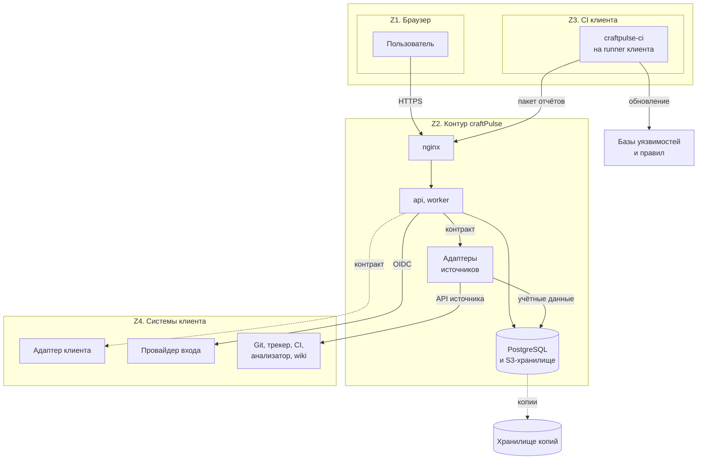

| Зона | Что в ней находится | Чему доверяем | Что пересекает границу |
|---|---|---|---|
| Z1. Браузер | SPA, сессия пользователя | Ничему: каждый запрос проверяется сервером | HTTPS-запросы к `api` с cookie сессии; ответ содержит только разрешённые данные (FR-001) |
| Z2. Контур craftPulse | `api`, `worker`, адаптеры источников, PostgreSQL, S3-хранилище, nginx, наблюдаемость | Своему коду, своей конфигурации и данным после приёма, очистки и валидации | Запросы к источникам выполняют только адаптеры, по учётным данным, которые хранят сами, в разрешённой сетевой области. Адаптеры доступны только ядру во внутренней сети по TLS. Входящие запросы пользователей, CI и webhooks идут через nginx |
| Z3. CI клиента | Pipeline, runner клиента, `craftpulse-ci`, исходники и секреты проекта | Не доверяем пакету из CI до проверки: envelope, лимиты, пути, схема и очистка выполняются при приёме (FR-016, NFR-015, BR-017) | Только пакет отчётов и манифест по токену загрузки конкретного проекта; токены источников и токен записи бота в CI не передаются (NFR-014) |
| Z4. Внешние системы | Git, трекер, CI, анализатор, wiki, провайдер входа, источник баз, адаптеры, которые клиент написал для своих систем | Источник отвечает за факты, свои права доступа и личность пользователя. Ответ адаптера клиента - недоверенные данные, как ответ любого источника | Ответы читаются в проверенных возможностях подключения (FR-014) и проходят тот же приём; webhook воспринимается только как сигнал, факт берётся запросом через адаптер |

Данными владеют так:

- Внешние системы владеют исходными фактами, правами доступа к ним и учётными записями. craftPulse хранит копию фактов с исходными ID, revision и временем получения и не меняет источник побочным действием. Запись в источник возможна только как отдельное подтверждённое действие: комментарий MR (FR-060) и, на M1, задача техдолга (FR-043).
- craftPulse владеет тем, что создают его пользователи и расчёты: структурой организации, подтверждёнными сопоставлениями, связями, исключениями, политиками, ревизиями расчётов и сводок, сохранёнными срезами, журналом приёма и аудитом.
- Внутри craftPulse у каждой таблицы один модуль-владелец (раздел 10.3). Другие модули получают данные через его интерфейс.
- Учётные данные источника принадлежат его адаптеру. Они лежат в отдельной базе адаптера, и ни ядро, ни другие адаптеры доступа к ней не имеют.

#### 10.2. Процессы и компоненты

| Компонент | Как запускается | Что делает | Почему отдельный процесс |
|---|---|---|---|
| `api` | Бинарник `api`, несколько экземпляров допустимы | HTTP API для SPA, приём пакетов из CI и универсального импорта, webhooks, вход и сессии, проверка прав при каждом чтении, выдача отчётов и раскрытия | Отвечает пользователю в пределах NFR-001; тяжёлая фоновая работа не делит с ним пул соединений и CPU |
| `api migrate` | Та же программа, разовый запуск перед выкатом | Применяет миграции схемы модулей и очереди под блокировкой | Ровно один исполнитель миграции; сбой миграции не превращается в цикл перезапусков сервиса |
| `worker` | Бинарник `worker`, один или несколько экземпляров | Задания очереди: сбор и сверка источников, очистка и разбор пакетов, нормализация, связи, расчёты, сводка MR, публикация, истечение исключений, удаление по срокам хранения | Длинные, повторяемые и ограниченные по параллельности задания; перезапуск не теряет работу (NFR-009) |
| Адаптер источника | Отдельный сервис на каждый вид источника: бинарник и образ из того же Go-модуля, своя база в PostgreSQL | Отвечает на вызовы контракта раздела 10.3: проверка подключения, страницы фактов, манифест сверки, проверка прав пользователя, публикация. Хранит учётные данные своих подключений и токены пользователей для проверки прав | Учётные данные каждого источника изолированы от `api`, доступного из интернета, и от других адаптеров (NFR-014); сбой или нехватка памяти адаптера не останавливает `worker` и другие источники; адаптер обновляется отдельно от ядра |
| `craftpulse-ci` | CLI и OCI-образы в jobs pipeline клиента: базовый образ передачи отчётов и образы профилей Go, Python, JS/TS, безопасности и документации | Получает профиль проверок проекта, запускает выбранные штатные проверки, собирает отчёты pipeline, удаляет значения найденных секретов, формирует манифест и загружает пакет | Работает с кодом клиента на runner клиента в зоне Z3; серверная часть не исполняет чужой код |
| Frontend | SPA, статические файлы раздаёт nginx | Экраны раздела 6; все данные и решения о доступе получает из `api` | Собирается в статический артефакт и обновляется вместе с образом nginx |
| PostgreSQL | Отдельный сервис | База ядра: данные модулей, очередь заданий, журнал приёма, ревизии, аудит. Отдельные базы адаптеров с учётными данными, у каждой своя роль | Единая транзакция для журнала приёма, фактов, checkpoint, следующего задания и завершения текущего |
| S3-совместимое хранилище | Отдельный сервис или управляемое хранилище | Принятые пакеты и отчёты, файлы выгрузок | Большие неизменяемые объекты не нагружают БД и доступны любому экземпляру `api` и `worker` |
| Внешнее хранилище копий | Хранилище другой площадки | Копии БД и бакета дважды в сутки, журнал удалений | Переживает потерю машины и диска сервиса (NFR-020) |
| nginx | Отдельный сервис | TLS, раздача frontend, лимит тела запроса, таймауты, маршрутизация к `api` | Граница Z2 для входящих соединений |
| Наблюдаемость | Отдельные сервисы | Сбор метрик и логов, дашборды, алерты | Диагностика по NFR-018 не зависит от работоспособности самого приложения |

Адаптер не хранит состояние сбора. Ядро вызывает его и получает ответ, а курсор, checkpoint, журнал приёма и следующее задание сохраняет `worker` одной транзакцией в базе ядра (FR-006, NFR-009). Если ответ адаптера потерян, ядро повторяет вызов с тем же курсором, поэтому подтверждение доставки между ядром и адаптером не нужно. Учётные данные источника знает только его адаптер (NFR-014): администратор вводит их в интерфейсе, `api` один раз передаёт их адаптеру и сам не сохраняет. Ядро хранит адрес адаптера подключения и служебный ключ для обращения к нему.

Адаптер для системы, у которой нет встроенного адаптера, клиент пишет на любом языке по опубликованному контракту `adapter.yaml` и разворачивает у себя. Ядро вызывает его так же, как встроенный: с теми же повторами, паузой лимита, проверкой ответа и сверкой полноты.

Все пути поступления данных приводятся к одному каноническому пакету фактов - формату универсального импорта (FR-016). Адаптер возвращает пакет, `craftpulse-ci` загружает пакет, пользователь загружает пакет. Дальше очистка, валидация, журнал приёма, идемпотентность, нормализация и расчёт одинаковы, поэтому API-путь и импорт дают те же identities, состояния данных и раскрытие.

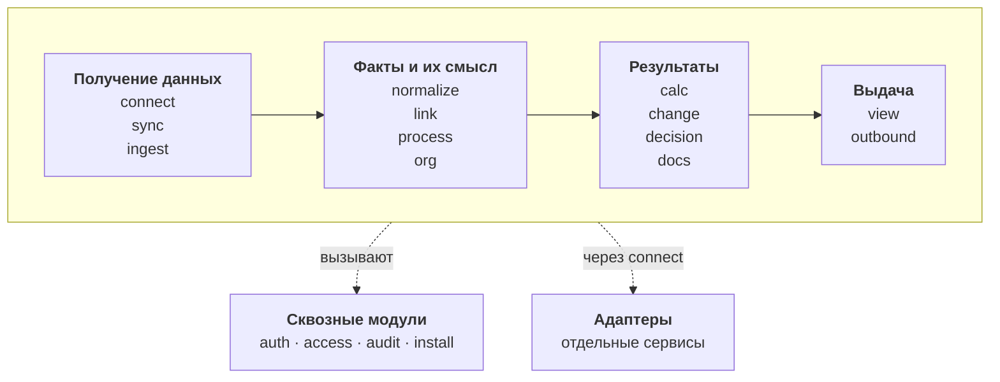

Схема показывает этапы, через которые проходят данные в ядре. Точные зависимости каждого модуля перечислены в таблице раздела 10.3; они образуют граф без циклов, и сборка процессов соединяет модули только по нему. Адаптеры вызываются только через `connect`: он знает адрес адаптера подключения, служебный ключ, версию контракта и паузу лимита подключения (раздел 10.7). `audit` вызывают все модули, изменяющие состояние; сам он не зависит от других модулей.

#### 10.3. Модули и их границы

Правила границ действуют с первой строки кода:

1. У модуля свои таблицы в своей схеме PostgreSQL, и работает с ними только его репозиторий `internal/repo/persistent/<модуль>`. Другой модуль не читает и не пишет их напрямую, а вызывает сценарий владельца. Физическая модель - раздел 12.
2. Границей транзакции владеет сценарий модуля, вызванного транспортом. Сценарий может передать транзакцию вызываемому модулю, чтобы факты, checkpoint, следующее задание и завершение текущего сохранились вместе. Транзакцию открывает сценарий через интерфейс из `internal/repo/contracts.go`, репозитории берут её из контекста вызова. Сетевой вызов внутри открытой транзакции запрещён: обращение к адаптеру идёт до неё, результат записывается короткой транзакцией.
3. Адаптер не обращается к базе ядра, не знает модулей ядра и не хранит состояние сбора. Своя у него только база учётных данных подключений. В Go-коде адаптер зависит только от `pkg/envelope` (канонический пакет фактов) и `pkg/adaptersdk` (сервер контракта, хранилище учётных данных, классификация ошибок).
4. Каждая строка данных принадлежит организации. Модули получают организацию из сессии или из аргументов задания, а не из тела запроса; PostgreSQL дополнительно ограничивает строки политикой row-level security (раздел 12.2). `api` и `worker` работают под ролью, которая не владеет таблицами и не имеет `BYPASSRLS`, поэтому политика действует на каждый их запрос; миграции и копирование выполняет роль-владелец (раздел 12.2). Фоновая работа по всем организациям (удаление по срокам, сборка мусора хранилища, ежедневное продление окон) ставится отдельным заданием на каждую организацию и выполняется под ней. Исключение - реестр организаций, по которому планировщик ставит задания каждой организации, и таблицы, по которым запрос узнаёт свою организацию: адреса входа организаций, сессии, записи предвхода, хэши ключей API и токенов загрузки, адреса webhook подключений. Их ищут до того, как организация известна, поэтому они вне row-level security; читает их только модуль-владелец по хэшу или ID, и в строке нет других данных организации.
5. Формулы показателей каталога живут только в `calc`. `change` строит сводку head из нормализованных отчётов и для показателей сводки (покрытие изменённых строк, попытки CI) вызывает определения `calc`. Результат каждого из них сохраняется ревизией: ревизия расчёта в `calc`, ревизия сводки head в `change`. `view`, комментарий MR, выгрузка и API показывают сохранённые ревизии и не содержат своих формул (FR-009).
6. Задание другого модуля ставится через интерфейс очереди из `internal/repo/contracts.go`. Виды заданий и их аргументы лежат в `internal/entity` без логики, обработчики - в `internal/controller/worker`, их подключает сборка `worker`. Поэтому `normalize` ставит пересчёт области, не завися от `calc`, а `decision` ставит пересчёт после истечения исключения, не завися от `calc` и `change`. Данные для решения, есть ли новая работа, задание запрашивает само у модулей, от которых зависит (раздел 10.6).
7. Сценарии модулей не импортируют друг друга. Модуль, которому нужен другой, объявляет у себя требуемый интерфейс, а реализацию передаёт `internal/app`; допустимые связи - столбец «Зависимости» таблицы ниже. Границы слоёв из раздела «Структура кода» проверяет depguard в golangci-lint в CI репозитория; нарушение блокирует слияние.

Контракт адаптера - HTTP API, описанный в `adapter.yaml` (OpenAPI 3.1.2) с номером версии. Встроенные адаптеры и адаптеры клиентов реализуют его одинаково. `Fetch` отдаёт потоком тот же пакет tar.gz с манифестом, что приходит из CI и импорта: в нём бывают файлы отчётов, например JUnit и покрытие из артефактов CI. Остальные операции обмениваются JSON. Каждый вызов несёт организацию, ID подключения и служебный ключ; по ID подключения адаптер находит свои учётные данные.

| Операция | Вход | Результат | Кто вызывает через `connect` | Ошибки |
|---|---|---|---|---|
| `PutCredentials` | Подключение, учётные данные, токен или код авторизации OAuth пользователя для проверки прав | Принято, без возврата значения; код адаптер сам обменивает на токены | `connect` при вводе и замене администратором, `access` при связывании учётной записи пользователя | Неверный формат; значение не попадает в ответы и логи |
| `AuthorizeUrl` | Подключение, одноразовый `state`, адрес возврата `completeSourceLink` | Адрес авторизации источника для связывания учётной записи пользователя; идентификатор клиента OAuth остаётся в адаптере | `access` при `startSourceLink` | Режим проверки токеном пользователя не поддержан - отказ, связывание не предлагается |
| `DeleteCredentials` | Подключение или учётная запись пользователя | Учётные данные удалены | `connect` при удалении подключения, `access` при отвязке | Повтор удаления даёт тот же результат |
| `Probe` | Параметры подключения и область | Проверенные возможности с причиной для недоступных, версия и редакция источника (FR-014), поддерживаемая версия контракта | `connect` при подключении и повторной проверке | Неверная редакция, нет прав, сеть, неподдержанная версия контракта; возможность не объявляется рабочей |
| `Fetch` | Вид данных, область, курсор, период | Канонический пакет одной страницы; в манифесте следующий курсор, признак конца выборки, известное общее число объектов | `sync`; `change` для текущего head MR | Классифицированная ошибка: `rate_limited` с `Retry-After`, `preparing` со временем повтора, `unavailable`, `timeout`, `auth`, `not_found`, `invalid_response` |
| `Manifest` | Вид данных, область, период | Список исходных ID и версий для сверки полноты | `sync` при сверке | Как у `Fetch` |
| `CheckAccess` | Учётная запись пользователя в источнике, набор областей или объектов | Разрешено, запрещено или неизвестно для каждого элемента со временем проверки; режим проверки и его свежесть | `access` | Неизвестно трактуется как запрет (FR-001) |
| `Publish` | Подтверждённое действие: комментарий MR или задача трекера, маркер объекта | Внешний ID и исход `succeeded`, `failed` или `unknown` | `outbound` | Нет права записи, конфликт head, потеря ответа |
| `FindPublished` | Маркер объекта | Найденный внешний объект или его отсутствие | `outbound` перед каждым созданием | Как у `Fetch` |
| `ParseWebhook` | Заголовки и тело webhook, пришедшего на адрес подключения | Подпись проверена секретом webhook, который хранит адаптер; ключи объектов для перечитывания с признаком «MR или pipeline» | `sync` в задании `sync.webhook` | Неверная подпись - webhook отбрасывается и считается в диагностике; неизвестный вид события игнорируется |

`CheckAccess` работает в одном из трёх режимов, и `Probe` записывает, какой доступен у подключения:

| Режим | Как работает | Свежесть решения |
|---|---|---|
| Проверка служебной учётной записью | Запрос прав указанного пользователя к API источника, если API это позволяет (например, членство в проекте GitLab) | Не старше 60 с |
| Проверка токеном пользователя | Пользователь один раз связывает свою учётную запись источника с craftPulse; токен хранит адаптер, права проверяются этим токеном | Не старше 60 с |
| Синхронизированные права | `sync` забирает права проектов и пространств, состав групп и ограничения объектов, `access` вычисляет итоговое право | Задержка синхронизации, видна в состоянии подключения |

Если у подключения доступна только синхронизация и её задержка больше 60 с, NFR-011 для этого источника не выполняется, и это видно администратору. Для Jira DC выбрана проверка служебной учётной записью, для Confluence DC - токеном пользователя (раздел 13.5).

Курсор приращения у адаптеров с историей - пара «время изменения, исходный ID» с перекрытием окна назад: объекты, изменённые во время чтения, не теряются между страницами, а повторы отсекает идемпотентный приём. Если источник отдаёт историю объекта не целиком (changelog задачи Jira, длинная история MR), адаптер возвращает отметку, и `sync` ставит задание на её дочитывание. Манифест сверки содержит пары «ID, версия», поэтому сверка находит и пропущенные изменения уже известных объектов.

В заданиях адаптер ждёт ответа источника не дольше 30 с, а ядро ждёт ответа адаптера не дольше 40 с: адаптер успевает вернуть классифицированную ошибку `timeout`, и оба срока укладываются в таймаут задания 60 с. На пути чтения `CheckAccess` ограничен 2 с, проверки разных областей идут параллельно; без ответа решение «неизвестно» и область закрыта. Так ответ пользователю укладывается в максимум 5 с по NFR-001. Работу, которая дольше, адаптер выполняет у себя и отвечает `preparing`: задание откладывается до указанного времени и не тратит попытку.

Контракт меняется совместимо: внутри версии новые поля необязательны, а старые не удаляются. Ядро поддерживает текущую и предыдущую версию контракта, и новая версия выходит только после того, как ядро её поддерживает. Подключение к адаптеру с неподдержанной версией не становится рабочим (FR-014).

Адаптеры M0: `jiradc`, `gitlab` (MR, diff и GitLab CI), `github` (GitHub.com и Actions для стенда), `jenkins` (build API), `sonarqube`, `confluencedc` и `git`. Адаптер `git` читает дерево, refs, diff и историю по SSH или HTTPS для репозиториев без поддержанного API Git-хостинга. Клон он держит в кэше своего контейнера и переиспользует между вызовами одного подключения. Первый вызов на большом репозитории отвечает `preparing`, пока идёт частичный клон. Содержимое не исполняется: hooks, фильтры LFS, подмодули и протокол `file` отключены, объём и время ограничены. Адаптеры следующих поставок (Redmine, Jira Cloud, Яндекс Трекер, GitVerse и другие по [коннекторам](../product/connectors.md)) реализуют тот же контракт и не меняют ядро.

| Модуль | Обязанность и FR | Вход / выход | Зависимости | Владение данными | Ошибки и восстановление |
|---|---|---|---|---|---|
| `org` | Организация, команды, проекты, сервисы, репозитории, пути компонентов, пользователи и роли; подтверждение сопоставления учётных записей людей и ботов; первый администратор. FR-012, FR-018, FR-064 | Вход: подтверждённая структура, предложения сопоставления из `normalize`, учётная запись первого администратора. Выход: структура и назначенные области на дату | `audit` | Структура и её версии, люди, учётные записи источников, назначения ролей (DR-001) | Конфликт версии структуры - отказ без перезаписи (FR-008); неподтверждённое предложение не действует; вход не той учётной записи не даёт роль администратора (UC-01 A4) |
| `install` | Проверка установки и её протокол: сайт, адаптеры и их версия контракта, хранилища учётных данных адаптеров, провайдер входа, источник обновлений и дата баз, БД, хранилище объектов, сетевая область runner клиента, из которой принимаются пакеты CI. FR-011 | Вход: параметры установки. Выход: протокол с версией поставки и исходом каждой проверки | `org`, `auth`, `connect`, `audit` | Протоколы установки | Неверные параметры перечислены (FR-011 A1); недоступный провайдер входа показан с причиной, вход невозможен (A3) |
| `auth` | Вход через внешнего провайдера, сессии, ключи API, токены загрузки CI, выход и истечение. FR-002, FR-013, FR-064; механизмы - раздел 13 | Вход: ответ провайдера, cookie, ключ API, токен загрузки. Выход: субъект с организацией и ролью или отказ | `org`, `crypto`, `audit` | Сессии, записи предвхода, ключи API, токены загрузки CI, регистрации провайдеров с зашифрованным секретом клиента | Недоступный провайдер - вход невозможен, обходного пароля нет; недействительная сессия - отказ до чтения данных |
| `access` | Решение «разрешено ли субъекту», фильтрация когорт и агрегатов, кэш решений источника не старше 60 с по областям и по объектам с собственными ограничениями. FR-001, BR-023, NFR-010, NFR-011 | Вход: субъект, запрашиваемые области и объекты. Выход: разрешённое подмножество и отметка ограничения без числа скрытых | `org`, `connect` для `CheckAccess`, `normalize` для синхронизированных прав, `audit` для записи отказов и связывания учётных записей | Кэш решений доступа со временем и режимом проверки; итоговые права, вычисленные из синхронизированных прав, групп и ограничений объектов. Сами права собирает `sync` как обычные данные источника | Источник прав недоступен, подключение на паузе или ответ устарел - область закрыта; ошибка видна администратору в диагностике |
| `audit` | Запись значимых действий пользователей, импортов и фоновых операций без секретов и закрытых выдержек; журнал удалений. FR-010, DR-018 | Вход: действие, субъект, область, версии, исход, correlation ID. Выход: разрешённый журнал | Платформа: `objstore` для копии журнала удалений | Журнал аудита; журнал удалений с копией каждой записи во внешнем хранилище копий (раздел 14.8) | Ошибка записи аудита или журнала удалений отменяет изменяющее действие: изменение без следа не сохраняется |
| `connect` | Подключения, область, адрес адаптера, пробное чтение и проверенные возможности; передача учётных данных в адаптер при вводе; единственная точка вызова адаптеров: служебный ключ, версия контракта, таймаут вызова и пауза лимита подключения. FR-014, NFR-006 | Вход: параметры администратора, вызовы адаптеров от других модулей. Выход: подключение с возможностями и датой проверки; результат вызова адаптера | Адаптеры по HTTP-контракту, `crypto`, `audit` | Подключения, адреса адаптеров и версии их контракта, зашифрованные служебные ключи адаптеров клиентов, возможности, пауза лимита по подключению. Учётных данных источников здесь нет | Пробное чтение не удалось - подключение не становится рабочим; адаптер не отвечает - как недоступный источник, с причиной «адаптер недоступен»; 429 устанавливает паузу для всех вызовов подключения; отзыв учётных данных переводит подключение в состояние потери доступа |
| `sync` | План сбора: первичная загрузка, приращение, дочитывание истории, ночная сверка, перечитывание объектов из набора webhook и открытых MR; курсоры, checkpoint, watermark, last success, lag; одна активная попытка сбора на подключение. FR-006, FR-015, FR-020, NFR-005, NFR-006 | Вход: расписание, ключи объектов из webhook после `ParseWebhook`, ручной повтор. Выход: пакеты в `ingest` вместе с новым checkpoint; состояние сбора | `connect`, `ingest`, `normalize` (текущие версии объектов для сверки с манифестом, раздел 12.6), `audit` | Состояние сбора по подключению и виду данных, блокировка активной попытки, набор объектов «перечитать» | Ошибка страницы оставляет прежний checkpoint и last success; повтор продолжает с сохранённого курсора; 401/403 останавливает сбор до исправления доступа |
| `ingest` | Единый приём канонических пакетов от `sync`, `craftpulse-ci` и универсального импорта: лимиты и безопасная распаковка, проверка envelope и схемы, очистка значений секретов до постоянного хранения, журнал приёма, отличие повтора доставки от новой версии факта, частичное принятие; перепаковка пакетов при удалении по запросу. FR-004, FR-010, FR-016, NFR-007, NFR-014, NFR-015, BR-017, DR-003 | Вход: пакет или поток загрузки, запрос удаления. Выход: записи журнала приёма с provenance, перечень отклонённого с причиной, задание нормализации | `envelope`, `objstore`, `org` (проект токена загрузки и формы импорта), `audit` | Журнал приёма: ключ объекта хранилища, номер записи в пакете, хэш, исход, причина и отметка удаления. Сами исходные записи хранятся только в объекте хранилища | Невалидный envelope отклоняет пакет целиком; повтор с тем же содержимым фиксируется в журнале без нового факта; конфликт содержимого без порядка версий уходит на сверку (BR-002) |
| `normalize` | Преобразование исходных фактов в канонические сущности: задачи и история полей, MR, ревизии и diff, запуски, jobs и попытки, тесты, покрытие, находки, документы; identity по BR-001; разбор форматов отчётов версионированными парсерами; предложения связей и сопоставления учётных записей. DR-002, DR-005, DR-006, DR-008, DR-009, DR-012 | Вход: записи журнала приёма и пакет из хранилища, запрос удаления задачи. Выход: канонические факты с исходными полями события, версией и отметкой изменения фактов области | `ingest`, `org`, `link`, `audit` | Канонические сущности и история их изменений | Неопределимая identity не допускается к точному счёту; ошибка парсера даёт отклонение с причиной; повтор нормализации того же входа даёт тот же результат; записи с отметкой удаления пропускаются при любом переразборе |
| `link` | Связи задачи, MR, CI, находки и документа с методом, источником и подтверждением; кандидаты отдельно от подтверждённых; цепочка бизнес-обязательства до последнего подтверждённого звена; зеркала задач M1. BR-010, BR-016, FR-024, FR-028, FR-033 | Вход: явные связи источников, кандидаты из `normalize`, решения пользователя. Выход: граф связей с типами рёбер и версиями | `org`, `audit` | Связи, кандидаты, решения о подтверждении, группы зеркал | Неоднозначная связь остаётся кандидатом; повтор подтверждения не создаёт второй связи |
| `process` | Версии сопоставления статусов, исходов и полей, календарь, часовой пояс, целевые сроки, правила DoD M1, предпросмотр на задачах. FR-017, FR-019, FR-063 | Вход: справочники источника, решение владельца процесса. Выход: версия сопоставления, применимая к расчёту | `normalize` (справочники и примеры задач), `org` (команда и её проекты), `audit` | Версии сопоставлений, календарей, целевых сроков и DoD (DR-004) | Устаревшая форма - конфликт без перезаписи (FR-008); отмена оставляет прежнюю версию (FR-007) |
| `calc` | Реестр определений показателей с версиями по каталогу метрик; расчёт по каноническим фактам, версиям сопоставления, решений и связей, области и окну; ревизии с рядом значений и хэшами входов; когорты с вкладом каждого объекта для раскрытия; состояния данных; состояние DoD, наблюдения карточки задержки и очередь ревью; сохранённые срезы; пересчёт затронутых срезов; ограниченный пересчёт на разрешённой части когорты; методы M2 с версией и проверкой на истории. FR-003, FR-005, FR-009, FR-021, FR-023, FR-025-FR-027, FR-029, FR-031, FR-032, FR-049, FR-055, FR-056, FR-058 | Вход: отметка изменения фактов или настроек, расписание дня, запрос пересчёта. Выход: опубликованная ревизия расчёта | `normalize`, `process`, `link`, `org`, `decision`, `sync` (полнота и watermark сбора для T38-T42 и отметки загрузки), `docs` (корни и нарушения для показателей D) | Определения, ревизии расчётов с рядами, готовые части неопубликованных ревизий, вклады объектов когорт, сохранённые срезы, интервалы workflow, эпизоды инцидентов и передач (DR-007, DR-011, DR-014, DR-016, DR-017) | Сбой расчёта не публикует новую ревизию: текущей остаётся прежняя, ошибка видна в диагностике; повтор пересчитывает ту же часть на том же входе |
| `change` | Технические результаты изменения: матрица профилей и базовая линия, сопоставимость base и head, жизненный цикл находок, попытки CI, тесты и покрытие изменённых строк, причины изменения, ревизия сводки MR для актуального head с отбором по аудитории MR; паспорт релиза и переоценка выпущенного состава M1. FR-035-FR-037, FR-039, FR-040, FR-042, FR-044, FR-045, FR-050, FR-051, FR-057, FR-059, FR-062 | Вход: нормализованные отчёты и запуски, текущий head от источника. Выход: ревизия сводки head и задание публикации | `normalize`, `link`, `decision`, `calc`, `org` (проекты и пути компонентов профиля), `docs` (корни документации профиля и нарушения head), `connect` для `Fetch` текущего head | Профили проверок, базовые линии, ревизии сводок MR, релизы, составы и доступность развёртываний (DR-009, DR-013, DR-016 в части доступности) | Отчёт другого SHA не покрывает head; новый head делает прежнюю сводку устаревшей и отменяет её публикацию (FR-059) |
| `decision` | Исключения, политики проверок, обходы, подтверждения и истечение по сроку. FR-038, FR-041, FR-061 | Вход: решение уполномоченного пользователя, текущее время. Выход: действующие решения на дату с областью и версией | `org`, `access`, `audit` | Решения и их версии (DR-010) | Пустая причина, чужая область, невалидный срок - отказ; истёкшее решение перестаёт действовать без удаления истории |
| `docs` | Корни документации, владелец, аудитория, профиль проверок, инвентарь и версии документов, нарушения, обязательства по версии контракта, комплект передачи, учения, поиск M2. FR-034, FR-046-FR-048, FR-052, FR-053 | Вход: настройки владельца сервиса, нормализованные документы и нарушения. Выход: состояние документации сервиса | `normalize`, `org`, `access`, `audit` | Корни, назначения, обязательства, поисковый индекс по разрешённым документам (DR-012, DR-015 в части поиска) | Неизвестные права документа закрывают индексирование; удаление убирает текст из индекса и выдач (FR-010) |
| `outbound` | Все записи во внешние системы: обновляемый комментарий MR, задача техдолга M1; журнал внешних действий; поиск по маркеру перед каждым созданием. FR-043, FR-060 | Вход: ревизия сводки или подтверждённое действие. Выход: внешний ID и исход | `connect`, `change`, `audit` | Журнал внешних действий, ID опубликованных комментариев | Потеря ответа - исход `unknown`, затем поиск по маркеру; создание без предварительного поиска запрещено (BR-002) |
| `view` | Выдача: отчёт команды, раскрытие, карточка задачи, таймлайн на дату, очередь ревью, страница MR, состояние сбора, бизнес-цепочка, комплект передачи, выгрузки. FR-020-FR-022, FR-024, FR-030 | Вход: запрос пользователя, ID ревизии или «актуальная». Выход: значения, когорта, основания и ссылки на исходные объекты в разрешённой области | `calc`, `change`, `docs`, `link`, `normalize`, `sync`, `access` | Задания и файлы выгрузок (через `objstore`) | Ревизия недоступна или основание удалено - явная отметка невоспроизводимости; запрет доступа не раскрывает объект |
| `survey` | Добровольный pulse-опрос M2 с порогом публикации. FR-054 | Вход: ответы участников, правила Q-02. Выход: сводка группы | `org`, `access`, `audit` | Опросы и ответы отдельно от инженерной активности (DR-015) | Группа меньше порога не публикуется; сбор не включается до решения Q-02 |

**Структура кода.** Код сервера - один Go-модуль в `backend/`, разложенный по слоям Clean Architecture. Зависимости направлены внутрь: транспорт знает сценарии, сценарии знают сущности и интерфейсы, реализации интерфейсов не знают сценариев. Код, сгенерированный oapi-codegen из `openapi.yaml` и `adapter.yaml` и sqlc из миграций, хранится в репозитории, а CI сверяет его с генерацией (раздел 14.3).

| Каталог | Что лежит | Что может импортировать |
|---|---|---|
| `cmd/<процесс>` | `main` каждого бинарника: `api`, `worker`, адаптеры, `craftpulse-ci` | `config`, `internal/app`, `pkg/logger` |
| `config` | Чтение и проверка конфигурации при старте | Ничего из `internal/` |
| `internal/entity` | Сущности модулей и их ошибки; виды заданий и их аргументы | Только стандартную библиотеку |
| `internal/usecase/<модуль>` | Сценарии модуля; `internal/usecase/contracts.go` - интерфейсы сценариев для транспорта | `internal/entity`, интерфейсы `internal/repo/contracts.go`, `pkg/clock`, `pkg/logger`. Не импортирует другие модули, gin, pgx и реализации репозиториев |
| `internal/repo` | `contracts.go` - что сценарии ждут снаружи: репозитории модулей, транзакция, очередь заданий, хранилище объектов, клиент адаптеров. Реализации: `persistent/<модуль>` (PostgreSQL через sqlc), `queue` (River), `objstore` (S3), `adapterapi` (клиент `adapter.yaml` для `connect`) | `internal/entity`, `pkg/`. Репозиторий одного модуля не импортирует репозиторий другого |
| `internal/controller` | Транспорт: `http` (роутер, `/livez`, `/readyz`, `/version`; в `v1` код из `openapi.yaml`, обработчики, middleware и ответы об ошибке) и `worker` (обработчики заданий River) | Интерфейсы сценариев, `internal/entity`, gin. Не импортирует `internal/repo` |
| `internal/adapter/<провайдер>` | Клиент API источника и перевод его данных в канонический пакет для встроенного адаптера | Только `pkg/envelope` и `pkg/adaptersdk` |
| `internal/app` | Сборка каждого процесса: создаёт реализации, соединяет модули по столбцу «Зависимости» таблицы выше, поднимает и останавливает HTTP-серверы и очередь | Всё из `internal/` и `pkg/` |
| `pkg/` | Общие пакеты нескольких бинарников без правил продукта: `postgres` (пул, транзакция организации с row-level security, повтор `40P01`, `40001` и `55P03`), `crypto` (envelope-шифрование учётных данных), `envelope`, `adaptersdk`, `logger` (журнал с маскированием секретов и correlation ID), `health` (`/livez`, `/readyz`, `/version`), `clock` (источник времени, подменяемый в тестах приёмки) | Ничего из `internal/` |
| `migrations/core`, `migrations/adapter` | SQL-миграции базы ядра и базы адаптера | - |

#### 10.4. Происхождение показателя: от источника до ответа

Каждое звено хранит идентификатор предыдущего, поэтому от числа на экране можно пройти до исходного объекта источника и обратно.

| Звено | Модуль | Что сохраняется | Как ссылается на предыдущее |
|---|---|---|---|
| 1. Ответ источника или отчёт CI | адаптер, `craftpulse-ci` | Канонический пакет: координаты источника, исходные ID и revision, event time, observed_at, схема, полнота | Подключение, вид данных, курсор страницы или run/job/attempt CI и SHA |
| 2. Очищенный пакет | `ingest`, `objstore` | Неизменяемый объект с ключом из организации и ID приёма; хэш SHA-256 очищенного содержимого | Запись журнала приёма содержит ключ объекта и хэш |
| 3. Журнал приёма | `ingest` | Принятые и отклонённые записи с причиной, отметка повтора доставки, границы выборки | Пакет по хэшу, подключение и попытка сбора или приём CI |
| 4. Канонический факт | `normalize` | Сущность или событие с identity по BR-001, исходными полями события и версией парсера; переразбор читает пакет из хранилища | Запись журнала приёма и исходный revision |
| 5. Связь, сопоставление, решение | `link`, `process`, `org`, `decision` | Подтверждённая связь, версия сопоставления, календаря и целевого срока, действующее исключение или политика | Факты на концах связи, автор и время подтверждения, версия |
| 6а. Ревизия расчёта | `calc` | Ряд значений за окно с шагом (день, неделя или месяц); для каждой точки значение, единица, числитель, знаменатель, n, состояние данных и когорта с вкладом каждого объекта (длительность, признак попадания в WIP на дату и т. п.); версии определения, сопоставления, календаря, целевого срока, исключений, политик и связей; watermark источников; хэш входов, as_of и knowledge cutoff | Набор фактов когорты с их версиями и версии звена 5 |
| 6б. Ревизия сводки head | `change` | MR, base и head SHA, использованные отчёты и их хэши, профиль, версии правил и баз, находки head и их сравнение с базой, ссылки на ревизии `calc` для показателей сводки | Отчёты звена 4 и ревизии звена 6а |
| 7. Ответ API, страница, MR, выгрузка | `view`, `outbound` | ID ревизии, разрешённая часть когорты, отметка ограничения доступом | Ревизия 6а или 6б и решение `access` со временем проверки |
| 8. Исходный объект | ссылка источника | URL объекта в Git, трекере, CI или wiki | Исходный ID факта |

Проверка доступа стоит на звене 7 и повторяется для каждого перехода по раскрытию. Если пользователю доступна только часть когорты ревизии, `view` вызывает в `calc` то же определение показателя на разрешённом подмножестве уже сохранённой когорты: агрегат строится по сохранённым вкладам объектов, а текущую область и ограничение каждого объекта `calc` получает у `normalize` одним запросом по ключам объектов (раздел 12.7). Факты повторно не читаются ни из базы, ни из источника, результат кэшируется по ревизии и набору разрешённых областей на время жизни решения доступа (60 с). Ответ помечается как ограниченный доступом и не содержит числа и названий скрытых объектов (FR-001). Формула при этом одна, поэтому FR-009 сохраняется: разница между двумя пользователями объясняется только разными правами.

Удаление по запросу (FR-010) обрывает цепочку осознанно. Запрос принимает модуль-владелец объекта: документ - `docs`, задачу и её события - `normalize`. Он записывает удаление в журнал удалений `audit` и через очередь заданий ставит задание удаления каждому модулю, у которого есть данные об объекте; каждое такое задание идемпотентно. `ingest` при этом отмечает записи объекта в журнале приёма удалёнными и ставит `ingest.repack`. Задание записывает в хранилище новый пакет без удалённых записей, переводит журнал на новый ключ и хэш с пометкой «перепакован по удалению» и удаляет прежний объект. `normalize` пропускает отмеченные записи при любом переразборе, поэтому удалённое не возвращается ни после обновления парсера, ни после восстановления из копии. Ревизии, которые опирались на удалённый объект, помечаются невоспроизводимыми с причиной.

#### 10.5. Сквозные последовательности

##### 10.5.1. Сбор истории и обновление отчёта

Последовательность «получение → проверка → нормализация → расчёт → API/UI → исходный объект» разбита на задания очереди. Одно задание сбора обрабатывает одну страницу, затем `normalize` строит канонические факты, а `calc` публикует новую ревизию. Задание сохраняет свой результат, ставит следующее задание и отмечает себя завершённым в одной транзакции PostgreSQL. Если процесс упал до коммита, не сохранено ничего и задание повторяется. Если после коммита, задание уже завершено и повторно не выполняется.

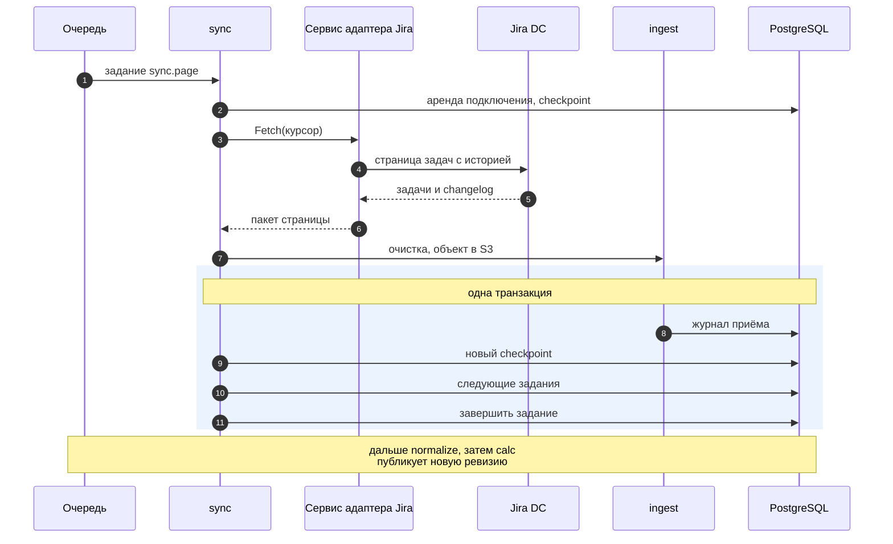

Отчёт пользователь получает уже посчитанным: `api` читает актуальную ревизию и не запускает расчёт по всей истории на каждый запрос. Watermark и last success обновляются только после сверки полной выборки (FR-015, BR-022). При отказе страницы задание откладывается, а checkpoint остаётся на последней сохранённой странице.

##### 10.5.2. Отчёт из CI и сводка MR

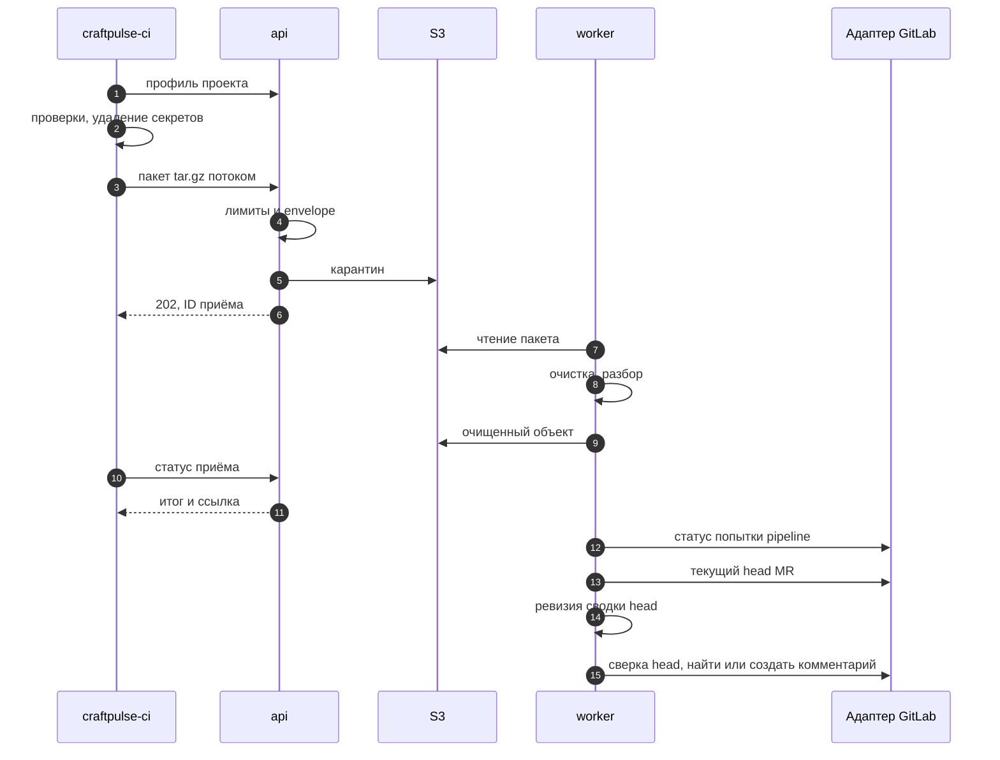

Пакет - архив tar.gz, первым файлом идёт манифест. Тело запроса и есть пакет, без multipart. Формат читается последовательно, поэтому `api` проверяет размер до 25 MiB, распакованный объём до 100 MiB, число файлов до 1 000, пути, ссылки, манифест и envelope по ходу потока (NFR-015). Невалидный пакет получает отказ сразу, и карантинный объект удаляется. Валидный пакет получает 202 и ID приёма. `craftpulse-ci` ждёт итог приёма ограниченное время и печатает перечень принятого и отклонённого. Отказ при приёме и отклонение всего пакета при разборе завершают шаг с ошибкой. Если итог не получен за время ожидания, шаг завершается отдельным кодом «итог неизвестен», а не успехом; во фрагменте CI режима предупреждений шаг разрешено завершить неуспешно, поэтому pipeline показывает предупреждение. Находки в режиме предупреждений шаг не роняют (FR-016, UC-25).

Формат приёма один для всех. Форма универсального импорта в интерфейсе принимает файл фактов JSON или CSV либо отчёт находок, тестов или покрытия поддержанного формата, а `api` упаковывает его в такой же пакет и строит манифест из полей формы: источник, схема, область, для отчёта - формат и ревизия. Дальше файл проходит тот же путь, что пакет из CI.

Карантин - отдельный префикс хранилища, доступный только приёму и исключённый из копий. Карантинный объект удаляется сразу после того, как закоммичен журнал приёма очищенного пакета; `objstore.gc` убирает только объекты, оставшиеся от прерванных приёмов. В постоянное хранение попадает только очищенный пакет, и хэш журнала относится к нему (DR-009). Так очищаются все пути поступления: пакеты CI, универсальный импорт, артефакты, полученные через API CI-системы, и ответы адаптеров (BR-017, NFR-014).

Пока отчёты попытки pipeline приходят, сайт показывает сводку с отметкой «pipeline идёт». Комментарий MR публикуется или обновляется один раз за попытку. Основной сигнал - получены все отчёты, ожидаемые по матрице профиля проекта; они приходят через очередь `interactive`. Если какого-то отчёта нет, сводку закрывает завершение попытки pipeline, которое `sync` узнаёт из API CI по webhook или при сверке. Перечитывание открытого MR, статуса его pipeline и анализа SonarQube идёт отдельным заданием `sync.mr` в очереди `interactive`, поэтому загрузка истории его не задерживает (NFR-004). Отчёт, который так и не пришёл, отмечается «не получен» (UC-26, AC-07). Перед построением сводки `change` сверяет head MR, а `outbound` повторяет сверку через `change` непосредственно перед вызовом `Publish`: если пришёл новый коммит, сводка помечается устаревшей и не публикуется (FR-059). В комментарий попадают только части сводки, доступные аудитории MR. Находки, требующие отдельного права, например права на данные безопасности, отражаются отметкой «есть закрытые результаты» со ссылкой на сайт (BR-023). Сайт и комментарий строятся из одной ревизии сводки head (FR-009).

##### 10.5.3. Чтение показателя с раскрытием

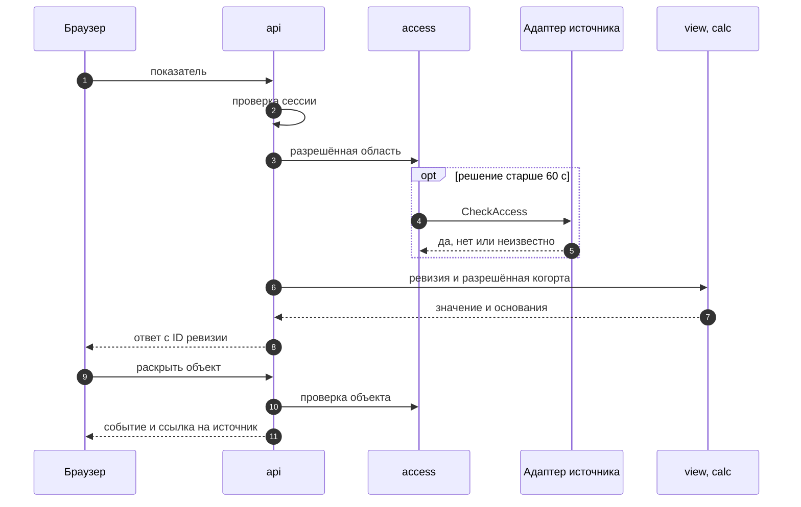

Права проверяются на двух уровнях; схема показывает оба. Для агрегата `access` проверяет области: проект трекера, репозиторий, пространство wiki. Ограничения отдельных объектов (уровень безопасности задачи, ограничения страницы wiki) он берёт из данных сбора. Объект с собственным ограничением, который показывается по имени или содержимому (раскрытие, карточка, основание, страница документа), проверяется в источнике отдельно, решение действует не дольше 60 с. Остальные объекты покрывает решение по их области. Если `CheckAccess` не ответил, вернул «неизвестно» или подключение на паузе лимита, область закрывается и ответ не содержит её данных. Причина видна администратору в состоянии подключения (NFR-011). Свежесть решения задаёт режим проверки подключения (раздел 10.3). Сохранённый срез и прямая ссылка проходят тот же путь (FR-001). Точки проверки и режимы по источникам - разделы 13.4 и 13.5.

##### 10.5.4. Внешняя запись

Запись комментария MR и задачи трекера выполняется в три шага. Сначала короткая транзакция сохраняет намерение в журнале `outbound`. Затем вне транзакции для комментария MR повторно сверяется head (FR-059), адаптер ищет объект по маркеру (`FindPublished`) и создаёт его только при подтверждённом отсутствии, а найденный обновляет (`Publish`). Последней транзакцией сохраняются внешний ID и исход. Маркер принадлежит целевому объекту, а не действию: для комментария это организация и MR, для задачи техдолга - подтверждённое действие пользователя. Публикации одного MR выполняются строго по очереди. Поэтому падение после вызова, параллельные head и восстановление из копии, где нет записи о комментарии, не создают второго комментария и второй задачи (FR-043, FR-060, NFR-024).

#### 10.6. Фоновые задания

Задания хранятся в PostgreSQL. Постановка следующего задания и завершение текущего выполняются в той же транзакции, что и изменение данных. Уникальность заданий действует только среди активных: ожидающих, запланированных, выполняющихся и ожидающих повтора. Завершённое задание не мешает поставить такое же снова, поэтому повторный webhook, новая попытка pipeline на том же head и позднее событие для уже рассчитанной даты обрабатываются.

Если новый факт пришёл, пока задание расчёта, сводки или публикации уже выполняется, его постановка совпадёт с активным заданием. Чтобы такой факт не потерялся, задание перед завершением само проверяет, не изменился ли его вход. `calc` и `change` спрашивают у `normalize` номер знания последнего изменения фактов их области или MR (раздел 12.6). `calc` дополнительно спрашивает у `process` и `decision` версии настроек области: сопоставления, целевых сроков и исключений. `outbound` сравнивает ID последней ревизии сводки MR; публикация берёт последнюю ревизию в момент выполнения. Если вход новее использованного, задание в одной транзакции сначала отмечает себя завершённым, затем ставит такое же снова. Порядок важен: пока задание выполняется, оно само считается активным, и постановка его копии была бы отброшена.

Ревизия `calc` - ряд значений за окно с шагом, а не одна дата: график за 10 месяцев по неделям читает одну ревизию, ежедневный расчёт продлевает текущее окно. Позднее событие или исправление пересчитывает только окна, в которые попадает его event time. Длинное окно считается частями: каждый запуск `calc.slice` обрабатывает часть, сохраняет её результат и в той же транзакции ставит следующую. Первая часть фиксирует knowledge cutoff - номер знания организации (раздел 12.6), который задаёт и факты, и версии настроек области. Все части читают факты и настройки на этот срез, поэтому ревизия согласована, даже если во время расчёта пришли новые факты; `normalize` для этого хранит историю версий фактов. Новые факты попадают в следующую цепочку по правилу проверки входа. Часть, у которой хэш входа совпал с частью прежней ревизии, не пересчитывается, а переиспользуется. Последняя часть публикует ревизию целиком, до этого действует прежняя. Задержка постановки `calc.slice` собирает в один расчёт все факты, пришедшие за 30 с. Пока у области идёт первичная загрузка истории, ревизии публикуются с отметкой «загрузка не завершена» и состоянием PROVISIONAL; итоговая ревизия выходит после сверки (FR-015). Вытесненные ревизии, на которые не ссылаются сохранённые срезы, выгрузки и сводки MR, образуют отдельный класс хранения со сроком по Q-08.

Задания распределены по двум очередям с отдельными слотами в каждом `worker`. Очередь `interactive` (приём пакетов CI, разбор webhook, перечитывание открытых MR, их нормализация, сводка MR, публикация) не ждёт очередь `bulk` (сбор, сверка, пересчёт истории, удаление по срокам), поэтому большая загрузка истории не задерживает сводку MR (NFR-004).

| Задание | Очередь | Запуск | Уникальность среди активных | Повтор | Результат и следующий шаг |
|---|---|---|---|---|---|
| `sync.page` | bulk | Подключение, расписание не реже раза в 24 ч (NFR-005), ручной повтор, предыдущая страница | Одно на подключение, вид данных и курсор; выполняется только под блокировкой подключения (NFR-006) | 429 - отложить до `Retry-After`; 503 и timeout - отложить на 1, 2, 4, 8, 16, затем 30 с со случайной добавкой до 50%; 401/403 - остановка до исправления доступа | Пакет страницы в `ingest`, задание `normalize`, следующая страница или `sync.reconcile` |
| `sync.reconcile` | bulk | Конец выборки, ночное расписание, восстановление подключения | Одно на подключение и вид данных; под блокировкой подключения | Как у `sync.page` | Сверка ID с манифестом источника, watermark, last success |
| `sync.dirty` | bulk | Новые ключи в наборе «перечитать» подключения | Одно на подключение; ставится с задержкой 10 с; под блокировкой подключения | Как у `sync.page` | Перечитанные объекты в `ingest`, очищенный набор |
| `sync.history` | bulk | Отметка обрезанной истории объекта | Одно на объект источника; под блокировкой подключения | Как у `sync.page` | Дочитанная история объекта в `ingest` |
| `sync.webhook` | interactive | Принятый webhook | Одно на доставку | Как у `sync.page`; неверная подпись завершает задание без повтора | Ключ MR или pipeline - задание `sync.mr`, остальные ключи - в набор «перечитать» |
| `sync.mr` | interactive | Webhook об открытом MR или его pipeline, принятый отчёт CI по MR | Одно на MR; ставится с задержкой 5 с; под блокировкой подключения | Как у `sync.page` | Перечитанные MR, попытка pipeline и анализ SonarQube в `ingest`, задание `normalize` |
| `ingest.package` | interactive для CI, bulk для импорта | Принятый пакет в карантине | Одно на ID приёма | Детерминировано: повтор даёт тот же результат | Очищенный объект, журнал принятого и отклонённого, задание `normalize`; после коммита удаляется карантинный объект |
| `ingest.repack` | bulk | Удаление по запросу (FR-010) | Одно на пакет | Идемпотентно: повтор находит в журнале уже перепакованный объект | Новый пакет без удалённых записей, журнал на новом ключе и хэше, прежний объект удалён |
| `normalize.batch` | Очередь источника пакета | Принятый пакет, готовая предыдущая часть | Одно на приём; большой пакет разбирается частями с курсором по записям, каждая часть - своей транзакцией | Детерминировано | Канонические факты; после последней части задания `calc` и `change` |
| `calc.slice` | bulk | Изменение фактов или настроек области, ежедневное продление окна, готовая предыдущая часть | Одно на область, набор показателей, окно и шаг; номер части в уникальность не входит, поэтому по области идёт одна цепочка; ставится с задержкой 30 с, во время первичной загрузки - не чаще раза в 5 мин; снова ставится, если вход изменился | Часть сохраняется целиком или не сохраняется; ревизия публикуется после последней части | Следующая часть или новая ревизия и указатель актуальной |
| `change.summary` | interactive | Нормализованный отчёт CI; нормализованный статус завершения попытки pipeline | Одно на MR; снова ставится, если вход изменился | При новом head задание завершается без публикации | Ревизия сводки head; задание `outbound`, когда получены все ожидаемые отчёты или попытка pipeline завершена |
| `outbound.publish` | interactive | Ревизия сводки или подтверждённое действие M1 | Одно на целевой объект: MR или действие; снова ставится, если появилась более новая ревизия сводки | Поиск по маркеру перед созданием | Внешний ID и исход в журнале |
| `decision.expire` | bulk | Момент `expires_at` | Одно на решение | Идемпотентно | Решение перестаёт действовать, задания `calc` и `change` по затронутой области |
| `retention.apply` | bulk | Ежедневно, готовая предыдущая порция | Одно на организацию и класс данных; порция удаляется одной транзакцией, следующая ставится с курсором | Идемпотентно: одинаковый результат при повторе за ту же дату | Каждый модуль удаляет свои данные класса по срокам Q-08; удаление записывается в журнал удалений |
| `objstore.gc` | bulk | Ежедневно, готовая предыдущая порция | Одно на организацию и класс объектов; по префиксу организации, порциями по курсору | Идемпотентно | Удаление карантинных объектов старше суток и объектов без ссылок старше суток: свежий объект может ждать коммита своей записи журнала |

Ежедневные задания (продление окон `calc`, `retention.apply`, `objstore.gc`) запускаются в окне 01:00-05:00, и время каждой области сдвигается по хэшу её ID, чтобы задания не совпадали по минуте.

Одна активная попытка сбора на подключение (NFR-006) обеспечивается блокировкой подключения в `sync`, а не уникальностью заданий. Блокировка - строка аренды с владельцем и сроком 120 с: задание берёт её короткой транзакцией до запроса к адаптеру и освобождает в транзакции результата. Аренда умершего процесса истекает сама. Задание сбора, которое не получило блокировку, откладывается на несколько секунд и не тратит попытку.

Webhook приходит в `api` на адрес своего подключения. `api` проверяет только подключение и размер тела, сразу отвечает 200 и ставит задание `sync.webhook` с телом. Источник не ждёт адаптер, поэтому перезапуск адаптера не копит у источника неудачные доставки, после которых, например, GitLab отключает webhook. Задание передаёт тело адаптеру (`ParseWebhook`): формат события и секрет подписи знает только адаптер. Webhook не ставит задание на каждый объект. Ключ открытого MR или его pipeline ставит `sync.mr` по этому MR, повторные схлопываются уникальностью. Остальные ключи дописываются в набор «перечитать» подключения, повтор того же ключа схлопывается, и на подключение ставится одно задание `sync.dirty`. Сотня webhook во время загрузки истории даёт одно задание, а не сотню отложенных. Задание страницы перед завершением проверяет, ждут ли аренду `sync.mr` или `sync.dirty`. Если ждут, следующая страница ставится с задержкой 5 с, и перечитывание берёт аренду первым. Поэтому сводка MR ждёт не дольше одной страницы, а перечитывание не ждёт конца загрузки истории.

Обработчик задания не ждёт внутри себя: пауза лимита, backoff и ответ адаптера `preparing` оформляются отложенным повтором, который не тратит попытку. Таймаут одного задания - 60 с. Задание процесса, умершего посреди работы, возвращается в очередь через 120 с, и другой экземпляр продолжает с сохранённого состояния. С учётом оставшейся обработки это укладывается в 300 с восстановления NFR-009. Срок возврата в River задаётся одним значением на весь `worker`, поэтому задание дольше 120 с было бы запущено повторно параллельно с первым. Работа, которая не укладывается в 60 с, делится на шаги с сохранённым прогрессом, как страницы сбора: разбор большого пакета и расчёт длинного окна идут частями, удаление по срокам и сборка мусора хранилища идут порциями, подготовку клона выполняет адаптер `git` у себя.

#### 10.7. Отказы, повторы и наблюдаемое состояние

| Ситуация | Что сохранено | Повтор и идемпотентность | Что видит пользователь | Требования |
|---|---|---|---|---|
| Источник недоступен: 503 или timeout 30 с | Checkpoint последней сохранённой страницы, прежние last success и watermark | Отложенный повтор через 1, 2, 4, 8, 16, затем 30 с со случайной добавкой до 50%, чтобы повторы подключений не совпадали после восстановления источника; одна попытка сбора на подключение; после восстановления сбор продолжает с курсора, затем сверка | Отчёт по последнему успешному снимку с датой, отставанием и текущей ошибкой; зависимые текущие показатели UNKNOWN | FR-006, FR-020, NFR-006, ОВ-2 |
| Адаптер не отвечает, перезапускается или нарушает контракт | Checkpoint последней сохранённой страницы, прежние last success и watermark | Как при недоступном источнике: отложенный повтор с того же курсора; проверка прав получает «неизвестно»; ответ не по схеме отклоняется при приёме | Состояние подключения с причиной «адаптер недоступен», отдельной от сбоя источника; после 60 с области подключения закрываются | FR-006, FR-016, NFR-011, NFR-018 |
| Лимит API: 429 | То же; пауза подключения до истечения `Retry-After` в `connect` | Ни один модуль не обращается к подключению до конца паузы: сбор отложен, проверка прав получает «неизвестно», публикация отложена | Отставание сбора и причина «лимит источника»; если пауза дольше 60 с, области подключения закрываются до ответа источника | NFR-006, NFR-011 |
| 401/403 или учётные данные отозваны | Состояние «потеря доступа» с даты отказа | Сбор не повторяется до исправления доступа или явного повторного запуска | Чтение и выдача этой области прекращены, в том числе из сохранённых срезов; администратор видит причину | FR-006, BR-022, ОВ-3 |
| Подключение удалено | Данные обрабатываются по политике хранения Q-08 | Новое подключение требует полной сверки до объявления полноты | Область недоступна; зависимые показатели UNKNOWN | FR-010, ОВ-3 |
| Ошибка на следующей странице | Принятые страницы и их checkpoint | Повтор с курсора; полученные повторно объекты распознаются по identity | Импорт неполный, указаны страница и причина; полный watermark не выставлен | FR-015, AC-FR-006 |
| Повтор события: webhook, повторная страница, пакет CI, импорт | Одна версия факта; в журнале отметка повтора доставки | Тот же identity, revision и содержимое не создают факт; другой attempt-ID создаёт новую попытку | Числа не меняются | FR-004, NFR-007 |
| Тот же revision с другим содержимым | Конфликт в журнале приёма, принятый факт не изменён | Требуется исправление источника или сверка | Причина конфликта в состоянии приёма | BR-002 |
| `worker` прерван посреди задания | Всё, что закоммичено до прерывания, вместе с завершением задания | Незавершённое задание возвращается в очередь через 120 с и повторяется с сохранённого состояния | Временное отставание обработки; после восстановления те же значения без дублей | NFR-009 |
| Невалидный или опасный пакет | Отклонение с причиной; прежняя принятая revision | Повторная загрузка того же пакета даёт тот же отказ | Шаг CI или форма импорта показывает причину и затронутые показатели | FR-016, NFR-015 |
| Сбой расчёта | Прежняя опубликованная ревизия; ошибка задания | Повтор на том же входе; после исчерпания попыток задание остаётся в диагностике и поднимает алерт | Прежний результат с его датой и отметкой «пересчёт не выполнен» | FR-003, FR-005 |
| Частичная история | Граница доступной истории и список затронутых показателей | После догрузки новая ревизия, прежняя сохраняется | BOUNDED или UNKNOWN с причиной; текущий снимок не выдаётся за прошлое | FR-015, BR-022, ОВ-4 |
| Новый head во время сводки | Сводка старого head как устаревшая | Задание по новому head | В MR публикуется только сводка текущего head | FR-059 |
| Нет права записи в MR или потерян ответ | Журнал действия с исходом `failed` или `unknown` | Поиск по маркеру перед любым созданием | Сводка на сайте; ошибка публикации видна техлиду | FR-060, UC-26 A4 |
| Проверка прав источника недоступна | Прежние решения со временем проверки | Новая проверка при следующем чтении | После 60 с область закрыта; администратор видит ошибку проверки прав | NFR-011 |
| PostgreSQL недоступна | Ничего нового не записывается | `api` снимает готовность, `worker` прекращает брать задания; после восстановления работа продолжается | Ошибка сервиса без данных; принятые события не теряются | NFR-009, NFR-018 |
| Хранилище объектов недоступно | Пакет не принят, запись журнала не создаётся | `craftpulse-ci` получает 503 и повторяет загрузку; задания сбора и чтения пакетов откладываются | Шаг CI сообщает об отказе, отчёт не считается полученным; отчёты, раскрытие и настройки работают, выгрузка недоступна | NFR-008 |

Ни в одной строке ошибка не превращается в ноль, успешный статус или новый last success. Каждый отказ записывается в лог с correlation ID, подключением, операцией, кодом причины, попыткой и checkpoint (NFR-018).

#### 10.8. Развёртывание и режимы поставки

Установка craftPulse - набор контейнеров Docker Compose. Runner, источники и адаптеры клиента работают вне неё, у клиента; хранилище копий находится на другой площадке.

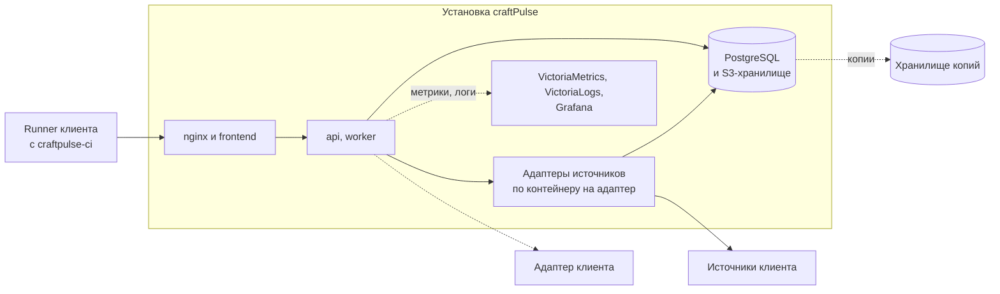

PostgreSQL и S3-хранилище в облаке - управляемые сервисы провайдера, в контуре - сервисы клиента или контейнеры из комплекта. Остальные контейнеры одинаковы во всех режимах.

| Режим | Организации | Вход | Хранилища | Обновление баз уязвимостей и правил |
|---|---|---|---|---|
| Облако | Много организаций в одной базе с row-level security | GitLab клиента или корпоративный SSO по тарифу | Управляемые PostgreSQL и S3-хранилище провайдера | `craftpulse-ci` получает их из публичных источников в CI клиента |
| В контуре клиента | Одна или несколько организаций клиента | GitLab или SSO клиента | PostgreSQL и S3-совместимое хранилище клиента либо поставляемые в комплекте | Внутренний источник обновлений; `api` при установке показывает дату базы, `craftpulse-ci` пишет её версию в манифест, и она видна рядом с результатами (UC-01 A2) |
| Демонстрационный стенд | Две организации для проверки изоляции | GitLab | PostgreSQL и S3-совместимое хранилище в составе стенда | Закреплённые версии из манифеста стенда |

Во всех режимах используются одни и те же образы. Различаются только конфигурация и секреты (раздел 14.2). Облачной организации нужен сетевой доступ к источникам клиента и его адаптерам; при источниках, недоступных извне, клиент выбирает установку в контуре.

Проверки во всех режимах выполняются на runner клиента. craftPulse поставляет образы `craftpulse-ci` и фрагмент CI, а код клиента на своих машинах не исполняет. Runner демонстрационного стенда принадлежит команде и обрабатывает только тестовые репозитории.

Адрес и ключ адаптера, который клиент развернул у себя (раздел 10.2), администратор указывает в подключении; ключ хранится в `connect` в зашифрованном виде.

#### 10.9. Последующие поставки в тех же модулях

| Возможность | Модуль | Что добавляется |
|---|---|---|
| Redmine, Jira Cloud, Яндекс Трекер, GitVerse и другие источники | Адаптеры | Новый сервис адаптера с тем же контрактом |
| Два трекера в одном проекте, зеркала (F-21) | `link`, `calc` | Группы зеркал с authority полей, расчёт по группе |
| История спринта, DoD, возвраты, инициативы, доставка и бизнес-цепочка (F-11, F-13-F-15, F-17, F-20) | `process`, `calc`, `link` | Версии DoD, определения показателей M1 |
| Горячие точки, карта сервиса, задача техдолга (F-33, F-37, F-38) | `change`, `org`, `outbound` | Определения, карта компонентов, запись в трекер через журнал внешних действий |
| Паспорт релиза и переоценка по новой базе (F-39) | `change` | Адаптер системы доставки, составы по digest. Переоценка сопоставляет сохранённый SBOM с новой версией базы уязвимостей в `worker`: на вход идёт только SBOM как данные, код клиента не исполняется |
| Обязательные проверки (UC-31) | `decision`, `change` | Вердикт политики в сводке MR |
| Wiki и влияние изменения API на документацию (F-60 M1, F-62, F-63) | `docs`, адаптеры | Проверки wiki, обязательства по версии контракта |
| Прогноз, маршрут ревью, отбор тестов, учения, сбои после развёртываний, стоимость CI, доступность извне, межкомандные передачи (UC-39-UC-42, UC-45-UC-48) | `calc`, `change`, `docs` | Методы с версией, входной когортой и проверкой на истории (BR-021) |
| Поиск по документации (UC-43) | `docs` | Полнотекстовый индекс PostgreSQL по разрешённым версиям документов |
| Pulse-опрос (UC-44) | `survey` | Отдельный модуль с правилами Q-02 |

Новые поставки добавляют сервисы адаптеров, а модули и задания очереди - в те же процессы `api` и `worker`. При росте нагрузки запускаются дополнительные экземпляры `worker` и нагруженных адаптеров.

### 11. Технологии и решения

Стек задан проектом: Go, React + TypeScript и PostgreSQL. Каждая строка таблицы связана с требованием или решением раздела 10. Версии и лицензии проверены по страницам проектов и реестрам пакетов 11 ноября 2026 года (ссылки под таблицей). Точная версия каждой зависимости фиксируется lock-файлами и манифестом выпуска. Обновление проходит обычный PR с проверками.

| Область | Выбор | Причина и связанное требование | Рассмотренная альтернатива | Последствия / ограничения |
|---|---|---|---|---|
| Структура сервера | Ядро - модульный монолит: бинарники `api` и `worker`, модули с владением таблицами, код по слоям Clean Architecture (раздел 10.3). Адаптеры источников - отдельные сервисы. Всё в одном Go-модуле | Журнал приёма, checkpoint и следующее задание сохраняются одной транзакцией ядра (FR-006, NFR-009); учётные данные каждого источника изолированы в его адаптере от `api` и других адаптеров (NFR-014); сбой адаптера не останавливает обработку других источников; клиент подключает адаптер своей системы по тому же контракту | Адаптеры модулями внутри `api` и `worker`; отдельные сервисы для модулей ядра | `api` и `worker` выпускаются вместе одной версией, адаптеры - своими версиями в пределах поддержанных версий контракта. Проверка прав на чтении проходит через вызов адаптера, поэтому адаптер должен быть доступен так же, как `api`. Границы слоёв проверяет depguard в golangci-lint |
| Контракт адаптеров | HTTP, спецификация `adapter.yaml` в OpenAPI 3.1.2 с номером версии: `Fetch` отдаёт пакет tar.gz потоком, остальные операции - JSON; общая Go-библиотека `pkg/adaptersdk` для встроенных адаптеров | Адаптер клиента пишется на любом языке по опубликованной спецификации; генерация кода та же, что для API craftPulse; страницы фактов передаются тем же каноническим пакетом, что и импорт (FR-016) | gRPC | Ядро поддерживает текущую и предыдущую версию контракта; несовместимый адаптер не становится рабочим (FR-014); каждый встроенный адаптер проходит контрактные тесты по `adapter.yaml` в CI |
| Язык сервера | Go 1.27 | Сборка статического бинарника; дешёвые горутины для сбора, где основное время уходит на ожидание API источников; стандартная библиотека даёт TLS, HTTP и AES-GCM | Kotlin/JVM | Поддерживаются два последних выпуска Go; переход на следующий выпуск плановый, не реже раза в год |
| HTTP-сервер | gin v1 | Готовые middleware восстановления после panic, лимита тела и журналирования; поддерживается генератором серверного кода из OpenAPI; один каркас для всех обработчиков | `net/http` ServeMux с шаблонами методов | Обработчик только разбирает запрос, вызывает сценарий модуля и переводит ошибку в формат контракта |
| Проверка и документация контракта | Redocly CLI 2.77.0 - валидация и примеры, сборка документации; Spectral CLI 6.17.1 - правила стиля | Redocly проверяет каждый пример по схеме и собирает документацию Redoc одной командой; Spectral задаёт правила продукта, включая обязательный `x-craftpulse-action` (раздел 13.4) | Swagger UI и отдельный валидатор примеров | Версии закреплены в командах раздела 5.6; оба инструмента запускаются через `npx` и не требуют сервера |
| Контракт API | OpenAPI 3.1.2, contract-first: `openapi.yaml` первичен, серверные интерфейсы и типы клиента генерируются | Backend и frontend реализуются независимо по одному контракту; ошибки, пагинация и частичные результаты заданы в одном месте (`openapi.yaml` и раздел 5) | Code-first: спецификация из аннотаций кода | Генератор сервера oapi-codegen v2.8 поддерживает OpenAPI 3.1 в начальном объёме: объединения типов, кроме пары с `null`, он не принимает (раздел 5.2). Конструкции контракта проверяются генерацией в CI |
| Типы клиента | openapi-typescript | Поддерживает OpenAPI 3.0 и 3.1; типы запросов и ответов frontend совпадают с контрактом | Ручные типы | Генерация входит в проверку frontend; расхождение с контрактом ломает сборку |
| СУБД | PostgreSQL 18 | Транзакции для журнала приёма, checkpoint и очереди; row-level security для изоляции организаций (NFR-010); `jsonb` для исходных полей источников; ограничения `EXCLUDE` для интервалов; секционирование больших таблиц результатов, когда этого потребует объём (раздел 12.10); полнотекстовый поиск документов M2 | ClickHouse или отдельная аналитическая БД; MongoDB | Поддержка версии до 14.11.2030. Агрегаты считает `calc` в Go и сохраняет ревизиями, поэтому профиль S (100 000 событий задач, 40 000 запусков CI) обслуживает одна PostgreSQL |
| Доступ к БД | pgx v5, запросы на SQL с генерацией типизированного кода sqlc v1.31 | SQL виден в ревью и проверяется на реальной схеме при генерации; без отражения и скрытых запросов ORM | ORM (GORM), построитель запросов squirrel | Динамических запросов немного: фильтры отчётов применяются к готовой ревизии. Редкие динамические запросы пишутся на pgx напрямую |
| Миграции | goose v3.30, SQL-файлы в репозитории; миграции очереди через API миграций River | Режим без транзакции для `CREATE INDEX CONCURRENTLY`; запуск отдельной командой `api migrate` (раздел 14.4) | golang-migrate, Atlas | Down-миграции не применяются в эксплуатации; совместимость обеспечивается expand-contract |
| Очередь и расписание | River v0.51 (MPL-2.0) поверх PostgreSQL | Постановка задания и его завершение в транзакции данных (`InsertTx`, `JobCompleteTx`); уникальность среди активных заданий против повторной постановки; периодические задания (NFR-005); отложенный повтор по `Retry-After` без траты попыток; именованные очереди с отдельными слотами; возврат заданий умершего процесса (NFR-009) | Своя таблица с `SKIP LOCKED`; RabbitMQ, NATS, Kafka | Очередь живёт в той же базе и том же бэкапе. River ещё не вышел в 1.0, поэтому версия закреплена, а обновление идёт отдельным PR с тестами очереди. Пересмотреть, если отставание очереди станет систематическим при штатном числе `worker` |
| Объектное хранилище | S3 API; клиент aws-sdk-go-v2. В контуре - S3 клиента или SeaweedFS 4 (Apache-2.0) из комплекта; в облаке - управляемое хранилище провайдера | Пакеты до 100 MiB после распаковки читаются потоком; процессы ядра не хранят файлов между заданиями, любой экземпляр `api` и `worker` читает тот же объект; карантин и сроки хранения по классам (Q-08) | Хранение пакетов в PostgreSQL; локальный том; MinIO; Garage | MinIO архивирован 25.04.2026, community-версия поставляется только исходным кодом; Garage распространяется под AGPL-3.0. Хранилище копируется вместе с БД (раздел 14.8) |
| Конфигурация | Переменные окружения, секреты файлами; caarlos0/env v11 | Проверка обязательных значений при старте: без них процесс не запускается и перечисляет недостающее (FR-011 A1) | Файлы YAML в образе | Список параметров ведётся в `.env.example` каждого процесса |
| Шифрование учётных данных | AES-256-GCM из стандартной библиотеки, envelope-схема в `pkg/crypto`, её использует `pkg/adaptersdk`: в базе адаптера ключ данных организации зашифрован мастер-ключом этого адаптера | Токены источника хранятся только в его адаптере и не открытым текстом; смена мастер-ключа перешифровывает только ключи данных (NFR-014). Тем же способом `connect` шифрует ключи адаптеров клиентов, а `auth` - секреты клиентов OIDC организаций | Vault или OpenBao | У каждого адаптера свой мастер-ключ, он хранится по процедуре раздела 14.2; его потеря требует повторного ввода учётных данных подключений этого адаптера |
| Чтение Git | git CLI в контейнере адаптера `git`: частичный клон, отключённые hooks, фильтры LFS и подмодули, запрет протокола `file` | Полная поддержка протоколов и частичного клона, работа с большими репозиториями без загрузки всей истории в память; содержимое репозитория не исполняется (раздел 2.1) | go-git | Версия git закреплена в образе адаптера; время, объём кэша клонов и память ограничены контейнером адаптера |
| Логи | zerolog, JSON в stdout | Структурные поля correlation ID, организации, подключения, задания и кода причины для поиска сбоя (NFR-018); маскирование секретов до записи (NFR-014) | `log/slog` | Один формат у `api`, `worker`, адаптеров и `craftpulse-ci`; correlation ID передаётся в вызов адаптера заголовком |
| Метрики, логи, алерты | Экспозиция prometheus/client_golang; хранение VictoriaMetrics v1.156 и VictoriaLogs (Apache-2.0); дашборды и алерты Grafana | Отставание сбора по подключению, возраст last success, очередь, ошибки приёма и публикации (NFR-005, NFR-018) | Prometheus и Loki | Grafana поставляется без изменений исходного кода |
| Обратный прокси | nginx, стабильная ветка | TLS с сертификатом площадки или клиента (NFR-013), раздача frontend, `client_max_body_size 25m` и таймауты на границе (NFR-015), повтор запроса на другом экземпляре `api` при ответе 503 | HAProxy | Конфигурация хранится в репозитории вместе с compose |
| Вход | OIDC через GitLab, корпоративный SSO по тарифу | UC-03, FR-013; собственных паролей нет | Собственная парольная система; самодостаточные JWT вместо серверной сессии | go-oidc v3.21 (Apache-2.0) проверяет ID-токен по discovery провайдера, golang.org/x/oauth2 v0.38 (BSD-3-Clause) ведёт код авторизации и PKCE. Сессия серверная в PostgreSQL: отзыв действует со следующего запроса (раздел 13.2) |
| Frontend | SPA: React 19 и TypeScript 6.0 в строгом режиме, сборка Vite 8, структура Feature-Sliced Design, компоненты Gravity UI 8 (MIT) | Приложение работает за входом, поэтому собирается в статический артефакт и раздаётся nginx без отдельного процесса, в том числе в контуре клиента (F-06). Компоненты таблиц, форм и навигации Gravity UI настраиваются токенами дизайн-системы раздела 6.3. FSD задаёт границы слоёв и публичные API срезов. Данные и решения о доступе приходят только из API craftPulse (FR-001) | Next.js с серверным рендерингом; TypeScript 7 | Типы запросов генерируются из `openapi.yaml`; проверка frontend входит в CI репозитория. TypeScript 7 подключается, когда его поддержит typescript-eslint: версия 8.72 работает с TypeScript до 6.0 |
| Данные, маршруты и графики frontend | TanStack Query 5, React Router 8, Gravity UI Charts 2 (все MIT) | Query кэширует ответы API по ключу с ID ревизии, повторяет запросы и показывает состояния загрузки и ошибки единообразно. Router задаёт прямые ссылки на отчёт, раскрытие и сохранённый срез, которые проверяются так же, как переход из интерфейса (FR-001). Графики рядов ревизии (отчёт команды, раскрытие точки) строятся компонентами той же дизайн-системы | Состояние сервера в собственном store; Recharts или ECharts | Ответ с другим ID ревизии считается новым значением, поэтому экран не смешивает две ревизии (FR-009) |
| Тесты frontend | Vitest 5 и Testing Library (MIT) для логики и компонентов, Playwright 1.65 (Apache-2.0) для сценариев в браузере | Vitest работает на конфигурации Vite; Playwright проверяет основные пути в Chromium и Firefox, как требует NFR-017, и доступность с клавиатуры (NFR-016) | Jest; Cypress | Сценарии Playwright идут на стенде с набором данных показа |
| Проверки в CI клиента | `craftpulse-ci`: Go CLI и OCI-образы профилей с закреплёнными Lizard, jscpd, golangci-lint, Ruff, ESLint/typescript-eslint, ShellCheck, Opengrep, Trivy, Gitleaks, Spectral; разбор Markdown на goldmark | Код и конфигурация клиента выполняются в его CI (раздел 2.1, UC-25); версии инструментов, правил и баз попадают в манифест (DR-009); значения найденных секретов удаляются до отправки (BR-017) | Запуск анализаторов в `worker`. Сопоставление сохранённого SBOM с базой уязвимостей на M1 анализатором кода не является: на вход идут только данные | Образы разделены по профилям, и фрагмент CI подключает только нужные, поэтому runner скачивает и кэширует меньше. ShellCheck входит в профиль M0 для репозиториев с shell-скриптами; в срез MVP входят инструменты из [состава поставки MVP](mvp-scope.md#что-поставляет-craftpulse). Образы версионируются отдельно от сервера и закрепляются во фрагменте CI по digest. Время профиля ограничено NFR-003 |
| Тесты сервера | testify; testcontainers-go с PostgreSQL 18 и SeaweedFS; контрольные наборы V-01-V-41 как табличные тесты `calc`; записанные ответы источников и реальные тестовые экземпляры для адаптеров; контрактные тесты адаптеров по `adapter.yaml` | Основные ошибки живут в SQL, транзакциях и разборе источников; AC-02 требует сверки на реальных экземплярах | Моки репозиториев | Интеграционные тесты требуют Docker в CI |
| Поставка | OCI-образы по digest, Docker Compose | Один и тот же артефакт во всех средах; установка в контуре без кластерной платформы (F-06, UC-01) | Kubernetes и Helm | Масштабирование `worker` - числом реплик в compose; резервирование M0 - копии и восстановление по разделу 14.8 |
| Секреты инфраструктуры | SOPS + age, зашифрованные файлы в репозитории развёртывания | Пароли ролей БД, ключи хранилищ, секрет OIDC-клиента, мастер-ключи адаптеров и `connect`, служебные ключи адаптеров восстанавливаются вместе с конфигурацией (NFR-022) | Vault, файлы только на сервере | Конфигурацию расшифровывает оператор выката своим ключом age; на сервер попадают только файлы секретов процессов. Закрытый ключ age и закрытый ключ копий на сервере не хранятся (раздел 14.2) |
| Резервные копии | `pg_dump` в архивном формате и роли, шифрование age, копирование dump во внешнее хранилище копий; бакет копирует rclone 1.76 (MIT) с дозаписью новых объектов и манифестом копии | RPO 24 ч и проверка восстановления (NFR-020-NFR-022) | Физический бэкап с архивом WAL | Точка восстановления - последняя копия; при RPO меньше суток (Q-05) добавляется архив WAL |

Источники версий и лицензий, проверено 11 ноября 2026 года: [Go](https://go.dev/doc/devel/release), [PostgreSQL](https://www.postgresql.org/support/versioning/), [River](https://github.com/riverqueue/river/releases), [документация River](https://riverqueue.com/docs/unique-jobs) и [настройка возврата зависших заданий](https://github.com/riverqueue/river/blob/master/client.go), [oapi-codegen](https://github.com/oapi-codegen/oapi-codegen/releases), [openapi-typescript](https://github.com/openapi-ts/openapi-typescript/blob/main/packages/openapi-typescript/README.md), [goose](https://github.com/pressly/goose/releases), [sqlc](https://github.com/sqlc-dev/sqlc/releases), [SeaweedFS](https://github.com/seaweedfs/seaweedfs/releases), [MinIO](https://github.com/minio/minio), [VictoriaMetrics](https://github.com/VictoriaMetrics/VictoriaMetrics/releases), [VictoriaLogs](https://github.com/VictoriaMetrics/VictoriaLogs), [rclone](https://github.com/rclone/rclone/releases); версии и лицензии frontend - по реестру npm: [React](https://www.npmjs.com/package/react), [TypeScript](https://www.npmjs.com/package/typescript), [typescript-eslint](https://www.npmjs.com/package/typescript-eslint), [Vite](https://www.npmjs.com/package/vite), [Gravity UI](https://www.npmjs.com/package/@gravity-ui/uikit), [Gravity UI Charts](https://www.npmjs.com/package/@gravity-ui/charts), [TanStack Query](https://www.npmjs.com/package/@tanstack/react-query), [React Router](https://www.npmjs.com/package/react-router), [Vitest](https://www.npmjs.com/package/vitest), [Testing Library](https://www.npmjs.com/package/@testing-library/react), [Playwright](https://www.npmjs.com/package/@playwright/test).

### 12. Структура БД и жизненный цикл данных

Раздел задаёт физическую модель данных ядра и адаптеров в PostgreSQL 18. Логические требования к данным - раздел 4.2 (DR-001-DR-018), владение таблицами - раздел 10.3: у каждого модуля своя схема, и другой модуль читает его данные только через публичный интерфейс. Миграции пишутся по этой модели при реализации; правила их выполнения - раздел 12.10.

#### 12.1. Почему PostgreSQL

Основная нагрузка craftPulse - запись фактов с проверкой повтора, транзакции «факты + checkpoint + следующее задание», изоляция организаций и выдача уже посчитанных ревизий. Агрегаты считает `calc` в Go и сохраняет рядами, поэтому на чтении база выбирает строки по ключу, а не выполняет аналитический просмотр всей истории.

| Запрос или требование | Чем его обеспечивает PostgreSQL | Требования |
|---|---|---|
| Повтор доставки распознаётся атомарно, без гонки «проверил - вставил» | `INSERT ... ON CONFLICT DO NOTHING` по частичному уникальному индексу журнала приёма (раздел 12.6) | FR-004, NFR-007 |
| Журнал приёма, checkpoint, следующее задание и завершение текущего сохраняются вместе | Одна транзакция: очередь River живёт в той же базе (раздел 11) | FR-006, NFR-009 |
| Строки одной организации недоступны другой даже при ошибке в запросе | Row-level security для роли приложения, составные внешние ключи с `organization_id` | NFR-010, SEC-11 |
| Интервалы состава команд и проектов не перекрываются | Ограничение `EXCLUDE` по `tstzrange` | FR-012, BR-007 |
| Срез воспроизводится на номер знания | B-tree по объекту, фильтр по `known_seq`; ревизии расчёта неизменяемы | FR-005, FR-009, BR-024 |
| Раскрытие показателя до объектов когорты | Чтение вкладов по первичному ключу точки ряда | FR-021 |
| Инварианты настроек при одновременном подтверждении | Уникальный номер версии вместо проверки в коде | FR-007, FR-008 |
| Полнотекстовый поиск по документации на M2 | `tsvector` с индексом GIN | UC-43 |

Аналитическая СУБД вроде ClickHouse не даёт транзакций вместе с очередью и уникальности при вставке, а без них не выполняются FR-004 и FR-006. Профиль S (раздел 8.2) обслуживает одна база PostgreSQL. Быстрее остальных растут выполнения тестов и вклады объектов в ревизии: их объём зависит от числа тестов в отчётах и длины окон; для этих таблиц предусмотрено секционирование (раздел 12.10). Ограничения выбранной модели перечислены в разделе 12.10.

#### 12.2. Устройство базы и общие правила

**Базы и схемы.** Ядро использует базу `craftpulse`. Каждый адаптер работает со своей базой (раздел 12.5.9), и роль ядра к ней доступа не имеет. Базы создаются в кодировке UTF8 с локалью встроенного провайдера `C.UTF-8`: порядок строк в индексах не зависит от версии glibc операционной системы, поэтому обновление ОС под базой не портит индексы. Если поставщик управляемой БД не даёт встроенный провайдер, используется локаль `C`. Сортировку для человека, например список команд по алфавиту, выполняет приложение. Часовой пояс сервера - UTC. Из расширений нужен `btree_gist` для ограничений `EXCLUDE`; проверка установки (FR-011) проверяет его наличие и локаль базы.

Схема совпадает с именем модуля: `org`, `auth`, `access`, `audit`, `install`, `connect`, `sync`, `ingest`, `normalize`, `link`, `process`, `decision`, `change`, `calc`, `view`, `outbound`, `docs`, на M2 `survey`. Схема `platform` не принадлежит модулю: реестр организаций и счётчик знания (раздел 12.6) ведёт репозиторий `internal/repo/persistent/platform`, а саму схему и таблицы River создаёт общая миграция ядра.

**Роли.**

| Роль | Кто использует | Права | Почему так |
|---|---|---|---|
| `craftpulse_owner` | `api migrate`, восстановление (раздел 14.8) | Владеет схемами и таблицами: DDL, миграции, `pg_restore` | Процессы приложения работают без прав владельца. На владельца политика RLS не действует, потому что `FORCE ROW LEVEL SECURITY` не включается, поэтому миграция видит строки всех организаций |
| `craftpulse_backup` | Задание копирования (раздел 14.8) | Только `SELECT`; на каждой таблице с RLS политика `FOR SELECT TO craftpulse_backup USING (true)` | `pg_dump --enable-row-security` под этой ролью снимает строки всех организаций, а записать или изменить схему роль не может. `BYPASSRLS` не нужен (проверено на PostgreSQL 18.6) |
| `craftpulse_app` | `api`, `worker` | `SELECT`, `INSERT`, `UPDATE`, `DELETE` на таблицы модулей и River; в `audit.event` без `UPDATE`; `NOBYPASSRLS`; владельцем таблиц не является | Права `TRUNCATE`, `REFERENCES` и DDL не выдаются: `TRUNCATE` очищает таблицу целиком в обход row-level security, это проверено на PostgreSQL 18.6 |
| `adapter_<имя>_owner` и `adapter_<имя>` | Миграции базы адаптера; работающий адаптер. Копию базы адаптера снимает `craftpulse_backup` по той же политике | Владелец базы адаптера; роль процесса адаптера с DML и `NOBYPASSRLS` | Учётные данные источника доступны только его адаптеру (NFR-014), а RLS базы адаптера действует на процесс адаптера |

`FORCE ROW LEVEL SECURITY` не используется осознанно. С ним политика действует и на владельца: на проверочной базе `UPDATE` под владельцем, как в миграции данных, молча изменил 0 строк из 2, а `pg_dump` завершился ошибкой «query would be affected by row-level security policy». Роль копирования с `BYPASSRLS` тоже не подходит: администратор управляемой БД без прав суперпользователя не может её создать («Only roles with the BYPASSRLS attribute may create roles with the BYPASSRLS attribute», проверено). Поэтому роль копирования получает отдельную политику только на чтение. Защиту от ошибки в коде даёт то, что приложение не владеет таблицами и не имеет `BYPASSRLS`, а политика копирования относится только к роли `craftpulse_backup`. Пароли ролей хранятся в секретах установки (раздел 14.2).

**Изоляция организаций.** В каждой таблице организации есть `organization_id uuid NOT NULL`. На таблице включён `ENABLE ROW LEVEL SECURITY` и две политики. Политика изоляции действует для `craftpulse_app` на все команды:

```sql
USING (organization_id = NULLIF(current_setting('craftpulse.org_id', true), '')::uuid)
WITH CHECK (organization_id = NULLIF(current_setting('craftpulse.org_id', true), '')::uuid)
```

`pkg/postgres` открывает транзакцию и первым оператором выполняет `set_config('craftpulse.org_id', $1, true)`. Значение живёт до конца транзакции, поэтому соединение из пула не переносит организацию в следующую. `NULLIF` нужен потому, что после завершения такой транзакции параметр в том же соединении равен пустой строке, а не NULL, и приведение `''::uuid` даёт ошибку. С `NULLIF` запрос без установленной организации получает пустой результат. Вторая политика - `FOR SELECT TO craftpulse_backup USING (true)` для копирования. Условие политики использует индекс по `organization_id`: проверено через `EXPLAIN` на PostgreSQL 18.6.

Под RLS условием индекса становится только оператор, помеченный `LEAKPROOF`: иначе PostgreSQL не проверяет его раньше условия политики. Равенство и сравнения `uuid`, `text`, `bigint`, `timestamptz` и `bytea` такими являются, а операторы диапазонов (`@>`, `&&`) нет. На проверочной базе запрос `valid @> now()` под ролью приложения использовал GiST-индекс только по равенствам, а дату проверял фильтром. Поэтому запросы по диапазону времени в модели сначала сужаются равенством по ключу (команда, проект, объект), а индексы по времени - B-tree по `timestamptz`.

Обходов RLS в модели нет:

- Представления создаются только с `security_invoker = true`. Обычное представление выполняется с правами владельца, и на проверочной базе роль приложения прочитала через него строки обеих организаций.
- Функции `SECURITY DEFINER` не используются.
- Уникальные ограничения на таблицах организаций всегда включают `organization_id`. Иначе ошибка уникальности при вставке выдала бы существование строки в другой организации.

Вне row-level security лежат только таблицы, по которым запрос узнаёт свою организацию, и реестр организаций (раздел 10.3): `platform.tenant`, `auth.login_route`, `auth.login_attempt`, `auth.session`, `auth.api_key`, `auth.upload_token` и `connect.webhook_route`. К ним добавляются таблицы уровня установки без `organization_id`: `install.protocol`, `install.check_result`, `calc.definition` и таблицы River. В аргументах заданий River лежат только ID и организация, без данных источников. Планировщик ежедневных заданий читает список организаций из `platform.tenant`: без него он работал бы без установленной организации и под RLS получил бы пустой список, и задания не ставились бы ни одной организации.

**Ключи.** Первичный ключ таблицы организации - `(organization_id, id)`, где `id uuid DEFAULT uuidv7()`. UUID версии 7 упорядочен по времени создания, поэтому вставка идёт в конец B-tree. Поиск по одному `id` использует тот же индекс: условие RLS даёт первую колонку. Внешний ключ внутри модуля составной `(organization_id, <поле>_id)`, поэтому строка не может сослаться на строку другой организации; это проверено вставкой. ID, которые работают как часть секретного адреса (`connect.webhook_route`), создаются `gen_random_uuid()`: UUID v7 раскрывает время создания и частично предсказуем.

Между модулями внешних ключей нет: поле `<сущность>_id` хранит ID, а модуль-владелец удаляет свои данные заданием (раздел 10.4). Внешний ключ между схемами связал бы порядок удаления и миграций разных модулей и мешал бы удалять данные по запросу. Ссылки между модулями помечены в словаре словом «ссылка». На ER-диаграммах они пунктирные и показаны там, где на диаграмме есть оба конца.

Каждый внешний ключ обеспечен индексом, который начинается с его колонок. Без такого индекса удаление родительской строки просматривает дочернюю таблицу целиком, потому что PostgreSQL не создаёт индекс на ссылающейся стороне сам.

Поведение при удалении по умолчанию - `ON DELETE RESTRICT`: строку с зависимыми удалить нельзя, и ошибка в порядке удаления видна сразу. `CASCADE` стоит только от владельца к подчинённым строкам, которые без него не имеют смысла:

- записи и конфликты приёма - от приёма;
- находки, выполнения тестов и покрытие - от отчёта;
- точки, вклады и интервалы - от части ряда;
- входы и части ревизии - от ревизии;
- правила - от версии сопоставления;
- строки матрицы - от версии профиля;
- входы и строки сводки - от её ревизии;
- переходы - от версии решения;
- области ключа API - от ключа;
- результаты проверок - от протокола установки.

Где ссылку нужно обнулить, пишется `ON DELETE SET NULL (<колонка>)` со списком колонок. Обычный `SET NULL` у составного ключа обнуляет и `organization_id`, и удаление падает на `NOT NULL`: это проверено на PostgreSQL 18.6. Так устроена `calc.revision.previous_revision_id`.

**Типы и ограничения.**

| Данные | Тип и правило | Почему |
|---|---|---|
| ID и ключи источников, имена веток | `text COLLATE "C"` с `CHECK (octet_length(x) BETWEEN 1 AND 255)` | Сравнение по байтам совпадает с семантикой источников. Длина ограничена, потому что строка B-tree не может быть больше 2 704 байт: проверено, вставка более длинного значения в индекс отклоняется. Значения от источника не должны ломать приём |
| Пути файлов и длинные ключи | `text COLLATE "C"` до 4 096 байт, без индекса по самой строке; для поиска хранится `path_hash` или `case_key_hash` (SHA-256) | Длинное значение не помещается в B-tree, хэш фиксированной длины помещается |
| Хэши содержимого | `bytea` с `CHECK (octet_length(x) = 32)` | Вдвое компактнее шестнадцатеричного текста |
| SHA Git | `text COLLATE "C"` с `CHECK (x ~ '^([0-9a-f]{40}\|[0-9a-f]{64})$')` | SHA-1 и SHA-256; значение показывается и ищется в том же виде, что в Git |
| Момент времени | `timestamptz`; исходное смещение события - `event_offset_s integer` в секундах | Хранится момент в UTC, смещение источника не теряется (BR-006). `timestamp` без пояса не используется |
| Длительность | `bigint` в секундах или миллисекундах | `interval` не используется: на проверочной базе `interval '1 day'` через переход на летнее время дал 23 часа, а BR-006 требует календарных секунд |
| Значения показателей и деньги | `numeric` | Без ошибок округления двоичной дроби; деньги - `numeric(18,4)` с валютой `char(3)` |
| Перечисления | `text` с `CHECK (x IN (...))` | Новое значение добавляется заменой ограничения (раздел 12.10). Значение, добавленное в тип `ENUM`, нельзя использовать в той же транзакции миграции (проверено), а удалить его из `ENUM` нельзя |
| Исходные поля без запросов по ним | `jsonb` | Хранятся для раскрытия и переразбора. Поле, по которому есть условие или соединение, выносится в колонку; индекс GIN по `jsonb` не создаётся, пока нет запроса по вхождению |
| Короткие неизменяемые списки | Массивы, например `date[]` выходных календаря | Читаются целиком и не участвуют в условиях |
| Признаки | `boolean NOT NULL` | Неизвестное значение - отдельное значение перечисления, а не NULL в булевом поле |

NULL означает только «значения нет». Причина отсутствия хранится отдельным полем там, где она нужна (раздел 4.2). Время бизнес-событий передаёт `pkg/clock` из приложения; `DEFAULT now()` не используется, иначе тесты с управляемыми часами (NFR-005, NFR-011) расходились бы с базой. Имена таблиц и колонок пишутся `snake_case` и не совпадают с зарезервированными словами SQL: нет таблицы `user` и колонок `window`, `offset`, `order`, `group`.

**Обозначения словаря** (раздел 12.5):

| Обозначение | Значение |
|---|---|
| `id` | `uuid DEFAULT uuidv7()`; первичный ключ таблицы `(organization_id, id)` |
| `ntext` | `text COLLATE "C"`, от 1 до 255 байт |
| `ptext` | `text COLLATE "C"`, до 4 096 байт, без индекса по значению |
| `hash` | `bytea`, ровно 32 байта (SHA-256) |
| `sha` | SHA Git в нижнем регистре |
| `x?` | Поле допускает NULL; остальные поля `NOT NULL` |
| `[знание]` | `known_seq bigint`, `superseded_seq bigint?`, `superseded_at timestamptz?`; `CHECK (superseded_seq > known_seq)` и `CHECK ((superseded_seq IS NULL) = (superseded_at IS NULL))` (раздел 12.6) |
| `[запись]` | `receipt_id uuid`, `record_no integer` - ссылка на запись журнала приёма |
| `[подтверждение]` | `confirmed_by uuid` (ссылка на `org.app_user`), `confirmed_at timestamptz`, `confirmation_id uuid`; `UNIQUE (organization_id, confirmation_id)` |
| Текущая версия | Частичный `UNIQUE (organization_id, <объект>) WHERE superseded_seq IS NULL`: у объекта не больше одной действующей версии |

`organization_id` входит в каждый ключ и индекс таблицы организации первым и в словаре не повторяется.

#### 12.3. ER-диаграммы

Диаграммы сгруппированы по этапам раздела 10.2. Сплошная линия - внешний ключ внутри модуля, пунктир - ссылка между модулями без внешнего ключа. В блоках показаны первичные (PK), внешние (FK) и уникальные (UK) ключи; `organization_id` входит в каждый ключ и не показан. Связь каждой таблицы с организацией не рисуется.

**ER-1. Организация, люди и роли**

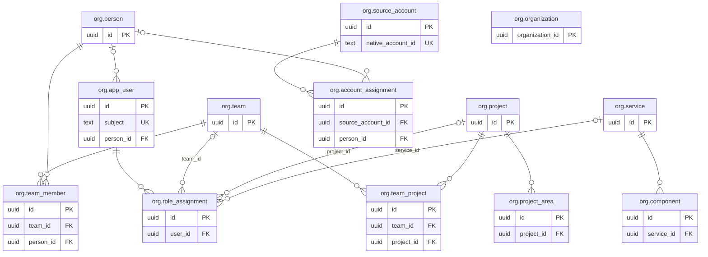

**ER-2. Вход, доступ, аудит и установка**

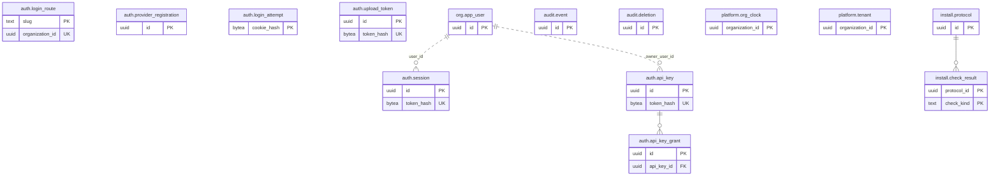

**ER-3. Подключения, сбор и приём**

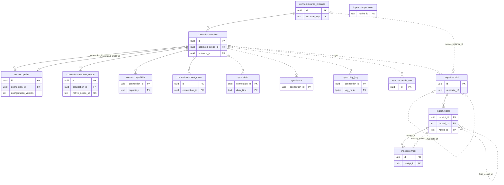

**ER-4. Канонические факты: объекты, задачи, MR и связи**

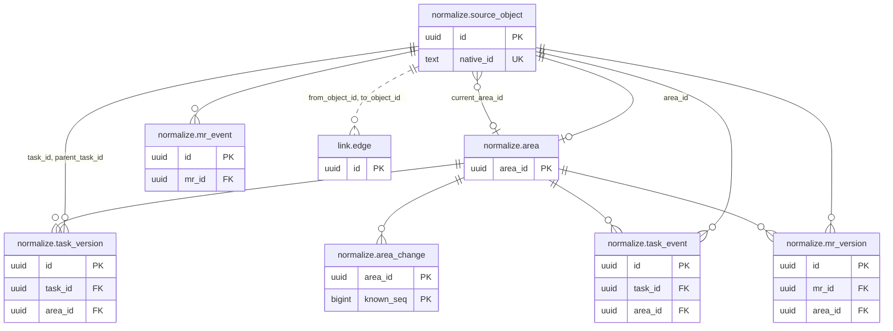

**ER-5. Факты CI, отчёты и документы**

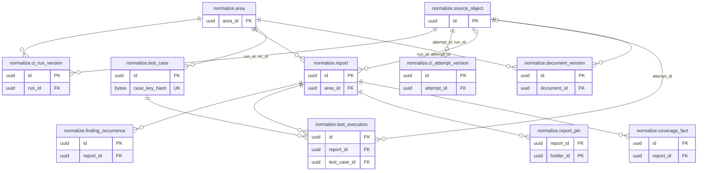

**ER-6. Настройки процесса, решения, профили и документация**

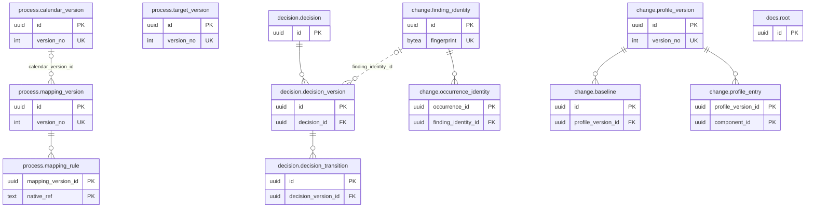

**ER-7. Ревизии расчёта и сохранённые срезы**

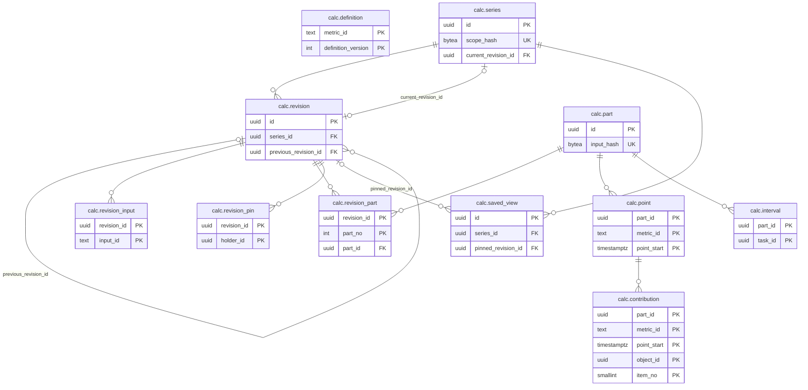

**ER-8. Сводки MR, публикация и выгрузки**

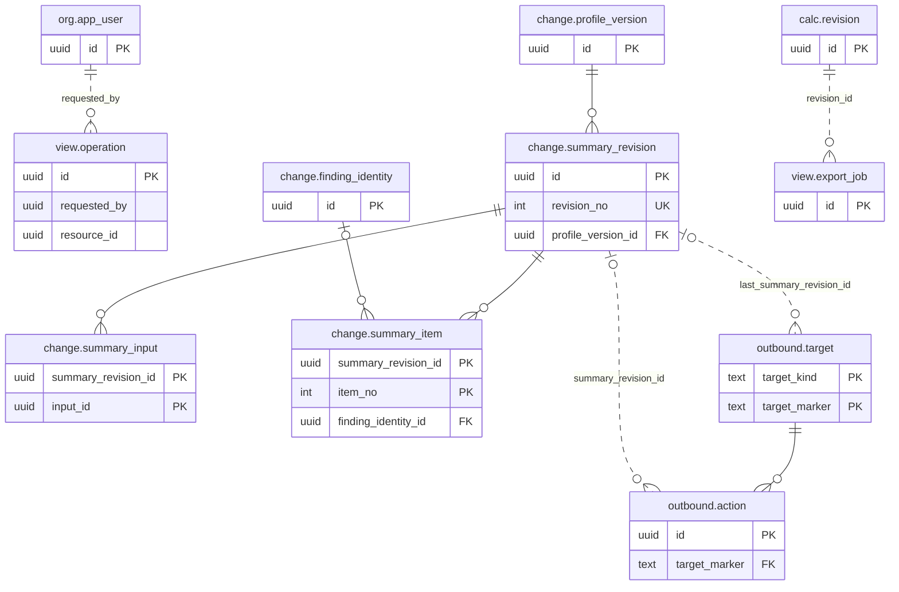

**ER-9. База адаптера**

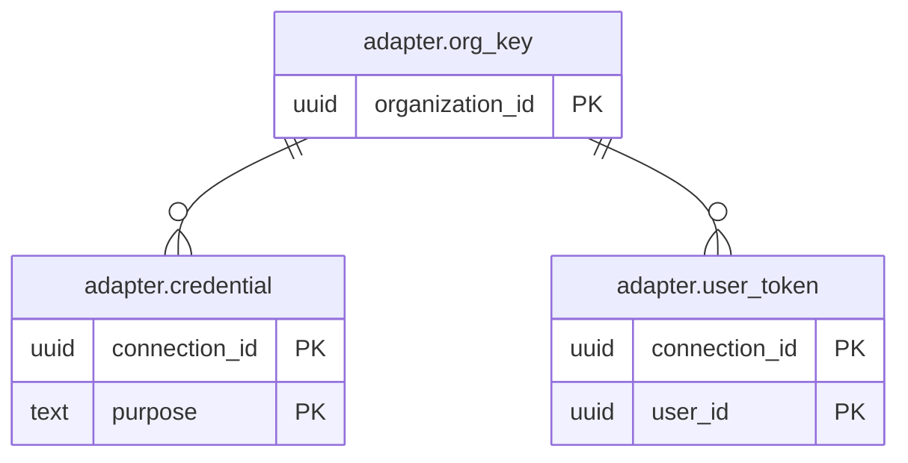

Таблицы M1 и M2 показаны на диаграммах ER-10-ER-12 в разделе 12.5.10.

#### 12.4. Идентичность внешних объектов

**Экземпляр и подключение.** Идентичность привязана к экземпляру источника (`connect.source_instance`), а не к подключению. Экземпляр определяется парой «провайдер, ключ экземпляра»: стабильный идентификатор, который адаптер получает при `Probe`, а если источник его не отдаёт - нормализованный базовый адрес. Подключение - способ читать экземпляр: учётные данные, адаптер и область. Поэтому два подключения к одному Jira, повторное подключение после удаления и универсальный импорт, который объявил в манифесте тот же экземпляр, приводят к одним и тем же объектам, а не к копиям. Если у экземпляра сменился адрес, администратор подтверждает, что это тот же экземпляр, и меняется только `base_url`. Одну область экземпляра собирает одно активное подключение: это ограничение `connect.connection_scope`.

**Ключ объекта.** Каноническая идентичность - `(organization_id, instance_id, object_kind, native_ns, native_id)` с уникальностью в `normalize.source_object` (BR-001). `native_ns` - пространство имён, в котором ID источника уникален. Он пустой, если ID уникален во всём экземпляре. Правило пространства имён объявляет адаптер для каждого вида объекта в контракте `adapter.yaml`; смена правила - миграция идентичности, а не правка данных.

| Источник и вид объекта | `native_ns` | `native_id` | Изменяемое и потому не входящее в ключ |
|---|---|---|---|
| Задача Jira DC | пусто | Числовой ID задачи | Ключ `PROJ-12`, проект, статус. Перенос задачи меняет проект в новой версии, а не идентичность |
| Изменение истории Jira | ID задачи | ID changelog и ID поля | - |
| Проект и MR GitLab | пусто | Глобальный ID проекта и MR | Путь проекта, `iid` MR, название |
| Pipeline и job GitLab CI | пусто | ID pipeline; ID job, новый у каждой повторной попытки | Имя job. Логический job задаётся `job_key` и отпечатком конфигурации матрицы |
| Репозиторий и PR GitHub.com | пусто | Числовой ID репозитория и PR | Владелец и имя репозитория, номер PR, название |
| Запуск и job GitHub Actions | ID запуска workflow для job, иначе пусто | ID запуска; номер попытки запуска и ID job | Имя workflow и job. Повторный запуск сохраняет ID запуска и увеличивает номер попытки |
| Сборка Jenkins | Полное имя job | Номер сборки | - |
| Проект, анализ и замечание SonarQube | пусто для проекта; ключ проекта для анализа и замечания | Ключ проекта; ключ анализа; ключ замечания | Название проекта, ветка, строка замечания |
| Репозиторий адаптера `git` | пусто | Нормализованный адрес remote | Ветки и теги; коммит задаётся SHA |
| Страница Confluence DC | пусто | ID страницы | Заголовок, пространство |
| Документ в Git | ID репозитория | Путь от корня | Версия - SHA blob |
| Универсальный импорт | Пространство, объявленное в манифесте | ID из пакета | По контракту импорта |
| Тестовый случай | Область (репозиторий) | SHA-256 от «набор, класс, имя» | - |

Если у источника нет устойчивого ID, адаптер объявляет детерминированную идентичность из исходных координат. Объект получает `identity_quality = 'derived'`; при недоказанной уникальности - `uncertain`, и `calc` не допускает его к точному счёту (BR-001). Одинаковое имя или ключ никогда не объединяет объекты.

**Один и тот же внешний ID в разных местах.**

| Случай | Результат по ключам | Основание |
|---|---|---|
| Задача с тем же ключом `A` в другом экземпляре Jira (`J1/P/A` и `J2/P/A`) | Две строки `source_object`: различается `instance_id` | V-17, V-22 |
| MR с одинаковым `iid` в двух проектах GitLab | Два объекта: в ключе глобальный ID, `iid` - атрибут версии | BR-001 |
| Сборка Jenkins `#7` двух разных jobs | Два объекта: различается `native_ns` | BR-001 |
| Тот же объект во втором подключении того же экземпляра | Тот же объект: ключ не содержит подключения | FR-004 |
| Тот же ID в другой организации | Разные строки: `organization_id` в ключе, RLS скрывает чужую | NFR-010 |

**Учётные записи и люди.** Учётная запись источника (`org.source_account`) уникальна по `(instance_id, native_account_id)`. Человек (`org.person`) - отдельная сущность. Связь учётной записи с человеком и вид участника (человек, бот, система) хранит `org.account_assignment` с версиями знания: у учётной записи одна действующая привязка, а изменение признака бота создаёт новую версию и пересчёт (FR-018). Пользователь craftPulse (`org.app_user`) уникален по паре «issuer провайдера, `sub`» (раздел 13.1). Совпадение логина, почты или имени создаёт только предложение.

**Объекты разных экземпляров, описывающие одну работу.** Задачи двух трекеров остаются разными объектами. Одну задачу из них делает только подтверждённая PM группа зеркал M1 (`link.mirror_group`, BR-016).

#### 12.5. Словарь данных

Обозначения - в разделе 12.2. В столбце «Индексы» первичный ключ не повторяется, если отдельного запроса к нему нет; у каждого индекса указан запрос, ради которого он нужен. Индексы на пустых новых таблицах создаются в той же миграции, что и таблица.

##### 12.5.1. Счётчик знания и структура организации

| Таблица | Назначение | Поля и типы | Ключи и связи | Ограничения | Индексы и запрос |
|---|---|---|---|---|---|
| `platform.tenant` | Реестр организаций для планировщика. Вне RLS | `organization_id uuid`; `status text`; `created_at timestamptz` | PK (`organization_id`) | `status IN ('active','blocked','deleting')`; строка создаётся и удаляется в одной транзакции с `org.organization` | PK. Планировщик ставит ежедневные задания каждой организации и повторно применяет журнал удалений после восстановления. Строка не содержит других данных организации |
| `platform.org_clock` | Номер знания организации (раздел 12.6) | `organization_id uuid`; `last_seq bigint`; `reproducible_from_seq bigint` | PK (`organization_id`) | `last_seq >= 0`; `reproducible_from_seq <= last_seq`; `fillfactor = 50` | Только PK: `UPDATE ... SET last_seq = last_seq + 1 RETURNING last_seq`. Свободное место на странице даёт HOT-обновления без роста индекса |
| `org.organization` | Организация (tenant) | `organization_id uuid`; `name text`; `status text`; `first_admin_issuer text`; `first_admin_subject ntext`; `first_admin_user_id uuid?`; `structure_version bigint`; `created_at timestamptz` | PK (`organization_id`) | `status IN ('setup','active','blocked','deleting')`; `structure_version >= 0` | Только PK. `structure_version` - оптимистическая проверка при сохранении структуры (FR-008) |
| `org.team` | Команда | `id`; `name text`; `status text`; `created_at timestamptz` | PK (`id`) | `status IN ('active','archived')`; длина `name` 1-200 | Только PK |
| `org.project` | Проект | Как `org.team` | PK (`id`) | Как `org.team` | Только PK |
| `org.service` | Сервис | Как `org.team` | PK (`id`) | Как `org.team` | Только PK |
| `org.component` | Компонент: путь в репозитории внутри сервиса | `id`; `service_id uuid`; `repository_area_id uuid`; `path_prefix ptext`; `status text`; `origin text`; `[знание]`; `confirmed_by uuid?`; `confirmed_at timestamptz?` | PK (`id`); FK `service_id` → `org.service`; ссылка `repository_area_id` → `normalize.area` | `status IN ('proposed','confirmed','rejected')`; `origin IN ('manifest','manual')`; подтверждённый имеет автора; `path_prefix` до 1 024 байт, пусто - весь репозиторий | UNIQUE (`service_id`, `repository_area_id`, `path_prefix`) WHERE `superseded_seq IS NULL` - один действующий компонент на путь, он же индекс FK; (`repository_area_id`) WHERE `superseded_seq IS NULL AND status = 'confirmed'` - какие компоненты покрывают репозиторий отчёта |
| `org.team_project` | Проекты команды во времени | `id`; `team_id uuid`; `project_id uuid`; `valid tstzrange`; `[знание]` | PK (`id`); FK `team_id` → `org.team`; FK `project_id` → `org.project` | `EXCLUDE USING gist (organization_id WITH =, team_id WITH =, project_id WITH =, valid WITH &&) WHERE (superseded_seq IS NULL)`; `valid` вида `[from,to)` с непустой нижней границей | GiST ограничения: проекты команды по `team_id`, дата проверяется фильтром по немногим строкам команды; (`project_id`) - индекс FK и команды проекта |
| `org.project_area` | Области источников проекта: проект трекера, репозиторий, пространство wiki | `id`; `project_id uuid`; `area_id uuid`; `valid tstzrange`; `[знание]` | PK (`id`); FK `project_id` → `org.project`; ссылка `area_id` → `normalize.area` | `EXCLUDE` по (`project_id`, `area_id`, `valid`) как у `org.team_project` | GiST ограничения: области проекта; (`area_id`) WHERE `superseded_seq IS NULL` - каким проектам принадлежит область при проверке доступа |
| `org.team_member` | Состав команды во времени | `id`; `team_id uuid`; `person_id uuid`; `valid tstzrange`; `[знание]` | PK (`id`); FK `team_id` → `org.team`; FK `person_id` → `org.person` | `EXCLUDE` по (`team_id`, `person_id`, `valid`) | GiST ограничения: состав команды; (`person_id`) WHERE `superseded_seq IS NULL` - базовая область пользователя по составу команд (раздел 7.1) |
| `org.person` | Человек, бот или служебный участник | `id`; `display_name text?`; `kind text`; `anonymized_at timestamptz?`; `created_at timestamptz` | PK (`id`) | `kind IN ('human','bot','system','unknown')`; после обезличивания `display_name IS NULL` | Только PK |
| `org.source_account` | Учётная запись в экземпляре источника | `id`; `instance_id uuid`; `native_account_id ntext`; `login text?`; `display_name text?`; `email text?`; `proposed_kind text`; `anonymized_at timestamptz?`; `first_seen_at timestamptz` | PK (`id`); ссылка `instance_id` → `connect.source_instance` | UNIQUE (`instance_id`, `native_account_id`); `proposed_kind` как `org.person.kind`; после обезличивания `login`, `display_name`, `email` пусты | UNIQUE - поиск учётной записи при нормализации событий |
| `org.account_assignment` | Подтверждённая привязка учётной записи к человеку и вид участника | `id`; `source_account_id uuid`; `person_id uuid?`; `actor_kind text`; `[знание]`; `[подтверждение]` | PK (`id`); FK `source_account_id` → `org.source_account`; FK `person_id` → `org.person` | `actor_kind IN ('human','bot','system','unknown')`; `actor_kind <> 'human' OR person_id IS NOT NULL` | UNIQUE (`source_account_id`) WHERE `superseded_seq IS NULL` - одна действующая привязка, индекс FK; (`person_id`) WHERE `superseded_seq IS NULL AND person_id IS NOT NULL` - учётные записи пользователя для `CheckAccess` |
| `org.app_user` | Пользователь craftPulse | `id`; `issuer text`; `subject ntext`; `person_id uuid?`; `display_name text?`; `status text`; `created_at timestamptz`; `blocked_at timestamptz?` | PK (`id`); FK `person_id` → `org.person` | UNIQUE (`issuer`, `subject`); `status IN ('active','blocked')`; `(status = 'blocked') = (blocked_at IS NOT NULL)`; `issuer` до 512 байт | UNIQUE - поиск при входе (раздел 13.1); (`person_id`) WHERE `person_id IS NOT NULL` - индекс FK |
| `org.role_assignment` | Роль пользователя в области | `id`; `user_id uuid`; `role text`; `team_id uuid?`; `project_id uuid?`; `service_id uuid?`; `assigned_by uuid`; `assigned_at timestamptz`; `revoked_by uuid?`; `revoked_at timestamptz?` | PK (`id`); FK `user_id` → `org.app_user`; FK `team_id` → `org.team`; FK `project_id` → `org.project`; FK `service_id` → `org.service` | `role IN ('administrator','dev_lead','project_manager','tech_lead','developer','process_owner','service_owner','security_access','wiki_access')`; `num_nonnulls(team_id, project_id, service_id) <= 1`, все NULL - вся организация; `administrator` - вся организация; `process_owner` - команда; `service_owner` - сервис | UNIQUE NULLS NOT DISTINCT (`user_id`, `role`, `team_id`, `project_id`, `service_id`) WHERE `revoked_at IS NULL` - роли пользователя на каждом запросе; без `NULLS NOT DISTINCT` две роли на всю организацию не считались бы дублем (проверено). Индексы FK (`team_id`), (`project_id`), (`service_id`), каждый с условием `IS NOT NULL` |

Отдельные внешние ключи на команду, проект и сервис с ограничением `num_nonnulls` выбраны вместо пары «вид, ID»: при полиморфной ссылке база не проверяет существование области.

##### 12.5.2. Вход, решения доступа, аудит и установка

| Таблица | Назначение | Поля и типы | Ключи и связи | Ограничения | Индексы и запрос |
|---|---|---|---|---|---|
| `auth.login_route` | Адрес входа `/o/<slug>` организации. Вне RLS | `slug ntext`; `organization_id uuid` | PK (`slug`); UNIQUE (`organization_id`) | `slug ~ '^[a-z0-9-]{2,40}$'` | PK - выбор организации до входа. Строка не содержит других данных организации |
| `auth.provider_registration` | Регистрация провайдера OIDC | `id`; `issuer text`; `client_id text`; `client_secret_enc bytea`; `key_version integer`; `status text`; `created_at timestamptz` | PK (`id`) | `status IN ('active','disabled')` | UNIQUE (`organization_id`) WHERE `status = 'active'` - один действующий провайдер, выбор при входе |
| `auth.login_attempt` | Запись предвхода на 10 мин. Вне RLS | `cookie_hash hash`; `organization_id uuid`; `state text`; `nonce text`; `pkce_verifier text`; `issuer text`; `return_path text`; `created_at timestamptz`; `expires_at timestamptz` | PK (`cookie_hash`) | `return_path` начинается с одного `/`; `expires_at > created_at` | PK - поиск на возврате, строка удаляется в той же транзакции; (`expires_at`) - ежедневное удаление брошенных |
| `auth.session` | Сессия браузера. Вне RLS | `id`; `token_hash hash`; `organization_id uuid`; `user_id uuid`; `created_at`, `last_activity_at`, `expires_at timestamptz`; `ended_at timestamptz?`; `end_reason text?` | PK (`organization_id`, `id`); UNIQUE (`token_hash`); ссылка `user_id` → `org.app_user` | `end_reason IN ('logout','admin','blocked','limit','replaced')`; `(ended_at IS NULL) = (end_reason IS NULL)`; `expires_at > created_at`; `fillfactor = 90` | UNIQUE (`token_hash`) - проверка каждого запроса; (`organization_id`, `user_id`, `created_at`) WHERE `ended_at IS NULL` - лимит 10 сессий и завершение всех; (`expires_at`) - ежедневное удаление. `last_activity_at` не индексируется, поэтому его обновление раз в минуту идёт HOT-записью |
| `auth.api_key` | Ключ API. Вне RLS | `id`; `token_hash hash`; `organization_id uuid`; `owner_user_id uuid`; `created_by uuid`; `created_at`, `expires_at timestamptz`; `revoked_at timestamptz?` | PK (`organization_id`, `id`); UNIQUE (`token_hash`); ссылка `owner_user_id` → `org.app_user` | `expires_at > created_at`; срок не больше 365 дней проверяет `auth` | UNIQUE (`token_hash`) - проверка запроса; (`organization_id`, `owner_user_id`) WHERE `revoked_at IS NULL` - отключение ключей при блокировке владельца |
| `auth.api_key_grant` | Область ключа API | `id`; `api_key_id uuid`; `team_id uuid?`; `project_id uuid?`; `service_id uuid?` | PK (`id`); FK `api_key_id` → `auth.api_key`; ссылки на `org.team`, `org.project`, `org.service` | `num_nonnulls(team_id, project_id, service_id) = 1` | UNIQUE NULLS NOT DISTINCT (`api_key_id`, `team_id`, `project_id`, `service_id`) - область ключа, индекс FK |
| `auth.upload_token` | Токен загрузки CI проекта. Вне RLS | `id`; `token_hash hash`; `organization_id uuid`; `project_id uuid`; `slot smallint`; `created_by uuid`; `created_at timestamptz`; `revoked_at timestamptz?` | PK (`organization_id`, `id`); UNIQUE (`token_hash`); ссылка `project_id` → `org.project` | `slot IN (1, 2)` | UNIQUE (`organization_id`, `project_id`, `slot`) WHERE `revoked_at IS NULL` - не больше двух действующих токенов проекта на уровне базы (раздел 13.3) |
| `audit.event` | Журнал значимых действий (раздел 13.8) | `id`; `occurred_at timestamptz`; `actor_kind text`; `actor_id uuid?`; `operation text`; `object_kind text?`; `object_id uuid?`; `area_id uuid?`; `outcome text`; `reason_code text?`; `base_version text?`; `new_version text?`; `correlation_id uuid`; `details jsonb?` | PK (`id`) | `actor_kind IN ('user','api_key','upload_token','system','source')`; `outcome IN ('succeeded','denied','failed')`; `pg_column_size(details) <= 4096`; `UPDATE` роли приложения не выдан | (`occurred_at`) - просмотр журнала и сроки хранения; (`actor_id`, `occurred_at`) WHERE `actor_id IS NOT NULL` - действия субъекта и алерт на рост отказов |
| `audit.deletion` | Журнал удалений (раздел 12.9) | `id`; `requested_at timestamptz`; `requested_by uuid?`; `basis text`; `scope_kind text`; `object_kind text?`; `object_id uuid?`; `retention_class text?`; `cutoff_at timestamptz?`; `status text`; `backup_object_key text?`; `recorded_at`, `applied_at timestamptz?` | PK (`id`) | `basis IN ('user_request','connection_deleted','organization_deleted','retention')`; `scope_kind IN ('object','area','connection','class','organization')`; `status IN ('pending','recorded','applied')`; удаление по запросу после `pending` имеет `backup_object_key` | (`status`, `requested_at`) WHERE `status <> 'applied'` - незавершённые удаления для заданий и восстановления |
| `install.protocol` | Протокол проверки установки, уровень установки | `id`; `started_at timestamptz`; `finished_at timestamptz?`; `release_sha sha`; `manifest jsonb`; `outcome text` | PK (`id`) | `outcome IN ('running','passed','failed')` | (`started_at`) - последний протокол |
| `install.check_result` | Исход одной проверки установки | `protocol_id uuid`; `check_kind text`; `outcome text`; `reason_code text?`; `detail text?` | PK (`protocol_id`, `check_kind`); FK `protocol_id` → `install.protocol` | `check_kind IN ('site','adapter','adapter_store','identity_provider','update_source','database','object_store','runner_network')`; `outcome IN ('passed','failed','skipped')` | PK |

Решения `CheckAccess` хранит кэш в памяти каждого процесса `api` и `worker`, не дольше 60 с. Таблица для них не нужна: у каждого экземпляра свой кэш с тем же сроком, поэтому NFR-011 выполняется. После перезапуска и восстановления решения запрашиваются заново (раздел 14.8).

##### 12.5.3. Подключения и сбор

| Таблица | Назначение | Поля и типы | Ключи и связи | Ограничения | Индексы и запрос |
|---|---|---|---|---|---|
| `connect.source_instance` | Экземпляр источника - якорь идентичности (раздел 12.4) | `id`; `provider text`; `instance_key text`; `base_url text?`; `edition text?`; `source_version text?`; `verified_at timestamptz?` | PK (`id`) | `provider IN ('jira_dc','gitlab','github','jenkins','sonarqube','confluence_dc','git','universal','client')`; `instance_key` - `text COLLATE "C"` до 512 байт | UNIQUE (`provider`, `instance_key`) - сопоставление пакета и подключения экземпляру |
| `connect.connection` | Подключение | `id`; `instance_id uuid`; `name text`; `adapter_kind text`; `adapter_url text?`; `adapter_key_enc bytea?`; `key_version integer?`; `contract_version text`; `access_mode text`; `status text`; `paused_until timestamptz?`; `row_version integer`; `activated_probe_id uuid?`; `activated_row_version integer?`; `created_by uuid`; `created_at timestamptz`; `deleted_at timestamptz?` | PK (`id`); FK `instance_id` → `connect.source_instance`; UNIQUE (`id`, `instance_id`) - цель составного FK области; FK (`id`, `activated_probe_id`) → `connect.probe` (`connection_id`, `id`) | `adapter_kind IN ('builtin','client')`; у адаптера клиента заданы адрес и ключ, у встроенного - нет; `access_mode IN ('service_account','user_token','synced')`; `status IN ('draft','active','access_lost','deleted')`; `(status = 'deleted') = (deleted_at IS NOT NULL)`; `row_version > 0`; поля последней активации заполнены вместе, `activated_row_version <= row_version` | (`instance_id`) - индекс FK. `row_version` - проверка устаревшей формы администратора. `paused_until` - пауза лимита 429 для всех вызовов (раздел 10.7) |
| `connect.probe` | Сохранённая проба конфигурации до подтверждения | `id`; `connection_id uuid`; `configuration_version integer`; `status text`; `started_at timestamptz`; `finished_at timestamptz?`; `edition`, `source_version`, `contract_version text?`; `capabilities jsonb`; `reason_code text?` | PK (`id`); FK `connection_id` → `connect.connection`; UNIQUE (`connection_id`, `id`) - активация только своей пробы | `configuration_version > 0`; `status IN ('pending','running','succeeded','failed')`; время завершения заполнено только у конечного статуса; при ошибке задан `reason_code`; capabilities - массив результатов проверки без учётных данных и ответов источника | Частичный UNIQUE (`connection_id`) WHERE `status IN ('pending','running')` - одна идущая проба; (`connection_id`, `started_at` DESC, `id` DESC) - последняя проба; (`finished_at`) WHERE `finished_at IS NOT NULL` - очистка |
| `connect.connection_scope` | Область подключения в источнике | `id`; `connection_id uuid`; `instance_id uuid`; `scope_kind text`; `native_scope_id ntext`; `display_name text`; `history_from timestamptz?`; `repository_scope_id uuid?`; `status text`; `added_at timestamptz`; `removed_at timestamptz?` | PK (`id`); FK (`connection_id`, `instance_id`) → `connect.connection` (`id`, `instance_id`) | `scope_kind IN ('tracker_project','repository','wiki_space','ci_project','analysis_project')`; `status IN ('active','removed')` | UNIQUE (`instance_id`, `scope_kind`, `native_scope_id`) WHERE `status = 'active'` - одну область экземпляра собирает одно подключение; (`connection_id`) - области подключения и индекс FK |
| `connect.capability` | Проверенная возможность подключения (FR-014) | `connection_id uuid`; `capability text`; `state text`; `reason_code text?`; `checked_at timestamptz`; `source_version text?` | PK (`connection_id`, `capability`); FK `connection_id` → `connect.connection` | `capability IN ('read_current','read_status_history','read_field_history','read_resolution_history','read_sprint_history','read_links','read_permissions','read_deletions','write_mr_comment','write_tracker_issue','webhook')`; `state IN ('verified','partial','missing')` | PK |
| `connect.webhook_route` | Адрес webhook подключения. Вне RLS | `id uuid DEFAULT gen_random_uuid()`; `organization_id uuid`; `connection_id uuid`; `created_at timestamptz`; `revoked_at timestamptz?` | PK (`id`); FK (`organization_id`, `connection_id`) → `connect.connection` | - | PK - приём webhook по адресу; (`organization_id`, `connection_id`) - индекс FK |
| `sync.state` | Состояние сбора по подключению и виду данных | `connection_id uuid`; `data_kind text`; `phase text`; `cursor text?`; `checkpoint_at timestamptz?`; `failed_cursor text?`; `last_attempt_at timestamptz?`; `last_outcome text?`; `last_error_code text?`; `last_success_at timestamptz?`; `watermark timestamptz?`; `history_from timestamptz?`; `completeness text` | PK (`connection_id`, `data_kind`); ссылка → `connect.connection` | `data_kind IN ('tasks','merge_requests','ci','reports','documents','accounts','permissions')`; `phase IN ('backfill','incremental','paused','stopped')`; `completeness IN ('complete','partial','unknown')`; `watermark` только при `last_success_at`; курсор до 4 096 байт; `fillfactor = 80` | Только PK: состояние читается по подключению, подключений десятки |
| `sync.lease` | Одна активная попытка сбора на подключение (NFR-006) | `connection_id uuid`; `holder text`; `lease_until timestamptz` | PK (`connection_id`); ссылка → `connect.connection` | - | PK. Захват: `INSERT ... ON CONFLICT (organization_id, connection_id) DO UPDATE ... WHERE sync.lease.lease_until < $now OR sync.lease.holder = $me RETURNING`; пустой ответ - аренда занята |
| `sync.dirty_key` | Набор объектов «перечитать» | `connection_id uuid`; `key_hash hash`; `object_kind text`; `native_ref ptext`; `added_at timestamptz` | PK (`connection_id`, `key_hash`); ссылка → `connect.connection` | - | PK. Добавление: `ON CONFLICT DO UPDATE SET added_at = EXCLUDED.added_at`; после перечитывания `DELETE ... WHERE added_at <= $read_started_at`, поэтому ключ, пришедший во время чтения, не теряется |
| `sync.reconcile_run` | Результат сверки с манифестом источника | `id`; `connection_id uuid`; `data_kind text`; `as_of`, `started_at timestamptz`; `finished_at timestamptz?`; `expected_count`, `observed_count`, `missing_count`, `changed_count integer?`; `outcome text`; `reason_code text?` | PK (`id`); ссылка → `connect.connection` | `outcome IN ('running','complete','incomplete','failed')` | (`connection_id`, `data_kind`, `started_at DESC`) - последняя сверка в диагностике (FR-020) |

Проба и её начальное задание River создаются одной транзакцией. Worker при фиксации результата под блокировкой подключения повторно сверяет `configuration_version` с настройками; если они изменились, завершает пробу с `configuration_changed`. Любое изменение адреса, областей, адаптера или учётных данных увеличивает `connect.connection.row_version`. До подтверждения `connect.capability` не меняется. Активация под блокировкой подключения проверяет, что последняя проба успешна и её версия настроек актуальна, копирует её возможности, увеличивает `row_version`, запоминает ID пробы и новую версию в полях активации, пишет аудит и ставит сбор одной транзакцией. Повтор с тем же `probe_id` при `status = active` и `row_version = activated_row_version` возвращает результат до сравнения устаревшего `If-Match`; без заголовка ответ 428. После изменения настроек этот повтор не применяется. Права проверяются каждый раз.

##### 12.5.4. Приём

| Таблица | Назначение | Поля и типы | Ключи и связи | Ограничения | Индексы и запрос |
|---|---|---|---|---|---|
| `ingest.receipt` | Приём пакета (DR-003) | `id`; `channel text`; `connection_id uuid?`; `project_id uuid?`; `upload_token_id uuid?`; `requested_by uuid?`; `source_instance_id uuid?`; `received_at timestamptz`; `status text`; `duplicate_of uuid?`; `schema_id`, `schema_version text`; `package_hash hash?`; `object_key text?`; `quarantine_key text?`; `record_count`, `accepted_count`, `rejected_count integer`; `reason_code text?`; `repacked_at timestamptz?`; `manifest jsonb` | PK (`id`); ссылка `duplicate_of` → `ingest.receipt` без FK: дубль переживает исходный приём, удалённый по сроку; ссылки на `connect.connection`, `org.project`, `auth.upload_token`, `connect.source_instance` | `channel IN ('sync','ci','import')`; `sync` требует `connection_id`, `ci` - `project_id` и `upload_token_id`, `import` - `requested_by`; `status IN ('quarantined','accepted','partial','rejected','duplicate')`; `duplicate` требует `duplicate_of`; принятый пакет имеет `object_key` и `package_hash` | (`package_hash`) WHERE `package_hash IS NOT NULL` - повтор того же пакета, в том числе при восстановлении (раздел 14.8); (`received_at`) - диагностика и сроки хранения |
| `ingest.record` | Запись пакета с исходной идентичностью и исходом | `receipt_id uuid`; `record_no integer`; `record_class text`; `record_kind text`; `payload_schema ntext`; `instance_id uuid?`; `native_ns text`; `native_id ntext?`; `source_revision ntext?`; `content_hash hash?`; `outcome text`; `reason_code text?`; `first_receipt_id uuid?`; `first_record_no integer?`; `deleted_at timestamptz?` | PK (`receipt_id`, `record_no`); FK `receipt_id` → `ingest.receipt` ON DELETE CASCADE; ссылка (`first_receipt_id`, `first_record_no`) → `ingest.record` без FK: запись повтора переживает принятую запись, удалённую по сроку | `record_class IN ('event','object','snapshot','file')`; `outcome IN ('accepted','replay','conflict','rejected','suppressed')`; кроме `rejected` заданы `instance_id`, `native_id`, `source_revision` и `content_hash`; `replay` и `conflict` ссылаются на принятую запись; `native_ns` и `payload_schema` `NOT NULL`, пустое пространство имён - пустая строка до 255 байт: NULL в колонке уникального ключа сделал бы каждую запись уникальной, и повтор не распознался бы | UNIQUE (`instance_id`, `record_kind`, `native_ns`, `native_id`, `source_revision`, `payload_schema`) WHERE `outcome = 'accepted'` - атомарное различение нового факта, повтора и конфликта; (`instance_id`, `record_kind`, `native_ns`, `native_id`) - все записи объекта при удалении по запросу |
| `ingest.conflict` | Тот же `source_revision` с другим содержимым (BR-002) | `id`; `receipt_id uuid`; `record_no integer`; `existing_receipt_id uuid`; `existing_record_no integer`; `detected_at timestamptz`; `status text`; `resolution text?`; `resolved_by uuid?`; `resolved_at timestamptz?` | PK (`id`); FK (`receipt_id`, `record_no`) → `ingest.record` ON DELETE CASCADE; ссылка (`existing_receipt_id`, `existing_record_no`) → `ingest.record` без FK | `status IN ('open','resolved')`; `resolution IN ('source_corrected','kept_existing','accepted_new')`; `(status = 'open') = (resolution IS NULL)` | UNIQUE (`receipt_id`, `record_no`) - один конфликт на запись, индекс FK; (`detected_at`) WHERE `status = 'open'` - открытые конфликты в диагностике |
| `ingest.suppression` | Объекты, удалённые по запросу: их новые записи и записи их дочерних объектов не принимаются | `instance_id uuid`; `record_kind text`; `native_ns text`; `native_id ntext`; `deletion_id uuid`; `suppressed_at timestamptz` | PK (`instance_id`, `record_kind`, `native_ns`, `native_id`); ссылка `deletion_id` → `audit.deletion` | - | PK - проверка каждой записи при очистке пакета: по ключу самой записи и по ключу родителя, например задачи для события, у которого `native_ns` - ID задачи |

Исходное содержимое записей лежит только в очищенном объекте хранилища (раздел 10.4). В базе остаются координаты, хэш и исход, поэтому журнал приёма компактен, а удаление по запросу перепаковывает объект, не трогая структуру журнала.

##### 12.5.5. Канонические факты

Все изменяемые факты хранятся версиями знания (раздел 12.6). Область источника (проект трекера, репозиторий, пространство wiki) хранят строки верхнего уровня: версии задач, MR, запусков, отчётов и документов. Строки нижнего уровня - события MR, попытки, находки, выполнения тестов, покрытие - получают область через свою родительскую строку. Решение о доступе принимается по текущей области объекта в `normalize.source_object.current_area_id` (раздел 12.7).

| Таблица | Назначение | Поля и типы | Ключи и связи | Ограничения | Индексы и запрос |
|---|---|---|---|---|---|
| `normalize.source_object` | Идентичность внешнего объекта (раздел 12.4) и его текущая принадлежность области | `id`; `instance_id uuid`; `object_kind text`; `native_ns text`; `native_id ntext`; `identity_quality text`; `first_known_seq bigint`; `current_area_id uuid?`; `restricted boolean`; `deleted_at timestamptz?` | PK (`id`); FK `current_area_id` → `normalize.area`; ссылка `instance_id` → `connect.source_instance` | `object_kind IN ('tracker_project','repository','wiki_space','ci_project','analysis_project','task','merge_request','ci_run','ci_attempt','document','sprint','deployment','artifact','incident')`; `identity_quality IN ('stable','derived','uncertain')`; `native_ns NOT NULL`, пусто - пустая строка | UNIQUE (`instance_id`, `object_kind`, `native_ns`, `native_id`) - идентичность при нормализации; (`current_area_id`) WHERE `current_area_id IS NOT NULL` - индекс FK. `current_area_id` и `restricted` меняются вместе с текущей версией объекта и служат для проверки доступа. Удалённый по запросу объект остаётся строкой-отметкой без атрибутов |
| `normalize.area` | Область источника и её состояние | `area_id uuid`; `area_kind text`; `last_change_seq bigint`; `retained_from timestamptz?` | PK (`area_id`); FK `area_id` → `normalize.source_object` | `area_kind IN ('tracker_project','repository','wiki_space','ci_project','analysis_project')` | Только PK. `retained_from` - граница истории после удаления по сроку хранения (раздел 12.9) |
| `normalize.area_change` | Журнал изменений фактов области для пересчёта | `area_id uuid`; `known_seq bigint`; `earliest_event_time timestamptz?`; `fact_kinds text[]`; `recorded_at timestamptz` | PK (`area_id`, `known_seq`); FK `area_id` → `normalize.area` | - | PK: `calc` читает изменения области после своего `consumed_seq` и пересчитывает окна начиная с `earliest_event_time` |
| `normalize.task_version` | Состояние задачи | `id`; `task_id uuid`; `area_id uuid`; `[знание]`; `[запись]`; `source_revision ntext`; `source_updated_at timestamptz?`; `task_key ntext?`; `title text?`; `type_native_id ntext`; `status_native_id ntext`; `resolution_native_id ntext?`; `created_src_at timestamptz`; `size_native text?`; `team_native text?`; `assignee_account_id uuid?`; `parent_task_id uuid?`; `restriction_native ntext?`; `raw_fields jsonb?` | PK (`id`); FK `task_id` → `normalize.source_object`; FK `area_id` → `normalize.area`; FK `parent_task_id` → `normalize.source_object`; ссылка `assignee_account_id` → `org.source_account` | Общие ограничения `[знание]`; `raw_fields` без описания задачи и вложений | UNIQUE (`task_id`, `source_revision`) - повторная нормализация не создаёт копию; текущая версия по `task_id`; (`area_id`) - задачи области для расчёта, отчёта и проверки доступа, включая версии, заменённые после среза; (`parent_task_id`) WHERE `parent_task_id IS NOT NULL` - индекс FK |
| `normalize.task_event` | Событие истории задачи (DR-002) | `id`; `task_id uuid`; `area_id uuid`; `event_key ntext`; `source_revision ntext`; `[знание]`; `[запись]`; `event_kind text`; `field_native_id ntext?`; `before_value text?`; `after_value text?`; `before_account_id uuid?`; `after_account_id uuid?`; `actor_account_id uuid?`; `event_time timestamptz`; `event_offset_s integer`; `observed_at timestamptz`; `observed_via text` | PK (`id`); FK `task_id` → `normalize.source_object`; FK `area_id` → `normalize.area`; ссылки на `org.source_account` | `event_kind IN ('created','field_change','comment','link_change','moved')`; изменение поля требует `field_native_id`; значения до 1 024 байт; `event_offset_s BETWEEN -64800 AND 64800`; `observed_via IN ('webhook','incremental','backfill','reconcile','import')` | UNIQUE (`task_id`, `event_key`, `source_revision`) - повтор и чтение всей истории задачи; текущая версия по (`task_id`, `event_key`); (`area_id`, `event_time`) - таймлайн проекта на дату (FR-030) |
| `normalize.mr_version` | Состояние MR | `id`; `mr_id uuid`; `area_id uuid`; `[знание]`; `[запись]`; `source_revision ntext`; `source_updated_at timestamptz?`; `iid integer?`; `title text?`; `state text`; `draft boolean`; `author_account_id uuid?`; `source_branch`, `target_branch ntext`; `head_sha sha`; `base_sha sha?`; `merge_base_sha sha?`; `reviewer_field boolean`; `opened_at timestamptz`; `ready_at`, `merged_at`, `closed_at timestamptz?` | PK (`id`); FK `mr_id` → `normalize.source_object`; FK `area_id` → `normalize.area` | `state IN ('open','merged','closed')`; `merged` требует `merged_at`. `reviewer_field` - доступно ли поле ревьюера (FR-031) | UNIQUE (`mr_id`, `source_revision`); текущая версия по `mr_id`; (`area_id`) WHERE `superseded_seq IS NULL AND state = 'open'` - очередь ревью только по открытым MR; (`area_id`, `opened_at`) - MR области за окно расчёта |
| `normalize.mr_event` | Событие MR: готовность, назначение ревьюера, ответ, push | `id`; `mr_id uuid`; `event_key ntext`; `source_revision ntext`; `[знание]`; `[запись]`; `event_kind text`; `actor_account_id uuid?`; `target_account_id uuid?`; `head_sha sha?`; `review_state text?`; `event_time timestamptz`; `event_offset_s integer`; `observed_at timestamptz`; `observed_via text` | PK (`id`); FK `mr_id` → `normalize.source_object` | `event_kind IN ('ready','reviewer_assigned','reviewer_removed','review','comment','approval','head_pushed','merged','closed','reopened')`; как у `task_event` | UNIQUE (`mr_id`, `event_key`, `source_revision`) - повтор и история MR; текущая версия по (`mr_id`, `event_key`) |
| `normalize.ci_run_version` | Состояние pipeline | `id`; `run_id uuid`; `area_id uuid`; `mr_id uuid?`; `[знание]`; `[запись]`; `source_revision ntext`; `ref_name ntext`; `sha sha`; `parent_run_id uuid?`; `definition_version text?`; `native_status ntext`; `outcome text`; `started_at`, `finished_at timestamptz?` | PK (`id`); FK `run_id`, `mr_id`, `parent_run_id` → `normalize.source_object`; FK `area_id` → `normalize.area` | `outcome IN ('running','success','failed','canceled','skipped','unknown')`; `finished_at >= started_at`; `parent_run_id` задан у дочернего pipeline: его jobs относятся к нему и не считаются попытками родительского запуска | UNIQUE (`run_id`, `source_revision`); текущая версия по `run_id`; (`mr_id`) WHERE `mr_id IS NOT NULL AND superseded_seq IS NULL` - запуски MR; (`area_id`, `started_at`) - запуски за окно |
| `normalize.ci_attempt_version` | Попытка job (DR-006) | `id`; `attempt_id uuid`; `run_id uuid`; `[знание]`; `[запись]`; `source_revision ntext`; `job_key ntext`; `config_fingerprint hash`; `attempt_no integer`; `native_status ntext`; `outcome text`; `allow_failure boolean`; `failure_kind text?`; `runner_class text?`; `started_at`, `finished_at timestamptz?`; `duration_s bigint?` | PK (`id`); FK `attempt_id`, `run_id` → `normalize.source_object` | `attempt_no >= 1`; `duration_s >= 0`; `outcome` как у запуска | UNIQUE (`attempt_id`, `source_revision`); текущая версия по `attempt_id`; (`run_id`) - все попытки запуска (FR-039) |
| `normalize.report` | Отчёт анализа, тестов или покрытия (DR-009) | `id`; `[запись]`; `known_seq bigint`; `area_id uuid`; `component_id uuid?`; `report_kind text`; `mode text`; `producer`, `producer_version`, `schema_version`, `parser_version text`; `profile_id text?`; `rules_hash`, `config_hash hash?`; `db_version text?`; `scope_hash hash`; `sha sha?`; `artifact_digest text?`; `run_id`, `attempt_id uuid?`; `started_at`, `finished_at timestamptz?`; `exit_class text`; `completeness text`; `scanned_count`, `skipped_count integer?` | PK (`id`); FK `area_id` → `normalize.area`; FK `run_id`, `attempt_id` → `normalize.source_object`; ссылка `component_id` → `org.component` | `report_kind IN ('code','sast','sca','secrets','iac','image','junit','coverage','docs','openapi','sonar')`; `mode IN ('import','builtin')`; `exit_class IN ('success','findings','partial','failed','timeout','unknown')`; `completeness IN ('complete','partial','unknown')`; задан SHA или digest | (`area_id`, `sha`, `report_kind`) - отчёты head и base (BR-011); (`attempt_id`) WHERE `attempt_id IS NOT NULL` - ожидаемые отчёты попытки; (`run_id`) WHERE `run_id IS NOT NULL` - индекс FK |
| `normalize.report_pin` | Кто удерживает отчёт от удаления по сроку | `report_id uuid`; `holder_kind text`; `holder_id uuid` | PK (`report_id`, `holder_kind`, `holder_id`); FK `report_id` → `normalize.report` | `holder_kind IN ('baseline','mr_summary')`. Записывает `change` через интерфейс `normalize` | PK - проверка перед удалением отчёта |
| `normalize.finding_occurrence` | Находка в конкретном отчёте | `id`; `report_id uuid`; `known_seq bigint`; `native_id text?`; `rule_id ntext`; `finding_kind text`; `path ptext?`; `line_start`, `line_end integer?`; `package_purl text?`; `native_severity`, `native_confidence text?`; `mapped_severity text?`; `severity_mapping_version integer?`; `fingerprint hash`; `evidence jsonb?` | PK (`id`); FK `report_id` → `normalize.report` ON DELETE CASCADE | `finding_kind IN ('code','security','secret','dependency','iac','docs','openapi')`; `line_end >= line_start`; `mapped_severity` задана вместе с версией сопоставления; `evidence` без значений секретов (BR-017) | (`report_id`) - находки отчёта для сводки и индекс FK. По `path` индекса нет: находки ищутся через отчёт и идентичность |
| `normalize.test_case` | Тестовый случай | `id`; `area_id uuid`; `case_key text`; `case_key_hash hash` | PK (`id`); FK `area_id` → `normalize.area` | `case_key` до 2 048 байт | UNIQUE (`area_id`, `case_key_hash`) - идентичность теста |
| `normalize.test_execution` | Выполнение теста в отчёте | `id`; `report_id uuid`; `test_case_id uuid`; `attempt_id uuid?`; `config_fingerprint hash`; `ordinal smallint`; `outcome text`; `duration_ms bigint?`; `run_started_at timestamptz`; `known_seq bigint` | PK (`id`); FK `report_id` → `normalize.report` ON DELETE CASCADE; FK `test_case_id` → `normalize.test_case`; FK `attempt_id` → `normalize.source_object` | `outcome IN ('passed','failed','error','skipped')`; `duration_ms >= 0` | UNIQUE (`report_id`, `test_case_id`, `config_fingerprint`, `ordinal`) - повтор отчёта и индекс FK; (`test_case_id`, `run_started_at`) - история теста (FR-062); (`attempt_id`) WHERE `attempt_id IS NOT NULL` - индекс FK |
| `normalize.coverage_fact` | Покрытие файла по виду (DR-008) | `id`; `report_id uuid`; `path ptext`; `path_hash hash`; `kind text`; `covered`, `executable integer`; `line_map_key text?`; `known_seq bigint` | PK (`id`); FK `report_id` → `normalize.report` ON DELETE CASCADE | `kind IN ('line','branch','block')`; `0 <= covered AND covered <= executable` | UNIQUE (`report_id`, `path_hash`, `kind`) - покрытие файла в отчёте и индекс FK. Построчная карта лежит объектом хранилища по `line_map_key` |
| `normalize.document_version` | Версия документа (DR-012) | `id`; `document_id uuid`; `area_id uuid`; `[знание]`; `[запись]`; `version_ref ntext`; `doc_format text`; `path ptext?`; `page_native_id ntext?`; `title text?`; `content_hash hash`; `restriction_native text?`; `acl_state text` | PK (`id`); FK `document_id` → `normalize.source_object`; FK `area_id` → `normalize.area` | `doc_format IN ('markdown','openapi','confluence')`; задан путь или страница; `acl_state IN ('known','unknown')`: при `unknown` документ не индексируется (BR-019) | UNIQUE (`document_id`, `version_ref`); текущая версия по `document_id`; (`area_id`) - документы корня и пространства |

Отчёты, находки, тесты и покрытие неизменяемы: у них есть только `known_seq`, без замены. Повторный отчёт - новая строка `report` со своими записями. Каскадное удаление разрешено только внутри `normalize` и только от отчёта к его строкам. Отчёты удаляются порциями (раздел 12.9), поэтому каскад одной транзакции ограничен.

##### 12.5.6. Связи, настройки процесса, решения и корни документации

| Таблица | Назначение | Поля и типы | Ключи и связи | Ограничения | Индексы и запрос |
|---|---|---|---|---|---|
| `link.edge` | Связь объектов с методом и подтверждением (DR-005, BR-010) | `id`; `link_type text`; `from_object_id`, `to_object_id uuid`; `method text`; `status text`; `[знание]`; `[запись]?`; `evidence jsonb?`; `actor_user_id uuid?`; `confirmation_id uuid?`; `valid tstzrange?` | PK (`id`); ссылки `from_object_id`, `to_object_id` → `normalize.source_object` | `link_type IN ('task_mr','mr_run','run_report','task_parent','finding_task','document_service','task_task','deployment_incident','incident_deployment')`; `method IN ('source_explicit','user_confirmed','branch_key','title_key','time_window','path_match')`; `status IN ('candidate','confirmed','rejected')`; подтверждённая связь только с методом `source_explicit` или `user_confirmed`; `user_confirmed` требует `actor_user_id`; концы различны | UNIQUE (`link_type`, `from_object_id`, `to_object_id`, `method`) WHERE `superseded_seq IS NULL` - повтор подтверждения не создаёт вторую связь, прямой переход; (`to_object_id`, `link_type`) WHERE `superseded_seq IS NULL` - обратный переход от MR к задачам; UNIQUE (`confirmation_id`) WHERE `confirmation_id IS NOT NULL` |
| `process.mapping_version` | Версия сопоставления статусов, исходов и полей команды (DR-004) | `id`; `team_id uuid`; `version_no integer`; `base_version_no integer?`; `content_hash hash`; `timezone text`; `calendar_version_id uuid?`; `known_seq bigint`; `[подтверждение]` | PK (`id`); FK `calendar_version_id` → `process.calendar_version`; ссылка `team_id` → `org.team` | Первая версия без базы, иначе `base_version_no = version_no - 1`; `timezone` проверяется по `pg_timezone_names` при подтверждении | UNIQUE (`team_id`, `version_no`) - устаревшая форма даёт конфликт (FR-008), последняя версия команды; UNIQUE (`confirmation_id`) - повтор подтверждения (FR-007); (`calendar_version_id`) WHERE `calendar_version_id IS NOT NULL` - индекс FK |
| `process.mapping_rule` | Правило сопоставления в версии | `mapping_version_id uuid`; `rule_kind text`; `instance_id uuid`; `native_ref ntext`; `native_value text`; `meaning text`; `rank smallint?` | PK (`mapping_version_id`, `rule_kind`, `instance_id`, `native_ref`, `native_value`); FK `mapping_version_id` → `process.mapping_version` | `rule_kind IN ('status','resolution','issue_type','code_required_type','size_field','size_value','team_field','team_value','acceptance_gate','epic_field','business_epic_value')`; `code_required_type` отмечает тип задачи, для которого обязательна связь с MR (знаменатель A20 и T28), `meaning = code_required`; без таких правил A20 и T28 имеют состояние `NOT_EVALUATED`; для `status` - `meaning IN ('intake','active','wait','blocked','done','cancelled','duplicate','ignored')`, для `resolution` - `('accepted','cancelled','duplicate','ignored')`; `size_value` требует `rank`; M1: `acceptance_gate` имеет `meaning = acceptance`, `epic_field` - `parent_epic`, `business_epic_value` - `business_epic`; дополнительные правила не заменяют status, на M0 отклоняются; `native_value` пустая строка для правил без значения | PK - правила версии. Статус без правила остаётся неизвестным и не даёт начала или завершения (FR-017 A3) |
| `process.calendar_version` | Версия рабочего календаря | `id`; `team_id uuid`; `version_no integer`; `base_version_no integer?`; `timezone text`; `workdays smallint`; `work_start`, `work_end time?`; `holidays date[]`; `known_seq bigint`; `[подтверждение]` | PK (`id`); ссылка `team_id` → `org.team` | `workdays BETWEEN 0 AND 127` - битовая маска дней недели; `cardinality(holidays) <= 400`; база как у сопоставления | UNIQUE (`team_id`, `version_no`); UNIQUE (`confirmation_id`) |
| `process.target_version` | Версия целевого срока (FR-019) | `id`; `team_id uuid`; `task_type text`; `size_label text`; `version_no integer`; `base_version_no integer?`; `duration_s bigint`; `basis text`; `basis_revision_id uuid?`; `basis_value_s bigint?`; `basis_n integer?`; `basis_window tstzrange?`; `known_seq bigint`; `[подтверждение]` | PK (`id`); ссылки на `org.team`, `calc.revision` | `duration_s > 0`; `basis IN ('manual','historical_p85')`; ориентир p85 хранит ревизию, значение, n и окно: значение основания остаётся, даже когда ревизия удалена по сроку | UNIQUE (`team_id`, `task_type`, `size_label`, `version_no`) - конфликт устаревшей формы и действующий срок группы; UNIQUE (`confirmation_id`) |
| `decision.decision` | Решение по находке или обход политики | `id`; `kind text`; `created_by uuid`; `created_at timestamptz` | PK (`id`) | `kind IN ('exception','bypass')` | Только PK |
| `decision.decision_version` | Версия решения: продление и изменение - новая версия (BR-012) | `id`; `decision_id uuid`; `version_no integer`; `base_version_no integer?`; `decision_type text`; `reason text`; `area_id uuid`; `component_id uuid?`; `finding_identity_id uuid?`; `rule_id ntext?`; `path_prefix ptext?`; `package_purl text?`; `effective_from`, `expires_at timestamptz`; `approval_required boolean`; `external_authority`, `external_ref text?`; `author_user_id uuid`; `known_seq bigint`; `confirmation_id uuid` | PK (`id`); FK `decision_id` → `decision.decision`; ссылки на `normalize.area`, `org.component`, `change.finding_identity` | `decision_type IN ('false_positive','accepted_risk','not_applicable','bypass')`; `length(btrim(reason)) BETWEEN 1 AND 4000`; `expires_at > effective_from`; задана находка или правило | UNIQUE (`decision_id`, `version_no`) - конфликт устаревшей формы, индекс FK; UNIQUE (`confirmation_id`); (`area_id`, `finding_identity_id`) - решения для находок области при сводке и расчёте |
| `decision.decision_transition` | Переход статуса версии решения | `id`; `decision_version_id uuid`; `status text`; `actor_user_id uuid`; `occurred_at timestamptz`; `known_seq bigint` | PK (`id`); FK `decision_version_id` → `decision.decision_version` | `status IN ('pending','approved','rejected','withdrawn')` | (`decision_version_id`, `occurred_at`) - статус версии на дату и индекс FK |
| `docs.root` | Корень документации сервиса (FR-046) | `id`; `service_id uuid`; `area_id uuid`; `path_prefix ptext`; `profile_id text`; `owner_person_id uuid?`; `audience text`; `[знание]`; `[подтверждение]` | PK (`id`); ссылки на `org.service`, `normalize.area`, `org.person` | `audience IN ('team','organization','external')`; `path_prefix` до 1 024 байт | UNIQUE (`service_id`, `area_id`, `path_prefix`) WHERE `superseded_seq IS NULL`; (`area_id`) WHERE `superseded_seq IS NULL` - корни, к которым относится документ области |

Задача относится к команде так. Сопоставления команд, которым принадлежит проект задачи (`org.team_project`), применяются к её полю команды. Задача относится к той команде, чьё правило `team_value` совпало. Если проект у команды один, а правила поля команды нет, задача относится к этой команде. Если совпало несколько правил или ни одного, команда неизвестна и задача выделяется отдельно (BR-007). Статусы задачи толкуются по сопоставлению её команды, поэтому команды с общим проектом не конфликтуют.

Решение по находке действует на момент `t`, если среди его версий с `known_seq` не больше среза есть версия, у которой последний переход до `t` - `approved` (или подтверждение не требуется и версия не отозвана), и `effective_from <= t < expires_at`. Если версий несколько, действует последняя по номеру. Пока продление ждёт подтверждения, действует прежняя версия до своего срока (V-27).

##### 12.5.7. Технические результаты изменения и внешняя запись

| Таблица | Назначение | Поля и типы | Ключи и связи | Ограничения | Индексы и запрос |
|---|---|---|---|---|---|
| `change.profile_version` | Версия матрицы проверок проекта (FR-035) | `id`; `project_id uuid`; `version_no integer`; `base_version_no integer?`; `known_seq bigint`; `[подтверждение]` | PK (`id`); ссылка `project_id` → `org.project` | База как у сопоставления | UNIQUE (`project_id`, `version_no`); UNIQUE (`confirmation_id`) |
| `change.profile_entry` | Строка матрицы: компонент, язык, вид анализа, режим | `profile_version_id uuid`; `component_id uuid`; `language text`; `analysis_kind text`; `mode text`; `profile_id text`; `tool_versions jsonb`; `rules_hash hash?` | PK (`profile_version_id`, `component_id`, `language`, `analysis_kind`); FK `profile_version_id` → `change.profile_version`; ссылка `component_id` → `org.component` | `mode IN ('import','builtin')`; `language` пустой для проверок без языка | PK - матрица версии и выдача профиля `craftpulse-ci` |
| `change.baseline` | Базовая линия после полного прогона основной ветки | `id`; `component_id uuid`; `language`, `analysis_kind text`; `profile_version_id uuid`; `report_id uuid`; `established_at timestamptz`; `superseded_at timestamptz?` | PK (`id`); FK `profile_version_id` → `change.profile_version`; ссылки на `org.component`, `normalize.report` | - | UNIQUE (`component_id`, `language`, `analysis_kind`) WHERE `superseded_at IS NULL` - действующая база; (`profile_version_id`) - индекс FK |
| `change.finding_identity` | Каноническая находка между отчётами | `id`; `area_id uuid`; `method_version integer`; `fingerprint hash`; `rule_id ntext`; `first_report_id uuid`; `first_seen_at timestamptz` | PK (`id`); ссылки на `normalize.area`, `normalize.report` | - | UNIQUE (`area_id`, `method_version`, `fingerprint`) - сопоставление новой находки с известной |
| `change.occurrence_identity` | Какой канонической находке соответствует находка отчёта | `occurrence_id uuid`; `finding_identity_id uuid`; `match_kind text`; `reported_at timestamptz`; `known_seq bigint` | PK (`occurrence_id`); FK `finding_identity_id` → `change.finding_identity`; ссылка `occurrence_id` → `normalize.finding_occurrence` | `match_kind IN ('exact','moved','uncertain')`: при `uncertain` нет одновременно new и resolved (BR-011) | (`finding_identity_id`) - все находки отчётов одной канонической |
| `change.summary_revision` | Ревизия сводки MR для head (DR-005, FR-036) | `id`; `mr_id uuid`; `revision_no integer`; `head_sha sha`; `base_sha sha?`; `profile_version_id uuid`; `status text`; `pipeline_state text`; `input_hash hash`; `knowledge_seq bigint`; `built_at timestamptz?`; `stale_reason text?` | PK (`id`); FK `profile_version_id` → `change.profile_version`; ссылка `mr_id` → `normalize.source_object` | `status IN ('building','ready','stale','superseded')`; `pipeline_state IN ('running','complete','reports_missing')` | UNIQUE (`mr_id`, `revision_no`) - история сводок MR; UNIQUE (`mr_id`) WHERE `status = 'ready'` - одна действующая сводка на MR; (`profile_version_id`) - индекс FK |
| `change.summary_input` | Отчёты, ревизии `calc`, решения и база, по которым построена сводка | `summary_revision_id uuid`; `input_kind text`; `input_id uuid` | PK (`summary_revision_id`, `input_kind`, `input_id`); FK → `change.summary_revision` | `input_kind IN ('report','calc_revision','decision_version','baseline')` | PK |
| `change.summary_item` | Строка сводки | `summary_revision_id uuid`; `item_no integer`; `item_kind text`; `finding_identity_id uuid?`; `occurrence_id uuid?`; `required_right text`; `rank smallint?` | PK (`summary_revision_id`, `item_no`); FK `summary_revision_id` → `change.summary_revision`; FK `finding_identity_id` → `change.finding_identity` | `item_kind IN ('new','resolved','newly_observed','unchanged','accepted','not_evaluated','ci_attempts','coverage','tests')`; `required_right IN ('none','security')`: такие строки не попадают в комментарий для аудитории MR (SEC-16) | PK - сводка на сайте и в MR; (`finding_identity_id`) WHERE `finding_identity_id IS NOT NULL` - индекс FK |
| `outbound.target` | Внешний объект craftPulse: комментарий MR или задача трекера | `target_kind text`; `target_marker ntext`; `connection_id uuid`; `external_id text?`; `last_summary_revision_id uuid?`; `updated_at timestamptz` | PK (`target_kind`, `target_marker`); ссылки на `connect.connection`, `change.summary_revision` | `target_kind IN ('mr_comment','tracker_issue')`. Маркер MR - ID MR, маркер задачи - ID подтверждённого действия | PK - один комментарий на MR и одна задача на действие (FR-043, FR-060) |
| `outbound.action` | Журнал внешних действий | `id`; `target_kind`, `target_marker text`; `summary_revision_id uuid?`; `confirmation_id uuid?`; `status text`; `attempt_no integer`; `error_code text?`; `created_at timestamptz`; `completed_at timestamptz?` | PK (`id`); FK (`target_kind`, `target_marker`) → `outbound.target`; ссылка → `change.summary_revision` | `status IN ('intent','succeeded','failed','unknown','stale')`; задача трекера требует `confirmation_id` | UNIQUE (`confirmation_id`) WHERE `confirmation_id IS NOT NULL` - повтор подтверждения возвращает то же действие; (`target_kind`, `target_marker`, `created_at`) - история публикаций и индекс FK |

##### 12.5.8. Расчёт и выдача

| Таблица | Назначение | Поля и типы | Ключи и связи | Ограничения | Индексы и запрос |
|---|---|---|---|---|---|
| `calc.definition` | Определение показателя, уровень установки | `metric_id ntext`; `definition_version integer`; `unit text`; `catalog_ref text`; `parameters jsonb?` (например, окно follow-up T23) | PK (`metric_id`, `definition_version`) | Строки добавляет миграция выпуска, приложение их не меняет | PK |
| `calc.series` | Ряд: область, набор показателей и шаг | `id`; `scope_hash hash`; `scope jsonb`; `metric_set ntext`; `step text`; `current_revision_id uuid?`; `consumed_seq bigint` | PK (`id`); FK `current_revision_id` → `calc.revision` | `step IN ('day','week','month')` | UNIQUE (`scope_hash`, `metric_set`, `step`) - поиск ряда для отчёта и сохранённого среза; (`current_revision_id`) WHERE `current_revision_id IS NOT NULL` - индекс FK |
| `calc.revision` | Ревизия ряда (DR-011) | `id`; `series_id uuid`; `revision_no integer`; `status text`; `progress_at timestamptz`; `window_range tstzrange`; `as_of timestamptz`; `knowledge_seq bigint`; `timezone text`; `input_hash hash`; `loading boolean`; `started_at timestamptz`; `published_at`, `superseded_at timestamptz?`; `irreproducible_reason text?`; `previous_revision_id uuid?` | PK (`id`); FK `series_id` → `calc.series`; FK `previous_revision_id` → `calc.revision` с `ON DELETE SET NULL (previous_revision_id)` | `status IN ('building','published','superseded','failed')`; у опубликованной есть `published_at`, у вытесненной - `superseded_at`; `irreproducible_reason IN ('basis_deleted','basis_expired','definition_retired')`; `loading` - загрузка истории не завершена, состояние PROVISIONAL | UNIQUE (`series_id`, `revision_no`) - история ряда, индекс FK; UNIQUE (`series_id`) WHERE `status = 'building'` - по ряду идёт одна цепочка расчёта (раздел 10.6); (`superseded_at`) WHERE `status = 'superseded'` - сроки хранения; (`previous_revision_id`) WHERE `previous_revision_id IS NOT NULL` - индекс FK |
| `calc.revision_input` | Версии входов ревизии | `revision_id uuid`; `input_kind text`; `input_id text`; `version text?`; `watermark timestamptz?`; `completeness text?` | PK (`revision_id`, `input_kind`, `input_id`); FK `revision_id` → `calc.revision` ON DELETE CASCADE | `input_kind IN ('definition','mapping','calendar','target','decision','structure','accounts','links','source_watermark')` | PK - паспорт показателя; (`input_kind`, `input_id`) - удерживают ли хранимые ревизии версию настройки перед её удалением по сроку |
| `calc.part` | Часть ряда, переиспользуемая по хэшу входа | `id`; `input_hash hash`; `metric_set ntext`; `part_range tstzrange`; `created_at timestamptz` | PK (`id`) | - | UNIQUE (`input_hash`) - часть с тем же входом не пересчитывается (раздел 10.6). Вставка `ON CONFLICT (organization_id, input_hash) DO UPDATE SET input_hash = EXCLUDED.input_hash RETURNING id` возвращает ID и существующей части и блокирует её строку до коммита, поэтому сборка мусора не удалит её между поиском и ссылкой. Сборка удаляет только части без ссылок старше суток |
| `calc.revision_part` | Части ревизии | `revision_id uuid`; `part_no integer`; `part_id uuid` | PK (`revision_id`, `part_no`); FK `revision_id` → `calc.revision`; FK `part_id` → `calc.part` | - | PK; (`part_id`) - сборка неиспользуемых частей и индекс FK |
| `calc.point` | Точка ряда | `part_id uuid`; `metric_id ntext`; `point_start timestamptz`; `value numeric?`; `unit text`; `numerator`, `denominator numeric?`; `n integer?`; `state text`; `reason_code text?`; `bound_kind text?`; `bound_value numeric?`; `estimator text?`; `excluded_count`, `missing_count integer`; `low_sample boolean` | PK (`part_id`, `metric_id`, `point_start`); FK `part_id` → `calc.part` ON DELETE CASCADE | `state IN ('ASSESSED','PROVISIONAL','BOUNDED','UNKNOWN','NOT_EVALUATED','NOT_APPLICABLE')`; значение есть только у ASSESSED и PROVISIONAL, граница - только у BOUNDED, у остальных нет ни того ни другого; `denominator >= 0`, у ASSESSED со знаменателем он больше нуля | PK - ряд части для графика |
| `calc.contribution` | Вклад объекта в точку: когорта раскрытия | `part_id uuid`; `metric_id ntext`; `point_start timestamptz`; `object_id uuid`; `item_no smallint`; `object_kind text`; `role text`; `value numeric?`; `reason_code text?` | PK (`part_id`, `metric_id`, `point_start`, `object_id`, `item_no`); FK (`part_id`, `metric_id`, `point_start`) → `calc.point` ON DELETE CASCADE; ссылка `object_id` → `normalize.source_object` | `role IN ('numerator','denominator','excluded','missing')`; `item_no` различает несколько вкладов одного объекта, например эпизоды доработки одной задачи (T36) | PK - раскрытие точки (FR-021); (`object_id`) - части, в которые вошёл объект, для пометки при удалении (FR-010). Область и ограничение объекта во вкладе не хранятся: они берутся из текущей строки `normalize.source_object` (раздел 12.7) |
| `calc.interval` | Интервалы workflow задачи в части (DR-007) | `part_id uuid`; `task_id uuid`; `episode_no integer`; `interval_no integer`; `class text`; `during tstzrange`; `source_event_ids uuid[]` | PK (`part_id`, `task_id`, `episode_no`, `interval_no`); FK `part_id` → `calc.part` ON DELETE CASCADE | `class IN ('active','wait','blocked')`; интервал непустой и вида `[from,to)` | PK - интервалы задачи в раскрытии |
| `calc.revision_pin` | Кто удерживает ревизию от удаления | `revision_id uuid`; `holder_kind text`; `holder_id uuid` | PK (`revision_id`, `holder_kind`, `holder_id`); FK `revision_id` → `calc.revision` | `holder_kind IN ('saved_view','export','mr_summary')` | PK - проверка перед удалением вытесненной ревизии |
| `calc.saved_view` | Сохранённый срез | `id`; `owner_user_id uuid`; `name text`; `series_id uuid`; `filters jsonb`; `pinned_revision_id uuid?`; `created_at timestamptz` | PK (`id`); FK `series_id` → `calc.series`; FK `pinned_revision_id` → `calc.revision`; ссылка → `org.app_user` | Без `pinned_revision_id` срез показывает актуальную ревизию | (`owner_user_id`) - срезы пользователя; (`series_id`), (`pinned_revision_id`) WHERE `IS NOT NULL` - индексы FK |
| `view.export_job` | Задание и файл выгрузки | `id`; `requested_by uuid`; `revision_id uuid`; `allowed_scope_hash hash`; `format text`; `status text`; `object_key text?`; `requested_at timestamptz`; `completed_at`, `expires_at timestamptz?` | PK (`id`); ссылки на `org.app_user`, `calc.revision` | `status IN ('pending','ready','failed','expired')`; у готовой есть объект | (`requested_by`, `requested_at`) - выгрузки пользователя; скачивание проверяет сессию того же пользователя (раздел 13.4) |
| `view.operation` | Публичное состояние запуска сбора, пересчёта или проверки документации | `id`; `requested_by uuid`; `kind text`; `resource_kind text`; `resource_id uuid`; `action text`; `request_hash hash`; `status text`; `created_at`, `updated_at timestamptz`; `completed_at timestamptz?`; `result_uri ptext?`; `error_code text?`; `correlation_id uuid?` | PK (`id`); ссылка на `org.app_user`; область и ресурс проверяются через владельца модуля | `kind IN ('sync_run','series_refresh','documentation_check')`; `status IN ('queued','running','succeeded','failed')`; время завершения заполнено только у конечных статусов; `result_uri` только у успеха, код ошибки и correlation ID только у ошибки | Частичный `UNIQUE (requested_by, kind, resource_kind, resource_id) WHERE status IN ('queued','running')` - повтор активного запроса; (`completed_at`) - очистка; (`requested_by`, `created_at`) - собственные операции |

Дескриптор `view.operation` и начальное задание River создаются в одной транзакции; состояние и ссылка на результат обновляются вместе с публикацией результата. Повтор с тем же `request_hash` возвращает существующий дескриптор; иные параметры активного запуска для этого ресурса дают `409 state_conflict`. Для сохранённого запуска worker при повторе использует тот же ID и не создаёт второй результат. Сбор одного подключения и пересчёт одного ряда сохраняют существующую сериализацию; разные инициаторы получают собственные дескрипторы, которые могут ссылаться на один общий запуск. Чтение повторно проверяет исходное действие и область; внутренний ID задания очереди наружу не передаётся. `retry_after_seconds` задаётся API при опросе и в таблице не хранится.

Поля ревизии и точки покрывают состав DR-011: определение, версии входов, область, окно, as_of, срез знания, часовой пояс, значение, единица, числитель, знаменатель, n, исключения, пропуски, состояние, границы и происхождение.

##### 12.5.9. База адаптера

У каждого адаптера своя база с одинаковой схемой из `adaptersdk` и RLS по `organization_id`; процесс адаптера работает под ролью без владения таблицами (раздел 12.2). Ядро к базе доступа не имеет.

| Таблица | Назначение | Поля и типы | Ключи и связи | Ограничения | Индексы и запрос |
|---|---|---|---|---|---|
| `adapter.org_key` | Ключ данных организации, зашифрованный мастер-ключом адаптера | `organization_id uuid`; `data_key_enc bytea`; `master_key_version integer` | PK (`organization_id`) | - | PK |
| `adapter.credential` | Учётные данные подключения | `connection_id uuid`; `purpose text`; `ciphertext bytea`; `nonce bytea`; `previous_ciphertext bytea?`; `previous_nonce bytea?`; `replaced_at timestamptz` | PK (`connection_id`, `purpose`); FK `organization_id` → `adapter.org_key` | `purpose IN ('collect','write_bot','webhook_secret','oauth_client')`; `octet_length(nonce) = 12`. Прежнее значение удаляется после успешного `Probe` (раздел 13.6) | PK - чтение при каждом вызове |
| `adapter.user_token` | Токен пользователя для проверки прав, например Confluence DC | `connection_id uuid`; `user_id uuid`; `account_native_id ntext`; `access_ciphertext bytea`; `refresh_ciphertext bytea?`; `nonce bytea`; `expires_at timestamptz` | PK (`connection_id`, `user_id`); FK `organization_id` → `adapter.org_key` | - | PK - `CheckAccess` для пользователя |

##### 12.5.10. Таблицы M1 и M2

Таблицы последующих поставок следуют тем же правилам: ключ `(organization_id, id)`, версии знания, перечисления через `CHECK`. Миграция вводит их вместе с функцией.

| Таблица | Поставка | Назначение | Ключевые поля, ключи и ограничения | Индексы и запрос |
|---|---|---|---|---|
| `normalize.sprint_version` | M1 | Состояние спринта (BR-015) | `sprint_id` FK → `normalize.source_object`; `area_id` FK → `normalize.area`; `[знание]`; `state IN ('future','active','closed')`; `started_at?`, `ended_at?` | Текущая версия; (`area_id`) - спринты доски |
| `normalize.sprint_event` | M1 | Добавление или снятие задачи в спринте | `sprint_id`, `task_id` FK → `normalize.source_object`; `event_key`, `source_revision`; `[знание]`; `kind IN ('added','removed')`; `event_time` | UNIQUE (`sprint_id`, `event_key`, `source_revision`) - состав на старт |
| `process.dod_version` | M1 | Версия DoD для типа задач (FR-063) | `team_id`, `task_type`, `version_no`; FK `mapping_version_id` → `process.mapping_version`; `known_seq`; `[подтверждение]` | UNIQUE (`team_id`, `task_type`, `version_no`) |
| `process.dod_obligation` | M1 | Обязательство DoD | PK (`dod_version_id`, `obligation_no`); FK → `process.dod_version`; `evidence_kind IN ('check','document','business_signoff')`; `source_rule jsonb` | PK |
| `link.mirror_group` | M1 | Подтверждённая группа зеркал (BR-016) | `[знание]`; `[подтверждение]`; `status_authority_task_id` ссылка → `normalize.source_object` | UNIQUE (`confirmation_id`) |
| `link.mirror_member` | M1 | Задача в группе | FK `mirror_group_id` → `link.mirror_group`; ссылка `task_id` → `normalize.source_object`; `[знание]` | UNIQUE (`task_id`) WHERE `superseded_seq IS NULL` - задача в одной группе |
| `decision.policy_version` | M1 | Версия политики обязательных проверок (BR-018) | `project_id`, `version_no`; `unknown_behavior IN ('pass','fail')`; `bypass_authority text`; `known_seq`; `[подтверждение]` | UNIQUE (`project_id`, `version_no`) |
| `decision.policy_rule` | M1 | Категория политики | PK (`policy_version_id`, `rule_no`); FK → `decision.policy_version`; `category`, `condition jsonb` | PK |
| `decision.bypass` | M1 | Обход политики для MR (FR-041 A2) | FK `decision_id` → `decision.decision` вида `bypass`, причина и срок - в его версии; FK `policy_version_id` → `decision.policy_version`; ссылка `merge_request_id` → `normalize.source_object`; `head_sha` | UNIQUE (`decision_id`); (`merge_request_id`) - вердикты и обходы MR |
| `docs.obligation` | M1 | Обязательство документации по версии контракта (FR-048) | `service_id`; `contract_document_id`, `contract_version_ref`; `[знание]`; `status IN ('open','closed')` | (`service_id`) WHERE `status = 'open'` |
| `docs.review` | M1 | Ревью версии документа | `document_id`, `version_ref`; `reviewer_person_id`; `reviewed_at`; `known_seq` | (`document_id`, `version_ref`) |
| `docs.handover_decision` | M1 | Решение принимающей стороны по комплекту передачи (FR-034) | ссылка `project_id` → `org.project`; `decision IN ('accept','request_additions')`; `requested_additions text[]`; `[подтверждение]` | (`project_id`, `confirmed_at`) |
| `outbound.tech_debt_draft` | M1 | Черновик задачи техдолга до подтверждения (FR-043) | ссылка `tracker_area_id` → `normalize.area`; `finding_ids uuid[]`; `issue_type`, `title`, `body text`; `created_by`; `confirmation_id uuid?` - значение совпадает с `outbound.action.confirmation_id` подтверждённой записи | UNIQUE (`confirmation_id`) WHERE `confirmation_id IS NOT NULL` - один черновик на подтверждение; (`created_by`, `created_at`) |
| `org.review_opt_out` | M1 | Отказ участника от рекомендаций ревью (FR-050 A2, UI-69) | PK (`person_id`); FK `person_id` → `org.person`; `opted_out_at` | PK - исключение участника при построении групп |
| `calc.initiative` | M1 | Инициатива для сравнения периодов (FR-027) | `name`; `effective_at`; `team_ids uuid[]`; `[подтверждение]` | Только PK |
| `access.source_permission` | При режиме синхронизированных прав | Право принципала источника на область или объект | `area_id`, `object_id?`; `principal_kind IN ('account','group')`; `principal_native_id`; `permission`; `[знание]` | (`area_id`, `principal_native_id`) WHERE `superseded_seq IS NULL` - вычисление итогового права |
| `change.artifact` | M1 | Артефакт по неизменяемому digest (DR-013) | `digest_algorithm`, `digest bytea`; UNIQUE (`digest_algorithm`, `digest`); `source_sha`, `build_ref`; `sbom_completeness IN ('complete','partial','unknown')` | UNIQUE - паспорт по digest |
| `change.deployment_version` | M1 | Развёртывание артефакта | ссылка `deployment_id` → `normalize.source_object`; FK `artifact_id` → `change.artifact`; `service_id`, `environment`; `decided_at`, `deployed_at`; `outcome`; `[знание]` | (`artifact_id`); (`service_id`, `deployed_at`) |
| `change.sbom_component` | M1 | Пакет в составе артефакта | FK `artifact_id` → `change.artifact`; `package_purl`, `version`, `ecosystem`; `relation` | (`artifact_id`); (`package_purl`) - затронутые digest при новой уязвимости |
| `change.vulnerability_db` | M1 | Версия базы уязвимостей | `db_name`, `version`, `fetched_at`; UNIQUE (`db_name`, `version`) | UNIQUE |
| `change.reassessment` | M1 | Переоценка выпущенного состава по новой базе (FR-045) | FK `artifact_id` → `change.artifact`; FK `vulnerability_db_id` → `change.vulnerability_db`; `outcome`; `assessed_at` | (`artifact_id`, `assessed_at`) |
| `change.deployment_exposure` | M2 | Доступность развёртывания извне (FR-057) | FK `deployment_version_id` → `change.deployment_version`; `exposure IN ('public','internal','unknown')`; `source`, `as_of` | (`deployment_version_id`, `as_of`) |
| `normalize.incident_version` | M2 | Инцидент (DR-016) | `incident_id` FK → `normalize.source_object`; `started_at`, `restored_at?`; `origin`; `[знание]`; `restored_at >= started_at` | Текущая версия |
| `calc.episode` | M2 | Эпизод инцидента или межкомандной передачи | FK `part_id` → `calc.part`; `episode_kind IN ('incident','transfer')`; `during tstzrange`; `from_team_id?`, `to_team_id?` | PK с частью |
| `calc.method_run` | M2 | Запуск метода прогноза, маршрута или отбора тестов (DR-014) | `method_id`, `method_version`; `seed bigint?`; `cohort_hash`; `status IN ('pending','succeeded','refused','failed')`; `result jsonb?` - распределение прогноза, маршрут или оценка эксперимента; `backtest_error numeric?`; `sufficient boolean` | (`method_id`, `method_version`) |
| `calc.recommendation_feedback` | M2 | Оценка рекомендации пользователем | FK `method_run_id` → `calc.method_run`; `user_id`; `verdict IN ('accepted','rejected')` | (`method_run_id`) |
| `calc.rate_version` | M2 | Ставка стоимости CI (DR-017) | `runner_class`, `unit`; `amount numeric(18,4)`; `currency char(3)`; `valid tstzrange`; `EXCLUDE` перекрытия по классу runner и валюте | GiST ограничения - ставка на дату |
| `calc.invoice` | M2 | Фактический счёт поставщика CI | `invoice_ref`; `period tstzrange`; `amount numeric(18,4)`; `currency char(3)` | (`period`) через GiST |
| `docs.drill` | M2 | Учение по версии runbook (FR-052) | `document_id`, `version_ref`; `scenario`; `outcome IN ('success','failed')`; `stopped_at_step?`; `held_at` | (`document_id`, `version_ref`) |
| `docs.search_chunk` | M2 | Фрагмент разрешённого документа для поиска | `document_version_id`; `chunk_no`; `body text`; `tsv tsvector GENERATED ALWAYS AS (to_tsvector('russian', body)) STORED` | GIN (`tsv`) - полнотекстовый запрос; (`document_version_id`) - удаление вместе с документом |
| `docs.search_feedback` | M2 | Явная отметка полезности (FR-053) | FK `query_id` → `docs.search_query`; `document_version_id`; `verdict IN ('helped','not_helped')`; `marked_at`; UNIQUE (`query_id`, `document_version_id`) - повтор отметки заменяет её | (`document_version_id`) |
| `docs.search_query` | M2 | Поисковый запрос, к которому относятся отметки (DR-015) | `user_id`; `query_text text` до 500 символов; `created_at`; удаляется по классу `SEARCH` | (`user_id`, `created_at`) |
| `survey.survey` | M2 | Опрос с правилами Q-02 | `group_ref`; `question_version`; `threshold integer > 0`; `opens_at`, `closes_at` | Только PK |
| `survey.participation` | M2 | Кто ответил: без содержания ответа | `id uuid DEFAULT gen_random_uuid()`; FK `survey_id` → `survey.survey`; `person_id`; UNIQUE (`survey_id`, `person_id`) | UNIQUE - один ответ на участника |
| `survey.answer` | M2 | Ответ без ID участника и точного времени | `id uuid DEFAULT gen_random_uuid()`; FK `survey_id` → `survey.survey`; `answers jsonb` | (`survey_id`) |

`survey.participation` и `survey.answer` не связаны ключом и не содержат времени, поэтому ответ нельзя сопоставить с участником даже по базе (DR-015). По той же причине их ID случайные: UUID v7 содержит время создания строки.

**ER-10. M1: процесс, связи, решения и документация**

```mermaid
erDiagram
  sprint["normalize.sprint_version"] {
    uuid id PK
    uuid sprint_id FK
  }
  sprint_event["normalize.sprint_event"] {
    uuid id PK
    uuid sprint_id FK
  }
  object["normalize.source_object"] {
    uuid id PK
  }
  area["normalize.area"] {
    uuid area_id PK
  }
  dod["process.dod_version"] {
    uuid id PK
    uuid mapping_version_id FK
  }
  obligation_dod["process.dod_obligation"] {
    uuid dod_version_id PK
    int obligation_no PK
  }
  mapping["process.mapping_version"] {
    uuid id PK
  }
  mgroup["link.mirror_group"] {
    uuid id PK
  }
  mmember["link.mirror_member"] {
    uuid id PK
    uuid mirror_group_id FK
  }
  policy["decision.policy_version"] {
    uuid id PK
  }
  ddecision["decision.decision"] {
    uuid id PK
  }
  bypass["decision.bypass"] {
    uuid id PK
    uuid decision_id FK
    uuid policy_version_id FK
  }
  handover["docs.handover_decision"] {
    uuid id PK
  }
  draft["outbound.tech_debt_draft"] {
    uuid id PK
    uuid confirmation_id UK
  }
  person["org.person"] {
    uuid id PK
  }
  optout["org.review_opt_out"] {
    uuid person_id PK
  }
  prule["decision.policy_rule"] {
    uuid policy_version_id PK
    int rule_no PK
  }
  dobligation["docs.obligation"] {
    uuid id PK
  }
  review["docs.review"] {
    uuid id PK
  }
  initiative["calc.initiative"] {
    uuid id PK
  }
  permission["access.source_permission"] {
    uuid id PK
  }
  object ||--o{ sprint : ""
  area ||--o{ sprint : ""
  object ||--o{ sprint_event : "sprint_id, task_id"
  mapping ||--o{ dod : ""
  dod ||--o{ obligation_dod : ""
  mgroup ||--o{ mmember : ""
  object ||..o{ mmember : "task_id"
  object |o..o{ mgroup : "status_authority_task_id"
  policy ||--o{ prule : ""
  ddecision ||--o| bypass : ""
  policy ||--o{ bypass : ""
  object ||..o{ bypass : "merge_request_id"
  person ||--o| optout : ""
  area ||..o{ draft : "tracker_area_id"
```

**ER-11. M1 и M2: выпуск и развёртывание**

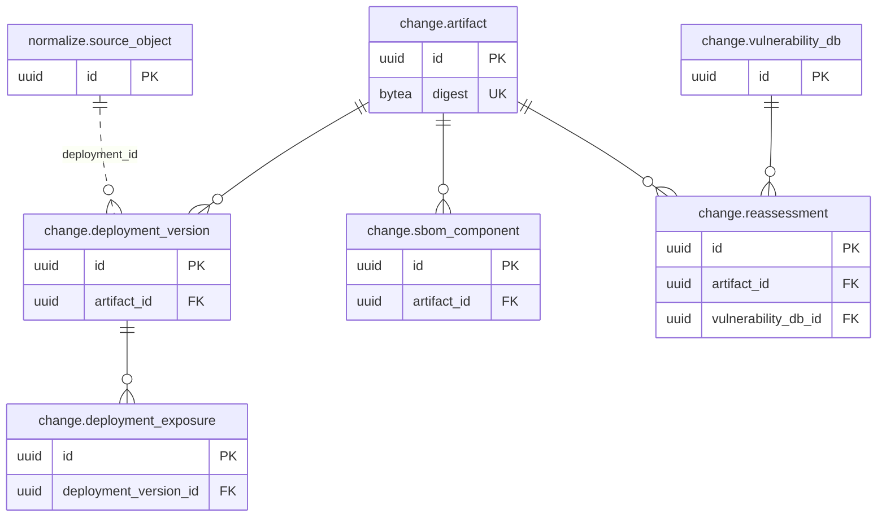

**ER-12. M2: эксперименты, стоимость, поиск и опрос**

```mermaid
erDiagram
  incident["normalize.incident_version"] {
    uuid id PK
    uuid incident_id FK
  }
  object["normalize.source_object"] {
    uuid id PK
  }
  episode["calc.episode"] {
    uuid id PK
    uuid part_id FK
  }
  part["calc.part"] {
    uuid id PK
  }
  method["calc.method_run"] {
    uuid id PK
  }
  feedback["calc.recommendation_feedback"] {
    uuid id PK
    uuid method_run_id FK
  }
  rate["calc.rate_version"] {
    uuid id PK
  }
  invoice["calc.invoice"] {
    uuid id PK
  }
  drill["docs.drill"] {
    uuid id PK
  }
  chunk["docs.search_chunk"] {
    uuid id PK
  }
  squery["docs.search_query"] {
    uuid id PK
  }
  sfeedback["docs.search_feedback"] {
    uuid id PK
  }
  survey["survey.survey"] {
    uuid id PK
  }
  participation["survey.participation"] {
    uuid id PK
    uuid survey_id FK
  }
  answer["survey.answer"] {
    uuid id PK
    uuid survey_id FK
  }
  object ||--o{ incident : ""
  part ||--o{ episode : ""
  method ||--o{ feedback : ""
  squery ||--o{ sfeedback : ""
  survey ||--o{ participation : ""
  survey ||--o{ answer : ""
```

#### 12.6. Приём, история и версии знания

**Два времени у каждого факта.** `event_time` с исходным смещением - когда событие произошло в источнике. Момент, когда craftPulse о нём узнал, задают `observed_at` записи и номер знания `known_seq`. По `event_time` факт встаёт в историю, по `known_seq` - в срез. Поэтому позднее событие занимает правильное место на таймлайне, но не попадает в ревизию, рассчитанную до его получения (FR-005, FR-030).

**Номер знания.** `platform.org_clock.last_seq` - монотонный номер организации. Каждая транзакция, которая записывает факты или подтверждённые настройки, влияющие на расчёт (нормализация, связи, сопоставление, целевые сроки, решения, структура, привязки учётных записей), берёт следующий номер первым оператором записывающей части:

```sql
UPDATE platform.org_clock SET last_seq = last_seq + 1
WHERE organization_id = $1 RETURNING last_seq;
```

Строка остаётся заблокированной до коммита. Следующая транзакция получит свой номер только после коммита предыдущей, и порядок номеров совпадает с порядком коммитов. Срез ревизии - одно число: прочитанное значение `last_seq`. Все факты и версии настроек с `known_seq` не больше него уже закоммичены и видны.

Последовательность (`sequence`) для этого не годится: номер выдаётся при вставке, а не при коммите. На проверочной базе транзакция с номером 1 оставалась открытой, а читатель уже видел номер 2. Ревизия со срезом 2 потеряла бы факт 1 навсегда. Идентификатор транзакции (`xid8`) тоже не подходит: после восстановления из `pg_dump` новый кластер выдаёт номера заново, и сохранённые значения потеряли бы порядок.

Блокировка сериализует запись знания внутри организации. Поэтому разбор пакета, канонизация и расчёт строк выполняются до транзакции. Под блокировкой транзакция читает текущие версии затронутых объектов, решает, какая версия становится текущей, и выполняет вставки. Читать текущие версии до блокировки нельзя: между чтением и блокировкой их могла заменить другая нормализация. Транзакция нормализации обрабатывает не больше 200 записей, поэтому блокировка держится доли секунды, и нормализация отчёта CI из очереди `interactive` ждёт загрузку истории не дольше одной такой транзакции.

Ожидание счётчика подчиняется `lock_timeout`. Ошибку `55P03` `pkg/postgres` повторяет так же, как взаимоблокировку (раздел 12.8), поэтому краткое ожидание за длинной транзакцией не тратит попытку задания.

**Версии знания.** Изменяемый факт хранится строками с `[знание]`. Новая версия объекта в одной транзакции:

1. ставит прежней текущей версии `superseded_seq = K` и `superseded_at`, а если изменились область или ограничение объекта - обновляет `current_area_id` и `restricted` в `normalize.source_object`;
2. вставляет новую с `known_seq = K`;
3. дописывает `normalize.area_change` через `INSERT ... ON CONFLICT DO UPDATE SET earliest_event_time = LEAST(...)`, если транзакция трогает область несколько раз, и обновляет `normalize.area.last_change_seq`;
4. ставит задания `calc` и `change`.

Порядок шагов 1 и 2 важен: частичный уникальный индекс текущей версии проверяется сразу. Если в одной транзакции у объекта или события несколько новых версий, записывается только последняя по порядку источника: промежуточная получила бы `superseded_seq = known_seq`, нарушила бы ограничение и не была бы видна ни одному срезу. Версия, действующая на срез `K`, - строка с `known_seq <= K AND (superseded_seq IS NULL OR superseded_seq > K)`. Строк на объект немного, поэтому условие проверяется после поиска по индексу объекта.

**Путь записи и повтор.**

| Класс записи | Что такое ревизия | Повтор того же содержимого | То же `source_revision`, другое содержимое | Новая ревизия |
|---|---|---|---|---|
| `event` - событие истории | Версия события у источника, например ID changelog или ревизия из манифеста импорта | `replay`, ссылка на принятую запись; факт не создаётся | `conflict`: строка `ingest.conflict`, принятый факт не меняется (BR-002) | Новая версия того же события (исправление) |
| `object` - состояние объекта | SHA-256 канонического содержимого вместе с `source_updated_at`, если источник не даёт номера версии (Jira, GitLab); иначе номер версии. Время изменения входит в хэш, поэтому возврат к прежнему состоянию A после B с новым временем - новая ревизия, а не повтор | `replay` | Для хэша невозможно; для номера версии - `conflict` | Становится текущей, если не старше текущей по паре (`source_updated_at`, время получения). Более старое состояние остаётся принятой записью журнала, но текущую версию не заменяет. Тот же `source_updated_at` с другим содержимым - более позднее чтение: источник изменил поля без обновления времени |
| `snapshot` - снимок без времени изменения | SHA-256 канонического содержимого вместе с ID чтения из манифеста | `replay` | Невозможно | Новая версия по времени получения, если содержимое отличается от текущей версии; совпадающее содержимое новой версии не создаёт. Снимок описывает состояние на момент чтения, история из снимков не восстанавливается (BR-022) |
| `file` - файл отчёта | SHA-256 содержимого. Идентичность файла: `native_ns` - попытка CI, а без неё SHA или digest; `native_id` - вид отчёта и путь файла в пакете | `replay` | Невозможно | Новый отчёт. Одинаковые побайтно файлы разных попыток или SHA - разные записи: их идентичность различается |

Приём записи идёт одной вставкой, без отдельной проверки, так что гонки «проверил - вставил» нет:

```sql
INSERT INTO ingest.record (...) VALUES (..., 'accepted')
ON CONFLICT (organization_id, instance_id, record_kind, native_ns, native_id, source_revision, payload_schema)
  WHERE outcome = 'accepted' DO NOTHING
RETURNING record_no;
```

Если строка не вставилась, приём читает принятую запись. Совпал хэш - вставляется запись `replay`, не совпал - `conflict`. При одновременной доставке одной записи двумя заданиями второе ждёт коммита первого на уникальном индексе и получает конфликт вставки. `normalize` дополнительно защищён уникальностью (`<объект>`, `source_revision`) в таблицах версий: повторная нормализация того же входа ничего не добавляет.

Условие частичного индекса повторяется в запросе дословно: и в `ON CONFLICT ... WHERE`, и в чтении текущих версий (`WHERE superseded_seq IS NULL`). Иначе PostgreSQL не выберет частичный индекс, а `ON CONFLICT` без условия не найдёт уникальный индекс и завершится ошибкой.

**Версия схемы записи.** Хэш считается по каноническому содержимому записи (поля в объявленном порядке, без служебных полей конверта) и сравнивается только внутри одной версии схемы `payload_schema`. Обновление адаптера, которое меняет состав полей, повышает версию схемы. Тогда событие с прежней ревизией в новой схеме не конфликтует с принятым: ключ включает схему, а `normalize` не создаёт второй версии факта благодаря уникальности (`<объект>`, `source_revision`). Состояние объекта с ревизией-хэшем получает одну новую версию с прежним смыслом. Без версии схемы первый сбор после обновления адаптера превратил бы все известные события в конфликты.

**Что принимает канал.** Канал приёма ограничивает, какие записи допустимы, до сравнения ключей:

- токен загрузки CI принимает только записи CI, отчёты и файлы отчётов для репозиториев своего проекта (`org.project_area`);
- универсальный импорт принимает записи только тех областей, где у пользователя есть право импорта; записи MR и запусков CI резервного пакета идут этим каналом по схемам `merge_requests` и `ci_runs`, токен загрузки CI их не принимает;
- сбор принимает только области своего подключения.

Запись вне разрешённого принимается как `rejected` с причиной. Иначе токен одного проекта мог бы записать «события» задач чужой области того же экземпляра. Экземпляр, объявленный в пакете CI или импорта, `ingest` получает у `connect`. Если такого экземпляра ещё нет, `connect` создаёт его запись без подключения.

**Удалённое не возвращается.** `ingest` отбрасывает при очистке записи, ключ которых или ключ их родителя есть в `ingest.suppression`. `normalize` в своей транзакции дополнительно пропускает запись, если у объекта или его родителя стоит `source_object.deleted_at`. Это закрывает гонку: задание нормализации, поставленное до удаления, могло выполниться раньше, чем `ingest` отметит записи. Так же `normalize` пропускает события раньше `normalize.area.retained_from` и закрытые объекты, у которых последнее событие раньше этой границы. Иначе загрузка истории после удаления по сроку вернула бы удалённое, а на следующий день оно удалилось бы снова.

**Позднее событие и исправление.** Позднее событие - новая строка со своим `known_seq` и ранним `event_time`. `area_change` запоминает самое раннее время, и `calc` пересчитывает только окна начиная с него (раздел 10.6). Исправление события источником - новая версия того же `event_key` с заменой прежней. Прежняя версия остаётся для ревизий со старым срезом.

**Восстановление после неполной загрузки.**

1. Страница фиксируется вместе с checkpoint в `sync.state` одной транзакцией. Отказ следующей страницы оставляет курсор и `last_success_at` без изменений и записывает `failed_cursor` и код причины (FR-006).
2. Повтор начинается с сохранённого курсора. Курсор приращения перекрывает окно назад (раздел 10.3), поэтому часть записей приходит повторно и получает `replay`.
3. Сверка (`sync.reconcile_run`) сравнивает пары «ID, версия» манифеста источника с текущими версиями. Версия манифеста сравнивается с `source_revision`, если источник даёт номер версии, и с `source_updated_at` текущей версии, если номером версии служит хэш (Jira, GitLab). Поэтому адаптер такого источника обязан передавать время изменения объекта. Отсутствующие и изменённые объекты попадают в `sync.dirty_key` и перечитываются.
4. `watermark`, `completeness = 'complete'` и `last_success_at` обновляются только после сверки без расхождений (BR-022). До этого ревизии области публикуются с `loading = true` и состоянием PROVISIONAL (раздел 10.6).

**Противоречащие данные не склеиваются.**

| Ситуация | Поведение модели |
|---|---|
| Тот же `source_revision` с другим содержимым, в том числе из универсального импорта того же экземпляра | Конфликт в `ingest.conflict`; действует прежний факт; администратор видит конфликт в состоянии приёма и выбирает исход. Решение `accepted_new` создаёт новую версию с новым номером знания |
| Состояние объекта старше текущего | Запись принята, текущая версия не заменяется |
| Одна работа в двух трекерах или экземплярах | Два объекта; одна задача только после подтверждения группы зеркал на M1 (BR-016) |
| Явная связь задачи с MR и ключ другой задачи в ветке | Явная связь подтверждена, ключ - кандидат; кандидат не отменяет и не заменяет подтверждённую связь (BR-010) |
| Предложение привязать учётную запись к другому человеку | Действует подтверждённая привязка; предложение ждёт решения администратора; у учётной записи одна действующая привязка |
| Два пользователя подтверждают настройку на основе одной версии | Второй получает конфликт уникальности номера версии (FR-008, раздел 12.8) |

#### 12.7. Ревизии расчёта, раскрытие и воспроизводимость

Ряд (`calc.series`) - область, набор показателей и шаг; его ревизии (`calc.revision`) неизменяемы после публикации. Кросс-показатели X01-X06 из [метрик MVP](../product/metrics/mvp.md#7-кросс-метрики-и-совместный-анализ) - такие же ряды со своими определениями в `calc.definition`: значения и когорты хранятся в `calc.point` и `calc.contribution`, отдельных таблиц для них нет. Состояние компонента в техническом обзоре читается из тех же рядов по области компонента. Первая часть фиксирует `knowledge_seq`, все части читают факты и настройки на этот срез (раздел 12.6). Входы ревизии с версиями записаны в `calc.revision_input`. Часть ряда (`calc.part`) с тем же хэшем входа переиспользуется: новая ревизия ссылается на прежнюю строку через `calc.revision_part`, а не копирует её точки. Хэш входа считается по тому, что часть действительно прочитала: определения и их версии, ID версий настроек, ID и `known_seq` версий фактов, область и интервал части. Сам номер среза в хэш не входит, иначе любой новый факт организации делал бы все части новыми. Описание области ряда (`calc.series.scope`) хранится каноническим JSON с упорядоченными ключами, и `scope_hash` считается по нему: одна и та же область всегда находит один ряд.

Публикация выполняется одной транзакцией:

1. ревизия получает `status = 'published'`, прежняя - `superseded`;
2. указатель ряда меняется условным обновлением:

```sql
UPDATE calc.series SET current_revision_id = $new
WHERE organization_id = $org AND id = $series
  AND current_revision_id IS NOT DISTINCT FROM $prev;
```

Если обновлено ноль строк, ревизию опубликовал кто-то другой. Это нарушение порядка цепочки: задание завершается ошибкой, и публикация не перезаписывает чужую.

Цепочка не может зависнуть в `building` навсегда: иначе частичный уникальный индекс запретил бы ряду новые расчёты. Каждая часть в своей транзакции обновляет `progress_at`. Обработчик исчерпанных попыток задания переводит ревизию в `failed`. Новая цепочка перед стартом переводит в `failed` ревизию `building` с `progress_at` старше 30 минут. Задание части, проснувшееся после такого перехвата, не должно ничего записать. Поэтому каждая часть и публикация начинают транзакцию с `UPDATE calc.revision SET progress_at = $now WHERE id = $r AND status = 'building'` и при нуле строк завершаются без записи. Порог перехвата влияет только на задержку: корректность держит условное обновление. Ревизия `failed` не публикуется, её части удаляет сборка мусора, а ошибка видна в диагностике (раздел 10.7).

Раскрытие читает `calc.contribution` той же части и точки, поэтому список объектов совпадает с когортой формулы (FR-021). Для пользователя с частичным доступом `access` выдаёт разрешённые `area_id`. `calc` строит агрегат по сохранённым вкладам объектов, чья текущая область разрешена, и пропускает объекты с `restricted = true`, если их отдельная проверка не дала разрешения (раздел 10.4). Факты при этом не читаются.

Область и ограничение объекта проверяются по его текущему положению, а не на момент расчёта (FR-001). Поэтому вклад их не хранит. `calc` получает у `normalize` текущие `current_area_id` и `restricted` объектов когорты одним запросом по ключам `normalize.source_object` и кэширует результат вместе с агрегатом на 60 с (раздел 10.4). Перенос задачи в закрытый проект меняет одну строку `source_object`, и следующий запрос уже не покажет её вклад через прежнюю область. Массового обновления вкладов при переносе нет. Событие задачи хранит `area_id` на момент события только для поиска по проекту на дату. Доступ к событию решается по текущей области задачи, поэтому перенесённая в закрытый проект задача не видна через старый проект на таймлайне.

Ревизия становится невоспроизводимой и получает `irreproducible_reason`, когда:

- удалён по запросу объект, который входит в её вклады: поиск по индексу `calc.contribution (organization_id, object_id)`;
- срок хранения заменённых версий фактов прошёл её срез: `knowledge_seq < platform.org_clock.reproducible_from_seq` (раздел 12.9);
- определение показателя снято с поддержки.

Значения такой ревизии остаются, а раскрытие показывает отметку «часть оснований удалена» вместо удалённых объектов (V-09).

Сохранённый срез без `pinned_revision_id` показывает актуальную ревизию ряда. Срез, выгрузка и сводка MR, которые ссылаются на конкретную ревизию, записывают её в `calc.revision_pin`. Вытесненная ревизия без закреплений удаляется по сроку хранения, закреплённая - нет.

#### 12.8. Транзакции и конкурентные изменения

Уровень изоляции - `READ COMMITTED` везде. Инварианты держат ограничения базы, атомарные вставки и условные обновления, а не проверка в коде перед записью. `REPEATABLE READ` и `SERIALIZABLE` не используются:

- согласованность ревизии даёт номер знания, а не снимок транзакции;
- выгрузка читает неизменяемую ревизию.

| Операция | Границы транзакций | Что гарантирует база | Конкурентный случай |
|---|---|---|---|
| Аренда подключения | Короткая транзакция: `INSERT ... ON CONFLICT DO UPDATE ... WHERE lease_until < $now OR holder = $me` | Одна попытка сбора на подключение (NFR-006) | Второе задание получает пустой ответ и откладывается без траты попытки |
| Страница сбора | Вызов адаптера вне транзакции; затем одна транзакция: `ingest.receipt` и `ingest.record`, checkpoint в `sync.state`, следующие задания River (`InsertTx`), завершение текущего (`JobCompleteTx`) | Страница и checkpoint сохраняются вместе (FR-006, NFR-009) | Падение до коммита: ничего не сохранено, задание повторяется с того же курсора |
| Приём пакета CI | `api` пишет поток в карантин хранилища вне транзакции, затем транзакция: приём `quarantined` и задание. `worker` очищает пакет в хранилище вне транзакции, затем транзакция: записи, статус приёма, задание `normalize`. Карантинный объект удаляется после коммита | Повтор пакета распознаётся по `package_hash` и по записям | Сирота в карантине удаляется `objstore.gc` (раздел 10.6) |
| Нормализация части | Подготовка в памяти; транзакция: номер знания, объекты, замена и вставка версий, `area_change`, задания `calc` и `change`, завершение | Версии и номер знания коммитятся вместе | Две нормализации одной организации выполняются по очереди на строке счётчика |
| Часть расчёта | Чтение на срез без длинной транзакции; транзакция: `calc.part` через `ON CONFLICT (organization_id, input_hash) DO NOTHING`, точки и вклады, `calc.revision_part`, следующее задание | Часть сохраняется целиком или не сохраняется | Одна цепочка на ряд: частичный уникальный индекс `building` |
| Публикация ревизии | Транзакция со статусами и условным обновлением указателя (раздел 12.7) | Указатель не перезаписывает чужую публикацию | Ноль обновлённых строк - ошибка задания |
| Подтверждение настройки: сопоставление, срок, профиль, решение, структура | Транзакция: номер знания, `INSERT ... version_no = base + 1 ... ON CONFLICT (organization_id, confirmation_id) DO NOTHING RETURNING id`; пустой ответ - чтение сохранённой версии по `confirmation_id`; затем аудит и задания пересчёта | `UNIQUE (<область>, version_no)` и `UNIQUE (confirmation_id)` | Устаревшая форма получает нарушение уникальности номера, `api` отвечает конфликтом без перезаписи (FR-008). Повтор того же `confirmation_id` возвращает сохранённую версию (FR-007): `ON CONFLICT` по `confirmation_id` проверяется до вставки, поэтому повтор не упирается в уникальность номера. Содержимое, равное текущей версии по `content_hash`, новую версию не создаёт |
| Структура организации | Обновление `org.organization.structure_version` с условием `= $base` и изменение строк структуры в одной транзакции | `EXCLUDE` не даёт перекрыть интервалы | Ноль обновлённых строк - конфликт версии структуры |
| Переход статуса решения | Транзакция: номер знания, строка `decision_transition`, аудит, задания пересчёта | Переход фиксируется вместе с номером знания | Истечение срока не требует записи: оно следует из `expires_at`, а `decision.expire` только ставит пересчёт |
| Публикация в MR и задача трекера | Транзакция: намерение в `outbound.action`; вне транзакции: сверка head, `FindPublished`, `Publish`; транзакция: исход и `external_id` (раздел 10.5.4) | PK `outbound.target` - один внешний объект на MR или действие | Задания одного MR уникальны в River и идут по очереди |
| Блокировка пользователя | Одна транзакция `org` и `auth`: статус пользователя, завершение сессий, отзыв ключей API (раздел 13.2) | Следующий запрос получает 401 | - |
| Удаление по запросу | Транзакция: `audit.deletion` (`pending`), `ingest.suppression`; вне транзакции: запись в хранилище копий; транзакция: `recorded`, задания модулей (раздел 12.9) | Объект не принимается повторно с момента первой транзакции | Повтор заданий удаления идемпотентен |
| Удаление по сроку | Порция до 1 000 строк одной транзакцией, курсор в аргументах следующего задания | Нет длинной транзакции и большого всплеска мёртвых строк | Повтор за ту же дату удаляет то же самое |

Правила, общие для всех операций:

- Внутри транзакции нет сетевых вызовов (раздел 10.3).
- Номер знания берётся первым из блокирующих операторов транзакции. Строки одной таблицы блокируются по возрастанию ID. Так циклы ожидания не возникают.
- Ошибки `40P01` (взаимоблокировка), `40001` и `55P03` (истёк `lock_timeout`) `pkg/postgres` повторяет до трёх раз со случайной паузой. Сценарий при этом выполняется целиком, а он идемпотентен.
- Уникальность заданий River задаётся явно: `UniqueOpts.ByState` = `available`, `pending`, `running`, `retryable`, `scheduled`. Список River по умолчанию включает и `completed`, поэтому задание, которое отметило себя завершённым и поставило такое же снова (раздел 10.6), было бы молча отброшено как дубль.
- Ожидаемое нарушение уникальности - это результат сценария (повтор или конфликт), а не ошибка сервиса.
- Ограничения времени задаются в строке подключения процесса:
  - `api`: `statement_timeout` 5 с, равный максимуму NFR-001;
  - `worker`: 50 с, меньше таймаута задания 60 с;
  - оба процесса: `idle_in_transaction_session_timeout` 30 с и `lock_timeout` 5 с;
  - миграции: `lock_timeout` 3 с.

#### 12.9. Хранение, удаление и обезличивание

Сроки по классам данных задаются параметрами `RETENTION_<КЛАСС>` в конфигурации установки (раздел 14.2) и записываются в протокол установки. Параметры обязательны: без них процесс не запускается и перечисляет недостающие (FR-011 A1). Значения согласуются по Q-08. Удаление по сроку выполняет `retention.apply` каждого модуля порциями и записывает его в `audit.deletion` с `basis = 'retention'`.

| Класс | Что входит | Отсчёт срока | Как удаляется | Последствие |
|---|---|---|---|---|
| `SOURCE_FACTS` | Объекты и события активных подключений: версии задач, MR, запусков, документов, события | Объект удаляется целиком, когда его последнее событие старше срока и объект не открыт | Версии, события, связи объекта; строка `source_object` остаётся отметкой | `normalize.area.retained_from` сдвигается; окна раньше границы получают BOUNDED или UNKNOWN с причиной |
| `SUPERSEDED_FACTS` | Заменённые версии фактов | От `superseded_at` | Строки с `superseded_seq`; затем `reproducible_from_seq` поднимается до наибольшего удалённого `superseded_seq` | Ревизии со срезом меньше этого номера помечаются `basis_expired` |
| `CI_RESULTS` | Отчёты, находки, выполнения тестов, покрытие, ревизии сводок MR | От `finished_at` отчёта и `built_at` сводки | Отчёт с каскадом на свои строки и объекты построчных карт покрытия. Отчёты с записью в `normalize.report_pin` (действующие базы, последние сводки открытых MR) не удаляются | Старые сводки показывают отметку удалённых оснований |
| `PACKAGES` | Очищенные пакеты в хранилище и записи журнала приёма | От `received_at` | Объект хранилища и записи журнала | Переразбор этих пакетов новым парсером невозможен; факты остаются |
| `SUPERSEDED_REVISIONS` | Вытесненные ревизии без закреплений и их неиспользуемые части | От `superseded_at` | Ревизия, затем части без ссылок | - |
| `EXPORTS` | Файлы выгрузок | От `completed_at` | Объект хранилища; задание получает `expired` | Ссылка на выгрузку перестаёт работать |
| `DECISIONS` | Заменённые версии настроек и решений, истёкшие решения | От замены или `expires_at` | Строки версий, кроме тех, на которые ссылаются хранимые ревизии (индекс `calc.revision_input (input_kind, input_id)`) и строки своего модуля | История решений короче этого срока не показывается |
| `AUDIT` | `audit.event` | От `occurred_at` | Порции по индексу `occurred_at` | - |
| `DISCONNECTED` | Факты областей удалённого подключения | От `deleted_at` подключения | Как `SOURCE_FACTS` для всей области | До удаления выдача области уже закрыта (раздел 10.7) |
| `BACKUPS` | Копии во внешнем хранилище | От времени копии | Правило жизненного цикла хранилища копий (раздел 14.2) | - |
| `SEARCH`, `SURVEY` (M2) | Поисковые фрагменты и отметки, ответы опроса | По Q-02 и Q-08 | Строки и производные сводки | - |

Удаление по сроку выбирает только строки, на которые не ссылается ни одна строка того же модуля (`NOT EXISTS` по индексу внешнего ключа). Поэтому `ON DELETE RESTRICT` не роняет ежедневное задание: например, версия календаря, на которую ссылается хранимая версия сопоставления, ждёт удаления этой версии.

При запуске проверяются два соотношения:

- `SUPERSEDED_FACTS` не меньше `SUPERSEDED_REVISIONS`, иначе незакреплённые ревизии теряли бы основания раньше собственного удаления;
- записи `audit.deletion` хранятся не меньше `BACKUPS` независимо от `AUDIT`: без них восстановление из копии не повторит удаление (раздел 14.8).

Строки, которые ссылаются на данные другого модуля без внешнего ключа, удаляет их собственный модуль. Когда владелец удаляет объект или отчёт по сроку, он ставит задания зависимым модулям так же, как при удалении по запросу:

- `link` удаляет связи объекта;
- `calc` обновляет вклады и помечает ревизии `basis_expired`;
- `change` удаляет `occurrence_identity` по `reported_at` с тем же сроком `CI_RESULTS`.

Поэтому висячая ссылка живёт не дольше одного задания, а чтение по ней получает «объект удалён», а не ошибку. Удаление объектов по `SOURCE_FACTS` и `DISCONNECTED` меняет факты, поэтому, как и удаление по запросу, берёт номер знания и дописывает `normalize.area_change`, и затронутые ряды пересчитываются. Удаление заменённых версий (`SUPERSEDED_FACTS`) текущих фактов не меняет и номер знания не берёт.

Технические данные удаляются по фиксированным правилам:

| Данные | Когда удаляются |
|---|---|
| `auth.login_attempt` и `auth.session` | Строки с истёкшим сроком или отметкой завершения, ежедневно (раздел 13.2) |
| Карантин хранилища | Через сутки (`objstore.gc`) |
| `sync.dirty_key` | После перечитывания |
| `normalize.area_change` | Через 30 дней. Если `consumed_seq` ряда старше самой старой оставшейся строки, `calc` пересчитывает окно целиком |
| `view.operation` | Через 24 ч после `completed_at`; активная операция не удаляется. Отзыв доступа закрывает чтение немедленно, независимо от срока |
| `connect.probe` | Через 24 ч после завершения, если проба не указана в `connect.connection.activated_probe_id`; текущая активированная проба сохраняется. Удаление подключения закрывает чтение проб сразу; при его окончательном удалении сначала очищаются ссылка активации и пробы |
| Задания River | Завершённые и отменённые через 24 ч, отброшенные после исчерпания попыток через 7 дней. Это заданные значения очистки River |

**Удаление по запросу (FR-010).**

1. Модуль-владелец объекта (задача и события - `normalize`, документ - `docs`) создаёт `audit.deletion` со статусом `pending` и `ingest.suppression` в одной транзакции. С этого момента новые записи объекта при очистке пакета получают `suppressed` и вырезаются из сохраняемого объекта.
2. Вне транзакции запись удаления сохраняется отдельным объектом во внешнем хранилище копий. Затем статус становится `recorded`, и задания удаления ставятся каждому модулю с данными объекта (раздел 10.4). Пользователь получает подтверждение после этого шага.
3. Модули удаляют свои строки:
   - `normalize` - версии и события, `source_object` остаётся отметкой с `deleted_at`. Транзакция берёт номер знания и дописывает `area_change`, поэтому следующая ревизия считается уже без объекта;
   - `link` - связи объекта;
   - `docs` - фрагменты поиска;
   - `calc` - вклады объекта, а ревизии помечает `basis_deleted`;
   - `ingest` - отмечает записи и перепаковывает пакеты, включая пакеты с повторами.
4. Когда все задания завершены, запись получает `applied`. Восстановление из копии повторно применяет записи новее дампа (раздел 14.8).

**Обезличивание.** Персональные данные в модели: логин, имя и почта в `org.source_account`, имя в `org.person` и `org.app_user`, а также исходные поля в пакетах хранилища. В событиях и версиях пользовательские поля хранятся ссылками на учётные записи (`before_account_id`, `after_account_id`, `assignee_account_id`), а не строками имён. `normalize` заменяет объекты пользователей и в `raw_fields`, и в значениях пользовательских полей (`before_value`, `after_value`) на ID учётных записей, поэтому имя и почта из источника в таблицы фактов не попадают. Поэтому по запросу человека обезличивание:

- очищает имя, логин и почту и ставит `anonymized_at`;
- перепаковывает пакеты без этих полей.

ID учётной записи в источнике остаётся техническим ключом: без него повторный сбор создал бы её заново. Для обезличенной учётной записи `normalize` не записывает имя, логин и почту из новых пакетов. Аудит хранит ID субъекта без имени.

**Удаление подключения и организации.** Удаление подключения сразу закрывает выдачу его областей (раздел 10.7). Факты этих областей удаляются по классу `DISCONNECTED`, если администратор не запросил немедленное удаление. Повторное подключение того же экземпляра в пределах срока находит прежние объекты по идентичности. Полноту оно объявляет только после сверки. Удаление организации проходит те же задания модулей для всех её данных, затем удаляются `org.organization`, строки счётчика и адреса входа, а в адаптеры уходит `DeleteCredentials`.

#### 12.10. Эволюция схемы, обслуживание и ограничения

**Миграции.** Миграции - SQL-файлы goose, применяемые `api migrate` под ролью-владельцем (раздел 14.4). Каждая миграция совместима с кодом предыдущего выпуска, поэтому откат кода не требует отката схемы (раздел 14.5). Перед каждым оператором задаётся `lock_timeout` 3 с: миграция, которая не получила блокировку, падает и повторяется, а не ставит в очередь за собой все запросы. sqlc генерирует запросы по схеме миграций, поэтому несовпадение схемы и кода ловится сборкой.

| Изменение | Как выполняется | Почему |
|---|---|---|
| Новая таблица | `CREATE TABLE`, индексы, политика RLS и права в одной миграции | Таблица пуста, обычное построение индекса мгновенно, а таблица без политики не должна существовать ни в одном выпуске |
| Новая колонка | Допускает NULL или имеет константный `DEFAULT` | Таблица не переписывается |
| `NOT NULL` на заполненной колонке | `ADD CONSTRAINT ... NOT NULL ... NOT VALID`, после заполнения - `VALIDATE CONSTRAINT` отдельной миграцией | Проверка существующих строк не держит блокировку записи; оба шага проверены на PostgreSQL 18.6 |
| Новый внешний ключ или `CHECK` | `NOT VALID`, затем `VALIDATE CONSTRAINT` | То же |
| Новое значение перечисления | Новый `CHECK` с расширенным списком `NOT VALID`, `VALIDATE`, удаление прежнего | Без `ENUM` значение доступно сразу |
| Индекс на заполненной таблице | `CREATE INDEX CONCURRENTLY` в миграции без транзакции; после неё проверка `pg_index.indisvalid` | Обычное построение запрещает запись на всё время; неудачное параллельное оставляет невалидный индекс |
| Смена типа или имени колонки | Expand-contract: новая колонка, заполнение заданием порциями, переключение чтения, удаление старой через выпуск | `ALTER COLUMN TYPE` переписывает таблицу под монопольной блокировкой |
| Удаление колонки или таблицы | Отдельный выпуск после того, как код предыдущей версии её не использует | Откат кода остаётся возможным |
| Заполнение данных | Задание `worker` порциями по курсору ключа с паузой | Нет длинной транзакции, автовакуум успевает |

**Обслуживание.** Таблицы с частыми обновлениями получают свои параметры автовакуума: `autovacuum_vacuum_scale_factor = 0.02` и запас страницы `fillfactor`. Это `platform.org_clock`, `sync.state`, `sync.lease`, `sync.dirty_key`, `auth.session` и таблица заданий River. Остальные таблицы в основном дополняются, поэтому строки в них почти не умирают. Медленные запросы находит `pg_stat_statements`; `log_min_duration_statement`, `log_lock_waits` и предел соединений задаются конфигурацией PostgreSQL стенда (раздел 14.9). Задание копирования держит снимок, пока идёт `pg_dump`, поэтому оно запускается вне окна ежедневных заданий (раздел 14.8).

**Секционирование.** В M0 таблицы не секционируются: при объёме профиля S PostgreSQL обслуживает их обычными индексами. Удаление по сроку идёт порциями, и автовакуум его догоняет. Секционирование таблиц фактов по `event_time` запрещено самой моделью. Уникальный ключ секционированной таблицы обязан включать ключ секционирования (проверено: создание такого ограничения отклоняется). Время события не определяется идентичностью записи, а исправление может его изменить. Значит, ограничение по `event_time` пропустило бы конфликт BR-002.

Первыми кандидатами станут `normalize.test_execution`, `normalize.coverage_fact` и `calc.contribution`: у них время однозначно следует из отчёта или части. Для выполнения тестов это `run_started_at`, который хранится с первого выпуска, чтобы ключ можно было дополнить без перестройки данных. Секционирование вводится, когда таблица идёт к десяткам миллионов строк и удаление по сроку перестаёт успевать. Секции для загрузки истории создаются заранее для всего заявленного окна. Новая секция присоединяется через `ATTACH PARTITION` после создания отдельной таблицы с подходящим `CHECK`: так родительская таблица не блокируется на запись.

**Существенные ограничения.**

| Ограничение | Как модель с ним работает |
|---|---|
| RLS не действует на суперпользователя, владельца таблиц без `FORCE` и роли с `BYPASSRLS`, не проверяет `TRUNCATE` и обычные представления | Приложение не владеет таблицами, не имеет `BYPASSRLS` и `TRUNCATE`, представления только с `security_invoker` (раздел 12.2); роль-владелец используется только миграциями и копированием |
| Проверки внешних ключей идут в обход RLS | Ключи составные с `organization_id`, ссылка на чужую строку невозможна |
| Номера sequence не совпадают с порядком коммитов | Номер знания на строке-счётчике (раздел 12.6) |
| Запись знания в одной организации сериализована | Короткие транзакции под блокировкой; нормализация разных организаций идёт параллельно |
| Строка B-tree не длиннее 2 704 байт | Ограничения длины на индексируемых полях и хэши вместо длинных путей |
| MVCC оставляет мёртвые строки при `UPDATE` | Факты дописываются версиями; горячие таблицы с `fillfactor` и своим автовакуумом |
| Один узел без автоматического переключения | Копии и восстановление по разделу 14.8; реплики для чтения в M0 не используются, поэтому ответ сразу после записи не устаревает |
| `pg_dump` согласован в пределах одной базы | Порядок копирования и восстановления баз ядра и адаптеров - раздел 14.8 |
| Очередь River использует `LISTEN/NOTIFY` | Пулер в режиме транзакций не ставится между `worker` и базой; при его появлении слушатель River получает прямое соединение |
| Содержимое `jsonb` не проверяется схемой базы | Поля, по которым есть условия, вынесены в колонки; содержимое `jsonb` проверяет приложение по версии схемы пакета |

#### 12.11. Проверка модели на сценариях

Проход выполнен по ключам и правилам этого раздела на контрольных наборах раздела 4.4: организация O, экземпляры Jira J1 и J2, проект P, номер знания перед началом - 100.

| Шаг | Что происходит в модели | Результат по ключам и правилам |
|---|---|---|
| 1. Первая загрузка: задача A и события a0-a4 из J1 (V-03) | `sync.page` принимает страницу. `ingest.record` получает 6 записей `accepted`: объект и 5 событий. `normalize` в одной транзакции берёт номер 101 и создаёт `source_object` A, версию `task_version` и 5 строк `task_event` с `known_seq = 101`. `area_change` получает `(P, 101, d0)`. `calc` строит ревизию R0 со срезом 101 | Одна задача, 5 событий; T08 = 3 дня в R0; вклады A в `calc.contribution` |
| 2. Повтор того же набора три раза (V-02) | Каждая вставка в `ingest.record` упирается в частичный уникальный индекс, хэши совпадают, пишутся записи `replay`. Принятых записей нет, `normalize` не запускается, номер знания не растёт | По-прежнему 1 задача и 5 событий; R0 актуальна; журнал содержит 18 повторов доставки |
| 3. Тот же `source_revision` события a4 с другим временем | Хэш не совпал: запись `conflict` и строка `ingest.conflict` | Принятый a4 не изменён, конфликт виден администратору (BR-002) |
| 4. Позднее изменение задачи H (V-05): история h0-h2 пришла на d6 | Номер 102; три новых `task_event` с `event_time` d0-d4 и `known_seq = 102`; `area_change (P, 102, d0)`. Пересчитываются окна от d0, публикуется R1 со срезом 102 | R0 читает строки с `known_seq <= 101` и сохраняет BOUNDED и UNKNOWN; R1 даёт T08 = 3 дня. Таймлайн показывает события на d1-d4 с отметкой позднего получения |
| 5. Пересчёт старого периода: владелец процесса подтверждает сопоставление v2 | Номер 103; `mapping_version` v2 с `version_no = 2`; задания `calc` по команде. Части окна, где хэш входа не изменился, переиспользуются, остальные считаются заново; публикуется R2 со срезом 103 | R1 не изменилась и раскрывается по v1. Срез с `pinned_revision_id = R1` показывает R1, актуальный - R2 |
| 6. Параллельно второй владелец процесса сохраняет форму, открытую на v1 | Вставка `version_no = 2` нарушает `UNIQUE (team_id, version_no)` | Конфликт без перезаписи (FR-008) |
| 7. Обрыв на второй странице (V-06), затем восстановление | Страница 1 и checkpoint закоммичены; отказ страницы 2 оставляет курсор, `last_success_at` и `watermark` прежними. Повтор с курсора даёт `replay` для перекрытия и `accepted` для C. Сверка находит все ID манифеста, после неё обновляется `watermark` | Объекты A, B, C по одной идентичности; до сверки ревизии с `loading = true` |
| 8. Объект из другого проекта или экземпляра с тем же внешним ID | `J2/P/A` даёт ключ `(O, J2, task, '', id)` - новая строка `source_object`. Тот же ID в организации O2 - другая строка, невидимая для O из-за RLS. Сборка `#7` двух jobs Jenkins различается `native_ns` | Учёт не удваивается и объекты не склеиваются; связь MR с `J1/P/A` не переходит к `J2/P/A` (V-17) |
| 9. Удаление задачи A по запросу | `audit.deletion` и `ingest.suppression` для A; запись в хранилище копий; задания модулей. `normalize` удаляет версии и события, `link` - связи, `calc` удаляет вклады A и помечает R0-R2 `basis_deleted`, `ingest` перепаковывает пакеты шагов 1-2 | A нет в выдаче, раскрытии и пакетах. Новая доставка A получает `suppressed`. После восстановления из копии удаление применяется повторно |

#### 12.12. Порядок ввода таблиц

Таблицы появляются в инкрементах раздела 14.12 вместе с кодом, который их использует. Миграция инкремента добавляет таблицы и ничего не удаляет (раздел 12.10).

| Инкремент | Таблицы |
|---|---|
| И0. Каркас | `platform.tenant`, `platform.org_clock`; `org.organization`, `org.team`, `org.project`, `org.service`, `org.person`, `org.app_user`, `org.role_assignment`, `org.team_member`, `org.team_project`; все таблицы `auth`, `audit`, `install`; таблицы River; база тестового адаптера |
| И1. Jira DC → отчёт команды | `connect.*`, `sync.*`, `ingest.*`; `normalize.source_object`, `normalize.area`, `normalize.area_change`, `normalize.task_version`, `normalize.task_event`; `org.source_account`, `org.account_assignment`, `org.project_area`; `process.*`; `calc.*`; `view.export_job`, `view.operation` |
| И2. GitLab и GitLab CI → разбор задачи | `normalize.mr_version`, `normalize.mr_event`, `normalize.ci_run_version`, `normalize.ci_attempt_version`; `link.edge` |
| И3. Проверки → сводка MR | `normalize.report`, `normalize.report_pin`, `normalize.finding_occurrence`, `normalize.test_case`, `normalize.test_execution`, `normalize.coverage_fact`; `org.component`; `change.*` M0; `decision.decision`, `decision.decision_version`, `decision.decision_transition`; `outbound.*`; `docs.root`, `normalize.document_version` |
| И4. Остальной состав стенда | Новых таблиц нет: Confluence DC, GitHub, Jenkins и SonarQube пишут в те же таблицы; базы своих адаптеров |
| M1 и M2 | Таблицы раздела 12.5.10 вместе со своими функциями |

#### 12.13. Связь с требованиями к данным

| DR | Таблицы |
|---|---|
| DR-001 | `connect.source_instance`, `connect.connection`, `connect.connection_scope`, `connect.capability`, `connect.probe`, `normalize.source_object`, `org.*`, `platform.tenant`, `access.source_permission` |
| DR-002 | `normalize.task_version`, `normalize.task_event`, `normalize.sprint_version`, `normalize.sprint_event` |
| DR-003 | `ingest.receipt`, `ingest.record`, `ingest.conflict`, `sync.state`, `sync.reconcile_run` |
| DR-004 | `process.mapping_version`, `process.mapping_rule`, `process.calendar_version`, `process.target_version`, `process.dod_version`, `process.dod_obligation`, `org.account_assignment` |
| DR-005 | `normalize.mr_version`, `normalize.mr_event`, `link.edge`, `change.summary_revision` |
| DR-006 | `normalize.ci_run_version`, `normalize.ci_attempt_version`, `normalize.test_case`, `normalize.test_execution` |
| DR-007 | `calc.interval` |
| DR-008 | `normalize.coverage_fact` |
| DR-009 | `normalize.report`, `normalize.finding_occurrence`, `change.finding_identity`, `change.occurrence_identity`, `change.profile_version`, `change.profile_entry`, `change.baseline` |
| DR-010 | `decision.decision`, `decision.decision_version`, `decision.decision_transition`, `decision.policy_version`, `decision.policy_rule`, `decision.bypass`, `docs.handover_decision` |
| DR-011 | `calc.series`, `calc.revision`, `calc.revision_input`, `calc.part`, `calc.revision_part`, `calc.point`, `calc.contribution`, `calc.revision_pin`, `calc.saved_view`, `view.export_job`, `view.operation` |
| DR-012 | `normalize.document_version`, `docs.root`, `docs.obligation`, `docs.review`, `docs.drill` |
| DR-013 | `change.artifact`, `change.deployment_version`, `change.sbom_component`, `change.vulnerability_db`, `change.reassessment` |
| DR-014 | `calc.method_run`, `calc.recommendation_feedback`, `calc.initiative`, `org.review_opt_out` |
| DR-015 | `docs.search_chunk`, `docs.search_query`, `docs.search_feedback`, `survey.*` |
| DR-016 | `normalize.incident_version`, `calc.episode`, `change.deployment_exposure` |
| DR-017 | `calc.rate_version`, `calc.invoice` |
| DR-018 | `audit.event`, `audit.deletion`, `outbound.target`, `outbound.action`, `outbound.tech_debt_draft` |

### 13. Реализация доступа и защиты

Раздел описывает механизмы, которые выполняют требования раздела 7. Вход, сессии и ключи принадлежат модулю `auth`, решения о доступе - модулю `access`, учётные данные источников - адаптерам (раздел 10.3).

#### 13.1. Вход через OpenID Connect

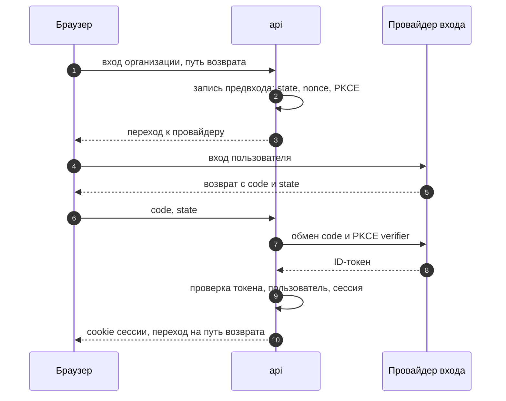

1. Пользователь открывает адрес входа своей организации `/o/<организация>/login`. По нему `api` выбирает зарегистрированного провайдера: issuer, `client_id` и секрет клиента. Адрес возврата `/o/<организация>/callback` регистрируется у провайдера точным значением. В облаке секрет клиента каждой организации хранится в `auth` в зашифрованном виде, как ключи адаптеров клиентов (раздел 10.8); в установке в контуре он лежит в файлах секретов (раздел 14.2).
2. `api` создаёт одноразовую запись предвхода со сроком 10 мин: `state`, `nonce`, PKCE verifier, ожидаемый issuer и путь возврата. Путь возврата принимается только как относительный путь внутри сайта. Запись привязана к cookie `__Host-cp_login`.
3. Браузер уходит к провайдеру с кодом авторизации, PKCE S256, scope `openid profile` и возвратом параметров в адресе (`response_mode=query`): только так cookie с `SameSite=Lax` придёт на возврате. Права на API провайдера, например `read_api` в GitLab, для входа не нужны и не запрашиваются.
4. На возврате `api` находит запись предвхода по cookie, сверяет `state` и, если провайдер его передал, параметр `iss`, а затем удаляет запись: повтор того же ответа отклоняется.
5. `api` обменивает code на токены по серверному каналу с секретом клиента и PKCE verifier. Ключи подписи и адреса провайдера берутся только из discovery заданного issuer.
6. ID-токен принимается, если подпись проверена ключом провайдера, `iss` равен заданному issuer, `aud` содержит `client_id`, срок не истёк и `nonce` совпадает с записью предвхода. Токены доступа и обновления провайдера после этого отбрасываются: craftPulse их не хранит и в браузер не передаёт.
7. `auth` ищет пользователя по паре «провайдер, `sub`». Нового пользователя создаёт без области, заблокированному отказывает. Для неназначенной организации применяет правило первого администратора (FR-064).
8. Создаётся сессия по разделу 13.2. Если браузер пришёл с cookie другой действующей сессии, та сессия завершается: браузер держит одну сессию. Cookie предвхода удаляется, браузер возвращается на сохранённый путь.

Ошибка на любом шаге не создаёт сессию. Пользователь видит UI-03 с классом причины, в аудит попадает неудачный вход с причиной без значений токенов. Корпоративный SSO использует тот же поток с любым провайдером OIDC, у которого есть discovery. Реализация - библиотеки go-oidc v3.21 (Apache-2.0) для discovery и проверки ID-токена и golang.org/x/oauth2 v0.38 (BSD-3-Clause) для кода авторизации и PKCE.

#### 13.2. Сессия

Сессия - строка в таблице `auth` PostgreSQL. Браузер получает случайный идентификатор из 32 байт криптографического генератора в cookie `__Host-cp_session` с атрибутами `Secure`, `HttpOnly`, `SameSite=Lax` и `Path=/`. В базе хранится не сам идентификатор, а его SHA-256, поэтому копия базы не даёт действующих сессий. Строка содержит пользователя, организацию входа, время входа, время последней активности, срок окончания (вход + 12 ч) и отметку завершения.

На каждом запросе `api` ищет строку по хэшу и проверяет, что сессия не завершена, срок не истёк и с последней активности прошло меньше 1 ч. Время активности обновляется не чаще раза в минуту: для срока в 1 ч точность в минуту достаточна, а записей в базу на порядок меньше. Если проверка не прошла, `api` отвечает 401 с кодом `AUTH_REQUIRED` и удаляет cookie.

SPA на ответ 401 показывает UI-03 и передаёт текущий путь экрана в адрес входа; после входа `api` возвращает браузер на этот путь (13.1, шаг 2). Данные формы не сохраняются и не отправляются повторно (FR-002). Идентификатор сессии и токены в хранилище браузера не попадают.

Выход - запрос POST, который ставит отметку завершения текущей сессии и удаляет cookie. Администратор завершает все сессии пользователя одной операцией. Блокировка пользователя или удаление из организации завершает все его сессии и отключает его ключи API в той же транзакции. При входе одиннадцатой сессии самая старая сессия пользователя завершается. Завершённые и истёкшие строки удаляются ежедневно.

Сессия хранит только пользователя и организацию, в которую выполнен вход. Роли, область и действия читаются при каждом запросе, поэтому их смена не требует нового входа. Переход в другую организацию в UI-01 - это вход по её адресу: у каждой организации свой провайдер, а организация из запроса не принимается. Новый вход заменяет сессию браузера, поэтому в одном браузере открыта одна организация.

Изменяющие операции API выполняются только методами POST, PUT, PATCH и DELETE с телом JSON. Для запросов с cookie сессии `api` требует заголовок `Origin`, равный адресу сайта, и отклоняет запрос с чужим или пустым `Origin`. Загрузка из `craftpulse-ci` и webhook идут без cookie и подтверждаются токеном загрузки и подписью webhook. Вместе с `SameSite=Lax` это закрывает подделку запроса с другого сайта без отдельного CSRF-токена. GET-запросы состояние не меняют.

#### 13.3. Ключи API и токены загрузки

Ключ API и токен загрузки CI устроены одинаково. Значение - префикс вида (`cpk_` для ключа, `cpt_` для токена) и 32 случайных байта. В `auth` хранятся SHA-256 значения, владелец, область, срок и отметка отзыва; само значение показывается один раз при выдаче. Значение принимается только в заголовке `Authorization: Bearer`; запрос, в котором ключ передан в URL, отклоняется, а ключ отзывается, потому что он мог попасть в логи.

Субъект запроса с ключом API - пользователь-владелец с областью ключа. Права считаются на момент запроса, поэтому сужение прав владельца сразу сужает и ключ. Токен загрузки - отдельный субъект «проект»: ему разрешены только загрузка пакета и чтение профиля проверок этого проекта.

#### 13.4. Точки авторизации на сервере

| Точка | Где | Что проверяет | Отказ |
|---|---|---|---|
| Граница | nginx | TLS, размер тела, частота запросов на адресах входа и webhook | 413, 429 |
| Субъект | Middleware субъекта в `api` через сценарий `auth` | Сессия, ключ API или токен загрузки по хэшу в таблицах вне row-level security (раздел 10.3); из них - пользователь или проект и организация. Дальше организация устанавливается в транзакции для row-level security | 401 |
| Действие | Middleware действия по контракту через сценарий `access` | У каждой операции OpenAPI есть обязательное расширение `x-craftpulse-action`; правило Spectral `craftpulse-action-present` из `openapi.spectral.yaml` не пропускает контракт с операцией без него (раздел 5.6). Роль субъекта должна содержать это действие в области запроса | 403, если область пользователю видна; иначе 404 |
| Данные | `access` и методы чтения модулей | Публичные методы чтения модулей принимают обязательный параметр разрешённой области `entity.Scope`; создать его может только сценарий `access` по решению для субъекта, вызов конструктора в других пакетах запрещает правило forbidigo в golangci-lint. Запросы sqlc лежат в `internal/repo/persistent/<модуль>`: транспорт не импортирует репозитории, а сценарий получает только репозиторий своего модуля, поэтому другой модуль или обработчик не может прочитать данные мимо такого метода | Объект вне области - 404 |
| Поля | Структуры ответа | Поля находок безопасности, тела документов и детали диагностики заполняются только при соответствующем праве | Поле отсутствует, вместо него отметка |
| Строки | PostgreSQL | Политика row-level security по организации, роль приложения без владения таблицами (раздел 10.3) | Пустой результат |
| Выгрузка | `view` | Задание выгрузки хранит субъекта и разрешённую область; скачивание проверяет сессию того же пользователя и права заново | 404 |
| Комментарий MR | `change`, `outbound` | Сводка для MR строится по аудитории MR; части, требующие отдельного права, заменяются отметкой | Закрытая часть не публикуется |

Решение `access` для области или объекта складывается из роли, назначенной области и прав источника. Права источника приходят из `CheckAccess` адаптера (раздел 10.3) и кэшируются на 60 с по паре «пользователь, область» и по объектам с собственными ограничениями. Изменение состава группы в источнике учитывается при следующей проверке, потому что источник сам раскрывает членство в группах. Неизвестный, устаревший или отрицательный ответ закрывает область или объект.

#### 13.5. Проверка прав в источниках

| Источник | Режим | Как проверяется | Права служебной учётной записи | Особенности |
|---|---|---|---|---|
| GitLab self-managed | Служебной учётной записью | `GET /projects/:id/members/all/:user_id` возвращает уровень доступа с учётом групп и состояние учётной записи. craftPulse считает код, MR и CI доступными с уровня Reporter; публичный проект доступен всем. Внутренний проект открывается только участникам: признак внешнего пользователя служебной учётной записи без прав администратора GitLab не виден | Reporter в подключённых проектах, scope `read_api` | Неактивная учётная запись даёт запрет |
| Jira DC | Служебной учётной записью | `GET /rest/api/2/user/viewissue/search` с `issueKey` проверяет право просмотра задачи с учётом уровня безопасности, с `projectKey` - право на проект. Метод ищет пользователей по подстроке `username`, поэтому адаптер сверяет в ответе ключ пользователя Jira (`key`), который не меняется при переименовании | Browse projects в подключённых проектах и глобальное Browse Users | Не больше 100 пользователей в ответе, поэтому запрос всегда содержит логин |
| Confluence DC | Токеном пользователя | Пользователь один раз разрешает craftPulse доступ через OAuth 2.0 входящей ссылки приложения Confluence со scope `READ`. Адаптер читает пространство или страницу этим токеном: 200 - разрешено, 403 и 404 - запрещено. REST Confluence DC не даёт служебной учётной записи проверить право другого пользователя на страницу | Чтение подключённых пространств для сбора; администратор Confluence создаёт входящую ссылку для craftPulse | Персональный токен не используется: он получает все права пользователя, включая запись. Без разрешённого доступа Confluence для пользователя закрыт; наличие OAuth 2.0 у экземпляра проверяет `Probe` |

GitHub.com, Jenkins и SonarQube и области видов `ci_project` и `analysis_project` получают режим по результату `Probe` на тестовых экземплярах стенда. Пока режим подключения не подтверждён, его области закрыты (NFR-011).

Проект SonarQube и job Jenkins привязываются к репозиторию в настройках области подключения (`repository_scope_id`): по этой привязке сводка MR находит их отчёты для репозитория и SHA, а пользователь видит такие данные, только если ему разрешены и репозиторий, и сама область источника. Область без привязки в сводку MR не попадает.

Адаптер `git` права не читает (раздел 5.5). Код и документ такого репозитория видны тому, кому разрешён репозиторий Git-хостинга с тем же адресом remote в подключённом GitLab или GitHub.com; если такого репозитория нет, область закрыта.

Проверка по объектам дорогая: у Jira DC нет пакетного метода, поэтому список из 200 задач потребовал бы 200 запросов. Поэтому объекты делятся на две группы. Объект без собственного ограничения на момент последнего сбора покрывается решением по его области: проекту, репозиторию, пространству. Объект с собственным ограничением (уровень безопасности задачи, ограничение страницы) проверяется по отдельности и для показа, и для вклада в агрегат; такие проверки идут параллельно с ограничением одновременных запросов на подключение и кэшируются на 60 с. Ограничение, которое появилось в источнике после последнего сбора, учитывается после перечитывания объекта по webhook (секунды) или ночной сверке; до этого объект покрывает решение по области. Это единственное место, где задержка может превысить 60 с, и её граница - возраст последнего сбора, видимый в состоянии подключения. Режимы каждого источника подтверждаются на тестовых экземплярах при проверке источников (раздел 14.12).

#### 13.6. Учётные данные интеграций и минимальные права

Учётные данные вводятся в форме подключения (UI-10) и уходят в `api` в теле POST по HTTPS. `connect` в той же операции передаёт их адаптеру через `PutCredentials` и не сохраняет. Адаптер шифрует их ключом данных организации, который зашифрован мастер-ключом адаптера (раздел 11). Ответы, логи и ошибки содержат только отметку «задано» и дату замены. Доступ к Confluence пользователь разрешает через OAuth 2.0: `api` ведёт его к Confluence с одноразовым `state`, как при входе, и получает код авторизации на адрес возврата, зарегистрированный во входящей ссылке точным значением. `access` передаёт код адаптеру через `PutCredentials`; обмен на токены делает адаптер, у которого хранится секрет клиента входящей ссылки. Токены доступа и обновления адаптер хранит под учётной записью пользователя.

Вызовы ядра к адаптерам внутри установки идут по TLS. Сертификаты адаптеров выпускает внутренний центр сертификации установки при развёртывании, ядро доверяет только ему. Каждый вызов несёт служебный ключ адаптера, поэтому сеть установки сама по себе доступа к адаптеру не даёт. Вызовы адаптеров клиентов идут по HTTPS с проверкой сертификата системными центрами или центром, указанным при установке.

| Учётные данные | Кто владеет | Минимальные права | Ротация и отзыв |
|---|---|---|---|
| Служебная учётная запись сбора | Адаптер источника | Только чтение в подключённых проектах и пространствах и права проверки доступа из раздела 13.5 | Замена через `PutCredentials`; прежнее значение удаляется после успешного `Probe` |
| Бот записи комментариев MR | Адаптер `gitlab` | Отдельная учётная запись с правом комментировать только в проектах, где включена публикация | Замена так же; отзыв в GitLab переводит публикацию в ошибку без потери сводки на сайте |
| Токен пользователя Confluence | Адаптер `confluencedc` | Scope `READ` в пределах прав пользователя | Обновляется токеном обновления; отзыв в профиле Confluence или в craftPulse закрывает документы для этого пользователя |
| Токен загрузки CI | `auth` | Загрузка пакета и чтение профиля одного проекта | Два действующих токена на проект; прежний отзывается после замены переменной в CI |
| Ключ API | `auth` | Чтение показателей и выгрузка в правах владельца | Срок не больше 365 дней, отзыв со следующего запроса |
| Служебный ключ адаптера | Секреты установки (раздел 14.2) | Вызов одного адаптера | Адаптер принимает новое и прежнее значение, пока ядро не перезапущено с новым |

Runner клиента получает только токен загрузки своего проекта в маскированной переменной CI. Токенов источников, ключей адаптеров и токена бота в CI нет (NFR-014).

#### 13.7. Запросы к адресам, которые вводит пользователь

Адрес источника и адрес адаптера клиента вводит администратор, поэтому запрос по нему - запрос по недоверенному адресу. Защита встроена в HTTP-клиент `adaptersdk`, которым адаптеры ходят в источники, и в клиент `connect`, которым ядро вызывает адаптеры клиентов. Встроенные адаптеры ядро вызывает по адресам из конфигурации установки отдельным клиентом, поэтому запрет внутренней сети установки их не затрагивает:

1. Разрешена только схема HTTPS: по соединению идут учётные данные источника (NFR-013).
2. Имя разрешается в адреса, и каждый адрес проверяется в момент установки соединения, а не только при сохранении подключения. Так подмена DNS после проверки не помогает.
3. Всегда запрещены loopback, link-local (в том числе служебный адрес метаданных облачной площадки `169.254.169.254`), неуказанные и multicast-адреса, а также внутренняя сеть самой установки craftPulse: адаптеры, PostgreSQL, S3-хранилище, наблюдаемость.
4. Частные сети разрешены только в установке в контуре и только в пределах сетевой области, заданной при установке. В облаке частные сети запрещены.
5. Перенаправление допускается не больше трёх раз, каждый новый адрес проходит те же проверки, смена HTTPS на HTTP запрещена.
6. Время ограничено таймаутами раздела 10.3, размер ответа - лимитами приёма (NFR-015).

Если установка в контуре выходит к источникам через корпоративный прокси, адрес назначения разрешает прокси, а не craftPulse. Тогда craftPulse проверяет имя и адреса до запроса, а запрет внутренних сетей должен быть настроен и на прокси; это условие входит в инструкцию установки.

Пользователь получает только класс причины: адрес вне разрешённой области, сертификат не доверен, таймаут, отказ авторизации, неожиданный ответ. Тело ответа источника в сообщение не попадает. Подробности с correlation ID видит администратор в диагностике подключения без значений учётных данных.

#### 13.8. Аудит и сообщения об ошибках

`audit` записывает изменяющее действие в одной транзакции с ним, а отказ в доступе и неудачный вход - отдельной записью. Запись содержит время в UTC, субъекта, организацию, операцию, область, исход с причиной и correlation ID (DR-018).

| Событие | Что записывается | Чего нет в записи |
|---|---|---|
| Вход, неудачный вход | Провайдер, `sub`, класс причины отказа | Токены провайдера, `state`, `nonce` |
| Выход, завершение сессий администратором, блокировка | Чьи сессии завершены и кем | Идентификаторы сессий |
| Отказ в доступе | Субъект, операция, запрошенный ID, причина: вне области, нет права, проверка источника недоступна | Содержимое закрытого объекта |
| Изменение ролей, областей, политик | Прежняя и новая версия | - |
| Выгрузка и чтение через ключ API | Субъект, область, revision | Содержимое выгрузки |
| Выдача и отзыв ключей API и токенов загрузки | Владелец, область, срок | Значение ключа и его хэш |
| Изменение подключения и учётных данных | Подключение, адрес, кто изменил | Значения учётных данных |
| Удаление данных | Область, основание | Удалённое содержимое |

Рост отказов в доступе у одного субъекта поднимает алерт (раздел 14.7): это признак перебора ID.

Ответ об ошибке - JSON с кодом ошибки, общим текстом и correlation ID. Стек, SQL, внутренние адреса и значения параметров в ответ не попадают; полная запись остаётся в логе по correlation ID.

#### 13.9. Решения по требованиям

| SEC-ID / сценарий | Проектное решение | Где применяется | Отказ / отзыв / сбой | Как проверим |
|---|---|---|---|---|
| SEC-01, SEC-02 | OIDC с кодом авторизации, PKCE S256, `state`, `nonce`, проверкой `iss` и `aud`; пользователь - пара «провайдер, `sub`» (13.1) | `api`, `auth` | Ответ без записи предвхода или с несовпадением отклоняется, сессия не создаётся | ST-07, ST-13 |
| SEC-03 | Правило первого администратора по паре «провайдер, `sub`» из параметров установки | `auth`, `install` | Другая учётная запись получает «Организация ещё не настроена» | ST-13 |
| SEC-04 | Нет обходного входа; класс причины в UI-03 и протоколе установки | `auth`, `install` | Вход невозможен; открытые сессии действуют до срока | ST-07 |
| SEC-05 | Идентификатор 32 байта, cookie `__Host-cp_session`, в базе SHA-256 (13.2) | `api`, `auth` | Подменённый идентификатор не находит сессию - 401 | ST-09 |
| SEC-06, SEC-07 | Сроки 1 ч и 12 ч в строке сессии, обновление активности раз в минуту, не больше 10 сессий | `auth` | 401 `AUTH_REQUIRED`, возврат на путь экрана без формы | ST-09 |
| SEC-08 | Отметка завершения сессии; завершение всех сессий и ключей при блокировке в одной транзакции | `auth` | Следующий запрос - 401 | ST-03, ST-09 |
| SEC-09 | Изменения только небезопасными методами с JSON, проверка `Origin` для запросов с cookie сессии, `SameSite=Lax` | `api` | Запрос с чужим `Origin` - 403 без выполнения | ST-09 |
| SEC-10, SEC-14 | Цепочка точек 13.4; решения источника не старше 60 с; роли читаются при каждом запросе | `api`, `access`, адаптеры | Неизвестное решение закрывает область; отзыв роли - со следующего запроса | ST-01, ST-03, ST-10 |
| SEC-11 | Обязательный `entity.Scope` в методах чтения, ответ 404, организация из сессии, row-level security | `access`, модули, PostgreSQL | «Не найдено» для закрытого, отсутствующего и чужого объекта | ST-02, ST-08 |
| SEC-12, SEC-13 | Агрегат по разрешённой части сохранённой когорты (раздел 10.4); срез и выгрузка по правам открывающего | `calc`, `view` | Отметка «ограничено доступом»; без области - отказ без данных | ST-03, ST-04 |
| SEC-15, SEC-16 | Отдельное право на данные безопасности и wiki; структуры ответа без закрытых полей; сводка MR по аудитории MR | `access`, `view`, `change` | Отметка «есть закрытые результаты» | ST-05, ST-06 |
| SEC-17 | Ключ в заголовке, SHA-256 в базе, права владельца на момент запроса (13.3) | `auth` | Отозванный или истёкший ключ - 401; ключ в URL отзывается | ST-12 |
| SEC-18, SEC-21 | Учётные данные только в адаптере, TLS внутри установки от внутреннего центра, служебный ключ (13.6) | `connect`, адаптеры | Неверный сертификат или ключ - вызов отклонён, подключение в ошибке | ST-06, ST-11 |
| SEC-19 | Удаление значения секрета в `craftpulse-ci` и при приёме (раздел 10.5.2) | `craftpulse-ci`, `ingest` | Значение не сохраняется ни на одном пути приёма: CI, импорт, ответы адаптеров | ST-06 |
| SEC-20 | Проверка адреса в момент соединения, запрет внутренних сетей установки, перенаправления до трёх с проверкой (13.7) | `adaptersdk`, `connect` | Отказ с классом причины | ST-11 |
| SEC-22, SEC-23 | События аудита 13.8 в транзакции действия; ответ об ошибке с кодом и correlation ID | `audit`, `api` | Ошибка записи аудита отменяет изменяющее действие | ST-02, ST-03, ST-11 |

#### 13.10. Проверка на двух пользователях

Пользователь u1 работает в проекте A, u2 - в проекте B. Оба входят через GitLab; учётные записи сопоставлены с Jira (UC-08).

| Шаг | Где срабатывает проверка | Что в ответе | Что в аудите |
|---|---|---|---|
| u1 открывает задачу проекта A | Сессия, действие «читать», `access`: проект A в области u1, Jira подтверждает право u1 на проект A; у задачи нет уровня безопасности, поэтому отдельной проверки нет | Задача, история и ссылка на Jira | Ничего: успешное чтение в аудит не пишется, решение `access` со временем проверки лежит в его кэше решений |
| u1 запрашивает задачу проекта B по ID | `access`: проект B вне области u1 | 404 без названия | Отказ: u1, операция, ID, «вне области» |
| u2 открывает сводку и выгрузку проекта B | Сессия, действие, `access` для проекта B; задачи с уровнем безопасности проверяются по отдельности | Сводка и файл по проекту B | Выгрузка: u2, область, revision |
| u2 исключён из проекта Jira; u2 читает задачу через 30 с | Кэш решения ещё действует, но ему не больше 60 с | Задача ещё выдаётся | Ничего |
| То же через 61 с | `CheckAccess` возвращает запрет | 404 для задачи; сводка без её вклада с отметкой «ограничено доступом»; выгрузка без её строк | Отказ: u2, «нет права в источнике» |
| Администратор снимает роль u2 | Следующий запрос: роль больше не содержит действия | 404 для объектов проекта B, UI-04 | Изменение роли: администратор, прежняя и новая роль; затем отказы u2 |
| u2 открывает сохранённую ссылку на выгрузку | Сессия u2 действует, права проверяются заново | 404, файл не выдаётся | Отказ при скачивании |
| Администратор блокирует u2 | Все сессии и ключи u2 завершены в одной транзакции | Следующий запрос u2 - 401 | Блокировка и завершение сессий |

### 14. Сборка, эксплуатация и технические риски

#### 14.1. Среды

| Среда | Назначение | Состав |
|---|---|---|
| Локальная | Разработка и отладка | Compose: PostgreSQL 18, SeaweedFS, `api`, `worker`, нужные адаптеры, nginx; записанные ответы источников вместо реальных экземпляров |
| CI репозитория | Проверка каждого PR | Линтеры, юнит- и интеграционные тесты в testcontainers, контрактные тесты адаптеров, генерация из `openapi.yaml` и `adapter.yaml` без расхождений, сборка образов |
| Стенд | Демонстрация и приёмка MVP | Полный compose профиля D, тестовые экземпляры источников, отдельный runner команды для тестовых репозиториев |
| Облако | Подписка | Тот же compose на машине провайдера с управляемыми PostgreSQL и S3-хранилищем |
| Контур клиента | Тарифы «Установка в контуре» и «Крупная компания» | Тот же compose, хранилища и провайдер входа клиента |

Между средами отличаются только конфигурация и секреты. Образы одинаковые, их digest записывается в протокол установки (FR-011).

#### 14.2. Конфигурация и секреты

Конфигурация процесса - переменные окружения: адрес сайта, строки подключения без паролей, адрес и бакеты хранилищ, адреса встроенных адаптеров, провайдер входа, сроки хранения по классам данных, сетевая область исходящих запросов адаптеров и вызовов адаптеров клиентов, сетевая область runner клиента для приёма пакетов, источник обновлений, размеры пулов и слоты очередей `worker`. Секреты передаются файлами, на которые указывает переменная с суффиксом `_FILE`. В образ, логи и ответы API секреты не попадают.

| Класс секрета | Примеры | Где хранится | Ротация и восстановление |
|---|---|---|---|
| Секреты сервера | Пароли ролей PostgreSQL (приложение, миграции и копирование ядра, адаптеры), ключи доступа к хранилищу и к хранилищу копий, секрет OIDC-клиента, мастер-ключи шифрования адаптеров и ядра, служебные ключи адаптеров, закрытый ключ внутреннего центра сертификации установки | Зашифрованные SOPS + age файлы в репозитории развёртывания; на машине - файлы с правами только для процесса. Закрытый ключ age хранится у DevOps-инженера и ответственного за продукт, по экземпляру вне инфраструктуры проекта | Новая версия файла и перезапуск; мастер-ключ имеет номер версии, старый действует до перешифровки ключей данных; служебный ключ адаптера принимает новое и прежнее значение, пока ядро не перезапущено с новым |
| Учётные данные интеграций | Токены Jira, GitLab, SonarQube, Confluence, токен записи бота MR, секреты webhook, токены пользователей для проверки прав | База адаптера своего источника, envelope-шифрование ключом данных организации; ядро их не хранит | Замена администратором в подключении, значение передаётся адаптеру через `PutCredentials`; отзыв в источнике переводит подключение в «потерю доступа» |
| Ключи адаптеров клиентов | Ключ, которым ядро обращается к адаптеру, развёрнутому клиентом | PostgreSQL ядра в `connect`, envelope-шифрование | Замена администратором в подключении |
| Токены загрузки CI | Токен проекта для `craftpulse-ci` | Хэш в PostgreSQL; значение показывается один раз и хранится в маскированной переменной CI клиента (UC-25) | У проекта может быть два действующих токена: новый выпускается, прежний отзывается после замены переменной в CI; токен даёт только загрузку пакетов и чтение профиля своего проекта |
| Ключи копий | Открытый ключ age для шифрования копий на сервере; закрытый ключ для восстановления | Закрытый ключ не хранится ни на сервере, ни в репозитории развёртывания: два экземпляра у владельцев процедуры восстановления | Без закрытого ключа копия не восстанавливается, поэтому оба экземпляра проверяются при каждом контрольном восстановлении |

Сертификаты для TLS между ядром и адаптерами выпускает внутренний центр сертификации установки при развёртывании: скрипт выката подписывает их ключом центра из секретов установки. Срок сертификата 1 год, перевыпуск идёт при каждом выкате адаптера, а за 30 дней до истечения поднимается алерт. Ядро доверяет только этому центру (раздел 13.6).

Ключ, которым сервер пишет во внешнее хранилище копий, может только записывать новые объекты. Удаление старых копий по сроку выполняют правила жизненного цикла хранилища копий или отдельный ключ администратора. Версионирование объектов в хранилище копий включено, поэтому запись с тем же именем не уничтожает прежнюю копию. Правило жизненного цикла удаляет и прежние версии объектов по сроку хранения копий, иначе удалённые данные оставались бы в версиях.

#### 14.3. Сборка

CI репозитория на каждый PR запускает `repository-check`, а также проверки Go и frontend: форматирование, линтеры, depguard для границ слоёв, проверку уязвимостей зависимостей `govulncheck`, линт контракта Redocly и Spectral по командам раздела 5.6, генерацию из `openapi.yaml`, `adapter.yaml` и sqlc с проверкой отсутствия расхождений, тесты, контрактные тесты адаптеров, сборку образов. После слияния в `main` из одного коммита собираются образ `craftpulse-server` (бинарники `api` и `worker`), образы адаптеров, образ frontend с nginx и образы `craftpulse-ci` по профилям. Образы помечаются SHA коммита, сканируются Trivy и публикуются в реестр. Дальше они идут по средам по digest без пересборки. Манифест выпуска содержит digest образов, версии схем баз ядра и адаптеров, версию контракта адаптеров, версии инструментов `craftpulse-ci`, хэши правил и лицензии компонентов.

#### 14.4. Развёртывание и миграции

1. Получить образы по digest. Оператор выката расшифровывает конфигурацию своим ключом age и передаёт на машину только файлы секретов процессов.
2. Если выпуск содержит миграцию, снять свежую копию БД по разделу 14.8.
3. Выполнить `api migrate` одним процессом под ролью-владельцем схемы: миграции модулей и миграции очереди. Каждый адаптер с изменённой схемой выполняет свою миграцию той же командой `migrate` своего бинарника. Миграции добавляют, но не удаляют и не переименовывают: новая колонка допускает NULL или имеет значение по умолчанию, индекс строится `CONCURRENTLY`, перед миграцией задаётся `lock_timeout`. Удаление старого выполняется отдельным выпуском, когда предыдущая версия кода больше не нужна для отката.
4. Перезапустить `worker`. Процесс получает SIGTERM, перестаёт брать задания, доделывает текущие в пределах их таймаута 60 с и выходит; время на остановку в compose - 90 с. Незавершённые задания возвращаются в очередь.
5. Перезапустить `api`. Готовность снимается, процесс доотвечает на текущие запросы и завершается.
6. Перезапустить по одному адаптеры, образ которых изменился. Ядро уже поддерживает их версию контракта (раздел 10.3), поэтому выкат адаптеров после ядра безопасен. Вызовы во время перезапуска получают отказ и повторяются как при недоступном источнике.
7. Проверить, что `/version` процессов ядра и адаптеров отдаёт ожидаемый SHA, а `/readyz` - готовность. Пройти дымовые проверки во внутренней служебной организации: вход, отчёт, раскрытие, загрузка тестового пакета, `Probe` каждого подключения служебной организации. Данные клиентских организаций дымовые проверки не меняют.
8. Если шаг 7 не прошёл, выполнить откат по разделу 14.5.

Новый вид задания или новый формат аргументов выходит в два выпуска: сначала обработчик, который умеет его выполнять, затем код, который его ставит. Поэтому `worker` предыдущей версии после отката не встречает заданий, которых не знает.

В M0 процессы перезапускаются по очереди, и запросы к `api` в момент его перезапуска получают кратковременную ошибку. Второй экземпляр `api` за nginx даёт выкат без простоя без изменения кода.

#### 14.5. Откат

Код откатывается повторным выкатом предыдущего digest ядра или адаптера. Миграции схемы не откатываются: каждая миграция совместима с предыдущей версией кода, поэтому прежние `api`, `worker` и адаптеры работают на новой схеме. Ядро поддерживает и предыдущую версию контракта, поэтому откат ядра или адаптера по отдельности не ломает их связь. Задания в очереди остаются выполнимыми по правилу двух выпусков из раздела 14.4. Если ошибка затронула данные, исправление выполняется новым выпуском и пересчётом затронутых срезов. Прежние ревизии расчётов неизменны, так что пересчёт создаёт новую ревизию (FR-005). Процедура отката проверяется на стенде перед первой демонстрацией и после изменения процедуры выката.

#### 14.6. Состояние процессов

| Проверка | `api` | `worker` | Адаптер | Чем пользуется |
|---|---|---|---|---|
| `/livez` | Процесс отвечает | Процесс отвечает, цикл выборки заданий работает; ошибка БД зависанием не считается | Процесс отвечает | Healthcheck контейнера и мониторинг. Зависший цикл обнаруживает сам процесс: внутренний сторож завершает его, и compose перезапускает контейнер по политике рестарта |
| `/readyz` | БД доступна, версия схемы не ниже ожидаемой | БД доступна, версия схемы не ниже ожидаемой | Своя база доступна, мастер-ключ загружен | Гейт выката. Неготовый `api` отвечает 503, и nginx повторяет запрос на другом экземпляре; неготовый `worker` не берёт задания; неготовый адаптер отвечает ядру `unavailable` |
| `/version` | SHA коммита и версия схемы | То же | SHA, версия схемы и версия контракта | Проверка выката, протокол установки (FR-011) |
| Проверка установки | Сайт, адаптеры и их версия контракта, хранилища учётных данных адаптеров, провайдер входа, источник обновлений и дата баз, БД, хранилище объектов, сетевая область runner клиента | Выполняет `api` | Отвечает на проверку `api` | Экран результата установки UC-01, шаг 5 |

Готовность ядра зависит только от его БД. Сбой Jira или адаптера Jira виден в состоянии подключения (FR-020) и не снимает готовность `api`. Сбой хранилища объектов закрывает приём пакетов и выгрузки ответом 503; остальная выдача работает.

#### 14.7. Наблюдаемость и диагностика

Каждый запрос `api` и каждое задание получают correlation ID. ID передаётся в аргументах следующих заданий, в вызовах адаптеров и в ответе пользователю при ошибке. По нему в логах находятся организация, подключение, операция, время, код причины, номер попытки и checkpoint (NFR-018).

| Метрика | Зачем | Алерт |
|---|---|---|
| Время с последнего успешного сбора по подключению | NFR-005, свежесть отчёта | Больше 26 ч |
| Отставание сбора и число ошибок по классам 401/403/429/503/timeout и «адаптер недоступен» | Отличить сбой источника от сбоя адаптера и craftPulse | 401/403 сразу; остальные при росте ошибок дольше часа |
| Длина очередей и возраст старейшего задания по видам | Отставание обработки, NFR-004 | В `interactive` старейшее задание старше 2 мин, в `bulk` - старше 1 ч |
| Задания, исчерпавшие повторы | Сбой расчёта или разбора, который сам не пройдёт | Любое |
| Отклонённые пакеты по причинам | NFR-015, ошибки формата у клиента | Рост доли отклонений |
| Ошибки публикации в MR | FR-060 | Любая ошибка, кроме отсутствия права записи |
| Ошибки проверки прав источника | NFR-011: закрытые из-за этого области | Дольше 5 мин |
| Отказы в доступе по субъекту | Перебор ID, SEC-11 | Рост отказов одного субъекта |
| Неудачные входы по провайдеру | Сбой провайдера или регистрации приложения, SEC-04 | Рост доли неудачных входов |
| RED-метрики `api`: частота, ошибки, длительность по операциям | NFR-001 | p95 больше 2 с дольше 10 мин |
| Время с последней успешной копии | NFR-020 | Больше 13 ч |
| Срок сертификатов адаптеров | SEC-21: истёкший сертификат останавливает вызовы адаптера | Меньше 30 дней |
| Память и CPU процессов | NFR-019 | Память выше 90% лимита контейнера |

Метрики хранятся 13 месяцев, логи - 30 дней. Аудит действий хранится в PostgreSQL в модуле `audit` по сроку Q-08, а не в логах.

#### 14.8. Резервирование и восстановление

Копия состоит из согласованной пары: дампов PostgreSQL с ролями и копии бакета хранилища без карантина. Дамп базы ядра содержит данные всех модулей, очередь, журнал приёма, ревизии, решения, аудит и версию схемы. Дампы баз адаптеров содержат зашифрованные учётные данные подключений; их мастер-ключи восстанавливаются из репозитория развёртывания вместе с остальными секретами. Базы дампятся по очереди, а не одним снимком. Базы адаптеров меняются только при вводе учётных данных, поэтому расхождение возможно лишь у подключения, созданного или изменённого между дампами: после восстановления оно уходит в «потерю доступа», и администратор вводит учётные данные заново. Бакет содержит очищенные пакеты, отчёты и выгрузки. Конфигурация и зашифрованные секреты лежат в репозитории развёртывания, закрытые ключи хранятся по процедуре раздела 14.2. Вместе это полный состав NFR-022.

Копия снимается в 06:00 и 18:00, вне окна ежедневных заданий 01:00-05:00, с пониженным приоритетом CPU и диска у процессов копирования. Так возраст последней пригодной копии в момент потери не превышает 24 ч даже при одном неудачном запуске (NFR-020). Окна копирования записываются в протокол, и замер отклика NFR-001 выполняется вне них. Порядок:

1. `pg_dumpall --roles-only` (на управляемой БД - с `--no-role-passwords`, пароли ролей берутся из секретов) и `pg_dump` в архивном формате по базе ядра и каждой базе адаптера под ролью копирования `craftpulse_backup` (раздел 12.2) с `--enable-row-security`, шифрование открытым ключом age, запись во внешнее хранилище копий.
2. Копирование бакета во внешнее хранилище копий после завершения дампа: новые объекты дописываются, и для копии сохраняется манифест - список ключей и хэшей объектов на её момент. Объекты не изменяются после записи, поэтому всё, на что ссылается дамп, есть в копии бакета.
3. Запись контрольной точки: время дампа, число строк ключевых таблиц, хэши файлов, версии схем баз ядра и адаптеров, digest образов.
4. Сигнал об успехе в мониторинг. Отсутствие успешной копии больше 13 ч поднимает алерт.

Удаление по запросу (FR-010), выполненное после последней копии, восстановленная база не знает. Поэтому каждое такое удаление до подтверждения пользователю записывается отдельным объектом во внешнее хранилище копий: что удалено, в какой области, когда и по какому основанию, без удалённого содержимого. После восстановления эти записи повторно применяются, в том числе с перепаковкой пакетов (раздел 10.4). Удаления по срокам хранения повторяет сам `retention.apply`: после восстановления он удаляет то же самое по тем же срокам. Срок хранения считается по копиям и задаётся по Q-08. Объект хранилища копий удаляется, когда на него не ссылается ни один манифест хранимой копии, а объекты, удалённые по запросу, исключаются из манифестов следующих копий. Поэтому удалённые данные живут в копиях не дольше срока хранения копий.

Процедура восстановления на чистой машине:

1. Развернуть compose по digest из контрольной точки, получить секреты и закрытый ключ копий.
2. Восстановить роли, базу ядра и базы адаптеров, затем бакет из внешнего хранилища копий.
3. Запустить `api`, `worker` и адаптеры с закрытой выдачей: сохранённые решения доступа из копии не используются, права подтверждаются заново.
4. Провести через `ingest` объекты бакета, которые новее дампа и не отражены в журнале приёма, кроме объектов, указанных в журнале удалений. Повтор распознаётся по хэшу, дублей не возникает.
5. Повторно применить все записи журнала удалений новее дампа.
6. Выполнить сверку: число строк и хэши против контрольной точки; разрешённые и запрещённые пробы доступа; пересчёт контрольного среза с тем же результатом; повторный импорт контрольного пакета без дублей.
7. Перечислить потерянное после контрольной точки. События источников догружаются сверкой с источником. Пакеты CI и универсального импорта, которых нет в копии бакета, передаются повторно: перезапуском pipeline или повторной загрузкой. Пользовательские решения вводятся повторно (NFR-020).

Восстановление считается успешным только после шага 6. Время от объявления потери до шага 6 включительно записывается как фактическое RTO (NFR-021). Контрольное восстановление выполняется перед первым показом, после изменения схемы или процедуры копирования и перед приёмкой M0 (раздел 8.4).

#### 14.9. Ресурсы стенда

Контур D - 2 vCPU и 4 GiB памяти на все процессы. Распределение задаётся лимитами контейнеров и `GOMEMLIMIT` процессов Go:

| Процесс | Лимит памяти | Настройка |
|---|---|---|
| PostgreSQL 18 | 1 152 MiB | `shared_buffers` 320 MiB, `work_mem` 8 MiB, не больше 40 соединений |
| `worker` | 640 MiB | Слоты: 2 в `interactive`, 2 в `bulk`; пул БД 10 соединений; разбор пакетов потоком |
| `api` | 320 MiB | Пул БД 10 соединений |
| Адаптеры Jira, GitLab, GitHub, Jenkins, SonarQube, Confluence | по 48 MiB, всего 288 MiB | Пул своей базы 2 соединения; страница фактов собирается потоком |
| Адаптер `git` | 256 MiB | Кэш клонов до 2 GiB на диске, старые клоны вытесняются |
| SeaweedFS | 256 MiB | Один узел |
| VictoriaMetrics и VictoriaLogs | 256 MiB | Хранение 13 месяцев и 30 дней |
| Grafana | 160 MiB | Дашборды и алерты из конфигурации репозитория |
| nginx с frontend | 64 MiB | Статические файлы и проксирование к `api` |
| Система | около 700 MiB | Остаток на ОС, кэш файлов и запас |

На двух ядрах фоновый импорт и чтение конкурируют за CPU. `worker` ограничен 1,5 vCPU, адаптер `git` - 1 vCPU, чтобы у `api` всегда оставалось процессорное время. Время отклика под импортом измеряется отдельно (NFR-019). Распределение проверяется серией NFR-019 и меняется по её результату.

#### 14.10. Проверка схемы на нормальном пути и при отказах

Проход по разделу 10 для данных MVP: подключение Jira DC и GitLab, загрузка истории, отчёт команды, сводка MR.

| Шаг | Сохранённое состояние | Действие повторного запуска | Что видит пользователь |
|---|---|---|---|
| Нормальный сбор: страницы 1-3 задач Jira, сверка, нормализация, расчёт | Журнал приёма трёх страниц, checkpoint после каждой, полный watermark после сверки, ревизия R1 | Не требуется; ежедневный запуск берёт приращение с checkpoint | Отчёт команды с датой R1, раскрытие до задач и событий Jira по ссылкам |
| Нормальная сводка MR: пакет CI, очистка, разбор, сводка head, публикация | Очищенный объект, запись приёма, находки head, ревизия сводки, ID комментария | Повтор того же пакета отмечен в журнале как повтор доставки | Одинаковая сводка на сайте и в одном комментарии MR; шаг CI печатает итог приёма |
| Источник убран: администратор отзывает токен Jira | Состояние подключения «потеря доступа» с датой; R1 сохранена | Сбор не запускается до замены токена; после замены - сверка до объявления полноты | Пользователь не получает задач этой области, в том числе из сохранённого среза; зависимые показатели UNKNOWN; администратор видит причину 401 |
| Источник убран: администратор удаляет подключение | Данные подключения обрабатываются по Q-08; выдача его области из R1 закрыта | Новое подключение проходит загрузку и сверку заново | Область исчезает из выдачи; показатели, которым она нужна, UNKNOWN |
| Прерывание после коммита страницы 2 и до задания страницы 3 | Страницы 1-2, checkpoint после 2 и задание страницы 3 закоммичены вместе; задание страницы 2 завершено | Выполняется задание страницы 3 | Временное отставание; итог совпадает с непрерывным сбором |
| Адаптер Jira перезапускается во время запроса страницы 3 | Checkpoint после страницы 2; задание страницы 3 получило «адаптер недоступен» | Отложенный повтор через 1, 2, 4 с со случайной добавкой, страница 3 запрашивается с того же курсора | Временное отставание; администратор видит причину в состоянии подключения; итог совпадает с непрерывным сбором |
| Прерывание после ответа Jira на страницу 3 и до коммита | Транзакция откатилась: страница 3 не сохранена, задание не завершено | Задание возвращается в очередь через 120 с, страница 3 запрашивается снова | То же; дубликатов нет, потому что страница 3 не сохранялась |
| Прерывание после записи пакета CI в карантин и до записи журнала приёма | Объект в карантине без записи журнала; `craftpulse-ci` не получил 202 | Шаг CI повторяет загрузку; сирота в карантине удаляется `objstore.gc` | Шаг CI сообщает о повторе; отчёт учитывается один раз |
| Прерывание после приёма и до нормализации | Записи журнала приёма и задание `normalize` закоммичены вместе, пакет лежит в хранилище | `normalize` выполняется после перезапуска | Отчёт обновляется позже; данные не потеряны |
| Прерывание во время расчёта | Готовые части R2 сохранены, R2 не опубликована, актуальной остаётся R1 | `calc.slice` повторяет прерванную часть на том же входе | Отчёт R1 с прежней датой до публикации R2 |
| Прерывание после создания комментария и до сохранения его ID | Действие в журнале `outbound` с исходом `unknown` | Поиск комментария по маркеру MR, обновление найденного | Один комментарий MR |

#### 14.11. Технические риски

| Риск / ограничение | Последствие | Проверка или мера | Ответственный | Связанные требования |
|---|---|---|---|---|
| Версия или редакция источника отвечает иначе, чем проверенная | Неполная история или неверные поля | Пробное чтение `Probe` и сверка `Manifest` на каждом подключении; контрактные тесты адаптера на записанных ответах заявленной версии | Backend-разработчик | FR-014, AC-02 |
| Лимиты API источников растягивают первичную загрузку | Долгий backfill, отставание отчёта | Одна попытка на подключение, пауза по `Retry-After`, видимое отставание; время backfill измеряется на профиле S | Backend-разработчик | NFR-006, NFR-023, Q-05 |
| Проверки прав создают нагрузку на API источника | 429 на чтении и закрытые области | Решения по областям кэшируются на 60 с, проверки одной области объединяются; отдельно проверяются только объекты, показанные по имени или содержимому | Backend-разработчик | NFR-011 |
| Ограничение отдельного объекта появилось в источнике после последнего сбора | До перечитывания объект показывается и учитывается в агрегате по решению его области | Изменения прав объектов перечитываются по webhook и приращению; объекты с известным ограничением проверяются по отдельности (раздел 13.5); задержка ограничена возрастом последнего сбора и видна в состоянии подключения | Backend-разработчик | NFR-011, BR-023, Q-10 |
| Пользователь не разрешил доступ к Confluence DC, у экземпляра нет OAuth 2.0 или метод проверки прав Jira DC ведёт себя на версии клиента иначе | Документы Confluence закрыты для пользователя; права Jira не подтверждаются | Предложение разрешить доступ на экране отказа; `Probe` проверяет OAuth 2.0 Confluence; режимы раздела 13.5 подтверждаются на тестовых экземплярах и при проверке совместимости с версиями клиентов | Backend-разработчик | NFR-011, Q-10 |
| Нестабильная постраничная выдача приращения или обрезанная история объекта | Пропущенные изменения | Курсор «время изменения, ID» с перекрытием окна, дочитывание истории, сверка по парам «ID, версия»; поведение changelog проверяется на версии Jira стенда | Backend-разработчик | FR-015, NFR-007 |
| Рост объёма ревизий расчёта | Заполнение диска стенда | Ревизия хранит ряд за окно, а не точку; части с прежним хэшем входа переиспользуются; пересчёты схлопываются задержкой; вытесненные ревизии удаляются по классу хранения Q-08; алерт на заполнение диска | Backend-разработчик | NFR-019, Q-08 |
| Адаптер недоступен или несовместим по версии контракта | Сбор стоит, области подключения закрываются при проверке прав | Healthcheck и перезапуск контейнера адаптера; повтор как при недоступном источнике; версия контракта в `Probe`; контрактные тесты каждого адаптера в CI; выкат адаптеров после ядра | Backend-разработчик | FR-014, NFR-011 |
| Адаптер клиента отдаёт неполные или неверные данные | Неверные показатели по его системе | Ответ проходит приём как недоверенные данные; возможности объявляет `Probe` и подтверждает пробное чтение; полнота объявляется только после сверки по `Manifest` | Backend-разработчик | FR-014, FR-015, FR-016 |
| Ошибка фильтра организации в запросе | Утечка данных другой организации | Row-level security в PostgreSQL поверх фильтров модулей; отрицательная матрица NFR-010 на каждой операции API | Backend-разработчик | NFR-010, FR-001 |
| Генератор сервера не поддерживает конструкцию OpenAPI 3.1.2 | Расхождение кода и контракта | Генерация входит в CI; неподдержанная конструкция заменяется эквивалентом при подготовке контракта | Backend-разработчик | `openapi.yaml`, раздел 5 |
| Память контура D | OOM при разборе пакета, расчёте под чтением или клоне большого репозитория | Потоковый разбор, лимит слотов `worker`, `GOMEMLIMIT`, расчёт частями; клоны выполняет адаптер `git` в своём контейнере, и его сбой не затрагивает `worker`; серия NFR-019 | DevOps-инженер | NFR-019 |
| Пересчёт после смены сопоставления затрагивает всю историю команды | Долгая очередь `calc` | Пересчёт в очереди `bulk` по затронутым срезам; до публикации действует прежняя ревизия | Backend-разработчик | FR-005, FR-017 |
| Потеря мастер-ключа адаптера | Учётные данные подключений этого адаптера не расшифровываются | Мастер-ключи в зашифрованном репозитории развёртывания и закрытый ключ age в двух экземплярах вне инфраструктуры; проверка при контрольном восстановлении | DevOps-инженер | NFR-014, NFR-022 |
| Потеря хранилища копий | Восстановление невозможно | Хранилище копий на другой площадке, без права удаления у ключа сервера, с версионированием; алерт на возраст копии | DevOps-инженер | NFR-020, Q-04 |
| Удалённые данные возвращаются при переразборе или восстановлении | Нарушение удаления | Перепаковка пакетов и пропуск отмеченных записей в `normalize` (раздел 10.4); журнал удалений во внешнем хранилище копий и его повторное применение; повтор `retention.apply`; удаление прежних версий объектов в хранилище копий | Backend-разработчик | FR-010, V-09 |
| Webhook подделан или потерян | Лишняя или пропущенная обработка | Webhook только ставит перечитывание; адаптер проверяет подпись своим секретом webhook; nginx ограничивает размер и частоту запросов на адресах webhook; объект берётся запросом через адаптер; ночная сверка находит пропуски | Backend-разработчик | FR-015 |
| Запрос по введённому администратором адресу уходит во внутреннюю сеть | Доступ к служебным адресам контура | Исходящие запросы адаптеров и вызовы адаптеров клиентов ограничены сетевой областью подключения, служебные и loopback-адреса запрещены; детали - раздел 13 | Backend-разработчик | FR-014, раздел 2.4 |
| Время профиля `craftpulse-ci` превышает бюджет | Задержка MR | Образы и базы заранее в кэше runner клиента; таймаут профиля даёт partial, а не clean; размер runner для профилей указан в инструкции администратора | DevOps-инженер | NFR-003 |
| Расхождение часов источника и craftPulse | Неверный порядок событий | Порядок истории берётся из event time источника, время получения хранится отдельно; синхронизация часов на машинах | DevOps-инженер | BR-006, раздел 8.2 |

#### 14.12. Порядок реализации

Реализация идёт инкрементами. Каждый инкремент заканчивается рабочим результатом на стенде, который проверяется по своим критериям MVP, и только после показа и правок начинается следующий. Инкременты собирают работы Р2-Р9 [плана запуска](../business-plan/business-plan.md#72-работы-и-условия-завершения) в сквозные срезы и сохраняют его порядок: основной путь Jira DC + GitLab + GitLab CI + Go-профиль собирается первым, остальные адаптеры стенда подключаются следом. Интерфейс каждого инкремента (Р6) делается в том же инкременте, что и его данные.

| Инкремент | Что делаем | Что видно на стенде | Критерии | Работы плана |
|---|---|---|---|---|
| И0. Каркас | Структура репозитория и CI, compose стенда, `api` и `worker`, миграции и очередь, health, вход через GitLab, две организации с row-level security, аудит; контракт `adapter.yaml`, библиотека `adaptersdk` и тестовый адаптер на записанных ответах; генератор набора данных показа | Вход и выход, изоляция организаций; выкат, откат, снятие копии и восстановление стенда из начального снимка | AC-01; NFR-012; NFR-020-NFR-022 на пустых данных | Р2, начало Р3 |
| Проверка источников | Режимы проверки прав, поведение changelog и постраничной выдачи на тестовых Jira DC, Confluence DC и GitLab | Протокол режимов по каждому источнику | Подтверждение режимов раздела 13.5 | Р4 |
| И1. Jira DC → отчёт команды | Адаптер `jiradc`, `connect`, `sync`, `ingest`, `normalize`, подтверждение сопоставления учётных записей Jira с пользователями в `org`, `process` с предпросмотром сопоставления, `calc` для показателей отчёта, отчёт с раскрытием, универсальный импорт задач, права на уровне областей | Отчёт команды на данных показа, сверка чисел с независимо рассчитанными ожидаемыми значениями; сбор переживает 429, 503, отзыв токена, перезапуск адаптера и `worker` | AC-03, AC-04, AC-14, AC-18; AC-06 в части identity, повторов и позднего события; AC-02 и AC-11 для Jira DC и импорта; NFR-005-NFR-007, NFR-009 | Р3, Р4, Р5, Р6 |
| И2. GitLab и GitLab CI → разбор задачи | Адаптер `gitlab`, связи задачи и MR, очередь ревью, попытки CI, карточка задержки | Разбор задержавшейся задачи PM | AC-05; AC-06 в части связи задачи и MR; AC-02 и AC-11 для GitLab; AC-08 для попыток GitLab CI | Р4, Р5, Р6 |
| И3. Проверки → сводка MR | `craftpulse-ci` с Go-профилем и профилем Git-документации, приём с карантином, парсеры, базовая линия, сводка head, комментарий MR, исключения | Шаги 0-9 показа на основном пути | AC-07, AC-09, AC-10, AC-13 на Go-профиле; NFR-003, NFR-004, NFR-008, NFR-014, NFR-015 | Р6, Р7 |
| И4. Остальной состав стенда | Профили Python и JS/TS; адаптеры `github` (GitHub.com и Actions), `jenkins`, `sonarqube`, `confluencedc` и `git` | Полный состав интеграций стенда | AC-02 и AC-11 для всех адаптеров; AC-07 для трёх языков; AC-08, AC-09, AC-12 для wiki | Р4, Р7 |
| И5. Приёмка MVP | Права по итогам Q-10 на всех поверхностях, повтор отказов и перезапусков на полном составе, нагрузка, доступность с клавиатуры, контрольное восстановление на наборе показа | Два прогона показа с одинаковыми контрольными значениями | AC-12, AC-15-AC-17; повтор AC-11, NFR-006 и NFR-009 на полном составе; NFR-001, NFR-002, NFR-010, NFR-011, NFR-013, NFR-016-NFR-022 | Р8, Р9 |

После приёмки MVP работы M0 идут по Р10-Р15 плана запуска: команда упаковывает установку, проверяет совместимость с версиями клиентов, готовит и проводит пилот. Расширения M1 и эксперименты M2 добавляются по Р16 и Р17 в модули раздела 10.9.
