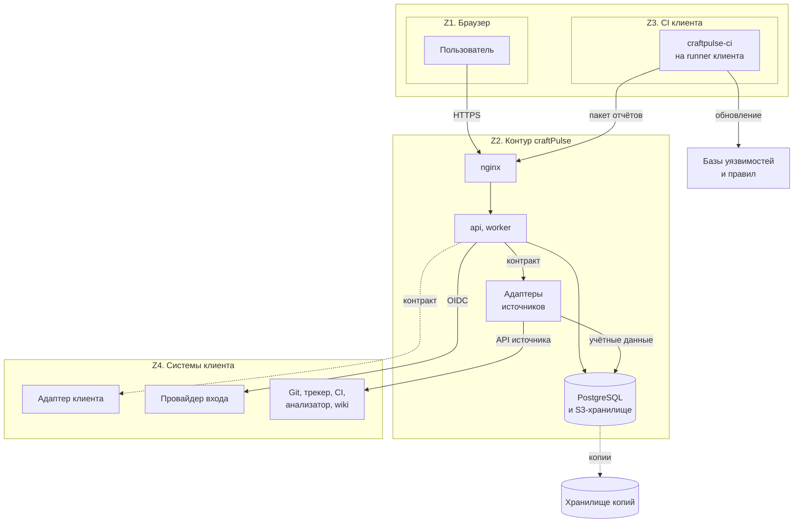
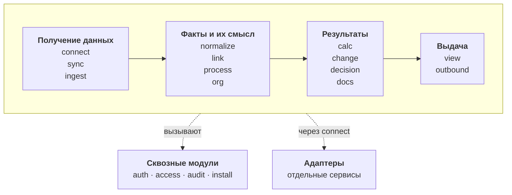
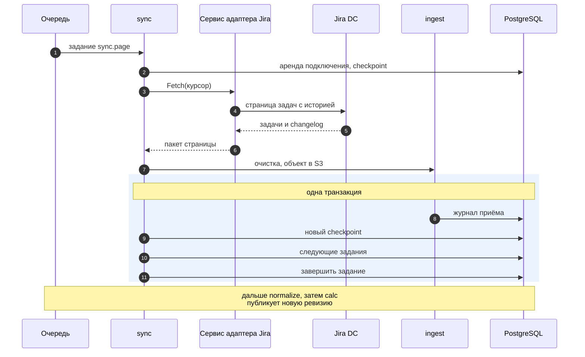
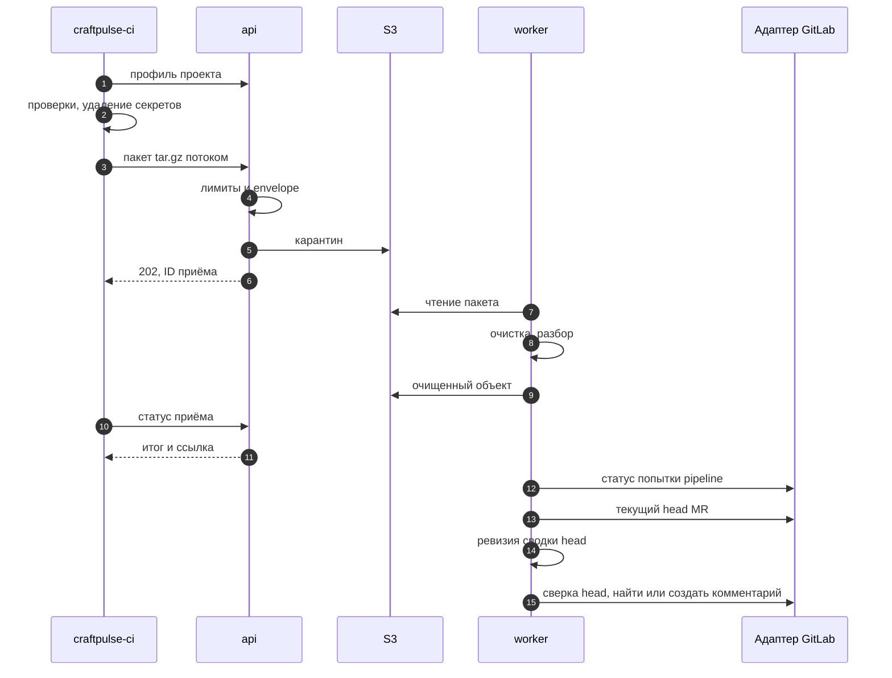
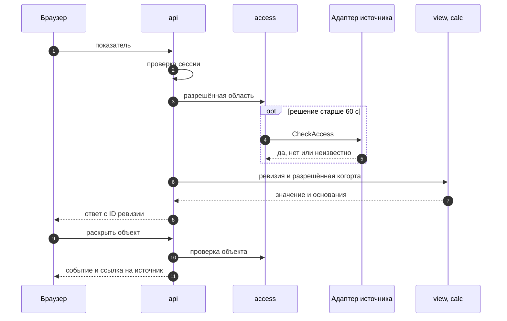
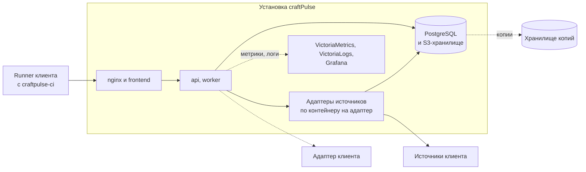

# Техническое задание craftPulse

## Часть I. SRS - спецификация требований к ПО

### 1. Назначение, границы и источники

#### 1.1. Назначение и версия требований

craftPulse связывает задачи, изменения кода, запуски CI, находки анализаторов и документы в одну историю разработки. По этой истории продукт строит ролевые отчёты и разборы: пользователь проверяет наблюдение по исходным событиям и выбирает следующее действие. Основные пользователи - руководитель разработки, проектный менеджер, техлид и разработчик. Подключениями управляет администратор, смысл статусов и полей подтверждает владелец процесса, за документацию сервиса отвечает владелец сервиса.

SRS нужна, чтобы согласовать поведение продукта, реализацию и приёмку. Версия требований - **0.5** от **7 ноября 2026 года**; приложения из раздела 1.5 берутся из того же коммита репозитория, что и этот документ. Эта версия задаёт границу системы, роли, поставки, полный состав функций, алгоритмы UC, проверяемые FR, бизнес-правила, требования к данным, план проверки NFR и общий реестр UI с текстовой дизайн-системой. Подробная политика доступа, карточки всех UI и сквозная приёмка добавляются в следующих версиях; внутреннее устройство системы описано в части II.

F-xx обозначают пользовательские возможности, UC-xx - сценарии, Kxx - сквозные технические сценарии, C/S/I/A/D/T - метрики. Идентификаторы не меняются при уточнении требований. Поставки M0/M1/M2 задают очередь реализации, а не глубину проектирования: все функции и сценарии этого документа входят в полное ТЗ, и исключить любую из них можно только новой версией требований.

#### 1.2. Граница системы

В craftPulse входят:

- подключение источников, приём отчётов и событий, хранение истории и контроль её полноты;
- подтверждённое сопоставление статусов, полей, учётных записей и объектов разных источников;
- расчёт показателей по версиям определений, сохранение срезов и раскрытие числа до исходных событий;
- отчёт команды, карточка задачи, сводка MR, разбор находок, попыток CI и документации;
- шаг передачи отчётов из CI клиента и штатные профили проверок в выделенном CI/runner;
- исключения, политика проверок и черновик задачи техдолга, который пользователь подтверждает перед записью, - каждое в своей поставке;
- проверка прав доступа при показе объектов, исходных данных, агрегатов и выгрузок.

Задачи ведутся в трекере, код и ревью - в Git-хостинге, сборка и тесты - в CI, документы редактируются в wiki, развёртывания выполняет система доставки. craftPulse читает факты этих систем и хранит, откуда взята каждая связь. Для публикации сводки в MR администратор отдельно выдаёт право записи. Задача техдолга появляется в трекере только после подтверждения пользователя с правом записи; чтение и повторный импорт ничего в трекер не пишут. Автоматической двусторонней синхронизации трекеров в первой версии нет.

Управленческое решение, исправление кода или документа и ручную приёмку пользователь выполняет в своём рабочем процессе. Завершение задачи, merge, успешный pipeline и доставка в production учитываются отдельно. Продукт не ставит сотрудникам единый балл, не складывает оценки размера задач разных команд и не выводит эффект инициативы из одного сравнения периодов. Публичный каталог репозиториев и единая оценка репозитория в продукт не входят.

#### 1.3. Поставки и границы показа

Демонстрационный MVP проходит на подготовленном стенде, M0 - на данных клиента, и принимаются они по разным условиям. Прохождение MVP не означает готовности M0. Для стенда подключается больше адаптеров, чем обязательно для M0: у клиента они включаются, только если он работает на этом стеке. Функции M1 в MVP не входят.

| Поставка | Функции и UC в объёме | Что отложено | Зависимости и ограничения | Условие готовности требований |
|---|---|---|---|---|
| Демонстрационный MVP | Три связанных результата: ежедневный отчёт команды, разбор задачи и сводка текущего MR. F-01-F-08; F-10-F-14 и F-16-F-18 в командном срезе; F-22, F-24; F-30-F-36 и F-40-F-43 в выбранных профилях; F-50, F-51, F-60, F-61 в границах столбца «Срез MVP» таблиц 3.1. UC-01-UC-11, UC-13-UC-15, UC-19-UC-21, UC-25-UC-30, UC-36, UC-37 в части MVP | Redmine и проект в двух трекерах; исходный план спринта, полный DoD, доставка, бизнес-иерархия, инициативы, горячие точки, создание задачи техдолга, обязательные проверки и эксперименты M2 | Один стенд; основной проход Jira DC + GitLab self-managed + GitLab CI. Дополнительные адаптеры стенда перечислены под таблицей | Каждое включённое поведение связано с AC-01-AC-18 и NFR-01-NFR-09 [требований MVP](mvp-scope.md) |
| Минимальный сквозной M0 | Общие F-01-F-08; командные F-10-F-14 и F-16-F-18 в части M0; F-22, F-24, F-50, F-51. Технический M0 в выбранном объёме: F-30-F-36, F-40-F-43; тонкий Git-профиль документации F-60, F-61. F-31 в M0 даёт только предупреждения через UC-25 и UC-26. UC-01-UC-15, UC-19-UC-21, UC-25-UC-30, UC-32, UC-36, UC-37 в части M0 | Расширения функций M1; остальные адаптеры и профили - по их этапам; обязательные проверки и разрешённый обход (UC-31) - M1 | Jira Server/DC, GitLab self-managed, GitLab CI и универсальный импорт. Первый отчёт о потоке работы не требует технического профиля | Для выбранного сквозного сценария определены данные, права, поведение при пробелах и приёмка на данных клиента; зафиксированы состав профиля и ограничения источников |
| M1 | F-02, F-11-F-15, F-17, F-20, F-21, F-23, F-33, F-34, F-37-F-39, F-51, F-60, F-62, F-63 в части M1; обязательные проверки и разрешённый обход F-31 (UC-31). UC-02, UC-04, UC-07, UC-13-UC-18, UC-21-UC-24, UC-28, UC-31-UC-38 в части M1; UC-40 в части M1 по K08 | Прогноз, сложные рекомендации, сокращение набора тестов, учения по runbook и остальные сценарии M2 | Redmine - первый следующий трекер; история спринта, DoD, CD, связи сервисов и wiki подключаются под конкретный сценарий | Для каждого расширения описаны основной путь, альтернативы, права и проверка результата, в том числе конфликт зеркал, отсутствие истории и неполные основания |
| M2 | F-23 и F-63 в части M2: UC-24 и UC-42; UC-39-UC-48: прогноз, маршрут ревью, выбор тестов, учения, поиск ответа в документации, pulse-опрос, сбои после развёртываний, стоимость CI, доступность сервиса извне, межкомандные передачи | Каждый сценарий включается отдельно после проверки пользы и достаточности данных | История, согласованный эксперимент, нужные CD, CMDB и телеметрия, правила публикации данных по группам | Для каждого сценария заданы ожидаемый результат, условия применимости, способ проверки и безопасное поведение при нехватке данных; вопросы раздела 9.2 решены до его приёмки |

Состав интеграций стенда задаёт [раздел 2 требований MVP](mvp-scope.md#2-интеграции-и-штатная-реализация): GitLab self-managed и GitHub.com; Jira DC и универсальный импорт; GitLab CI, GitHub Actions и Jenkins в пределах build API; SonarQube Server/Community Build; Markdown и OpenAPI в Git и Confluence DC. Штатные проверки покрывают выбранные профили Go, Python и JS/TS, а также Opengrep, Trivy и Gitleaks; результаты тестов и покрытие приходят готовыми отчётами. GitHub.com с Actions, Jenkins и Confluence DC для стенда обязательны в заявленном объёме. Порядок остальных интеграций задают [коннекторы](../product/connectors.md); GitHub Enterprise Server, облачные редакции и произвольные плагины поддержку автоматически не получают.

#### 1.4. Термины

| Термин | Значение |
|---|---|
| Организация | Изолированная область клиента со своими пользователями, командами и проектами (tenant) |
| Команда, проект, сервис, компонент | Команда задаёт процесс и шкалу размера задач; проект объединяет работу; сервис связывает поставляемую систему с её компонентами; компонент - область анализа внутри репозитория или между репозиториями |
| MR | Запрос на слияние изменения. В тексте MR означает и PR в GitHub, при этом семантика каждого провайдера сохраняется |
| Head и база MR | Head - последний коммит MR, к которому относится сводка. База - сопоставимая ревизия целевой ветки, с которой сравнивается head |
| Исходный идентификатор | Провайдер, инстанс, проект и внешний ID объекта внутри организации. Одинаковый ключ из разных источников не означает один объект |
| Сопоставление (mapping) | Подтверждённое соответствие статусов, исходов, полей, типов, размеров и команд понятиям процесса; хранится с версией |
| Область | Выбранный набор проектов, объектов, компонентов, документов или проверок. Расчёт учитывает одновременно область расчёта и область, доступную пользователю |
| Возможность подключения | Проверенное свойство конкретного подключения: чтение состояния, истории, связей, отчётов или прав, публикация в MR (capability) |
| Срез на дату | Дата состояния расчёта вместе с версиями истории и определений (as-of). Время получения запоздавшего события хранится отдельно |
| Основание | Доступные пользователю исходные данные вывода: объект, событие, интервал, отчёт или манифест с версией и происхождением (evidence) |
| Находка | Результат конкретного правила с объектом, областью, версией и основанием. Исходная серьёзность и решение триажа сохраняются |
| Манифест, профиль | Манифест описывает источник отчёта, запуск, версии инструментов, область и полноту. Профиль задаёт поддержанный набор проверок и их настройки |
| Режимы проверок | Import-only: craftPulse принимает готовые отчёты клиента. Штатный: craftPulse запускает выбранные проверки сам. Смешанный: оба режима совмещаются по компоненту, языку, виду анализа, профилю, SHA и области |
| Предупреждение, обязательная проверка | Предупреждение информирует и не блокирует merge (advisory). Обязательную проверку команда включает отдельно своей политикой (gate) |
| Исключение | Решение с автором, причиной, областью и сроком пересмотра. Принятый риск оставляет находку открытой и не считается исправлением |
| Завершение, доставка, DoD | Принятое завершение задачи; подтверждённая доставка артефакта; Definition of Done - набор условий готовности с технической и ручной проверкой |
| Состояние данных | `ASSESSED`, `PROVISIONAL`, `BOUNDED`, `UNKNOWN`, `NOT_EVALUATED`, `NOT_APPLICABLE` по [модели метрик](../product/metrics/model.md). Ноль допустим только для определённой проверенной области |

#### 1.5. Источники требований

Все приложения лежат внутри `docs/` и взяты на коммите из раздела 1.1. Версии провайдеров и инструментов конкретной поставки фиксируются в её манифесте.

| Источник | Что считается требованием | Назначение |
|---|---|---|
| [Видение](../product/vision.md) | Рабочие задачи, граница продукта, права и ход разработки | Назначение и общий порядок M0/M1/M2 |
| [Бизнес-план, раздел 5](../business-plan/business-plan.md#5-продукт-и-полный-перечень-возможностей) | Все 42 F-ID, пользовательские цели и связанные UC; раздел 7.1 - условия поставок | Проверка полноты каталога и результата каждой функции |
| [Функции](../requirements/features.md) | Поведение каждой F-xx, ограничения этапа и проверка законченных сценариев | Результат, данные и границы функций |
| [Use Case](../requirements/use-cases.md) | UC-01-UC-48: акторы, предусловия, данные и права, основной ход, альтернативы, итоги | Алгоритмы сценариев и общие ветки ОВ-1-ОВ-7 |
| [MVP](mvp-scope.md) | Разделы 1-4 - состав и правила; разделы 5-8 - показ, данные, AC и NFR | Точный состав стенда, включая дополнительные адаптеры |
| [Сквозные сценарии](../product/scenarios.md) | K01-K10 и сценарии шести блоков | Связи технических результатов, документации и решений пользователя |
| [Метрики](../product/metrics.md) и [модель](../product/metrics/model.md) | Определения, состояния данных, версии, область и общий паспорт показателя | Единые правила расчёта и раскрытия |
| [Задачи](../product/metrics/tasks.md), [активность](../product/metrics/activity.md), [код](../product/metrics/code.md), [безопасность](../product/metrics/security.md), [CI/CD](../product/metrics/ci-cd.md), [документация](../product/metrics/documentation.md) | ID, формулы, минимальные данные, ограничения и этапы | Методика расчёта; формулы в SRS не повторяются |
| [Коннекторы](../product/connectors.md) | Модель подключения, возможности, форматы, этапы и ошибки | Поддержанная область каждого провайдера |

Если источники расходятся, состав и критерии стенда берутся из требований MVP, состав первого клиентского пилота - из раздела 7.1 бизнес-плана и этапа M0 коннекторов, формулы и состояния - из каталога метрик, перечень F-ID - целиком из раздела 5 бизнес-плана.

### 2. Общее описание и контекст

#### 2.1. Рабочий процесс и среда

Администратор выбирает организацию, проекты и источники, проверяет полномочия и загружает историю. Владелец процесса подтверждает сопоставление статусов и полей на исходных задачах. craftPulse связывает факты и обновляет отчёт команды, карточку задачи и сводку MR. Руководитель и PM разбирают поток работы и препятствия, техлид и разработчик - текущее изменение. После действия в исходной системе следующий сбор показывает новое состояние тех же объектов.

craftPulse работает в облаке или устанавливается в контуре компании. Среде нужен разрешённый доступ к API, Git, отчётам и источникам обновления правил и баз уязвимостей; для закрытого контура способ обновления согласуется до запуска профиля. Код и конфигурация проекта клиента исполняются только в выделенном CI/runner, основной сервис получает результаты. Состав инфраструктуры и изоляция описаны в части II.

В MVP и M0 пользователи входят через GitLab. Подключение GitHub как источника данных вход через GitHub не добавляет. На тарифе «Крупная компания» вход идёт через корпоративный SSO. Вход выполняется только через внешнего провайдера: учётная запись первого администратора задаётся при установке или создании облачного рабочего пространства и получает роль при первом входе (UC-01, UC-03).

#### 2.2. Пользователи и полномочия

Роль - набор действий, а не должность; один человек может совмещать роли. Пользователь видит только то, что ему разрешено одновременно в craftPulse и в исходной системе. Права администратора на настройки не открывают закрытый код, данные безопасности или wiki. Выбор дашборда права не меняет.

| Актор / роль | Цель и действия | Область данных | Условия и ограничения |
|---|---|---|---|
| Пользователь | Войти, выбрать разрешённый срез, раскрыть число, получить отчёт или выгрузку | Доступные ему организация, команды, проекты и объекты | Права проверяются также для заголовков, поиска, агрегатов, сохранённых срезов и выгрузок; если право неизвестно, объект закрыт |
| Руководитель разработки | Проверять выпуск и поток работы с учётом размера задач, возраст и блокировки, сроки и возвраты; сравнивать инициативы, переходить к бизнес-обязательствам | Назначенные команды и проекты; на M1 - доступные организационные и бизнес-связи | Шкалы размера разных команд не складываются; данные закрытой команды не раскрываются через общий итог |
| Проектный менеджер | Разбирать задачу, историю проекта, очередь MR, план спринта, проект в двух трекерах и передачу проекта | Назначенный проект, его задачи и разрешённые связанные MR, запуски CI и документы | Доступ к задаче не открывает закрытую находку в связанном коде; подтверждение зеркал и разбор конфликтов ничего не пишут в трекер |
| Техлид | Выбрать профиль проверок, разобрать MR, попытки CI и находку, оформить исключение, подготовить задачу техдолга, настроить политику проверок | Разрешённые сервисы, компоненты, репозитории, отчёты и находки | Политику и исключения меняет только пользователь с отдельным правом в этой области; задача техдолга создаётся после подтверждения и при праве записи в трекер |
| Разработчик | Получить сводку своего MR, сверить правило и строку, результаты тестов и покрытие, исправить проблему или обосновать риск | Доступные репозитории, MR и отчёты | Исключение действует только в назначенной области; значение потенциального секрета удаляется до показа |
| Администратор | Задать структуру организации, подключения, учётные записи, области доступа и вариант поставки; восстановить сбор | Настройки организации, состояние подключений и разрешённые диагностические сведения | Права на чтение API, клонирование Git, загрузку отчётов и запись комментария в MR выдаются раздельно; учётные данные интеграций в отчётах не показываются |
| Владелец процесса | Подтвердить, какие статусы означают начало, завершение, отмену и блокировку, а также размер, тип, команду, календарь и целевые сроки; на M1 - правила DoD | Процесс своей команды и примеры доступных задач | Сопоставление подтверждается по ID статусов конкретного инстанса и хранится с версией; категория статуса в трекере сама по себе не означает начало работы |
| Владелец сервиса | Назначить корневые каталоги документации, владельца и аудиторию; исправлять нарушения документации, проверять влияние изменений API, публикацию и комплект передачи | Свой сервис и разрешённые документы, версии и обязательства | Последний редактор не становится владельцем автоматически; ревью документа и учение по runbook привязаны к версии и учитываются раздельно |
| Участник команды | Добровольно ответить на pulse-опрос (M2) | Собственный ответ и сводка по группе в согласованной области | Вопросы, доступ к ответам и минимальный размер группы для публикации согласуются до сбора (Q-02) |

#### 2.3. Внешние участники обмена

| Участник | Что передаёт и получает | За что отвечает craftPulse | Что остаётся за внешней системой |
|---|---|---|---|
| Git-хостинг | Передаёт коммиты, MR, base и head, ответы ревью, учётные записи и права; принимает разрешённый комментарий | Связи, сопоставимость ревизий, сводка для актуального head, проверка прав | Хранение кода, назначение ревьюеров, ревью и merge; проверка личности при входе через GitLab |
| Трекер задач | Передаёт задачи, статусы и исходы, поля, связи, историю и права; на M1 принимает подтверждённую задачу техдолга | Сопоставление, восстановление истории, связи, расчёт потока работы, разбор зеркал и подтверждение записи | Workflow, изменения задач, ручная приёмка и справочники |
| CI и runner | Передаёт запуски, jobs и попытки, время, исходы, отчёты и манифест; выполняет шаг передачи и выбранный профиль | Приём и нормализация отчётов, полнота и версии, сводка по текущему изменению | Сборка и тесты проекта, ресурсы исполнения и исходный результат job |
| Анализатор и поставщик отчётов | Передаёт находки, правила, исходную серьёзность, метрики, решения внешнего триажа, схему отчёта и сведения о запуске | Чтение поддержанного формата, происхождение, сопоставимость и исключения в craftPulse | Смысл правила, лицензия движка клиента и решения внешнего триажа |
| Хранилище документации | Передаёт текст, версию или hash, структуру, сведения о владельце и права чтения | Выбор документов и аудитории, связь с сервисом, поддержанные проверки | Редактирование, хранение исходной версии и права доступа |
| Провайдер идентификации | Подтверждает личность через GitLab или корпоративный SSO | Сопоставление учётных записей, роль и область, применение прав источников | Аутентификация и корпоративная учётная запись |
| Система доставки, реестр артефактов, CMDB | Передаёт развёртывания, окружение, digest артефакта, состав и подтверждённую доступность извне | На M1/M2 связывает поставку с проверками, уязвимостями, сбоями и доступностью извне | Развёртывание, запись инцидента и сведения об окружении |
| Источник баз уязвимостей и правил | Передаёт версии баз, правила и обновления из разрешённого источника | Фиксирует использованную версию и отличает новую уязвимость в базе от изменения кода | Публикация базы и доступность обновления в контуре |
| Внешняя BI-система, получатель выгрузки | Читает разрешённую выгрузку или ответ API | Сохраняет в выгрузке определения, версии, область и права | Свои визуализации и дальнейшая работа с выгрузкой |

#### 2.4. Внешние условия и ограничение результата

| Зависимость | Что требуется | Если условие не выполнено | Как проверяется |
|---|---|---|---|
| Версия и редакция провайдера | Проверенные методы API, схема ответов, постраничная выдача и возможности конкретного инстанса | Доступная часть показывается отдельно; неподдержанная возможность не объявляется рабочей интеграцией | Пробное чтение, проверка контракта и сверка с источником на заявленной версии |
| История задач | Полная история переходов и полей, нужная предыстория и все открытые задачи | Без истории доступен только текущий снимок; прошлый WIP, cycle time и исходный план считаются только по доступным событиям | Сверка старой открытой задачи, загрузки истории, постраничной выдачи и границы истории с источником |
| Смысл процесса | Подтверждённые ID статусов и исходов, размер, тип, команда, календарь и целевые сроки | Неизвестные поля видны; начало, завершение и обещанный срок не назначаются по догадке | Предпросмотр на доступных задачах и ручная сверка выбранного среза |
| Права в источниках | Проверка доступа конкретного пользователя к репозиторию, задаче, документу и закрытым данным безопасности | Содержимое, заголовки и вклад недоступных объектов не раскрываются; служебная учётная запись не заменяет права пользователя | Положительная и отрицательная проверка, прямая ссылка, агрегат, сохранённый срез и отзыв права; для MVP AC-12 и NFR-05 |
| Сеть и лимиты API | Разрешённые адреса, лимиты и возможность повторной сверки | Текущая ошибка, точка продолжения, задержка и последний успешный снимок с датой показываются отдельно | Ответы 401/403, 429, timeout и ошибка на следующей странице с последующим восстановлением |
| Подтверждение связей | Исходные ID, тип и происхождение связи; для MR, CI и отчёта - репозиторий, ревизия, запуск и область | Связь, найденная по ветке или названию, остаётся кандидатом; причина ожидания не придумывается | Одинаковые ключи из разных инстансов, неоднозначная связь, отчёт по другому SHA |
| Формат и полнота отчёта | Поддержанный формат и схема, источник отчёта, профиль и правила, SHA или digest, область и признак завершённости | Неверный пакет отклоняется с причиной; отсутствующая проверка не считается чистой или исправленной | Корректный и некорректный пакет для каждого профиля |
| Сопоставимая база | Base и head проверены теми же правилами, базой уязвимостей, областью и настройками | Без базы находка помечается «впервые обнаружена»; смена методики показывается отдельно от изменения кода | Повтор анализа при смене правил или базы и при пропуске проверки head |
| Попытки CI и отчёты тестов | ID запусков, jobs и попыток; JUnit для исходов тестов, отдельный LCOV, Cobertura или JaCoCo для покрытия | Сводка Jenkins не восстанавливает внутренние повторы; JUnit не даёт покрытия; провал и затем успех не доказывают нестабильность теста | Наборы с повторами и матрицей; для Jenkins - манифест запуска; отсутствие каждого вида отчёта |
| Публикация в MR | Отдельное право записи в нужный проект и подтверждённый актуальный head | Результат остаётся на сайте в разрешённой области; ошибка публикации видна, публикация не считается выполненной | Токен только на чтение, отозванное право записи, новый head во время публикации |
| Штатные проверки | Поддержанный язык, вид анализа и профиль, изолированный запуск, доступные версии правил и баз, нужные лицензии | Непокрытая область обозначается; законченный внешний отчёт заменяет только свою область | Манифест, наборы с проблемами и без; недоступное обновление базы |
| Документы и аудитория | Выбранные корневые каталоги, владелец, версия и проверяемые права чтения; для внешних ссылок - согласованный сетевой режим | Неизвестные права закрывают документ; ответы 403/429 и timeout не считаются сломанной ссылкой; возраст документа не заменяет ревью | Закрытый родительский раздел wiki, пользователь вне группы, сломанный якорь, сетевые ошибки |
| Доставка и состав артефакта | SHA, неизменяемый digest, окружение, исход, состав и подтверждённые связи с инцидентами | По tag, видимости репозитория или job до production нельзя утверждать доставку в production, доступность извне или причину сбоя | Повторно использованный tag, отсутствие CD или CMDB, неполный перечень компонентов; UC-34, UC-35, UC-45, UC-47 |

Срез воспроизводится по выбранному периоду или дате, исходным ID и версиям сопоставления и расчёта. Запоздавшее событие или новая методика создают новую версию результата. Формулы и правила для неизвестных значений заданы в приложениях раздела 1.5. Сохранённый отчёт показывается только в той области, которая доступна пользователю сейчас.

#### 2.5. Основные пути по ролям

| Путь | Входное условие и действие | Ожидаемый результат | Связи и проверка |
|---|---|---|---|
| Подключение | Администратор выбирает тестовые проекты, подключает Jira, GitLab и CI и повторяет загрузку | Видны возможности подключения, область и история; повторная загрузка не создаёт дубликатов | F-03, F-07; UC-04-UC-06, UC-10; MVP AC-02, AC-06, AC-11 |
| Настройка процесса | Владелец процесса сверяет на исходных задачах рабочие и входящие статусы, отмену, переоткрытие, неизвестные поля и целевые сроки | Подтверждённая версия сопоставления; неизвестное не становится началом или завершением, прежний срез воспроизводится | F-16; UC-07, UC-09; MVP AC-03, AC-18 |
| Регулярный контроль | Руководитель выбирает команду и период и раскрывает стареющую задачу из отчёта | Обновлённые графики и та же расчётная выборка; пробелы и n видны | F-01, F-10-F-14, F-18; UC-11, UC-13, UC-15; MVP AC-04, AC-14, AC-18 |
| Разбор препятствия | PM открывает разрешённую задачу, у которой MR ждёт ревьюера, и смотрит результаты CI | Наблюдение с основанием и следующим действием; неизвестная связь или причина показана как неизвестная | F-02, F-22, F-24, F-51; UC-19, UC-21; MVP AC-05, AC-16 |
| Технический разбор | Техлид выбирает профиль, получает новый head, открывает находку и оформляет исключение | Сайт и MR показывают одну и ту же актуальную сводку; у исключения есть область и срок пересмотра; упавшая проверка не закрывает находку | F-30, F-32, F-34-F-36; UC-25-UC-30; MVP AC-07, AC-08, AC-10, AC-13 |
| Исправление | Разработчик открывает правило и строку, исправляет код и перезапускает pipeline | Сопоставимый полный отчёт подтверждает исправление; прежний успешный результат не переносится на новый head | F-40-F-43; UC-26-UC-28; MVP AC-07, AC-09, AC-10 |
| Документация | Владелец сервиса назначает корневой каталог в Git, владельца и аудиторию, открывает сломанный якорь или ошибку спецификации | Нарушение привязано к документу и версии; закрытая страница wiki не раскрывается | F-60, F-61; UC-36, UC-37; MVP AC-09, AC-12 |
| Отзыв доступа | Администратор сужает область пользователя или его права в источнике; пользователь открывает прежний срез и прямую ссылку | Недоступные объекты, их названия и вклад в агрегаты не показываются; сохранённый результат не обходит проверку | F-08; UC-03; MVP AC-12, NFR-05 |

Для M1 дополнительно проверяются исходный план спринта и его история, два трекера с подтверждёнными зеркалами, подтверждение DoD и доставки, сопоставимость периодов инициативы, подтверждение записи в трекер, влияние изменения API на документацию и комплект передачи. Для M2 к каждому сценарию из подраздела «Общие и последующие сценарии» раздела 3.1 добавляются условия эксперимента и измеримая проверка по каталогу метрик.

### 3. Функциональные требования и Use Case

#### 3.1. Каталог функций

Каталог содержит все 42 функции раздела 5 бизнес-плана с их названиями и связанными UC. Столбец «Поставка» описывает целевой продукт, «Срез MVP» - поведение на стенде. Ссылка на UC не означает, что весь сценарий входит в более раннюю поставку: например, F-31 в M0 и MVP даёт только предупреждения через UC-25 и UC-26, а UC-31 с обязательными проверками и разрешённым обходом относится к M1.

Во всех строках действуют права доступа из раздела 2.2, паспорт показателя и состояния данных. «Пользователь» - любая роль, которой доступен объект. Карточки FR раздела 3.2 и связи со шагами и ветками в разделе 3.3 уточняют каталог с теми же F-ID и UC-ID; критерии MVP заданы в его требованиях.

##### Общие возможности

| F-ID | Функция | Актор | Ожидаемый результат | UC-ID | Поставка | Срез MVP |
|---|---|---|---|---|---|---|
| F-01 | Раскрытие показателя | Пользователь | Формула, выборка, интервалы, исключения, n, полнота, версия и исходные объекты того же расчёта | UC-11 | M0; одно определение для панели, MR, выгрузки и API | Да, для включённых показателей |
| F-02 | Связи задачи, MR и проверок | Пользователь | Цепочка связей с типом и подтверждением каждой; предположение отделено от факта | UC-14, UC-19 | M0: задача и MR; M1: самостоятельные связи с находками и задачами | Задача, MR, запуск CI и отчёт; находка через MR помечена как косвенная связь |
| F-03 | Подключения и импорт | Администратор; техлид - для импорта отчётов | Подключённая область и проверенные возможности источника; повторный пакет не дублирует объекты | UC-04, UC-05, UC-06 | M0: Jira Server/DC, GitLab self-managed, GitLab CI и универсальный импорт; другие адаптеры по этапам | Да, включая дополнительные адаптеры стенда из раздела 1.3 |
| F-04 | Готовые панели | Руководитель разработки | После загрузки и подтверждения сопоставления доступны готовые панели без написания запросов | UC-07, UC-13 | M0 | Три связанных разбора на подготовленном наборе |
| F-05 | Понятные состояния данных | Пользователь | Ноль, неизвестность, отсутствие проверки, частичный результат и неприменимость различаются | UC-10, UC-11 | M0 | Да; текущая попытка показана отдельно от последнего успешного снимка |
| F-06 | Работа в согласованном контуре | Администратор | Подключения, импорт и runner работают в выбранной области размещения | UC-01 | M0: облако или установка в контуре по тарифам «Установка в контуре» и «Крупная компания» | Один изолированный стенд, без отказоустойчивости и самостоятельного подключения клиентов |
| F-07 | Состояние сбора | Администратор | Видны задержка обновления, границы истории, неизвестные поля, последняя сверка и причина пробела | UC-04, UC-05, UC-08, UC-10 | M0 | Да, для каждого обязательного подключения |
| F-08 | Доступ к разрешённым данным | Пользователь | Открываются только разрешённые объекты, основания и агрегаты; отзыв права действует и на сохранённые срезы | UC-03 | M0 | Вход через GitLab, сопоставление учётных записей и отрицательные проверки доступа |

##### Руководитель разработки и владелец процесса

| F-ID | Функция | Актор | Ожидаемый результат | UC-ID | Поставка | Срез MVP |
|---|---|---|---|---|---|---|
| F-10 | Ежедневный отчёт команды | Руководитель разработки | Обновлённый отчёт за выбранный период с датой расчёта, динамикой и последней сверкой | UC-13 | M0 | Графики потока работы, длительности, WIP, сроков и переоткрытий; фильтры и обновление |
| F-11 | Результаты задач и поставка | Руководитель разработки | Первые принятые завершения по типу и размеру; подтверждённая доставка отдельно | UC-13, UC-18 | M0: завершения; M1: доставка и бизнес-срез | Завершения без двойного учёта переоткрытий; без доставки в production |
| F-12 | Незавершённая работа и задержки | Руководитель разработки | WIP, возраст задач, заблокированные задачи и разброс cycle time с переходом к задачам | UC-13 | M0: WIP, возраст, блокировки и cycle time; M1: время по состояниям | Как в M0; заблокированные задачи остаются частью WIP |
| F-13 | Возвраты и готовность | Руководитель разработки, владелец процесса | Переоткрытия, возвраты из приёмки, дефекты после выпуска и выполнение DoD разбираются отдельно | UC-15, UC-16 | M0: переоткрытия; M1: приёмка, дефекты после выпуска и DoD с подтверждением | Переоткрытия (T23) с окном наблюдения; без DoD и дефектов после выпуска |
| F-14 | Целевые сроки и план | Руководитель разработки, владелец процесса | Время задач сравнивается с целевым сроком нужной версии, результат спринта - с исходным планом при полной истории | UC-09, UC-22 | M0: целевые сроки; M1: исходный план спринта | Целевые сроки по типу и размеру, без исходного плана спринта |
| F-15 | Эффект инициатив | Руководитель разработки | Сравнение периодов до и после с видимыми изменениями состава, области и методики | UC-17 | M1 | Не входит |
| F-16 | Определения процесса | Владелец процесса | Проверенное на задачах и подтверждённое сопоставление, календарь и целевые сроки с версией | UC-07, UC-09 | M0 | Начало, завершение, отмена, блокировка, размер, тип, команда и целевой срок; без бизнес-полей и DoD |
| F-17 | Переход между уровнями | Руководитель разработки | Переход от доступного общего среза к команде, задаче, MR и инженерному результату | UC-14, UC-18 | M0: команда; M1: организация и бизнес-иерархия | Команда и её доступные задачи и MR |
| F-18 | Отчёт за период | Руководитель разработки, получатель выгрузки | Повторяемый отчёт с теми же определениями и основаниями; выгрузка сохраняет область и версию | UC-12, UC-13 | M0: регулярный отчёт; формат выгрузки выбирается до приёмки UC-12 | Сохранённый отчёт и ручное обновление; рассылка и выгрузка в BI или API в срез не входят |

##### Проектный менеджер

| F-ID | Функция | Актор | Ожидаемый результат | UC-ID | Поставка | Срез MVP |
|---|---|---|---|---|---|---|
| F-20 | Прогресс спринта | PM | Исходный план, добавленные и снятые задачи и результат на конец спринта | UC-22 | M1 при наличии истории плана | Не входит |
| F-21 | Проект в двух трекерах | PM | Общая выборка Jira и Redmine с подтверждёнными зеркалами задач и видимыми конфликтами | UC-23 | M1, только чтение | Не входит; универсальный импорт этот сценарий не заменяет |
| F-22 | Разбор задержки задачи | PM, руководитель разработки | История и блокировки задачи, её MR, очередь ревью и CI собраны в наблюдение с основанием и следующим действием | UC-19 | M0 | Да, в том числе до нарушения целевого срока |
| F-23 | Разбор проекта перед передачей | PM, владелец сервиса | Сервисы, владельцы, открытые проблемы и комплект документов с известными пробелами | UC-24 | M1: комплект передачи; M2: проверка учением | Не входит |
| F-24 | Понятное объяснение проблемы | PM, техлид, разработчик | Объект, правило, область проверки, исходная серьёзность и доступное действие | UC-27 | M0 | Разрешённые технические наблюдения в карточке задачи и MR |

##### Техлид

| F-ID | Функция | Актор | Ожидаемый результат | UC-ID | Поставка | Срез MVP |
|---|---|---|---|---|---|---|
| F-30 | Сводка MR | Техлид, разработчик | Сводка по актуальному head: новые и устранённые находки относительно сопоставимой базы, попытки CI, покрытие и непроверенные области | UC-26 | Технический M0 | Сайт и один обновляемый комментарий в MR для выбранного профиля |
| F-31 | Политика проверок | Техлид | Предупреждения по умолчанию; отдельно включённые обязательные проверки с правилами разрешённого обхода | UC-31; предупреждения через UC-25, UC-26 | M0: предупреждения через UC-25 и UC-26; M1: UC-31 с обязательными проверками и обходом | Только предупреждения; отсутствие данных проверки не считается успехом |
| F-32 | Импорт и штатные проверки | Техлид | Режим выбран по компоненту, языку, виду анализа и профилю; законченный внешний отчёт закрывает только свою область | UC-25 | Технический M0 в поддержанных профилях | Import-only, штатный и смешанный режимы для Go, Python и JS/TS |
| F-33 | Находки и работа по техдолгу | Техлид | Факты и структура изменения; затем короткий список горячих точек и концентрация авторства для разбора | UC-27, UC-32 | M0: факты и находки; M1: горячие точки и концентрация авторства | Только факты и находки выбранных профилей |
| F-34 | Управление исключениями | Техлид, уполномоченный разработчик, владелец сервиса | Решение с автором, причиной, областью и сроком пересмотра; решения внешнего триажа сохранены | UC-28 | M0: код и безопасность; M1: документация | Исключения по коду и безопасности без записи во внешний триаж |
| F-35 | Повторы CI | Техлид | Все известные попытки, смена провала на успех, разрешённые падения и расход повторов | UC-29 | M0 при доступной истории попыток | GitLab CI и GitHub Actions; Jenkins в пределах build API и манифеста запуска |
| F-36 | Причины изменения показателей | Техлид | Видно, что изменило результат: код, зависимости, правила, база уязвимостей, область или доступность источника; новая уязвимость прежнего артефакта не приписывается последнему MR | UC-30 | M0: причины изменения и версии показаны отдельно | Изменение между base и head, без переоценки выпущенных SBOM |
| F-37 | Карта сервиса | Техлид | Подтверждённая карта компонентов и переход к исходным данным проблемного компонента | UC-32 | M1 | Не входит |
| F-38 | Задача техдолга из находки | Техлид | Проверенный черновик, явное подтверждение записи в трекер и связь с созданной задачей | UC-33 | M1 | Не входит |
| F-39 | Паспорт релиза | Техлид, владелец сервиса | Выпущенная версия по digest: исходная ревизия, проверки до решения о выпуске, исключения и окружение; при новой уязвимости - затронутые выпущенные версии с версией базы | UC-34, UC-35 | M1 при подключённой системе доставки и манифесте сборки с digest | Не входит |

##### Разработчик

| F-ID | Функция | Актор | Ожидаемый результат | UC-ID | Поставка | Срез MVP |
|---|---|---|---|---|---|---|
| F-40 | Разбор предупреждения | Разработчик | Разрешённые место, правило, версия и контекст для исправления или триажа | UC-27 | M0 | Да; значение потенциального секрета удалено до показа |
| F-41 | Тесты и покрытие | Разработчик | Исходы тестов и доступное покрытие строк, ветвей и изменения с привязкой к коду и видимыми пробелами | UC-26 | M0 при наличии отчётов | JUnit и выбранные LCOV, Cobertura, JaCoCo; покрытие изменения - только при надёжной привязке строк |
| F-42 | Сравнение с базой | Разработчик | Сравнение с сопоставимой базой или явная причина, почему сравнить нельзя | UC-26 | M0 | Да; переименование файла и смена правил не создают новых проблем без основания |
| F-43 | Принятие риска | Уполномоченный разработчик | Обоснованное исключение действует в разрешённой области до срока пересмотра | UC-28 | M0 | Да; чужая область и истёкший срок находку не скрывают |

##### Активность и документация

| F-ID | Функция | Актор | Ожидаемый результат | UC-ID | Поставка | Срез MVP |
|---|---|---|---|---|---|---|
| F-50 | История проекта на дату | PM, руководитель разработки | События задач, MR, CI и доступных документов на выбранную дату с отметками загрузки истории и запоздания | UC-20 | M0: события подключённых источников | История включённых объектов; полный исторический обзор проекта в срез не входит |
| F-51 | Очередь ревью | Техлид, PM | Готовые к ревью MR без ревьюера, ожидающие первого ответа и повторного ревью показаны отдельно | UC-21 | M0: очередь и первый ответ; M1: повторное ревью и сроки ответа | Очередь и первый ответ человека; ответ бота ожидание не завершает |
| F-60 | Подключение документации | Владелец сервиса, администратор | Выбранные корневые каталоги, владелец, аудитория и профиль проверки связаны с сервисом и задачей | UC-36 | M0: тонкий Git-профиль; M1: wiki | Markdown и OpenAPI в Git; в Confluence DC - список страниц, текст, версия и ссылка на источник в проверенной области |
| F-61 | Нарушения документации | Владелец сервиса, разработчик | Нарушение ведёт к файлу, якорю или спецификации и правилу; ошибки доступа и сети отделены от дефектов документа | UC-37 | M0: поддержанные проверки; новые профили по каталогу коннекторов | Локальные ссылки и якоря в Git, проверка OpenAPI; чтение wiki не включает проверку всех макросов и вложений |
| F-62 | Документация при изменении API | Владелец сервиса, разработчик | Затронутый контракт и документы, примеры или руководство по миграции, которые нужно обновить | UC-38 | M1 | Не входит |
| F-63 | Комплект передачи и публикации | Владелец сервиса, PM | Инструкции, ADR, ревью и опубликованные документы соответствуют нужной версии; результат учения по runbook показан отдельно | UC-24, UC-42 | M1: обязательства, ревью и версия публикации; M2: учения | Не входит |

##### Общие и последующие сценарии

Эти UC описывают общие условия работы и сквозные или экспериментальные результаты. У UC-02, UC-39-UC-41 и UC-43-UC-48 нет строки F в бизнес-плане, новые F-ID для них не заводятся. Правила pulse-опроса и подтверждения полезности документа для UC-43 и UC-44 решаются в Q-02.

| UC-ID | Актор и цель | Наблюдаемый результат и граница | Поставка | Основание в продуктовой документации |
|---|---|---|---|---|
| UC-01 | Администратор: развернуть систему в контуре | Работающий экземпляр с подключениями и runner в разрешённой области; первый вход через внешнего провайдера | M0; в MVP один стенд | F-06, [видение](../product/vision.md#1-выбрать-область-и-доступ); Q-01 |
| UC-02 | Администратор: описать организацию | Команды, проекты, сервисы, репозитории и компоненты задают области представлений | M0 | [Уровни и права](../product/vision.md#уровни-права-и-поведение-при-нехватке-данных) |
| UC-08 | Администратор: сопоставить учётные записи | Подтверждённые исходные учётные записи участника, боты отдельно; сопоставление не расширяет права | M0 | F-07, [активность](../product/metrics/activity.md) |
| UC-34 | Техлид, владелец сервиса: проверить релиз по артефакту | SHA и digest, проверки до решения о выпуске, исключения, окружение и исход; tag без digest не доказывает, что выпущен тот же артефакт; поздняя проверка не меняет прошлую готовность | M1 | F-39, [K06](../product/scenarios.md#k06-паспорт-релиза-по-digest---m1) |
| UC-35 | Техлид: узнать о новой уязвимости в выпущенной версии | Затронутые известные digest и причина «обновилась база уязвимостей» с её версией; неизвестный состав артефакта виден | M1 | F-39, [K07](../product/scenarios.md#k07-повторная-оценка-без-изменения-кода---m1) |
| UC-39 | Руководитель, PM: спрогнозировать срок или объём | Распределение по историческим данным, проверка на истории, ошибка и условия применимости; срок не гарантируется | M2 | [Задачи, T37](../product/metrics/tasks.md) |
| UC-40 | Техлид, разработчик: получить маршрут ревью | Места MR, которые стоит посмотреть первыми, и возможные ревьюеры с объяснением; история изменений файлов остаётся косвенным признаком владения | M1/M2 по K08; сложные рекомендации - M2 | [K08](../product/scenarios.md#k08-рекомендованный-маршрут-ревью---m1m2), [код](../product/metrics/code.md) |
| UC-41 | Техлид: сократить набор тестов под изменение | Рекомендация в теневом режиме, сравнение с полным прогоном и учёт пропущенных падений; при сомнении запускается полный прогон | M2 | [K10](../product/scenarios.md#k10-безопасное-сокращение-тестов---m2-эксперимент) |
| UC-42 | Владелец сервиса: подтвердить runbook учением | Результат согласованного учения для версии runbook отдельно от наличия текста | M2 | F-63, [документация, D26](../product/metrics/documentation.md) |
| UC-43 | Пользователь: найти ответ в документации | Разрешённая инструкция и явное подтверждение пользователя, что она помогла; переход по ссылке не считается найденным ответом | M2 | [Документация, D31-D34](../product/metrics/documentation.md) |
| UC-44 | Участник команды: ответить на pulse-опрос | Добровольный ответ и сводка по группе по согласованным правилам; активность в системах ответ не заменяет | M2 | [Активность, A26](../product/metrics/activity.md); Q-02 |
| UC-45 | Руководитель, техлид: разобрать сбои после развёртываний | Подтверждённые сбои из-за развёртывания, время восстановления и внеплановые развёртывания; упавший job до production учитывается отдельно | M2 | [CI/CD, I39-I41](../product/metrics/ci-cd.md) |
| UC-46 | Руководитель, техлид: оценить стоимость CI | Расход переведён в деньги по ставкам компании с периодом и единицами; без ставок показывается только расход ресурсов | M2 | [CI/CD, I18](../product/metrics/ci-cd.md) |
| UC-47 | Техлид: учесть доступность сервиса извне | Публичный, внутренний или неизвестный доступ для реально затронутого развёртывания по подтверждённому перечню; видимость репозитория не используется как признак доступности | M2 | [Безопасность, S24/S25](../product/metrics/security.md) |
| UC-48 | Руководитель: разобрать межкомандные передачи | Эпизоды смены команды-владельца задачи и время ожидания по истории; факт передачи не указывает на виновника | M2 | [Активность, A25](../product/metrics/activity.md) |

#### 3.2. Карточки функциональных требований

FR задают обязанности системы, BR - семантику результата, DR - необходимый состав и происхождение данных. Номера устойчивы и не заменяют F-ID и UC-ID. Для карточки есть отдельный `AC-FR-xxx`; это пространство идентификаторов отличается от AC-01-AC-18 MVP. Источники - приложения раздела 1.5 в том же коммите. Статус карточек - требования данной версии SRS для проверки и согласования; выполненная приёмка продукта здесь не заявлена.

Поставка и приоритет относятся к поведению в карточке; общий FR наследуется всеми более поздними поставками. Части M1/M2 не включаются в MVP через общую ссылку на F. Для UC-02 и самостоятельных последующих UC без отдельной функции в разделе 3.1 указаны обеспечиваемые общие F-ID; это связь общего контракта, а не расширение смысла этих функций. Собственная цель таких UC остаётся в каталоге UC. Формулы и единицы берутся из каталогов метрик; физическая модель данных определяется отдельно в части II.

Входом служат только данные, принятые по DR. Указанный в карточке актор действует в пределах раздела 2.2. Общие ветки ОВ-1-ОВ-7 и их FR из таблицы 3.3 применяются также к карточкам, в которых не повторён полный текст ветки. Новый смысл неизвестного поля, метода прогноза, опроса или внешней операции не назначается по догадке: действует отказ либо ограниченный результат по BR/DR и соответствующему Q.

##### FR-001. Выдача в разрешённой области

| Поле | Содержание |
|---|---|
| ID и название | FR-001. Выдача в разрешённой области |
| Основание | F-01/F-08/F-18/F-60; [каталог функций](../requirements/features.md), [UC](../requirements/use-cases.md), определения раздела 1.5 |
| Требование | Система должна при чтении пользователем объекта, сводки или выгрузки ограничить выдачу пересечением организации, назначенной области и действующих прав источников. |
| Вход и результат | Вход: субъект и область запроса. Результат: только разрешённые объекты и их вклад; общая сумма пересчитана по доступной области с отметкой ограничения без числа и названий скрытых объектов. |
| Правила и права | BR-023; раздел 2.2; NFR-010/NFR-011; полномочия и область по разделу 2.2 |
| Ошибки и альтернативы | Неподтверждённый доступ закрывает область. Прямая ссылка, сохранённый срез и evidence не обходят проверку; пустая разрешённая область даёт отказ без данных. |
| Поставка и приоритет | M0, наследуется M1/M2; обязательно при включении указанной возможности; условия Q сохраняют силу |
| Критерий приёмки | AC-FR-001: V-08/V-26 из двух задач с доступом только к одной выдаётся одна и count=1; после отзыва нет ни задачи, ни её вклада, заголовка или выдержки. Проверить UI/API/выгрузку и прямую ссылку. |
| Проверка | Пройти указанные в критерии наборы раздела 4.4 и отрицательные ветки; свидетельство: входы, ожидаемое/фактическое, версии и разрешённое evidence |
| Связи | Все UC, ОВ-1; UC-03, шаг 6, A2-A4; UC-11 A4; UC-12 A1; DR-001/DR-011/DR-012. UI и operationId связываются при проектировании разделов 5-6 |

##### FR-002. Проверка сессии перед действием

| Поле | Содержание |
|---|---|
| ID и название | FR-002. Проверка сессии перед действием |
| Основание | F-08; [каталог функций](../requirements/features.md), [UC](../requirements/use-cases.md), определения раздела 1.5 |
| Требование | Система должна при недействительной сессии или отозванном ключе пользователя отказать в защищённом действии до чтения данных или изменения состояния. |
| Вход и результат | Истёкшая сессия возвращает ко входу и затем к исходному экрану; несохранённая форма не применяется. Недействительный ключ API получает отказ без данных. |
| Правила и права | BR-023; раздел 2.2; NFR-012; сроки сессии - Q-06; полномочия и область по разделу 2.2 |
| Ошибки и альтернативы | Новая сессия требует нового подтверждения действия, которое не было выполнено; переход на экран не равен сохранению. |
| Поставка и приоритет | M0, наследуется M1/M2; обязательно при включении указанной возможности; условия Q сохраняют силу |
| Критерий приёмки | AC-FR-002: V-07/V-08 истечение сессии перед сохранением mapping оставляет прежнюю версию; после входа доступен тот же экран. Отозванный API-ключ не получает срез. |
| Проверка | Пройти указанные в критерии наборы раздела 4.4 и отрицательные ветки; свидетельство: входы, ожидаемое/фактическое, версии и разрешённое evidence |
| Связи | UC-03; все защищённые действия, ОВ-7; DR-010/DR-018. UI и operationId связываются при проектировании разделов 5-6 |

##### FR-003. Состояние результата вместо ложного нуля

| Поле | Содержание |
|---|---|
| ID и название | FR-003. Состояние результата вместо ложного нуля |
| Основание | F-01/F-05; [каталог функций](../requirements/features.md), [UC](../requirements/use-cases.md), определения раздела 1.5 |
| Требование | Система должна при выдаче результата указать его состояние данных и причину по таблице 4.3. |
| Вход и результат | Значение, единица, состояние, границы и n независимы; неизвестный знаменатель не даёт процент. При отсутствии оценки value отсутствует; запрет доступа оформляется без защищённого payload. |
| Правила и права | BR-006/BR-022/BR-023; NFR-008; полномочия и область по разделу 2.2 |
| Ошибки и альтернативы | Малая выборка не меняет точный count на UNKNOWN; частичный count относится только к названной проверенной области. |
| Поставка и приоритет | M0, наследуется M1/M2; обязательно при включении указанной возможности; условия Q сохраняют силу |
| Критерий приёмки | AC-FR-003: полный успешный scan без findings даёт 0 ASSESSED; отсутствующий scan даёт NOT_EVALUATED без 0, повреждённый - UNKNOWN; пустой применимый знаменатель - NOT_APPLICABLE. Сверить V-01. |
| Проверка | Пройти указанные в критерии наборы раздела 4.4 и отрицательные ветки; свидетельство: входы, ожидаемое/фактическое, версии и разрешённое evidence |
| Связи | UC-10; UC-11, шаг 2, A1-A3; все выдачи результата; DR-003/DR-009/DR-011. UI и operationId связываются при проектировании разделов 5-6 |

##### FR-004. Идемпотентный приём

| Поле | Содержание |
|---|---|
| ID и название | FR-004. Идемпотентный приём |
| Основание | F-03/F-07/F-35; [каталог функций](../requirements/features.md), [UC](../requirements/use-cases.md), определения раздела 1.5 |
| Требование | Система должна при повторной доставке уже принятого факта с той же исходной идентичностью и содержимым сохранить один вклад этого факта в расчёт. |
| Вход и результат | Ledger фиксирует повтор доставки; число сущностей, событий, attempts и occurrences остаётся прежним. Новая исходная версия сохраняется как изменение, а не дополнительное одноимённое событие. |
| Правила и права | BR-001/BR-002; NFR-007; полномочия и область по разделу 2.2 |
| Ошибки и альтернативы | Неопределимая identity или конфликт содержимого без порядка исходных версий направляется на сверку; тихая перезапись запрещена. |
| Поставка и приоритет | M0, наследуется M1/M2; обязательно при включении указанной возможности; условия Q сохраняют силу |
| Критерий приёмки | AC-FR-004: три replay V-02 оставляют один completion и одну job-attempt; другая attempt-ID добавляет новую попытку, а не перезаписывает первую. |
| Проверка | Пройти указанные в критерии наборы раздела 4.4 и отрицательные ветки; свидетельство: входы, ожидаемое/фактическое, версии и разрешённое evidence |
| Связи | UC-05 A4; UC-06 A3; UC-26; ОВ-5; DR-002/DR-003/DR-006. UI и operationId связываются при проектировании разделов 5-6 |

##### FR-005. Исправление истории новой revision

| Поле | Содержание |
|---|---|
| ID и название | FR-005. Исправление истории новой revision |
| Основание | F-03/F-07/F-50; [каталог функций](../requirements/features.md), [UC](../requirements/use-cases.md), определения раздела 1.5 |
| Требование | Система должна после принятия запоздавшего события или исправления исходного факта создать новую calculation revision затронутых срезов. |
| Вход и результат | Event time задаёт место в истории; observed_at задаёт момент знания. Сохранённая revision воспроизводится по прежним входам, mapping и определению; новая revision показывает изменение и причину. |
| Правила и права | BR-002/BR-006/BR-024; NFR-008; полномочия и область по разделу 2.2 |
| Ошибки и альтернативы | Событие после as_of не влияет на состояние на эту дату; неизвестный порядок одновременных конфликтов не разрешается по порядку доставки. |
| Поставка и приоритет | M0, наследуется M1/M2; обязательно при включении указанной возможности; условия Q сохраняют силу |
| Критерий приёмки | AC-FR-005: V-05 после полной догрузки даёт новый точный T08=3 дня; прежняя неполная revision сохраняет своё состояние и не переписывается. |
| Проверка | Пройти указанные в критерии наборы раздела 4.4 и отрицательные ветки; свидетельство: входы, ожидаемое/фактическое, версии и разрешённое evidence |
| Связи | UC-05, шаг 4; UC-07 A7; UC-20 A2; DR-002/DR-004/DR-011. UI и operationId связываются при проектировании разделов 5-6 |

##### FR-006. Сохранение точки продолжения при отказе

| Поле | Содержание |
|---|---|
| ID и название | FR-006. Сохранение точки продолжения при отказе |
| Основание | F-03/F-05/F-07; [каталог функций](../requirements/features.md), [UC](../requirements/use-cases.md), определения раздела 1.5 |
| Требование | Система должна при отказе чтения источника сохранить подтверждённую точку продолжения и показать текущую ошибку отдельно от последней успешной сверки. |
| Вход и результат | Временный отказ оставляет датированный снимок при действующем доступе; после восстановления сбор продолжает незавершённую область и сверяет пропуски. |
| Правила и права | BR-022/BR-023; NFR-006/NFR-009/NFR-018; полномочия и область по разделу 2.2 |
| Ошибки и альтернативы | Потеря подключения или отзыв доступа прекращает чтение и выдачу отозванной области; зависимый текущий показатель UNKNOWN. Ошибка не обновляет last success или полный watermark. |
| Поставка и приоритет | M0, наследуется M1/M2; обязательно при включении указанной возможности; условия Q сохраняют силу |
| Критерий приёмки | AC-FR-006: сбой второй страницы V-06 не объявляет импорт полным; повтор после восстановления получает пропущенные IDs без дублей. Отзыв доступа закрывает и старый снимок. |
| Проверка | Пройти указанные в критерии наборы раздела 4.4 и отрицательные ветки; свидетельство: входы, ожидаемое/фактическое, версии и разрешённое evidence |
| Связи | UC-04 A5; UC-05 A2/A5; UC-10 A1/A2; ОВ-2/ОВ-3; DR-003/DR-011/DR-018. UI и operationId связываются при проектировании разделов 5-6 |

##### FR-007. Отмена и повтор подтверждения настроек

| Поле | Содержание |
|---|---|
| ID и название | FR-007. Отмена и повтор подтверждения настроек |
| Основание | F-03/F-16/F-34; [каталог функций](../requirements/features.md), [UC](../requirements/use-cases.md), определения раздела 1.5 |
| Требование | Система должна при отмене до сохранения оставить действующую версию настроек без изменений. |
| Вход и результат | Повтор подтверждения того же содержимого возвращает ту же сохранённую версию; новая версия появляется только при изменении подтверждённых значений. |
| Правила и права | BR-002/BR-024; права автора по разделу 2.2; полномочия и область по разделу 2.2 |
| Ошибки и альтернативы | Уже подтверждённое внешнее действие проверяется по ledger FR-043; закрытие формы после внешней записи её не отменяет. |
| Поставка и приоритет | M0, наследуется M1/M2; обязательно при включении указанной возможности; условия Q сохраняют силу |
| Критерий приёмки | AC-FR-007: отмена изменения target сохраняет v1; два подтверждения одного target дают одну v2 и одну запись решения. V-07. |
| Проверка | Пройти указанные в критерии наборы раздела 4.4 и отрицательные ветки; свидетельство: входы, ожидаемое/фактическое, версии и разрешённое evidence |
| Связи | UC-01/UC-02/UC-04/UC-07/UC-09/UC-17/UC-25/UC-28; ОВ-5/ОВ-6; DR-004/DR-010/DR-018. UI и operationId связываются при проектировании разделов 5-6 |

##### FR-008. Защита от устаревшего подтверждения

| Поле | Содержание |
|---|---|
| ID и название | FR-008. Защита от устаревшего подтверждения |
| Основание | F-16/F-34/F-38; [каталог функций](../requirements/features.md), [UC](../requirements/use-cases.md), определения раздела 1.5 |
| Требование | Система должна при подтверждении изменения на основе уже заменённой версии отказать в перезаписи до повторного просмотра актуального состояния. |
| Вход и результат | Вход: версия, которую видел автор. Результат конфликта: сохранена более новая версия, показана необходимость обновить данные; чужое решение не потеряно. |
| Правила и права | BR-002/BR-012/BR-024; права автора по разделу 2.2; полномочия и область по разделу 2.2 |
| Ошибки и альтернативы | Повтор того же подтверждённого действия возвращает его исход по FR-007/FR-043 и не считается новым конкурирующим решением. |
| Поставка и приоритет | M0, наследуется M1/M2; обязательно при включении указанной возможности; условия Q сохраняют силу |
| Критерий приёмки | AC-FR-008: два автора прочитали v1; после сохранения v2 первым второй не заменяет её своей v1-формой; после просмотра v2 вправе подтвердить v3. V-07. |
| Проверка | Пройти указанные в критерии наборы раздела 4.4 и отрицательные ветки; свидетельство: входы, ожидаемое/фактическое, версии и разрешённое evidence |
| Связи | UC-07, шаг 7; UC-28, шаг 3; UC-33, шаги 3-4; DR-004/DR-010/DR-018. UI и operationId связываются при проектировании разделов 5-6 |

##### FR-009. Один срез для всех представлений

| Поле | Содержание |
|---|---|
| ID и название | FR-009. Один срез для всех представлений |
| Основание | F-01/F-18/F-30/F-42; [каталог функций](../requirements/features.md), [UC](../requirements/use-cases.md), определения раздела 1.5 |
| Требование | Система должна при показе одного показателя в UI, MR, API или выгрузке использовать его единое определение и одну явно указанную calculation revision. |
| Вход и результат | Scope, as_of, версии, фильтры, когорта и единицы одинаковы для сравниваемых выдач. Актуальная ссылка выбирает новую revision явно; ссылка на сохранённую сохраняет её идентичность. |
| Правила и права | BR-009/BR-023/BR-024; NFR-008; полномочия и область по разделу 2.2 |
| Ошибки и альтернативы | Разные права получателей дают разные разрешённые области и подписанные итоги; это не расхождение формулы. Alias-метрики не удваивают вклад. |
| Поставка и приоритет | M0, наследуется M1/M2; обязательно при включении указанной возможности; условия Q сохраняют силу |
| Критерий приёмки | AC-FR-009: V-08 при одинаковых правах и revision даёт равные numerator/denominator, n, значения и IDs в UI/API/выгрузке; MR содержит ссылку на ту же revision. |
| Проверка | Пройти указанные в критерии наборы раздела 4.4 и отрицательные ветки; свидетельство: входы, ожидаемое/фактическое, версии и разрешённое evidence |
| Связи | UC-11/UC-12; UC-26, шаги 4-5; DR-008/DR-009/DR-011. UI и operationId связываются при проектировании разделов 5-6 |

##### FR-010. История решений и управляемое удаление

| Поле | Содержание |
|---|---|
| ID и название | FR-010. История решений и управляемое удаление |
| Основание | F-06/F-07/F-08/F-34; [каталог функций](../requirements/features.md), [UC](../requirements/use-cases.md), определения раздела 1.5 |
| Требование | Система должна при изменении или удалении сохраняемого факта зарегистрировать основание, область, автора либо источник и время операции в разрешённом аудите. |
| Вход и результат | Действуют настроенные сроки хранения по классам данных. Удалённый payload исчезает из выдачи, индекса, выдержек и производных срезов; остаётся допустимая отметка удаления без содержимого. |
| Правила и права | BR-024; NFR-011/NFR-014; сроки и удаление копий - Q-08; полномочия и область по разделу 2.2 |
| Ошибки и альтернативы | После физического удаления оснований прежний расчёт помечается невоспроизводимым с причиной; запрет доступа действует до удаления, а не после него. |
| Поставка и приоритет | M0, наследуется M1/M2; обязательно при включении указанной возможности; условия Q сохраняют силу |
| Критерий приёмки | AC-FR-010: удаление тестового документа V-09 исключает его текст из поиска и evidence; отчёт объясняет отсутствие основания. Аудит не содержит secret-marker. |
| Проверка | Пройти указанные в критерии наборы раздела 4.4 и отрицательные ветки; свидетельство: входы, ожидаемое/фактическое, версии и разрешённое evidence |
| Связи | UC-01, шаг 1; UC-10 A2; UC-28; ОВ-3; DR-010/DR-011/DR-012/DR-018. UI и operationId связываются при проектировании разделов 5-6 |

##### FR-011. Проверка установки и первый администратор

| Поле | Содержание |
|---|---|
| ID и название | FR-011. Проверка установки и первый администратор |
| Основание | F-06; [каталог функций](../requirements/features.md), [UC](../requirements/use-cases.md), определения раздела 1.5 |
| Требование | Система должна после запуска администратором поставки выдать результат проверки заданного контура. |
| Вход и результат | Параметры: адрес, credential store, срок хранения, сетевая область runner, источник обновлений и провайдер входа. Выход: версия установки и результаты проверок сайта, хранилища, входа и базы. |
| Правила и права | BR-022/BR-023; раздел 2.2; Q-01/Q-06/Q-08; полномочия и область по разделу 2.2 |
| Ошибки и альтернативы | A1: неверные параметры перечислены; A2: внутренняя база имеет видимую дату; A3: недоступный провайдер не даёт входа; A4: назначение admin по FR-064. Отмена - FR-007. |
| Поставка и приоритет | M0; обязательно при включении указанной возможности; условия Q сохраняют силу |
| Критерий приёмки | AC-FR-011: V-10 на валидной конфигурации проверки сайта, credential store, провайдера и базы имеют определённый исход с версией поставки; при недоступном провайдере причина видна, вход невозможен. Сохранить протокол установки. |
| Проверка | Пройти указанные в критерии наборы раздела 4.4 и отрицательные ветки; свидетельство: входы, ожидаемое/фактическое, версии и разрешённое evidence |
| Связи | UC-01, шаги 1-7, A1-A4; DR-001/DR-018. UI и operationId связываются при проектировании разделов 5-6 |

##### FR-012. Подтверждённая структура организации

| Поле | Содержание |
|---|---|
| ID и название | FR-012. Подтверждённая структура организации |
| Основание | F-06/F-08/F-17 (общая настройка); [каталог функций](../requirements/features.md), [UC](../requirements/use-cases.md), определения раздела 1.5 |
| Требование | Система должна по подтверждению администратором структуры сохранить связи команд, проектов, сервисов, репозиториев и путей компонентов как область срезов и назначенных прав. |
| Вход и результат | Предложения из manifests не действуют до подтверждения. На M0 отчёт подписывает группировку по текущему составу; на M1 применяет состав на дату при наличии истории. |
| Правила и права | BR-001/BR-007/BR-023; полномочия и область по разделу 2.2 |
| Ошибки и альтернативы | A1: недостаток manifests требует ручных путей; A2: перенос меняет текущую структуру M0, а на M1 получает effective time. Нельзя выдать текущий состав за исторический. |
| Поставка и приоритет | M0; датированная структура - M1; обязательно при включении указанной возможности; условия Q сохраняют силу |
| Критерий приёмки | AC-FR-012: сервис из двух repos сохраняет оба подтверждённых компонента; неподтверждённый путь не участвует. Перенос команды меняет только заявленный режим группировки. V-11. |
| Проверка | Пройти указанные в критерии наборы раздела 4.4 и отрицательные ветки; свидетельство: входы, ожидаемое/фактическое, версии и разрешённое evidence |
| Связи | UC-02, шаги 1-8, A1/A2; DR-001/DR-004. UI и operationId связываются при проектировании разделов 5-6 |

##### FR-013. Вход через внешний провайдер

| Поле | Содержание |
|---|---|
| ID и название | FR-013. Вход через внешний провайдер |
| Основание | F-08; [каталог функций](../requirements/features.md), [UC](../requirements/use-cases.md), определения раздела 1.5 |
| Требование | Система должна после подтверждения личности провайдером создать сессию с сопоставленной identity, ролью и разрешённой областью пользователя. |
| Вход и результат | Базовая область задаётся составом команд; назначение роли не расширяет права источников. GitLab - M0, корпоративный SSO - соответствующая поставка после Q-01. |
| Правила и права | BR-014/BR-023; FR-001/FR-002; NFR-012; полномочия и область по разделу 2.2 |
| Ошибки и альтернативы | A1/A5: без identity или при отказе провайдера сессия не создаётся; A2/A3: отзыв сужает доступ; A4: прямая ссылка вне области даёт отказ без заголовка. |
| Поставка и приоритет | M0; SSO по тарифу после Q-01; обязательно при включении указанной возможности; условия Q сохраняют силу |
| Критерий приёмки | AC-FR-013: подтверждённый участник видит свою команду; тот же субъект без подтверждения провайдера не входит. Отдельно пройти отрицательные запросы FR-001. V-10. |
| Проверка | Пройти указанные в критерии наборы раздела 4.4 и отрицательные ветки; свидетельство: входы, ожидаемое/фактическое, версии и разрешённое evidence |
| Связи | UC-03, шаги 1-7, A1-A5; DR-001/DR-018. UI и operationId связываются при проектировании разделов 5-6 |

##### FR-014. Проверенные возможности подключения

| Поле | Содержание |
|---|---|
| ID и название | FR-014. Проверенные возможности подключения |
| Основание | F-03/F-07; [каталог функций](../requirements/features.md), [UC](../requirements/use-cases.md), определения раздела 1.5 |
| Требование | Система должна по запросу администратора выполнить пробное чтение выбранного источника и сохранить после подтверждения только фактически проверенные capabilities. |
| Вход и результат | Тип, instance, редакция/версия, scope и период определены; current/status/resolution/field/sprint history, links, permissions и deletions проверяются раздельно. Write MR и write tracker проверяются отдельно от read без пробной записи. |
| Правила и права | BR-001/BR-022/BR-023; FR-006/FR-007; полномочия и область по разделу 2.2 |
| Ошибки и альтернативы | A1: частичная capability видна с причиной; A2/A4: отдельное право записи не выдаётся из read; A3: другая редакция не подключается под неверным адаптером; A5: ошибка не даёт статуса рабочего подключения. |
| Поставка и приоритет | M0; дополнительные адаптеры по 1.3; обязательно при включении указанной возможности; условия Q сохраняют силу |
| Критерий приёмки | AC-FR-014: read-only источник подтверждает чтение, но не публикацию/создание задачи; Jira Cloud не принимается за DC; отказ history даёт частичный scope, а не полную историю. V-06/V-12. |
| Проверка | Пройти указанные в критерии наборы раздела 4.4 и отрицательные ветки; свидетельство: входы, ожидаемое/фактическое, версии и разрешённое evidence |
| Связи | UC-04, шаги 1-6, A1-A5; DR-001/DR-003. UI и operationId связываются при проектировании разделов 5-6 |

##### FR-015. Полный охват загрузки истории

| Поле | Содержание |
|---|---|
| ID и название | FR-015. Полный охват загрузки истории |
| Основание | F-03/F-07; [каталог функций](../requirements/features.md), [UC](../requirements/use-cases.md), определения раздела 1.5 |
| Требование | Система должна при загрузке истории собрать заявленную когорту до подтверждённого конца постраничной выдачи и опубликовать фактические границы охвата. |
| Вход и результат | Для задач: весь открытый backlog, завершённая когорта периода и предыстория её начала. Для Git: заявленное окно по UC-05; отчёты привязаны к SHA/profile/scope. После backfill действуют webhooks при наличии и ночная сверка. |
| Правила и права | BR-002/BR-022; FR-004/FR-005/FR-006; полномочия и область по разделу 2.2 |
| Ошибки и альтернативы | A1/A3: усечённая история имеет границу; A2: продолжение с checkpoint; A4: replay без дубля; A5: без webhook обновление ночной сверкой с видимым lag. |
| Поставка и приоритет | M0; обязательно при включении указанной возможности; условия Q сохраняют силу |
| Критерий приёмки | AC-FR-015: старая открытая задача без недавнего updated включена в WIP; ошибка последней страницы не даёт полного watermark. После продолжения IDs совпадают с source manifest. V-06. |
| Проверка | Пройти указанные в критерии наборы раздела 4.4 и отрицательные ветки; свидетельство: входы, ожидаемое/фактическое, версии и разрешённое evidence |
| Связи | UC-05, шаги 1-5, A1-A5; DR-002/DR-003/DR-005. UI и operationId связываются при проектировании разделов 5-6 |

##### FR-016. Валидация универсального импорта

| Поле | Содержание |
|---|---|
| ID и название | FR-016. Валидация универсального импорта |
| Основание | F-03; [каталог функций](../requirements/features.md), [UC](../requirements/use-cases.md), определения раздела 1.5 |
| Требование | Система должна при передаче пакета уполномоченным пользователем проверить его контракт и выдать перечень принятого и отклонённого с причиной и затронутыми показателями. |
| Вход и результат | Schema, исходные координаты, event time, версия документа или SHA, scope и completeness обязательны по виду данных. Невалидный envelope отклоняет пакет целиком; валидный envelope допускает пообъектное принятие независимых записей с явным partial. |
| Правила и права | BR-001/BR-002/BR-022; FR-004; NFR-015; полномочия и область по разделу 2.2 |
| Ошибки и альтернативы | A1: CSV без истории даёт только текущий snapshot; A2: отклонённый пакет не заменяет принятую revision; A3: повтор не удваивает вклад. Запись с неразрешённой обязательной ссылкой не считается полной. |
| Поставка и приоритет | M0; обязательно при включении указанной возможности; условия Q сохраняют силу |
| Критерий приёмки | AC-FR-016: V-13 принимает один валидный объект и отклоняет другой с неизвестным обязательным ID; полный статус не выставлен. Неподдержанная schema отклоняет весь пакет, прежний отчёт сохранён. |
| Проверка | Пройти указанные в критерии наборы раздела 4.4 и отрицательные ветки; свидетельство: входы, ожидаемое/фактическое, версии и разрешённое evidence |
| Связи | UC-06, шаги 1-5, A1-A3; DR-002/DR-003/DR-009. UI и operationId связываются при проектировании разделов 5-6 |

##### FR-017. Подтверждение семантики workflow

| Поле | Содержание |
|---|---|
| ID и название | FR-017. Подтверждение семантики workflow |
| Основание | F-04/F-16; [каталог функций](../requirements/features.md), [UC](../requirements/use-cases.md), определения раздела 1.5 |
| Требование | Система должна по подтверждению владельцем процесса сохранить проверенную на примерах версию mapping статусов, исходов, полей, календаря и часового пояса команды. |
| Вход и результат | Preview на 10-20 задачах показывает начало, принятое завершение, отмену/дубликат, ожидание, blocked, тип, размер и команду; три расчёта сверяются на одну дату. После подтверждения включается ежедневный отчёт. |
| Правила и права | BR-003/BR-004/BR-005/BR-006/BR-007; FR-005/FR-007/FR-008; полномочия и область по разделу 2.2 |
| Ошибки и альтернативы | A1: исключается конкретный intake status; A2: создание сразу в подтверждённом рабочем статусе даёт start=created; A3: unknown не становится start/done; A4: расхождение раскрывается до событий; A5: без размера отдельная группа; A7: новая версия не заменяет старую. |
| Поставка и приоритет | M0; обязательно при включении указанной возможности; условия Q сохраняют силу |
| Критерий приёмки | AC-FR-017: intake с API-category active не стартует работу, а реально созданная active задача стартует в created; неизвестный status перечислен отдельно. V-14. |
| Проверка | Пройти указанные в критерии наборы раздела 4.4 и отрицательные ветки; свидетельство: входы, ожидаемое/фактическое, версии и разрешённое evidence |
| Связи | UC-07, шаги 1-8, A1-A5/A7; DR-002/DR-004. UI и operationId связываются при проектировании разделов 5-6 |

##### FR-018. Подтверждённые identities людей и ботов

| Поле | Содержание |
|---|---|
| ID и название | FR-018. Подтверждённые identities людей и ботов |
| Основание | F-07/F-51; [каталог функций](../requirements/features.md), [UC](../requirements/use-cases.md), определения раздела 1.5 |
| Требование | Система должна по подтверждению администратором сохранить сопоставление source accounts и actor kind для расчётов человеческого ответа. |
| Вход и результат | Логин/почта создают предложение; одно отображаемое имя не объединяет людей. Изменение bot-mark пересчитывает затронутые метрики новой revision. |
| Правила и права | BR-001/BR-014; FR-004/FR-005; полномочия и область по разделу 2.2 |
| Ошибки и альтернативы | A1: совпавшее имя остаётся кандидатом; A2: найденный позднее бот исключается из human-response. Неизвестный actor kind не считается доказанным человеком. |
| Поставка и приоритет | M0; обязательно при включении указанной возможности; условия Q сохраняют силу |
| Критерий приёмки | AC-FR-018: V-15 два одинаковых имени остаются разными accounts; bot-комментарий не завершает human clock, подтверждённый внешний human response завершает. |
| Проверка | Пройти указанные в критерии наборы раздела 4.4 и отрицательные ветки; свидетельство: входы, ожидаемое/фактическое, версии и разрешённое evidence |
| Связи | UC-08, шаги 1-5, A1/A2; DR-001/DR-004/DR-005. UI и operationId связываются при проектировании разделов 5-6 |

##### FR-019. Версионные целевые сроки

| Поле | Содержание |
|---|---|
| ID и название | FR-019. Версионные целевые сроки |
| Основание | F-14/F-16; [каталог функций](../requirements/features.md), [UC](../requirements/use-cases.md), определения раздела 1.5 |
| Требование | Система должна по решению владельца процесса сохранить target для команды, типа и размера отдельной версией с основанием и областью применимости. |
| Вход и результат | Исторический p85 показан с периодом, n и полнотой как ориентир. Прежние нарушения сохраняют прежний target; новая оценка имеет свою явно выбранную версию. |
| Правила и права | BR-006/BR-007; FR-007/FR-008; полномочия и область по разделу 2.2 |
| Ошибки и альтернативы | A1: n<20 помечено малой выборкой и не даёт надёжного автоматического срока; A2: изменение не переписывает нарушения; A3: без размера срок не применяется по догадке. |
| Поставка и приоритет | M0; обязательно при включении указанной возможности; условия Q сохраняют силу |
| Критерий приёмки | AC-FR-019: V-16 задача с cycle=3 дня нарушает target v1=2 дня; v2=4 дня не исправляет старый отчёт. Без target нет процента соблюдения. |
| Проверка | Пройти указанные в критерии наборы раздела 4.4 и отрицательные ветки; свидетельство: входы, ожидаемое/фактическое, версии и разрешённое evidence |
| Связи | UC-09, шаги 1-5, A1-A3; DR-004/DR-011. UI и operationId связываются при проектировании разделов 5-6 |

##### FR-020. Диагностика полноты и свежести

| Поле | Содержание |
|---|---|
| ID и название | FR-020. Диагностика полноты и свежести |
| Основание | F-05/F-07; [каталог функций](../requirements/features.md), [UC](../requirements/use-cases.md), определения раздела 1.5 |
| Требование | Система должна при открытии администратором состояния сбора показать по подключению последнюю попытку, last success, lag, границы страниц/истории, неизвестные поля и затронутые показатели. |
| Вход и результат | После исправления причины и повтора показан новый результат сверки; error, last successful snapshot и полнота не объединяются в один зелёный статус. |
| Правила и права | BR-022/BR-023; FR-006/FR-010; NFR-018; полномочия и область по разделу 2.2 |
| Ошибки и альтернативы | A1: временная ошибка оставляет датированный снимок; A2: потеря подключения прекращает выдачу отозванной области, документы удаляются из поискового индекса вместе с выдержками. |
| Поставка и приоритет | M0; обязательно при включении указанной возможности; условия Q сохраняют силу |
| Критерий приёмки | AC-FR-020: V-06 показывает failed page, неизменный last success и зависимый T08; восстановление меняет состояние только после сверки. |
| Проверка | Пройти указанные в критерии наборы раздела 4.4 и отрицательные ветки; свидетельство: входы, ожидаемое/фактическое, версии и разрешённое evidence |
| Связи | UC-10, шаги 1-6, A1/A2; DR-003/DR-011/DR-018. UI и operationId связываются при проектировании разделов 5-6 |

##### FR-021. Раскрытие показателя до его когорты

| Поле | Содержание |
|---|---|
| ID и название | FR-021. Раскрытие показателя до его когорты |
| Основание | F-01/F-05; [каталог функций](../requirements/features.md), [UC](../requirements/use-cases.md), определения раздела 1.5 |
| Требование | Система должна при выборе пользователем показателя выдать паспорт и исходные объекты именно той когорты и revision, по которым рассчитан разрешённый результат. |
| Вход и результат | Паспорт содержит поля DR-011; список интервалов/задач/attempts/findings позволяет независимо получить числитель, знаменатель и исключения. |
| Правила и права | BR-006/BR-023; FR-001/FR-003/FR-009; полномочия и область по разделу 2.2 |
| Ошибки и альтернативы | A1: неполный результат имеет своё состояние; A2: неизвестный знаменатель исключает процент; A3: малая выборка подписана; A4: скрытый вклад не раскрывается. |
| Поставка и приоритет | M0; обязательно при включении указанной возможности; условия Q сохраняют силу |
| Критерий приёмки | AC-FR-021: V-03/V-04 раскрывают тот же один completion и те же интервалы, что использованы в формуле; закрытый объект не появляется в списке и итоге. |
| Проверка | Пройти указанные в критерии наборы раздела 4.4 и отрицательные ветки; свидетельство: входы, ожидаемое/фактическое, версии и разрешённое evidence |
| Связи | UC-11, шаги 1-5, A1-A4; DR-002/DR-011. UI и operationId связываются при проектировании разделов 5-6 |

##### FR-022. Выгрузка с определениями и правами

| Поле | Содержание |
|---|---|
| ID и название | FR-022. Выгрузка с определениями и правами |
| Основание | F-18; [каталог функций](../requirements/features.md), [UC](../requirements/use-cases.md), определения раздела 1.5 |
| Требование | Система должна по запросу пользователя либо внешней BI отдать выбранный разрешённый срез вместе с определениями, версиями, единицами и полнотой. |
| Вход и результат | Период, фильтры и calculation revision передаются с данными. Формат выдачи определяется до приёмки UC-12; выбор формата не меняет смысл показателя. |
| Правила и права | BR-023/BR-024; FR-001/FR-002/FR-009; полномочия и область по разделу 2.2 |
| Ошибки и альтернативы | A1: выдаётся только разрешённая область с безопасной отметкой ограничения; A2: отозванный/истёкший ключ получает отказ. Сохранённая копия вне craftPulse не считается автоматически отозванной. |
| Поставка и приоритет | M0, вне среза демонстрационного MVP; обязательно при включении указанной возможности; условия Q сохраняют силу |
| Критерий приёмки | AC-FR-022: V-08 даёт совпадающие значения и IDs при одинаковых версиях и правах; отозванный ключ не получает даже строку результата. |
| Проверка | Пройти указанные в критерии наборы раздела 4.4 и отрицательные ветки; свидетельство: входы, ожидаемое/фактическое, версии и разрешённое evidence |
| Связи | UC-12, шаги 1-4, A1/A2; DR-011/DR-018. UI и operationId связываются при проектировании разделов 5-6 |

##### FR-023. Ежедневный отчёт команды

| Поле | Содержание |
|---|---|
| ID и название | FR-023. Ежедневный отчёт команды |
| Основание | F-04/F-10/F-11/F-12/F-18; [каталог функций](../requirements/features.md), [UC](../requirements/use-cases.md), определения раздела 1.5 |
| Требование | Система должна после выбора руководителем команды и периода сформировать отчёт по подтверждённому mapping с графиками T04/T05/T08/T10-T15/T18/T23 и очередью MR в доступной области. |
| Вход и результат | Ось недели/месяца, тип/размер, p50/p85/n и точки задач, WIP/blocked/возраст, target и дата/полнота открываются до объектов. Сохранённый срез обновляется ежедневно и при ручном refresh новой revision. |
| Правила и права | BR-003-BR-009; FR-001/FR-003/FR-009; полномочия и область по разделу 2.2 |
| Ошибки и альтернативы | A1: unknown size отдельной группой; A2: датированный старый снимок; A3: первый completion остаётся в своём периоде; A4: шкалы команд не складываются. Получатель ссылки имеет собственную область. |
| Поставка и приоритет | M0; только состав 1.3 для MVP; обязательно при включении указанной возможности; условия Q сохраняют силу |
| Критерий приёмки | AC-FR-023: V-03/V-04 дают один первый результат и отдельную доработку; ежедневный сбор создаёт новую revision, старый срез воспроизводится. Для общего отчёта двух команд размеры разделены. |
| Проверка | Пройти указанные в критерии наборы раздела 4.4 и отрицательные ветки; свидетельство: входы, ожидаемое/фактическое, версии и разрешённое evidence |
| Связи | UC-13, шаги 1-7, A1-A4; DR-002/DR-004/DR-005/DR-007/DR-011. UI и operationId связываются при проектировании разделов 5-6 |

##### FR-024. Переход от агрегата к подтверждённому звену

| Поле | Содержание |
|---|---|
| ID и название | FR-024. Переход от агрегата к подтверждённому звену |
| Основание | F-02/F-17; [каталог функций](../requirements/features.md), [UC](../requirements/use-cases.md), определения раздела 1.5 |
| Требование | Система должна при переходе руководителя от общего показателя к команде, задаче, MR или проверке сохранить определение, фильтры и доступную область исходного среза. |
| Вход и результат | Каждое звено имеет source identity и подтверждение; неполнота и режим текущего/исторического состава видны на каждом уровне. |
| Правила и права | BR-007/BR-009/BR-010/BR-023; полномочия и область по разделу 2.2 |
| Ошибки и альтернативы | A1: разные шкалы размера раздельны; A2: неизвестный исторический состав не подменяется текущим; A3: ветка с ключом задачи только кандидат. |
| Поставка и приоритет | M0: команда; M1: организация/бизнес-иерархия; обязательно при включении указанной возможности; условия Q сохраняют силу |
| Критерий приёмки | AC-FR-024: V-17 явная связь открывает нужный MR того же instance; одинаковый ключ в другом instance не добавляет второе звено. |
| Проверка | Пройти указанные в критерии наборы раздела 4.4 и отрицательные ветки; свидетельство: входы, ожидаемое/фактическое, версии и разрешённое evidence |
| Связи | UC-14, шаги 1-5, A1-A3; DR-001/DR-004/DR-005/DR-011. UI и operationId связываются при проектировании разделов 5-6 |

##### FR-025. Раздельные виды возвратов

| Поле | Содержание |
|---|---|
| ID и название | FR-025. Раздельные виды возвратов |
| Основание | F-13; [каталог функций](../requirements/features.md), [UC](../requirements/use-cases.md), определения раздела 1.5 |
| Требование | Система должна при разборе руководителем возвратов показать T23 по когорте с полным follow-up и отдельно доступные на M1 T24/T25. |
| Вход и результат | Окно наблюдения и зрелый знаменатель сохранены; недавно завершённые, отменённые и события вне окна перечислены отдельными категориями. Эпизоды доступны в раскрытии. |
| Правила и права | BR-004/BR-008/BR-013; FR-003; полномочия и область по разделу 2.2 |
| Ошибки и альтернативы | A1: незрелые задачи не занижают reopen-rate; A2: неизвестный gate не выводится по частому предыдущему статусу. Workflow reopen не называется production defect. |
| Поставка и приоритет | M0: T23; M1: T24/T25; обязательно при включении указанной возможности; условия Q сохраняют силу |
| Критерий приёмки | AC-FR-025: V-04 даёт 1/1=100% зрелых переоткрытий; незрелая задача не увеличивает знаменатель. Без origin=production T25 не возникает. |
| Проверка | Пройти указанные в критерии наборы раздела 4.4 и отрицательные ветки; свидетельство: входы, ожидаемое/фактическое, версии и разрешённое evidence |
| Связи | UC-15, шаги 1-5, A1/A2; DR-002/DR-004/DR-013. UI и operationId связываются при проектировании разделов 5-6 |

##### FR-026. Проверка DoD по основаниям

| Поле | Содержание |
|---|---|
| ID и название | FR-026. Проверка DoD по основаниям |
| Основание | F-13; [каталог функций](../requirements/features.md), [UC](../requirements/use-cases.md), определения раздела 1.5 |
| Требование | Система должна при проверке готовности задачи выдать по каждому обязательству DoD его состояние и основание для подтверждённой версии результата задачи. |
| Вход и результат | T26 показывает покрытие определением; T27 - подтверждение всех обязательств среди eligible completed. Ручная приёмка требует source-поля/отметки, автора и времени. |
| Правила и права | BR-010/BR-013; FR-001/FR-003; полномочия и область по разделу 2.2 |
| Ошибки и альтернативы | A1: неописанный DoD выделен и не выполнен; A2: чужой SHA не засчитан; A3: CI не заменяет ручную отметку; A4: кандидат связи не основание. |
| Поставка и приоритет | M1; обязательно при включении указанной возможности; условия Q сохраняют силу |
| Критерий приёмки | AC-FR-026: V-18 полный набор check и ручной отметки нужной версии даёт verified; удаление отметки или другой SHA оставляет обязательство неподтверждённым. |
| Проверка | Пройти указанные в критерии наборы раздела 4.4 и отрицательные ветки; свидетельство: входы, ожидаемое/фактическое, версии и разрешённое evidence |
| Связи | UC-16, шаги 1-6, A1-A4; DR-004/DR-005/DR-009/DR-010. UI и operationId связываются при проектировании разделов 5-6 |

##### FR-027. Сопоставление периодов инициативы

| Поле | Содержание |
|---|---|
| ID и название | FR-027. Сопоставление периодов инициативы |
| Основание | F-15; [каталог функций](../requirements/features.md), [UC](../requirements/use-cases.md), определения раздела 1.5 |
| Требование | Система должна после выбора руководителем инициативы и периодов выдать сравнение только сопоставимых показателей с составом, объёмом, областью и версиями обоих периодов. |
| Вход и результат | Дата инициативы и затронутые команды сохранены; различия процесса/состава видны. Наблюдаемая разница не утверждается причинным эффектом. |
| Правила и права | BR-009/BR-025; FR-007; полномочия и область по разделу 2.2 |
| Ошибки и альтернативы | A1: несовместимый mapping/profile запрещает delta; A2: изменение состава подписано фактором сравнения. |
| Поставка и приоритет | M1; обязательно при включении указанной возможности; условия Q сохраняют силу |
| Критерий приёмки | AC-FR-027: V-19 при совпадающих версиях сравнение раскрывает обе когорты; смена определения сохраняет два уровня без числового delta. |
| Проверка | Пройти указанные в критерии наборы раздела 4.4 и отрицательные ветки; свидетельство: входы, ожидаемое/фактическое, версии и разрешённое evidence |
| Связи | UC-17, шаги 1-6, A1/A2; DR-004/DR-011/DR-014. UI и operationId связываются при проектировании разделов 5-6 |

##### FR-028. Цепочка бизнес-обязательства

| Поле | Содержание |
|---|---|
| ID и название | FR-028. Цепочка бизнес-обязательства |
| Основание | F-11/F-17; [каталог функций](../requirements/features.md), [UC](../requirements/use-cases.md), определения раздела 1.5 |
| Требование | Система должна при открытии руководителем эпика выдать его исходный и изменённый состав до последнего подтверждённого звена задачи, MR, артефакта и доставки. |
| Вход и результат | Остановка цепочки подписана отсутствующим основанием; переход открывает доступный source object. |
| Правила и права | BR-010/BR-020/BR-023; полномочия и область по разделу 2.2 |
| Ошибки и альтернативы | A1: без delivery нет production verdict; A2: недоказанная связь остаётся разрывом, даже если названия совпали. |
| Поставка и приоритет | M1; обязательно при включении указанной возможности; условия Q сохраняют силу |
| Критерий приёмки | AC-FR-028: V-20 завершённая задача с merge, но без deployment показывается без доставки; появление подтверждённого digest достраивает звено новой revision. |
| Проверка | Пройти указанные в критерии наборы раздела 4.4 и отрицательные ветки; свидетельство: входы, ожидаемое/фактическое, версии и разрешённое evidence |
| Связи | UC-18, шаги 1-5, A1/A2; DR-002/DR-005/DR-013. UI и operationId связываются при проектировании разделов 5-6 |

##### FR-029. Карточка наблюдаемой задержки

| Поле | Содержание |
|---|---|
| ID и название | FR-029. Карточка наблюдаемой задержки |
| Основание | F-02/F-22/F-24; [каталог функций](../requirements/features.md), [UC](../requirements/use-cases.md), определения раздела 1.5 |
| Требование | Система должна при открытии пользователем задачи сформировать наблюдение о её текущем эпизоде с основанием и доступным следующим действием. |
| Вход и результат | Возраст/target, blocked intervals, подтверждённые MR/reviewer/wait/CI имеют ссылки на исходные события; действие в трекере или Git выполняет пользователь там. |
| Правила и права | BR-005/BR-007/BR-010/BR-014/BR-025; полномочия и область по разделу 2.2 |
| Ошибки и альтернативы | A1: нет MR - пробел; A2: ключ ветки только кандидат с подтверждением/отклонением; A3: без достаточных фактов причина не придумывается. |
| Поставка и приоритет | M0; обязательно при включении указанной возможности; условия Q сохраняют силу |
| Критерий приёмки | AC-FR-029: V-17 ready MR без reviewer даёт это наблюдение и ссылку; удаление подтверждённой связи убирает вывод о MR, оставляя возраст задачи. |
| Проверка | Пройти указанные в критерии наборы раздела 4.4 и отрицательные ветки; свидетельство: входы, ожидаемое/фактическое, версии и разрешённое evidence |
| Связи | UC-19, шаги 1-6, A1-A3; DR-002/DR-005/DR-006/DR-007/DR-011. UI и operationId связываются при проектировании разделов 5-6 |

##### FR-030. Таймлайн на дату

| Поле | Содержание |
|---|---|
| ID и название | FR-030. Таймлайн на дату |
| Основание | F-50; [каталог функций](../requirements/features.md), [UC](../requirements/use-cases.md), определения раздела 1.5 |
| Требование | Система должна по выбору пользователем проекта и даты восстановить события подключённых источников на эту дату с разделением human/bot/system. |
| Вход и результат | Source URLs, event time, observed_at и отметки backfill/late позволяют отличить произошедшее от момента его загрузки; knowledge cutoff и revision заданы. |
| Правила и права | BR-002/BR-006/BR-014; FR-005; полномочия и область по разделу 2.2 |
| Ошибки и альтернативы | A1: отсутствующая история имеет границу; A2: поздние и backfill-события отмечены. Текущий snapshot не создаёт прошлых событий. |
| Поставка и приоритет | M0, в MVP только включённые объекты; обязательно при включении указанной возможности; условия Q сохраняют силу |
| Критерий приёмки | AC-FR-030: V-05 поздний start занимает место по event time, но в старой knowledge revision отсутствует; обе даты видны в новой. |
| Проверка | Пройти указанные в критерии наборы раздела 4.4 и отрицательные ветки; свидетельство: входы, ожидаемое/фактическое, версии и разрешённое evidence |
| Связи | UC-20, шаги 1-4, A1/A2; DR-002/DR-003/DR-005/DR-011. UI и operationId связываются при проектировании разделов 5-6 |

##### FR-031. Очередь человеческого ревью

| Поле | Содержание |
|---|---|
| ID и название | FR-031. Очередь человеческого ревью |
| Основание | F-51; [каталог функций](../requirements/features.md), [UC](../requirements/use-cases.md), определения раздела 1.5 |
| Требование | Система должна при открытии очереди показать готовые открытые MR по наблюдаемому ожиданию назначения ревьюера или первого внешнего человеческого ответа. |
| Вход и результат | Возраст от ready; при его отсутствии явно от open. Нет назначения считается только при доступном поле reviewer. Автор и бот не завершают human clock. |
| Правила и права | BR-014; FR-018; полномочия и область по разделу 2.2 |
| Ошибки и альтернативы | A1: fallback подписан; A2: unknown reviewer не значит отсутствующий; A3: comments-only называется внешним ответом; A4: повторное ревью и ожидание автора раздельны на M1. |
| Поставка и приоритет | M0; повторные раунды/порог - M1; обязательно при включении указанной возможности; условия Q сохраняют силу |
| Критерий приёмки | AC-FR-031: V-15 bot и автор не меняют ожидание; внешний human response завершает его. Неизвестный reviewer не попадает в группу «нет reviewer». |
| Проверка | Пройти указанные в критерии наборы раздела 4.4 и отрицательные ветки; свидетельство: входы, ожидаемое/фактическое, версии и разрешённое evidence |
| Связи | UC-21, шаги 1-5, A1-A4; DR-004/DR-005/DR-011. UI и operationId связываются при проектировании разделов 5-6 |

##### FR-032. План спринта на фактический старт

| Поле | Содержание |
|---|---|
| ID и название | FR-032. План спринта на фактический старт |
| Основание | F-14/F-20; [каталог функций](../requirements/features.md), [UC](../requirements/use-cases.md), определения раздела 1.5 |
| Требование | Система должна при выборе PM спринта показать неизменяемый исходный состав на фактический старт и его результат на конец отдельно от изменений после старта. |
| Вход и результат | Membership/тип/размер/team на start и события add/remove сохранены; снятая задача остаётся в знаменателе исходного обещания. |
| Правила и права | BR-007/BR-015; полномочия и область по разделу 2.2 |
| Ошибки и альтернативы | A1: без исторического состава план UNKNOWN, snapshots начинаются с подключения; A2: add-then-remove сохраняет оба события; A3: removed не исчезает из исходного плана. |
| Поставка и приоритет | M1; обязательно при включении указанной возможности; условия Q сохраняют силу |
| Критерий приёмки | AC-FR-032: V-21 план A/B, завершена A, снята B, добавлена и снята C: выполнение 1/2, исходный план 2, оба события C видны. |
| Проверка | Пройти указанные в критерии наборы раздела 4.4 и отрицательные ветки; свидетельство: входы, ожидаемое/фактическое, версии и разрешённое evidence |
| Связи | UC-22, шаги 1-5, A1-A3; DR-002/DR-004/DR-011. UI и operationId связываются при проектировании разделов 5-6 |

##### FR-033. Подтверждённые зеркала трекеров

| Поле | Содержание |
|---|---|
| ID и название | FR-033. Подтверждённые зеркала трекеров |
| Основание | F-21; [каталог функций](../requirements/features.md), [UC](../requirements/use-cases.md), определения раздела 1.5 |
| Требование | Система должна после подтверждения PM зеркальной пары и источника истины полей учитывать её как одну задачу с сохранением обеих исходных identities и конфликтов. |
| Вход и результат | Новая явная связь только предлагает кандидата; до подтверждения задачи раздельны. Conflict не выбирает автоматически более благополучный статус. |
| Правила и права | BR-001/BR-016; FR-004/FR-007; полномочия и область по разделу 2.2 |
| Ошибки и альтернативы | A1: допускается ручная пара; A2: новые кандидаты не склеиваются; A3: оба статуса видны разрешённому пользователю. В трекеры ничего не записывается. |
| Поставка и приоритет | M1; обязательно при включении указанной возможности; условия Q сохраняют силу |
| Критерий приёмки | AC-FR-033: V-22 одинаковые summary/key двух instances дают две задачи; подтверждённая пара даёт один вклад, конфликт active/done сохранён по chosen authority. |
| Проверка | Пройти указанные в критерии наборы раздела 4.4 и отрицательные ветки; свидетельство: входы, ожидаемое/фактическое, версии и разрешённое evidence |
| Связи | UC-23, шаги 1-8, A1-A3; DR-001/DR-002/DR-004/DR-005. UI и operationId связываются при проектировании разделов 5-6 |

##### FR-034. Комплект передачи проекта

| Поле | Содержание |
|---|---|
| ID и название | FR-034. Комплект передачи проекта |
| Основание | F-23/F-63; [каталог функций](../requirements/features.md), [UC](../requirements/use-cases.md), определения раздела 1.5 |
| Требование | Система должна при разборе проекта принимающей стороной выдать состояние сервиса и комплект передачи с владельцами, текущими версиями, основаниями ревью и пробелами. |
| Вход и результат | Открытые задачи/findings/checks, runbook/ADR/инструкция имеют дату и источник; пользователь принимает комплект или запрашивает конкретное дополнение. |
| Правила и права | BR-019/BR-023; FR-001; полномочия и область по разделу 2.2 |
| Ошибки и альтернативы | A1: unknown owner - пробел; A2: текст без ревью текущей версии не готов; A3: закрытый документ не раскрывает даже заголовок. Учение отдельно в FR-052. |
| Поставка и приоритет | M1; учение - M2; обязательно при включении указанной возможности; условия Q сохраняют силу |
| Критерий приёмки | AC-FR-034: V-23 комплект с текущим ревью открывается принимающему; старая review-version оставляет пробел, закрытый корень не раскрывается. |
| Проверка | Пройти указанные в критерии наборы раздела 4.4 и отрицательные ветки; свидетельство: входы, ожидаемое/фактическое, версии и разрешённое evidence |
| Связи | UC-24, шаги 1-5, A1-A3; DR-001/DR-010/DR-012. UI и operationId связываются при проектировании разделов 5-6 |

##### FR-035. Матрица профилей и базовая линия

| Поле | Содержание |
|---|---|
| ID и название | FR-035. Матрица профилей и базовая линия |
| Основание | F-31/F-32; [каталог функций](../requirements/features.md), [UC](../requirements/use-cases.md), определения раздела 1.5 |
| Требование | Система должна после выбора техлидом компонентов и режима выдать версионную матрицу проверки и конфигурацию шага CI в режиме предупреждений для поддержанных профилей. |
| Вход и результат | Режим выбирается по component/language/kind/profile/scope. Законченный внешний отчёт заменяет только совпадающую область; базовая линия возникает после полного прогона основной ветки. |
| Правила и права | BR-010/BR-011/BR-018; FR-007; NFR-003/NFR-014; полномочия и область по разделу 2.2 |
| Ошибки и альтернативы | A1: Sonar не выключает secrets/SCA; A2: нет test/coverage reports - NOT_EVALUATED, тесты не запускаются craftPulse; A3: оборванный pipeline не создаёт clean baseline; A4: unsupported scope явно непроверен. |
| Поставка и приоритет | Технический M0; обязательно при включении указанной возможности; условия Q сохраняют силу |
| Критерий приёмки | AC-FR-035: V-24 внешний code report закрывает только code; secrets остаётся в профиле. Первый MR не получает старые baseline-findings как новые. |
| Проверка | Пройти указанные в критерии наборы раздела 4.4 и отрицательные ветки; свидетельство: входы, ожидаемое/фактическое, версии и разрешённое evidence |
| Связи | UC-25, шаги 1-7, A1-A4; DR-003/DR-005/DR-009. UI и operationId связываются при проектировании разделов 5-6 |

##### FR-036. Сводка по точным ревизиям MR

| Поле | Содержание |
|---|---|
| ID и название | FR-036. Сводка по точным ревизиям MR |
| Основание | F-30/F-31/F-41/F-42; [каталог функций](../requirements/features.md), [UC](../requirements/use-cases.md), определения раздела 1.5 |
| Требование | Система должна при поступлении отчётов MR сформировать сводку из законченных отчётов на зафиксированные head/base, профиль и область. |
| Вход и результат | Сводка содержит findings/delta, структуру кода, CI attempts, тесты, patch coverage и непроверенные области; ссылка ведёт к разрешённым основаниям. |
| Правила и права | BR-010/BR-011/BR-017; FR-009/FR-059/FR-062; полномочия и область по разделу 2.2 |
| Ошибки и альтернативы | A1: без базы newly_observed; A2: неуспешный scan не закрывает findings; A5: coverage по FR-062; A6: неподдержанный Sonar MR - NOT_EVALUATED для Sonar и поддержанный штатный профиль отдельно. |
| Поставка и приоритет | Технический M0; обязательно при включении указанной возможности; условия Q сохраняют силу |
| Критерий приёмки | AC-FR-036: V-25 отчёт другого SHA не попадает в сводку head; без comparable base есть newly_observed, без head scan нет resolved. |
| Проверка | Пройти указанные в критерии наборы раздела 4.4 и отрицательные ветки; свидетельство: входы, ожидаемое/фактическое, версии и разрешённое evidence |
| Связи | UC-26, шаги 1-4/6-7, A1/A2/A5/A6; DR-005/DR-006/DR-008/DR-009/DR-011. UI и operationId связываются при проектировании разделов 5-6 |

##### FR-037. Основание и действие по находке

| Поле | Содержание |
|---|---|
| ID и название | FR-037. Основание и действие по находке |
| Основание | F-24/F-33/F-40; [каталог функций](../requirements/features.md), [UC](../requirements/use-cases.md), определения раздела 1.5 |
| Требование | Система должна при открытии пользователем находки выдать разрешённые место, правило, версии, native severity/confidence, приоритет безопасности и доступное действие. |
| Вход и результат | Source report и evidence раскрывают основание; потенциальный secret redacted до любой выдачи. Решение внешнего триажа имеет источник и не переписывается. |
| Правила и права | BR-017/BR-023/BR-025; NFR-014; полномочия и область по разделу 2.2 |
| Ошибки и альтернативы | A1: скрыт secret-value, удаление строки не доказывает отзыв; A2: внешний triage сохранён; A3: нет security right - отказ без finding payload. |
| Поставка и приоритет | M0; обязательно при включении указанной возможности; условия Q сохраняют силу |
| Критерий приёмки | AC-FR-037: V-26 учебный marker отсутствует в UI/API/log/export, но правило и безопасная location доступны; PM без security right не видит основание. |
| Проверка | Пройти указанные в критерии наборы раздела 4.4 и отрицательные ветки; свидетельство: входы, ожидаемое/фактическое, версии и разрешённое evidence |
| Связи | UC-27, шаги 1-5, A1-A3; DR-009/DR-010/DR-018. UI и operationId связываются при проектировании разделов 5-6 |

##### FR-038. Исключение с областью и сроком

| Поле | Содержание |
|---|---|
| ID и название | FR-038. Исключение с областью и сроком |
| Основание | F-34/F-43; [каталог функций](../requirements/features.md), [UC](../requirements/use-cases.md), определения раздела 1.5 |
| Требование | Система должна по подтверждению уполномоченным пользователем сохранить решение по находке с причиной, областью, автором и сроком пересмотра. |
| Вход и результат | Тип решения: false positive, accepted risk или not applicable; external authority импортируется со ссылкой. Исключение меняет применимую выборку по политике и оставляет occurrence в истории. |
| Правила и права | BR-012/BR-017; FR-007/FR-008/FR-061; полномочия и область по разделу 2.2 |
| Ошибки и альтернативы | A2: другая область не подавляется; A3: требуется review - pending не действует; A4: triage во внешнем источнике не изменяется craftPulse; A5: без права запись отклонена. |
| Поставка и приоритет | M0: код/безопасность; M1: документация; обязательно при включении указанной возможности; условия Q сохраняют силу |
| Критерий приёмки | AC-FR-038: V-27 accepted в scope A не закрывает finding как fixed и не подавляет scope B; pending approval не уменьшает применимую выборку. |
| Проверка | Пройти указанные в критерии наборы раздела 4.4 и отрицательные ветки; свидетельство: входы, ожидаемое/фактическое, версии и разрешённое evidence |
| Связи | UC-28, шаги 1-5, A2-A5; DR-009/DR-010. UI и operationId связываются при проектировании разделов 5-6 |

##### FR-039. Все известные попытки CI

| Поле | Содержание |
|---|---|
| ID и название | FR-039. Все известные попытки CI |
| Основание | F-35; [каталог функций](../requirements/features.md), [UC](../requirements/use-cases.md), определения раздела 1.5 |
| Требование | Система должна при открытии pipeline техлидом выдать историю известных attempts с первым и итоговым исходом, allowed failures, пропущенными отчётами и расходом повторов. |
| Вход и результат | Attempt IDs, matrix/shard/config, время и native/normalized statuses не теряются за общим pass. Расход складывается по job duration, не по wall-clock pipeline. |
| Правила и права | BR-001/BR-006/BR-014; FR-004; полномочия и область по разделу 2.2 |
| Ошибки и альтернативы | A1: одинаковые имена matrix jobs различаются; A2: неизвестная причина не приписана коду; A3: неполная история даёт нижнюю границу расхода, Jenkins без manifest не восстанавливает внутренние retries. |
| Поставка и приоритет | M0; обязательно при включении указанной возможности; условия Q сохраняют силу |
| Критерий приёмки | AC-FR-039: V-28 fail 60 с, retry pass 30 с и parallel pass 40 с дают три attempts, общий расход 130 с и retry 30 с; потеря retry-history даёт BOUNDED. |
| Проверка | Пройти указанные в критерии наборы раздела 4.4 и отрицательные ветки; свидетельство: входы, ожидаемое/фактическое, версии и разрешённое evidence |
| Связи | UC-29, шаги 1-6, A1-A3; DR-003/DR-006/DR-009. UI и operationId связываются при проектировании разделов 5-6 |

##### FR-040. Причины изменения технического результата

| Поле | Содержание |
|---|---|
| ID и название | FR-040. Причины изменения технического результата |
| Основание | F-36; [каталог функций](../requirements/features.md), [UC](../requirements/use-cases.md), определения раздела 1.5 |
| Требование | Система должна при сравнении техлидом результатов показать подтверждённые факторы code/dependency/rules/DB/scope/source/identity отдельно от числовой delta. |
| Вход и результат | Изменение может иметь несколько факторов; невозможность разложить влияние не скрывается. Rename не создаёт одновременно new и resolved без доказанной identity. |
| Правила и права | BR-009/BR-011/BR-025; полномочия и область по разделу 2.2 |
| Ошибки и альтернативы | A1: сохранены все факторы; A2: перенос - кандидат совпадения; A3: новый advisory на прежнем digest относится к DB update, а не автору последнего MR. |
| Поставка и приоритет | M0; выпущенные SBOM - M1; обязательно при включении указанной возможности; условия Q сохраняют силу |
| Критерий приёмки | AC-FR-040: V-19/V-29 неизменный digest с новой DB получает причину DB changed; изменённые rules без сопоставимого анализа не дают delta «внесено кодом». |
| Проверка | Пройти указанные в критерии наборы раздела 4.4 и отрицательные ветки; свидетельство: входы, ожидаемое/фактическое, версии и разрешённое evidence |
| Связи | UC-30, шаги 1-5, A1-A3; DR-005/DR-009/DR-013/DR-011. UI и operationId связываются при проектировании разделов 5-6 |

##### FR-041. Вердикт обязательной политики

| Поле | Содержание |
|---|---|
| ID и название | FR-041. Вердикт обязательной политики |
| Основание | F-31; [каталог функций](../requirements/features.md), [UC](../requirements/use-cases.md), определения раздела 1.5 |
| Требование | Система должна после явного включения техлидом обязательных проверок выдавать вердикт версии политики отдельно от фактических исходов проверок. |
| Вход и результат | Policy задаёт категории, условия unknown и разрешённого bypass: authority, reason, scope, expiry. Нарушение даёт failed job; реальный запрет merge зависит от настройки Git-хостинга. |
| Правила и права | BR-012/BR-018; FR-003/FR-007; полномочия и область по разделу 2.2 |
| Ошибки и альтернативы | A1: нет evidence - не pass; A2: действующий разрешённый bypass учтён и записан; A3: merge без разрешения отмечен отдельно; A4: отсутствие host gate явно означает, что merge не блокируется. |
| Поставка и приоритет | M1; M0 только advisory; обязательно при включении указанной возможности; условия Q сохраняют силу |
| Критерий приёмки | AC-FR-041: V-30 новая verified запрещённая находка даёт policy fail; approved bypass меняет verdict, но не scan outcome; без host setting блокировка не заявлена. |
| Проверка | Пройти указанные в критерии наборы раздела 4.4 и отрицательные ветки; свидетельство: входы, ожидаемое/фактическое, версии и разрешённое evidence |
| Связи | UC-31, шаги 1-5, A1-A4; DR-005/DR-009/DR-010. UI и operationId связываются при проектировании разделов 5-6 |

##### FR-042. Факты для выбора техдолга

| Поле | Содержание |
|---|---|
| ID и название | FR-042. Факты для выбора техдолга |
| Основание | F-33/F-37; [каталог функций](../requirements/features.md), [UC](../requirements/use-cases.md), определения раздела 1.5 |
| Требование | Система должна при выборе техлидом компонента показать факты для выбора участка работы: находки, возраст, исключения, сложность и копии, а на M1 горячие точки и концентрацию авторства. |
| Вход и результат | Каждый компонент имеет собственный источник/профиль и временное окно Git-истории. Ownership по истории - косвенный признак для разбора. |
| Правила и права | BR-009/BR-011/BR-025; полномочия и область по разделу 2.2 |
| Ошибки и альтернативы | A1: сервис из компонентов не усредняет несовместимые проценты; A2: короткая история подписана границей, не выдаётся за полную. |
| Поставка и приоритет | M0: факты; M1: карта/горячие точки; обязательно при включении указанной возможности; условия Q сохраняют силу |
| Критерий приёмки | AC-FR-042: V-19/V-31 сложный часто изменяемый файл появляется с факторами; неполная история ограничивает результат, а два analyser-процента не усредняются. |
| Проверка | Пройти указанные в критерии наборы раздела 4.4 и отрицательные ветки; свидетельство: входы, ожидаемое/фактическое, версии и разрешённое evidence |
| Связи | UC-32, шаги 1-5, A1/A2; DR-001/DR-005/DR-009/DR-014. UI и operationId связываются при проектировании разделов 5-6 |

##### FR-043. Однократная подтверждённая запись в трекер

| Поле | Содержание |
|---|---|
| ID и название | FR-043. Однократная подтверждённая запись в трекер |
| Основание | F-38; [каталог функций](../requirements/features.md), [UC](../requirements/use-cases.md), определения раздела 1.5 |
| Требование | Система должна после отдельного подтверждения техлидом проверенного черновика создать не более одной задачи для одного подтверждённого действия и сохранить её source identity. |
| Вход и результат | До подтверждения существует только draft. Сбой после отправки оставляет outcome unknown до сверки; повтор использует ledger действия. Закрытие задачи не подтверждает исправление finding. |
| Правила и права | BR-002/BR-010/BR-011/BR-023; FR-008; NFR-024; полномочия и область по разделу 2.2 |
| Ошибки и альтернативы | A1/A2: до полного сопоставимого scan finding не fixed; A3: отказ записи оставляет draft и причину; A4: повтор подтверждения возвращает ту же задачу, неизвестный исход не вызывает слепой create. |
| Поставка и приоритет | M1; обязательно при включении указанной возможности; условия Q сохраняют силу |
| Критерий приёмки | AC-FR-043: V-32 два подтверждения и обрыв после успешного create дают одну внешнюю задачу после сверки; без write right нет записи. |
| Проверка | Пройти указанные в критерии наборы раздела 4.4 и отрицательные ветки; свидетельство: входы, ожидаемое/фактическое, версии и разрешённое evidence |
| Связи | UC-33, шаги 1-6, A1-A4; DR-003/DR-005/DR-010/DR-018. UI и operationId связываются при проектировании разделов 5-6 |

##### FR-044. Паспорт развёрнутого артефакта

| Поле | Содержание |
|---|---|
| ID и название | FR-044. Паспорт развёрнутого артефакта |
| Основание | F-39; [каталог функций](../requirements/features.md), [UC](../requirements/use-cases.md), определения раздела 1.5 |
| Требование | Система должна при открытии развёртывания выдать его паспорт по immutable digest с исходной ревизией, сборкой, окружением, исходом и основаниями на момент решения о выпуске. |
| Вход и результат | Проверки и исключения после release-decision time показаны отдельно; tag не идентифицирует артефакт. Одинаковый tag с двумя digest даёт две сборки. |
| Правила и права | BR-010/BR-020; полномочия и область по разделу 2.2 |
| Ошибки и альтернативы | A1: без CD только builds без production verdict; A2: reused tag сохраняет обе identities; A3: поздний scan не исправляет прошлое release readiness. |
| Поставка и приоритет | M1; обязательно при включении указанной возможности; условия Q сохраняют силу |
| Критерий приёмки | AC-FR-044: V-20 два digest под одним tag различаются; scan после выпуска доступен отдельно и не засчитывается в evidence до решения. |
| Проверка | Пройти указанные в критерии наборы раздела 4.4 и отрицательные ветки; свидетельство: входы, ожидаемое/фактическое, версии и разрешённое evidence |
| Связи | UC-34, шаги 1-4, A1-A3; DR-005/DR-009/DR-010/DR-013. UI и operationId связываются при проектировании разделов 5-6 |

##### FR-045. Переоценка выпущенного состава

| Поле | Содержание |
|---|---|
| ID и название | FR-045. Переоценка выпущенного состава |
| Основание | F-39; [каталог функций](../requirements/features.md), [UC](../requirements/use-cases.md), определения раздела 1.5 |
| Требование | Система должна после обновления базы по расписанию переоценить известный состав выпущенных digest и показать затронутые версии с датой и версией базы. |
| Вход и результат | По умолчанию ежедневная переоценка, источник базы задан клиентом; новый pipeline приложения не требуется. Причина обновления - новая известная уязвимость прежнего артефакта. |
| Правила и права | BR-011/BR-020/BR-025; FR-006; полномочия и область по разделу 2.2 |
| Ошибки и альтернативы | A1: неизвестный/неполный SBOM не объявлен незатронутым; A2: недоступная DB оставляет старую дату и ошибку, не актуальную зелёную оценку. |
| Поставка и приоритет | M1; обязательно при включении указанной возможности; условия Q сохраняют силу |
| Критерий приёмки | AC-FR-045: V-29 одинаковый digest/SBOM на DB2 получает advisory, которого нет в DB1; релиз без SBOM остаётся UNKNOWN. |
| Проверка | Пройти указанные в критерии наборы раздела 4.4 и отрицательные ветки; свидетельство: входы, ожидаемое/фактическое, версии и разрешённое evidence |
| Связи | UC-35, шаги 1-4, A1/A2; DR-003/DR-009/DR-013. UI и operationId связываются при проектировании разделов 5-6 |

##### FR-046. Проверяемый корпус документации

| Поле | Содержание |
|---|---|
| ID и название | FR-046. Проверяемый корпус документации |
| Основание | F-60; [каталог функций](../requirements/features.md), [UC](../requirements/use-cases.md), определения раздела 1.5 |
| Требование | Система должна после выбора владельцем сервиса корней, аудитории и профиля построить перечень документов с проверенным эффективным доступом и выполнить поддержанные проверки профиля. |
| Вход и результат | Git Markdown/OpenAPI M0, wiki M1 и Confluence DC на стенде по 1.3; корень может быть в другом repo. Владелец подтверждён, не вычислен по последнему редактору. |
| Правила и права | BR-019/BR-023; FR-001; полномочия и область по разделу 2.2 |
| Ошибки и альтернативы | A1: без корня результат документации UNKNOWN, не 0%; A2: неизвестный ACL не позволяет индексировать текст или выдержки; закрытый parent учитывается. |
| Поставка и приоритет | M0: Git; M1: wiki; стенд по 1.3; обязательно при включении указанной возможности; условия Q сохраняют силу |
| Критерий приёмки | AC-FR-046: V-23 открытый Git-root даёт manifest документов; wiki-child с неизвестным/закрытым parent ACL не индексируется и не появляется в поиске. |
| Проверка | Пройти указанные в критерии наборы раздела 4.4 и отрицательные ветки; свидетельство: входы, ожидаемое/фактическое, версии и разрешённое evidence |
| Связи | UC-36, шаги 1-6, A1/A2; DR-001/DR-012. UI и operationId связываются при проектировании разделов 5-6 |

##### FR-047. Проверка нарушения документации

| Поле | Содержание |
|---|---|
| ID и название | FR-047. Проверка нарушения документации |
| Основание | F-61; [каталог функций](../requirements/features.md), [UC](../requirements/use-cases.md), определения раздела 1.5 |
| Требование | Система должна при разборе нарушения документации выдать документ, место, правило и версию проверки и подтвердить исправление только повторной проверкой той же применимой области. |
| Вход и результат | Поддержанные исходы: missing file/anchor, устойчивые external 404/410, invalid OpenAPI, missing required profile document. Причины доступа/сети показаны раздельно. |
| Правила и права | BR-011/BR-019; полномочия и область по разделу 2.2 |
| Ошибки и альтернативы | A1: 403/429/timeout не broken link; A2: новый modified_at без устранения не закрывает finding. |
| Поставка и приоритет | M0; обязательно при включении указанной возможности; условия Q сохраняют силу |
| Критерий приёмки | AC-FR-047: V-23 missing anchor даёт нарушение, 403 даёт unknown/access outcome; изменение даты без исправления сохраняет нарушение, исправленный anchor закрывается полным повтором. |
| Проверка | Пройти указанные в критерии наборы раздела 4.4 и отрицательные ветки; свидетельство: входы, ожидаемое/фактическое, версии и разрешённое evidence |
| Связи | UC-37, шаги 1-5, A1/A2; DR-003/DR-009/DR-012. UI и operationId связываются при проектировании разделов 5-6 |

##### FR-048. Обязательство документации по версии контракта

| Поле | Содержание |
|---|---|
| ID и название | FR-048. Обязательство документации по версии контракта |
| Основание | F-62; [каталог функций](../requirements/features.md), [UC](../requirements/use-cases.md), определения раздела 1.5 |
| Требование | Система должна при подтверждённом изменении API-контракта сформировать связанное обязательство документации с владельцем и версией контракта. |
| Вход и результат | Reference/примеры/runbook определяются по карте сервиса; закрытие требует обновления и review документа на текущую версию контракта. |
| Правила и права | BR-010/BR-019; полномочия и область по разделу 2.2 |
| Ошибки и альтернативы | A1: возможный breaking change остаётся кандидатом до проверки; A2: нет изменения контракта - нет обязательства; A3: старое review оставляет открытым. |
| Поставка и приоритет | M1; обязательно при включении указанной возможности; условия Q сохраняют силу |
| Критерий приёмки | AC-FR-048: V-23 contract v2 и review v1 не закрывают обязательство; review обновлённого документа для v2 закрывает; обычный refactor без изменения контракта его не создаёт. |
| Проверка | Пройти указанные в критерии наборы раздела 4.4 и отрицательные ветки; свидетельство: входы, ожидаемое/фактическое, версии и разрешённое evidence |
| Связи | UC-38, шаги 1-6, A1-A3; DR-005/DR-010/DR-012. UI и operationId связываются при проектировании разделов 5-6 |

##### FR-049. Прогноз с проверкой на истории

| Поле | Содержание |
|---|---|
| ID и название | FR-049. Прогноз с проверкой на истории |
| Основание | F-01/F-05 (общий контракт результата); [каталог функций](../requirements/features.md), [UC](../requirements/use-cases.md), определения раздела 1.5 |
| Требование | Система должна по запросу руководителя или PM выдать распределение срока либо объёма только при выполненных условиях применимости versioned метода. |
| Вход и результат | Результат содержит историческую когорту, n, assumptions, уровни вероятности и rolling backtest/error без использования будущих данных. Throughput samples сохраняют дни с нулевым результатом и календарь. Метод, критерий достаточности и качество фиксируются до включения по Q-05. |
| Правила и права | BR-009/BR-021/BR-025; NFR-025; полномочия и область по разделу 2.2 |
| Ошибки и альтернативы | A1: недостаточная история - отказ от прогноза с причиной; A2: рост scope показан нарушенным допущением; A3: используется сопоставимая часть или прогноз отсутствует. |
| Поставка и приоритет | M2; включение после Q-05; обязательно при включении указанной возможности; условия Q сохраняют силу |
| Критерий приёмки | AC-FR-049: V-33 повтор фиксированного набора/метода/seed воспроизводит распределение и backtest; удаление достаточной истории даёт отказ, не гарантированную дату. |
| Проверка | Пройти указанные в критерии наборы раздела 4.4 и отрицательные ветки; свидетельство: входы, ожидаемое/фактическое, версии и разрешённое evidence |
| Связи | UC-39, шаги 1-6, A1-A3; самостоятельная возможность без отдельного F-ID; DR-011/DR-014. UI и operationId связываются при проектировании разделов 5-6 |

##### FR-050. Объяснённый маршрут ревью

| Поле | Содержание |
|---|---|
| ID и название | FR-050. Объяснённый маршрут ревью |
| Основание | F-01/F-05/F-33 (общие факты); [каталог функций](../requirements/features.md), [UC](../requirements/use-cases.md), определения раздела 1.5 |
| Требование | Система должна при открытии маршрута ревью выдать упорядоченные места изменения с наблюдаемыми основаниями и допустимые рекомендации групп ревьюеров. |
| Вход и результат | Причины: hotspot/finding/test gap/co-change; история, scope, версия метода и пользовательская оценка рекомендации сохранены. Ownership остаётся косвенным признаком. |
| Правила и права | BR-014/BR-021/BR-025; полномочия и область по разделу 2.2 |
| Ошибки и альтернативы | A1: нет истории - нет групп по истории, остаются findings/tests; A2: opt-out исключает участника; A3: неверная рекомендация фиксируется в оценке. |
| Поставка и приоритет | M1: простые факты K08; M2: сложные рекомендации; обязательно при включении указанной возможности; условия Q сохраняют силу |
| Критерий приёмки | AC-FR-050: V-33 доступная история даёт группу с основанием; opt-out убирает её участника; отсутствие истории оставляет только обоснованные места проверки. |
| Проверка | Пройти указанные в критерии наборы раздела 4.4 и отрицательные ветки; свидетельство: входы, ожидаемое/фактическое, версии и разрешённое evidence |
| Связи | UC-40, шаги 1-5, A1-A3; K08; DR-005/DR-009/DR-014. UI и operationId связываются при проектировании разделов 5-6 |

##### FR-051. Теневой отбор тестов

| Поле | Содержание |
|---|---|
| ID и название | FR-051. Теневой отбор тестов |
| Основание | F-01/F-05/F-41 (общие результаты тестов); [каталог функций](../requirements/features.md), [UC](../requirements/use-cases.md), определения раздела 1.5 |
| Требование | Система должна при включённом техлидом теневом эксперименте сохранить рекомендованный набор тестов и сравнить его с полным прогоном без изменения pipeline. |
| Вход и результат | Версии test map, code и метода заданы; пропущенные падения и возможная экономия учитываются по одному сопоставимому запуску. Порог перехода из shadow - Q-05. |
| Правила и права | BR-021; NFR-025; полномочия и область по разделу 2.2 |
| Ошибки и альтернативы | A1: нет карты - полный набор; A2: падение вне рекомендации записывается как пропуск; A3: сокращение требует отдельного решения после оценки, при сомнении полный прогон. |
| Поставка и приоритет | M2; автоматизация после Q-05; обязательно при включении указанной возможности; условия Q сохраняют силу |
| Критерий приёмки | AC-FR-051: V-34 рекомендация {a}, полный прогон a=pass/b=fail дают один пропуск; теневой режим оставляет оба теста в pipeline. |
| Проверка | Пройти указанные в критерии наборы раздела 4.4 и отрицательные ветки; свидетельство: входы, ожидаемое/фактическое, версии и разрешённое evidence |
| Связи | UC-41, шаги 1-6, A1-A3; самостоятельная возможность без отдельного F-ID; DR-005/DR-006/DR-014. UI и operationId связываются при проектировании разделов 5-6 |

##### FR-052. Учение по версии runbook

| Поле | Содержание |
|---|---|
| ID и название | FR-052. Учение по версии runbook |
| Основание | F-63; [каталог функций](../requirements/features.md), [UC](../requirements/use-cases.md), определения раздела 1.5 |
| Требование | Система должна по записи владельца сервиса сохранить исход согласованного учения для точной версии runbook с датой, участниками, сценарием и местом остановки. |
| Вход и результат | Доля успешных учений и последняя дата относятся к одной версии и сопоставимым сценариям; наличие текста не заменяет учение. |
| Правила и права | BR-019/BR-021; полномочия и область по разделу 2.2 |
| Ошибки и альтернативы | A1: новая версия не наследует success прежней; A2: неуспех сохранён с шагом остановки и не становится successful. |
| Поставка и приоритет | M2; обязательно при включении указанной возможности; условия Q сохраняют силу |
| Критерий приёмки | AC-FR-052: V-35 runbook v1 success и v1 fail дают 1/2; у v2 без учений нет 100%, последняя дата v1 не считается датой учения v2. |
| Проверка | Пройти указанные в критерии наборы раздела 4.4 и отрицательные ветки; свидетельство: входы, ожидаемое/фактическое, версии и разрешённое evidence |
| Связи | UC-42, шаги 1-5, A1/A2; DR-010/DR-012/DR-014. UI и operationId связываются при проектировании разделов 5-6 |

##### FR-053. Поиск с явной оценкой полезности

| Поле | Содержание |
|---|---|
| ID и название | FR-053. Поиск с явной оценкой полезности |
| Основание | F-01/F-05/F-60 (общий доступ к документам); [каталог функций](../requirements/features.md), [UC](../requirements/use-cases.md), определения раздела 1.5 |
| Требование | Система должна по запросу пользователя показать только разрешённые документы и учесть полезность ответа только по явной пользовательской отметке. |
| Вход и результат | Просмотр/клик не означает helpful; отметки helped/not helped и no result разделены. Содержание запроса и отметки защищены политикой Q-02/Q-08. |
| Правила и права | BR-019/BR-021/BR-023; полномочия и область по разделу 2.2 |
| Ошибки и альтернативы | A1: no result не доказывает отсутствие документа и не раскрывает закрытый; A2: отрицательная отметка учитывается отдельно, повтор запроса не подменяет её положительной. |
| Поставка и приоритет | M2; правила оценки после Q-02; обязательно при включении указанной возможности; условия Q сохраняют силу |
| Критерий приёмки | AC-FR-053: V-35 клик без отметки не увеличивает helped; явное helped увеличивает его на один; закрытый документ не появляется в выдаче/выдержке. |
| Проверка | Пройти указанные в критерии наборы раздела 4.4 и отрицательные ветки; свидетельство: входы, ожидаемое/фактическое, версии и разрешённое evidence |
| Связи | UC-43, шаги 1-6, A1/A2; самостоятельная возможность без отдельного F-ID; DR-012/DR-015. UI и operationId связываются при проектировании разделов 5-6 |

##### FR-054. Добровольный pulse-опрос

| Поле | Содержание |
|---|---|
| ID и название | FR-054. Добровольный pulse-опрос |
| Основание | F-05/F-08 (общий контракт и доступ); [каталог функций](../requirements/features.md), [UC](../requirements/use-cases.md), определения раздела 1.5 |
| Требование | Система должна после закрытия добровольного опроса опубликовать сводку только по согласованной группе и при достижении согласованного порога ответов. |
| Вход и результат | Ответы отдельно от активности; вопросы разрешено пропускать. До Q-02 сбор/публикация не включаются; доступ к ответам и размер группы не назначаются системой по догадке. |
| Правила и права | BR-021/BR-023; NFR-025; полномочия и область по разделу 2.2 |
| Ошибки и альтернативы | A1: меньше порога - сводки нет; A2: отказ не создаёт ответ и не раскрывает руководителю личность отказавшегося. |
| Поставка и приоритет | M2; включение после Q-02; обязательно при включении указанной возможности; условия Q сохраняют силу |
| Критерий приёмки | AC-FR-054: V-36 при пороге k ответы k-1 не публикуются, k публикуются в согласованной области; закрытие формы без отправки не создаёт ответ. |
| Проверка | Пройти указанные в критерии наборы раздела 4.4 и отрицательные ветки; свидетельство: входы, ожидаемое/фактическое, версии и разрешённое evidence |
| Связи | UC-44, шаги 1-5, A1/A2; самостоятельная возможность без отдельного F-ID; DR-015/DR-018. UI и operationId связываются при проектировании разделов 5-6 |

##### FR-055. Сбои подтверждённых развёртываний

| Поле | Содержание |
|---|---|
| ID и название | FR-055. Сбои подтверждённых развёртываний |
| Основание | F-01/F-05 (общий контракт результата); [каталог функций](../requirements/features.md), [UC](../requirements/use-cases.md), определения раздела 1.5 |
| Требование | Система должна при разборе сервисов и периода вычислить I39-I41 по подтверждённым связям production deployment и инцидента с числителями, знаменателями и временем восстановления. |
| Вход и результат | Источник инцидента подтверждает необходимость вмешательства и восстановление; unsuccessful job до production отделён от сбоя развёртывания. |
| Правила и права | BR-010/BR-020/BR-021; полномочия и область по разделу 2.2 |
| Ошибки и альтернативы | A1: совпадение по времени только кандидат; A2: pre-production failure не увеличивает долю сбоев; A3: hotfix без инцидента не подтверждает rework deployment. |
| Поставка и приоритет | M2; обязательно при включении указанной возможности; условия Q сохраняют силу |
| Критерий приёмки | AC-FR-055: V-37 два eligible production deploy, один с подтверждённым incident дают CFR=1/2; совпавший по времени неподтверждённый incident не добавляет числитель. |
| Проверка | Пройти указанные в критерии наборы раздела 4.4 и отрицательные ветки; свидетельство: входы, ожидаемое/фактическое, версии и разрешённое evidence |
| Связи | UC-45, шаги 1-4, A1-A3; самостоятельная возможность без отдельного F-ID; DR-013/DR-016/DR-011. UI и operationId связываются при проектировании разделов 5-6 |

##### FR-056. Расход и расчётная стоимость CI

| Поле | Содержание |
|---|---|
| ID и название | FR-056. Расход и расчётная стоимость CI |
| Основание | F-01/F-05/F-35 (общий расход попыток); [каталог функций](../requirements/features.md), [UC](../requirements/use-cases.md), определения раздела 1.5 |
| Требование | Система должна при выборе пользователем проектов и периода выдать расход jobs и расчётную стоимость по применимым версиям ставок с отдельными фиксированными платежами. |
| Вход и результат | Runner class, единица тарификации, валюта и тарифный период определены. Фактический счёт показан отдельно от оценки; attempts доступны в раскрытии. |
| Правила и права | BR-006/BR-021; FR-039; полномочия и область по разделу 2.2 |
| Ошибки и альтернативы | A1: без ставки только расход, стоимость UNKNOWN без нулевой цены; A2: invoice не перезаписывает расчётную оценку. |
| Поставка и приоритет | M2; точность сверки после Q-05; обязательно при включении указанной возможности; условия Q сохраняют силу |
| Критерий приёмки | AC-FR-056: V-38 10 job-min по 2 RUB/min дают 20 RUB переменной оценки; fixed 5 RUB и invoice 30 RUB раздельны; неизвестная ставка не даёт 0 RUB. |
| Проверка | Пройти указанные в критерии наборы раздела 4.4 и отрицательные ветки; свидетельство: входы, ожидаемое/фактическое, версии и разрешённое evidence |
| Связи | UC-46, шаги 1-4, A1/A2; самостоятельная возможность без отдельного F-ID; DR-006/DR-017/DR-011. UI и operationId связываются при проектировании разделов 5-6 |

##### FR-057. Доступность затронутого развёртывания

| Поле | Содержание |
|---|---|
| ID и название | FR-057. Доступность затронутого развёртывания |
| Основание | F-01/F-05/F-39 (общие основания релиза); [каталог функций](../requirements/features.md), [UC](../requirements/use-cases.md), определения раздела 1.5 |
| Требование | Система должна при открытии панели безопасности связать находки известного развёрнутого digest с подтверждённой внешней доступностью каждого затронутого развёртывания. |
| Вход и результат | Public/internal/unknown взяты из deployment/CMDB/inventory с датой и provenance; видимость Git-репозитория не определяет доступность развёртывания. |
| Правила и права | BR-010/BR-020/BR-021/BR-023; полномочия и область по разделу 2.2 |
| Ошибки и альтернативы | A1: отсутствующая доступность остаётся unknown, не internal; A2: без deployment находки repo показаны отдельно без exposure ranking. |
| Поставка и приоритет | M2; обязательно при включении указанной возможности; условия Q сохраняют силу |
| Критерий приёмки | AC-FR-057: V-37 приватный repo с public deployment имеет public exposure; публичный repo без deployment не получает эту классификацию. |
| Проверка | Пройти указанные в критерии наборы раздела 4.4 и отрицательные ветки; свидетельство: входы, ожидаемое/фактическое, версии и разрешённое evidence |
| Связи | UC-47, шаги 1-4, A1/A2; самостоятельная возможность без отдельного F-ID; DR-009/DR-013/DR-016. UI и operationId связываются при проектировании разделов 5-6 |

##### FR-058. Эпизоды межкомандной передачи

| Поле | Содержание |
|---|---|
| ID и название | FR-058. Эпизоды межкомандной передачи |
| Основание | F-01/F-05/F-50 (общая история); [каталог функций](../requirements/features.md), [UC](../requirements/use-cases.md), определения раздела 1.5 |
| Требование | Система должна при выборе руководителем команд и периода восстановить подтверждённые эпизоды смены команды-владельца после начала работы и ожидание после каждой передачи. |
| Вход и результат | Исходная/целевая команда, effective time и следующее подтверждённое действие имеют происхождение; длительность не приписывается виновнику. |
| Правила и права | BR-006/BR-007/BR-021/BR-023/BR-025; полномочия и область по разделу 2.2 |
| Ошибки и альтернативы | A1: до границы owner-history эпизоды не выводятся; A2: чужая команда/объекты не раскрываются, из безопасного исходящего эпизода не выводятся закрытые длительности и counts. |
| Поставка и приоритет | M2; обязательно при включении указанной возможности; условия Q сохраняют силу |
| Критерий приёмки | AC-FR-058: V-39 передача t1 и возобновление t3 дают 2 дня известного ожидания; без history нет придуманного эпизода; закрытая целевая область не раскрывается. |
| Проверка | Пройти указанные в критерии наборы раздела 4.4 и отрицательные ветки; свидетельство: входы, ожидаемое/фактическое, версии и разрешённое evidence |
| Связи | UC-48, шаги 1-4, A1/A2; самостоятельная возможность без отдельного F-ID; DR-002/DR-004/DR-005/DR-016. UI и operationId связываются при проектировании разделов 5-6 |

##### FR-059. Публикация только актуального head

| Поле | Содержание |
|---|---|
| ID и название | FR-059. Публикация только актуального head |
| Основание | F-30/F-42; [каталог функций](../requirements/features.md), [UC](../requirements/use-cases.md), определения раздела 1.5 |
| Требование | Система должна перед публикацией сводки MR проверить, что её head совпадает с текущим head MR. |
| Вход и результат | Сводка старого head сохраняется с его SHA и признаком устаревания; новый head требует своего набора отчётов и revision. |
| Правила и права | BR-010/BR-011; FR-036; полномочия и область по разделу 2.2 |
| Ошибки и альтернативы | При смене head во время анализа/публикации результат не объявляется текущим; обработка возвращается к фиксации нового head. |
| Поставка и приоритет | Технический M0; обязательно при включении указанной возможности; условия Q сохраняют силу |
| Критерий приёмки | AC-FR-059: V-25 смена h1→h2 до публикации не публикует pass h1 как результат h2; h2 без scan остаётся непроверенным. |
| Проверка | Пройти указанные в критерии наборы раздела 4.4 и отрицательные ветки; свидетельство: входы, ожидаемое/фактическое, версии и разрешённое evidence |
| Связи | UC-26, шаги 2-5, A3; DR-005/DR-009/DR-011. UI и operationId связываются при проектировании разделов 5-6 |

##### FR-060. Один обновляемый комментарий MR

| Поле | Содержание |
|---|---|
| ID и название | FR-060. Один обновляемый комментарий MR |
| Основание | F-30; [каталог функций](../requirements/features.md), [UC](../requirements/use-cases.md), определения раздела 1.5 |
| Требование | Система должна при разрешённой публикации обновить один комментарий craftPulse для данного MR вместо создания нового при каждом повторе. |
| Вход и результат | Краткая сводка содержит до пяти важнейших новых сигналов, устранённые, структуру кода, CI/tests/coverage, непроверенные области, режим и ссылку на полную revision. |
| Правила и права | BR-002/BR-023; FR-009/FR-059; полномочия и область по разделу 2.2 |
| Ошибки и альтернативы | Нет write right - сводка остаётся на сайте/по ссылке CI, техлиду видна ошибка. Payload комментария ограничен аудиторией MR; более закрытые evidence/агрегаты туда не передаются. |
| Поставка и приоритет | Технический M0; обязательно при включении указанной возможности; условия Q сохраняют силу |
| Критерий приёмки | AC-FR-060: V-25 три replay дают один comment ID с последней актуальной revision; read-only token не публикует комментарий и не теряет сводку сайта. |
| Проверка | Пройти указанные в критерии наборы раздела 4.4 и отрицательные ветки; свидетельство: входы, ожидаемое/фактическое, версии и разрешённое evidence |
| Связи | UC-26, шаг 5, A4; ОВ-5; DR-003/DR-005/DR-011/DR-018. UI и operationId связываются при проектировании разделов 5-6 |

##### FR-061. Применение и истечение исключения

| Поле | Содержание |
|---|---|
| ID и название | FR-061. Применение и истечение исключения |
| Основание | F-34/F-43; [каталог функций](../requirements/features.md), [UC](../requirements/use-cases.md), определения раздела 1.5 |
| Требование | Система должна при расчёте на дату применять исключение только после требуемого подтверждения, в его области и до срока пересмотра. |
| Вход и результат | Условие времени: effective_from ≤ as_of < expires_at; expired/pending/rejected не подавляют находку. Прежнее решение остаётся в истории, accepted не становится fixed. |
| Правила и права | BR-012; FR-038; полномочия и область по разделу 2.2 |
| Ошибки и альтернативы | На точной границе expires_at находка возвращается в применимую выборку; продление создаёт новое подтверждённое решение, не переписывает старое. |
| Поставка и приоритет | M0: код/безопасность; M1: документация; обязательно при включении указанной возможности; условия Q сохраняют силу |
| Критерий приёмки | AC-FR-061: V-27 до expiry approved действует только в A; ровно в expiry A возвращается в выборку, B никогда не подавляется. |
| Проверка | Пройти указанные в критерии наборы раздела 4.4 и отрицательные ветки; свидетельство: входы, ожидаемое/фактическое, версии и разрешённое evidence |
| Связи | UC-28, шаг 4, A1-A3; DR-009/DR-010/DR-011. UI и operationId связываются при проектировании разделов 5-6 |

##### FR-062. Тесты и применимое покрытие

| Поле | Содержание |
|---|---|
| ID и название | FR-062. Тесты и применимое покрытие |
| Основание | F-41/F-42; [каталог функций](../requirements/features.md), [UC](../requirements/use-cases.md), определения раздела 1.5 |
| Требование | Система должна при получении test/coverage reports выдать исходы тестов и виды покрытия только для соответствующих SHA, test configuration и измеренных executable units. |
| Вход и результат | JUnit описывает test executions, не coverage; LCOV/Cobertura/JaCoCo дают покрытие своего вида. Patch coverage требует надёжной diff/line-привязки; line/branch/block не смешиваются. |
| Правила и права | BR-001/BR-011; FR-003/FR-009; полномочия и область по разделу 2.2 |
| Ошибки и альтернативы | Нет отчёта - NOT_EVALUATED; malformed - UNKNOWN; нет executable changed lines - NOT_APPLICABLE. Один test case в разных matrix configs не один уникальный execution и не доказанный flaky. |
| Поставка и приоритет | M0; обязательно при включении указанной возможности; условия Q сохраняют силу |
| Критерий приёмки | AC-FR-062: V-40 covered=2/executable=4 дают 50% line coverage; 0 executable дают N/A, JUnit без coverage не даёт процент, чужой SHA не измеряет текущий diff. |
| Проверка | Пройти указанные в критерии наборы раздела 4.4 и отрицательные ветки; свидетельство: входы, ожидаемое/фактическое, версии и разрешённое evidence |
| Связи | UC-25 A2; UC-26, шаги 3-4, A5; DR-005/DR-006/DR-008. UI и operationId связываются при проектировании разделов 5-6 |

##### FR-063. Версионное определение DoD

| Поле | Содержание |
|---|---|
| ID и название | FR-063. Версионное определение DoD |
| Основание | F-13/F-16; [каталог функций](../requirements/features.md), [UC](../requirements/use-cases.md), определения раздела 1.5 |
| Требование | Система должна по подтверждению владельцем процесса сохранить для типов задач версию обязательств DoD с указанным видом основания и правилами ручного подтверждения. |
| Вход и результат | Обязательство задаёт eligibility, требуемый check/document/business sign-off и source field/status/checklist; версия связывается с mapping и областью команды. |
| Правила и права | BR-013; FR-007/FR-008/FR-026; полномочия и область по разделу 2.2 |
| Ошибки и альтернативы | Обязательство без способа подтверждения не объявляется машинно проверенным; отсутствие определения видно в T26 и не засчитывается verified. |
| Поставка и приоритет | M1; обязательно при включении указанной возможности; условия Q сохраняют силу |
| Критерий приёмки | AC-FR-063: V-18 заданные test+manual обязательства видны у нужного типа; тип без DoD выделен отдельно, даже если его pipeline pass. |
| Проверка | Пройти указанные в критерии наборы раздела 4.4 и отрицательные ветки; свидетельство: входы, ожидаемое/фактическое, версии и разрешённое evidence |
| Связи | UC-07 A6; UC-16, шаг 2; DR-004/DR-009/DR-010. UI и operationId связываются при проектировании разделов 5-6 |

##### FR-064. Назначение первого администратора

| Поле | Содержание |
|---|---|
| ID и название | FR-064. Назначение первого администратора |
| Основание | F-06/F-08; [каталог функций](../requirements/features.md), [UC](../requirements/use-cases.md), определения раздела 1.5 |
| Требование | Система должна при первом подтверждённом входе в ещё не настроенную организацию назначить роль первого администратора только указанной при установке учётной записи внешнего провайдера. |
| Вход и результат | Назначение привязано к provider instance и stable subject ID; сообщение другой учётной записи не раскрывает identity назначенного администратора. Собственный пароль craftPulse не создаётся. |
| Правила и права | BR-001/BR-023; FR-011/FR-013; Q-01; полномочия и область по разделу 2.2 |
| Ошибки и альтернативы | Недоступный провайдер, неподтверждённая identity или другой subject не получают admin. Повтор входа не создаёт новую организацию или повторное назначение. |
| Поставка и приоритет | M0; обязательно при включении указанной возможности; условия Q сохраняют силу |
| Критерий приёмки | AC-FR-064: V-10 u1 из конфигурации получает admin при первом подтверждённом входе; u2 с таким же display name и субъект другого instance не получают эту роль. |
| Проверка | Пройти указанные в критерии наборы раздела 4.4 и отрицательные ветки; свидетельство: входы, ожидаемое/фактическое, версии и разрешённое evidence |
| Связи | UC-01, шаг 6, A4; UC-03, шаги 2-4; DR-001/DR-018. UI и operationId связываются при проектировании разделов 5-6 |

#### 3.3. Алгоритмы UC

Пошаговые алгоритмы ведутся в одном [каталоге Use Case](../requirements/use-cases.md) по [шаблону](../templates/use-case.md). В каталоге у каждого UC указаны акторы, триггер, предусловия с данными и правами, основной ход, альтернативы с шагом возникновения и точкой возврата, итог успеха, отмены и отказа. Общие ветки ОВ-1-ОВ-7 - отзыв доступа, устаревшие данные, потеря источника, неполная история, повтор действия, отмена и истёкшая сессия - описаны там один раз и указаны в UC, где меняют результат.

| UC-ID | Цель | Альтернативы и расширения | Связанные F | Результат успеха | Основной ход → FR | Ветки → FR |
|---|---|---|---|---|---|---|
| [UC-01](../requirements/use-cases.md#uc-01-развернуть-craftpulse-в-контуре-компании) | Развернуть craftPulse в контуре компании: запустить craftPulse внутри сети компании, чтобы исходный код, учётные данные и отчёты не покидали её контур, и назначить первого администратора | A1, A2, A3, A4; переходы: UC-02, UC-03; ОВ-5, ОВ-6 | F-06 | экземпляр craftPulse работает в контуре, параметры и версия поставки сохранены, первый администратор назначен | шаги 1-7: FR-011; шаг 6: FR-064 | A1: FR-011; A2: FR-011; A3: FR-011; A4: FR-064; ОВ-5: FR-004/FR-007; ОВ-6: FR-007 |
| [UC-02](../requirements/use-cases.md#uc-02-описать-организацию-и-её-структуру) | Описать организацию и её структуру: задать направления, команды, проекты, сервисы, репозитории и компоненты, по которым строятся срезы и области доступа | A1, A2; переходы: UC-04, UC-08; ОВ-6 | - | структура сохранена; отчёты и права используют её с момента сохранения | шаги 1-8: FR-012 | A1: FR-012; A2: FR-012; ОВ-6: FR-007 |
| [UC-03](../requirements/use-cases.md#uc-03-войти-в-craftpulse-и-получить-доступ) | Войти в craftPulse и получить доступ: войти в craftPulse и видеть данные не шире своих прав в исходных системах | A1, A2, A3, A4, A5; переходы: UC-08; ОВ-1, ОВ-7 | F-08 | у пользователя есть сессия, роль и область; каждое чтение проверяет пересечение прав | шаги 1-7: FR-013; первый администратор: FR-064 | A1: FR-013; A2: FR-001; A3: FR-001; A4: FR-001; A5: FR-013; ОВ-1: FR-001; ОВ-7: FR-002 |
| [UC-04](../requirements/use-cases.md#uc-04-подключить-источник-данных) | Подключить источник данных: подключить источник и узнать, какие данные из него реально доступны | A1, A2, A3, A4, A5; переходы: UC-05, UC-06; ОВ-5, ОВ-6 | F-03, F-07 | подключение сохранено с перечнем проверенных возможностей; загрузка истории началась | шаги 1-6: FR-014 | A1: FR-014; A2: FR-014; A3: FR-014; A4: FR-014; A5: FR-014; ОВ-5: FR-004/FR-007; ОВ-6: FR-007 |
| [UC-05](../requirements/use-cases.md#uc-05-загрузить-историю-источника) | Загрузить историю источника: получить историю, на которой можно строить воспроизводимые расчёты, и видеть её границы | A1, A2, A3, A4, A5; переходы: UC-07; ОВ-2, ОВ-3, ОВ-4, ОВ-5 | F-03, F-07 | история сохранена с границами, точками продолжения и временем сверки; включено обновление | шаги 1-5: FR-015 | A1: FR-015; A2: FR-006; A3: FR-015; A4: FR-004; A5: FR-015; ОВ-2: FR-006; ОВ-3: FR-006/FR-010; ОВ-4: FR-003/FR-015; ОВ-5: FR-004/FR-007 |
| [UC-06](../requirements/use-cases.md#uc-06-загрузить-данные-универсальным-импортом) | Загрузить данные универсальным импортом: получить поддержанные показатели для системы, к которой нет готового адаптера | A1, A2, A3; переходы: UC-07; ОВ-5, ОВ-6 | F-03 | принятые факты сохранены с происхождением; список принятого и отклонённого доступен | шаги 1-5: FR-016 | A1: FR-016; A2: FR-016; A3: FR-004; ОВ-5: FR-004/FR-007; ОВ-6: FR-007 |
| [UC-07](../requirements/use-cases.md#uc-07-подтвердить-соответствие-статусов-и-полей) | Подтвердить соответствие статусов и полей: закрепить, что в workflow команды означает начало работы, завершение, отмена, ожидание, блокировка, размер и команда, чтобы отчёт совпадал с тем, как команда работает | A1, A2, A3, A4, A5, A6, A7; переходы: UC-09; ОВ-6 | F-04, F-16 | сохранена версия соответствия и календаря; ежедневный отчёт команды включён | шаги 1-8: FR-017 | A1: FR-017; A2: FR-017; A3: FR-017; A4: FR-017; A5: FR-017; A6: FR-063; A7: FR-005/FR-017; ОВ-6: FR-007 |
| [UC-08](../requirements/use-cases.md#uc-08-сопоставить-учётные-записи-участников) | Сопоставить учётные записи участников: связать учётные записи одного человека в трекере, Git, CI и craftPulse и отделить ботов и служебные учётные записи от людей | A1, A2; ОВ-5, ОВ-6 | F-07 | сопоставление сохранено; показатели ответа и очереди считают только людей | шаги 1-5: FR-018 | A1: FR-018; A2: FR-018; ОВ-5: FR-004/FR-007; ОВ-6: FR-007 |
| [UC-09](../requirements/use-cases.md#uc-09-задать-целевые-сроки) | Задать целевые сроки: закрепить целевой срок для размера и типа задач, чтобы отчёт показывал задачи сверх срока | A1, A2, A3; ОВ-4, ОВ-6 | F-14, F-16 | целевой срок сохранён с версией и применяется к новым расчётам | шаги 1-5: FR-019 | A1: FR-019; A2: FR-019; A3: FR-019; ОВ-4: FR-003/FR-015; ОВ-6: FR-007 |
| [UC-10](../requirements/use-cases.md#uc-10-проверить-состояние-сбора-данных) | Проверить состояние сбора данных: узнать, насколько свежи и полны данные каждого источника и что мешает сбору | A1, A2; переходы: UC-04, UC-05; ОВ-2, ОВ-3 | F-05, F-07 | причина пробела устранена, новая сверка прошла успешно | шаги 1-6: FR-020 | A1: FR-006/FR-020; A2: FR-001/FR-006/FR-010; ОВ-2: FR-006; ОВ-3: FR-006/FR-010 |
| [UC-11](../requirements/use-cases.md#uc-11-раскрыть-показатель) | Раскрыть показатель: понять, из чего получено число, и проверить его по исходным объектам | A1, A2, A3, A4; переходы: UC-12; ОВ-1, ОВ-2, ОВ-4 | F-01, F-05 | пользователь видит паспорт и тот же набор объектов, что в формуле | шаги 1-5: FR-021 | A1: FR-003; A2: FR-003; A3: FR-003; A4: FR-001; ОВ-1: FR-001; ОВ-2: FR-006; ОВ-4: FR-003/FR-015 |
| [UC-12](../requirements/use-cases.md#uc-12-выгрузить-показатели) | Выгрузить показатели: использовать показатели вне сайта и получить те же значения и определения | A1, A2; ОВ-1, ОВ-2 | F-18 | выгрузка или ответ API содержит значения, определения, версии, состояние данных и полноту | шаги 1-4: FR-022 | A1: FR-001/FR-022; A2: FR-002; ОВ-1: FR-001; ОВ-2: FR-006 |
| [UC-13](../requirements/use-cases.md#uc-13-получить-ежедневный-отчёт-команды) | Получить ежедневный отчёт команды: видеть, как движется работа команды, без ручной выгрузки из трекера | A1, A2, A3, A4; переходы: UC-11, UC-15, UC-19, UC-21; ОВ-1, ОВ-2, ОВ-4 | F-04, F-10, F-11, F-12, F-18 | отчёт за период показан с датой расчёта; сохранённый срез обновляется ежедневно по тем же определениям | шаги 1-7: FR-023 | A1: FR-023; A2: FR-006/FR-023; A3: FR-023; A4: FR-023; ОВ-1: FR-001; ОВ-2: FR-006; ОВ-4: FR-003/FR-015 |
| [UC-14](../requirements/use-cases.md#uc-14-перейти-от-организации-к-задачам-и-mr) | Перейти от организации к задачам и MR: спуститься от общего среза к команде, задаче, MR и проверке, чтобы найти причину изменения | A1, A2, A3; переходы: UC-19, UC-27; ОВ-1 | F-02, F-17 | руководитель прошёл от общего среза до исходного объекта по тем же определениям | шаги 1-5: FR-024 | A1: FR-024; A2: FR-024; A3: FR-024; ОВ-1: FR-001 |
| [UC-15](../requirements/use-cases.md#uc-15-разобрать-возвраты-и-доработку) | Разобрать возвраты и доработку: отдельно увидеть переоткрытия, возвраты с этапа приёмки и дефекты после выпуска, чтобы понять, где теряется качество | A1, A2; ОВ-1, ОВ-4 | F-13 | руководитель видит переоткрытия и на M1 остальные виды возвратов с задачами | шаги 1-5: FR-025 | A1: FR-025; A2: FR-025; ОВ-1: FR-001; ОВ-4: FR-003/FR-015 |
| [UC-16](../requirements/use-cases.md#uc-16-проверить-готовность-задачи-по-dod) | Проверить готовность задачи по DoD: узнать, какие обязательства Definition of Done подтверждены для задачи и каких оснований не хватает | A1, A2, A3, A4; ОВ-1, ОВ-2 | F-13 | для задачи показаны все обязательства и основания; неподтверждённые выделены | шаги 1-6: FR-026; определение: FR-063 | A1: FR-026; A2: FR-026; A3: FR-026; A4: FR-026; ОВ-1: FR-001; ОВ-2: FR-006 |
| [UC-17](../requirements/use-cases.md#uc-17-сравнить-периоды-до-и-после-инициативы) | Сравнить периоды до и после инициативы: увидеть, что изменилось после улучшения процесса, и не принять случайное изменение за эффект | A1, A2; ОВ-4, ОВ-6 | F-15 | инициатива сохранена, сравнение показано с составом, объёмом и методикой | шаги 1-6: FR-027 | A1: FR-027; A2: FR-027; ОВ-4: FR-003/FR-015; ОВ-6: FR-007 |
| [UC-18](../requirements/use-cases.md#uc-18-проследить-бизнес-обязательство-до-поставки) | Проследить бизнес-обязательство до поставки: найти, где остановился бизнес-эпик: в плане, задачах, MR, проверках или доставке | A1, A2; переходы: UC-34; ОВ-1, ОВ-3 | F-11, F-17 | цепочка эпика показана до последнего подтверждённого звена | шаги 1-5: FR-028 | A1: FR-028; A2: FR-028; ОВ-1: FR-001; ОВ-3: FR-006/FR-010 |
| [UC-19](../requirements/use-cases.md#uc-19-разобрать-задержку-задачи) | Разобрать задержку задачи: найти подтверждённое препятствие, из-за которого задача не движется, и того, кто может действовать | A1, A2, A3; переходы: UC-21, UC-27; ОВ-1, ОВ-2 | F-02, F-22 | пользователь видит основание задержки и переходит к действию в исходной системе | шаги 1-6: FR-029 | A1: FR-029; A2: FR-029; A3: FR-029; ОВ-1: FR-001; ОВ-2: FR-006 |
| [UC-20](../requirements/use-cases.md#uc-20-восстановить-ход-проекта-на-дату) | Восстановить ход проекта на дату: увидеть, что происходило в проекте в выбранный день, со ссылками на исходные объекты | A1, A2; ОВ-1, ОВ-4, ОВ-5 | F-50 | история на дату показана со ссылками и отметками полноты | шаги 1-4: FR-030 | A1: FR-030; A2: FR-005/FR-030; ОВ-1: FR-001; ОВ-4: FR-003/FR-015; ОВ-5: FR-004/FR-007 |
| [UC-21](../requirements/use-cases.md#uc-21-разобрать-очередь-mr-на-ревью) | Разобрать очередь MR на ревью: найти MR, которые ждут ревьюера или первого ответа, и сдвинуть очередь | A1, A2, A3, A4; ОВ-1, ОВ-2 | F-51 | очередь разделена по видам ожидания; самые долгие видны с возрастом | шаги 1-5: FR-031 | A1: FR-031; A2: FR-031; A3: FR-031; A4: FR-031; ОВ-1: FR-001; ОВ-2: FR-006 |
| [UC-22](../requirements/use-cases.md#uc-22-разобрать-план-спринта) | Разобрать план спринта: сравнить, что команда обещала на старте спринта, с изменениями состава и результатом | A1, A2, A3; ОВ-4 | F-14, F-20 | исходный план, изменения и результат спринта показаны раздельно | шаги 1-5: FR-032 | A1: FR-032; A2: FR-032; A3: FR-032; ОВ-4: FR-003/FR-015 |
| [UC-23](../requirements/use-cases.md#uc-23-свести-проект-из-двух-трекеров) | Свести проект из двух трекеров: получить общий список задач проекта из двух трекеров без двойного учёта и с видимыми конфликтами | A1, A2, A3; ОВ-3, ОВ-5, ОВ-6 | F-21 | подтверждённые зеркала считаются одной задачей; конфликты перечислены | шаги 1-8: FR-033 | A1: FR-033; A2: FR-033; A3: FR-033; ОВ-3: FR-006/FR-010; ОВ-5: FR-004/FR-007; ОВ-6: FR-007 |
| [UC-24](../requirements/use-cases.md#uc-24-разобрать-проект-перед-передачей) | Разобрать проект перед передачей: понять состояние проекта или сервиса, который команда принимает или отдаёт, и что нужно дополнить до передачи | A1, A2, A3; переходы: UC-42; ОВ-1, ОВ-2 | F-23, F-63 | обзор и комплект показаны с датами и источниками; пробелы названы | шаги 1-5: FR-034 | A1: FR-034; A2: FR-034; A3: FR-001; ОВ-1: FR-001; ОВ-2: FR-006 |
| [UC-25](../requirements/use-cases.md#uc-25-подключить-проверки-к-ci-проекта) | Подключить проверки к CI проекта: выбрать для каждого компонента импорт своих отчётов или штатный профиль проверок и добавить шаг craftPulse в pipeline | A1, A2, A3, A4; переходы: UC-26; ОВ-5, ОВ-6 | F-31, F-32 | шаг craftPulse добавлен в pipeline, матрица проверок и базовая линия сохранены с версиями инструментов | шаги 1-7: FR-035 | A1: FR-035; A2: FR-035; A3: FR-035; A4: FR-035; ОВ-5: FR-004/FR-007; ОВ-6: FR-007 |
| [UC-26](../requirements/use-cases.md#uc-26-получить-сводку-mr) | Получить сводку MR: увидеть в MR, что изменение добавило и исправило, что не проверено и какое действие нужно | A1, A2, A3, A4, A5, A6; переходы: UC-27, UC-29, UC-30, UC-31, UC-38; ОВ-1, ОВ-5 | F-30, F-31, F-41, F-42 | в MR один актуальный комментарий для текущего head; полная сводка на сайте совпадает с ним | шаги 1-7: FR-036; шаги 2-5: FR-059, шаг 5: FR-060, шаги 3-4: FR-062 | A1: FR-036; A2: FR-036; A3: FR-059; A4: FR-060; A5: FR-062; A6: FR-036; ОВ-1: FR-001; ОВ-5: FR-004/FR-007 |
| [UC-27](../requirements/use-cases.md#uc-27-разобрать-находку) | Разобрать находку: проверить основание предупреждения и выбрать действие | A1, A2, A3; переходы: UC-28, UC-30, UC-33; ОВ-1 | F-24, F-33, F-40 | действие по находке выбрано, основание проверено | шаги 1-5: FR-037 | A1: FR-037; A2: FR-037; A3: FR-001/FR-037; ОВ-1: FR-001 |
| [UC-28](../requirements/use-cases.md#uc-28-оформить-исключение) | Оформить исключение: зафиксировать, что находку не исправляют, с причиной, областью и сроком пересмотра, чтобы она не всплывала снова и не терялась | A1, A2, A3, A4, A5; ОВ-1, ОВ-5, ОВ-6 | F-34, F-43 | исключение сохранено с автором, причиной, областью и сроком; находка помечена «принята» | шаги 1-5: FR-038; шаг 4: FR-061 | A1: FR-061; A2: FR-038/FR-061; A3: FR-038/FR-061; A4: FR-038; A5: FR-038; ОВ-1: FR-001; ОВ-5: FR-004/FR-007; ОВ-6: FR-007 |
| [UC-29](../requirements/use-cases.md#uc-29-разобрать-успешный-pipeline-с-оговорками) | Разобрать успешный pipeline с оговорками: увидеть, что скрыто за зелёным статусом pipeline: повторы, разрешённые падения и пропущенные отчёты | A1, A2, A3; ОВ-4 | F-35 | повторы, разрешённые падения и пропущенные отчёты показаны с попытками | шаги 1-6: FR-039 | A1: FR-039; A2: FR-039; A3: FR-039; ОВ-4: FR-003/FR-015 |
| [UC-30](../requirements/use-cases.md#uc-30-понять-причину-изменения-показателей) | Понять причину изменения показателей: отличить изменение кода от смены правил, базы уязвимостей, области проверки или потери источника, чтобы не обвинить автора MR | A1, A2, A3; переходы: UC-35; ОВ-3 | F-36 | изменение разложено по причинам с находками каждой | шаги 1-5: FR-040 | A1: FR-040; A2: FR-040; A3: FR-040; ОВ-3: FR-006/FR-010 |
| [UC-31](../requirements/use-cases.md#uc-31-включить-обязательную-проверку) | Включить обязательную проверку: сделать выбранные проверки блокирующими по политике команды и задать правила обхода | A1, A2, A3, A4; ОВ-6 | F-31 | политика сохранена с версией; вердикт виден в каждом MR и блокирует слияние при нарушении | шаги 1-5: FR-041 | A1: FR-041; A2: FR-041; A3: FR-041; A4: FR-041; ОВ-6: FR-007 |
| [UC-32](../requirements/use-cases.md#uc-32-выбрать-работу-по-техдолгу) | Выбрать работу по техдолгу: найти участки кода, работа над которыми принесёт больше пользы, и обосновать время на техдолг | A1, A2; переходы: UC-33; ОВ-1, ОВ-4 | F-33, F-37 | выбран участок для работы с фактами и, на M1, горячими точками | шаги 1-5: FR-042 | A1: FR-042; A2: FR-042; ОВ-1: FR-001; ОВ-4: FR-003/FR-015 |
| [UC-33](../requirements/use-cases.md#uc-33-подготовить-задачу-техдолга) | Подготовить задачу техдолга: создать в трекере задачу на исправление находки и потом убедиться, что исправление подтверждено | A1, A2, A3, A4; ОВ-5, ОВ-6 | F-38 | в трекере одна задача, связанная с находками; исправление подтверждено проверкой того же вида | шаги 1-6: FR-043 | A1: FR-043; A2: FR-043; A3: FR-043; A4: FR-043; ОВ-5: FR-004/FR-007; ОВ-6: FR-007 |
| [UC-34](../requirements/use-cases.md#uc-34-проверить-релиз-по-артефакту) | Проверить релиз по артефакту: узнать, что именно выпущено и какие проверки были у этой версии до решения о выпуске | A1, A2, A3; переходы: UC-27; ОВ-1, ОВ-3 | F-39 | паспорт релиза показан с проверками до выпуска и найденными пробелами | шаги 1-4: FR-044 | A1: FR-044; A2: FR-044; A3: FR-044; ОВ-1: FR-001; ОВ-3: FR-006/FR-010 |
| [UC-35](../requirements/use-cases.md#uc-35-узнать-о-новой-уязвимости-в-выпущенных-версиях) | Узнать о новой уязвимости в выпущенных версиях: найти уже выпущенные версии, которые затронула новая публикация об уязвимости, до следующего коммита и pipeline | A1, A2; переходы: UC-33; ОВ-1, ОВ-2 | F-39 | затронутые выпущенные версии отмечены с версией базы | шаги 1-4: FR-045 | A1: FR-045; A2: FR-045; ОВ-1: FR-001; ОВ-2: FR-006 |
| [UC-36](../requirements/use-cases.md#uc-36-подключить-документацию-сервиса) | Подключить документацию сервиса: связать документы с сервисом, владельцем, аудиторией и профилем требований, где бы они ни лежали | A1, A2; переходы: UC-04, UC-37; ОВ-1, ОВ-6 | F-60 | корни, владельцы, аудитория и профиль сохранены; перечень документов и результат проверок доступны | шаги 1-6: FR-046 | A1: FR-046; A2: FR-046; ОВ-1: FR-001; ОВ-6: FR-007 |
| [UC-37](../requirements/use-cases.md#uc-37-разобрать-нарушения-документации) | Разобрать нарушения документации: найти и исправить конкретные проблемы документации сервиса | A1, A2; переходы: UC-28; ОВ-1 | F-61 | нарушение закрыто повторной проверкой | шаги 1-5: FR-047 | A1: FR-047; A2: FR-047; ОВ-1: FR-001 |
| [UC-38](../requirements/use-cases.md#uc-38-увидеть-в-mr-затронутую-документацию) | Увидеть в MR затронутую документацию: узнать до выпуска, какие документы нужно обновить из-за изменения API-контракта | A1, A2, A3; ОВ-1 | F-62 | обязательство закрыто обновлённым документом с ревью текущей версии | шаги 1-6: FR-048 | A1: FR-048; A2: FR-048; A3: FR-048; ОВ-1: FR-001 |
| [UC-39](../requirements/use-cases.md#uc-39-спрогнозировать-срок-или-объём) | Спрогнозировать срок или объём: получить распределение возможной даты завершения или числа задач к дате по истории команды и понимать, насколько прогнозу можно доверять | A1, A2, A3; ОВ-4 | - | показано распределение, допущения и ошибка на истории | шаги 1-6: FR-049 | A1: FR-049; A2: FR-049; A3: FR-049; ОВ-4: FR-003/FR-015 |
| [UC-40](../requirements/use-cases.md#uc-40-получить-маршрут-ревью) | Получить маршрут ревью: узнать, какие места MR смотреть первыми и какую группу владельцев позвать на ревью | A1, A2, A3; ОВ-1, ОВ-4 | - | маршрут показан с причинами; отметка о принятии сохранена | шаги 1-5: FR-050 | A1: FR-050; A2: FR-050; A3: FR-050; ОВ-1: FR-001; ОВ-4: FR-003/FR-015 |
| [UC-41](../requirements/use-cases.md#uc-41-сократить-набор-тестов-под-изменение) | Сократить набор тестов под изменение: получить рекомендацию набора тестов, затронутых изменением, и оценку пропущенных падений, чтобы решить, можно ли сокращать тяжёлые прогоны | A1, A2, A3; ОВ-6 | - | накоплена оценка пропущенных падений и экономии | шаги 1-6: FR-051 | A1: FR-051; A2: FR-051; A3: FR-051; ОВ-6: FR-007 |
| [UC-42](../requirements/use-cases.md#uc-42-подтвердить-runbook-учением) | Подтвердить runbook учением: зафиксировать результат согласованного учения по runbook отдельно от наличия текста | A1, A2; переходы: UC-24; ОВ-6 | F-63 | запись учения сохранена с версией runbook и исходом | шаги 1-5: FR-052 | A1: FR-052; A2: FR-052; ОВ-6: FR-007 |
| [UC-43](../requirements/use-cases.md#uc-43-найти-ответ-в-документации) | Найти ответ в документации: найти нужную инструкцию в подключённых документах и отметить, помогла ли она | A1, A2; ОВ-1 | - | найден документ, полезность подтверждена явной отметкой | шаги 1-6: FR-053 | A1: FR-053; A2: FR-053; ОВ-1: FR-001 |
| [UC-44](../requirements/use-cases.md#uc-44-ответить-на-опрос-команды) | Ответить на опрос команды: добровольно сообщить о трениях в работе и возможности работать качественно | A1, A2; ОВ-6 | - | ответ сохранён, сводка группы опубликована по согласованным правилам | шаги 1-5: FR-054 | A1: FR-054; A2: FR-054; ОВ-6: FR-007 |
| [UC-45](../requirements/use-cases.md#uc-45-разобрать-сбои-после-развёртываний) | Разобрать сбои после развёртываний: увидеть развёртывания в production, вызвавшие сбой, время восстановления и внеплановые развёртывания | A1, A2, A3; переходы: UC-34; ОВ-1, ОВ-3 | - | показатели стабильности поставки показаны с числом развёртываний и подтверждёнными связями | шаги 1-4: FR-055 | A1: FR-055; A2: FR-055; A3: FR-055; ОВ-1: FR-001; ОВ-3: FR-006/FR-010 |
| [UC-46](../requirements/use-cases.md#uc-46-оценить-стоимость-ci) | Оценить стоимость CI: перевести расход CI в деньги по ставкам компании, чтобы видеть цену повторов и тяжёлых прогонов | A1, A2; переходы: UC-29; ОВ-4 | - | расчётная стоимость показана с периодом, единицами и ставками | шаги 1-4: FR-056 | A1: FR-056; A2: FR-056; ОВ-4: FR-003/FR-015 |
| [UC-47](../requirements/use-cases.md#uc-47-учесть-доступность-сервиса-извне) | Учесть доступность сервиса извне: увидеть, какие развёрнутые сервисы с находками доступны снаружи, чтобы раньше разбирать их | A1, A2; переходы: UC-27; ОВ-1, ОВ-3 | - | затронутые развёртывания показаны с доступностью | шаги 1-4: FR-057 | A1: FR-057; A2: FR-057; ОВ-1: FR-001; ОВ-3: FR-006/FR-010 |
| [UC-48](../requirements/use-cases.md#uc-48-разобрать-межкомандные-передачи) | Разобрать межкомандные передачи: увидеть, где задачи и MR переходят между командами и сколько ждут после передачи | A1, A2; переходы: UC-19; ОВ-1, ОВ-4 | - | передачи и ожидания показаны по эпизодам | шаги 1-4: FR-058 | A1: FR-058; A2: FR-058; ОВ-1: FR-001; ОВ-4: FR-003/FR-015 |

### 4. Бизнес-правила и требования к данным

#### 4.1. Бизнес-правила

Проверка в последнем столбце задаёт входы и ожидаемый результат в разделе 4.4. Правило наследует права FR-001 и состояние данных FR-003; неизвестное предусловие не считается выполненным. Определения показателей: [модель](../product/metrics/model.md), [задачи](../product/metrics/tasks.md), [активность](../product/metrics/activity.md), [код](../product/metrics/code.md), [безопасность](../product/metrics/security.md), [CI/CD](../product/metrics/ci-cd.md), [документация](../product/metrics/documentation.md).

| BR-ID | Условие | Правило и результат | Исключение | Источник и связанные FR | Проверка |
|---|---|---|---|---|---|
| BR-001 | Идентификация объекта, account, события или attempt | Identity включает tenant, provider, instance, вид объекта и стабильный внешний ID в его исходном namespace; project/repo и история переноса сохраняются. Mutable key/name не является identity. Run/job/attempt/config различаются | Нет устойчивого ID: применяется объявленная адаптером детерминированная identity по исходным координатам; если уникальность не доказана, запись не допускается к точному счёту. Одинаковое имя не объединяет объекты | Модель; задачи; CI/CD; FR-004/FR-012/FR-016/FR-018/FR-033/FR-039 | V-02/V-17/V-22/V-28 |
| BR-002 | Повтор, исправление или конкурентное изменение | Одинаковые identity+source revision+payload дают один факт. Новая исходная revision меняет историю с provenance и создаёт новую calculation revision; старый срез сохраняет свои входы. Повтор подтверждения без изменения не создаёт новой версии | При разном payload без порядка исходных версий - конфликт и сверка, без last-write-wins по received time. Неопределённый исход внешней записи не разрешает новый create | Модель, ОВ-5; FR-004/FR-005/FR-007/FR-008/FR-043 | V-02/V-05/V-07/V-32 |
| BR-003 | Начало и принятый результат задачи | Смысл status/resolution определяется подтверждённым mapping по IDs. Completed - принятый результат workflow; cancelled/duplicate - терминальный исход без принятого результата. Если задача действительно создана active, start=created; intake-status исключается адресно | Unknown mapping не создаёт start/completion. Done/merge/fixVersion/зелёный CI не доказывают production delivery. Последующая отмена не переписывает первое валидно принятое completion; ошибочное исходное completion исправляется только явной correction с новой revision | Задачи T04/T05/T07; FR-017/FR-023/FR-028 | V-03/V-14/V-20 |
| BR-004 | Переоткрытие и повторное закрытие | Первое принятое completion задаёт T05/T08/T09. Reopen открывает новый episode; повторное принятое completion сохраняется отдельно, T36 с числом/длительностями rework episodes относится к M1. First-completed, final-completed-as-of и причины эпизодов сохраняются | Альтернативная cohort policy требует отдельного названия и версии. Если неизвестно, был ли completion первым, точный default T05 не определяется; известные эпизоды не выдаются за первые | Задачи T05/T08/T23/T36; FR-005/FR-023/FR-025 | V-03/V-04/V-05 |
| BR-005 | WIP и блокировка на дату t | Задача входит в WIP при открытом эпизоде `episode_started ≤ t < completed/cancelled`. Reopen возвращает её в WIP. Blocked - подмножество WIP; перекрывающиеся интервалы блокировки не суммируются дважды. Открытая блокировка ограничена as_of | Неизвестное начало не создаёт точный исторический age. Исключение пауз допустимо только для отдельно названного active-clock, а не полного WIP или end-to-end cycle time | Задачи T12-T17; FR-023/FR-029 | V-03/V-04/V-05 |
| BR-006 | Время и распределения | Период `[from,to)`, as_of, knowledge cutoff, timezone/calendar и единицы зафиксированы. Длительности - календарные секунды с преобразованием offset в UTC; дни по 86 400 с для calendar mode. Business-time - отдельный versioned календарь. p50/p85: nearest-rank `sorted[ceil(p*n)-1]`, без округления до расчёта | n=0 не даёт percentile; n<20 - low-sample warning, а не запрет точного count. Отрицательная длительность или конфликт порядка событий - invalid/UNKNOWN до сверки; delivery order не заменяет event order | Модель; задачи; FR-003/FR-005/FR-019/FR-021/FR-039 | V-03/V-04/V-16/V-41 |
| BR-007 | Тип, размер, команда и target | Размер берётся на start, состав/тип/команда - на дату, предусмотренную метрикой; план - на sprint start. Unknown size выделяется, не удаляется. Шкалы команд не складываются. Target задаётся владельцем по типу/размеру/команде с версией; исторический p85 только ориентир | M0 grouping по текущему составу подписывается и не называется team-at-time. Без size/target срок не подставляется из другой группы. Новая версия target не переписывает прежние нарушения | Задачи T08/T10/T11/T19; UC-02/UC-09; FR-012/FR-019/FR-023/FR-032 | V-11/V-16/V-21 |
| BR-008 | Переоткрытия и возвраты | T23: unique tasks с reopen в фиксированном follow-up / completed cohort с полным таким окном. На точной границе начала окно включительно, конца - исключительно. Незрелые задачи отдельно. T24 требует заданного acceptance gate, T25 - подтверждённого production origin и delivery | Reopen не production defect; число дефектов и число задач не одна единица. При неполном наблюдении знаменатель не объявляется полным | Задачи T23-T25; FR-025/FR-026 | V-04/V-18/V-37 |
| BR-009 | Сравнение и агрегация | Delta допускается при совместимых определениях, mapping, единицах, scope, cohort policy, календаре, tools/rules/config/DB и наблюдаемом охвате. При различии факторов показаны отдельные уровни и причина несопоставимости. Совместимые доли агрегируются суммой числителей и знаменателей | Нельзя усреднять проценты сервисов, складывать points команд, alias-метрики или считать смену метода изменением кода. Состав команды и объём показаны; before/after не доказывает причинность. Сравнение возможно после явно выполненного пересчёта обеих сторон единым методом в новых revisions | Модель; задачи; FR-009/FR-024/FR-027/FR-040/FR-042 | V-08/V-19/V-31 |
| BR-010 | Связь task/MR/CI/finding/document | Подтверждённая связь имеет endpoints с canonical IDs, вид, метод, источник/автора, интервал действия и основание. Explicit source relation или отдельное подтверждение уполномоченным пользователем делает связь подтверждённой; ключ ветки/name/time proximity даёт кандидата | MR→CI→report требует совпадения repo/SHA/run/profile/scope. Косвенная finding→task через MR так и подписана и не заменяет самостоятельную причинную связь. Unknown/ambiguous link не закрывает DoD или release chain | Модель; задачи T28; активность A18/A20; FR-024/FR-026/FR-028/FR-029/FR-036 | V-17/V-18/V-25/V-37 |
| BR-011 | Delta находок и покрытие | New/resolved требуют сопоставимых полных scans base/head и доказанной occurrence identity. Без baseline - newly_observed. Resolved только при полном сопоставимом scan нужной области без находки. Report другого SHA не покрывает текущий head | Missing/failed/timeout scan не clean/fixed; rename с неопределённой identity не создаёт двойной new/resolved. JUnit не даёт coverage, разные виды coverage не смешиваются. Смена DB/rules отдельно от изменения кода | Модель; код; безопасность; CI/CD; FR-035/FR-036/FR-040/FR-043/FR-047/FR-059/FR-062 | V-24/V-25/V-29/V-40 |
| BR-012 | Исключение, обход и принятый риск | Решение действует только в подтверждённой области, при полномочиях автора и требуемом approval, в `[effective_from,expires_at)`. Причина и expiry обязательны. Применимость определяется версией политики. Accepted/FP/not applicable сохраняют original occurrence и решение | Pending/rejected/expired не подавляют; другая location/package/version/scope, не покрытая решением, остаётся открытой. Accepted risk не fixed. Продление - новое решение; внешний authority сохраняется | Безопасность; код; UC-28/UC-31; FR-038/FR-041/FR-061 | V-27/V-30 |
| BR-013 | Definition of Done | Eligibility и обязательства задаёт versioned policy команды. Verified требует всех машинных и ручных evidence для подтверждённых связей и правильных версий результата. T26 (описан DoD) отдельно от T27 (подтверждён DoD) | Нет policy/evidence/ручной отметки - не verified. Pass CI не подтверждает business sign-off, старый SHA и предложенный task-link не основание | Задачи T26/T27; FR-026/FR-063 | V-18 |
| BR-014 | Human response и попытки CI | Боты, system accounts и автор MR не внешний human response. Clock начинается от ready; open fallback подписывается. Comments-only называется первым внешним ответом. Config/matrix/shard входят в identity test/job execution | Unknown actor/reviewer не означает human/no-reviewer. Fail→pass одного запуска без сопоставимых test identities не доказывает flaky. Jenkins без manifest не восстанавливает скрытые attempts | Активность A05-A10; CI/CD; FR-018/FR-031/FR-039/FR-062 | V-15/V-28/V-40 |
| BR-015 | Исходный план спринта | Истина: stable sprint ID, фактические start/end и history membership. На start фиксируются tasks/size/type/team; removed остаются в исходном знаменателе, add-then-remove сохраняет оба изменения. T20 и T22 используют эту когорту | Текущий список не восстанавливает прошлый план. Cancelled/removed показаны отдельно; доля завершённых задач не означает достижение sprint goal | Задачи T19-T22; FR-032 | V-21 |
| BR-016 | Два трекера | До явного подтверждения mirror group исходные задачи раздельны. После подтверждения вклад один, поля берутся из выбранного authority с видимыми конфликтами и версиями решения | Ни summary, ни одинаковый key, ни вновь появившаяся explicit relation не склеивают без подтверждения. Автоматической записи/синхронизации в трекеры нет; source ACL остаются обязательны | Задачи T29; UC-23; FR-033 | V-22 |
| BR-017 | Severity, secrets и внешний triage | Native severity/confidence сохраняются рядом с mapped значением и mapping version. Неизвестная confidence остаётся неизвестной. Secret-value и его фрагменты удаляются до сохранения доступного payload/логов/комментариев; внешний triage отображается с authority | Удаление строки не доказывает отзыв credentials. Redaction не лишает finding безопасного rule/location evidence; запрещённая security evidence не раскрывается через task aggregate | Безопасность; модель; FR-037/FR-038 | V-26 |
| BR-018 | Advisory и gate | M0 по умолчанию advisory. На M1 mandatory capability включается явно versioned policy, содержащей поведение при unknown и правила bypass. Вердикт политики не стирает фактический scan outcome | Рекомендация модели не mandatory gate. Без host setting нельзя обещать блокировку merge. Unauthorized merge и approved bypass считаются раздельно; missing evidence не становится pass | Модель; UC-31; FR-035/FR-041 | V-30 |
| BR-019 | Документ и его готовность | Root/profile/owner/audience/ACL/version обязательны. Ревью, contract obligation и учение привязаны к версиям, не modified_at. Broken external link требует устойчивого 404/410; file/anchor проверяются по дереву нужной версии | 403/429/timeout - access/network, не broken link. Без root - UNKNOWN; unknown ACL закрывает индексирование. Новый contract/runbook не наследует прежнюю готовность. Клик/просмотр не helpful, только явная отметка | Документация; FR-034/FR-046/FR-047/FR-048/FR-052/FR-053 | V-23/V-35 |
| BR-020 | Выпуск и внешние сигналы | Release identity - immutable digest со source/build/service/environment/deployment time/outcome. Readiness на decision time использует только существовавшие тогда evidence/решения. Новая DB может дать новое знание о прежнем digest | Tag/Done/merge не delivery; поздний scan не делает прошлую проверку пройденной. Incident-by-time только кандидат; public repo не public deployment. Неизвестный SBOM/exposure не означает отсутствие проблемы | Модель; CI/CD; безопасность; FR-028/FR-044/FR-045/FR-055/FR-057 | V-20/V-29/V-37 |
| BR-021 | M2 и условия применимости | Метод/версия, входная когорта, assumptions, дата и достаточность обязательны. Forecast требует backtest; test selection сначала shadow с полным прогоном; survey добровольный с согласованным порогом; деньги требуют ставки/валюты/периода | Неопределённые пороги Q-02/Q-05 не подменяются числами. Недостаточные данные дают отказ либо названную пригодную часть. Без rate стоимость UNKNOWN; invoice и estimate отдельно; отказ от опроса не раскрывается руководителю | Соответствующие каталоги; UC-39-UC-48; FR-049-FR-058 | V-33-V-39 |
| BR-022 | Пробел, ошибка или потеря источника | Причина и затронутый scope обязательны. Full watermark только после подтверждённого конца всех нужных страниц и сверки; snapshot не history. Временная ошибка допускает старый датированный результат только при подтверждённом доступе | Отзыв/удаление подключения прекращает чтение и текущую выдачу его области; зависимый показатель UNKNOWN. Пригодная часть - PROVISIONAL, доказанная граница - BOUNDED, ошибка неопределимого результата - UNKNOWN; прежний snapshot отдельно | Модель; ОВ-2/ОВ-3/ОВ-4; FR-003/FR-006/FR-014/FR-015/FR-016/FR-020 | V-01/V-05/V-06/V-13 |
| BR-023 | Любая выдача и общий показатель | Разрешение - пересечение tenant, роли, назначенной области, source ACL и специальных прав security/wiki. Значение и drilldown строятся по одной разрешённой когорте и revision на UI/API/MR/export. Общий aggregate не раскрывает скрытый вклад | Служебный token не заменяет user ACL. Публикация в MR ограничена аудиторией MR, иначе защищённые части не публикуются. Скрытые объекты не дают названий/snippets/counts; reason AUTH_REQUIRED допустим без payload. Уже скачанная внешняя копия не отзывается системой | Модель; UC-03/UC-11/UC-12/ОВ-1; FR-001/FR-002/FR-009/FR-022/FR-060 | V-08/V-09/V-26 |
| BR-024 | Сохранённый срез, correction и удаление | Срез фиксирует as_of и knowledge cutoff, входные revisions/hashes, определения, mapping/calculation, scope и query. Изменение фактов/метода даёт новую revision. Воспроизведение использует сохранённую семантику с текущей проверкой доступа | Reproducibility действует пока разрешены и сохранены основания. После удаления источник не восстанавливается из старого отчёта; невоспроизводимость обозначена. Retention и удаление копий настраиваются по классам после Q-08, произвольный срок не вводится | Модель; UC-01/UC-07/UC-10/UC-20; FR-005/FR-008/FR-009/FR-010 | V-05/V-07/V-08/V-09 |
| BR-025 | Объяснение и причинность | Наблюдение содержит объект, факт/правило, версию, область, основание и доступное действие. Подтверждённая последовательность событий не подменяется утверждением о виновнике или бизнес-эффекте | Нет основания - неизвестная причина; before/after, co-change, authorship, совпадение времени или новый advisory не доказательство причинности/производительности человека | Видение; модель; активность; FR-027/FR-029/FR-037/FR-040/FR-042/FR-058 | V-17/V-19/V-29/V-39 |

#### 4.2. Требования к данным

Это логический контракт, а не схема таблиц БД. Каждая запись ссылается на tenant/source instance и provenance; nullable поле имеет отдельную причину отсутствия, а не фиктивное значение. Набор допустим только в рамках проверенной capability. Числа, используемые в примерах, - синтетические входы приёмки.

Общие правила истории для всех строк: исходная identity и исходная revision не теряются; correction, mapping и расчёт версионируются. Сроки хранения событий, reports/evidence, пользовательских решений, аудита и копий задаются раздельно до поставки по Q-08; здесь они не назначаются. В пределах срока и разрешённого доступа старые revisions воспроизводимы. Отзыв закрывает выдачу сразу по FR-001, независимо от физического удаления. Удаление исключает текст/вложения/выдержки из индексов и производных представлений; безопасный tombstone и аудит сохраняются только в допустимой политикой части. Эти правила обязательны для каждой строки ниже.

| DR-ID | Набор данных, обязательные поля и единицы | Идентичность и источник истины | Проверки и полнота | Хранение / удаление / история | Проверка и связи |
|---|---|---|---|---|---|
| DR-001 | Tenant, provider, instance ID/URL, edition/version, object kind, native ID, project/repo namespace; структуры service/component/path, user/source account, assigned area и source ACL | Source IDs стабильны, key/name mutable; источник подтверждает перенос, администратор подтверждает структуру и identity mappings. Credentials только безопасная ссылка, без значения | Коллизии по типу/instance/project не объединяются. Capabilities и ACL с датой проверки обязательны; display name не identity и не human-kind | История переносов/состава/ACL с effective/observed time; удаление source payload не меняет принадлежность tenant | V-10/V-11/V-12/V-17/V-22; FR-001/FR-012/FR-014/FR-018/FR-033; BR-001/BR-023 |
| DR-002 | Task ID, created, status/resolution/type; event ID/source revision, field ID, before/after, actor ID/kind, event_time+offset, observed_at, source URL, schema; start/completion/reopen/cancel episodes | Трекер/универсальный manifest - факты, confirmed mapping - смысл. Объект сохраняет identity при доказанном переносе между проектами | Поле size/team может быть unknown с reason. Before/after chain, порядок и исходный cursor проверены; unknown first completion не считается первым. Snapshot и history раздельны | Raw permitted facts и нормализованные версии ссылаются друг на друга; correction не стирает прежнюю knowledge revision | V-02-V-05/V-14/V-21; FR-004/FR-005/FR-015/FR-017/FR-023; BR-002-BR-008 |
| DR-003 | Import ID, schema/parser version, package hash, source scope, requested/loaded time bounds, pages/cursors/checkpoint, accepted/rejected IDs+reasons, expected/observed counts, current attempt, last success, watermark, completeness | Source/API/пакет и ledger - происхождение; повтор delivery отличается от новой версии факта. У manifest есть hash и время получения | Envelope без schema/identity/scope отклоняется. Объектные ошибки изолируются только для независимых валидных записей; неполные dependencies не дают full. Полный checkpoint не проходит незагруженную страницу | Принятый manifest неизменяем в своей revision, retry связан с исходной попыткой; секреты не сохраняются. Отказ не стирает предыдущий успешный результат | V-02/V-06/V-13/V-32; FR-004/FR-006/FR-015/FR-016/FR-020/FR-043; BR-002/BR-022 |
| DR-004 | Mapping ID/version, actor/confirmation time, status/resolution/field IDs, start/done/cancel/blocked policy, type/size/team, effective interval, calendar/timezone; target value/unit/version/basis; DoD eligibility/evidence rules | Подтверждение владельца процесса, структуры/accounts - администратора; исходные схемы/значения сохраняются | Size - локальная шкала, target duration>0 в объявленной единице; unknown отдельно. Preview/reconciliation до подтверждения. Исторические поля требуют history capability | Версии не перезаписываются; no-op не новая версия; target сохраняет применимость к прежнему отчёту. DoD отдельно для M1 | V-07/V-11/V-14/V-16/V-18; FR-007/FR-008/FR-017/FR-019/FR-063; BR-003/BR-007/BR-013 |
| DR-005 | Repo/MR ID, base/head/merge-base SHA, diff version/hash, ready/open/response times, reviewer field availability; Link endpoints/type/method/status/confidence/source/actor/valid interval/evidence | Git provider и explicit source link либо подтверждение человека; task key из текста - candidate. Finding→MR→task - косвенный путь с типами рёбер | Endpoint identity, repo/SHA/run/scope совпадают; ambiguous edges не подтверждены. Native review и external comment не смешиваются; bot/author исключены из human response | Force-push/new head создают новую версию связи и сводки; старые SHA не переименовываются в текущие; ACL применяется к каждому endpoint | V-15/V-17/V-25; FR-024/FR-029/FR-030/FR-031/FR-036/FR-059; BR-010/BR-014 |
| DR-006 | Pipeline/run/job/attempt IDs, definition version, config/env/matrix/shard fingerprint, native+normalized outcome, timestamps, duration seconds; test case/config/execution ID, suite/params/version, outcome/duration/attempt, failure kind if known | API CI и run manifest; report producer для tests. Имя job/case не заменяет ID/config | Attempt history completeness обязательна; fail→pass сохранены. Unknown failure cause не code failure. Duration≥0, test counts и report totals сверяются; JUnit без coverage не создаёт его | Все известные attempts сохраняются, финальный success не стирает fail; повтор report не удваивает executions. Неполные retries дают bound, не точную сумму | V-02/V-28/V-34/V-38/V-40; FR-039/FR-051/FR-056/FR-062; BR-001/BR-006/BR-014 |
| DR-007 | Workflow intervals: episode ID, class active/wait/blocked, start/end+offset, open-end as_of, source event refs; created/start/completed clocks | События DR-002 и mapping DR-004; interval derived version фиксирована | Полуоткрытые интервалы не имеют отрицательной длины; blocked overlaps объединяются; full WIP включает blocked. Неполное начало даёт lower bound только при доказуемой границе | Пересчёт сохраняет исходные events и новую derived revision; порядок получения не меняет event-time timeline | V-03-V-05/V-41; FR-023/FR-029; BR-004/BR-005/BR-006 |
| DR-008 | Coverage: producer/version/schema, SHA, file/path/range, kind line/branch/block, covered/executable counts, diff/map version и scope | Report и source tree/diff того же SHA; C28/I27 - aliases одного patch-coverage факта | `0≤covered≤executable`; нет executable units - N/A, нет report - NOT_EVALUATED. Patch требует надёжной line-map. Unsupported/malformed report - reason, не 0% | Canonical fact повторно используется в MR/CI/API; исходные line-map и producer version привязаны к snapshot | V-08/V-40; FR-009/FR-036/FR-062; BR-011/BR-023 |
| DR-009 | Analysis/report ID+hash, tool/rules/config/profile/parser/DB versions+hashes, mode/language/component/scope, SHA/digest, start/end, exit class, scanned/skipped targets, completeness; finding native/canonical ID, rule/kind/location/package, severity/confidence/lifecycle/evidence | Анализатор/штатный runner; решения не стирают исходные occurrences. Совпадение finding требует versioned identity method | Count без detailed findings не позволяет new/resolved. Head/base сравнимы только при BR-011. Secret payload redacted до доступного хранения; unknown confidence не high | Old scan и current attempt раздельны; missing scan не закрывает occurrence. Hash относится к очищенному доступному report, исходный secret не нужен для доказательства | V-01/V-24-V-30/V-40; FR-035-FR-040/FR-045/FR-047; BR-011/BR-017 |
| DR-010 | Decision/exception/policy/bypass ID+version, actor/authority/reviewer, reason/type, endpoints/scope, created/effective/expiry times, approval status, evidence time, external triage refs; DoD/manual sign-off source field+actor+time | Подтверждённый автор или внешний authority; policy version определяет требуемый approval | Пустая причина/невалидный срок/чужая область отклоняются. Effective interval полуоткрытый; pending не действует. Manual evidence и check имеют нужную версию | Audit переходов pending/approved/rejected/expired сохраняется; extension новая версия; delete по общей политике без утечки текста причины | V-07/V-18/V-27/V-30/V-32; FR-008/FR-026/FR-038/FR-041/FR-061/FR-063; BR-012/BR-013 |
| DR-011 | Metric ID/definition version, calculation revision, input revisions/hashes/query hash, mapping/target/calendar/policy versions, scope/filter/cohort/window/as_of/knowledge cutoff/timezone, value/unit/numerator/denominator/n, estimator, exclusions/missing counts, state/reason/bounds/confidence, source watermarks/provenance | Сохранённый versioned расчёт по canonical facts и каталогу метрик; UI/API/export не назначают свою формулу | Undefined value отсутствует, bounds доказаны; n не заменяет completeness. Drilldown IDs/intervals совпадают с разрешённой когортой. Timestamp знания и дата состояния различаются | Новая history/method revision не переписывает старую. При утрате основания - явная невоспроизводимость. Saved view проверяет текущие ACL перед выдачей | V-01/V-03-V-05/V-08/V-09/V-16/V-19; FR-003/FR-005/FR-009/FR-021-FR-023; BR-006/BR-009/BR-024 |
| DR-012 | Document/root/service IDs, path/page ID, version/hash/body reference, owner/audience, inherited/effective ACL+checked time, profile version, link/anchor targets, review/contract/runbook refs | Git/wiki и подтверждённая карта сервиса; последний редактор не owner. Документ в другом repo имеет собственные ACL | Unknown ACL закрывает индексирование; 403/429/timeout - отдельные outcomes. Review и drill относятся к версии; root отсутствует - UNKNOWN. Link finding содержит location и rule version | При отзыве/удалении убрать body/snippets из индекса и выдач; old version не подменяет текущую готовность. Срок хранения поисковых производных согласован с исходником | V-09/V-23/V-35; FR-010/FR-034/FR-046-FR-048/FR-052/FR-053; BR-019/BR-023 |
| DR-013 | Artifact digest (алгоритм+значение), source/build refs, SBOM/package PURL/version/ecosystem/relations/completeness, deployment/release ID, service/environment, decision/deploy times+outcome, inventory version, DB snapshot | Build manifest, registry/CD и SBOM; tag только label. Source composition и deployed digest имеют подтверждённую связь | Нужен тот же digest; неполный SBOM не доказывает отсутствие CVE. Evidence после decision time не прошлое readiness. Delivery не выводится из Done/merge | Релизное решение и поздняя переоценка хранятся отдельно; digest не переиспользуется для другой сборки, reused tag сохраняет обе связи | V-20/V-29/V-37; FR-028/FR-044/FR-045/FR-055/FR-057; BR-020 |
| DR-014 | Experiment/method ID+version, cohort/period/assumptions, достаточность, model/config/seed if stochastic, backtest predictions+actuals/errors; recommendation reasons/feedback/opt-out; shadow test set/full result/missed failures; drill scenario/runbook version/participants/outcome | Versioned расчёт и явная оценка пользователя; threshold достаточности/качества фиксируется до включения по Q-05 | Два одинаковых набора и method/seed воспроизводят результат; shadow не меняет pipeline. Opt-out учтён. Отсутствующий backtest/required history исключает forecast; failed drill не success | Метод и inputs pinned, результаты разных методов не перезаписывают друг друга; отзывы/участники защищены своей областью | V-19/V-31/V-33-V-35; FR-027/FR-042/FR-049-FR-052; BR-021/BR-025 |
| DR-015 | Search session/query ID, разрешённый scope+document version, explicit helpful/not-helpful action/time; survey ID/question version/group/consent, optional answers, close time, publication threshold и audience policy | Явное действие человека, а не активность/клик. Содержание ответов хранится отдельно от engineering activity | Q-02 до сбора задаёт вопросы/порог/доступ; refusal не ответ; пропущенный вопрос не 0. Порог применяется к согласованной группе ответов, маленькая группа не публикуется | Retention запросов/ответов и производных сводок по Q-08 с минимально необходимыми identities; руководитель не получает список отказавшихся | V-35/V-36; FR-053/FR-054; BR-021/BR-023 |
| DR-016 | Incident ID/start/restored/intervention+origin, confirmed deployment link; deployment exposure public/internal/unknown+source/as_of; transfer episode/from/to/effective time/next resumed event/history bounds | Incident source, CMDB/inventory и история владельца; совпадение времени - только candidate | Restoration≥incident start; незавершённое восстановление отдельно от complete cohort. Unknown exposure не internal. Без owner history нет восстановленного transfer; закрытая команда не раскрывается | Новые подтверждения связей создают revision, не меняют прежнюю known-at картину; source ACL по каждому основанию | V-37/V-39; FR-055/FR-057/FR-058; BR-010/BR-020/BR-025 |
| DR-017 | Runner class, consumed amount/unit, rate ID/version/value/currency/unit/effective period, fixed fee/period, invoice ID/currency/period+actual amount | CI usage - факт; rate/invoice - подтверждённые данные компании/поставщика | Единицы совместимы; currency conversion только по явно заданной версии курса, иначе валюты раздельны. Нет ставки - нет стоимости. Wall-clock parallel pipeline не сумма job-min | Изменение rate не переписывает прежнюю оценку; invoice и estimate хранятся раздельно со ссылкой на одни usage facts | V-38; FR-039/FR-056; BR-006/BR-021 |
| DR-018 | Audit/action ID, actor/source, operation, scope, base/new version, event/observed times, outcome/reason, correlation ID и safe evidence refs | Подтверждённое действие пользователя, импорт или фоновая операция; external-write ledger содержит confirmation ID и исход unknown/succeeded/failed | Без raw credentials/secrets и закрытых snippets. Audit не даёт дополнительных пользовательских прав. Повтор action ID не новый create; unknown внешней записи требует reconciliation | Срок/доступ/удаление аудита отдельно от payload по Q-08; след удаления без запрещённого содержимого. Технические копии не расширяют срок выдачи | V-07/V-09/V-26/V-32; FR-002/FR-010/FR-020/FR-043/FR-060; BR-002/BR-023/BR-024 |

#### 4.3. Неполнота, отсутствие значения и недоступность

Data state описывает качество данных; право чтения проверяется раньше. Для недоступного пользователю объекта нет ответа с protected value, count или названием, даже если внутренний расчёт ASSESSED. Разрешена общая причина `AUTH_REQUIRED` без раскрытия объекта. Неизвестное поле сохраняет raw ID и reason, видимое только в разрешённой области; оно не получает смысл «нет», «0», «false», «не было события».

| Ситуация | Наблюдаемый результат | Значение и восстановление | FR / BR / DR |
|---|---|---|---|
| Полная определённая область успешно проверена и объектов нарушения нет | ASSESSED; count=0 с единицей и scope | Ноль означает проверенное отсутствие. Малый n помечается отдельно | FR-003; BR-022; DR-009/DR-011 |
| Пригодна только явно определённая часть области | PROVISIONAL; named covered scope, missing counts/reasons | Число только для проверенной части, не итог всей области; неизвестный общий знаменатель исключает общий процент | FR-003/FR-016; BR-022; DR-003/DR-011 |
| Доказана только нижняя/верхняя граница | BOUNDED; bound+unit+основание | Например cycle≥1 дня или известный минимальный retry расход; точечное значение не подставляется | FR-003/FR-039; BR-006/BR-022; DR-007/DR-011 |
| Источник не настроен либо scan/report ещё не выполнялся | NOT_EVALUATED с причиной для соответствующего вида измерения | Чистота, pass rate и покрытие не определяются. Для документации без root действует явно заданный UC-36 UNKNOWN | FR-003/FR-035/FR-046; BR-019/BR-022; DR-009/DR-012 |
| API error, corrupt report, unknown required field/порядок истории | UNKNOWN для неопределимого показателя | Нет точного value; безопасная пригодная часть может иметь отдельный PROVISIONAL результат, доказанный bound - BOUNDED | FR-003/FR-006/FR-017; BR-022; DR-002/DR-003 |
| Известно, что объект либо применимый знаменатель отсутствует | NOT_APPLICABLE | Нет changed executable lines - patch coverage N/A; нулевой знаменатель не 0% и не 100% | FR-003/FR-062; BR-011; DR-008/DR-011 |
| Временный сетевой отказ при действующем доступе | Текущая попытка UNKNOWN/error; прежний успешный snapshot отдельно с его state/as_of | Старый результат не называется текущим; last success неизменён. Продолжение с checkpoint и сверка | FR-006/FR-020; BR-022; DR-003 |
| Подключение удалено/доступ отозван | Чтение и выдача отозванной области прекращены; зависимый текущий показатель UNKNOWN в разрешённой диагностике | Старый snapshot не обход доступа. Retention/удаление по Q-08, восстановление подключения не доказательство полноты до сверки | FR-001/FR-006/FR-010; BR-022/BR-023; DR-012/DR-018 |
| History page отсутствует, неизвестен start/прошлый состав | Граница истории, список affected metrics; исторический результат BOUNDED/UNKNOWN | Current snapshot не реконструирует прошлый WIP или sprint plan. После полной догрузки новая revision | FR-005/FR-015/FR-032; BR-004/BR-022; DR-002/DR-003 |
| Late/correction/replay | Late/correction меняет затронутую revision; replay оставляет один вклад | Сохранены event time/observed_at, исходный порядок и hashes. Неоднозначный конфликт требует сверки | FR-004/FR-005/FR-008; BR-002/BR-024; DR-002/DR-003/DR-011 |

#### 4.4. Контрольные наборы и ожидаемые результаты

Это спецификация входов и ожидаемых выводов для будущей приёмки. Она не означает, что craftPulse реализован или прошёл проверки. Проверяющий сначала фиксирует manifest: source capabilities, очищенные входные IDs/events/reports, scope, период, as_of и knowledge cutoff, mapping/calculation/method/profile versions, expected values и hashes. Один и тот же набор прогоняется дважды, ingest-набор - с тремя replay. Затем сверяются payload и drilldown всех предусмотренных представлений, включая отрицательные права. Формат файла автоматизации и физическое хранение данных здесь не задаются.

Общие обозначения: `d0=2026-10-01T00:00:00Z`, `dN=d0+N календарных суток`; время в UTC; окно `[d0,d10)`, as_of=d10, если строка не задаёт другое. Tenant O, source J1, project P; `J1/P/A` и `J2/P/A` - разные identities. Mapping m1 подтверждает intake→not started, active→started, blocked→started+blocked, done/accepted→completion, cancelled/duplicate→non-completion. Calculation c1 использует default cohort и nearest-rank. Размер S известен на start, если не указано обратное. Полнота history означает все страницы от creation до as_of, включая resolution и field history. Время получения обычно равно event time; поздние доставки заданы отдельно. Приведённые версии/пороги - входы примеров, не назначенные клиенту настройки.

##### 4.4.1. Обычный результат, отмена и повтор импорта

| Набор V-02/V-03 | Входное событие с устойчивым ID | Ожидаемая история и вклад |
|---|---|---|
| Обычный путь A | a0: created d0 intake; a1: start d1; a2: blocked d2; a3: active d3; a4: done/accepted d4 | T04=1; T05=1; T08=3 дня; T09=4 дня; blocked duration=1 день; size-at-start=S |
| Отмена B | b0: created d0; b1: start d1; b2: cancelled d3 | T04 ещё +1, T07=1; T05/T08 не получают B. На d3 B уже вне WIP |
| Снимки WIP | Полная область A/B на d2 и d3 | d2: T12=2, blocked T13 count=1 и share=1/2; d3: T12=1, blocked=0. На d4: WIP=0. Boundary d4 completion уже исключает A |
| Итог периода | Окно `[d0,d10)` и полная история | T04=2, T05=1, T07=1, n(T08)=1, p50=p85=3 дня с low-sample warning; B показана исключением completion cohort |
| Replay | Три раза передать a0-a4/b0-b2 с теми же IDs/versions и payload | 2 задачи, 8 событий, T04/T05/T07/интервалы прежние; import ledger содержит повторные доставки без новых source facts |
| Нарушение identity | Передать a4 с тем же source revision, но другим event_time без correction ordering | Конфликт и причина; принятый факт не молча перезаписан. Для разрешения нужна исходная correction/reconciliation |

##### 4.4.2. Переоткрытая задача

| Набор V-04 | Вход | Ожидаемый результат |
|---|---|---|
| Эпизоды A | a0 created d0; a1 start d1; a2 done d3; a3 reopen d5; a4 done d8; полная история | Первый cycle=2 дня, lead=3 дня; второй episode d5-d8. First-completed=d3, final-completed-as-of-d10=d8 |
| Первое окно | `[d0,d5)` | T05=1, T08 p50=p85=2 дня, n=1; переоткрытие на d5 не меняет это первое completion |
| Второе окно | `[d5,d10)` | T05=0 ASSESSED для полной области; повторное completion видно отдельно. В M1 T36: один rework episode длительностью3 дня. n(T08)=0 и percentile N/A, не 0 дней |
| Текущий WIP | Состояние на d6 | WIP=1; возраст текущего episode=1 день, полный age от первого start=5 дней показан отдельно; на d8 WIP=0 |
| Follow-up | H=4 дня, as_of=d10. Добавить C: first done d9, без reopen; полная история обеих | У A полное окно `[d3,d7)`, reopen d5 в окне: T23=1/1=100%. C незрелая, отдельно; знаменатель не 2 |
| Граница follow-up | Вместо reopen d5 поставить единственный reopen d7 | Reopen ровно в конце `[d3,d7)` не входит: T23=0/1=0%; новый WIP episode всё равно начинается d7 |
| Нарушение условия | Неизвестна history до d2, первый completion может быть раньше | Default first-completion cohort не ASSESSED; известные переходы перечислены, точный T05/T08 не восстанавливаются по final status |

##### 4.4.3. Неполная история и запоздавшее событие

| Набор V-05 | Вход и версия знания | Ожидаемый результат |
|---|---|---|
| R0 на d5 | Scope содержит только H: snapshot active на d3, done на d4; history до d3 недоступна; source scope полностью перечислен, но start/первые completion неизвестны | На d5 current WIP=0 по полному current snapshot. Длительность известного завершившегося episode ≥1 дня BOUNDED. T05 BOUNDED от0 до1 задачи: не доказано, что известное completion было первым. Точный T08 UNKNOWN без значения. Snapshot не создаёт start на d3 |
| R1 на d6 | Приходят h0 created d0, h1 first start d1, h2 done d4 и подтверждение всех history pages d0-d5; as_of остаётся d5, knowledge cutoff=d6 | Новая revision R1: T05=1, T08=3 дня, T09=4 дня, n=1, ASSESSED/low sample; причина - history recovered, observed_at позднее event time |
| Воспроизведение | Открыть R0 и R1 при тех же актуальных правах | R0 сохраняет неопределённость и bounds; R1 точные значения. Новый event не переписывает R0. Drilldown каждой revision соответствует её knowledge cutoff |
| Нарушение условия | Пришла только h1, но нет подтверждения отсутствующих страниц | Полнота не повышена до ASSESSED автоматически; возможное прежнее completion/исправление не исключено. Сохраняется причина пробела |

##### 4.4.4. Остальные правила: нормальный и отрицательный случай

| Набор | Входы / действие | Ожидаемый нормальный результат | Нарушение условия и ожидаемый результат | Связи |
|---|---|---|---|---|
| V-01. Состояния | Успешный полный scan scope A без findings; отдельно scan A не запускался, malformed report, отсутствующий applicable denominator, завершённые 2 из 3 языков | Полный scope: count 0 ASSESSED; 2 языка: свой count PROVISIONAL и missing language | Missing scan NOT_EVALUATED; malformed UNKNOWN; no denominator N/A. Ни один не показан 0/100%. Известные 12 retry-min при усечённой истории дают ≥12 min BOUNDED | FR-003/BR-022/DR-011 |
| V-06. Источник и страницы | Source manifest IDs A/B/C, page1 A/B, page2 C; старая открытая C без updated; last success d4. Page2 timeout d5, восстановлена d6 | После d6 все A/B/C по одной identity, complete watermark после сверки; C в open backlog | До d6 incomplete/page2 error и last success d4, current attempt failed. Отзыв credentials d5 прекращает выдачу source-area даже из снимка; 429 следует NFR-006 | FR-006/FR-014/FR-015/FR-020; BR-022; DR-003 |
| V-07. Отмена/повтор/конкуренция | Target v1=2 дня; форма v2=4 дня; сначала отмена, потом два подтверждения одного action | После отмены v1; после подтверждений одна v2. Audit содержит автора/основание | Два автора читали v1: после v2 первого второй получает конфликт, не перезаписывает. После просмотра v2 может создать v3 | FR-007/FR-008; BR-002/BR-024; DR-004/DR-018 |
| V-08. Единый результат и ACL | V-03, одинаковые scope/as_of/revision/principal на UI/API/export. Отдельно права только на A | Одинаковые T05=1, n=1, cycle=3, task IDs. При правах только A доступная когорта не содержит B | Отзыв A исключает её payload/count из всех новых выдач. Итог по более широкой области не сохраняется как скрытый count; invalid key - отказ. C28/I27 alias не складываются | FR-001/FR-002/FR-009/FR-021/FR-022; BR-023; DR-011 |
| V-09. Удаление и сохранённый отчёт | Документ D v1 проиндексирован и входит в saved report; есть разрешённая политика удаления D | После удаления нет body/snippet в поиске, API/evidence/cache выдачах; безопасная отметка отсутствия основания | Попытка открыть старую revision не возвращает удалённый текст и не утверждает её полную воспроизводимость; audit не содержит payload. Восстановление из backup проверяет действующие удаления | FR-010/BR-024/DR-012/DR-018 |
| V-10. Установка/вход | GitLab identity u1 указана первым admin; валидные параметры; отдельно внутренняя DB с датой | u1 получает admin при подтверждённом входе, дата DB видна, session ограничена tenant | u2 не admin; неверные параметры перечислены; недоступный провайдер/непроверенная identity не создаёт session и парольный fallback | FR-011/FR-013; BR-023; DR-001 |
| V-11. Состав | Команда A владеет P до d5, B с d5; у сервиса два подтверждённых component paths | M1 as_of d4 использует A, d6 - B; M0 явно current grouping B. Service содержит оба paths | Неподтверждённый proposed path не участвует; unknown history не выдаёт B как исторического владельца d4 | FR-012/FR-024; BR-007; DR-001/DR-004 |
| V-12. Capabilities | Test instance Jira DC с read current/history, без write; версия зафиксирована | Подключение содержит проверенные current/history, read не создаёт пробных задач | Jira Cloud на DC-адаптере отклоняется; 403 history даёт missing capability/partial scope, не успешную полную историю; write отсутствует отдельно | FR-014; BR-022; DR-001/DR-003 |
| V-13. Частичный импорт | Валидный envelope schema s1, record A валиден, B без обязательного source ID; refs независимы | A принят один раз, B отклонён с reason, пакет partial, affected scope явно неполон | Unsupported envelope schema s2 отклоняет пакет целиком; прежняя accepted revision сохранена. CSV current-only не создаёт прошлый WIP | FR-016; BR-001/BR-022; DR-003 |
| V-14. Workflow | Intake ID i с API-category active; real active ID a; неизвестный x; A created в a d0, B created в i d0 | Подтверждённый mapping даёт start(A)=d0, у B до перехода в a нет start; preview и три контрольных расчёта совпадают | x перечислен unmapped без start/completion; отсутствие size даёт группу «без размера», не исключение задачи | FR-017; BR-003/BR-007; DR-004 |
| V-15. Люди/ревью | MR ready d1; bot comment d2; author comment d3; external human review d4; два accounts с одинаковым display name | Время первого human review=3 дня, до d4 MR ждёт; одинаковые имена раздельны до подтверждения | Comments-only называется external response; unknown reviewer не «нет reviewer», unknown actor не human; без ready используется open с подписью. M1 раунды/ожидание автора раздельны | FR-018/FR-031; BR-014; DR-005 |
| V-16. Target и размер | V-03 A size S на start, M после start; target v1(S)=2 дня, позже v2(S)=4; отдельная задача без size/target | A в S, cycle3 нарушает v1; старое нарушение сохранено. Новая явно выбранная оценка v2 имеет свою revision | Target≤0 отклоняется; unknown size/target не заменяется M/общим сроком; нет applicable target - нет eligible denominator. p85 при n=1 подписан малой выборкой | FR-019/FR-023; BR-006/BR-007; DR-004/DR-011 |
| V-17. Связи/задержка | J1/P/A и J2/P/A; MR в repo R явно связан с J1/P/A, ready без reviewer, CI ждёт; соседняя ветка содержит только key A | Подтверждённая цепочка у J1/P/A даёт наблюдение ожидания reviewer и source URLs, у J2 нет этой связи | Текстовый key остаётся candidate; после отклонения кандидата нет причины «ждёт этот MR». Недостаток фактов не дополняется причинным объяснением | FR-024/FR-029; BR-001/BR-010/BR-025; DR-005 |
| V-18. DoD/возвраты | Для типа code: test check SHA h1 и manual acceptance field с actor/time обязательны; подтверждённая task→MR h1; отдельный gate acceptance и production origin | Оба основания h1 дают verified; T26 и T27 имеют свои eligible denominators; T24/T25 только при заданных gate/origin/delivery | h0 вместо h1, missing manual, candidate link или no DoD не verified; pass CI не закрывает manual. Без production origin reopen не T25 | FR-025/FR-026/FR-063; BR-008/BR-013; DR-004/DR-010 |
| V-19. Сопоставимость | Одинаковая когорта/definition/mapping/calendar/profile/rules/config/DB двух периодов; затем смена rules при неизменном коде | Совместимые уровни допускают delta с n/scope/составом и оговоркой причинности | Разные версии без общего пересчёта не дают delta; rules changed отдельно. Смена состава видна, before/after не доказанный эффект | FR-027/FR-040; BR-009/BR-025; DR-011 |
| V-20. Релиз | Task→MR h1→build digest D1→prod deploy d5, decision d4; scan D1 d3; под тем же tag появился D2; поздний scan D1 d6 | Паспорт D1 содержит scan d3, отдельно поздний d6; D2 другая сборка. Chain до подтверждённой delivery | Нет deployment/digest - только build, без production verdict. Scan другого digest или после decision не evidence готовности на d4 | FR-028/FR-044; BR-010/BR-020; DR-013 |
| V-21. Спринт | Start d1, end d8; план A/B; A done d4; B removed d5; C add d2/remove d3 | Исходный count2, T20=1/2, T22=1/2 с причиной B removed; добавления/снятия C сохранены оба, size на start | Текущий список {A} не меняет исходный знаменатель на 1; без history start план UNKNOWN, не восстановлен из current | FR-032; BR-015; DR-002/DR-004 |
| V-22. Зеркала | J1/P/A и J2/P/A с одинаковым summary; status active/done; затем PM подтверждает mirror и J1 как status authority | До подтверждения две задачи; после одна canonical group со статусом active и видимым конфликтом | Новая explicit cross-link даёт кандидата, не auto-merge. Повтор подтверждения не удваивает group; недоступный endpoint не раскрывается | FR-033; BR-001/BR-016; DR-001/DR-005 |
| V-23. Документация | Root R/profile p1, doc D v1, owner/audience/ACL подтверждены; missing anchor; external 404 подтверждён повтором; contract v2 и review v2 | Manifest доступных docs, точные нарушения anchor/404; исправление подтверждается повторной проверкой; review v2 закрывает obligation v2 | 403/429/timeout не broken; modified_at не исправляет anchor; review v1 не закрывает contract v2; unknown parent ACL исключает index/snippet; без root UNKNOWN | FR-034/FR-046/FR-047/FR-048; BR-019/BR-023; DR-012 |
| V-24. Профиль | Repo Go: внешний полный code-report для h1/scope A; штатный secrets/SCA; первый полный main scan содержит finding f | Code не сканируется повторно в том же covered scope, secrets/SCA выполняются; f входит в baseline | Частичный report не выключает непокрытый scope; отсутствующий JUnit/coverage NOT_EVALUATED; оборванный main scan не создаёт clean baseline; unsupported язык отмечен | FR-035; BR-011/BR-018; DR-009 |
| V-25. MR и публикация | Полные comparable scans base b/head h1, finding f есть только на b; MR write разрешён; три доставки сводки | f resolved; один comment ID, актуальная revision; top signals≤5, полный список на сайте; comment и сайт согласованы | Head сменился h2: h1 stale и не current; report h0 не покрывает h2; нет scan h2 - нет fixed. Нет base - newly_observed. Нет write - сайт и ошибка публикации. Закрытая evidence не уходит аудитории MR | FR-036/FR-059/FR-060; BR-010/BR-011/BR-023; DR-005/DR-009 |
| V-26. Безопасность | Finding потенциального секрета с учебным нерабочим marker, native severity high/confidence unknown; доступ разработчику, PM без security right; внешний triage FP | Разработчик видит безопасную location/rule/native severity и unknown confidence, действия отзыва; внешний triage сохранён | Marker и фрагменты не в payload/log/export/comment; PM не видит finding/скрытый вклад. Удаление строки не подтверждает отзыв; triage источника не изменён | FR-037/FR-038; BR-017/BR-023; DR-009/DR-010 |
| V-27. Исключение | f в scope A и B; decision accepted только A, effective d2, expiry d5, policy требует reviewer; approved d3 | До approval f применима; после d3 и до d5 A accepted, original occurrence сохранён, B открыта | На d5 A снова применима; pending/rejected/чужая область/пустая причина не подавляют. Продление - новое approved decision, accepted никогда не fixed | FR-038/FR-061; BR-012; DR-010 |
| V-28. CI attempts | Run r, job config linux attempt1 fail60с/attempt2 pass30с; одноимённый job windows attempt1 pass40с; финальный pipeline pass | 3 attempts, расход130с, retry30с, fail→pass виден; linux/windows раздельны | Усечённая history даёт lower bound; Jenkins без manifest не придумывает inner retries; неизвестная failure cause не названа code. Allowed failure и missing report отдельно от pipeline pass | FR-039; BR-001/BR-006/BR-014; DR-006 |
| V-29. Новая база | Digest D1/SBOM P v1 неизменны; DB1 без advisory, DB2 содержит advisory для P v1; второй digest D2 без SBOM | D1 получает новую известную проблему с DB2 и причиной DB changed; не приписана последнему MR | D2 не объявлен unaffected; DB update failed оставляет дату DB1/error; rename finding с uncertain identity не считается сразу new+resolved | FR-040/FR-045; BR-011/BR-020/BR-025; DR-009/DR-013 |
| V-30. Gate | Policy p1 запрещает новый verified secret, требует scan, unknown→fail; Git host требует successful job. Отдельно approved bypass actor/reason/scope/expiry | Finding даёт scan finding и policy fail, bypass даёт разрешённый verdict с записью, но не удаляет finding | Нет required scan - не pass; default M0 advisory не блокирует. Без host setting нет обещания merge block; merge без approved bypass отмечен unauthorized | FR-041; BR-012/BR-018; DR-010 |
| V-31. Техдолг/доли | Файл F: complexity20, churn10 в окне; G: complexity20, churn0; method учитывает оба фактора. У компонентов покрытия 1/2 и 9/10 одинакового вида | Hotspot F объяснён complexity/churn, G имеет свои факты. Совместимая общая доля=10/12, не среднее 70% | Разные producer/scope semantics не агрегируются; неполное Git-окно подписано границей, authorship не доказанный owner/продуктивность | FR-042; BR-009/BR-025; DR-009/DR-014 |
| V-32. Внешняя запись | Draft с finding refs, action q1 подтверждён техлидом с write right; tracker создал Z, ответ потерян; повтор q1 | Reconciliation находит Z; одна внешняя задача и одна связь. Повтор возвращает тот же результат | До подтверждения нет записи; нет write - draft и отказ; unknown outcome не даёт blind create. Закрытие Z без полного scan не fixed | FR-043; BR-002/BR-011/BR-023; DR-003/DR-018 |
| V-33. Прогноз/маршрут | До включения заданы method/seed, достаточная сопоставимая history и backtest criterion; маршрут содержит finding/test gap и разрешённую owner-history, один участник opt-out | Два расчёта дают тот же прогноз/backtest; маршрут содержит reasons и не содержит opt-out участника; feedback сохраняется | Нет требуемой history/backtest - forecast не построен; short history убирает owner suggestion, но оставляет finding/test gap; scope growth показан violated assumption | FR-049/FR-050; BR-021/BR-025; DR-014 |
| V-34. Отбор тестов | Shadow method рекомендует {a}, полный прогон {a pass,b fail} одного SHA/config; затем отсутствует test map | Один missed failure b, фактический pipeline запускает a/b; estimate экономии отделён от факта | No map рекомендует полный набор; включение сокращения без отдельного решения не происходит; unknown/full comparison gap не даёт «0 пропусков» | FR-051; BR-021; DR-006/DR-014 |
| V-35. Учение/поиск | Runbook v1: два сопоставимых drills success/fail; v2 без drills. Search по разрешённому D: click, затем explicit helped | v1 success share1/2, дата последнего drill v1; один explicit helped учтён отдельно от click | v2 без подтверждения, не 100%; failed drill с шагом остановки. Click без отметки не helpful; not helped отдельно; no-result не доказывает отсутствия документа | FR-052/FR-053; BR-019/BR-021; DR-012/DR-014/DR-015 |
| V-36. Опрос | До сбора согласованы questions/group/access и threshold k; closed survey с k ответами; optional question пропущен | Групповая сводка опубликована в согласованной области, missing answer не нулевая оценка | k-1 ответов - сводки нет; отказ без отправки не запись и не список отказавшихся руководителю. Пока Q-02 не решён, сбор не включён | FR-054; BR-021/BR-023; DR-015 |
| V-37. Инцидент/exposure | Два production deployments D1/D2, D1 связан с incident start d2/restored d3; D1 public по inventory, private repo; D2 internal | CFR=1/2; I40 recovery p50=p85=24 часа для одной complete записи с n=1; D1 public независимо от private repo | Только совпадение времени не даёт incident link; pre-prod fail не CFR; hotfix без incident только кандидат. Нет inventory - exposure unknown, нет deployment - repo finding без exposure. Без restored нет complete duration | FR-055/FR-057; BR-010/BR-020; DR-013/DR-016 |
| V-38. Деньги | 10 job-min class R, rate v1=2 RUB/min, fixed5 RUB/period, invoice30 RUB того же периода | Variable estimate20 RUB и fixed5 RUB показаны отдельно; invoice30 RUB отдельно; раскрытие до jobs/attempts | Нет rate - только10 job-min, стоимость UNKNOWN; разные валюты без conversion version не складываются. Смена ставки не переписывает v1 estimate | FR-056; BR-006/BR-021; DR-017 |
| V-39. Передача | Task start d0, team A→B d1, первое подтверждённое возобновление d3; owner-history полна | Один transfer episode и ожидание2 дня, source refs; нет утверждения о виновнике | Нет history - до границы эпизодов нет; B вне области - безопасный исходящий факт A без названий/объектов B и скрытого ожидания/counts | FR-058; BR-007/BR-021/BR-023/BR-025; DR-016 |
| V-40. Покрытие/tests | h1 line covered2/executable4 и сопоставимый diff; JUnit содержит case a в linux/windows | 50% line coverage; test executions различаются по config, не две попытки одного flaky test | executable0=N/A; no coverage report=NOT_EVALUATED; malformed=UNKNOWN; report h0 не h1; JUnit не coverage; разные виды line/branch не смешаны | FR-062; BR-011/BR-014; DR-006/DR-008 |
| V-41. Границы и единицы | Длительности [1,2,3,4] суток; событие completion ровно to; timestamp `2026-10-02T03:00:00+03:00`; перекрывающиеся blocked `[d1,d3)`/`[d2,d4)` | p50=2, p85=4 дня; completion на to не входит; timestamp=d1 UTC; blocked union=3 дня, не4. n4 low-sample отдельно от ASSESSED | n0 не percentile0; отрицательный interval отклоняется/UNKNOWN до сверки; неподтверждённый business calendar не подменяет calendar seconds | FR-003/FR-023/FR-039; BR-005/BR-006; DR-007/DR-011 |

### 6. Интерфейс пользователя: полное текстовое описание

#### 6.1. Карта интерфейса

Реестр охватывает M0, M1 и M2 из раздела 1.3. Поставка в строке означает начало доступности представления; уточнения после точки с запятой относятся к расширениям. Демонстрационный MVP использует только срез из [его требований](mvp-scope.md). Наличие UI-ID не означает готовности реализации или макета. Реестр и общие правила задают основу подробных карточек раздела 6.2.

Порядок чтения панелей, раскрытие до исходных объектов, короткая сводка MR и путь первого отчёта опираются на [интервью и исследование UI/UX-паттернов](../research/ui-ux-patterns.md). Заимствуются способы взаимодействия, совместимые с действующими UC; новые функции и пороги из аналогов в объём не переносятся.

У каждого UI-ID один владелец. Заимствованный компонент, переход на экран другой группы и его использование другой ролью владельца не меняют. Группа отвечает также за предметные состояния и альтернативные ветки своих представлений.

| Группа | Область ответственности | UI-ID | Следующий комплект описаний |
|---|---|---|---|
| G1 | Настройки, источники, доступы; общая оболочка, вход, общие состояния и подтверждения | UI-01-UI-18 | Подключения, импорт и доступы |
| G2 | Управленческие панели, раскрытие задач, таймлайн, зеркала трекеров, выгрузка и управленческие представления M2 | UI-19-UI-40, UI-43 | Дашборды и раскрытие исходных событий |
| G3 | Находки, CI, документация, технические и внешние представления, включая стабильность поставки и стоимость CI | UI-41-UI-42, UI-44-UI-72 | Находки, исключения, MR/CI и документация |

«Пользователь» ниже включает роли людей из раздела 2.2 в разрешённой области. Видимая роль панели определяет компоновку, а разрешение действия и данных проверяется отдельно. Все строки наследуют FR-001-FR-010 по применимости: права, сессия, состояния данных, повтор, версии, отмена и сохранение точки продолжения.

##### 6.1.1. Общая оболочка, настройки, источники и доступы (G1)

| UI-ID | Экран / диалог / представление | Актор | Цель | FR / F / UC и шаги | Входы и выходы | Поставка |
|---|---|---|---|---|---|---|
| UI-01 | Оболочка, выбор организации, команды, проекта и вида панели | Пользователь | Открыть доступную область и сохранить контекст | FR-001/013/024; F-02/F-08; UC-03: 6-7, UC-14: 1-2 | Вход UI-02, глубокая ссылка; выход в UI-20/UI-22/UI-44, настройки; выбор доступной области без расширения прав | M0; уровни организации/направления M1 |
| UI-02 | Вход через внешний провайдер и возврат после входа | Пользователь | Получить сессию | FR-013/064; F-08; UC-03: 1-4, UC-01: 6 | Адрес сайта или сохранённый разрешённый путь → GitLab/SSO → UI-01/UI-06; отказ UI-03/UI-04 | M0; SSO только соответствующей поставки, Q-01 |
| UI-03 | Вход временно невозможен / сессия истекла | Пользователь | Повторить вход, сохранив точку продолжения | FR-002/013; F-08; UC-03 A1/A5, ОВ-7 | Ошибка провайдера или истечение → объяснение, повтор UI-02; без пароля craftPulse | M0 |
| UI-04 | Объект или область недоступны | Пользователь | Вернуться к разрешённому контексту без раскрытия объекта | FR-001; F-08; UC-03 A2-A4, ОВ-1 | Прямая ссылка или отзыв → UI-01 либо последний разрешённый список; названия, выдержки и вклад скрыты | M0 |
| UI-05 | Конфигурация установки и результат запуска вне сайта | Администратор | Запустить экземпляр и исправить параметры | FR-011; F-06; UC-01: 1-5, A1-A3 | Конфигурация/команда запуска → диагностический вывод запуска с причинами → исправление и повтор; при успехе UI-02 | M0 |
| UI-06 | Результат первого входа и назначения администратора | Первый администратор; иной вошедший пользователь | Подтвердить назначение или объяснить, что организация ещё не настроена | FR-064; F-06/F-08; UC-01: 6-7, A4 | UI-02 → UI-07 для указанной учётной записи; иная запись → безопасное сообщение и возврат к UI-02 | M0 |
| UI-07 | Структура организации и форма команды, проекта, сервиса, компонента | Администратор | Подтвердить состав и границы срезов | FR-012; UC-02: 1-8, A1/A2 | UI-01 → редактирование связей, путей и участников → UI-17 → структура; отмена UI-18 | M0; даты действия структуры M1 |
| UI-08 | Доступ пользователя: роль, область и доступ API | Администратор | Назначить действия и область; увидеть ограничения и состояние доступа API | FR-001/013/022; F-08/F-18; UC-03: 5-7/A3, UC-12 A2 | Настройки → выбор пользователя/области → UI-17 → актуальные права; недействительный ключ не даёт данных UI-36 | M0; API для BI на тарифе «Крупная компания» |
| UI-09 | Подключения и состояние сбора | Администратор | Найти источник и причину пробела | FR-014/020; F-03/F-05/F-07; UC-04: 1, UC-10: 1-3 | Настройки → UI-10 или UI-11; разрешённая ссылка из панелей → состояние источника | M0; адаптеры по разделу 1.3 |
| UI-10 | Форма подключения и пробное чтение возможностей | Администратор | Проверить и подтвердить подключение | FR-014; F-03/F-07; UC-04: 1-6, A1-A5 | UI-09 → адрес/область/период/credentials → пробное чтение → UI-17 → UI-11; неподдержанный адаптер → UI-12 | M0; запись задач/новые источники M1 |
| UI-11 | Загрузка истории, диагностика и восстановление источника | Администратор | Видеть границы, остановить загрузку или продолжить сбор | FR-015/020; F-03/F-05/F-07; UC-05: 1-5/A1-A5, UC-10: 2-6/A1/A2 | UI-09/UI-10 → страницы, точка продолжения, ошибки, last success → повтор/восстановление UI-10; отключение UI-17 | M0 |
| UI-12 | Универсальный импорт: выбор проекта, вида и передача пакета | Администратор, техлид | Передать факты поддержанной схемы | FR-016; F-03; UC-06: 1-3/A1-A3 | UI-09 или UI-49 → передача пакета → UI-13; отмена UI-18 | M0 |
| UI-13 | Квитанция импорта: принятое, отклонённое и причины | Администратор, техлид | Проверить исход, исправить и повторить пакет | FR-016; F-03; UC-06: 3-5/A1-A3 | UI-12 или внешний приём → строки ошибок, происхождение и охват → UI-12/UI-11; переход к доступному результату | M0 |
| UI-14 | Соответствие workflow, календарь, предпросмотр и сверка | Владелец процесса | Подтвердить семантику статусов/полей и на M1 определить DoD | FR-017/063; F-04/F-16; UC-07: 1-8/A1-A7 | Настройки/пробел в UI-20/UI-29 → примеры задач и расхождения → UI-17 → версия и UI-20; конфликт требует обновления | M0; этап приёмки, бизнес-эпик и DoD M1 |
| UI-15 | Учётные записи: кандидаты сопоставления и пометки ботов | Администратор | Подтвердить identities без объединения по имени | FR-018; F-07; UC-08: 1-5/A1/A2 | Настройки/проблема входа → кандидаты и пакетное подтверждение → UI-17 → сопоставление; неизвестные остаются отдельно | M0 |
| UI-16 | Целевые сроки команды: ориентир и форма версии | Владелец процесса | Задать срок по типу/размеру с видимым n | FR-019; F-14/F-16; UC-09: 1-5/A1-A3 | Настройки/панель → исторический p85 и ввод срока → UI-17 → UI-20; без mapping ссылка UI-14 | M0 |
| UI-17 | Общий диалог подтверждения изменения / конфликта версии | Роль, которой разрешено исходное действие | Подтвердить именно просмотренное изменение | FR-007/008/010; UC-02/04/07/08/09, UC-10 A2, ОВ-5/ОВ-6 | Форма → область, изменения, последствия и версия → результат исходного UI; конфликт → просмотр свежей версии и новое подтверждение | M0 |
| UI-18 | Общий диалог несохранённых изменений | Пользователь с изменённой формой | Явно сохранить ввод или отказаться от него | FR-007; ОВ-6 | Переход/закрытие формы → «Продолжить редактирование» либо «Отбросить изменения» → прежняя форма/целевой экран | M0 |

UI-05 - реальный внешний интерфейс конфигурации, команды запуска и диагностического вывода, а не мастер установки в ещё не запущенном сайте. Секретные параметры маскируются. Экран UI-08 не определяет протокол выпуска ключей, срок сессии или новый способ входа: это границы разделов 5 и 7 и вопросов Q-01/Q-06.

##### 6.1.2. Управленческие панели, таймлайн и выгрузка (G2)

| UI-ID | Экран / диалог / представление | Актор | Цель | FR / F / UC и шаги | Входы и выходы | Поставка |
|---|---|---|---|---|---|---|
| UI-19 | Проект в двух трекерах: пары зеркал, источник истины и конфликты | PM | Подтвердить зеркала и правила полей без записи в трекеры | FR-033; F-21; UC-23: 1-8/A1-A3 | Настройки проекта или UI-22 → общий список, пары вручную/списком → UI-17 → UI-22; конфликты → исходные трекеры | M1 |
| UI-20 | Ежедневный отчёт команды | Руководитель разработки | Видеть поток, WIP, сроки и очередь | FR-023; F-04/F-10/F-11/F-12/F-18; UC-13: 1-7/A1-A4 | UI-01/сохранённая ссылка → UI-23/UI-25/UI-27/UI-28; сохранение UI-37, выгрузка UI-34 | M0; время в состояниях M1 |
| UI-21 | Срез организации и направления | Руководитель разработки | Сравнить команды без сложения разных шкал | FR-024; F-02/F-17; UC-14: 1-2/A1/A2 | UI-01 → команда UI-20 → проект UI-22; назад тот же период | M1 |
| UI-22 | Обзор проекта и сервиса, общий список задач | Руководитель разработки, PM, владелец сервиса | Выбрать объект и его управленческий контекст | FR-024/029/033/034; F-02/F-21/F-22/F-23; UC-14: 2-3, UC-19: 1, UC-23: 1-2/6, UC-24: 1-2 | UI-20/UI-21/прямая ссылка → UI-25/UI-26/UI-32/UI-33/UI-44; зеркала UI-19 | M0; зеркала/передача M1 |
| UI-23 | Паспорт показателя | Пользователь | Проверить определение, revision, n и полноту | FR-021; F-01/F-05; UC-11: 1-2/A1-A4 | Число в панели/сводке → UI-24; закрытие возвращает к выбранному числу | M0 |
| UI-24 | Расчётная когорта и исходные события | Пользователь | Проверить те же объекты, которые вошли в формулу | FR-021/024; F-01/F-02/F-05; UC-11: 3-5, UC-14: 3-4 | UI-23 → задача UI-25, MR UI-53, попытка UI-56, находка UI-46 или исходная система; назад тот же срез | M0 |
| UI-25 | Карточка задачи и подтверждение связи-кандидата | Руководитель разработки, PM; пользователь в области | Разобрать задержку по основаниям | FR-029; F-02/F-22; UC-19: 1-6/A1-A3 | UI-20/UI-24/UI-26/ссылка → факты и кандидат связи; подтвердить/отклонить → UI-17; далее UI-27/UI-53/UI-55/источник | M0 |
| UI-26 | Таймлайн проекта на дату и подробности события | Руководитель разработки, PM | Восстановить события, разделив людей/ботов/системы | FR-030; F-50; UC-20: 1-4/A1/A2 | UI-22/выбор даты → событие и UI-25/UI-53/документ/источник; назад дата и позиция | M0 |
| UI-27 | Очередь MR и настройка порога ответа | PM, техлид; руководитель в области | Найти ожидание ревью и перейти к действию | FR-031; F-51; UC-21: 1-5/A1-A4 | UI-20/UI-25 → UI-53 или назначение в Git-хостинге; порог M1 → UI-17 | M0; повторное ревью/порог M1 |
| UI-28 | Возвраты и эпизоды доработки | Руководитель разработки | Разделить переоткрытие, приёмку и дефект после выпуска | FR-025; F-13; UC-15: 1-5/A1/A2 | UI-20 → UI-23/UI-24/UI-25; ненастроенный этап → UI-14 по правам | M0; приёмка/дефекты M1 |
| UI-29 | Обзор DoD и основания задачи | Руководитель разработки, PM, владелец процесса | Найти неподтверждённое обязательство | FR-026/063; F-13; UC-16: 1-6/A1-A4 | UI-20/UI-25 → список обязательств и точных версий оснований → UI-53/UI-55/UI-67/трекер; определение UI-14 | M1 |
| UI-30 | Инициатива: форма даты/команд и сравнение периодов | Руководитель разработки | Сопоставить показатели при видимых допущениях | FR-027; F-15; UC-17: 1-6/A1/A2 | Панель → параметры → UI-17 → сравнение → UI-23/UI-24; несопоставимость → смена показателя | M1 |
| UI-31 | Цепочка бизнес-эпика до поставки | Руководитель разработки | Найти последнее подтверждённое звено | FR-028; F-11/F-17; UC-18: 1-5/A1/A2 | UI-21/UI-22 → UI-25/UI-53/UI-62; пробел остаётся пробелом, назад цепочка | M1 |
| UI-32 | План спринта, изменения состава и результат | PM | Сравнить обещание на старт с итогом | FR-032; F-14/F-20; UC-22: 1-5/A1-A3 | UI-22 → спринт → UI-24/UI-25; назад исходный спринт | M1 |
| UI-33 | Комплект передачи проекта и решение принимающей стороны | PM, владелец сервиса | Принять комплект или назвать дополнение | FR-034; F-23/F-63; UC-24: 1-5/A1-A3 | UI-22 → владельцы/проблемы/документы → приёмка либо запрос дополнения; UI-65/UI-71, назад проект | M1; учение runbook M2 |
| UI-34 | Диалог параметров и результата выгрузки | Пользователь | Получить разрешённый срез вне сайта | FR-022; F-18; UC-12: 1-4/A1 | Панель/UI-23/срез → подтверждение области/периода/revision → UI-35; отказ/повтор в том же диалоге | M0 |
| UI-35 | Файл выгрузки с определениями и состоянием данных | Получатель выгрузки | Проверить числа и происхождение вне сайта | FR-009/022; F-18; UC-12: 3-4 | UI-34 → файл с метаданными и разрешёнными ссылками; ссылка → UI-23/вход UI-02 | M0 |
| UI-36 | Ответ API для BI, включая отказ и частичную область | Внешняя BI-система, администратор | Получить тот же срез машинным запросом | FR-009/022; F-18; UC-12: 1-4/A1/A2 | Запрос BI → ответ со scope/revision/определениями либо безопасный отказ; недействительный ключ → администратор UI-08 | M0 на тарифе «Крупная компания» |
| UI-37 | Сохранение, открытие и ссылка на срез | Руководитель разработки; получатель в области | Повторять отчёт и делиться разрешённой ссылкой | FR-009/023; F-18; UC-13: 5-6 | UI-20 → параметры сохранения → сохранённый срез UI-20; выгрузка UI-34; права получателя проверяются заново | M0 |
| UI-38 | Прогноз: параметры, распределение и проверка на истории | Руководитель разработки, PM | Получить вероятностный сценарий с ошибкой | FR-049; UC-39: 1-6/A1-A3 | Панель → вопрос/исторический период → распределение и backtest либо причина отказа → UI-23/UI-24 | M2 |
| UI-39 | Pulse-опрос: ссылка, добровольная форма и результат отправки | Участник команды, в том числе без доступа к сайту | Отправить ответы или пропустить вопросы | FR-054; UC-44: 1-3/A2 | Переданная руководителем ссылка → форма → подтверждение сохранения; закрытие до отправки не создаёт ответа | M2, после Q-02/Q-08 |
| UI-40 | Pulse-опрос: условия проведения, ссылка и групповая сводка | Руководитель в согласованной области | Передать ссылку и увидеть допустимую сводку после закрытия | FR-054; UC-44: 1/4-5/A1 | Согласованные вопросы/группа/правила → ссылка UI-39 → закрытый опрос → сводка либо сообщение о непубликации; без списка отказавшихся | M2, после Q-02/Q-08 |
| UI-43 | Межкомандные передачи и ожидания по эпизодам | Руководитель разработки | Найти долгие организационные очереди | FR-058; UC-48: 1-4/A1/A2 | Панель → команды/период → UI-25/исходный MR; выход в недоступную команду не раскрывает её объекты или скрытые итоги | M2 |

UI-35 и UI-36 - внешние представления. Им не назначаются вымышленные интерактивные экраны: результат существует в скачанном файле или ответе API. Уже полученный внешний файл не отзывается автоматически; новая выдача и переход по ссылкам всегда проверяют текущий доступ. Механизм допуска к UI-39 не заменяет основной вход в craftPulse и не обещает анонимность. Вопросы, получатели ответов, порог группы и правила ссылки уточняются до сбора по Q-02/Q-08; произвольный порог здесь не задаётся.

##### 6.1.3. Находки, CI, документация и технические представления (G3)

| UI-ID | Экран / диалог / представление | Актор | Цель | FR / F / UC и шаги | Входы и выходы | Поставка |
|---|---|---|---|---|---|---|
| UI-41 | Стабильность поставки и связи с инцидентами | Руководитель разработки, техлид | Разобрать сбои подтверждённых развёртываний | FR-055; UC-45: 1-4/A1-A3 | Панель → сервис/период → UI-62/источник инцидента; кандидат связи отдельно, подтверждение человеком/источником по UC → UI-17 | M2 |
| UI-42 | Расход, расчётная стоимость CI и форма ставок | Руководитель разработки, техлид; ставки задаёт администратор | Разделить минуты, оценку, фиксированные платежи и счёт; задать версии ставок | FR-056; UC-46: предусловия, 1-4/A1/A2 | Панель → проекты/период → UI-55/UI-56/UI-23; администратор → классы runner, ставки, единицы, валюта/период и фиксированные платежи → UI-17; отмена UI-18, неизвестная ставка оставляет минуты | M2 |
| UI-44 | Технический обзор компонента/сервиса и участки техдолга | Техлид | Выбрать работу по фактам кода и истории | FR-042; F-33/F-37; UC-32: 1-5/A1/A2 | UI-01/UI-22 → UI-45/UI-46/UI-57/UI-61; компоненты с разными источниками раздельны | M0; горячие точки/концентрация авторства/несколько компонентов M1 |
| UI-45 | Список находок кода и безопасности | Техлид, разработчик с правом на данные | Отобрать находки по состоянию и основанию | FR-037/042; F-24/F-33/F-40; UC-27: 1, UC-32: 2-4 | UI-44/UI-53/UI-63 → UI-46/UI-48; назад тот же фильтр | M0 |
| UI-46 | Карточка находки и очищенное основание | Техлид, разработчик; PM только в разрешённой области | Проверить правило, место, серьёзность и выбрать действие | FR-037; F-24/F-33/F-40; UC-27: 1-5/A1-A3 | UI-45/UI-25/UI-53 → отчёт/код, UI-47/UI-57/UI-61; закрытая security-находка → UI-04 | M0 |
| UI-47 | Форма исключения и продления | Техлид, разработчик, владелец сервиса по политике | Задать причину, область и срок пересмотра | FR-038/061; F-34/F-43; UC-28: 1-5/A1-A5 | UI-46/UI-66/UI-48 → UI-17 → принято/ожидает/отказ; внешний триаж → анализатор; назад исходная находка | M0 код/безопасность; документация M1 |
| UI-48 | Исключения: история, ожидающее подтверждение и решение ревьюера | Уполномоченный автор/ревьюер | Проверить действие и срок решения | FR-038/061; F-34/F-43; UC-28 A1/A3/A4 | UI-44/UI-46 → подтвердить/отклонить UI-17 или продлить UI-47; истёкшее решение остаётся в истории | M0 код/безопасность; документация M1 |
| UI-49 | Матрица проверок, профиль и режим импорта по компоненту | Техлид | Выбрать реальное покрытие и базовую линию | FR-035; F-31/F-32; UC-25: 1-3/A1/A2/A4 | UI-44/настройки → профиль, версии, непокрытая область → UI-50/UI-52; сохранение UI-17 | M0 |
| UI-50 | Подключение шага в конфигурации CI и обычном MR | Техлид; внешний Git-хостинг/CI | Применить настройку pipeline и маскированную переменную | FR-035; F-31/F-32; UC-25: 4-6 | UI-49 → инструкция/фрагмент конфигурации → переменная в CI и обычный MR в Git-хостинге → UI-51/UI-52 | M0 |
| UI-51 | Шаг craftPulse в CI: вывод приёма отчётов и вердикт | CI, техлид, разработчик | Видеть, что передано, что не проверено и где полный результат | FR-016/035/036/041; F-30/F-31/F-32; UC-25: 5-7/A3, UC-26: 1-5, UC-31: 4/A1 | Запуск pipeline → очищенная квитанция/ссылка → UI-13/UI-53; ошибка до шага → UI-55; повтор в CI | M0 предупреждения; обязательный вердикт M1 |
| UI-52 | Базовая линия и статус её готовности | Техлид | Проверить сопоставимость base и выбранного профиля | FR-035/036; F-30/F-32; UC-25: 3/6-7, UC-26 A1 | UI-49/UI-51 → результат baseline/пробелы → UI-53; ожидание/ошибка не означает готовую базу | M0 |
| UI-53 | Полная web-сводка MR по точному head | Техлид, разработчик; пользователь в области | Разобрать добавленное, исправленное и непроверенное | FR-036/059/060/062; F-30/F-31/F-41/F-42; UC-26: 1-7/A1-A6 | Комментарий UI-54, CI UI-51, UI-25 → UI-46/UI-55/UI-57/UI-67/UI-68; новый head явно меняет актуальную сводку | M0; обязательства документации M1 |
| UI-54 | Один обновляемый комментарий craftPulse в MR | Разработчик, техлид во внешнем Git-хостинге | Получить краткий сигнал того же head и ссылку на детали | FR-036/059/060; F-30/F-42; UC-26: 5/A3/A4 | Публикация по разрешённой учётной записи → комментарий → UI-53; отказ записи виден техлиду в UI-53/UI-09 | M0 |
| UI-55 | Pipeline: исход, оговорки, тесты и применимое покрытие | Техлид; пользователь в области | Отделить зелёный итог от полноты проверок | FR-039/062; F-35/F-41; UC-29: 1-6/A1-A3, UC-26: 3-4/A5 | UI-25/UI-53/UI-42 → UI-56/исходный CI; отсутствующий отчёт имеет своё состояние | M0 |
| UI-56 | Job, конфигурация matrix и все известные попытки | Техлид | Проверить расход повторов и причину исхода | FR-039; F-35; UC-29: 3-5/A1-A3 | UI-55/UI-42/UI-24 → список attempts → исходный job/отчёт; назад pipeline с фильтром | M0 |
| UI-57 | Причины изменения технического результата | Техлид | Разделить код, правила, базу, область и потери источников | FR-040; F-36; UC-30: 1-5/A1-A3 | UI-44/UI-53/UI-46 → находки по каждой причине UI-46, переоценка UI-63; несопоставимость вместо ложной разницы | M0 |
| UI-58 | Версионная политика обязательных проверок | Техлид с правом менять политику | Выбрать основания блокировки и правила обхода | FR-041; F-31; UC-31: 1-5/A1/A4 | UI-49/настройки → UI-17 → UI-53/UI-60; внешняя настройка требования successful pipeline через UI-50 | M1 |
| UI-59 | Диалог разрешённого обхода | Ответственный из политики | Указать причину и срок обхода | FR-041; F-31; UC-31 A2 | Нарушение UI-53/UI-60 → причина/срок/область → UI-17 → перезапуск во внешнем CI; история UI-60 | M1 |
| UI-60 | Отчёт политики и история обходов | Техлид | Отличить разрешённый обход, нарушение и отсутствие merge gate | FR-041; F-31; UC-31 A2-A4 | UI-58/UI-53 → MR UI-53, решение UI-59 или внешний Git-хостинг; несанкционированный обход отдельным исходом | M1 |
| UI-61 | Черновик задачи техдолга, подтверждение записи и результат | Техлид с правом записи в выбранный проект | Создать одну задачу и проверить исправление | FR-043; F-38; UC-33: 1-6/A1-A4 | UI-46/UI-44 → проект/тип/текст → отдельное подтверждение UI-17 → исходный трекер и связь; отказ сохраняет черновик | M1 |
| UI-62 | Паспорт сборки/развёртывания по digest | Техлид, владелец сервиса; пользователь в области | Проверить состав, проверки до выпуска и пробелы | FR-044; F-39; UC-34: 1-4/A1-A3 | UI-31/UI-41/UI-63 → UI-46/UI-48/исходная доставка; без CD только сборка, без digest нет паспорта | M1 |
| UI-63 | Панель безопасности выпущенных версий и доступности извне | Техлид | Найти затронутые digest после обновления базы | FR-045/057; F-39; UC-35: 1-4/A1/A2, UC-47: 1-4/A1/A2 | UI-44/результат фоновой переоценки → UI-62/UI-46/UI-61; неизвестные состав/доступность показаны отдельно | M1 переоценка; доступность извне M2 |
| UI-64 | Корни документации, владельцы, аудитория и профиль | Владелец сервиса | Подключить разрешённый корпус к сервису | FR-046; F-60; UC-36: 1-6/A1/A2 | UI-22/настройки → корни/аудитория/профиль → UI-17 → UI-65; источник подключается через UI-10 | M0 Git; wiki M1, Confluence DC на стенде MVP |
| UI-65 | Корпус документации и результат проверок | Владелец сервиса; пользователь с правом на документы | Найти документы текущей версии и пробелы профиля | FR-046/047; F-60/F-61; UC-36: 4-6, UC-37: 1-2 | UI-64/UI-33/UI-44 → UI-66/UI-71/исходный документ; неизвестные права закрывают документы | M0 |
| UI-66 | Нарушение документации: место, правило и повторная проверка | Владелец сервиса | Исправить нарушение и получить подтверждение | FR-047; F-61; UC-37: 1-5/A1/A2 | UI-65/UI-53 → редактирование в хранилище → результат повторной проверки; исключение UI-47; сетевой отказ отдельно от 404/410 | M0; исключение M1 |
| UI-67 | Изменение API-контракта и обязательства документации | Разработчик, владелец сервиса | Подтвердить кандидат несовместимости и актуальное ревью | FR-048; F-62; UC-38: 1-6/A1-A3 | UI-53/UI-54 → подтвердить/отклонить кандидат UI-17 → документ/MR в источнике → основание текущей версии; назад UI-53 | M1 |
| UI-68 | Маршрут ревью и отметка о рекомендации | Техлид, разработчик | Выбрать места проверки и группу владельцев | FR-050; UC-40: 1-5/A1-A3 | UI-53 → основания, места, группы → исходный diff; отметка «принята/неверная группа» → результат; отказ участия UI-69 | M1/M2 по K08; сложные рекомендации M2 |
| UI-69 | Личная настройка участия в рекомендациях ревью | Участник, который может попасть в рекомендации | Отказаться от появления в группах рекомендаций | FR-050; UC-40: предусловие, A2 | Профиль в UI-01/маршрут UI-68 → отказ от участия → сохранённая настройка; история не превращается в рейтинг | M1/M2 вместе с соответствующим маршрутом |
| UI-70 | Эксперимент отбора тестов: включение и оценка пропусков | Техлид | Измерить пропуски в теневом режиме | FR-051; UC-41: 1-6/A1-A3 | UI-49 → UI-17 → теневой режим/оценка полного прогона → UI-55; отдельное решение о следующем этапе, без скрытого изменения CI | M2 |
| UI-71 | Учение по runbook: форма записи и история версий | Владелец сервиса | Зафиксировать сценарий, участников, дату и исход | FR-052; F-63; UC-42: 1-5/A1/A2 | UI-65/UI-33 → runbook/version и форма → UI-17 → запись, в том числе неуспешная; новый runbook не наследует успех | M2 |
| UI-72 | Поиск по документации и явная отметка полезности | Пользователь | Найти разрешённый документ и оценить результат | FR-053; UC-43: 1-6/A1/A2 | UI-01/документация → запрос → разрешённые выдержки → документ → «Помог / Не помог»; повтор запроса после неудачи | M2, отдельная опция после Q-02/Q-08 |

UI-50, UI-51 и UI-54 существуют вне собственного браузерного интерфейса craftPulse: в конфигурации/переменных CI, выводе задания и комментарии Git-хостинга. Их G3-владелец описывает текст, метаданные, ссылки и исходы в границах возможностей провайдера. Стиль внешней системы не переопределяется токенами сайта. У фонового приёма, сверки, истечения исключения и переоценки отдельного интерактивного экрана нет: они начинаются событием/расписанием, а наблюдаемый исход закреплён за UI-11, UI-13, UI-48, UI-53 или UI-63.

##### 6.1.4. Проверка покрытия всех UC

Шаги и A-ветки ниже ссылаются на [действующие алгоритмы UC](../requirements/use-cases.md), а FR и F - на разделы 3.1-3.3. Общие ОВ-1-ОВ-7 покрываются правилами 6.1.6 во всех применимых строках. Таблица показывает путь до результата, включая сценарии без отдельного экрана сайта; подробное поведение остаётся в UC и будущих карточках UI.

| UC | Шаги и альтернативы | Точка входа → представление результата / завершение | Владелец результата; смежные группы |
|---|---|---|---|
| UC-01 | 1-7; A1-A4 | Внешняя конфигурация/запуск UI-05 → результат диагностики → UI-02/UI-06; сбой исправляется вне ещё недоступного сайта | G1 |
| UC-02 | 1-8; A1/A2 | Настройки UI-07 → подтверждённая структура; форма и ручные пути компонентов там же | G1 |
| UC-03 | 1-7; A1-A5 | UI-02 → UI-01 в разрешённой области; назначение UI-08, сбои UI-03, отказ UI-04 | G1 |
| UC-04 | 1-6; A1-A5 | UI-09 → UI-10 с пробным чтением → UI-11; неподдержанная редакция → UI-12 | G1 |
| UC-05 | 1-5; A1-A5 | Подключение запускает сбор → UI-11: ход, границы, остановка/повтор; webhooks и сверка фоновые | G1 |
| UC-06 | 1-5; A1-A3 | UI-12 или внешний приём → UI-13 с принятым/отклонённым; исправление пакета → UI-12 | G1; передача CI G3 |
| UC-07 | 1-8; A1-A7 | UI-14 → предпросмотр, сверка и подтверждение версии → UI-20; DoD и неизвестные поля в UI-14 | G1; отчёт G2 |
| UC-08 | 1-5; A1/A2 | UI-15 → подтверждённые identities/боты; отмена оставляет кандидатов раздельными | G1 |
| UC-09 | 1-5; A1-A3 | UI-16 → сохранённая версия срока → UI-20; малая выборка и «без размера» показаны | G1; отчёт G2 |
| UC-10 | 1-6; A1/A2 | UI-09 → UI-11 → восстановление UI-10/повтор → новое состояние; отключение через UI-17 | G1 |
| UC-11 | 1-5; A1-A4 | Число → UI-23 → та же когорта UI-24 → исходный объект; закрытие возвращает к числу | G2; объекты G3 по типу |
| UC-12 | 1-4; A1/A2 | UI-34 → внешний файл UI-35; запрос BI → UI-36/отказ ключа; отдельный web-экран BI не нужен | G2; доступ G1 |
| UC-13 | 1-7; A1-A4 | UI-20 → раскрытие/задача → сохранение UI-37 или выгрузка UI-34; ежедневный пересчёт фоновый | G2 |
| UC-14 | 1-5; A1-A3 | UI-21 (M1) или UI-20 (M0) → UI-22/UI-25 → UI-53/UI-55/UI-46 и обратно | G2; технические объекты G3 |
| UC-15 | 1-5; A1/A2 | UI-28 → когорта UI-24/эпизод UI-25; ненастроенный этап → UI-14 по полномочиям | G2; настройки G1 |
| UC-16 | 1-6; A1-A4 | UI-29 → обязательство и основание точной версии; ручная отметка читается из трекера | G2; определение G1, основания G3 |
| UC-17 | 1-6; A1/A2 | Форма UI-30 → сравнение; несопоставимый показатель → выбор другого без вывода разницы | G2 |
| UC-18 | 1-5; A1/A2 | UI-31 → последнее подтверждённое звено → UI-25/UI-53/UI-62; без CD доставка не объявляется | G2; паспорт G3 |
| UC-19 | 1-6; A1-A3 | UI-25 → проверка/отклонение связи-кандидата → основания и действие в источнике; неизвестное явно | G2; MR/CI G3 |
| UC-20 | 1-4; A1/A2 | UI-26 → подробности события и исходный объект; дата и граница истории сохраняются | G2 |
| UC-21 | 1-5; A1-A4 | UI-27 → нужный MR UI-53 → назначение/договорённость в Git-хостинге; порог на M1 | G2; сводка G3 |
| UC-22 | 1-5; A1-A3 | UI-32 → исходный план, изменения, остаток → задача UI-25; неизвестный старт не подменяется текущим списком | G2 |
| UC-23 | 1-8; A1-A3 | UI-22 → UI-19: пары/источник истины → общий список без дублей UI-22; исправление конфликтов в трекерах | G2 |
| UC-24 | 1-5; A1-A3 | UI-33 → комплект и решение/дополнение → документы UI-65; закрытые документы не раскрываются | G2; документация G3 |
| UC-25 | 1-7; A1-A4 | UI-49 → внешний конфиг/обычный MR UI-50 → шаг CI UI-51 → статус baseline UI-52; несостоявшийся шаг виден в UI-55 | G3 |
| UC-26 | 1-7; A1-A6 | CI завершён → UI-53 и один внешний комментарий UI-54; без записи в MR остаются сайт и ошибка публикации | G3 |
| UC-27 | 1-5; A1-A3 | UI-46 → исходный отчёт и выбранное действие UI-47/UI-61/код; значение секрета скрыто, запрет → UI-04 | G3; общий отказ G1 |
| UC-28 | 1-5; A1-A5 | UI-47 → UI-48: действует/ожидает/отклонено; ревьюер решает там, продление через UI-47, внешнее решение в анализаторе | G3 |
| UC-29 | 1-6; A1-A3 | UI-55 → UI-56 и исходный job; все известные attempts, matrix и нижняя граница расхода | G3 |
| UC-30 | 1-5; A1-A3 | UI-57 → находки каждой причины UI-46; новая база для прежнего артефакта → UI-63 | G3 |
| UC-31 | 1-5; A1-A4 | UI-58 → вердикт UI-51/UI-53; обход UI-59, история UI-60; merge gate настраивается в Git-хостинге UI-50 | G3 |
| UC-32 | 1-5; A1/A2 | UI-44 → участки/находки UI-45/UI-46 → выбор работы; горячие точки и авторство только в M1 | G3 |
| UC-33 | 1-6; A1-A4 | UI-61 → отдельное подтверждение → одна внешняя задача; повтор проверяет исход, исправление подтверждает анализ | G3 |
| UC-34 | 1-4; A1-A3 | UI-62 → паспорт digest с проверками до выпуска; без CD только сборки, поздние сканы раздельно | G3 |
| UC-35 | 1-4; A1/A2 | Фоновая переоценка по базе → UI-63 → UI-62/UI-61; отдельного ручного экрана запуска не нужно | G3 |
| UC-36 | 1-6; A1/A2 | UI-64 → UI-65 с разрешённым корпусом; нет корня → UNKNOWN, неизвестные права закрывают документ | G3 |
| UC-37 | 1-5; A1/A2 | UI-65 → UI-66 → правка в хранилище → результат повторной проверки; сеть/доступ не равны сломанной ссылке | G3 |
| UC-38 | 1-6; A1-A3 | Сигнал в UI-53/UI-54 → UI-67: кандидат/решение → обновление и ревью в источнике → актуальное обязательство | G3 |
| UC-39 | 1-6; A1-A3 | UI-38 → распределение, допущения и ошибка либо причина отсутствия прогноза → когорта UI-24 | G2 |
| UC-40 | 1-5; A1-A3 | UI-53 → UI-68: места/группы/обратная связь → diff; личный отказ UI-69 исключает участника | G3 |
| UC-41 | 1-6; A1-A3 | UI-70 → теневой эксперимент и оценка по полным прогонам; следующий режим требует отдельного решения | G3 |
| UC-42 | 1-5; A1/A2 | UI-71 → запись учения по версии, включая неуспех; новый runbook требует нового подтверждения | G3 |
| UC-43 | 1-6; A1/A2 | UI-72 → разрешённая выдача → документ и явная отметка; без результата/без отметки разные исходы | G3 |
| UC-44 | 1-5; A1/A2 | Ссылка UI-40 → внешняя форма UI-39 → сохранение; после закрытия UI-40 публикуется лишь по согласованным правилам | G2 |
| UC-45 | 1-4; A1-A3 | UI-41 → UI-62 и инцидент источника; неподтверждённые связи, pre-production и hotfix-кандидаты раздельно | G3 |
| UC-46 | Предусловия, 1-4; A1/A2 | Администратор задаёт ставки/валюту в UI-42 → подтверждение/отмена; пользователь → расход UI-42 → UI-55/UI-56; без ставки минуты, счёт и оценка раздельно | G3 |
| UC-47 | 1-4; A1/A2 | UI-63 → затронутое развёртывание UI-62/находка UI-46; без CD отдельные repository findings без exposure | G3 |
| UC-48 | 1-4; A1/A2 | UI-43 → эпизод и UI-25; история ограничена, недоступная принимающая сторона не раскрывается | G2 |

##### 6.1.5. Навигация и окончание сценария

Стартовый экран отвечает на рабочий вопрос роли, затем показывает наблюдение, основание и следующее доступное действие. В UI-20 сначала видны изменение потока и задачи, которым нужно внимание; в UI-25 - наблюдаемое препятствие и исходные события; в UI-53 - новое/исправленное/непроверенное для текущего head и переход к разбору. Набор графиков ниже раскрывает этот ответ, а полный паспорт UI-23 открывается явной ссылкой «Как рассчитано». Нейтральные формулировки описывают события команды и не приписывают человеку причину задержки или личный балл.

Настройка первого доверенного отчёта проходит короткую последовательность: UI-10 (источник, область и проверенные возможности) → UI-11 (история и её качество) → UI-14 (примеры задач и подтверждение смысла) → UI-20 (отчёт с видимой полнотой). Шаг не отмечается успешным до своего фактического результата; автоматическое предложение не подменяет подтверждение пользователя.

| Ситуация | Правило перехода и сохранения контекста |
|---|---|
| Старт после входа | UI-02 возвращает на запрошенный путь после новой проверки прав. Без пути открывается последняя доступная область; если её нет, UI-01 предлагает только назначенные команды/проекты. Для руководителя начальная панель UI-20, PM - UI-22, техлида - UI-44, разработчика - разрешённый контекст проекта UI-22 или запрошенный MR UI-53. Первый администратор без структуры начинает с UI-07. Выбор панели не назначает роль |
| Общая навигация | Верхняя область UI-01: выбор организации, текущая область и профиль. Навигация: «Обзор», «Задачи и история», «MR и CI», «Код и безопасность», «Документация», «Настройки» по доступности. Вложенные пункты ведут к UI-ID; активный пункт обозначен текстом и маркером, текущий объект - в хлебных крошках |
| Организация → команда → проект/сервис | UI-21 → UI-20 → UI-22; селектор команды не меняет доступ в источнике. На M0 нет отдельного аналитического уровня организации: UI-01 выбирает команду. После смены области сохраняются совместимые период/дата и вид, несовместимые параметры сбрасываются с сообщением; чужой объект не переносится |
| Панель → объект → обратно | Значение → UI-23 → UI-24 → предметная карточка. «Назад к отчёту/списку» восстанавливает область, период/as_of, revision, фильтры, сортировку, страницу и позицию/фокус выбранного объекта. Внешний объект открывается обычной подписанной ссылкой с названием системы; действия назначения, правки, merge и развёртывания выполняются там |
| Глубокая ссылка | Идентифицирует тип/ID объекта и разрешённый контекст scope, периода/as_of, фильтров и revision. Ссылка «актуальная сводка» и ссылка на конкретную revision различаются подписью; появление нового head/revision предлагается явно. Полные URL API не проектируются в этом разделе. Credentials, текст секретов и несохранённые поля в URL не попадают |
| Сохранённый срез | UI-37 задаёт воспроизводимые параметры; ежедневный отчёт обновляется по тем же определениям. При открытии сохранённого результата показаны его revision и дата; переход к актуальному результату явный. Новые права применяются и к сохранённому срезу: ссылка не даёт прежних полномочий владельца |
| Ошибка и повтор | Локальная ошибка остаётся в текущем UI с параметрами, причиной и безопасным повтором. После 429/timeout повтор не начинает вторую внешнюю запись; перед повтором UI-61 выясняется исход первого подтверждения. Невосстановимый доступ → UI-04 → последний разрешённый список; вход → UI-03/UI-02 → тот же путь без автоматического выполнения сохранения |
| Несохранённый ввод | Закрытие/переход из изменённой формы вызывает UI-18. «Продолжить» возвращает фокус в форму; «Отбросить» оставляет прежнюю версию. Сессия истекла - ввод не применяется; секретные поля после входа вводятся заново. Конфликт версии не перезаписывает новое решение, UI-17 требует просмотра актуального состояния |
| Завершение | Просмотр заканчивается возвратом без изменения данных. Сохранение показывает результат и новую/сохранённую версию в исходном UI; диалог закрывается только после известного исхода. Внешняя запись заканчивается ссылкой на созданный объект и статусом проверки исправления. Отмена до отправки не меняет данные; закрытие после состоявшейся записи её не отменяет |
| Смена вида роли и выход | Вид панели меняет расположение разрешённых блоков, не роль аккаунта и не scope. Изменение прав - UI-08 с отдельной проверкой. Выход доступен в профиле UI-01, закрывает текущую рабочую сессию и возвращает к UI-02; область выхода по другим сессиям и сроки определяются Q-06, содержимое прежней страницы после выхода скрыто |

##### 6.1.6. Общие состояния и принадлежность

Общие состояния S-01-S-10 описывает G1 один раз; G2/G3 применяют их к своим UI-ID без нового владельца экрана. Например, ошибка проверки UI-66 принадлежит G3, общий вид ошибки S-04 - G1. Отдельных маршрутов для каждой загрузки или пустой таблицы нет. Если состояние меняет цель/переход, оно включено отдельной строкой реестра (UI-03/UI-04/UI-17/UI-18).

| Состояние | Представление и действие | Проверяемый исход |
|---|---|---|
| S-01. Загрузка | Сохранённая геометрия блоков, текст «Загрузка», индикатор без ложного процента. При известном знаменателе показываются число/общий объём. Форма не отправляется повторно, фокус не перескакивает | До результата нет нулей/пустых графиков, выдаваемых за данные; повтор загрузки не дублирует действие |
| S-02. Данные | Значение, единица, n, период/as_of, часовой пояс, дата актуальности, состояние и доступное происхождение; действия по полномочиям | UI-23/UI-24 открывают то же определение и когорту, FR-009 |
| S-03. Пусто | Различаются «нет объектов по фильтрам», «источник не настроен», «история ещё не получена», «результат неприменим». Предлагается сброс фильтров или разрешённая настройка | Пустая разрешённая выдача не доказывает отсутствие объектов вне прав; отсутствие данных не становится числом 0 |
| S-04. Ошибка/повтор | Краткая причина и область, время последней удачной операции, код безопасной диагностики, действие исправления/повтора. Credentials и содержимое закрытых объектов не выводятся | Параметры сохраняются; повтор чтения и повтор подтверждения не создают дубль, FR-004/006 |
| S-05. Частичные/ограниченные данные | Подпись и иконка: PROVISIONAL «частично», BOUNDED «известна граница». Показаны охват, причина и доступные границы; процент без знаменателя отсутствует | Известное количество и нижняя граница не изображаются полным итогом |
| S-06. Не оценено / неизвестно / неприменимо | NOT_EVALUATED «не проверено», UNKNOWN «неизвестно», NOT_APPLICABLE «неприменимо» с причиной; ASSESSED - «оценено». Значение отсутствует, если не может быть рассчитано | Цвет, текст и знак не смешивают отсутствие проверки с успешной проверкой; малое n - отдельное предупреждение |
| S-07. Устарело / источник потерян | Временный сбой: датированный последний снимок при действующем доступе и текущая ошибка отдельно. Потеря подключения: дата потери, UNKNOWN для зависимого текущего результата и переход администратора в UI-11 | last success не обновляется ошибкой. Снимок не обходит отзыв доступа или удаление |
| S-08. Доступ запрещён / сессия истекла | UI-04 или UI-03. Закрытые названия, подписи графиков, выдержки, счётчики и их вклад исключены; фокус в безопасном сообщении | Прямая ссылка, возврат браузера и сохранённый срез не возвращают закрытое содержимое; после входа действие не отправляется автоматически |
| S-09. Успех / ожидает решения | Встроенное подтверждение с версией/датой/ссылкой; отдельный текст «Ожидает подтверждения» для исключения. Принятое исключение не обозначается исправленным | Ожидающее решение не действует до подтверждения; поздний ответ не закрывает новую форму другого объекта |
| S-10. Конфликт / отмена | UI-17 при устаревшей версии; UI-18 для изменённого ввода. Причина блокировки отправки видна рядом с действием | Новое решение другого автора сохранено; отмена до записи оставляет прежнюю версию, FR-007/008 |

#### 6.2. Подробные карточки UI и граница описаний

Реестр определяет полный состав и владельцев; отдельные карточки заполняются по форме раздела 6.2 [шаблона ТЗ/SRS](../templates/technical-specification-srs.md). G1 описывает UI-01-UI-18, G2 - UI-19-UI-40 и UI-43, G3 - UI-41-UI-42 и UI-44-UI-72. При детализации ID сохраняются. Новый самостоятельный экран добавляется в реестр и проверку покрытия; повтор общего диалога нового ID не получает.

В каждой карточке нужны назначение/права, структура блоков, все поля и форматы данных, валидация формы с текстами ошибок, условия каждого действия, исход/ошибка/повтор/отмена, состояния S-01-S-10 или причина неприменимости, сохранение контекста, клавиатура/фокус, адаптация, FR/UC/ветки и применимые DS-ID, проверяемая приёмка. Внешняя карточка вместо браузерной компоновки задаёт место вывода, структуру текста/пакета, обязательные метаданные, ссылку на подробности и исходы провайдера. Точные API operationId добавляются после проектирования контракта; придуманные имена операций не используются.

Общие DS-ID и правила состояний имеют единственное определение ниже. Карточка ссылается на них и называет только предметные исключения. Детализация всех карточек и их сквозная проверка предшествуют макетам; этот раздел не выдаёт реестр за завершённые карточки.

#### 6.3. Дизайн-система в тексте

Числа, палитра и компоновка ниже - проектные решения для общего интерфейса craftPulse. Единицы размеров - CSS px при базовом размере шрифта 16 px; текст задаётся в rem, размеры компонентов допускают рост с текстом. Таблица не выбирает React-библиотеку или версии браузеров. Приёмочная матрица остаётся в NFR-016/017 и Q-07; требования к доступности применяются с условиями раздела 8.

##### 6.3.1. Токены и компоненты

| DS-ID | Элемент / токен | Назначение | Значения / размеры | Состояния и поведение | Правила использования |
|---|---|---|---|---|---|
| DS-01 | Семейство шрифтов | Русский интерфейс и технические ID | UI: `system-ui, -apple-system, "Segoe UI", sans-serif`; код: `ui-monospace, "Cascadia Code", Consolas, monospace`; базовый 16 px (1 rem), вес 400 | Системный fallback без блокировки вывода | Нет обязательной загрузки внешних шрифтов; SHA/путь моноширинные, числа таблиц tabular |
| DS-02 | Иерархия текста | Различить заголовки, основной текст и подписи | H1 28/36 px, 600; H2 24/32, 600; H3 20/28, 600; основной 16/24, 400; таблица/подпись 14/20, 400; label 14/20, 600; код 14/20, 400; важное значение 32/40, 600 | Текст масштабируется до 200%; подпись не прячется из-за увеличения | Одна H1 на экран, уровни не пропускаются ради размера. В карточке числа единица/период не теряются |
| DS-03 | Нейтральные цвета и поверхности | Фон, текст и границы | Фон #F8FAFC; поверхность #FFFFFF; основной текст #0F172A; вторичный #475569; декоративный разделитель #CBD5E1; граница поля/интерактива #64748B | Выделенная строка #EFF6FF, hover #F1F5F9; отключено: фон #E2E8F0, текст #475569 | #CBD5E1 только разделяет декоративные блоки, не единственный контур поля; основной текст не осветляется ради плотности |
| DS-04 | Акцент и ссылка | Основное действие, активный выбор | Акцент #1D4ED8 с текстом #FFFFFF; hover #1E40AF; pressed #1E3A8A; ссылка #1D4ED8; visited #6D28D9 | Ссылка подчёркнута; активный пункт имеет маркер 3 px и вес 600; ошибка по DS-05 | На панели одна главная кнопка одного действия; цвет не заменяет название или тип действия |
| DS-05 | Семантическая палитра | Успех, предупреждение, ошибка, информация | Успех текст #166534/фон #F0FDF4; предупреждение #92400E/#FFFBEB; ошибка #B91C1C/#FEF2F2; информация #1E40AF/#EFF6FF; неизвестно #475569/#F1F5F9 | Каждое состояние с текстом и различимой иконкой; ошибка поля контуром 2 px #B91C1C | Статус данных и исход CI подписываются отдельно. Принятый риск не получает надпись «исправлено»; нейтральный UNKNOWN не зелёный |
| DS-06 | Отступы и геометрия | Единый ритм | Шкала 4, 8, 12, 16, 24, 32, 48, 64 px; радиус поля/кнопки 6 px, карточки/диалога 8 px; границы 1 px; тень диалога `0 8px 24px #0F172A33` | Фокус/ошибка не меняют наружный размер элемента | Между label и полем 8 px, полем и подсказкой 4 px; между полями 16 px, секциями 24/32 px; внешний padding по DS-07 |
| DS-07 | Сетка и оболочка | Собрать экран из одинаковых блоков | От 1280: 12 колонок, gap 24 px, padding 32 px, навигация 240 px; 768-1279: 8 колонок, gap 16, padding 24; 320-767: 4 колонки, gap 16, padding 16. Область контента max 1600 px, форма max 720 px, чтение текста max 80ch | Высота верхней строки min 64 px; узкий вид - min 56 px; nav на узком виде в выдвижной панели | Карточки показателей занимают минимум 240 px по доступности; сетка схлопывается по правилам 6.3.2 без обрезания содержимого |
| DS-08 | Фокус и цель действия | Видимый доступ с клавиатуры | Кольцо 2 px #7C3AED с offset 2 px и зазором фона #FFFFFF; внешняя интерактивная цель min 44×44 px, интервал соседних целей min 8 px | `focus-visible` на любом интерактивном элементе; hover не обязателен для доступа к действию | Не удалять outline без равнозначной замены. Кольцо не обрезается контейнером; sticky-область не закрывает фокусируемую цель |
| DS-09 | Кнопки | Главные, вторичные и опасные действия | Высота min 44 px; padding 12 px по горизонтали; gap иконки 8 px; текст 14/20 600; иконка 20 px. Вторичная: белый фон, текст #0F172A, контур #64748B; опасная: #B91C1C с белым текстом | Normal по варианту; hover primary DS-04/secondary #F1F5F9/danger #991B1B; pressed primary DS-04/secondary #E2E8F0/danger #7F1D1D; disabled DS-03; focus DS-08; pending спиннер+«Сохранение» | Enter/Space нажимают; disabled не меняет данные, причина блокировки видна вне tooltip. Ошибка отправки - DS-20, текст кнопки не исчезает. Icon-only имеет доступное имя |
| DS-10 | Поля ввода и textarea | Имена, даты, параметры и текст | Input min-height 44 px, padding 10 px 12 px, контур 1 px #64748B; textarea min-height 120 px с ростом; label/prompt DS-02; фон #FFFFFF, текст #0F172A | Hover border #475569; focus DS-08 и border #1D4ED8; invalid DS-05 + текст под полем; disabled DS-03; read-only подписано «Только чтение» | Label постоянно виден; placeholder не label. Обязательность в подписи и программно. Ошибка сообщает поле и способ исправить, введённое несекретное значение остаётся |
| DS-11 | Выбор, combobox и календарь | Справочники, scope и период | Закрытое поле DS-10; раскрытие max-height 320 px, строка min 44 px, padding 12 px; поиск при длинном списке; календарная ячейка min 44×44 px | Открытие Enter/Space/стрелкой; стрелки меняют кандидат, Enter выбирает, Escape закрывает без изменения; выбранное отмечено текстом/галочкой | Focus по DS-08, disabled/error DS-10. Период имеет поля «С»/«По» и часовой пояс. Если доступная ширина сетки меньше 308 px (7×44), календарная сетка заменяется текстовыми полями дат с теми же проверками; цели не уменьшаются |
| DS-12 | Checkbox, radio и switch | Множественный выбор и режим | Визуальный control 20×20 px внутри цели 44×44; label 14/20, gap 8 px; unchecked #FFFFFF/#64748B, checked #1D4ED8 с белым знаком | Space меняет checkbox/switch, стрелки radio; indeterminate отдельным знаком; hover #EFF6FF; disabled DS-03; invalid DS-05 и текст; focus DS-08 | Switch для немедленного локального выбора, изменение политики сохраняется явной кнопкой. Нельзя считать промежуточный выбор подтверждённой записью |
| DS-13 | Таблица, строка и сортировка | Когорты, findings и attempts | Шапка min 44 px, строка min 48 px; ячейка padding 12 px; текст 14/20; контур DS-03; колонка названия min 240 px; метаданные min 120 px; числа min 96 px | Hover #F1F5F9, selected #EFF6FF + checkbox/маркер; сортировка кнопкой с направлением и `aria-sort`; loading/empty/error встроены по S-01-S-04 | Сортировка/пагинация в контексте ссылки; строка не единственная clickable-цель: имя отдельной ссылкой. Недоступные действия не добавляют скрытые факты |
| DS-14 | Пагинация и выбор строк | Работа с длинным списком | Начальная страница 25 строк; варианты 25/50/100; кнопки min 44×44, gap 8; счётчик с известным итогом либо «получено N», если общего числа нет | Текущая страница имеет текст и маркер; крайние кнопки disabled DS-03; focus DS-08; ошибка страницы S-04 | Не выдумывать total по загруженной странице. Нет бесконечной прокрутки без альтернативы; после перехода фокус в заголовке списка, результат объявляется |
| DS-15 | Фильтры и чипы | Явный срез и возможность сброса | Панель gap 12 px; поля DS-10/11; чип min-height 32 px внутри цели удаления min 44 px; текст 14/20; «Применить»/«Сбросить» 44 px | Применённые фильтры перечислены; ввод до «Применить» не меняет результат; активный чип #EFF6FF/#1E40AF; error/disabled/focus по DS-10/08 | На узком виде раскрываемая панель с числом применённых фильтров. Скрытые в панели значения остаются видимыми в кратком резюме, сброс не меняет scope прав |
| DS-16 | Карточка показателя и панель | Единое чтение значения | Padding 24 px (16 на узком виде), gap 8 px; заголовок 16/24 600, число DS-02, метаданные 14/20; min-height 160 px с ростом | Кликабельное название/число подчёркнуто как ссылка к UI-23, hover DS-04, focus DS-08; состояния по S-01-S-07 | Единица, n, дата и статус рядом с числом; отсутствующее значение «Не рассчитано» с причиной; группа «без размера» не скрывается |
| DS-17 | График и легенда | Сравнить периоды и увидеть исходные точки | Высота графика min 280 px (240 на узком виде), подписи 14/20; линия 2 px, точка 6 px; серии #1D4ED8/#166534/#92400E/#7C3AED/#B91C1C; max 5 одновременно, далее фильтр; сетка #CBD5E1 | Выбор серии и точки кнопками/клавиатурой; выбранное с обводкой и подписью; hover-tooltip дублируется при фокусе; ошибка/пусто S-03/S-04, отключённая серия подписана | Серия различается также штрихом/маркером/названием. Есть краткий текстовый вывод и таблица тех же данных DS-13; единицы/шкала/часовой пояс видны, оси не обрезают смысл |
| DS-18 | Вкладки и хлебные крошки | Вложенная навигация | Вкладка min-height 44 px, padding 12 px, gap 8; активный текст #1D4ED8 и линия 3 px; крошки 14/20, цель ссылки min 44 px | Вкладки: стрелки/Home/End выбирают, Enter/Space активируют при ручном режиме; focus DS-08; disabled DS-03 с причиной. Крошки обычные ссылки | Tab входит в активную вкладку и затем панель. При смене вкладки сохраняется допустимый контекст; длинные крошки сворачивают средние уровни в подписанное меню |
| DS-19 | Диалог и выдвижная панель | Подтверждение, форма и навигация | Диалог width 560 px, сложная форма 720 px, max-width `calc(100% - 32px)`, max-height `calc(100dvh - 32px)`; padding 24 px; фон затемнения #0F172A66; кнопки gap 12 px | При открытии фокус в заголовке или первом поле, при опасном подтверждении в безопасной кнопке; Tab/Shift+Tab в диалоге; Escape = отмена до отправки; закрытие возвращает фокус инициатору | Указаны title/description; фон не интерактивен. На 320-767 панель полноширинная с внутренней прокруткой; sticky-footer не закрывает поля. Pending не выдаётся за отменённую запись |
| DS-20 | Встроенное сообщение и уведомление | Исход операции без потери контекста | Padding 12 px 16 px, gap 8, icon 20 px, текст 14/20, semantic DS-05; ширина контейнера; toast max 400 px, отступ 16 px | Успех/информация объявляются `status`, ошибка/срочное событие `alert` один раз; focus не крадётся. Ошибки/сообщения с действием остаются до закрытия/исправления; пассивный успех 8 с и доступен в результате формы | Уведомления только на сайте; почта/мессенджеры не добавляются. Кнопка закрытия 44×44. Автоисчезновение при hover/focus приостановлено; важный результат остаётся в исходном UI |
| DS-21 | Бейдж статуса и происхождения | Различить исход, качество данных и кандидата | Высота min 24 px, padding 2 px 8 px, текст 14/20 600, icon 16; палитра DS-05; неинтерактивный badge не цель ввода | Текст ASSESSED/«оценено», UNKNOWN/«неизвестно» и остальные S-05/S-06; «Кандидат» отдельно от «Подтверждено»; интерактивный badge получает цель 44 px и DS-08 | Без смешения native severity и приоритета craftPulse; tooltip только дополняет видимое название и причину |
| DS-22 | Техническое основание, код, digest и внешняя ссылка | Проверить доказательство без раскрытия секрета | Моноширинный текст DS-01/02, блок padding 16, фон #F1F5F9; длинный ID переносится по безопасной границе, точная копия по отдельной кнопке 44 px | Копирование объявляет результат; focus DS-08; ошибка копирования встроенная. Редактирование в источнике - подписанная ссылка; секрет заменён «Значение скрыто» | Полный разрешённый SHA/digest доступен текстом, усечение с отдельным раскрытием; скопированное не содержит UI-разрывов. Значения секретов нет в DOM/tooltip/копии |
| DS-23 | Индикация прогресса | Сбор, импорт, baseline и отправка | Индикатор 20 px; полоса высотой 8 px; подпись 14/20, gap 8; без известного total неопределённый режим и текущий этап | Загрузка/pending не фокусируемы сами; изменяется программный статус; error по DS-20; остановка только если предусмотрена UC, повтор DS-09 | Сохраняются числа принятого и точка продолжения; 100% означает завершённую известную область, а не исчерпывающую историю источника |
| DS-24 | Пустое состояние, ошибка и ограничение данных | Переиспользовать S-01-S-10 | Блок padding 24 px, icon 24, заголовок 16/24 600, текст 14/20, действие DS-09; inline-вариант padding 12; max-width текста 80ch | Пусто имеет причину/разрешённое действие; ошибка - повтор/исправление; UNKNOWN/NOT_EVALUATED/N/A разные подписи. Фокус в заголовке при замене всей страницы, иначе остаётся в работе | Полнота и свежесть расположены у результата, а не спрятаны только в общем banner. Возврат после отказа безопасен по UI-04 |
| DS-25 | Движение и слои | Не мешать чтению и клавиатуре | Переход цвета 120 мс, раскрытие 160 мс; слои: контент 0, sticky 10, меню страницы 20, backdrop 30, диалог 40, уведомление 50; popup поля внутри диалога - локальный слой 1 над содержимым диалога | При `prefers-reduced-motion: reduce` анимации раскрытия/перемещения отключены, спиннер заменяется текстовым статусом; информация сохраняется | Меню/календарь диалога размещается внутри его области слоёв и управления фокусом, поверх backdrop; контейнер не обрезает popup. Без мигания/автопрокрутки. Toast не накрывает focus; вложенные диалоги не используются |
| DS-26 | Структура формы и ошибки | Предсказуемое подтверждение настроек | Форма max 720 px; поле на всю ширину, две связанные колонки только от 768 px; footer gap 12 px, min-height 64 с ростом; сводка ошибок padding 16 px | Submit проверяет поля, focus в сводке со ссылками на ошибки; исправление не сбрасывает соседние поля; серверная ошибка в том же контексте, конфликт UI-17 | Различать «Проверить подключение», «Сохранить» и внешнюю запись «Создать задачу в трекере»; явная кнопка отмены, автоотправки при смене поля нет |
| DS-27 | Подсказка tooltip | Дополнить видимую подпись без скрытого обязательного содержания | Фон #0F172A, текст #FFFFFF 14/20 px; padding 8 px 12 px; radius 6 px; max-width 320 px и не шире `calc(100vw - 32px)`; gap до цели 8 px | Hover показывает через 300 мс, focus сразу; Escape закрывает до следующего входа hover/focus. Подсказка не исчезает при наведении на неё и остаётся до ухода с цели/подсказки, потери focus или Escape | Текст переносится; положение выбирается в границах окна без перекрытия focus. Привязка к цели программная; внутри нет интерактивных действий, они требуют меню/диалога. В диалоге используется локальный слой DS-25. Для touch/disabled-контрола объяснение доступно видимым текстом |

##### 6.3.2. Устройства, ширины, длинные значения и закрепление

Основная работа - настольный браузер с мышью и клавиатурой. Для MVP проверяются 1280×800 и 1920×1080 из NFR-017, клавиатурный проход - по NFR-016. Проектирование также предусматривает планшет/узкое окно 768-1279 px и телефон/масштабирование до ширины 320-767 px; поддержка точных браузеров/ОС фиксируется по Q-07. Эти дополнительные диапазоны описывают компоновку для полного проекта и не расширяют обязательную приёмочную матрицу MVP без согласования Q-07. При увеличении до 200% текст остаётся доступным; при 400% на 1280 px используется узкая компоновка с эквивалентной шириной 320 px.

| Диапазон / ситуация | Перестроение | Таблицы, графики и переполнение | Закреплённые элементы |
|---|---|---|---|
| ≥1280 px | DS-07: постоянная навигация 240 px; контент 12 колонок, карточки обычно 3/4/6 колонок по смыслу; форма 720 px | Таблица использует ширину контента; графики и паспорт могут стоять рядом только при min ширине графика 480 px и текста 320 px | Верхняя строка UI-01; шапка длинной таблицы в своём контейнере. Первая колонка до 280 px может быть закреплена только если остаётся ≥480 px видимой области остальных колонок |
| 768-1279 px | Навигация в вызываемой кнопкой панели, 8 колонок; карточки по 4/8, форма остаётся max 720 px; паспорт под графиком | Фильтры переносятся строками; таблица прокручивается в подписанной области, графики одной колонкой | Только верхняя строка и шапка таблицы; закрепление первой колонки отключено, если закрывает ≥1/3 контейнера |
| 320-767 px | Одна смысловая колонка, сетка 4 колонки; карточка/поле/диалог на доступную ширину; фильтры в панели с резюме; действия формы вертикально на всю ширину | Числовая матрица остаётся таблицей с собственной горизонтальной прокруткой и подсказкой; приоритетные имя/статус/действие доступны без исчезновения остальных колонок. График высотой ≥240 px с резюме и альтернативной таблицей; легенда переносится | Верхняя строка min 56 px; нет закреплённой первой колонки; footer формы может быть закреплён внутри диалога лишь с отступом прокрутки, чтобы последнее поле и focus целиком были видны |
| Длинное название / путь / digest | Заголовки и labels переносятся без ограничения по строкам; кнопка растёт по высоте. Названия в таблице до 3 строк; затем явное «Показать полностью», доступное с клавиатуры | Неразрывные технические значения используют `overflow-wrap: anywhere` для чтения либо отдельную прокрутку кода. Оригинал доступен для копирования. Tooltip не единственный способ прочитать значение | Sticky-область растёт с заголовком лишь до доступной высоты; если перекрывает контент, закрепление выключается |
| Сложная таблица / график | Страница не получает горизонтальную прокрутку целиком; двумерное представление имеет подписанный прокручиваемый контейнер и видимый индикатор продолжения | Контейнер доступен с клавиатуры; данные и действия не зависят от drag. График не уменьшает шрифт ниже DS-02, на узком виде сокращает число ticks, сохраняя единицы и доступ к точным значениям | Прокрутка к ошибке/фокусу учитывает высоту sticky-header и gap 16 px; ни одно действие не скрывается под закреплением |

##### 6.3.3. Клавиатура, подписи и приёмка общих правил

Порядок документа: ссылка «К содержимому» → выбор области → основная навигация → заголовок → фильтры → результат → действия/пагинация → профильные дополнительные блоки. Внутри одной области фокус следует порядку чтения; произвольный положительный `tabindex` и порядок, отличный от визуального, не используются. При переходе на новую страницу фокус получает H1/контейнер основного содержимого; при локальном обновлении таблицы или фильтра он остаётся на инициаторе. Изменение числа строк объявляется без повторного чтения всей таблицы. При удалении/исчезновении инициатора фокус переходит на ближайшую доступную строку или заголовок списка.

Диалог возвращает фокус в открывший его control; если тот недоступен после отзыва права, фокус получает безопасный заголовок UI-04/UI-01. Escape закрывает меню/подсказку/несохранённый диалог по его правилам; критическое сообщение и уже отправленная запись не исчезают как «отменённые». Проверка с ошибкой не заставляет искать поле: сводка содержит ссылки, поле имеет label, текст ошибки и программную связь с ними. Все действия доступны без перетаскивания, hover и распознавания цвета. Состояние графика читается по легенде/таблице, серьёзность - по тексту, связь-кандидат - по подписи, исключение - по основанию и сроку.

| Проверка | Ожидаемый результат |
|---|---|
| Сборка мысленного экрана | Любой UI-ID использует DS-01-DS-27 и S-01-S-10; для размеров, отступов, focus/error/disabled и узкого вида не требуется придумывать новый общий вариант. Предметные поля/действия уточняются в карточке 6.2 |
| Клавиатурный проход | Вход, смена области, фильтры, раскрытие числа, таблица, диалог, отмена и возврат проходят Tab/Shift+Tab/Enter/Space/Escape; focus виден и не перекрыт, ловушка только внутри открытого модального диалога |
| Контраст | При реализации проверить пары DS-03-DS-05/08: обычный текст ≥4,5:1, крупный текст ≥3:1, границы значимых controls/графики/focus ≥3:1 с соседней поверхностью; произвольная прозрачность текста и замена токенов требуют повторной проверки |
| Масштаб и ширина | На 1280×800/1920×1080, 768 px и 320 px и при увеличении текста до 200% действия/ошибки доступны, названия читаются полностью; горизонтальная прокрутка ограничена двумерными таблицами/кодом/графиками с эквивалентной таблицей |
| Отказ и восстановление | Каждая группа проходит S-04/S-07/S-08/S-10: параметры сохраняются, секреты/закрытые объекты не видны, повтор не дублирует запись, конфликт не теряет решение другого автора |
| Одинаковый результат | При одинаковых правах и revision UI-23/UI-24, UI-35/UI-36 и UI-53/UI-54 согласованы по определениям, исходным IDs, единицам и состоянию данных; разные разрешённые области явно подписаны |

Эти строки - критерии проверки спецификации и будущего интерфейса, а не отчёт об испытании приложения. Открытые вопросы Q-01/Q-02/Q-05-Q-08 сохраняются в разделе 9.2; оформление не выбирает протокол SSO, порог публикации опроса, срок хранения или допустимый риск эксперимента.

#### 6.4. Перенос в Figma

После завершения подробных карточек всех трёх групп и их общей проверки создаётся единый файл Figma: страница токенов/компонентов с DS-ID и страницы G1/G2/G3 с UI-ID, состояниями S-01-S-10 и переходами UC. До этой точки ссылки на несуществующие макеты не подставляются. Внешние UI-05/UI-35/UI-36/UI-50/UI-51/UI-54 показываются как образцы результата и переходов, с сохранением ограничений внешнего интерфейса.

Макеты используют собственные компоненты и значения из 6.3. Для каждого UI-ID проверяются основной ход, формы, отказ/повтор/отмена, разрешённая область, клавиатурный фокус и предусмотренные ширины. Изменение поведения в макете сначала отражается в карточке, реестре, UC/FR и общих DS по затронутым связям. Готовность реестра и дизайн-системы не заменяет готовность всех карточек или Figma.

### 8. Нефункциональные требования и ограничения

#### 8.1. Область и основания порогов

Раздел задаёт план приёмки качества. Результаты испытаний появятся после реализации. Идентификаторы `NFR-001` и далее относятся к SRS; прежние `NFR-01`-`NFR-09` в [требованиях MVP](mvp-scope.md#8-минимальное-качество-показа) сохраняются. Их соответствие указано в таблицах ниже. F и UC раскрываются в разделе 3 и [каталоге алгоритмов](../requirements/use-cases.md).

«База MVP» означает порог из принятого состава MVP. «Предложено» означает новый профиль или порог, который нужно согласовать по Q-03-Q-07 до приёмки затронутой области. Приоритет «обязательно» задаёт условие успешной приёмки соответствующей поставки после такого согласования. Предложенные строки и открытые вопросы не считаются готовыми требованиями. Изменение профиля требует повторного согласования связанных порогов, а не сравнения результатов разных стендов.

Демонстрация проверяет один стенд и три основных пути, включая отрицательные случаи. M0 дополнительно проверяет длительный сбор и восстановление клиентских данных. M1/M2 наследуют изоляцию, воспроизводимость, обработку неполноты и диагностику для всех добавленных источников и сценариев; дополнительные условия приведены в разделе 8.5. Процент доступности production, круглосуточное дежурство и HA для демонстрации не назначаются; условия эксплуатации M0 решаются в Q-05.

#### 8.2. Среда, данные и правила измерения

| Профиль | Воспроизводимые условия | Основание и статус |
|---|---|---|
| D. Демонстрационный стенд | Один изолированный контур: прокси, frontend, api, worker, PostgreSQL, объектное хранилище и средства наблюдаемости суммарно в пределах 2 vCPU, 4 GiB RAM, 40 GiB постоянного диска. Runner отдельно: 4 vCPU, 8 GiB RAM. Источники и генератор нагрузки размещены отдельно. Клиент: 4 логических CPU, 8 GiB RAM; канал до приложения не ниже 100 Mbit/s, RTT не выше 20 мс. ОС, CPU, тип диска, лимиты процессов и версии сборки фиксируются в протоколе | CPU и RAM контура - **ресурсы доступной машины**; распределение памяти по процессам - в разделе 14.9. Диск, runner и клиент - **предложено, Q-03**. Runner отделён, чтобы сканирование не занимало ресурсы чтения отчётов |
| D-data. Набор MVP | Две организации; в первой одна команда из 20 учётных записей, два проекта Jira DC, отдельный проект универсального импорта, два репозитория (GitLab и GitHub), один из них закрытый. Во второй организации один закрытый проект с одной задачей и 10 событиями, один репозиторий с одним MR и одним CI run, один Git-документ и одна wiki-страница. В первой: ровно 100 задач (40/40/20 для двух Jira-проектов и импорта), 1 000 событий их истории (400/400/200), 10 MR/PR (6 GitLab, 4 GitHub), 20 CI runs (12 GitLab CI, 8 Actions), 50 Git-документов (25 на репозиторий) и 10 wiki-страниц. Отрицательные fixtures и проверки остальных адаптеров выполняются отдельными сериями и не меняют объём замера отклика. История: с 2026-01-01T00:00:00Z до 2026-11-01T00:00:00Z, as-of равен правой границе, интервалы полуоткрытые. Не меньше 20 задач имеют полные start/completion; все варианты раздела 6 MVP представлены именованными объектами. API-страница содержит 10 объектов, последняя может быть неполной | Объекты и варианты - **база MVP**, раздел 6. Число событий, команда, период, распределение по источникам и страницы - **предложено, Q-03**. Длинная история нужна для графика по месяцам, малая страница - для проверки переходов между страницами |
| D-control. Контрольные данные | Версионированный генератор с seed `21` либо очищенный неизменяемый архив; manifest хранит полный список объектов, событий и разбиение по источникам, ожидаемые когорты, интервалы, числители и знаменатели. Идентификатор включает организацию, instance и исходный ID. В наборе есть одинаковые ключи разных instances, позднее событие, повтор, старый open backlog, неполная страница и смена SHA. Ожидания рассчитаны отдельно от проверяемого расчётчика. Точные source/tool/parser/rules/DB versions и SHA-256 файлов обязательны | **База MVP**, разделы 6-7 и AC-04/06/09/10. Набор и его генератор входят в будущие свидетельства; их наличие проверяется до запуска испытаний |
| D-load. Чтение | Пять одновременно активных сессий с разрешённой областью первой организации. Каждая без пауз выполняет 20 циклов: открыть отчёт команды за весь период, месячный график, раскрытие выбранного ненулевого значения до списка и карточку заранее выбранной задачи с MR/CI. Получается 100 измерений каждой операции, всего 400. Точные фильтры, IDs и порядок фиксируются в manifest. До измерения каждая сессия выполняет 5 таких циклов прогрева; initial scan и расчёт завершены. Дополнительно 20 одиночных открытий отчёта, каждое после отдельного перезапуска приложения с пустым прикладным кэшем, но прогретой БД, измеряются отдельно | 100 операций и подготовленные данные - **база MVP NFR-01**; параллелизм, раздельные серии и прогрев - **предложено, Q-03**. Пять сессий покрывают одновременную работу основных ролей и администратора |
| S. Проверка масштаба M0 | На согласованной среде: 100 инженеров, 10 одновременных читающих пользователей; 365 суток истории, 100 репозиториев, 10 000 задач, 100 000 событий задач, 20 000 MR, 40 000 CI runs, 500 документов. Отдельно выполняются initial backfill и суточное приращение: 100 задач, 1 000 событий, 100 MR и 200 CI runs. Распределение, объём отчётов, версии API и лимиты клиента сохраняются в manifest | **Предложено, Q-05**: верхняя граница целевого сегмента 10-100 инженеров из раздела 1 MVP. Это проектный профиль, а не сведения о реальной нагрузке; его подтверждают на пилоте. Пороги времени и ресурсы M0 до решения Q-05 не заданы |

Время отклика считается в браузере монотонными часами от действия пользователя до отображения запрошенных данных и готовности связанных элементов к взаимодействию. Ответ из кэша учитывается наравне с другим ответом. Предзагрузка до начала измеряемого действия запрещена. p95 каждой операции - элемент с номером `ceil(0,95 × n)` в отсортированном ряду; максимум, все ошибки и таймауты сохраняются. Ошибочный ответ не исключается из выборки и проваливает положительный сценарий. Холодная и прогретая серии не объединяются.

Для фоновых задержек часы источника, приложения и наблюдателя синхронизированы с расхождением не более 1 с. Фиксируются UTC и монотонная длительность. В измерение сводки входят передача готового отчёта, обработка и публикация в UI и MR; очередь и исполнение анализатора измеряются отдельно. Тест доступности источника использует настоящий тестовый instance; управляемый HTTP-стенд применяется только для воспроизводимых отказов и не заменяет проверку совместимости адаптера.

#### 8.3. Обязательный минимум демонстрационного MVP

Во всех строках используется D и соответствующий набор раздела 8.2. «Ноль» означает отсутствие нарушений во всех перечисленных проверках, а не гарантию для любых входных данных. Серии запускаются на одной сборке; повторный прогон после исправления сохраняется отдельно.

| NFR-ID и связи | Ситуация и среда | Измеряемый результат и порог | Нагрузка / данные / интервал | Способ проверки и свидетельство | Основание, приоритет и статус |
|---|---|---|---|---|---|
| NFR-001; F-01/F-02/F-05/F-10; UC-10/UC-11/UC-13/UC-19 | Пользователь читает подготовленные данные | Для каждой из четырёх операций p95 ≤2 с и максимум ≤5 с; ошибок 0. В отдельной холодной серии максимум ≤5 с | D-load; фоновый initial scan завершён, массовый импорт не выполняется | Browser timing всех 400 операций и 20 холодных открытий с ошибками, p95 и максимумом по каждой операции; `EV-01` | Непрерывный показ, MVP NFR-01; **обязательно, база MVP**. Холодная серия и D-load **предложены, Q-03** |
| NFR-002; три пути раздела 2.5 | Демонстратор проходит основной рассказ | Длительность каждого прохода ≤15 мин | Два прохода шагов 0-9 раздела 5 MVP; установка и initial scan до старта | От первого действия шага 0 до результата шага 9, видеозаписи с длительностью; `EV-02` | Бюджет показа, MVP NFR-02; **обязательно, база MVP** |
| NFR-003; F-31/F-32; UC-25/UC-26 | Запущен лёгкий штатный MR-профиль | Execution ≤300 с; превышение даёт partial/error и 0 ложных clean | По одному base/head fixture до 20 000 строк для Go, Python и JS/TS; 3 запуска каждого профиля, образы и DB заранее доступны; очередь и загрузки записываются отдельно | Длительность от старта профиля до завершения всех его проверок; дополнительно принудительный timeout; runner logs и manifest; `EV-03` | MVP NFR-03; **обязательно, база MVP**. Тяжёлый initial scan и полный исторический поиск секретов сюда не входят |
| NFR-004; F-30/F-41; UC-26 | Все отчёты текущего head готовы, API чтения и записи доступны | Сводка текущего head видна и на сайте, и в одном MR-комментарии ≤120 с от готовности последнего обязательного отчёта | 10 последовательных обновлений одного MR; отчёты каждого обновления в пределах NFR-015 | Замер report-ready → позднейшая из публикаций UI/MR; совпадение SHA и revision; `EV-04` | MVP NFR-04; **обязательно, база MVP**; число повторов **предложено, Q-03** |
| NFR-005; F-03/F-18; UC-06/UC-13 | Включён ежедневный сбор | Интервал стартов плановой задачи ≤24 ч; при каждом чтении статуса видны время последнего старта, последней успешной синхронизации, watermark и lag по источнику | D-data; 48 ч на управляемых часах планировщика, включая один сбой источника. Реальная длительность задачи записывается отдельно | Три последовательных старта с проверкой расписания, API статуса и UI; успешная отметка не продвигается при неполном сборе; `EV-04` | MVP NFR-04, AC-11/14; **обязательно, база MVP** |
| NFR-006; F-03/F-07; UC-04/UC-06 | Источник возвращает 429, 503, timeout или теряет последующую страницу | Ноль пропущенных/удвоенных событий после восстановления; ноль запросов до истечения `Retry-After: 60`; при 503/timeout паузы между попытками не меньше 1, 2, 4, 8, 16, затем 30 с; не более одной незавершённой попытки на подключение | Каждый отказ отдельно на странице 2 из не менее 3. 503 держится 120 с; timeout задаётся отсутствием ответа 30 с, после него запрос прекращается. 401/403 не повторяется без исправления доступа или явного повторного запуска | Управляемый HTTP-стенд, журнал времён запросов, checkpoint до/после, сверка IDs с полным проходом; `EV-05` | AC-11 и правила [коннекторов](../product/connectors.md#ошибки-и-повторная-сверка); отсутствие потерь - **база MVP**; временные бюджеты и повторы **предложены, Q-03**, чтобы ограничить нагрузку при отказе |
| NFR-007; F-03/F-05/F-07; UC-06/UC-10/UC-11, ОВ-5 | Одни события доставлены повторно или позже основного импорта | Ноль дублей объектов, событий и вкладов в метрики; ноль расхождений с контрольными значениями. Позднее событие создаёт новый расчётный срез, старый остаётся воспроизводимым | D-data; три полных replay, затем одно позднее событие с заранее рассчитанным эффектом | Expected/actual по исходным IDs, когортам и срезам до/после; ledger импорта; `EV-06` | MVP NFR-06, AC-04/06; **обязательно, база MVP** |
| NFR-008; F-05/F-07/F-35/F-36; UC-10/UC-11/UC-29/UC-30 | Неполная страница, обрезанный/неподдержанный отчёт, чужой SHA, смена rules/DB или отсутствующий scan | Ноль ложных clean/fixed и ноль подмен последнего полного среза неполным; во всех затронутых представлениях есть причина, scope, as-of и состояние missing/partial/error/несопоставимо | Каждый отрицательный fixture D-control отдельно; чтение отчёта, карточки, находки и сводки MR после обработки | Таблица ожидаемых и фактических состояний, UI/API и ledger; `EV-06` | MVP NFR-06, AC-08/10; **обязательно, база MVP**. Смена DB без смены кода не считается исправлением |
| NFR-009; F-03/F-07; UC-06 | Worker прекращает работу в середине импорта | После повторного запуска обработка всего оставшегося D-data завершается ≤300 с; потеря принятых событий 0, дублей 0 | Остановка после подтверждённого сохранения 500 из 1 000 событий, затем отдельно перед и после сохранения следующего checkpoint; источник доступен | Принудительное завершение процесса, restart, сравнение ledger и контрольных расчётов; отсчёт от запуска worker; `EV-07` | MVP NFR-09; **обязательно, база MVP**. Не моделирует потерю диска или БД |
| NFR-010; F-08/F-60; UC-03/UC-10/UC-11 | Аккаунт другой организации либо пользователь без repo/wiki access читает данные | Число раскрытых чужих объектов, заголовков, snippets, идентификаторов и вкладов в агрегаты равно 0 | Все роли D-data; UI, API, прямая ссылка, поиск, раскрытие, сохранённый срез и предусмотренная поставкой выгрузка; по одному разрешённому и запрещённому объекту каждого типа | Отрицательная матрица с marker-объектами и положительными контролями; сравнение агрегата с эталоном разрешённой области; `EV-08` | MVP NFR-05, AC-01/12, раздел 2.4; **обязательно, база MVP**. Матрица разрешённых действий детализируется отдельно; эти запреты обязательны для неё |
| NFR-011; F-08/F-60; UC-03/UC-10/UC-11 | Право отозвано в источнике или истёк кэш проверки | Возраст положительного подтверждения доступа при каждом чтении ≤60 с; новая выдача прекращается ≤60 с после отзыва; после TTL при недоступном ACL-API число раскрытий 0 | Отзыв сразу после заполнения кэша, запросы каждые 5 с в течение 120 с по всем поверхностям NFR-010; отдельно отказ ACL-API | Управляемые часы, журнал ACL-решений и ответы до/после; ранее открытый срез повторно запрашивается; `EV-08` | MVP NFR-05; **обязательно, база MVP**. Уже прочитанное пользователем содержимое отозвать невозможно |
| NFR-012; F-06/F-08; UC-01/UC-03, ОВ-7 | Выход, истечение или подмена сессии; запрос изменения из чужого origin | После выхода/истечения 0 успешных чтений и записей со старой сессией; подмена и CSRF дают 0 выполненных действий | Две одновременные сессии одного пользователя, запросы до/после выхода (область отзыва фиксируется по Q-06); истечение на управляемых часах по объявленному сроку; подмена cookie и внешний origin для каждого изменяющего действия MVP | Интеграционный протокол; cookie сессии Secure/HttpOnly/SameSite, идентификатор меняется при входе, access/refresh tokens провайдеров отсутствуют в URL, localStorage и sessionStorage; `EV-09` | AC-01 и ОВ-7 - **база MVP**; конкретные меры и длительности **предложены, Q-06**, политика не заменяет отзыв source-access |
| NFR-013; F-06/F-08; UC-01/UC-03/UC-04 | Передача сессии и credentials между браузером, сервисом и источником | На всех границах с credentials 0 соединений открытым текстом и 0 принятых недоверенных/просроченных сертификатов | Вход и по одной операции каждого подключения на D; отрицательные сертификаты подставляются по одному | Запись схемы соединений и отрицательные TLS-пробы без отключения проверки сертификата; `EV-09` | Защита сессии и прав подключения; **обязательно, предложено, Q-06**. Локальные исключения для разработки не входят в приёмочный стенд |
| NFR-014; F-03/F-07/F-40; UC-04/UC-26/UC-27 | В данных и настройках есть учебные secret-markers | Ноль raw secrets и их контрольных фрагментов в UI/API/отчётах/логах/ошибках/выгрузках; issuer credentials отсутствуют в browser и MR-runner | D-control: отдельные маркеры для подключения и найденного секрета; успешный путь, parser error, timeout и повтор | Поиск полных маркеров и контрольных фрагментов из manifest в собранных артефактах; просмотр запросов и окружения runner без вывода значений; `EV-09` | MVP NFR-07, AC-09; **обязательно, база MVP**. Runner получает только ограниченные credentials передачи отчёта, если они нужны |
| NFR-015; F-07; UC-05/UC-25 | Пользователь или CI передаёт пакет | Принимаются корректные пакеты ≤25 MiB, после распаковки ≤100 MiB и ≤1 000 файлов. Превышение любого предела, path traversal, абсолютный путь, опасная ссылка и внешняя XML entity отклоняются; записей вне выделенной области и обращений по XML entity 0 | Пакеты на каждом пределе и выше на 1 byte/файл; каждый опасный вариант отдельно; принятые пакеты соответствуют поддержанной схеме | Негативные ingest-тесты, контроль файловой системы и сетевого наблюдателя; последний принятый срез неизменен; `EV-10` | MVP NFR-07 и AC-10; **обязательно, база MVP**. Ограничения относятся к пакету, не ограничивают суммарную историю подключения |
| NFR-016; F-01/F-02/F-07/F-08/F-34/F-60; основные пути MVP | Работа без мыши и без различения цветов | Ноль недостижимых действий, ловушек/потерь фокуса; 100% ошибок и состояний находок имеют текст, поле ошибки связано с сообщением; диалог возвращает фокус инициатору | Вход, отчёт → график → раскрытие → задача → MR → находка, форма импорта и исключения; Tab/Shift+Tab/Enter/Space/Escape в каждом браузере и размере D-ui | Чек-лист шагов и видеозапись фокуса, ошибок форм и состояний partial/error; `EV-11` | MVP NFR-08; **обязательно, база MVP**. Полная сертификация по стандарту accessibility в объём не заявлена |
| NFR-017; основные пути MVP | UI в поддержанном браузере и размере окна | Все действия NFR-016 доступны; перекрытых/обрезанных элементов управления 0; горизонтальная прокрутка допускается внутри таблицы/графика, не на всей странице | D-ui: Chromium и Firefox, по одной стабильной версии, доступной команде на дату заморозки приёмки; 1280×800 и 1920×1080 CSS px, масштаб 100%. Точные версии ОС/браузера и viewport фиксируются до запуска, затем не меняются | Все четыре комбинации браузер/размер, снимки и функциональный чек-лист; `EV-11` | Браузеры и размеры - **база MVP NFR-08**; правило выбора версии и отсутствие перекрытий **предложены, Q-07** |
| NFR-018; F-03/F-05/F-07; UC-04/UC-06/UC-10 | Ошибка источника или фоновой обработки | Для каждого искусственно вызванного сбоя можно по одному correlation ID найти источник/подключение, операцию, время, код причины, попытку и checkpoint; доля найденных сбоев 100%; секретов в диагностике 0 | По одному 401, 403, 429, 503, timeout, parser error и worker restart; один успешный контроль. Статус показывает last success, длительность и lag | Поиск по ID в структурированном журнале и сопоставление с UI/API; `EV-12` | Last success - **база MVP AC-11**; полнота диагностики **предложена, Q-03**, чтобы отличить сбой источника от сбоя craftPulse |
| NFR-019; все процессы приложения | Стенд обслуживает чтение и последовательный импорт | Пиковая суммарная память всех процессов контура D ≤4 GiB, занятый постоянный диск ≤40 GiB; OOM и аварий по нехватке диска 0 | D; 30 мин: D-load повторяется непрерывно, один импорт D-data с тремя replay, затем ещё 5 мин без нагрузки. Runner и sources измеряются отдельно | Замеры памяти/CPU/диска с шагом 1 с, отдельно размер БД и временных файлов; все пробы и ошибки сохраняются; `EV-12` | **Обязательно**: исполнимость на ресурсах D; длительность серии **предложена, Q-03**. CPU ограничен 2 vCPU стенда; время отклика под импортом записывается отдельно, без переноса обещания NFR-001 |

Для NFR-016/NFR-017 набор D-ui определяется в строке NFR-017. Для NFR-006 просроченный `Retry-After` не разрешает параллельный шторм запросов: после него действует ограничение одной попытки. Отказ источника не обновляет время последней успешной синхронизации. Устаревшие данные разрешено читать с явной датой и причиной неполноты только при действующем доступе; правила NFR-010/NFR-011 приоритетнее доступности отчёта.

#### 8.4. Резервирование и контрольное восстановление

Перезапуск worker из NFR-009 защищает от сбоя процесса. Потеря БД или диска проверяется отдельно. Для демонстрационного стенда предлагаются следующие условия; приёмка восстановления не завершена до Q-04. Для M0 значения согласуются отдельно по Q-05 с учётом возможностей повторного чтения источников и неповторяемых пользовательских решений.

| NFR-ID и связи | Ситуация и среда | Измеряемый результат и порог | Нагрузка / данные / интервал | Способ проверки и свидетельство | Основание, приоритет и статус |
|---|---|---|---|---|---|
| NFR-020; F-03/F-04/F-07/F-34 | Потерян диск приложения D | RPO ≤24 ч: возраст последней пригодной согласованной копии относительно момента потери ≤24 ч | D-data, расписание копий не реже раза в 24 ч; после копии создать событие и исключение с известными IDs, зафиксировать момент потери | Сопоставить момент пригодной копии и отказа, восстановить её, перечислить потерянные изменения, не считать повторный импорт гарантией восстановления пользовательского решения; `EV-13` | **Обязательно для демонстрации восстановления, предложено, Q-04**: максимум один день подготовки допускается повторить; для данных клиента этот допуск не принят |
| NFR-021; F-03/F-04/F-07/F-34 | Контрольное восстановление на чистой машине профиля D | RTO ≤30 мин до чтения отчёта, проверки доступа и работоспособности worker | Одна полная копия D-data; машина, доступ к хранилищу копий и совместимые артефакты установки заранее доступны; отсчёт от объявления потери до успешных контрольных проб | Хронометраж всего восстановления, включая получение копии, запуск БД/приложения и контроль; несовместимая либо повреждённая копия не даёт успешного результата; `EV-13` | **Обязательно для демонстрации восстановления, предложено, Q-04**: восстановление одним оператором в пределах учебного занятия; не SLO обслуживания клиента |
| NFR-022; F-03/F-04/F-05/F-07/F-08/F-34 | Восстановлена согласованная точка данных | Ноль расхождений с контрольной точкой копии по событиям, связям, mapping, расчётам, исключениям и доступу; после replay дублей 0 | Копия включает БД, manifests/принятые отчёты и evidence, checkpoints, версии mapping/расчётов/схемы, конфигурацию и версии сборки. Секреты и ключи доступны оператору по отдельной защищённой процедуре; в открытый архив не включаются | До копии сохранить независимые counts/hashes и разрешённые/запрещённые пробы; после восстановления сверить их, пересчитать срез, повторить импорт; `EV-13` | **Обязательно, предложено, Q-04**: копия одной БД без внешних evidence и ключей может оказаться непригодной |

Копия хранится вне диска восстанавливаемого стенда, с ограниченным доступом и проверкой целостности. До объявления её пригодной выполняется контрольное восстановление. Проверка идёт перед первым показом, после изменения схемы/процедуры резервирования и перед приёмкой M0 по согласованной политике. Автоматическая публикация старых срезов до проверки доступа запрещена. Время ожидания нового оборудования в предложенный RTO D не входит; потеря хранилища копий - отдельный риск Q-04.

#### 8.5. M0 и последующие поставки

| NFR-ID и связи | Ситуация и среда | Измеряемый результат и порог | Нагрузка / данные / интервал | Способ проверки и свидетельство | Основание, приоритет и статус |
|---|---|---|---|---|---|
| NFR-023; F-03/F-07/F-50; UC-06/UC-20 | M0 загружает большую историю и суточное приращение, во время backfill обрывается подключение | Ноль пропусков и дублей относительно source manifest; ноль ложных полных watermark. Время backfill, свежесть и отклик имеют отдельные пороги по Q-05 | Профиль S, включая открытые задачи старше периода и недоступную последнюю страницу; остановка на 50% и продолжение с checkpoint | Сверка всех исходных IDs, временных диапазонов и hashes; замеры времени/ресурсов initial и incremental отдельно; `EV-14` | **Обязательно для M0**: корректность следует из AC-02/11 и UC-06; профиль **предложен**, временные пороги **открыты, Q-05**, строка пока не готова к приёмке |
| NFR-024; F-20/F-21/F-38/F-62/F-63; UC-22/UC-23/UC-33/UC-38/UC-42 | M1: повторная доставка двух трекеров, повтор подтверждённой записи и сбой перед ответом трекера | Ноль удвоенных подтверждённых зеркал и вкладов; не более одной задачи техдолга на одно подтверждённое действие; ноль записей без права/подтверждения. Неподтверждённая внешняя запись остаётся с неизвестным исходом до сверки | D-data расширяется двумя трекерами, одним подтверждённым зеркалом, конфликтом, задачей техдолга и изменением API/документа; три replay, отказ до/после записи и отзыв права | Контроль внешнего трекера, ledger действий и сохранённых срезов; повтор NFR-007/008/010/011 на новых объектах; `EV-15` | **Обязательно для M1, предложено** из UC-22/23/33/38/42. Численные профили производительности и совместимость дополнительных источников - **Q-05** |
| NFR-025; сценарии M2 из раздела 3.1 | M2: воспроизведение рекомендации, прогноза, опроса и внешнего сигнала на фиксированной истории | У 100% результатов есть версия метода/правил, входная когорта и дата; утечек закрытых объектов и несогласованных ответов опроса 0; отсутствие достаточной выборки даёт неполноту, а не успешный результат | Отдельные фиксированные наборы UC-39-UC-48; повтор одного набора дважды, отрицательные случаи прав/неполных данных; seed фиксируется, если метод случайный | Повтор NFR-008/010/011, сравнение provenance и результатов, отчёт эксперимента по соответствующему каталогу метрик; `EV-16` | **Обязательно для M2, предложено** из общих правил модели метрик. Качество прогноза, допустимые пропуски падений и минимальная группа опроса **открыты, Q-02/Q-05**, численные продуктовые критерии здесь не подставляются |

Лимиты пакета и общие запреты безопасности MVP наследуются последующими поставками, пока отдельная версия требований не изменит их с нагрузочной и отрицательной проверкой. Увеличение объёма истории само по себе не разрешает ослабить изоляцию, скрыть неполноту или переиспользовать устаревшее подтверждение доступа.

#### 8.6. Будущие свидетельства и ответственность

Каждый пакет свидетельств хранит commit/build ID, дату, среду и лимиты, версии браузеров/источников/инструментов, manifest и hashes входных файлов, команды или сценарий запуска, сырые результаты, ожидаемые значения, итог по каждому NFR и найденные нарушения. Секреты и закрытые данные в передаваемый пакет не включаются. Ссылка на CI без этих данных не заменяет протокол.

| Пакет | Требования | Что должно быть приложено | Ответственный за подготовку и устранение нарушений |
|---|---|---|---|
| EV-01 | NFR-001 | Browser timings, p95/max/errors по операциям и отдельная холодная серия | Frontend-разработчик и backend-разработчик |
| EV-02 | NFR-002 | Две записи полного показа, длительности и контрольные значения | Ответственный за продукт |
| EV-03 | NFR-003 | Runner timing каждого языка, fixtures, версии профилей и результат timeout | Backend-разработчик и DevOps-инженер |
| EV-04 | NFR-004/005 | Временная шкала готовности/публикации, SHA/revision, расписание и last success | Backend-разработчик |
| EV-05 | NFR-006 | Скрипт отказов, журнал запросов с паузами, checkpoints и сверка страниц | Backend-разработчик |
| EV-06 | NFR-007/008 | Независимый expected/actual, replay ledger, отрицательные состояния и срезы | Backend-разработчик, ожидания проверяет продуктовый аналитик |
| EV-07 | NFR-009 | Точки остановки, журнал restart и контроль потерь/дублей | Backend-разработчик и DevOps-инженер |
| EV-08 | NFR-010/011 | Матрица доступа, разрешённые контроли и временная шкала отзыва | Backend-разработчик; роли согласует ответственный за продукт |
| EV-09 | NFR-012/013/014 | Пробы сессии/TLS/CSRF, поиск маркеров и конфигурация без значений секретов | Backend-разработчик и DevOps-инженер |
| EV-10 | NFR-015 | Граничные/опасные пакеты, исходы, контроль файлов и исходящих запросов | Backend-разработчик |
| EV-11 | NFR-016/017 | Версии браузеров, четыре комбинации размеров, шаги клавиатуры, снимки ошибок | Frontend-разработчик и дизайнер |
| EV-12 | NFR-018/019 | Пробы диагностики, связь по correlation ID и ряд ресурсов с шагом 1 с | Backend-разработчик и DevOps-инженер |
| EV-13 | NFR-020/021/022 | Состав/дата/hash копии, команды восстановления, RPO/RTO и сверка с контрольной точкой | DevOps-инженер и backend-разработчик |
| EV-14 | NFR-023 | Reconciliation большой истории, initial/incremental timing и ресурсы | Backend-разработчик и DevOps-инженер |
| EV-15 | NFR-024 | Межтрекерные fixtures и протокол сверки внешней записи | Backend-разработчик и продуктовый аналитик |
| EV-16 | NFR-025 | Протоколы воспроизведения/экспериментов M2 и проверка прав | Продуктовый аналитик и backend-разработчик |

Перед испытаниями участник, который не писал раздел, составляет план по NFR: выбирает профиль, получает фиксированные данные, выполняет указанное воздействие и определяет исход по порогу. Если ему нужен незаданный параметр, требование уточняется до запуска. Принимающий участник проверяет EV-пакеты и решения Q, а не только заполнение таблиц. Проверки отклика, отзыва и восстановления нельзя принять по одной записи основного показа.

### 9. Приёмка, трассировка и открытые вопросы

#### 9.1. Проверка состава требований

Состав SRS проверяется сверкой таблиц раздела 3.1 с разделом 5 бизнес-плана и каталогом функций: каждый F-ID встречается один раз, у него есть актор, наблюдаемый результат, UC и поставка. Если функция поставляется по частям, граница M0/M1/M2 указана в её строке. Вместе с общими и последующими сценариями каталог покрывает UC-01-UC-48.

Алгоритмы проверяются по [каталогу Use Case](../requirements/use-cases.md): у каждого F-ID есть сценарий, каждый шаг называет действующее лицо и наблюдаемый ответ, у каждой альтернативы есть шаг возникновения и точка возврата или завершение, у каждого сценария - итог успеха, отмены и отказа.

Для каждой роли из раздела 2.2 берётся путь из раздела 2.5 или её сценарий M1/M2 и проверяется, что понятны действие, область доступа, результат и поведение при нехватке данных. Для каждого внешнего участника по разделам 2.3 и 2.4 проверяются нужная возможность подключения, полномочия и поведение при отказе.

FR-001-FR-064 проверяются по своим AC-FR и контрольным наборам V-01-V-41 раздела 4.4. Таблица 3.3 связывает каждый шаг основного хода и каждую явную альтернативу UC с обязанностью системы; пользовательские шаги задают вход/триггер этой обязанности. BR-001-BR-025 и DR-001-DR-018 связаны с FR и положительными/отрицательными примерами. Для общего отказа/отмены используются FR-001/FR-002/FR-007; для повтора и восстановления - FR-004/FR-005/FR-006. Сверка примеров проверяет спецификацию; исполнение AC на продукте проводится после реализации.

Полная трассировка строится по цепочке `F → FR/BR/DR/SEC/NFR → UC и альтернативы → UI или внешний интерфейс → operationId, где нужен → приёмка`. MVP проверяется по AC и NFR своих требований. Трассировка последующих поставок добавляется в этот же документ, алгоритмы UC ведутся в едином каталоге.

#### 9.2. Вопросы до приёмки соответствующего объёма

Ответственные указаны ролями из раздела 7.3 бизнес-плана. Каждый вопрос нужно решить до приёмки области, на которую он влияет.

| Q-ID | Вопрос | На что влияет | Ответственный | Срок | Что уже решено |
|---|---|---|---|---|---|
| Q-01 | Какие протоколы корпоративного SSO поддерживаются на тарифе «Крупная компания» и передаются ли роли craftPulse из групп корпоративного каталога? | UC-01, UC-03; F-06, F-08 | Backend-разработчик и DevOps-инженер, решение утверждает ответственный за продукт | До приёмки входа на тарифе «Крупная компания» | В MVP и M0 вход через GitLab. Первый администратор задаётся при установке или создании рабочего пространства и получает роль при первом входе (UC-01, UC-03); вход только через внешнего провайдера |
| Q-02 | Какие вопросы задаёт pulse-опрос, кто видит ответы и с какого размера группы публикуется сводка; какие действия подтверждают, что документ помог? | UC-43, UC-44; A26, D31-D34 | Продуктовый аналитик вместе с владельцем процесса клиента | До детализации приёмки и сбора данных M2 | Ответы не выводятся из активности; просмотр документа не считается успешным поиском; размер группы не назначается произвольно |
| Q-03 | Подтверждены ли диск и runner профиля D, D-data/D-load и предложенные бюджеты повторов/диагностики/ресурсов? | NFR-001/004/006/018/019 и воспроизводимость всех проверок MVP | Backend-разработчик и DevOps-инженер; нагрузку согласует ответственный за продукт | До подготовки приёмочного набора и первого замера MVP | Пороги отклика и сводки из MVP сохраняются. CPU и RAM контура D заданы доступной машиной: 2 vCPU и 4 GiB. Остальные параметры предложены в разделе 8.2 и не считаются согласованными |
| Q-04 | Допустима ли потеря 24 ч подготовки стенда и восстановление за 30 мин; где хранятся копии, ключи и как переживается потеря хранилища копий? | NFR-020/021/022 | DevOps-инженер и ответственный за продукт | До контрольного восстановления и приёмки демонстрационного стенда | Предложены RPO/RTO только для D; потеря принятых событий при restart worker по-прежнему равна 0 |
| Q-05 | Какие нагрузка, оборудование, лимиты API, время initial/incremental, свежесть, отклик, RPO/RTO, хранение копий и доступность с окном/исключениями нужны клиенту; какие численные критерии добавляют сценарии M1/M2? | NFR-023/024/025, производительность и эксплуатация M0/M1/M2 | Ответственный за продукт с владельцем процесса клиента, backend-разработчиком и DevOps-инженером | Для M0 - до согласования пилота и архитектуры эксплуатации; для M1/M2 - до детализации приёмки соответствующего сценария | S предложен как профиль проверки; SLA и качественные критерии M2 не назначены. У прогноза нужны метрика ошибки/база сравнения, у отбора тестов - допустимая доля пропущенных падений, у стоимости CI - точность сверки и тарифный период |
| Q-06 | Каковы сроки неактивности/жизни сессии, область выхода (одна или все сессии), правила ротации credentials и допустимые доверенные центры сертификатов? | NFR-012/013/014 и будущая матрица безопасности | Backend-разработчик и DevOps-инженер; утверждает ответственный за продукт | До проектирования доступа и приёмки входа/интеграций | Предложены меры защиты и отрицательные проверки; сроки не назначены, NFR-012 до решения вопроса не готов к приёмке. Отзыв source-access ≤60 с остаётся обязательным |
| Q-07 | Какие точные версии Chromium/Firefox и ОС входят в первую матрицу, когда она обновляется и нужны ли дополнительные браузеры для M0? | NFR-016/017 | Frontend-разработчик и дизайнер; условия клиента подтверждает ответственный за продукт | До заморозки матрицы приёмки MVP; расширение - до пилота M0 | Размеры 1280×800 и 1920×1080 сохраняются из MVP; предложено закрепить по одной доступной стабильной версии до запуска |
| Q-08 | Каковы сроки хранения source events, reports/evidence, срезов, пользовательских решений, поисковых запросов/опросов, аудита и копий; как удаляются производные данные и как отмечается потеря воспроизводимости? | FR-010, BR-024, DR-001-DR-018; воспроизведение сохранённых отчётов и удаление source payload | Ответственный за продукт с владельцем данных клиента, backend-разработчиком и DevOps-инженером | До включения хранения данных соответствующей поставки; Q-02 дополнительно до поисковой аналитики/опросов M2 | Классы хранения раздельны; отзыв закрывает выдачу независимо от удаления. Произвольный срок не задан; удалённые основания не восстанавливаются выдачей старого отчёта, уже скачанные внешние копии не отзываются автоматически |
| Q-10 | Какой режим проверки прав (служебной учётной записью, токеном пользователя или синхронизацией) доступен у Jira DC и Confluence DC, и как подтверждать в пределах 60 с ограничения отдельных объектов (уровень безопасности задачи, ограничения страницы wiki), появившиеся в источнике после последнего сбора, при расчёте агрегата области? | NFR-010/011, FR-001, AC-FR-001; разделы 10.5.3 и 13 | Backend-разработчик; утверждает ответственный за продукт | До раздела 13 и адаптеров Jira DC и Confluence DC; проверяется на тестовых экземплярах | Три режима проверки заданы в разделе 10.3. Объект, показанный по имени или содержимому, проверяется с решением не старше 60 с; при неизвестном ответе область закрыта |

При изменении границ проверяются связанные функции, UC, интерфейс, данные, API и права доступа.

## Часть II. Проектирование

Разделы 12 и 13 детализируют модель PostgreSQL и механизмы доступа в границах модулей раздела 10.

### 10. Архитектура, модули и взаимодействия

#### 10.1. Контекст и границы доверия

Сервер craftPulse состоит из ядра и адаптеров источников. Ядро - модульный монолит на Go из двух процессов: `api` отвечает пользователям и CI, `worker` выполняет сбор, разбор, расчёты и публикацию. Оба процесса используют общий код модулей, одну базу PostgreSQL и одно S3-совместимое хранилище. Каждый адаптер источника - отдельный сервис: он переводит API своей системы в канонический пакет фактов и хранит учётные данные этой системы. Ядро вызывает адаптеры по одному HTTP-контракту и учётные данные источников не хранит. Адаптер для своей системы клиент пишет по тому же контракту.

`craftpulse-ci` запускается в pipeline клиента на runner клиента и передаёт отчёты проверок. Код и конфигурация проекта клиента выполняются только там, в облаке так же, как в контуре: серверная часть craftPulse получает отчёты как данные и ничего из репозитория клиента не исполняет. Средства наблюдаемости перечислены в разделе 10.2, журнал удалений пишется во внешнее хранилище копий вместе с копиями (раздел 14.8).

| Зона | Что в ней находится | Чему доверяем | Что пересекает границу |
|---|---|---|---|
| Z1. Браузер | SPA, сессия пользователя | Ничему: каждый запрос проверяется сервером | HTTPS-запросы к `api` с cookie сессии; ответ содержит только разрешённые данные (FR-001) |
| Z2. Контур craftPulse | `api`, `worker`, адаптеры источников, PostgreSQL, S3-хранилище, nginx, наблюдаемость | Своему коду, своей конфигурации и данным после приёма, очистки и валидации | Запросы к источникам выполняют только адаптеры, по учётным данным, которые хранят сами, в разрешённой сетевой области. Адаптеры доступны только ядру во внутренней сети. Входящие запросы пользователей, CI и webhooks идут через nginx |
| Z3. CI клиента | Pipeline, runner клиента, `craftpulse-ci`, исходники и секреты проекта | Не доверяем пакету из CI до проверки: envelope, лимиты, пути, схема и очистка выполняются при приёме (FR-016, NFR-015, BR-017) | Только пакет отчётов и манифест по токену загрузки конкретного проекта; токены источников и токен записи бота в CI не передаются (NFR-014) |
| Z4. Внешние системы | Git, трекер, CI, анализатор, wiki, провайдер входа, источник баз, адаптеры, которые клиент написал для своих систем | Источник отвечает за факты, свои права доступа и личность пользователя. Ответ адаптера клиента - недоверенные данные, как ответ любого источника | Ответы читаются в проверенных возможностях подключения (FR-014) и проходят тот же приём; webhook воспринимается только как сигнал, факт берётся запросом через адаптер |

Данными владеют так:

- Внешние системы владеют исходными фактами, правами доступа к ним и учётными записями. craftPulse хранит копию фактов с исходными ID, revision и временем получения и не меняет источник побочным действием. Запись в источник возможна только как отдельное подтверждённое действие: комментарий MR (FR-060) и, на M1, задача техдолга (FR-043).
- craftPulse владеет тем, что создают его пользователи и расчёты: структурой организации, подтверждёнными сопоставлениями, связями, исключениями, политиками, ревизиями расчётов и сводок, сохранёнными срезами, журналом приёма и аудитом.
- Внутри craftPulse у каждой таблицы один модуль-владелец (раздел 10.3). Другие модули получают данные через его интерфейс.
- Учётные данные источника принадлежат его адаптеру. Они лежат в отдельной базе адаптера, и ни ядро, ни другие адаптеры доступа к ней не имеют.

#### 10.2. Процессы и компоненты

| Компонент | Как запускается | Что делает | Почему отдельный процесс |
|---|---|---|---|
| `api` | Бинарник `api`, несколько экземпляров допустимы | HTTP API для SPA, приём пакетов из CI и универсального импорта, webhooks, вход и сессии, проверка прав при каждом чтении, выдача отчётов и раскрытия | Отвечает пользователю в пределах NFR-001; тяжёлая фоновая работа не делит с ним пул соединений и CPU |
| `api migrate` | Та же программа, разовый запуск перед выкатом | Применяет миграции схемы модулей и очереди под блокировкой | Ровно один исполнитель миграции; сбой миграции не превращается в цикл перезапусков сервиса |
| `worker` | Бинарник `worker`, один или несколько экземпляров | Задания очереди: сбор и сверка источников, очистка и разбор пакетов, нормализация, связи, расчёты, сводка MR, публикация, истечение исключений, удаление по срокам хранения | Длинные, повторяемые и ограниченные по параллельности задания; перезапуск не теряет работу (NFR-009) |
| Адаптер источника | Отдельный сервис на каждый вид источника: бинарник и образ из того же Go-модуля, своя база в PostgreSQL | Отвечает на вызовы контракта раздела 10.3: проверка подключения, страницы фактов, манифест сверки, проверка прав пользователя, публикация. Хранит учётные данные своих подключений и токены пользователей для проверки прав | Учётные данные каждого источника изолированы от `api`, доступного из интернета, и от других адаптеров (NFR-014); сбой или нехватка памяти адаптера не останавливает `worker` и другие источники; адаптер обновляется отдельно от ядра |
| `craftpulse-ci` | CLI и OCI-образы в jobs pipeline клиента: базовый образ передачи отчётов и образы профилей Go, Python, JS/TS, безопасности и документации | Получает профиль проверок проекта, запускает выбранные штатные проверки, собирает отчёты pipeline, удаляет значения найденных секретов, формирует манифест и загружает пакет | Работает с кодом клиента на runner клиента в зоне Z3; серверная часть не исполняет чужой код |
| Frontend | SPA, статические файлы раздаёт nginx | Экраны раздела 6; все данные и решения о доступе получает из `api` | Собирается в статический артефакт и обновляется вместе с образом nginx |
| PostgreSQL | Отдельный сервис | База ядра: данные модулей, очередь заданий, журнал приёма, ревизии, аудит. Отдельные базы адаптеров с учётными данными, у каждой своя роль | Единая транзакция для журнала приёма, фактов, checkpoint, следующего задания и завершения текущего |
| S3-совместимое хранилище | Отдельный сервис или управляемое хранилище | Принятые пакеты и отчёты, файлы выгрузок | Большие неизменяемые объекты не нагружают БД и доступны любому экземпляру `api` и `worker` |
| Внешнее хранилище копий | Хранилище другой площадки | Копии БД и бакета дважды в сутки, журнал удалений | Переживает потерю машины и диска сервиса (NFR-020) |
| nginx | Отдельный сервис | TLS, раздача frontend, лимит тела запроса, таймауты, маршрутизация к `api` | Граница Z2 для входящих соединений |
| Наблюдаемость | Отдельные сервисы | Сбор метрик и логов, дашборды, алерты | Диагностика по NFR-018 не зависит от работоспособности самого приложения |

Адаптер не хранит состояние сбора. Ядро вызывает его и получает ответ, а курсор, checkpoint, журнал приёма и следующее задание сохраняет `worker` одной транзакцией в базе ядра (FR-006, NFR-009). Если ответ адаптера потерян, ядро повторяет вызов с тем же курсором, поэтому подтверждение доставки между ядром и адаптером не нужно. Учётные данные источника знает только его адаптер (NFR-014): администратор вводит их в интерфейсе, `api` один раз передаёт их адаптеру и сам не сохраняет. Ядро хранит адрес адаптера подключения и служебный ключ для обращения к нему.

Адаптер для системы, у которой нет встроенного адаптера, клиент пишет на любом языке по опубликованному контракту `adapter.yaml` и разворачивает у себя. Ядро вызывает его так же, как встроенный: с теми же повторами, паузой лимита, проверкой ответа и сверкой полноты.

Все пути поступления данных приводятся к одному каноническому пакету фактов - формату универсального импорта (FR-016). Адаптер возвращает пакет, `craftpulse-ci` загружает пакет, пользователь загружает пакет. Дальше очистка, валидация, журнал приёма, идемпотентность, нормализация и расчёт одинаковы, поэтому API-путь и импорт дают те же identities, состояния данных и раскрытие.

Схема показывает этапы, через которые проходят данные в ядре. Точные зависимости каждого модуля перечислены в таблице раздела 10.3; они образуют граф без циклов, который проверяет depguard в golangci-lint. Адаптеры вызываются только через `connect`: он знает адрес адаптера подключения, служебный ключ, версию контракта и паузу лимита подключения (раздел 10.7). `audit` вызывают все модули, изменяющие состояние; сам он зависит только от платформы.

#### 10.3. Модули и их границы

Правила границ действуют с первой строки кода:

1. У модуля свои таблицы в своей схеме PostgreSQL. Другой модуль не читает и не пишет их напрямую, а вызывает публичный интерфейс владельца. Физическая модель - раздел 12.
2. Границей транзакции владеет сценарий модуля, вызванного транспортом. Сценарий может передать транзакцию вызываемому модулю, чтобы факты, checkpoint, следующее задание и завершение текущего сохранились вместе. Сетевой вызов внутри открытой транзакции запрещён: обращение к источнику идёт до неё, результат записывается короткой транзакцией.
3. Адаптер не обращается к базе ядра, не знает модулей ядра и не хранит состояние сбора. Своя у него только база учётных данных подключений. В Go-коде адаптер зависит от пакетов `envelope` (канонический пакет фактов) и `adaptersdk` (сервер контракта, хранилище учётных данных, классификация ошибок).
4. Каждая строка данных принадлежит организации. Модули получают организацию из сессии или из аргументов задания, а не из тела запроса; PostgreSQL дополнительно ограничивает строки политикой row-level security (раздел 12).
5. Формулы показателей каталога живут только в `calc`. `change` строит сводку head из нормализованных отчётов и для показателей сводки (покрытие изменённых строк, попытки CI) вызывает определения `calc`. Результат каждого из них сохраняется ревизией: ревизия расчёта в `calc`, ревизия сводки head в `change`. `view`, комментарий MR, выгрузка и API показывают сохранённые ревизии и не содержат своих формул (FR-009).
6. Задание другого модуля ставится через пакет `jobs`. В нём только виды заданий и их аргументы, без логики; обработчики подключаются при сборке `worker`. Поэтому `normalize` ставит пересчёт области, не завися от `calc`, а `decision` ставит пересчёт после истечения исключения, не завися от `calc` и `change`. Данные для решения, есть ли новая работа, задание запрашивает само у модулей, от которых зависит (раздел 10.6).
7. Направление зависимостей проверяет depguard в golangci-lint в CI репозитория; нарушение блокирует слияние.

Контракт адаптера - HTTP API, описанный в `adapter.yaml` (OpenAPI 3.1.2) с номером версии. Встроенные адаптеры и адаптеры клиентов реализуют его одинаково. Каждый вызов несёт организацию, ID подключения и служебный ключ; по ID подключения адаптер находит свои учётные данные.

| Операция | Вход | Результат | Кто вызывает через `connect` | Ошибки |
|---|---|---|---|---|
| `PutCredentials` | Подключение, учётные данные или токен пользователя для проверки прав | Принято, без возврата значения | `connect` при вводе и замене администратором, `access` при связывании учётной записи пользователя | Неверный формат; значение не попадает в ответы и логи |
| `DeleteCredentials` | Подключение или учётная запись пользователя | Учётные данные удалены | `connect` при удалении подключения, `access` при отвязке | Повтор удаления даёт тот же результат |
| `Probe` | Параметры подключения и область | Проверенные возможности с причиной для недоступных, версия и редакция источника (FR-014), поддерживаемая версия контракта | `connect` при подключении и повторной проверке | Неверная редакция, нет прав, сеть, неподдержанная версия контракта; возможность не объявляется рабочей |
| `Fetch` | Вид данных, область, курсор, период | Канонический пакет одной страницы, следующий курсор, признак конца выборки, известное общее число объектов | `sync`; `change` для текущего head MR | Классифицированная ошибка: `rate_limited` с `Retry-After`, `preparing` со временем повтора, `unavailable`, `timeout`, `auth`, `not_found`, `invalid_response` |
| `Manifest` | Вид данных, область, период | Список исходных ID и версий для сверки полноты | `sync` при сверке | Как у `Fetch` |
| `CheckAccess` | Учётная запись пользователя в источнике, набор областей или объектов | Разрешено, запрещено или неизвестно для каждого элемента со временем проверки; режим проверки и его свежесть | `access` | Неизвестно трактуется как запрет (FR-001) |
| `Publish` | Подтверждённое действие: комментарий MR или задача трекера, маркер объекта | Внешний ID и исход `succeeded`, `failed` или `unknown` | `outbound` | Нет права записи, конфликт head, потеря ответа |
| `FindPublished` | Маркер объекта | Найденный внешний объект или его отсутствие | `outbound` перед каждым созданием | Как у `Fetch` |

`CheckAccess` работает в одном из трёх режимов, и `Probe` записывает, какой доступен у подключения:

| Режим | Как работает | Свежесть решения |
|---|---|---|
| Проверка служебной учётной записью | Запрос прав указанного пользователя к API источника, если API это позволяет (например, членство в проекте GitLab) | Не старше 60 с |
| Проверка токеном пользователя | Пользователь один раз связывает свою учётную запись источника с craftPulse; токен хранит адаптер, права проверяются этим токеном | Не старше 60 с |
| Синхронизированные права | `sync` забирает права проектов и пространств, состав групп и ограничения объектов, `access` вычисляет итоговое право | Задержка синхронизации, видна в состоянии подключения |

Если у подключения доступна только синхронизация и её задержка больше 60 с, NFR-011 для этого источника не выполняется, и это видно администратору. Какой режим реально работает у Jira DC и Confluence DC, проверяется на тестовых экземплярах до раздела 13 (Q-10).

Курсор приращения у адаптеров с историей - пара «время изменения, исходный ID» с перекрытием окна назад: объекты, изменённые во время чтения, не теряются между страницами, а повторы отсекает идемпотентный приём. Если источник отдаёт историю объекта не целиком (changelog задачи Jira, длинная история MR), адаптер возвращает отметку, и `sync` ставит задание на её дочитывание. Манифест сверки содержит пары «ID, версия», поэтому сверка находит и пропущенные изменения уже известных объектов.

Адаптер ждёт ответа источника не дольше 30 с, а ядро ждёт ответа адаптера не дольше 40 с: адаптер успевает вернуть классифицированную ошибку `timeout`, и оба срока укладываются в таймаут задания 60 с. Работу, которая дольше, адаптер выполняет у себя и отвечает `preparing`: задание откладывается до указанного времени и не тратит попытку.

Контракт меняется совместимо: внутри версии новые поля необязательны, а старые не удаляются. Ядро поддерживает текущую и предыдущую версию контракта, и новая версия выходит только после того, как ядро её поддерживает. Подключение к адаптеру с неподдержанной версией не становится рабочим (FR-014).

Адаптеры M0: `jiradc`, `gitlab` (MR, diff и GitLab CI), `github` (GitHub.com и Actions для стенда), `jenkins` (build API), `sonarqube`, `confluencedc` и `git`. Адаптер `git` читает дерево, refs, diff и историю по SSH или HTTPS для репозиториев без поддержанного API Git-хостинга. Клон он держит в кэше своего контейнера и переиспользует между вызовами одного подключения. Первый вызов на большом репозитории отвечает `preparing`, пока идёт частичный клон. Содержимое не исполняется: hooks, фильтры LFS, подмодули и протокол `file` отключены, объём и время ограничены. Адаптеры следующих поставок (Redmine, Jira Cloud, Яндекс Трекер, GitVerse и другие по [коннекторам](../product/connectors.md)) реализуют тот же контракт и не меняют ядро.

| Модуль | Обязанность и FR | Вход / выход | Зависимости | Владение данными | Ошибки и восстановление |
|---|---|---|---|---|---|
| `org` | Организация, команды, проекты, сервисы, репозитории, пути компонентов, пользователи и роли; подтверждение сопоставления учётных записей людей и ботов; первый администратор. FR-012, FR-018, FR-064 | Вход: подтверждённая структура, предложения сопоставления из `normalize`, учётная запись первого администратора. Выход: структура и назначенные области на дату | `audit` | Структура и её версии, люди, учётные записи источников, назначения ролей (DR-001) | Конфликт версии структуры - отказ без перезаписи (FR-008); неподтверждённое предложение не действует; вход не той учётной записи не даёт роль администратора (UC-01 A4) |
| `install` | Проверка установки и её протокол: сайт, адаптеры и их версия контракта, хранилища учётных данных адаптеров, провайдер входа, источник обновлений и дата баз, БД, хранилище объектов, сетевая область runner клиента, из которой принимаются пакеты CI. FR-011 | Вход: параметры установки. Выход: протокол с версией поставки и исходом каждой проверки | `org`, `auth`, `connect`, `audit` | Протоколы установки | Неверные параметры перечислены (FR-011 A1); недоступный провайдер входа показан с причиной, вход невозможен (A3) |
| `auth` | Вход через внешнего провайдера, сессии, ключи API, выход и истечение. FR-002, FR-013, FR-064; механизмы - раздел 13 | Вход: ответ провайдера, cookie, ключ API. Выход: субъект с организацией и ролью или отказ | `org`, `audit` | Сессии, ключи API, регистрация провайдера | Недоступный провайдер - вход невозможен, обходного пароля нет; недействительная сессия - отказ до чтения данных |
| `access` | Решение «разрешено ли субъекту», фильтрация когорт и агрегатов, кэш решений источника не старше 60 с по областям и по объектам с собственными ограничениями. FR-001, BR-023, NFR-010, NFR-011 | Вход: субъект, запрашиваемые области и объекты. Выход: разрешённое подмножество и отметка ограничения без числа скрытых | `org`, `connect` для `CheckAccess`, `normalize` для синхронизированных прав | Кэш решений доступа со временем и режимом проверки; итоговые права, вычисленные из синхронизированных прав, групп и ограничений объектов. Сами права собирает `sync` как обычные данные источника | Источник прав недоступен, подключение на паузе или ответ устарел - область закрыта; ошибка видна администратору в диагностике |
| `audit` | Запись значимых действий пользователей, импортов и фоновых операций без секретов и закрытых выдержек; журнал удалений. FR-010, DR-018 | Вход: действие, субъект, область, версии, исход, correlation ID. Выход: разрешённый журнал | Платформа: `objstore` для копии журнала удалений | Журнал аудита; журнал удалений с копией каждой записи во внешнем хранилище копий (раздел 14.8) | Ошибка записи аудита или журнала удалений отменяет изменяющее действие: изменение без следа не сохраняется |
| `connect` | Подключения, область, адрес адаптера, пробное чтение и проверенные возможности; передача учётных данных в адаптер при вводе; единственная точка вызова адаптеров: служебный ключ, версия контракта, таймаут вызова и пауза лимита подключения. FR-014, NFR-006 | Вход: параметры администратора, вызовы адаптеров от других модулей. Выход: подключение с возможностями и датой проверки; результат вызова адаптера | Адаптеры по HTTP-контракту, `crypto`, `audit` | Подключения, адреса адаптеров и версии их контракта, зашифрованные служебные ключи адаптеров клиентов, возможности, пауза лимита по подключению. Учётных данных источников здесь нет | Пробное чтение не удалось - подключение не становится рабочим; адаптер не отвечает - как недоступный источник, с причиной «адаптер недоступен»; 429 устанавливает паузу для всех вызовов подключения; отзыв учётных данных переводит подключение в состояние потери доступа |
| `sync` | План сбора: первичная загрузка, приращение, дочитывание истории, ночная сверка, перечитывание объектов из набора webhook и открытых MR; курсоры, checkpoint, watermark, last success, lag; одна активная попытка сбора на подключение. FR-006, FR-015, FR-020, NFR-005, NFR-006 | Вход: расписание, набор «перечитать» и открытые MR от webhook, ручной повтор. Выход: пакеты в `ingest` вместе с новым checkpoint; состояние сбора | `connect`, `ingest`, `audit` | Состояние сбора по подключению и виду данных, блокировка активной попытки, набор объектов «перечитать» | Ошибка страницы оставляет прежний checkpoint и last success; повтор продолжает с сохранённого курсора; 401/403 останавливает сбор до исправления доступа |
| `ingest` | Единый приём канонических пакетов от `sync`, `craftpulse-ci` и универсального импорта: лимиты и безопасная распаковка, проверка envelope и схемы, очистка значений секретов до постоянного хранения, журнал приёма, отличие повтора доставки от новой версии факта, частичное принятие; перепаковка пакетов при удалении по запросу. FR-004, FR-010, FR-016, NFR-007, NFR-014, NFR-015, BR-017, DR-003 | Вход: пакет или поток загрузки, запрос удаления. Выход: записи журнала приёма с provenance, перечень отклонённого с причиной, задание нормализации | `envelope`, `objstore`, `audit` | Журнал приёма: ключ объекта хранилища, номер записи в пакете, хэш, исход, причина и отметка удаления. Сами исходные записи хранятся только в объекте хранилища | Невалидный envelope отклоняет пакет целиком; повтор с тем же содержимым фиксируется в журнале без нового факта; конфликт содержимого без порядка версий уходит на сверку (BR-002) |
| `normalize` | Преобразование исходных фактов в канонические сущности: задачи и история полей, MR, ревизии и diff, запуски, jobs и попытки, тесты, покрытие, находки, документы; identity по BR-001; разбор форматов отчётов версионированными парсерами; предложения связей и сопоставления учётных записей. DR-002, DR-005, DR-006, DR-008, DR-009, DR-012 | Вход: записи журнала приёма и пакет из хранилища. Выход: канонические факты с исходными полями события, версией и отметкой изменения фактов области | `ingest`, `org`, `link` | Канонические сущности и история их изменений | Неопределимая identity не допускается к точному счёту; ошибка парсера даёт отклонение с причиной; повтор нормализации того же входа даёт тот же результат; записи с отметкой удаления пропускаются при любом переразборе |
| `link` | Связи задачи, MR, CI, находки и документа с методом, источником и подтверждением; кандидаты отдельно от подтверждённых; цепочка бизнес-обязательства до последнего подтверждённого звена; зеркала задач M1. BR-010, BR-016, FR-024, FR-028, FR-033 | Вход: явные связи источников, кандидаты из `normalize`, решения пользователя. Выход: граф связей с типами рёбер и версиями | `org`, `audit` | Связи, кандидаты, решения о подтверждении, группы зеркал | Неоднозначная связь остаётся кандидатом; повтор подтверждения не создаёт второй связи |
| `process` | Версии сопоставления статусов, исходов и полей, календарь, часовой пояс, целевые сроки, правила DoD M1, предпросмотр на задачах. FR-017, FR-019, FR-063 | Вход: справочники источника, решение владельца процесса. Выход: версия сопоставления, применимая к расчёту | `normalize` (справочники и примеры задач), `audit` | Версии сопоставлений, календарей, целевых сроков и DoD (DR-004) | Устаревшая форма - конфликт без перезаписи (FR-008); отмена оставляет прежнюю версию (FR-007) |
| `calc` | Реестр определений показателей с версиями по каталогу метрик; расчёт по каноническим фактам, версиям сопоставления, решений и связей, области и окну; ревизии с рядом значений и хэшами входов; когорты с вкладом каждого объекта для раскрытия; состояния данных; состояние DoD, наблюдения карточки задержки и очередь ревью; сохранённые срезы; пересчёт затронутых срезов; ограниченный пересчёт на разрешённой части когорты; методы M2 с версией и проверкой на истории. FR-003, FR-005, FR-009, FR-021, FR-023, FR-025-FR-027, FR-029, FR-031, FR-032, FR-049, FR-055, FR-056, FR-058 | Вход: отметка изменения фактов или настроек, расписание дня, запрос пересчёта. Выход: опубликованная ревизия расчёта | `normalize`, `process`, `link`, `org`, `decision` | Определения, ревизии расчётов с рядами, готовые части неопубликованных ревизий, вклады объектов когорт, сохранённые срезы, интервалы workflow, эпизоды инцидентов и передач (DR-007, DR-011, DR-014, DR-016, DR-017) | Сбой расчёта не публикует новую ревизию: текущей остаётся прежняя, ошибка видна в диагностике; повтор пересчитывает ту же часть на том же входе |
| `change` | Технические результаты изменения: матрица профилей и базовая линия, сопоставимость base и head, жизненный цикл находок, попытки CI, тесты и покрытие изменённых строк, причины изменения, ревизия сводки MR для актуального head с отбором по аудитории MR; паспорт релиза и переоценка выпущенного состава M1. FR-035-FR-037, FR-039, FR-040, FR-042, FR-044, FR-045, FR-050, FR-051, FR-057, FR-059, FR-062 | Вход: нормализованные отчёты и запуски, текущий head от источника. Выход: ревизия сводки head и задание публикации | `normalize`, `link`, `decision`, `calc`, `connect` для `Fetch` текущего head | Профили проверок, базовые линии, ревизии сводок MR, релизы, составы и доступность развёртываний (DR-009, DR-013, DR-016 в части доступности) | Отчёт другого SHA не покрывает head; новый head делает прежнюю сводку устаревшей и отменяет её публикацию (FR-059) |
| `decision` | Исключения, политики проверок, обходы, подтверждения и истечение по сроку. FR-038, FR-041, FR-061 | Вход: решение уполномоченного пользователя, текущее время. Выход: действующие решения на дату с областью и версией | `org`, `access`, `audit` | Решения и их версии (DR-010) | Пустая причина, чужая область, невалидный срок - отказ; истёкшее решение перестаёт действовать без удаления истории |
| `docs` | Корни документации, владелец, аудитория, профиль проверок, инвентарь и версии документов, нарушения, обязательства по версии контракта, комплект передачи, учения, поиск M2. FR-034, FR-046-FR-048, FR-052, FR-053 | Вход: настройки владельца сервиса, нормализованные документы и нарушения. Выход: состояние документации сервиса | `normalize`, `org`, `access`, `audit` | Корни, назначения, обязательства, поисковый индекс по разрешённым документам (DR-012, DR-015 в части поиска) | Неизвестные права документа закрывают индексирование; удаление убирает текст из индекса и выдач (FR-010) |
| `outbound` | Все записи во внешние системы: обновляемый комментарий MR, задача техдолга M1; журнал внешних действий; поиск по маркеру перед каждым созданием. FR-043, FR-060 | Вход: ревизия сводки или подтверждённое действие. Выход: внешний ID и исход | `connect`, `change`, `audit` | Журнал внешних действий, ID опубликованных комментариев | Потеря ответа - исход `unknown`, затем поиск по маркеру; создание без предварительного поиска запрещено (BR-002) |
| `view` | Выдача: отчёт команды, раскрытие, карточка задачи, таймлайн на дату, очередь ревью, страница MR, состояние сбора, бизнес-цепочка, комплект передачи, выгрузки. FR-020-FR-022, FR-024, FR-030 | Вход: запрос пользователя, ID ревизии или «актуальная». Выход: значения, когорта, основания и ссылки на исходные объекты в разрешённой области | `calc`, `change`, `docs`, `link`, `normalize`, `sync`, `access` | Задания и файлы выгрузок (через `objstore`) | Ревизия недоступна или основание удалено - явная отметка невоспроизводимости; запрет доступа не раскрывает объект |
| `survey` | Добровольный pulse-опрос M2 с порогом публикации. FR-054 | Вход: ответы участников, правила Q-02. Выход: сводка группы | `org`, `access`, `audit` | Опросы и ответы отдельно от инженерной активности (DR-015) | Группа меньше порога не публикуется; сбор не включается до решения Q-02 |

Платформенные пакеты не содержат правил продукта: `db` (пул соединений, транзакции, установка организации для row-level security), `queue` (очередь заданий поверх PostgreSQL), `objstore` (S3 API, потоковая запись и чтение), `crypto` (envelope-шифрование учётных данных), `telemetry` (логи, метрики, correlation ID), `config` (чтение и проверка конфигурации при старте), `clock` (источник времени, подменяемый в тестах приёмки).

#### 10.4. Происхождение показателя: от источника до ответа

Каждое звено хранит идентификатор предыдущего, поэтому от числа на экране можно пройти до исходного объекта источника и обратно.

| Звено | Модуль | Что сохраняется | Как ссылается на предыдущее |
|---|---|---|---|
| 1. Ответ источника или отчёт CI | адаптер, `craftpulse-ci` | Канонический пакет: координаты источника, исходные ID и revision, event time, observed_at, схема, полнота | Подключение, вид данных, курсор страницы или run/job/attempt CI и SHA |
| 2. Очищенный пакет | `ingest`, `objstore` | Неизменяемый объект с ключом из организации и ID приёма; хэш SHA-256 очищенного содержимого | Запись журнала приёма содержит ключ объекта и хэш |
| 3. Журнал приёма | `ingest` | Принятые и отклонённые записи с причиной, отметка повтора доставки, границы выборки | Пакет по хэшу, подключение и попытка сбора или приём CI |
| 4. Канонический факт | `normalize` | Сущность или событие с identity по BR-001, исходными полями события и версией парсера; переразбор читает пакет из хранилища | Запись журнала приёма и исходный revision |
| 5. Связь, сопоставление, решение | `link`, `process`, `org`, `decision` | Подтверждённая связь, версия сопоставления, календаря и целевого срока, действующее исключение или политика | Факты на концах связи, автор и время подтверждения, версия |
| 6а. Ревизия расчёта | `calc` | Ряд значений за окно с шагом (день, неделя или месяц); для каждой точки значение, единица, числитель, знаменатель, n, состояние данных и когорта с вкладом каждого объекта (длительность, признак попадания в WIP на дату и т. п.); версии определения, сопоставления, календаря, целевого срока, исключений, политик и связей; watermark источников; хэш входов, as_of и knowledge cutoff | Набор фактов когорты с их версиями и версии звена 5 |
| 6б. Ревизия сводки head | `change` | MR, base и head SHA, использованные отчёты и их хэши, профиль, версии правил и баз, находки head и их сравнение с базой, ссылки на ревизии `calc` для показателей сводки | Отчёты звена 4 и ревизии звена 6а |
| 7. Ответ API, страница, MR, выгрузка | `view`, `outbound` | ID ревизии, разрешённая часть когорты, отметка ограничения доступом | Ревизия 6а или 6б и решение `access` со временем проверки |
| 8. Исходный объект | ссылка источника | URL объекта в Git, трекере, CI или wiki | Исходный ID факта |

Проверка доступа стоит на звене 7 и повторяется для каждого перехода по раскрытию. Если пользователю доступна только часть когорты ревизии, `view` вызывает в `calc` то же определение показателя на разрешённом подмножестве уже сохранённой когорты: агрегат строится по сохранённым вкладам объектов. Факты повторно не читаются ни из базы, ни из источника, результат кэшируется по ревизии и набору разрешённых областей на время жизни решения доступа (60 с). Ответ помечается как ограниченный доступом и не содержит числа и названий скрытых объектов (FR-001). Формула при этом одна, поэтому FR-009 сохраняется: разница между двумя пользователями объясняется только разными правами.

Удаление по запросу (FR-010) обрывает цепочку осознанно. Модули-владельцы удаляют свои данные об объекте, а `ingest` отмечает его записи в журнале приёма удалёнными и ставит `ingest.repack`. Задание записывает в хранилище новый пакет без удалённых записей, переводит журнал на новый ключ и хэш с пометкой «перепакован по удалению» и удаляет прежний объект. `normalize` пропускает отмеченные записи при любом переразборе, поэтому удалённое не возвращается ни после обновления парсера, ни после восстановления из копии. Ревизии, которые опирались на удалённый объект, помечаются невоспроизводимыми с причиной.

#### 10.5. Сквозные последовательности

##### 10.5.1. Сбор истории и обновление отчёта

Последовательность «получение → проверка → нормализация → расчёт → API/UI → исходный объект» разбита на задания очереди. Одно задание сбора обрабатывает одну страницу, затем `normalize` строит канонические факты, а `calc` публикует новую ревизию. Задание сохраняет свой результат, ставит следующее задание и отмечает себя завершённым в одной транзакции PostgreSQL. Если процесс упал до коммита, не сохранено ничего и задание повторяется. Если после коммита, задание уже завершено и повторно не выполняется.

Отчёт пользователь получает уже посчитанным: `api` читает актуальную ревизию и не запускает расчёт по всей истории на каждый запрос. Watermark и last success обновляются только после сверки полной выборки (FR-015, BR-022). При отказе страницы задание откладывается, а checkpoint остаётся на последней сохранённой странице.

##### 10.5.2. Отчёт из CI и сводка MR

Пакет - архив tar.gz, первым файлом идёт манифест. Тело запроса и есть пакет, без multipart. Формат читается последовательно, поэтому `api` проверяет размер до 25 MiB, распакованный объём до 100 MiB, число файлов до 1 000, пути, ссылки, манифест и envelope по ходу потока (NFR-015). Невалидный пакет получает отказ сразу, и карантинный объект удаляется. Валидный пакет получает 202 и ID приёма. `craftpulse-ci` ждёт итог приёма ограниченное время и печатает перечень принятого и отклонённого. Отказ при приёме и отклонение всего пакета при разборе завершают шаг с ошибкой. Если итог не получен за время ожидания, шаг завершается отдельным кодом «итог неизвестен», а не успехом; во фрагменте CI режима предупреждений шаг разрешено завершить неуспешно, поэтому pipeline показывает предупреждение. Находки в режиме предупреждений шаг не роняют (FR-016, UC-25).

Формат приёма один для всех. Форма универсального импорта в интерфейсе принимает файл JSON или CSV, а `api` упаковывает его в такой же пакет и строит манифест из полей формы: источник, схема, область. Дальше файл проходит тот же путь, что пакет из CI.

Карантин - отдельный префикс хранилища, доступный только приёму и исключённый из копий. Карантинный объект удаляется сразу после того, как закоммичен журнал приёма очищенного пакета; `objstore.gc` убирает только объекты, оставшиеся от прерванных приёмов. В постоянное хранение попадает только очищенный пакет, и хэш журнала относится к нему (DR-009). Так очищаются все пути поступления: пакеты CI, универсальный импорт, артефакты, полученные через API CI-системы, и ответы адаптеров (BR-017, NFR-014).

Пока отчёты попытки pipeline приходят, сайт показывает сводку с отметкой «pipeline идёт». Комментарий MR публикуется или обновляется один раз за попытку. Основной сигнал - получены все отчёты, ожидаемые по матрице профиля проекта; они приходят через очередь `interactive`. Если какого-то отчёта нет, сводку закрывает завершение попытки pipeline, которое `sync` узнаёт из API CI по webhook или при сверке. Перечитывание открытого MR, статуса его pipeline и анализа SonarQube идёт отдельным заданием `sync.mr` в очереди `interactive`, поэтому загрузка истории его не задерживает (NFR-004). Отчёт, который так и не пришёл, отмечается «не получен» (UC-26, AC-07). Перед построением сводки `change` сверяет head MR, а `outbound` повторяет сверку через `change` непосредственно перед вызовом `Publish`: если пришёл новый коммит, сводка помечается устаревшей и не публикуется (FR-059). В комментарий попадают только части сводки, доступные аудитории MR. Находки, требующие отдельного права, например права на данные безопасности, отражаются отметкой «есть закрытые результаты» со ссылкой на сайт (BR-023). Сайт и комментарий строятся из одной ревизии сводки head (FR-009).

##### 10.5.3. Чтение показателя с раскрытием

Права проверяются на двух уровнях; схема показывает оба. Для агрегата `access` проверяет области: проект трекера, репозиторий, пространство wiki. Ограничения отдельных объектов (уровень безопасности задачи, ограничения страницы wiki) он берёт из данных сбора. Объект, который показывается по имени или содержимому (раскрытие, карточка, основание, страница документа), проверяется в источнике отдельно, решение действует не дольше 60 с. Если `CheckAccess` не ответил, вернул «неизвестно» или подключение на паузе лимита, область закрывается и ответ не содержит её данных. Причина видна администратору в состоянии подключения (NFR-011). Свежесть решения задаёт режим проверки подключения (раздел 10.3). Сохранённый срез и прямая ссылка проходят тот же путь (FR-001). Подробная политика проверок - раздел 13; режимы Jira DC и Confluence DC и учёт объектных ограничений в агрегате - Q-10.

##### 10.5.4. Внешняя запись

Запись комментария MR и задачи трекера выполняется в три шага. Сначала короткая транзакция сохраняет намерение в журнале `outbound`. Затем вне транзакции для комментария MR повторно сверяется head (FR-059), адаптер ищет объект по маркеру (`FindPublished`) и создаёт его только при подтверждённом отсутствии, а найденный обновляет (`Publish`). Последней транзакцией сохраняются внешний ID и исход. Маркер принадлежит целевому объекту, а не действию: для комментария это организация и MR, для задачи техдолга - подтверждённое действие пользователя. Публикации одного MR выполняются строго по очереди. Поэтому падение после вызова, параллельные head и восстановление из копии, где нет записи о комментарии, не создают второго комментария и второй задачи (FR-043, FR-060, NFR-024).

#### 10.6. Фоновые задания

Задания хранятся в PostgreSQL. Постановка следующего задания и завершение текущего выполняются в той же транзакции, что и изменение данных. Уникальность заданий действует только среди активных: ожидающих, запланированных, выполняющихся и ожидающих повтора. Завершённое задание не мешает поставить такое же снова, поэтому повторный webhook, новая попытка pipeline на том же head и позднее событие для уже рассчитанной даты обрабатываются.

Если новый факт пришёл, пока задание расчёта, сводки или публикации уже выполняется, его постановка совпадёт с активным заданием. Чтобы такой факт не потерялся, задание перед завершением само проверяет, не изменился ли его вход. `calc` и `change` спрашивают у `normalize` номер последней записи журнала приёма, затрагивающей их область или MR. `calc` дополнительно спрашивает у `process` и `decision` версии настроек области: сопоставления, целевых сроков и исключений. `outbound` сравнивает ID последней ревизии сводки MR; публикация берёт последнюю ревизию в момент выполнения. Если вход новее использованного, задание в одной транзакции сначала отмечает себя завершённым, затем ставит такое же снова. Порядок важен: пока задание выполняется, оно само считается активным, и постановка его копии была бы отброшена.

Ревизия `calc` - ряд значений за окно с шагом, а не одна дата: график за 10 месяцев по неделям читает одну ревизию, ежедневный расчёт продлевает текущее окно. Позднее событие или исправление пересчитывает только окна, в которые попадает его event time. Длинное окно считается частями: каждый запуск `calc.slice` обрабатывает часть, сохраняет её результат и в той же транзакции ставит следующую. Последняя часть публикует ревизию целиком, до этого действует прежняя. Задержка постановки `calc.slice` собирает в один расчёт все факты, пришедшие за 30 с. Пока у области идёт первичная загрузка истории, ревизии публикуются с отметкой «загрузка не завершена» и состоянием PROVISIONAL; итоговая ревизия выходит после сверки (FR-015). Вытесненные ревизии, на которые не ссылаются сохранённые срезы, выгрузки и сводки MR, образуют отдельный класс хранения со сроком по Q-08.

Задания распределены по двум очередям с отдельными слотами в каждом `worker`. Очередь `interactive` (приём пакетов CI, перечитывание открытых MR, их нормализация, сводка MR, публикация) не ждёт очередь `bulk` (сбор, сверка, пересчёт истории, удаление по срокам), поэтому большая загрузка истории не задерживает сводку MR (NFR-004).

| Задание | Очередь | Запуск | Уникальность среди активных | Повтор | Результат и следующий шаг |
|---|---|---|---|---|---|
| `sync.page` | bulk | Подключение, расписание не реже раза в 24 ч (NFR-005), ручной повтор, предыдущая страница | Одно на подключение, вид данных и курсор; выполняется только под блокировкой подключения (NFR-006) | 429 - отложить до `Retry-After`; 503 и timeout - отложить на 1, 2, 4, 8, 16, затем 30 с; 401/403 - остановка до исправления доступа | Пакет страницы в `ingest`, задание `normalize`, следующая страница или `sync.reconcile` |
| `sync.reconcile` | bulk | Конец выборки, ночное расписание, восстановление подключения | Одно на подключение и вид данных; под блокировкой подключения | Как у `sync.page` | Сверка ID с манифестом источника, watermark, last success |
| `sync.dirty` | bulk | Новые ключи в наборе «перечитать» подключения | Одно на подключение; ставится с задержкой 10 с; под блокировкой подключения | Как у `sync.page` | Перечитанные объекты в `ingest`, очищенный набор |
| `sync.history` | bulk | Отметка обрезанной истории объекта | Одно на объект источника; под блокировкой подключения | Как у `sync.page` | Дочитанная история объекта в `ingest` |
| `sync.mr` | interactive | Webhook об открытом MR или его pipeline, принятый отчёт CI по MR | Одно на MR; ставится с задержкой 5 с; под блокировкой подключения | Как у `sync.page` | Перечитанные MR, попытка pipeline и анализ SonarQube в `ingest`, задание `normalize` |
| `ingest.package` | interactive для CI, bulk для импорта | Принятый пакет в карантине | Одно на ID приёма | Детерминировано: повтор даёт тот же результат | Очищенный объект, журнал принятого и отклонённого, задание `normalize`; после коммита удаляется карантинный объект |
| `ingest.repack` | bulk | Удаление по запросу (FR-010) | Одно на пакет | Идемпотентно: повтор находит в журнале уже перепакованный объект | Новый пакет без удалённых записей, журнал на новом ключе и хэше, прежний объект удалён |
| `normalize.batch` | Очередь источника пакета | Принятый пакет | Одно на приём | Детерминировано | Канонические факты, задания `calc` и `change` |
| `calc.slice` | bulk | Изменение фактов или настроек области, ежедневное продление окна, готовая предыдущая часть | Одно на область, набор показателей, окно и шаг; ставится с задержкой 30 с, во время первичной загрузки - не чаще раза в 5 мин; снова ставится, если вход изменился | Часть сохраняется целиком или не сохраняется; ревизия публикуется после последней части | Следующая часть или новая ревизия и указатель актуальной |
| `change.summary` | interactive | Нормализованный отчёт CI; нормализованный статус завершения попытки pipeline | Одно на MR; снова ставится, если вход изменился | При новом head задание завершается без публикации | Ревизия сводки head; задание `outbound`, когда получены все ожидаемые отчёты или попытка pipeline завершена |
| `outbound.publish` | interactive | Ревизия сводки или подтверждённое действие M1 | Одно на целевой объект: MR или действие; снова ставится, если появилась более новая ревизия сводки | Поиск по маркеру перед созданием | Внешний ID и исход в журнале |
| `decision.expire` | bulk | Момент `expires_at` | Одно на решение | Идемпотентно | Решение перестаёт действовать, задания `calc` и `change` по затронутой области |
| `retention.apply` | bulk | Ежедневно, готовая предыдущая порция | Одно на класс данных; порция удаляется одной транзакцией, следующая ставится с курсором | Идемпотентно: одинаковый результат при повторе за ту же дату | Каждый модуль удаляет свои данные класса по срокам Q-08; удаление записывается в журнал удалений |
| `objstore.gc` | bulk | Ежедневно, готовая предыдущая порция | Одно на класс объектов; порциями по курсору | Идемпотентно | Удаление карантинных объектов старше суток и объектов без ссылок старше суток: свежий объект может ждать коммита своей записи журнала |

Ежедневные задания (продление окон `calc`, `retention.apply`, `objstore.gc`) запускаются в окне 01:00-05:00, и время каждой области сдвигается по хэшу её ID, чтобы задания не совпадали по минуте.

Одна активная попытка сбора на подключение (NFR-006) обеспечивается блокировкой подключения в `sync`, а не уникальностью заданий. Блокировка - строка аренды с владельцем и сроком 120 с: задание берёт её короткой транзакцией до запроса к адаптеру и освобождает в транзакции результата. Аренда умершего процесса истекает сама. Задание сбора, которое не получило блокировку, откладывается на несколько секунд и не тратит попытку.

Webhook не ставит задание на каждый объект. Webhook об открытом MR и его pipeline ставит `sync.mr` по этому MR, повторные схлопываются уникальностью. Остальные webhook дописывают ключ объекта в набор «перечитать» подключения, повтор того же ключа схлопывается, и на подключение ставится одно задание `sync.dirty`. Сотня webhook во время загрузки истории даёт одно задание, а не сотню отложенных. Задание страницы перед завершением проверяет, ждут ли аренду `sync.mr` или `sync.dirty`. Если ждут, следующая страница ставится с задержкой 5 с, и перечитывание берёт аренду первым. Поэтому сводка MR ждёт не дольше одной страницы, а перечитывание не ждёт конца загрузки истории.

Обработчик задания не ждёт внутри себя: пауза лимита, backoff и ответ адаптера `preparing` оформляются отложенным повтором, который не тратит попытку. Таймаут одного задания - 60 с. Задание процесса, умершего посреди работы, возвращается в очередь через 120 с, и другой экземпляр продолжает с сохранённого состояния. С учётом оставшейся обработки это укладывается в 300 с восстановления NFR-009. Срок возврата в River задаётся одним значением на весь `worker`, поэтому задание дольше 120 с было бы запущено повторно параллельно с первым. Работа, которая не укладывается в 60 с, делится на шаги с сохранённым прогрессом, как страницы сбора: расчёт длинного окна идёт частями, удаление по срокам и сборка мусора хранилища идут порциями, подготовку клона выполняет адаптер `git` у себя.

#### 10.7. Отказы, повторы и наблюдаемое состояние

| Ситуация | Что сохранено | Повтор и идемпотентность | Что видит пользователь | Требования |
|---|---|---|---|---|
| Источник недоступен: 503 или timeout 30 с | Checkpoint последней сохранённой страницы, прежние last success и watermark | Отложенный повтор через 1, 2, 4, 8, 16, затем 30 с; одна попытка сбора на подключение; после восстановления сбор продолжает с курсора, затем сверка | Отчёт по последнему успешному снимку с датой, отставанием и текущей ошибкой; зависимые текущие показатели UNKNOWN | FR-006, FR-020, NFR-006, ОВ-2 |
| Адаптер не отвечает, перезапускается или нарушает контракт | Checkpoint последней сохранённой страницы, прежние last success и watermark | Как при недоступном источнике: отложенный повтор с того же курсора; проверка прав получает «неизвестно»; ответ не по схеме отклоняется при приёме | Состояние подключения с причиной «адаптер недоступен», отдельной от сбоя источника; после 60 с области подключения закрываются | FR-006, FR-016, NFR-011, NFR-018 |
| Лимит API: 429 | То же; пауза подключения до истечения `Retry-After` в `connect` | Ни один модуль не обращается к подключению до конца паузы: сбор отложен, проверка прав получает «неизвестно», публикация отложена | Отставание сбора и причина «лимит источника»; если пауза дольше 60 с, области подключения закрываются до ответа источника | NFR-006, NFR-011 |
| 401/403 или учётные данные отозваны | Состояние «потеря доступа» с даты отказа | Сбор не повторяется до исправления доступа или явного повторного запуска | Чтение и выдача этой области прекращены, в том числе из сохранённых срезов; администратор видит причину | FR-006, BR-022, ОВ-3 |
| Подключение удалено | Данные обрабатываются по политике хранения Q-08 | Новое подключение требует полной сверки до объявления полноты | Область недоступна; зависимые показатели UNKNOWN | FR-010, ОВ-3 |
| Ошибка на следующей странице | Принятые страницы и их checkpoint | Повтор с курсора; полученные повторно объекты распознаются по identity | Импорт неполный, указаны страница и причина; полный watermark не выставлен | FR-015, AC-FR-006 |
| Повтор события: webhook, повторная страница, пакет CI, импорт | Одна версия факта; в журнале отметка повтора доставки | Тот же identity, revision и содержимое не создают факт; другой attempt-ID создаёт новую попытку | Числа не меняются | FR-004, NFR-007 |
| Тот же revision с другим содержимым | Конфликт в журнале приёма, принятый факт не изменён | Требуется исправление источника или сверка | Причина конфликта в состоянии приёма | BR-002 |
| `worker` прерван посреди задания | Всё, что закоммичено до прерывания, вместе с завершением задания | Незавершённое задание возвращается в очередь через 120 с и повторяется с сохранённого состояния | Временное отставание обработки; после восстановления те же значения без дублей | NFR-009 |
| Невалидный или опасный пакет | Отклонение с причиной; прежняя принятая revision | Повторная загрузка того же пакета даёт тот же отказ | Шаг CI или форма импорта показывает причину и затронутые показатели | FR-016, NFR-015 |
| Сбой расчёта | Прежняя опубликованная ревизия; ошибка задания | Повтор на том же входе; после исчерпания попыток задание остаётся в диагностике и поднимает алерт | Прежний результат с его датой и отметкой «пересчёт не выполнен» | FR-003, FR-005 |
| Частичная история | Граница доступной истории и список затронутых показателей | После догрузки новая ревизия, прежняя сохраняется | BOUNDED или UNKNOWN с причиной; текущий снимок не выдаётся за прошлое | FR-015, BR-022, ОВ-4 |
| Новый head во время сводки | Сводка старого head как устаревшая | Задание по новому head | В MR публикуется только сводка текущего head | FR-059 |
| Нет права записи в MR или потерян ответ | Журнал действия с исходом `failed` или `unknown` | Поиск по маркеру перед любым созданием | Сводка на сайте; ошибка публикации видна техлиду | FR-060, UC-26 A4 |
| Проверка прав источника недоступна | Прежние решения со временем проверки | Новая проверка при следующем чтении | После 60 с область закрыта; администратор видит ошибку проверки прав | NFR-011 |
| PostgreSQL недоступна | Ничего нового не записывается | `api` снимает готовность, `worker` прекращает брать задания; после восстановления работа продолжается | Ошибка сервиса без данных; принятые события не теряются | NFR-009, NFR-018 |
| Хранилище объектов недоступно | Пакет не принят, запись журнала не создаётся | `craftpulse-ci` получает 503 и повторяет загрузку; задания сбора и чтения пакетов откладываются | Шаг CI сообщает об отказе, отчёт не считается полученным; отчёты, раскрытие и настройки работают, выгрузка недоступна | NFR-008 |

Ни в одной строке ошибка не превращается в ноль, успешный статус или новый last success. Каждый отказ записывается в лог с correlation ID, подключением, операцией, кодом причины, попыткой и checkpoint (NFR-018).

#### 10.8. Развёртывание и режимы поставки

Установка craftPulse - набор контейнеров Docker Compose. Runner, источники и адаптеры клиента работают вне неё, у клиента; хранилище копий находится на другой площадке.

PostgreSQL и S3-хранилище в облаке - управляемые сервисы провайдера, в контуре - сервисы клиента или контейнеры из комплекта. Остальные контейнеры одинаковы во всех режимах.

| Режим | Организации | Вход | Хранилища | Обновление баз уязвимостей и правил |
|---|---|---|---|---|
| Облако | Много организаций в одной базе с row-level security | GitLab клиента или корпоративный SSO по тарифу | Управляемые PostgreSQL и S3-хранилище провайдера | `craftpulse-ci` получает их из публичных источников в CI клиента |
| В контуре клиента | Одна или несколько организаций клиента | GitLab или SSO клиента | PostgreSQL и S3-совместимое хранилище клиента либо поставляемые в комплекте | Внутренний источник обновлений; `api` при установке показывает дату базы, `craftpulse-ci` пишет её версию в манифест, и она видна рядом с результатами (UC-01 A2) |
| Демонстрационный стенд | Две организации для проверки изоляции | GitLab | PostgreSQL и S3-совместимое хранилище в составе стенда | Закреплённые версии из манифеста стенда |

Во всех режимах используются одни и те же образы. Различаются только конфигурация и секреты (раздел 14.2). Облачной организации нужен сетевой доступ к источникам клиента и его адаптерам; при источниках, недоступных извне, клиент выбирает установку в контуре.

Проверки во всех режимах выполняются на runner клиента. craftPulse поставляет образы `craftpulse-ci` и фрагмент CI, а код клиента на своих машинах не исполняет. Runner демонстрационного стенда принадлежит команде и обрабатывает только тестовые репозитории.

Адрес и ключ адаптера, который клиент развернул у себя (раздел 10.2), администратор указывает в подключении; ключ хранится в `connect` в зашифрованном виде.

#### 10.9. Последующие поставки в тех же модулях

| Возможность | Модуль | Что добавляется |
|---|---|---|
| Redmine, Jira Cloud, Яндекс Трекер, GitVerse и другие источники | Адаптеры | Новый сервис адаптера с тем же контрактом |
| Два трекера в одном проекте, зеркала (F-21) | `link`, `calc` | Группы зеркал с authority полей, расчёт по группе |
| История спринта, DoD, возвраты, инициативы, доставка и бизнес-цепочка (F-11, F-13-F-15, F-17, F-20) | `process`, `calc`, `link` | Версии DoD, определения показателей M1 |
| Горячие точки, карта сервиса, задача техдолга (F-33, F-37, F-38) | `change`, `org`, `outbound` | Определения, карта компонентов, запись в трекер через журнал внешних действий |
| Паспорт релиза и переоценка по новой базе (F-39) | `change` | Адаптер системы доставки, составы по digest. Переоценка сопоставляет сохранённый SBOM с новой версией базы уязвимостей в `worker`: на вход идёт только SBOM как данные, код клиента не исполняется |
| Обязательные проверки (UC-31) | `decision`, `change` | Вердикт политики в сводке MR |
| Wiki и влияние изменения API на документацию (F-60 M1, F-62, F-63) | `docs`, адаптеры | Проверки wiki, обязательства по версии контракта |
| Прогноз, маршрут ревью, отбор тестов, учения, сбои после развёртываний, стоимость CI, доступность извне, межкомандные передачи (UC-39-UC-42, UC-45-UC-48) | `calc`, `change`, `docs` | Методы с версией, входной когортой и проверкой на истории (BR-021) |
| Поиск по документации (UC-43) | `docs` | Полнотекстовый индекс PostgreSQL по разрешённым версиям документов |
| Pulse-опрос (UC-44) | `survey` | Отдельный модуль с правилами Q-02 |

Новые поставки добавляют сервисы адаптеров, а модули и задания очереди - в те же процессы `api` и `worker`. При росте нагрузки запускаются дополнительные экземпляры `worker` и нагруженных адаптеров.

### 11. Технологии и решения

Стек задан проектом: Go, React + TypeScript и PostgreSQL. Каждая строка таблицы связана с требованием или решением раздела 10. Версии и лицензии проверены по страницам проектов 7-8 ноября 2026 года (ссылки под таблицей). Точная версия каждой зависимости фиксируется lock-файлами и манифестом выпуска. Обновление проходит обычный PR с проверками.

| Область | Выбор | Причина и связанное требование | Рассмотренная альтернатива | Последствия / ограничения |
|---|---|---|---|---|
| Структура сервера | Ядро - модульный монолит: бинарники `api` и `worker`, модули с владением таблицами. Адаптеры источников - отдельные сервисы. Всё в одном Go-модуле | Журнал приёма, checkpoint и следующее задание сохраняются одной транзакцией ядра (FR-006, NFR-009); учётные данные каждого источника изолированы в его адаптере от `api` и других адаптеров (NFR-014); сбой адаптера не останавливает обработку других источников; клиент подключает адаптер своей системы по тому же контракту | Адаптеры модулями внутри `api` и `worker`; отдельные сервисы для модулей ядра | `api` и `worker` выпускаются вместе одной версией, адаптеры - своими версиями в пределах поддержанных версий контракта. Проверка прав на чтении проходит через вызов адаптера, поэтому адаптер должен быть доступен так же, как `api`. Границы модулей ядра проверяет depguard в golangci-lint |
| Контракт адаптеров | HTTP и JSON, спецификация `adapter.yaml` в OpenAPI 3.1.2 с номером версии; общая Go-библиотека `adaptersdk` для встроенных адаптеров | Адаптер клиента пишется на любом языке по опубликованной спецификации; генерация кода та же, что для API craftPulse; страницы фактов передаются тем же каноническим пакетом, что и импорт (FR-016) | gRPC | Ядро поддерживает текущую и предыдущую версию контракта; несовместимый адаптер не становится рабочим (FR-014); каждый встроенный адаптер проходит контрактные тесты по `adapter.yaml` в CI |
| Язык сервера | Go 1.27 | Сборка статического бинарника; дешёвые горутины для сбора, где основное время уходит на ожидание API источников; стандартная библиотека даёт TLS, HTTP и AES-GCM | Kotlin/JVM | Поддерживаются два последних выпуска Go; переход на следующий выпуск плановый, не реже раза в год |
| HTTP-сервер | gin v1 | Готовые middleware восстановления после panic, лимита тела и журналирования; поддерживается генератором серверного кода из OpenAPI; один каркас для всех обработчиков | `net/http` ServeMux с шаблонами методов | Обработчик только разбирает запрос, вызывает сценарий модуля и переводит ошибку в формат контракта |
| Контракт API | OpenAPI 3.1.2, contract-first: `openapi.yaml` первичен, серверные интерфейсы и типы клиента генерируются | Backend и frontend реализуются независимо по одному контракту; ошибки, пагинация и частичные результаты заданы в одном месте (`openapi.yaml` и раздел 5 «Внешние интерфейсы и API», который добавляется вместе с контрактом) | Code-first: спецификация из аннотаций кода | Генератор сервера oapi-codegen v2.8 поддерживает OpenAPI 3.1 в начальном объёме; конструкции контракта проверяются генерацией в CI, неподдержанные заменяются эквивалентом 3.1 |
| Типы клиента | openapi-typescript | Поддерживает OpenAPI 3.0 и 3.1; типы запросов и ответов frontend совпадают с контрактом | Ручные типы | Генерация входит в проверку frontend; расхождение с контрактом ломает сборку |
| СУБД | PostgreSQL 18 | Транзакции для журнала приёма, checkpoint и очереди; row-level security для изоляции организаций (NFR-010); `jsonb` для исходных полей источников; секционирование событий по времени; полнотекстовый поиск документов M2 | ClickHouse или отдельная аналитическая БД; MongoDB | Поддержка версии до 14.11.2030. Агрегаты считает `calc` в Go и сохраняет ревизиями, поэтому профиль S (100 000 событий задач, 40 000 запусков CI) обслуживает одна PostgreSQL |
| Доступ к БД | pgx v5, запросы на SQL с генерацией типизированного кода sqlc v1.31 | SQL виден в ревью и проверяется на реальной схеме при генерации; без отражения и скрытых запросов ORM | ORM (GORM), построитель запросов squirrel | Динамических запросов немного: фильтры отчётов применяются к готовой ревизии. Редкие динамические запросы пишутся на pgx напрямую |
| Миграции | goose v3.29, SQL-файлы в репозитории; миграции очереди через API миграций River | Режим без транзакции для `CREATE INDEX CONCURRENTLY`; запуск отдельной командой `api migrate` (раздел 14.4) | golang-migrate, Atlas | Down-миграции не применяются в эксплуатации; совместимость обеспечивается expand-contract |
| Очередь и расписание | River v0.51 (MPL-2.0) поверх PostgreSQL | Постановка задания и его завершение в транзакции данных (`InsertTx`, `JobCompleteTx`); уникальность среди активных заданий против повторной постановки; периодические задания (NFR-005); отложенный повтор по `Retry-After` без траты попыток; именованные очереди с отдельными слотами; возврат заданий умершего процесса (NFR-009) | Своя таблица с `SKIP LOCKED`; RabbitMQ, NATS, Kafka | Очередь живёт в той же базе и том же бэкапе. Пересмотреть, если отставание очереди станет систематическим при штатном числе `worker` |
| Объектное хранилище | S3 API; клиент aws-sdk-go-v2. В контуре - S3 клиента или SeaweedFS 4 (Apache-2.0) из комплекта; в облаке - управляемое хранилище провайдера | Пакеты до 100 MiB после распаковки читаются потоком; процессы ядра не хранят файлов между заданиями, любой экземпляр `api` и `worker` читает тот же объект; карантин и сроки хранения по классам (Q-08) | Хранение пакетов в PostgreSQL; локальный том; MinIO; Garage | MinIO архивирован 25.04.2026, community-версия поставляется только исходным кодом; Garage распространяется под AGPL-3.0. Хранилище копируется вместе с БД (раздел 14.8) |
| Конфигурация | Переменные окружения, секреты файлами; caarlos0/env v11 | Проверка обязательных значений при старте: без них процесс не запускается и перечисляет недостающее (FR-011 A1) | Файлы YAML в образе | Список параметров ведётся в `.env.example` каждого процесса |
| Шифрование учётных данных | AES-256-GCM из стандартной библиотеки, envelope-схема в `adaptersdk`: в базе адаптера ключ данных организации зашифрован мастер-ключом этого адаптера | Токены источника хранятся только в его адаптере и не открытым текстом; смена мастер-ключа перешифровывает только ключи данных (NFR-014). Тем же способом `connect` шифрует ключи адаптеров клиентов | Vault или OpenBao | У каждого адаптера свой мастер-ключ, он хранится по процедуре раздела 14.2; его потеря требует повторного ввода учётных данных подключений этого адаптера |
| Чтение Git | git CLI в контейнере адаптера `git`: частичный клон, отключённые hooks, фильтры LFS и подмодули, запрет протокола `file` | Полная поддержка протоколов и частичного клона, работа с большими репозиториями без загрузки всей истории в память; содержимое репозитория не исполняется (раздел 2.1) | go-git | Версия git закреплена в образе адаптера; время, объём кэша клонов и память ограничены контейнером адаптера |
| Логи | zerolog, JSON в stdout | Структурные поля correlation ID, организации, подключения, задания и кода причины для поиска сбоя (NFR-018); маскирование секретов до записи (NFR-014) | `log/slog` | Один формат у `api`, `worker`, адаптеров и `craftpulse-ci`; correlation ID передаётся в вызов адаптера заголовком |
| Метрики, логи, алерты | Экспозиция prometheus/client_golang; хранение VictoriaMetrics v1.155 и VictoriaLogs (Apache-2.0); дашборды и алерты Grafana | Отставание сбора по подключению, возраст last success, очередь, ошибки приёма и публикации (NFR-005, NFR-018) | Prometheus и Loki | Grafana поставляется без изменений исходного кода |
| Обратный прокси | nginx, стабильная ветка | TLS с сертификатом площадки или клиента (NFR-013), раздача frontend, `client_max_body_size 25m` и таймауты на границе (NFR-015), повтор запроса на другом экземпляре `api` при ответе 503 | HAProxy | Конфигурация хранится в репозитории вместе с compose |
| Вход | OIDC через GitLab, корпоративный SSO по тарифу | UC-03, FR-013; собственных паролей нет | Собственная парольная система | Механизмы сессии и библиотека клиента OIDC - раздел 13 |
| Frontend | SPA: React 19 и TypeScript 6.0 в строгом режиме, сборка Vite 8, структура Feature-Sliced Design, компоненты Gravity UI 8 (MIT) | Приложение работает за входом, поэтому собирается в статический артефакт и раздаётся nginx без отдельного процесса, в том числе в контуре клиента (F-06). Компоненты таблиц, форм и навигации Gravity UI настраиваются токенами дизайн-системы раздела 6.3. FSD задаёт границы слоёв и публичные API срезов. Данные и решения о доступе приходят только из API craftPulse (FR-001) | Next.js с серверным рендерингом; TypeScript 7 | Типы запросов генерируются из `openapi.yaml`; проверка frontend входит в CI репозитория. TypeScript 7 подключается, когда его поддержит typescript-eslint: версия 8.72 работает с TypeScript до 6.0 |
| Данные, маршруты и графики frontend | TanStack Query 5, React Router 8, Gravity UI Charts 2 (все MIT) | Query кэширует ответы API по ключу с ID ревизии, повторяет запросы и показывает состояния загрузки и ошибки единообразно. Router задаёт прямые ссылки на отчёт, раскрытие и сохранённый срез, которые проверяются так же, как переход из интерфейса (FR-001). Графики рядов ревизии (отчёт команды, раскрытие точки) строятся компонентами той же дизайн-системы | Состояние сервера в собственном store; Recharts или ECharts | Ответ с другим ID ревизии считается новым значением, поэтому экран не смешивает две ревизии (FR-009) |
| Тесты frontend | Vitest 5 и Testing Library (MIT) для логики и компонентов, Playwright 1.65 (Apache-2.0) для сценариев в браузере | Vitest работает на конфигурации Vite; Playwright проверяет основные пути в Chromium и Firefox, как требует NFR-017, и доступность с клавиатуры (NFR-016) | Jest; Cypress | Сценарии Playwright идут на стенде с набором данных показа |
| Проверки в CI клиента | `craftpulse-ci`: Go CLI и OCI-образы профилей с закреплёнными Lizard, jscpd, golangci-lint, Ruff, ESLint/typescript-eslint, ShellCheck, Opengrep, Trivy, Gitleaks, Spectral; разбор Markdown на goldmark | Код и конфигурация клиента выполняются в его CI (раздел 2.1, UC-25); версии инструментов, правил и баз попадают в манифест (DR-009); значения найденных секретов удаляются до отправки (BR-017) | Запуск анализаторов в `worker`. Сопоставление сохранённого SBOM с базой уязвимостей на M1 анализатором кода не является: на вход идут только данные | Образы разделены по профилям, и фрагмент CI подключает только нужные, поэтому runner скачивает и кэширует меньше. Образы версионируются отдельно от сервера и закрепляются во фрагменте CI по digest. Время профиля ограничено NFR-003 |
| Тесты сервера | testify; testcontainers-go с PostgreSQL 18 и SeaweedFS; контрольные наборы V-01-V-41 как табличные тесты `calc`; записанные ответы источников и реальные тестовые экземпляры для адаптеров; контрактные тесты адаптеров по `adapter.yaml` | Основные ошибки живут в SQL, транзакциях и разборе источников; AC-02 требует сверки на реальных экземплярах | Моки репозиториев | Интеграционные тесты требуют Docker в CI |
| Поставка | OCI-образы по digest, Docker Compose | Один и тот же артефакт во всех средах; установка в контуре без кластерной платформы (F-06, UC-01) | Kubernetes и Helm | Масштабирование `worker` - числом реплик в compose; резервирование M0 - копии и восстановление по разделу 14.8 |
| Секреты инфраструктуры | SOPS + age, зашифрованные файлы в репозитории развёртывания | Пароли ролей БД, ключи хранилищ, секрет OIDC-клиента, мастер-ключи адаптеров и `connect`, служебные ключи адаптеров восстанавливаются вместе с конфигурацией (NFR-022) | Vault, файлы только на сервере | Конфигурацию расшифровывает оператор выката своим ключом age; на сервер попадают только файлы секретов процессов. Закрытый ключ age и закрытый ключ копий на сервере не хранятся (раздел 14.2) |
| Резервные копии | `pg_dump` в архивном формате и роли кластера, шифрование age, копирование dump и бакета во внешнее хранилище копий | RPO 24 ч и проверка восстановления (NFR-020-NFR-022) | Физический бэкап с архивом WAL | Точка восстановления - последняя копия; при RPO меньше суток (Q-05) добавляется архив WAL |

Источники версий и лицензий, проверено 7-8 ноября 2026 года: [Go](https://go.dev/doc/devel/release), [PostgreSQL](https://www.postgresql.org/support/versioning/), [River](https://github.com/riverqueue/river/releases), [документация River](https://riverqueue.com/docs/unique-jobs) и [настройка возврата зависших заданий](https://github.com/riverqueue/river/blob/master/client.go), [oapi-codegen](https://github.com/oapi-codegen/oapi-codegen/releases), [openapi-typescript](https://github.com/openapi-ts/openapi-typescript/blob/main/packages/openapi-typescript/README.md), [goose](https://github.com/pressly/goose/releases), [sqlc](https://github.com/sqlc-dev/sqlc/releases), [SeaweedFS](https://github.com/seaweedfs/seaweedfs/releases), [MinIO](https://github.com/minio/minio), [VictoriaMetrics](https://github.com/VictoriaMetrics/VictoriaMetrics/releases), [VictoriaLogs](https://github.com/VictoriaMetrics/VictoriaLogs); версии и лицензии frontend - по реестру npm: [React](https://www.npmjs.com/package/react), [TypeScript](https://www.npmjs.com/package/typescript), [typescript-eslint](https://www.npmjs.com/package/typescript-eslint), [Vite](https://www.npmjs.com/package/vite), [Gravity UI](https://www.npmjs.com/package/@gravity-ui/uikit), [Gravity UI Charts](https://www.npmjs.com/package/@gravity-ui/charts), [TanStack Query](https://www.npmjs.com/package/@tanstack/react-query), [React Router](https://www.npmjs.com/package/react-router), [Vitest](https://www.npmjs.com/package/vitest), [Testing Library](https://www.npmjs.com/package/@testing-library/react), [Playwright](https://www.npmjs.com/package/@playwright/test).

### 14. Сборка, эксплуатация и технические риски

#### 14.1. Среды

| Среда | Назначение | Состав |
|---|---|---|
| Локальная | Разработка и отладка | Compose: PostgreSQL 18, SeaweedFS, `api`, `worker`, нужные адаптеры, nginx; записанные ответы источников вместо реальных экземпляров |
| CI репозитория | Проверка каждого PR | Линтеры, юнит- и интеграционные тесты в testcontainers, контрактные тесты адаптеров, генерация из `openapi.yaml` и `adapter.yaml` без расхождений, сборка образов |
| Стенд | Демонстрация и приёмка MVP | Полный compose профиля D, тестовые экземпляры источников, отдельный runner команды для тестовых репозиториев |
| Облако | Подписка | Тот же compose на машине провайдера с управляемыми PostgreSQL и S3-хранилищем |
| Контур клиента | Тарифы «Установка в контуре» и «Крупная компания» | Тот же compose, хранилища и провайдер входа клиента |

Между средами отличаются только конфигурация и секреты. Образы одинаковые, их digest записывается в протокол установки (FR-011).

#### 14.2. Конфигурация и секреты

Конфигурация процесса - переменные окружения: адрес сайта, строки подключения без паролей, адрес и бакеты хранилищ, адреса встроенных адаптеров, провайдер входа, сроки хранения по классам данных, сетевая область исходящих запросов адаптеров и вызовов адаптеров клиентов, сетевая область runner клиента для приёма пакетов, источник обновлений, размеры пулов и слоты очередей `worker`. Секреты передаются файлами, на которые указывает переменная с суффиксом `_FILE`. В образ, логи и ответы API секреты не попадают.

| Класс секрета | Примеры | Где хранится | Ротация и восстановление |
|---|---|---|---|
| Секреты сервера | Пароли ролей PostgreSQL ядра и адаптеров, ключи доступа к хранилищу и к хранилищу копий, секрет OIDC-клиента, мастер-ключи шифрования адаптеров и `connect`, служебные ключи адаптеров | Зашифрованные SOPS + age файлы в репозитории развёртывания; на машине - файлы с правами только для процесса. Закрытый ключ age хранится у DevOps-инженера и ответственного за продукт, по экземпляру вне инфраструктуры проекта | Новая версия файла и перезапуск; мастер-ключ имеет номер версии, старый действует до перешифровки ключей данных; служебный ключ адаптера принимает новое и прежнее значение, пока ядро не перезапущено с новым |
| Учётные данные интеграций | Токены Jira, GitLab, SonarQube, Confluence, токен записи бота MR, токены пользователей для проверки прав | База адаптера своего источника, envelope-шифрование ключом данных организации; ядро их не хранит | Замена администратором в подключении, значение передаётся адаптеру через `PutCredentials`; отзыв в источнике переводит подключение в «потерю доступа» |
| Ключи адаптеров клиентов | Ключ, которым ядро обращается к адаптеру, развёрнутому клиентом | PostgreSQL ядра в `connect`, envelope-шифрование | Замена администратором в подключении |
| Токены загрузки CI | Токен проекта для `craftpulse-ci` | Хэш в PostgreSQL; значение показывается один раз и хранится в маскированной переменной CI клиента (UC-25) | Перевыпуск отзывает прежний токен; токен даёт только загрузку пакетов и чтение профиля своего проекта |
| Ключи копий | Открытый ключ age для шифрования копий на сервере; закрытый ключ для восстановления | Закрытый ключ не хранится ни на сервере, ни в репозитории развёртывания: два экземпляра у владельцев процедуры восстановления | Без закрытого ключа копия не восстанавливается, поэтому оба экземпляра проверяются при каждом контрольном восстановлении |

Ключ, которым сервер пишет во внешнее хранилище копий, может только записывать новые объекты. Удаление старых копий по сроку выполняют правила жизненного цикла хранилища копий или отдельный ключ администратора. Версионирование объектов в хранилище копий включено, поэтому запись с тем же именем не уничтожает прежнюю копию. Правило жизненного цикла удаляет и прежние версии объектов по сроку хранения копий, иначе удалённые данные оставались бы в версиях.

#### 14.3. Сборка

CI репозитория на каждый PR запускает `repository-check`, а также проверки Go и frontend: форматирование, линтеры, depguard для направлений импортов, генерацию из `openapi.yaml`, `adapter.yaml` и sqlc с проверкой отсутствия расхождений, тесты, контрактные тесты адаптеров, сборку образов. После слияния в `main` из одного коммита собираются образ `craftpulse-server` (бинарники `api` и `worker`), образы адаптеров, образ frontend с nginx и образы `craftpulse-ci` по профилям. Образы помечаются SHA коммита, сканируются Trivy и публикуются в реестр. Дальше они идут по средам по digest без пересборки. Манифест выпуска содержит digest образов, версии схем баз ядра и адаптеров, версию контракта адаптеров, версии инструментов `craftpulse-ci`, хэши правил и лицензии компонентов.

#### 14.4. Развёртывание и миграции

1. Получить образы по digest. Оператор выката расшифровывает конфигурацию своим ключом age и передаёт на машину только файлы секретов процессов.
2. Если выпуск содержит миграцию, снять свежую копию БД по разделу 14.8.
3. Выполнить `api migrate` одним процессом: миграции модулей и миграции очереди. Каждый адаптер с изменённой схемой выполняет свою миграцию той же командой `migrate` своего бинарника. Миграции добавляют, но не удаляют и не переименовывают: новая колонка допускает NULL или имеет значение по умолчанию, индекс строится `CONCURRENTLY`, перед миграцией задаётся `lock_timeout`. Удаление старого выполняется отдельным выпуском, когда предыдущая версия кода больше не нужна для отката.
4. Перезапустить `worker`. Процесс получает SIGTERM, перестаёт брать задания, доделывает текущие в пределах их таймаута 60 с и выходит; время на остановку в compose - 90 с. Незавершённые задания возвращаются в очередь.
5. Перезапустить `api`. Готовность снимается, процесс доотвечает на текущие запросы и завершается.
6. Перезапустить по одному адаптеры, образ которых изменился. Ядро уже поддерживает их версию контракта (раздел 10.3), поэтому выкат адаптеров после ядра безопасен. Вызовы во время перезапуска получают отказ и повторяются как при недоступном источнике.
7. Проверить, что `/version` процессов ядра и адаптеров отдаёт ожидаемый SHA, а `/readyz` - готовность. Пройти дымовые проверки во внутренней служебной организации: вход, отчёт, раскрытие, загрузка тестового пакета, `Probe` каждого подключения служебной организации. Данные клиентских организаций дымовые проверки не меняют.
8. Если шаг 7 не прошёл, выполнить откат по разделу 14.5.

Новый вид задания или новый формат аргументов выходит в два выпуска: сначала обработчик, который умеет его выполнять, затем код, который его ставит. Поэтому `worker` предыдущей версии после отката не встречает заданий, которых не знает.

В M0 процессы перезапускаются по очереди, и запросы к `api` в момент его перезапуска получают кратковременную ошибку. Второй экземпляр `api` за nginx даёт выкат без простоя без изменения кода.

#### 14.5. Откат

Код откатывается повторным выкатом предыдущего digest ядра или адаптера. Миграции схемы не откатываются: каждая миграция совместима с предыдущей версией кода, поэтому прежние `api`, `worker` и адаптеры работают на новой схеме. Ядро поддерживает и предыдущую версию контракта, поэтому откат ядра или адаптера по отдельности не ломает их связь. Задания в очереди остаются выполнимыми по правилу двух выпусков из раздела 14.4. Если ошибка затронула данные, исправление выполняется новым выпуском и пересчётом затронутых срезов. Прежние ревизии расчётов неизменны, так что пересчёт создаёт новую ревизию (FR-005). Процедура отката проверяется на стенде перед первой демонстрацией и после изменения процедуры выката.

#### 14.6. Состояние процессов

| Проверка | `api` | `worker` | Адаптер | Чем пользуется |
|---|---|---|---|---|
| `/livez` | Процесс отвечает | Процесс отвечает, цикл выборки заданий работает; ошибка БД зависанием не считается | Процесс отвечает | Healthcheck контейнера и мониторинг. Зависший цикл обнаруживает сам процесс: внутренний сторож завершает его, и compose перезапускает контейнер по политике рестарта |
| `/readyz` | БД доступна, версия схемы не ниже ожидаемой | БД доступна, версия схемы не ниже ожидаемой | Своя база доступна, мастер-ключ загружен | Гейт выката и healthcheck контейнера. Неготовый `api` отвечает 503, и nginx повторяет запрос на другом экземпляре; неготовый `worker` не берёт задания; неготовый адаптер отвечает ядру `unavailable` |
| `/version` | SHA коммита и версия схемы | То же | SHA, версия схемы и версия контракта | Проверка выката, протокол установки (FR-011) |
| Проверка установки | Сайт, адаптеры и их версия контракта, хранилища учётных данных адаптеров, провайдер входа, источник обновлений и дата баз, БД, хранилище объектов | Выполняет `api` | Отвечает на проверку `api` | Экран результата установки UC-01, шаг 5 |

Готовность ядра зависит только от его БД. Сбой Jira или адаптера Jira виден в состоянии подключения (FR-020) и не снимает готовность `api`. Сбой хранилища объектов закрывает приём пакетов и выгрузки ответом 503; остальная выдача работает.

#### 14.7. Наблюдаемость и диагностика

Каждый запрос `api` и каждое задание получают correlation ID. ID передаётся в аргументах следующих заданий, в вызовах адаптеров и в ответе пользователю при ошибке. По нему в логах находятся организация, подключение, операция, время, код причины, номер попытки и checkpoint (NFR-018).

| Метрика | Зачем | Алерт |
|---|---|---|
| Время с последнего успешного сбора по подключению | NFR-005, свежесть отчёта | Больше 26 ч |
| Отставание сбора и число ошибок по классам 401/403/429/503/timeout и «адаптер недоступен» | Отличить сбой источника от сбоя адаптера и craftPulse | 401/403 сразу; остальные при росте ошибок дольше часа |
| Длина очередей и возраст старейшего задания по видам | Отставание обработки, NFR-004 | В `interactive` старейшее задание старше 2 мин, в `bulk` - старше 1 ч |
| Задания, исчерпавшие повторы | Сбой расчёта или разбора, который сам не пройдёт | Любое |
| Отклонённые пакеты по причинам | NFR-015, ошибки формата у клиента | Рост доли отклонений |
| Ошибки публикации в MR | FR-060 | Любая ошибка, кроме отсутствия права записи |
| Ошибки проверки прав источника | NFR-011: закрытые из-за этого области | Дольше 5 мин |
| RED-метрики `api`: частота, ошибки, длительность по операциям | NFR-001 | p95 больше 2 с дольше 10 мин |
| Время с последней успешной копии | NFR-020 | Больше 13 ч |
| Память и CPU процессов | NFR-019 | Память выше 90% лимита контейнера |

Метрики хранятся 13 месяцев, логи - 30 дней. Аудит действий хранится в PostgreSQL в модуле `audit` по сроку Q-08, а не в логах.

#### 14.8. Резервирование и восстановление

Копия состоит из согласованной пары: дампов PostgreSQL с ролями и копии бакета хранилища без карантина. Дамп базы ядра содержит данные всех модулей, очередь, журнал приёма, ревизии, решения, аудит и версию схемы. Дампы баз адаптеров содержат зашифрованные учётные данные подключений; их мастер-ключи восстанавливаются из репозитория развёртывания вместе с остальными секретами. Бакет содержит очищенные пакеты, отчёты и выгрузки. Конфигурация и зашифрованные секреты лежат в репозитории развёртывания, закрытые ключи хранятся по процедуре раздела 14.2. Вместе это полный состав NFR-022.

Копия снимается в 06:00 и 18:00, вне окна ежедневных заданий 01:00-05:00, с пониженным приоритетом CPU и диска у процессов копирования. Так возраст последней пригодной копии в момент потери не превышает 24 ч даже при одном неудачном запуске (NFR-020). Окна копирования записываются в протокол, и замер отклика NFR-001 выполняется вне них. Порядок:

1. `pg_dumpall --roles-only` (на управляемой БД - с `--no-role-passwords`, пароли ролей берутся из секретов) и `pg_dump` в архивном формате по базе ядра и каждой базе адаптера, шифрование открытым ключом age, запись во внешнее хранилище копий.
2. Копирование бакета во внешнее хранилище копий после завершения дампа: новые объекты дописываются, и для копии сохраняется манифест - список ключей и хэшей объектов на её момент. Объекты не изменяются после записи, поэтому всё, на что ссылается дамп, есть в копии бакета.
3. Запись контрольной точки: время дампа, число строк ключевых таблиц, хэши файлов, версии схем баз ядра и адаптеров, digest образов.
4. Сигнал об успехе в мониторинг. Отсутствие успешной копии больше 13 ч поднимает алерт.

Удаление по запросу (FR-010), выполненное после последней копии, восстановленная база не знает. Поэтому каждое такое удаление до подтверждения пользователю записывается отдельным объектом во внешнее хранилище копий: что удалено, в какой области, когда и по какому основанию, без удалённого содержимого. После восстановления эти записи повторно применяются, в том числе с перепаковкой пакетов (раздел 10.4). Удаления по срокам хранения повторяет сам `retention.apply`: после восстановления он удаляет то же самое по тем же срокам. Срок хранения считается по копиям и задаётся по Q-08. Объект хранилища копий удаляется, когда на него не ссылается ни один манифест хранимой копии, а объекты, удалённые по запросу, исключаются из манифестов следующих копий. Поэтому удалённые данные живут в копиях не дольше срока хранения копий.

Процедура восстановления на чистой машине:

1. Развернуть compose по digest из контрольной точки, получить секреты и закрытый ключ копий.
2. Восстановить роли, базу ядра и базы адаптеров, затем бакет из внешнего хранилища копий.
3. Запустить `api`, `worker` и адаптеры с закрытой выдачей: сохранённые решения доступа из копии не используются, права подтверждаются заново.
4. Провести через `ingest` объекты бакета, которые новее дампа и не отражены в журнале приёма, кроме объектов, указанных в журнале удалений. Повтор распознаётся по хэшу, дублей не возникает.
5. Повторно применить все записи журнала удалений новее дампа.
6. Выполнить сверку: число строк и хэши против контрольной точки; разрешённые и запрещённые пробы доступа; пересчёт контрольного среза с тем же результатом; повторный импорт контрольного пакета без дублей.
7. Перечислить потерянное после контрольной точки. События источников догружаются сверкой с источником. Пакеты CI и универсального импорта, которых нет в копии бакета, передаются повторно: перезапуском pipeline или повторной загрузкой. Пользовательские решения вводятся повторно (NFR-020).

Восстановление считается успешным только после шага 6. Время от объявления потери до шага 6 включительно записывается как фактическое RTO (NFR-021). Контрольное восстановление выполняется перед первым показом, после изменения схемы или процедуры копирования и перед приёмкой M0 (раздел 8.4).

#### 14.9. Ресурсы стенда

Контур D - 2 vCPU и 4 GiB памяти на все процессы. Распределение задаётся лимитами контейнеров и `GOMEMLIMIT` процессов Go:

| Процесс | Лимит памяти | Настройка |
|---|---|---|
| PostgreSQL 18 | 1 152 MiB | `shared_buffers` 320 MiB, `work_mem` 8 MiB, не больше 40 соединений |
| `worker` | 640 MiB | Слоты: 2 в `interactive`, 2 в `bulk`; пул БД 10 соединений; разбор пакетов потоком |
| `api` | 320 MiB | Пул БД 10 соединений |
| Адаптеры Jira, GitLab, GitHub, Jenkins, SonarQube, Confluence | по 48 MiB, всего 288 MiB | Пул своей базы 2 соединения; страница фактов собирается потоком |
| Адаптер `git` | 256 MiB | Кэш клонов до 2 GiB на диске, старые клоны вытесняются |
| SeaweedFS | 256 MiB | Один узел |
| VictoriaMetrics и VictoriaLogs | 256 MiB | Хранение 13 месяцев и 30 дней |
| Grafana | 160 MiB | Дашборды и алерты из конфигурации репозитория |
| nginx с frontend | 64 MiB | Статические файлы и проксирование к `api` |
| Система | около 700 MiB | Остаток на ОС, кэш файлов и запас |

На двух ядрах фоновый импорт и чтение конкурируют за CPU. `worker` ограничен 1,5 vCPU, адаптер `git` - 1 vCPU, чтобы у `api` всегда оставалось процессорное время. Время отклика под импортом измеряется отдельно (NFR-019). Распределение проверяется серией NFR-019 и меняется по её результату.

#### 14.10. Проверка схемы на нормальном пути и при отказах

Проход по разделу 10 для данных MVP: подключение Jira DC и GitLab, загрузка истории, отчёт команды, сводка MR.

| Шаг | Сохранённое состояние | Действие повторного запуска | Что видит пользователь |
|---|---|---|---|
| Нормальный сбор: страницы 1-3 задач Jira, сверка, нормализация, расчёт | Журнал приёма трёх страниц, checkpoint после каждой, полный watermark после сверки, ревизия R1 | Не требуется; ежедневный запуск берёт приращение с checkpoint | Отчёт команды с датой R1, раскрытие до задач и событий Jira по ссылкам |
| Нормальная сводка MR: пакет CI, очистка, разбор, сводка head, публикация | Очищенный объект, запись приёма, находки head, ревизия сводки, ID комментария | Повтор того же пакета отмечен в журнале как повтор доставки | Одинаковая сводка на сайте и в одном комментарии MR; шаг CI печатает итог приёма |
| Источник убран: администратор отзывает токен Jira | Состояние подключения «потеря доступа» с датой; R1 сохранена | Сбор не запускается до замены токена; после замены - сверка до объявления полноты | Пользователь не получает задач этой области, в том числе из сохранённого среза; зависимые показатели UNKNOWN; администратор видит причину 401 |
| Источник убран: администратор удаляет подключение | Данные подключения обрабатываются по Q-08; выдача его области из R1 закрыта | Новое подключение проходит загрузку и сверку заново | Область исчезает из выдачи; показатели, которым она нужна, UNKNOWN |
| Прерывание после коммита страницы 2 и до задания страницы 3 | Страницы 1-2, checkpoint после 2 и задание страницы 3 закоммичены вместе; задание страницы 2 завершено | Выполняется задание страницы 3 | Временное отставание; итог совпадает с непрерывным сбором |
| Адаптер Jira перезапускается во время запроса страницы 3 | Checkpoint после страницы 2; задание страницы 3 получило «адаптер недоступен» | Отложенный повтор 1, 2, 4 с, страница 3 запрашивается с того же курсора | Временное отставание; администратор видит причину в состоянии подключения; итог совпадает с непрерывным сбором |
| Прерывание после ответа Jira на страницу 3 и до коммита | Транзакция откатилась: страница 3 не сохранена, задание не завершено | Задание возвращается в очередь через 120 с, страница 3 запрашивается снова | То же; дубликатов нет, потому что страница 3 не сохранялась |
| Прерывание после записи пакета CI в карантин и до записи журнала приёма | Объект в карантине без записи журнала; `craftpulse-ci` не получил 202 | Шаг CI повторяет загрузку; сирота в карантине удаляется `objstore.gc` | Шаг CI сообщает о повторе; отчёт учитывается один раз |
| Прерывание после приёма и до нормализации | Записи журнала приёма и задание `normalize` закоммичены вместе, пакет лежит в хранилище | `normalize` выполняется после перезапуска | Отчёт обновляется позже; данные не потеряны |
| Прерывание во время расчёта | Готовые части R2 сохранены, R2 не опубликована, актуальной остаётся R1 | `calc.slice` повторяет прерванную часть на том же входе | Отчёт R1 с прежней датой до публикации R2 |
| Прерывание после создания комментария и до сохранения его ID | Действие в журнале `outbound` с исходом `unknown` | Поиск комментария по маркеру MR, обновление найденного | Один комментарий MR |

#### 14.11. Технические риски

| Риск / ограничение | Последствие | Проверка или мера | Ответственный | Связанные требования |
|---|---|---|---|---|
| Версия или редакция источника отвечает иначе, чем проверенная | Неполная история или неверные поля | Пробное чтение `Probe` и сверка `Manifest` на каждом подключении; контрактные тесты адаптера на записанных ответах заявленной версии | Backend-разработчик | FR-014, AC-02 |
| Лимиты API источников растягивают первичную загрузку | Долгий backfill, отставание отчёта | Одна попытка на подключение, пауза по `Retry-After`, видимое отставание; время backfill измеряется на профиле S | Backend-разработчик | NFR-006, NFR-023, Q-05 |
| Проверки прав создают нагрузку на API источника | 429 на чтении и закрытые области | Решения по областям кэшируются на 60 с, проверки одной области объединяются; отдельно проверяются только объекты, показанные по имени или содержимому | Backend-разработчик | NFR-011 |
| Ограничение отдельного объекта появилось в источнике после последнего сбора | Объект до следующего сбора учитывается в агрегате области | Показ самого объекта проверяется в источнике не реже чем через 60 с; изменения прав объектов перечитываются по webhook и приращению. Способ уложить вклад объекта в агрегат в 60 с решается в Q-10 до приёмки доступа | Backend-разработчик | NFR-011, BR-023, Q-10 |
| Права пользователя в Jira DC или Confluence DC нельзя проверить служебной учётной записью | Свежесть решения хуже 60 с, NFR-011 для источника не выполняется | Проверка режимов на тестовых экземплярах до раздела 13; проверка токеном пользователя или синхронизация прав; при задержке больше 60 с требование для источника уточняется (Q-10) | Backend-разработчик | NFR-011, Q-10 |
| Нестабильная постраничная выдача приращения или обрезанная история объекта | Пропущенные изменения | Курсор «время изменения, ID» с перекрытием окна, дочитывание истории, сверка по парам «ID, версия»; поведение changelog проверяется на версии Jira стенда | Backend-разработчик | FR-015, NFR-007 |
| Рост объёма ревизий расчёта | Заполнение диска стенда | Ревизия хранит ряд за окно, а не точку; пересчёты схлопываются задержкой; вытесненные ревизии удаляются по классу хранения Q-08; алерт на заполнение диска | Backend-разработчик | NFR-019, Q-08 |
| Адаптер недоступен или несовместим по версии контракта | Сбор стоит, области подключения закрываются при проверке прав | Healthcheck и перезапуск контейнера адаптера; повтор как при недоступном источнике; версия контракта в `Probe`; контрактные тесты каждого адаптера в CI; выкат адаптеров после ядра | Backend-разработчик | FR-014, NFR-011 |
| Адаптер клиента отдаёт неполные или неверные данные | Неверные показатели по его системе | Ответ проходит приём как недоверенные данные; возможности объявляет `Probe` и подтверждает пробное чтение; полнота объявляется только после сверки по `Manifest` | Backend-разработчик | FR-014, FR-015, FR-016 |
| Ошибка фильтра организации в запросе | Утечка данных другой организации | Row-level security в PostgreSQL поверх фильтров модулей; отрицательная матрица NFR-010 на каждой операции API | Backend-разработчик | NFR-010, FR-001 |
| Генератор сервера не поддерживает конструкцию OpenAPI 3.1.2 | Расхождение кода и контракта | Генерация входит в CI; неподдержанная конструкция заменяется эквивалентом при подготовке контракта | Backend-разработчик | `openapi.yaml`, раздел 5 |
| Память контура D | OOM при разборе пакета, расчёте под чтением или клоне большого репозитория | Потоковый разбор, лимит слотов `worker`, `GOMEMLIMIT`, расчёт частями; клоны выполняет адаптер `git` в своём контейнере, и его сбой не затрагивает `worker`; серия NFR-019 | DevOps-инженер | NFR-019 |
| Пересчёт после смены сопоставления затрагивает всю историю команды | Долгая очередь `calc` | Пересчёт в очереди `bulk` по затронутым срезам; до публикации действует прежняя ревизия | Backend-разработчик | FR-005, FR-017 |
| Потеря мастер-ключа адаптера | Учётные данные подключений этого адаптера не расшифровываются | Мастер-ключи в зашифрованном репозитории развёртывания и закрытый ключ age в двух экземплярах вне инфраструктуры; проверка при контрольном восстановлении | DevOps-инженер | NFR-014, NFR-022 |
| Потеря хранилища копий | Восстановление невозможно | Хранилище копий на другой площадке, без права удаления у ключа сервера, с версионированием; алерт на возраст копии | DevOps-инженер | NFR-020, Q-04 |
| Удалённые данные возвращаются при переразборе или восстановлении | Нарушение удаления | Перепаковка пакетов и пропуск отмеченных записей в `normalize` (раздел 10.4); журнал удалений во внешнем хранилище копий и его повторное применение; повтор `retention.apply`; удаление прежних версий объектов в хранилище копий | Backend-разработчик | FR-010, V-09 |
| Webhook подделан или потерян | Лишняя или пропущенная обработка | Webhook только ставит перечитывание; объект берётся запросом через адаптер; секрет webhook проверяется; ночная сверка находит пропуски | Backend-разработчик | FR-015 |
| Запрос по введённому администратором адресу уходит во внутреннюю сеть | Доступ к служебным адресам контура | Исходящие запросы адаптеров и вызовы адаптеров клиентов ограничены сетевой областью подключения, служебные и loopback-адреса запрещены; детали - раздел 13 | Backend-разработчик | FR-014, раздел 2.4 |
| Время профиля `craftpulse-ci` превышает бюджет | Задержка MR | Образы и базы заранее в кэше runner клиента; таймаут профиля даёт partial, а не clean; размер runner для профилей указан в инструкции администратора | DevOps-инженер | NFR-003 |
| Расхождение часов источника и craftPulse | Неверный порядок событий | Порядок истории берётся из event time источника, время получения хранится отдельно; синхронизация часов на машинах | DevOps-инженер | BR-006, раздел 8.2 |

#### 14.12. Порядок реализации

Реализация идёт инкрементами. Каждый инкремент заканчивается рабочим результатом на стенде, который проверяется по своим критериям MVP, и только после показа и правок начинается следующий. Инкременты собирают работы Р2-Р9 [плана запуска](../business-plan/business-plan.md#72-работы-и-условия-завершения) в сквозные срезы и сохраняют его порядок: основной путь Jira DC + GitLab + GitLab CI + Go-профиль собирается первым, остальные адаптеры стенда подключаются следом. Интерфейс каждого инкремента (Р6) делается в том же инкременте, что и его данные.

| Инкремент | Что делаем | Что видно на стенде | Критерии | Работы плана |
|---|---|---|---|---|
| И0. Каркас | Структура репозитория и CI, compose стенда, `api` и `worker`, миграции и очередь, health, вход через GitLab, две организации с row-level security, аудит; контракт `adapter.yaml`, библиотека `adaptersdk` и тестовый адаптер на записанных ответах; генератор набора данных показа | Вход и выход, изоляция организаций; выкат, откат, снятие копии и восстановление стенда из начального снимка | AC-01; NFR-012; NFR-020-NFR-022 на пустых данных | Р2, начало Р3 |
| Проверка источников | Режимы проверки прав, поведение changelog и постраничной выдачи на тестовых Jira DC, Confluence DC и GitLab | Протокол режимов по каждому источнику | Решение Q-10, вход для раздела 13 | Р4 |
| И1. Jira DC → отчёт команды | `connect`, `sync`, `ingest`, `normalize`, `process` с предпросмотром сопоставления, `calc` для показателей отчёта, отчёт с раскрытием, универсальный импорт задач, права на уровне областей | Отчёт команды на данных показа, сверка чисел с независимо рассчитанными ожидаемыми значениями; сбор переживает 429, 503, отзыв токена, перезапуск адаптера и `worker` | AC-03, AC-04, AC-14, AC-18; AC-06 в части identity, повторов и позднего события; AC-02 и AC-11 для Jira DC и импорта; NFR-005-NFR-007, NFR-009 | Р3, Р4, Р5, Р6 |
| И2. GitLab и GitLab CI → разбор задачи | Адаптер `gitlab`, связи задачи и MR, очередь ревью, попытки CI, карточка задержки | Разбор задержавшейся задачи PM | AC-05; AC-06 в части связи задачи и MR; AC-02 и AC-11 для GitLab; AC-08 для попыток GitLab CI | Р4, Р5, Р6 |
| И3. Проверки → сводка MR | `craftpulse-ci` с Go-профилем и профилем Git-документации, приём с карантином, парсеры, базовая линия, сводка head, комментарий MR, исключения | Шаги 0-9 показа на основном пути | AC-07, AC-09, AC-10, AC-13 на Go-профиле; NFR-003, NFR-004, NFR-008, NFR-014, NFR-015 | Р6, Р7 |
| И4. Остальной состав стенда | Профили Python и JS/TS, GitHub.com и Actions, Jenkins, SonarQube, Confluence DC | Полный состав интеграций стенда | AC-02 и AC-11 для всех адаптеров; AC-07 для трёх языков; AC-08, AC-09, AC-12 для wiki | Р4, Р7 |
| И5. Приёмка MVP | Права по итогам Q-10 на всех поверхностях, повтор отказов и перезапусков на полном составе, нагрузка, доступность с клавиатуры, контрольное восстановление на наборе показа | Два прогона показа с одинаковыми контрольными значениями | AC-12, AC-15-AC-17; повтор AC-11, NFR-006 и NFR-009 на полном составе; NFR-001, NFR-002, NFR-010, NFR-011, NFR-013, NFR-016-NFR-022 | Р8, Р9 |

После приёмки MVP работы M0 идут по Р10-Р15 плана запуска: команда упаковывает установку, проверяет совместимость с версиями клиентов, готовит и проводит пилот. Расширения M1 и эксперименты M2 добавляются по Р16 и Р17 в модули раздела 10.9.
